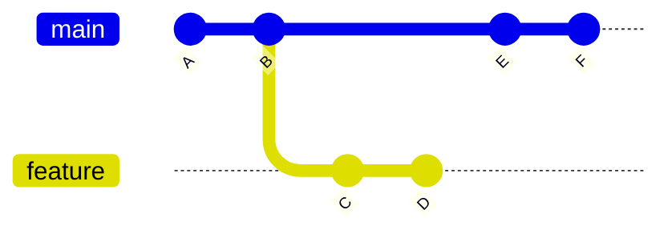

## 47.5 Rebase

#### Concept

Rebase replays your commits on top of a different base commit. Because a commit's hash covers its parent, replaying a commit onto a new parent necessarily produces a **new commit object with a different hash**. The original commits are not modified; they are abandoned, and remain reachable through the reflog.

#### Why does it exist?

To keep history linear and readable, and to let you tidy your work before others read it. A feature branch rebased onto the current `main` looks as though you wrote it against the latest code, which is exactly the history a reviewer and a future bisect want.

#### Mental model

Imagine you wrote three pages of a report based on version 4 of a shared document, and meanwhile the shared document reached version 9. Merging staples your pages on and adds a note explaining the two versions came together. Rebasing rewrites your three pages *as if* you had written them against version 9 — the same ideas, freshly typed, and if a paragraph you edited was changed in version 9, you must decide what the merged paragraph should say.

The key insight: rebasing produces **new pages**. Anyone holding the old pages now has documents that do not exist in your version.

#### How it works



After `git switch feature && git rebase main`, commits C and D are replayed onto F as new commits C' and D'. The branch becomes `A-B-E-F-C'-D'`, and the original C and D are unreachable.

```bash
$ git switch feature/idempotent-orders
$ git fetch origin
$ git rebase origin/main
Successfully rebased and updated refs/heads/feature/idempotent-orders.
```

**Interactive rebase** is where most of the value is:

```bash
$ git rebase -i origin/main
```

```text
pick 5e1d8b7 feat(orders): add idempotency key column
pick a3c9f04 wip
pick 7b2e5d1 fix typo
pick c8f1a92 feat(orders): return existing order on duplicate key
pick 2d4e6f8 fix review comments

# Commands:
# p, pick   = use commit
# r, reword = use commit, but edit the message
# e, edit   = use commit, but stop for amending
# s, squash = meld into previous commit, combine messages
# f, fixup  = like squash, but discard this commit's message
# d, drop   = remove commit
# b, break  = stop here (continue with git rebase --continue)
```

Rewritten into three meaningful commits:

```text
pick 5e1d8b7 feat(orders): add idempotency key column
fixup a3c9f04 wip
fixup 7b2e5d1 fix typo
pick c8f1a92 feat(orders): return existing order on duplicate key
fixup 2d4e6f8 fix review comments
```

Reordering lines reorders commits. Deleting a line drops that commit entirely — which is also the easiest way to lose work by accident, so read the list before saving.

`edit` stops the rebase at that commit so you can amend it, or split it (47.14). `break` stops at a point without modifying anything, useful for running tests mid-history.

**`--autosquash`.** Rather than editing the todo list by hand, mark the fixups when you create them:

```bash
$ git commit --fixup 5e1d8b7          # message becomes "fixup! feat(orders): add idempotency key column"
$ git commit --squash c8f1a92         # combines and lets you edit the message
$ git rebase -i --autosquash origin/main
```

Git reorders the todo list automatically, placing each `fixup!` immediately after its target with the `fixup` action pre-selected. Set `rebase.autosquash=true` globally and it applies to every interactive rebase. This is the fastest way to respond to review comments without polluting history with "fix review comments" commits.

**`--onto`.** The precise form. `git rebase --onto <newbase> <upstream> <branch>` replays the commits in `<upstream>..<branch>` onto `<newbase>`. It is the tool for moving a branch that was based on the wrong thing:

```bash
# feature-b was branched from feature-a, but feature-a is being abandoned.
# Move only feature-b's own commits onto main.
$ git rebase --onto main feature-a feature-b
```

Without `--onto`, a plain `git rebase main feature-b` would also try to replay all of `feature-a`'s commits, which is almost never what you want.

Another common use: dropping a range of commits from the middle of a branch.

```bash
# Drop the three commits between HEAD~5 and HEAD~2
$ git rebase --onto HEAD~5 HEAD~2 feature/x
```

**The golden rule.** *Do not rebase commits that exist in a repository others have based work on.*

The reason is now obvious from the object model: rebase creates new commits and abandons old ones. A colleague whose branch descends from your old commits will, when they pull, see both the old and the new versions of every commit. Merging then applies the same changes twice, producing spurious conflicts and, worse, resolutions that silently drop code.

The practical boundary:

| Branch | Rebase? | Why |
|---|---|---|
| Your unpushed local branch | Freely | Nobody has seen it |
| Your pushed feature branch, no other contributors | Yes, with `--force-with-lease` | Only you build on it; PR history is not sacred |
| A shared feature branch two people push to | Only with explicit coordination | Both will have divergent copies |
| `main`, `develop`, a release branch | Never | Everyone's history breaks |

**Conflicts mid-rebase.** A rebase applies commits one at a time, so you may hit a conflict at each one:

```bash
$ git rebase origin/main
Auto-merging src/orders/orders.service.ts
CONFLICT (content): Merge conflict in src/orders/orders.service.ts
error: could not apply c8f1a92... feat(orders): return existing order on duplicate key
Resolve all conflicts manually, mark them as resolved with
"git add/rm <conflicted_files>", then run "git rebase --continue".
You can instead skip this commit: run "git rebase --skip".
To abort and get back to the state before "git rebase", run "git rebase --abort".
```

Three exits, and knowing which to use matters:

- `git rebase --continue` after `git add`ing your resolution. The normal path.
- `git rebase --skip` **drops the current commit entirely**. Correct only when the commit's change is already present upstream. Used carelessly, it silently deletes your work.
- `git rebase --abort` restores the branch exactly as it was. Always safe. When a rebase is going badly, abort, do not push through.

Remember the inverted `ours`/`theirs` here. And `git status` during a rebase tells you where you are:

```bash
$ git status
interactive rebase in progress; onto 9f3c1a2
Last commands done (3 commands done):
   pick 5e1d8b7 feat(orders): add idempotency key column
   pick c8f1a92 feat(orders): return existing order on duplicate key
Next command to do (1 remaining command):
   pick 2d4e6f8 fix review comments
```

#### Practical example

A pull request receives eight review comments over two days. The engineer fixes each with `git commit --fixup <target>`, pushing after each so reviewers see incremental changes. When approved, one `git rebase -i --autosquash origin/main` collapses the eight fixups into the three original commits, and `git push --force-with-lease` publishes a clean, reviewable, bisectable history. The reviewers saw the increments; `main` gets the finished product.

#### Failure scenario

At 09:40 an engineer rebased a shared `feature/checkout-v2` branch that two colleagues were also pushing to, then force-pushed. Both colleagues had local commits based on the old versions. When they pulled, Git merged the old and new histories: every commit appeared twice, 40 conflicts appeared, and one colleague resolved them by taking "theirs" everywhere, which discarded a day of the other colleague's work.

Recovery took two hours: `git reflog` on each machine to find each person's pre-pull tip, cherry-picking the genuinely missing commits onto a fresh branch from the rebased base, and verifying with `git log --oneline --graph` plus a careful diff against the pre-incident state.

The team's rule since: shared branches are never rebased. If a shared branch must be updated from `main`, it is *merged*. Only single-owner branches are rebased, and `--force-with-lease` is mandatory so an unexpected colleague push aborts the push instead of destroying it.

#### Edge cases & failure modes

- **Rebasing a shared branch.** The scenario above.
- **`--skip` used to escape a conflict.** Silently drops the commit.
- **Long rebase with many conflicts.** Twelve commits each conflicting is twelve resolutions; `rerere` helps, and so does squashing first, then rebasing.
- **Rebase changes committer date but keeps author date.** History looks like commits made on days people were away.
- **Signatures are lost.** Rebasing produces new commits that are unsigned unless you use `-S` or set `commit.gpgsign`.
- **`--force` instead of `--force-with-lease`** destroys a colleague's push with no warning.
- **CI results become stale.** After a rebase, the SHAs reviewers approved no longer exist; approvals may auto-dismiss.
- **Rebasing merge commits.** By default they are flattened; `--rebase-merges` preserves the structure, and is fiddly.
- **Very long rebase on a big repository** can take minutes and leave you mid-operation if interrupted; `git rebase --abort` recovers.

#### How a Senior Backend Engineer thinks about this

They separate two questions: *what history do reviewers need?* (incremental, showing responses to feedback) and *what history does `main` need?* (atomic, bisectable, each commit passing tests). Interactive rebase with `--autosquash` is how they get both from the same branch.

They apply the golden rule mechanically rather than by judgement, because the cost of getting it wrong falls on colleagues rather than on themselves. A shared branch gets merges; a personal branch gets rebases.

They also treat `--abort` as the default response to a rebase going wrong. There is no prize for pushing through a twelve-conflict rebase at 18:00.

Explained to a product manager: "Rebasing rewrites our local history so it reads cleanly. We only do it on work nobody else has built on, because rewriting shared history creates duplicate versions of the same change and people lose work."

#### Common mistakes

- Rebasing `main` or a shared branch.
- `git push --force` rather than `--force-with-lease`.
- Using `--skip` to make a conflict go away.
- Squashing a whole feature into one commit before review, so reviewers cannot follow the reasoning.
- Rebasing when the branch has a merge commit in it and being surprised the merge disappeared.

#### Interview questions

1. *What does rebase do at the object level?* Expected: replays commits as new objects with new hashes onto a new base; originals become unreachable but remain in the reflog.
2. *State the golden rule and explain why it exists.* Expected: never rebase history others have based work on; duplicated commits, spurious conflicts, silent loss.
3. *What is `--onto` for?* Expected: replaying a precise range onto a new base, e.g. moving a branch off an abandoned parent branch or dropping a middle range.
4. *How do you respond to review comments without polluting history?* Expected: `--fixup` commits during review, then `rebase -i --autosquash` before merge.
5. *You are mid-rebase with a conflict and unsure. What are your options?* Expected: continue after resolving, skip (drops the commit — dangerous), abort (always safe); prefer abort when unsure.
6. *Why did a colleague's work disappear after your rebase and force-push?* Expected: they had commits on the old objects; force-push replaced the ref; recovery through their reflog.

#### Practical exercise

Create a branch with six messy commits including two "wip" and one "fix typo". Use `git commit --fixup` for two further changes, then run `git rebase -i --autosquash main` to produce three clean, atomic commits. Verify each of the three passes tests independently. Then deliberately create a conflict during a rebase and practise all three exits: continue, skip (observe what is lost), and abort. Acceptance criteria: a three-commit linear branch, a written note describing exactly what `--skip` discarded, and a demonstration that `--abort` returned you to the exact pre-rebase state (compare `git rev-parse HEAD` before and after).

## 47.6 Cherry-pick

#### Concept

`git cherry-pick` takes the change introduced by one commit and applies it as a *new commit* on your current branch. It computes the diff between that commit and its parent, applies it, and commits the result with a new hash.

#### Why does it exist?

Because sometimes you need one specific change somewhere else, without the rest of the branch it came from. The canonical case is a hotfix: a bug is fixed on `main`, and the same fix must go onto `release/2.4` which is running in production and must not receive the twenty other commits `main` has accumulated.

#### Mental model

Imagine copying one paragraph from one document into another. The words are the same; the paragraph is not the same object — it has a different position, a different surrounding context, and it exists twice.

#### How it works

```bash
$ git switch release/2.4
$ git cherry-pick 7b2e5d1
[release/2.4 e4a9c02] fix(payments): reject refunds above the original charge
 Date: Sun Sep 8 11:04:12 2025 +0100
 2 files changed, 18 insertions(+), 3 deletions(-)
```

Note the new hash `e4a9c02`. The change is the same; the commit is not.

**`-x`.** Appends a line to the message recording where the change came from:

```bash
$ git cherry-pick -x 7b2e5d1
```

```text
fix(payments): reject refunds above the original charge

(cherry picked from commit 7b2e5d1a9c8f4e3b2a1d0c9e8f7a6b5c4d3e2f1a)
```

Always use `-x` when picking between long-lived branches. It is the only durable record of the relationship, and it lets you answer "is this fix on the release branch?" with a grep instead of a diff review. Many teams alias `cherry-pick` to always include it.

**Ranges.**

```bash
$ git cherry-pick 5e1d8b7^..c8f1a92     # inclusive range: 5e1d8b7 through c8f1a92
$ git cherry-pick 5e1d8b7..c8f1a92      # exclusive of 5e1d8b7
$ git cherry-pick -n 7b2e5d1            # apply to the index without committing
$ git cherry-pick -m 1 3a9f04c          # pick a merge commit, taking parent 1's line as the base
```

The `^..` form catches people: `A..B` in Git range syntax excludes `A` itself, so `A^..B` is how you include it. During a range pick, `--continue`, `--skip` and `--abort` work as they do in rebase.

**When it creates duplicate commits.** This is the part that matters at senior level. If you cherry-pick a commit from `main` onto `release/2.4`, and later merge `release/2.4` back into `main`, the same *change* now exists as two different *commits* with different hashes.

Usually this is fine: Git's `ort` strategy notices that the content is already present ("patch already applied") and the merge is clean. But it breaks down in three situations:

1. **The picked commit was modified during the pick** (conflicts resolved differently, or the surrounding code differed). Now the two commits are not equivalent, and merging produces a real conflict or applies a partial duplicate.
2. **The original was later amended or rebased** on the source branch, so the two diverge.
3. **The change is not idempotent in effect** — a migration that adds a column, an append to a changelog, an increment. Applying it twice is not the same as applying it once, even when Git merges the text cleanly.

`git cherry` tells you what has and has not been ported:

```bash
$ git cherry -v release/2.4 main
+ 7b2e5d1 feat(orders): add partial refund support
- a3c9f04 fix(payments): reject refunds above the original charge
```

`-` means an equivalent change is already in `release/2.4` (matched by patch id, so hash differences do not matter); `+` means it is not.

**The alternative that avoids the whole problem.** Fix the bug on the *oldest* branch that needs it — the release branch — and then merge that branch forward into `main`. Now there is one commit, one hash, and no duplication. This is the discipline used by projects with many maintained versions (Linux, PostgreSQL), and it is strictly better than cherry-picking backwards when your branching model allows it. Cherry-picking is the pragmatic tool when it does not.

#### Practical example

A production incident at 22:10: refunds above the original charge amount are accepted. The fix is on `main` as `7b2e5d1`, alongside 22 other commits including a schema change that is not ready for release.

```bash
$ git switch release/2.4
$ git pull
$ git cherry-pick -x 7b2e5d1
$ npm run test:unit && npm run test:int
$ git push
$ git tag -a v2.4.7 -m "Hotfix: reject over-refunds"
$ git push origin v2.4.7
```

The pipeline (Part 46) builds and deploys `v2.4.7`. Total time from decision to production: 14 minutes. Later, `release/2.4` is merged back into `main`; the `ort` strategy recognises the change is already there and the merge is clean.

#### Failure scenario

An engineer cherry-picked a three-commit fix onto a release branch. The second commit conflicted, and they resolved it differently from the original because the release branch lacked a refactor that `main` had. Three weeks later `release/2.4` was merged into `main`. The merge appeared clean. In fact the resolution on the release branch had dropped a null check that existed in the original, and the merge preferred the release branch's version of that hunk.

Production then threw `TypeError: Cannot read properties of null` on a code path exercised once every few thousand requests. Finding it required `git log --oneline --graph` around the merge, `git show -m` on the merge commit, and a comparison of the cherry-picked commit against its original — about 90 minutes.

The lesson: **a cherry-pick that required conflict resolution is not the same change any more.** Record that fact (the `-x` line plus a note in the message), and diff the picked commit against the original before merging branches back together.

#### Edge cases & failure modes

- **Conflict during the pick** produces a different change under the same message.
- **Picking a merge commit** requires `-m` to choose which parent's line is the baseline; getting it wrong applies a huge unintended diff.
- **Picking a range that includes merges** fails unless handled explicitly.
- **Dependent commits.** Picking commit 3 without 1 and 2 compiles but is semantically wrong.
- **Migrations.** Cherry-picking a migration onto a branch with a different migration history produces out-of-order timestamps and a broken sequence.
- **Duplicate history noise.** Frequent cherry-picking makes `git log` show every fix twice, which confuses release notes and `git bisect`.
- **Forgetting `-x`** so nobody can trace where a commit came from.

#### How a Senior Backend Engineer thinks about this

They treat cherry-pick as a controlled exception, not a workflow. Routine cherry-picking between long-lived branches is a signal that the branching strategy is wrong (47.12) — usually too many maintained lines, or a `develop` branch that should not exist.

Before picking, they ask: *is this commit self-contained? Does it depend on anything not present on the target? Will the pick conflict, and if it does, is the resolved change still the same change?* If the answers are uncomfortable, they write the fix directly against the release branch and merge forward instead.

Explained to a product manager: "We can copy a single fix onto the released version without shipping everything else we have been building. It is a copy, though, not the same change, so we verify it separately on that branch."

#### Common mistakes

- Omitting `-x`, losing all traceability.
- Cherry-picking a commit whose dependencies are absent.
- Resolving a conflict during a pick and assuming the result is identical to the original.
- Using cherry-pick as the normal way to move work between long-lived branches.
- Cherry-picking migrations without checking migration ordering.

#### Interview questions

1. *What does cherry-pick do and how does the result differ from the original?* Expected: applies the commit's diff as a new commit with a new hash; same content, different object and parent.
2. *Why use `-x`?* Expected: records the source commit in the message; the only durable trace of the relationship across branches.
3. *When does cherry-picking create problems on a later merge?* Expected: when the pick was modified by conflict resolution, when the original was amended, or when the change is not idempotent in effect.
4. *How do you check whether a fix has already been ported to a release branch?* Expected: `git cherry -v release main`, which matches by patch id rather than hash.
5. *What is the alternative to cherry-picking backwards?* Expected: fix on the oldest supported branch and merge forward, so one commit exists.

#### Practical exercise

Set up `main` and `release/1.0` diverged by several commits. Cherry-pick a fix from `main` onto the release branch with `-x`, tag a patch release, then merge `release/1.0` back into `main` and confirm the merge is clean. Then repeat with a fix that conflicts during the pick, resolve it differently, and observe what the later merge does. Acceptance criteria: `git cherry -v release/1.0 main` correctly reports which commits are ported, a written explanation of what changed between the original and the picked commit in the conflicting case, and a note on how you would have detected it before the merge.

