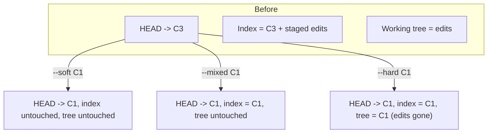
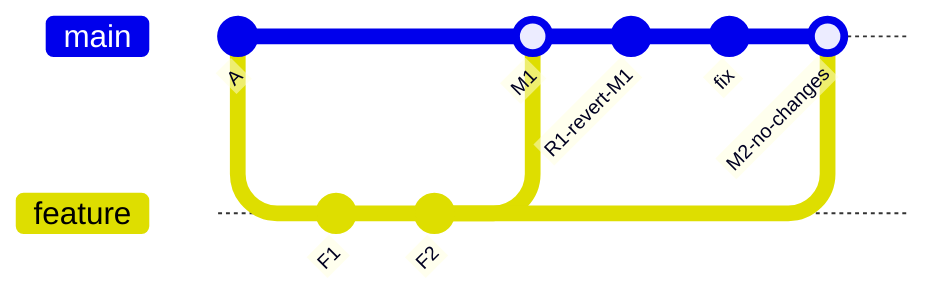

## 47.7 Reset

#### Concept

`git reset` moves the current branch ref to a specified commit, and — depending on the mode — optionally updates the index and the working tree to match.

Three modes, three levels of destruction:

| Mode | Moves branch ref | Resets index | Resets working tree | Destroys uncommitted work |
|---|---|---|---|---|
| `--soft` | Yes | No | No | No |
| `--mixed` (default) | Yes | Yes | No | No |
| `--hard` | Yes | Yes | Yes | **Yes** |

#### Why does it exist?

Because you will frequently want to undo something locally: uncommit but keep the changes staged, unstage a file, or discard everything and start over. Each of those is a different combination of "which of the three areas do I want to move?"

#### Mental model

Imagine three shelves stacked vertically: the top is your desk (working tree), the middle is the outbox (index), the bottom is the filing cabinet (HEAD commit). `reset` always moves the cabinet's pointer. `--soft` stops there. `--mixed` also empties the outbox to match. `--hard` also clears your desk — and your desk is the only one of the three that Git was never keeping copies of.

#### How it works



**`--soft`: uncommit, keep everything staged.**

```bash
$ git reset --soft HEAD~3
$ git status --short
M  src/orders/orders.service.ts
A  src/migrations/1725870000-add-idempotency-index.ts
```

The three commits are gone from the branch; all their changes are staged, ready to be recommitted as one. This is the simplest way to squash the last N commits without an interactive rebase.

**`--mixed`: uncommit and unstage.**

```bash
$ git reset HEAD~1
Unstaged changes after reset:
M	src/orders/orders.service.ts

$ git reset -- src/config/database.ts    # unstage one file, keep its changes
```

The default. Changes remain in your working tree but are no longer staged, so you can restage them selectively with `git add -p`.

**`--hard`: uncommit, unstage, and overwrite the working tree.**

```bash
$ git reset --hard HEAD~1
HEAD is now at 9f3c1a2 chore: bump dependencies
```

Nothing warns you. Uncommitted changes are gone and are **not** in the reflog, because they were never objects. Committed changes are recoverable.

**Reset vs restore.** `reset` operates on the branch ref and (optionally) the index and tree wholesale. `restore` operates on specific files. Use `git restore --staged <file>` to unstage rather than `git reset -- <file>`; it says what it does.

**Recovery through the reflog.** The reflog records every position `HEAD` and each branch has held, with a timestamp and the command that moved it:

```bash
$ git reflog
9f3c1a2 HEAD@{0}: reset: moving to HEAD~3
c8f1a92 HEAD@{1}: commit: feat(orders): return existing order on duplicate key
a3c9f04 HEAD@{2}: commit: test(orders): cover duplicate key path
5e1d8b7 HEAD@{3}: commit: feat(orders): add idempotency key column
9f3c1a2 HEAD@{4}: checkout: moving from main to feature/idempotent-orders
```

```bash
$ git reset --hard c8f1a92        # back to where you were
# or, non-destructively:
$ git branch rescue c8f1a92
```

Per-branch reflogs also exist (`git reflog show feature/idempotent-orders`), which is useful when `HEAD`'s log is noisy. Reflog entries expire after 90 days by default (30 days for entries whose commits are unreachable), and `git gc --prune=now` clears them immediately — which is why you must never run it while recovering.

#### Practical example

An engineer has made five commits on a local branch. Three are "wip". Before pushing, they collapse the lot:

```bash
$ git reset --soft origin/main
$ git status --short
M  src/orders/orders.service.ts
M  src/orders/orders.controller.ts
A  src/migrations/1725870000-add-idempotency-index.ts
$ git commit -m "feat(orders): make order creation idempotent

Adds a unique index on orders(idempotency_key) and returns the existing
order on a duplicate key rather than creating a second one.

Refs: ORD-4182"
```

One clean commit, no interactive rebase needed. `--soft` to the merge base is the fastest squash there is.

#### Failure scenario

At 17:50 an engineer with two hours of uncommitted work ran `git reset --hard origin/main` intending to update a *different* branch. The working tree was replaced instantly. There was no reflog entry that could help, because the changes had never been committed or stashed and therefore had never become objects.

Partial recovery came from two accidents: the IDE's local history had most of one file, and a `node_modules`-adjacent build output contained a compiled version of another. About 40 minutes of work was genuinely lost, plus 90 minutes of recovery.

Two habits prevent this entirely. First, commit early and often locally — a "wip" commit costs nothing and is fully recoverable, and interactive rebase cleans it up later. Second, `git stash` before any destructive operation; a stash is a real commit object and appears in `git fsck --lost-found` even after `stash drop`.

#### Edge cases & failure modes

- **`--hard` destroys uncommitted work permanently.** The single most common way engineers lose work.
- **`reset` on a shared branch, then force-push.** Rewrites public history for everyone (47.15).
- **Untracked files survive `--hard`** but are destroyed by `git clean -fd`, which people often run next.
- **`reset --hard <remote>` on the wrong branch**, as above.
- **Reflog expiry.** 90 days, or immediately after `gc --prune=now`.
- **`reset` after a merge conflict** abandons the merge state; use `git merge --abort` instead, which is purpose-built.
- **Submodule contents are not reset** by default, leaving a confusing mixed state.
- **Confusing `reset` with `revert`.** `reset` rewrites history and is for local work; `revert` adds a commit and is for shared history (47.8).

#### How a Senior Backend Engineer thinks about this

They ask one question before any reset: *is anything here uncommitted?* If yes, stash or commit first, always. Everything committed is recoverable through the reflog; nothing uncommitted is.

They use `--soft` routinely (squashing), `--mixed` occasionally (restaging), and `--hard` rarely and deliberately, having checked `git status` first.

They also know that on a shared branch the answer is never `reset`. It is `revert`.

#### Common mistakes

- `reset --hard` with uncommitted changes present.
- Using `reset` to undo a pushed commit on a shared branch.
- Not knowing the reflog exists, and re-cloning after a mistake — which destroys the reflog and any hope of recovery.
- Running `git gc --prune=now` while trying to recover.
- Using `reset -- <file>` when `restore --staged <file>` is clearer.

#### Interview questions

1. *Explain `--soft`, `--mixed` and `--hard` in terms of HEAD, index and working tree.* Expected: the table above, precisely.
2. *You committed three times and want one commit. Two ways?* Expected: `reset --soft` to the base then commit, or `rebase -i` with squash/fixup.
3. *What does the reflog recover, and what can it never recover?* Expected: recovers anything that was ever a commit; cannot recover changes that were never committed or stashed.
4. *When would you never use reset?* Expected: on a branch others have pulled; use revert.
5. *Someone ran `reset --hard` and lost three commits. Walk me through recovery.* Expected: `git reflog`, identify the pre-reset SHA, `git branch rescue <sha>` or `reset --hard <sha>`; do not gc, do not re-clone.

#### Practical exercise

In a scratch repository, make three commits and one uncommitted edit. Run `git reset --soft HEAD~3`, inspect `git status`, then recover with the reflog. Repeat with `--mixed`, then with `--hard`, and document precisely what survived each time — paying attention to the uncommitted edit. Then simulate the disaster: make uncommitted changes, `reset --hard`, and attempt recovery. Acceptance criteria: a table of what each mode did to HEAD, index, working tree and untracked files, and a written statement of exactly which state is unrecoverable and why.

## 47.8 Revert

#### Concept

`git revert` creates a **new commit** that applies the inverse of an existing commit. History is not rewritten; it is extended with an explicit "undo this" entry.

#### Why does it exist?

Because you cannot rewrite history that other people have. `reset` plus force-push works on your own branch and destroys everyone else's. Revert is the safe undo: it is a normal commit, it merges normally, it pulls normally, and it leaves an auditable record that says a change was deliberately backed out and by whom.

#### Mental model

Imagine a ledger. You cannot erase an entry, because others have copies and audits depend on them. Instead you write a correcting entry: "reverses entry 4182". The original stays, the correction is visible, and the balance is right.

#### How it works

```bash
$ git revert 7b2e5d1
[main 3d8f0a1] Revert "feat(orders): return existing order on duplicate key"
 2 files changed, 3 insertions(+), 18 deletions(-)
```

The generated message is `Revert "<original subject>"` plus `This reverts commit <sha>.` Add *why* to the body — "reverted because it caused a 12% error rate spike, see INC-2291" — because a revert with no reason invites someone to reapply the change next week.

```bash
$ git revert --no-commit 7b2e5d1 a3c9f04   # stage several reverts, commit once
$ git revert 5e1d8b7..c8f1a92               # revert a range (newest applied first)
$ git revert --no-edit 7b2e5d1              # accept the generated message
```

**Reverting a merge.** A merge commit has two parents, so "the inverse of this commit" is ambiguous: relative to which parent? `-m` selects the *mainline*, the parent whose line of history you want to keep.

```bash
$ git revert -m 1 3a9f04c
```

For a merge of a feature branch into `main`, parent 1 is `main` and parent 2 is the feature branch. `-m 1` therefore means "keep the mainline, undo everything the feature branch brought in", which is almost always what you want. Confirm before running:

```bash
$ git log --oneline -1 --parents 3a9f04c
3a9f04c 9f3c1a2 c8f1a92 Merge pull request #412 from acme/feature/refunds
```

The first hash after the merge's own is parent 1 (`9f3c1a2`, the `main` tip), the second is parent 2 (`c8f1a92`, the feature tip). Getting `-m` wrong reverts all of `main` instead of the feature, which produces a spectacular and immediately obvious diff.

**The revert-of-a-revert trap.** This is the sharpest edge in everyday Git, and it catches senior engineers.

You merge `feature/refunds` into `main`. It causes an incident. You revert the merge with `-m 1`. `main` no longer has the feature. Good.

The team then fixes the feature and merges the branch again — and **nothing appears**. The build succeeds, the merge is clean, and the feature is still missing.



Why: merging is based on reachability, not on file content. After `M1`, every commit on `feature` is already an ancestor of `main`. The revert `R1` changed the files but did not change reachability. When you merge `feature` again, Git computes the merge base — which is the tip of `feature`, already merged — sees nothing new to bring in, and produces an empty or near-empty merge. The revert's deletion stands.

Three correct ways out:

1. **Revert the revert, then continue.** `git revert R1` restores the feature's content, and further work continues on top. Cleanest when the original feature was fine and only needed a small fix.

   ```bash
   $ git revert 3d8f0a1          # 3d8f0a1 is the revert commit
   $ git switch -c fix/refunds-null-check
   ```

2. **Rebase the feature branch onto the post-revert `main`**, so its commits become new objects that are not yet ancestors, then merge. This gives clean history but rewrites the branch, so it must be a branch you own.

3. **Start a fresh branch** from the current `main` and reapply the work (cherry-pick the original commits, which creates new hashes). Slower, but unambiguous.

The rule to remember: **after reverting a merge, you cannot simply re-merge the same branch.** Write it in the revert commit's message so the next person does not lose an afternoon.

#### Practical example

At 15:40 a merge introduces a memory leak. The on-call reverts:

```bash
$ git log --oneline -1 --parents 3a9f04c
3a9f04c 9f3c1a2 c8f1a92 Merge pull request #412 from acme/feature/refunds

$ git revert -m 1 3a9f04c
$ git commit --amend
```

with the message:

```text
Revert "Merge pull request #412 from acme/feature/refunds"

This reverts commit 3a9f04c, reversing changes made to 9f3c1a2.

Reverted because the refund reconciliation job leaked ~40 MB per run,
OOM-killing pods after roughly 90 minutes. See INC-2291.

NOTE: do not simply re-merge feature/refunds. Because the merge is
already an ancestor of main, a second merge brings in nothing. Either
revert this revert first, or rebase the branch onto main.
```

Deploy takes 6 minutes through the pipeline (Part 46). The feature returns two days later by reverting this revert, then merging the fix.

#### Failure scenario

A team reverted a merge on a Friday. The following Wednesday, after fixing the bug on the feature branch, they merged it again. The PR showed a small diff (just the fix). CI passed. It deployed.

The feature was still missing in production. QA raised it as a new bug; two engineers spent a day investigating "why is the code not running", checking feature flags, deployment digests and configuration, before someone ran `git log --oneline -- src/orders/refunds.service.ts` and saw the revert.

Total cost: about 14 engineer-hours, entirely avoidable with one sentence in the revert message and one line in the team's runbook.

#### Edge cases & failure modes

- **Revert-of-a-revert trap.** As above.
- **Wrong `-m` value.** Reverts the mainline instead of the feature; enormous diff, usually caught immediately.
- **Reverting a commit whose changes were built upon.** Conflicts, or a clean revert that breaks later code.
- **Reverting a migration commit does not undo the migration.** The code reverts; the schema does not (Part 23).
- **Range direction.** `git revert A..B` applies reverts from newest to oldest; getting the range backwards produces conflicts.
- **Revert with no explanation**, so the change is reapplied next sprint by someone who assumes it was an accident.
- **Reverting a squash-merged PR.** One revert undoes the whole PR, which is convenient, but you cannot revert just one commit inside it because they no longer exist (47.13).

#### How a Senior Backend Engineer thinks about this

Their decision rule is simple and mechanical: *has this been pushed to a branch others use?* If yes, revert. If no, reset or rebase. There is no judgement call.

They treat the revert commit message as an incident artifact: what broke, what the evidence was, the incident ID, and explicit instructions about re-merging. During an incident, the revert is the fastest safe action — faster than a fix, and reversible.

They also check what the revert does *not* undo: database migrations, published events, cache state, external side effects. Reverting code is one step of recovery, not all of it (Part 46, section 46.9).

Explained to a product manager: "We add a change that undoes the previous one, rather than pretending it never happened. Everyone's copy stays consistent, and we keep the record of what we tried."

#### Common mistakes

- Using `reset` plus force-push on a shared branch instead of `revert`.
- Forgetting `-m 1` when reverting a merge, or guessing the parent number.
- Re-merging a branch whose merge was reverted, and shipping nothing.
- Reverting a commit and assuming the database change went with it.
- Empty revert messages.

#### Interview questions

1. *When do you revert and when do you reset?* Expected: revert for shared/pushed history (adds a commit); reset for local, unpublished work (rewrites).
2. *How do you revert a merge commit, and what does `-m 1` mean?* Expected: `-m` selects the mainline parent; parent 1 is normally the branch you merged into.
3. *You reverted a merge, fixed the branch, re-merged, and the feature is missing. Explain and fix.* Expected: the branch's commits are already ancestors so the merge brings nothing; revert the revert, or rebase the branch, or reapply on a fresh branch.
4. *What does reverting a commit that added a migration actually undo?* Expected: only the code; the schema change persists and needs its own forward migration.
5. *Why does a revert commit message matter more than most?* Expected: it is read during incidents; it must record why and warn about re-merging.

#### Practical exercise

Build the trap end to end. Create a feature branch with two commits, merge it into `main` with `--no-ff`, then revert the merge with `-m 1`. Add a fix commit on the feature branch and merge again; confirm the feature is still absent and explain why using `git log --graph --oneline` and `git merge-base`. Then recover using each of the three approaches (revert the revert, rebase the branch, fresh branch with cherry-picks) and compare the resulting histories. Acceptance criteria: a graph for each approach, a statement of which you would use in an incident and why, and a revert message template your team could adopt.
