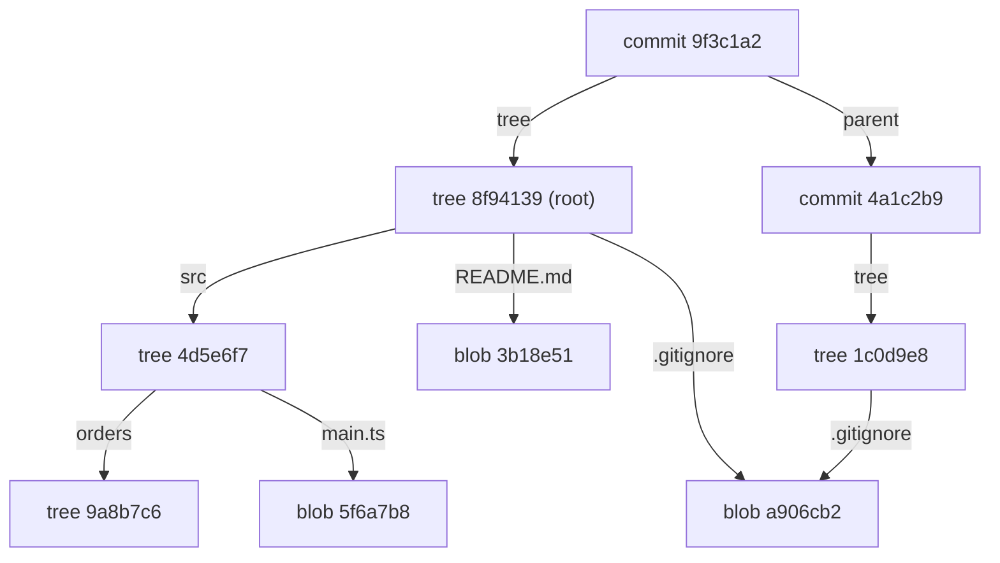
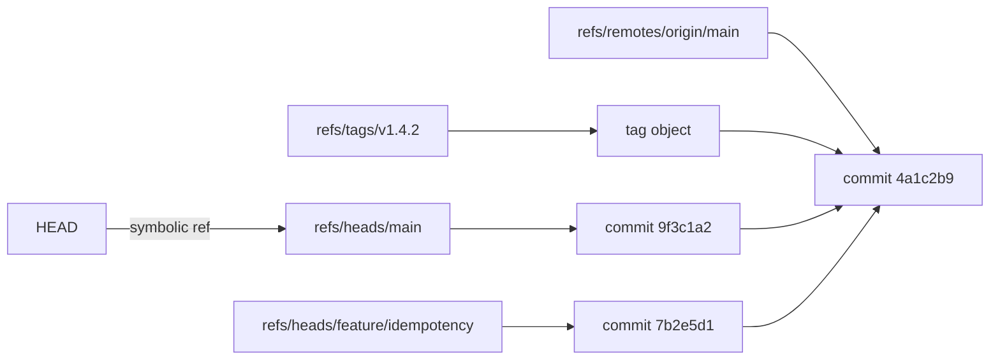

# Part 48 — Git from Intermediate to Senior

Most engineers learn Git as a list of spells. `git commit`, `git push`, `git pull`, and when something goes wrong, `git reset --hard` or a fresh clone. That works until the day it does not: a rebase leaves you in a state no tutorial mentioned, a force-push erases a colleague's afternoon, a revert of a merge quietly drops a feature that everyone believed was released, or a secret ends up in history and someone asks whether deleting the file is enough. (It is not.)

The difference between an intermediate and a senior user of Git is not knowing more commands. It is knowing the **object model**. Once you understand that Git stores snapshots as content-addressed objects, that branches are 41-byte files containing a hash, and that almost nothing is ever really deleted until garbage collection runs, every command stops being a spell and becomes an obvious consequence. `reset` moves a pointer. `rebase` replays commits as new objects. `cherry-pick` applies a diff and creates a new commit. `reflog` is a log of where your pointers used to be, which is why "lost" work is almost never lost.

This part starts with the object model, because everything after it is downstream. Then commits, branches, merge, rebase, cherry-pick, reset and revert — each with the mechanics, realistic command output, and the specific traps. Then the senior's toolbox: `bisect`, `blame -w -C`, the pickaxe, worktrees, hooks. Then branching strategies, the pull request workflow as it is actually practised at senior level, a set of step-by-step recovery procedures for the situations that cause real panic, and a catalogue of failure modes.

## 48.1 Git internals first

#### Concept

Git is a content-addressed key/value store with a version control interface on top. It stores four kinds of objects. Every object is identified by the SHA-1 (or SHA-256, in newer repositories) hash of its content, so the identifier *is* a fingerprint of what is inside.

- **Blob** — the raw contents of a file. No name, no permissions, no history. Just bytes.
- **Tree** — a directory listing: a set of entries, each with a mode, a type, a hash and a name. Trees point at blobs and at other trees.
- **Commit** — a snapshot pointer: one tree (the whole project state), zero or more parents, an author, a committer, timestamps, and a message.
- **Tag** (annotated) — a named pointer to an object with its own message and optional signature.

Around the objects sit **refs**: human-readable names that hold an object hash. A branch is a ref. A tag is a ref. `HEAD` is a special ref pointing at the branch you are on.

#### Why does it exist?

Because the alternative — storing diffs and reconstructing state by replaying them — is what older systems did, and it makes several important operations slow or impossible. Reconstructing a five-year-old file means applying 4,000 patches in order. Verifying that history has not been tampered with is hard. Deduplicating identical files across branches is hard.

Content addressing solves all three at once. Every object's name is its hash, so identical content is stored once no matter how many commits or branches reference it. A commit's hash covers its tree and its parents, so it transitively covers the entire history: change one byte in a five-year-old file and every commit hash after it changes. That is why Git history is tamper-evident, and it is also why rewriting history produces *new commits* rather than modifying old ones — a fact that explains rebase, amend, `filter-repo` and force-push in one sentence.

#### Mental model

Imagine a library where every book is filed by a fingerprint of its own text rather than by a shelf number. Two identical books get one copy. A "commit" is a card that says: here is the fingerprint of the complete catalogue of the library at this moment, here is the card that came before, and here is why I changed things. A "branch" is a sticky note on one card saying `main`. Moving the sticky note to a different card does not change any book or any card; it changes what `main` means.

That is the whole model. `reset` moves a sticky note. `checkout`/`switch` changes which note you are standing next to. `commit` writes a new card and drags your note forward. Nothing else is happening.

#### How it works

**Commits are snapshots, not diffs.** Every commit references a complete tree describing the entire project at that moment. When you see a diff in `git log -p`, Git computed it on the fly by comparing two trees. Storage does not suffer, because unchanged subtrees and unchanged files are the same objects reused — a 100 MB repository with one changed file adds one blob, a handful of trees and one commit.

Let us look at a real object graph. Start from `HEAD`:

```bash
$ git cat-file -p HEAD
tree 8f94139338f9404f26296befa88755fc2598c289
parent 4a1c2b9e3d5f6a7b8c9d0e1f2a3b4c5d6e7f8a9b
author Priya Nair <priya@example.com> 1757328041 +0100
committer Priya Nair <priya@example.com> 1757328041 +0100

feat(orders): reject duplicate idempotency keys with a unique index
```

Six lines. That is a commit: a tree, a parent, who wrote it, who committed it, and why. Note there is no diff and no file list. Now the tree:

```bash
$ git cat-file -p 8f94139
100644 blob a906cb2a4a904a152e80877d4088654daad0c859    .gitignore
100644 blob 3b18e512dba79e4c8300dd08aeb37f8e728b8dad    README.md
100644 blob c1f2a8d34e5b6079a1b2c3d4e5f6a7b8c9d0e1f2    package.json
040000 tree 4d5e6f708192a3b4c5d6e7f8091a2b3c4d5e6f70    src
```

Four entries. `100644` is a regular file, `100755` an executable, `040000` a directory (which points at another tree), `120000` a symlink, `160000` a submodule commit. Descend one level:

```bash
$ git cat-file -p 4d5e6f7
040000 tree 9a8b7c6d5e4f3a2b1c0d9e8f7a6b5c4d3e2f1a0b    orders
100644 blob 5f6a7b8c9d0e1f2a3b4c5d6e7f8091a2b3c4d5e6    main.ts
```

And finally a blob, which is just content:

```bash
$ git cat-file -p a906cb2
node_modules
dist
.env
coverage
```

You can inspect any object's type and size:

```bash
$ git cat-file -t 8f94139
tree
$ git cat-file -s 8f94139
239
```

**Content addressing, demonstrated.** Git hashes the content plus a small header of the form `<type> <length>\0`:

```bash
$ echo -n 'hello' | git hash-object --stdin
b6fc4c620b67d95f953a5c1c1230aaab5db5a1b0

$ echo 'hello' | git hash-object --stdin
ce013625030ba8dba906f756967f9e9ca394464a
```

Two different hashes, because the second string has a trailing newline. That one-byte difference is why line-ending configuration matters so much (48.10 and 48.15): a file converted from LF to CRLF is, to Git, a completely different blob.



Notice that both commits point at the same `.gitignore` blob. That is deduplication falling out of content addressing for free.

**Refs, branches and HEAD.** A branch is a file containing a hash:

```bash
$ cat .git/refs/heads/main
9f3c1a2b8e7d6c5f4a3b2c1d0e9f8a7b6c5d4e3f

$ cat .git/HEAD
ref: refs/heads/main
```

That is it. `main` is 41 bytes. Creating a branch writes 41 bytes; that is why `git switch -c feature/x` is instantaneous even in a 4 GB repository. `HEAD` normally holds a *symbolic* reference to a branch. When it holds a raw hash instead, you are in **detached HEAD** (48.9): commits you make have no branch pointing at them, so when you leave, nothing references them.



**The three areas.** Git has three places your files exist, and almost every confusing message is about the boundary between two of them:

```text
Working tree          Index (staging area)        HEAD commit
   your files    -->     .git/index          -->   the last snapshot
                 git add                 git commit
```

The **index** is a binary file (`.git/index`) listing every tracked path with its mode, its blob hash and cached stat information. It is not "a list of changes"; it is a complete proposed next tree. `git add` writes a blob and updates the index entry. `git commit` turns the index into trees and writes a commit. `git status` is a three-way comparison: working tree vs index (unstaged changes), index vs HEAD (staged changes).

```bash
$ git ls-files --stage src/orders/orders.service.ts
100644 5f6a7b8c9d0e1f2a3b4c5d6e7f8091a2b3c4d5e6 0	src/orders/orders.service.ts
```

The `0` is the merge stage. During a conflict, the same path appears at stages 1 (common ancestor), 2 (ours) and 3 (theirs), which is exactly how `git checkout --ours` and `--theirs` know what to pick (48.4).

**The `.git` layout.**

```text
.git/
├── HEAD                     ref: refs/heads/main
├── config                   repository-local config
├── index                    the staging area (binary)
├── objects/
│   ├── 8f/94139338f940...   a loose object, zlib-compressed
│   ├── info/
│   └── pack/
│       ├── pack-3a9f.idx    index into the packfile
│       └── pack-3a9f.pack   many objects, delta-compressed
├── refs/
│   ├── heads/main           41 bytes: a commit hash
│   ├── tags/v1.4.2
│   └── remotes/origin/main
├── packed-refs              refs collapsed into one file after gc
├── logs/
│   ├── HEAD                 the reflog
│   └── refs/heads/main
└── hooks/                   sample hooks, plus yours
```

**Packfiles.** Loose objects are one file each, zlib-compressed but stored whole. That is fine for a hundred objects and terrible for a million. `git gc` (run automatically) packs them: many objects into one `.pack` file, with similar objects stored as deltas against each other, plus an `.idx` for random access. This is the one place Git does store diffs — as a storage optimisation, *below* the object model, invisible to it. A repository with 300,000 loose objects can pack down by 10x or more.

```bash
$ git count-objects -vH
count: 412
size: 2.31 MiB
in-pack: 284917
packs: 2
size-pack: 189.44 MiB
```

**Reachability and garbage collection.** An object is *reachable* if you can get to it by starting from any ref (branches, tags, remote-tracking refs, the reflog, the index, stashes) and following pointers. Unreachable objects are candidates for deletion by `git gc`, but not immediately: the default `gc.pruneExpire` is two weeks, and the reflog keeps its own entries for 90 days (30 for unreachable ones).

This is the single most reassuring fact in Git. When you "lose" commits with a bad reset or rebase, the commits still exist as objects; only the ref that pointed at them moved. The reflog records where every ref used to point, so recovery is usually one command (48.9, 48.14). The window is generous, but it is not infinite, and an explicit `git gc --prune=now` closes it immediately.

```bash
$ git fsck --lost-found
Checking object directories: 100% (256/256), done.
dangling commit 7b2e5d1a9c8f4e3b2a1d0c9e8f7a6b5c4d3e2f1a
dangling blob   c4d3e2f1a0b9c8d7e6f5a4b3c2d1e0f9a8b7c6d5
```

#### Practical example

A team is debugging why a 2.4 GB clone takes eleven minutes on a new laptop. `git count-objects -vH` shows `size-pack: 2.28 GiB` for 41,000 commits — far too much for a TypeScript codebase. `git rev-list --objects --all` piped through `git cat-file --batch-check` and sorted by size reveals the cause: 340 versions of a 6 MB `test-fixtures.sqlite` file committed over three years, totalling roughly 1.9 GB.

The objects are reachable from history, so no amount of `gc` removes them. Deleting the file today does nothing: every historical commit still references its blob. The only fixes are to rewrite history (48.14) or to move the file to Git LFS going forward and accept the existing weight. This is why "giant binaries bloat the repository forever" is in the failure-modes list: the object model that makes Git fast is the same one that makes this permanent.

#### Production scenario

A monorepo with 180,000 commits, 24,000 files and a 1.1 GB packfile. `git switch` between branches takes about 400 ms, because switching writes only the files that differ between two trees; Git compares tree hashes and skips whole subtrees that are identical. `git log --oneline -20` returns in 30 ms because it walks 20 commit objects and never touches a blob. `git blame` on a 3,000-line file takes 4 seconds because it must walk history for every line. Understanding which operations touch the object graph and which touch the working tree is what lets you predict performance instead of being surprised by it.

#### Failure scenario

At 11:20 an engineer runs `git reset --hard origin/main` to "clean up", not realising they had three days of local commits on a branch they had never pushed. The working tree is replaced and the branch pointer moves back to `origin/main`. They report that three days of work is gone.

It is not. The commits are unreachable but not collected. `git reflog` shows every position `HEAD` held:

```bash
$ git reflog
9f3c1a2 HEAD@{0}: reset: moving to origin/main
7b2e5d1 HEAD@{1}: commit: feat(orders): add partial refund handling
a3c9f04 HEAD@{2}: commit: test(orders): cover refund edge cases
5e1d8b7 HEAD@{3}: commit: refactor(orders): extract RefundCalculator
```

`git branch recovered 7b2e5d1` recreates a branch at the tip and all three commits are back. Total recovery: 40 seconds. The only work genuinely lost was uncommitted changes in the working tree, which the reflog does not cover, because they were never objects in the first place. That is the practical rule: **commit early, and Git can almost always save you; leave work uncommitted, and it cannot.**

#### Edge cases & failure modes

- **Uncommitted changes are not in the object store.** `reset --hard`, `checkout -- .` and `clean -fd` destroy them permanently. `git stash` at least creates objects.
- **`gc --prune=now` closes the recovery window immediately.** Never run it while trying to recover something.
- **Detached HEAD commits are unreachable the moment you switch away**, though the reflog remembers them for 30 days.
- **SHA-1 collisions** are theoretically constructible (SHAttered). Git added collision detection, and new repositories can use SHA-256. Not a practical risk, but worth knowing when someone asks.
- **The index can hold content that exists in no commit.** `git add` then delete the file: the blob exists, the working tree does not have it.
- **Large loose object counts slow everything.** Thousands of small commits without `gc` degrade `status` and `log`.
- **`.git` on a case-insensitive filesystem** creates rename problems (48.15).

#### How a Senior Backend Engineer thinks about this

They reason about Git in terms of objects and pointers, never in terms of "what does this command do to my files". Asked what `git reset --hard HEAD~2` does, they answer: "moves the current branch ref back two commits, makes the index match, makes the working tree match; the two commits still exist and the reflog knows where they were." That framing makes the risk obvious (the working tree is overwritten) and the recovery obvious (reflog).

They also treat "commit often, locally" as a safety practice rather than a style preference, because an object in the store is recoverable and a working-tree change is not. History gets tidied later with interactive rebase (48.5).

Explained to a product manager: "Git keeps a complete photo of the project at every save point, and names each photo by its contents. Branches are just labels stuck on photos. Almost nothing is ever really thrown away, which is why we can usually recover from mistakes."

#### Common mistakes

- Believing commits store diffs, which makes rebase and cherry-pick seem mysterious.
- Believing a branch "contains" commits. It points at one commit; the rest is reachability.
- Thinking `git rm` on a large file shrinks the repository.
- Running `gc --prune=now` or a fresh clone during a recovery attempt, destroying the evidence.
- Confusing the index with "changes" rather than a complete proposed snapshot.

#### Interview questions

1. *What are Git's object types and how do they relate?* Expected: blob (content), tree (directory listing pointing at blobs and trees), commit (one tree plus parents plus metadata), annotated tag. Follow-up: what exactly is in a commit object? (No diff, no filenames.)
2. *Are commits snapshots or diffs?* Expected: snapshots at the model level; packfiles use deltas as a storage optimisation underneath. Follow-up: why does that make branching cheap?
3. *What is a branch, physically?* Expected: a file under `.git/refs/heads` containing a commit hash; creating one is 41 bytes.
4. *What is detached HEAD and why is it risky?* Expected: HEAD holds a hash instead of a symbolic ref; new commits have no branch pointing at them and become unreachable when you leave.
5. *How would you recover from `reset --hard` that discarded three commits?* Expected: `git reflog`, find the old HEAD, `git branch recovered <sha>` or `git reset --hard <sha>`; note that uncommitted changes are not recoverable.
6. *Why does deleting a large file not shrink the clone?* Expected: historical commits still reference the blob, so it stays reachable; only history rewriting or LFS changes that.

#### Practical exercise

In a scratch repository, create one file and commit it. Then use only plumbing commands to walk the graph: `git cat-file -p HEAD` to get the tree, `git cat-file -p <tree>` to list entries, `git cat-file -p <blob>` to print content. Add a second file, commit again, and confirm that the first file's blob hash is unchanged and reused by the second commit's tree. Then run `git hash-object` on the file's content by hand and confirm it matches the blob hash in the tree. Acceptance criteria: a diagram of your repository's object graph with real hashes, and a written explanation of exactly which objects the second commit created and which it reused.

## 48.2 Commits

#### Concept

A commit is one atomic unit of change: a complete snapshot, a link to its parents, and a message explaining why the change exists. Everything senior engineers care about here comes from treating the commit as a communication artifact and a recovery unit, not merely as a save button.

#### Why does it exist?

Because you will read this history under pressure. When `git bisect` narrows an incident to one commit at 03:00, the value of that commit being small, self-contained and well-described is enormous. When you `git revert` a bad change, an atomic commit reverts cleanly; a commit that mixed a refactor, a dependency bump and a bug fix does not.

#### Mental model

Imagine a lab notebook. Each entry should be one experiment, with a note saying what you were testing and why. An entry that says "stuff" and contains three unrelated experiments is worthless six months later, when the only person who can interpret it has left.

#### How it works

**Atomic commits.** One logical change per commit. The test: *can this commit be reverted on its own without breaking anything, and does the test suite pass at this commit?* If reverting it would also remove an unrelated fix, it is not atomic.

In practice this means splitting work as you go, using `git add -p` to stage hunks selectively:

```bash
$ git add -p src/orders/orders.service.ts
diff --git a/src/orders/orders.service.ts b/src/orders/orders.service.ts
@@ -42,7 +42,7 @@ export class OrdersService {
-    const total = items.reduce((s, i) => s + i.price * i.qty, 0);
+    const total = items.reduce((s, i) => s + i.priceMinor * i.qty, 0);
(1/3) Stage this hunk [y,n,q,a,d,s,e,?]? y
```

`s` splits a hunk into smaller ones, `e` opens an editor to stage individual lines. This is the everyday tool for keeping a messy working session from becoming a messy history.

**Message quality.** The structure that has become standard:

```text
<type>(<scope>): <subject in the imperative, under 72 chars>

Explain WHY this change exists. What was broken or missing, what
approach you chose, and what you deliberately did not do. Wrap at
72 columns so `git log` reads well in a terminal.

Refs: ORD-4182
```

Three rules that matter more than the format:

1. **Imperative mood.** "Add rate limiting", not "Added" or "Adds". The convention exists because Git's own generated messages are imperative ("Merge branch...", "Revert..."), so the whole log reads consistently as instructions: *apply this commit and it will* add rate limiting.
2. **Why over what.** The diff already says what changed. It cannot say that you chose a database-level unique index instead of an application check because the application check had a race window under concurrent requests. That sentence saves the next engineer an hour.
3. **Subject under about 72 characters**, blank line, then the body. Tools truncate the subject; a run-on first line becomes unreadable in `--oneline`.

A bad message and a good one on the same change:

```text
fix bug
```

```text
fix(orders): prevent duplicate orders from concurrent retries

Clients retry POST /orders on timeout. The previous check did a SELECT
for an existing idempotency key and then an INSERT, which has a race
window: two concurrent requests both see no row and both insert.

Adds a unique index on orders(idempotency_key) and catches 23505 to
return the original order. The application-level check stays as a fast
path so the common case does not rely on an exception.

Refs: ORD-4182
```

**Conventional Commits, and what they actually buy you.** The format is `type(scope): subject`, with types like `feat`, `fix`, `refactor`, `perf`, `test`, `docs`, `build`, `ci`, `chore`, and `BREAKING CHANGE:` in the footer or a `!` after the type.

The concrete payoffs, in order of value:

- **Automated semantic versioning and changelogs.** `semantic-release` or `changesets` reads the commits since the last tag: any `feat` bumps the minor version, any `fix` bumps the patch, any `BREAKING CHANGE` bumps the major, and the changelog writes itself. This is the main reason to adopt it, and it only works if the discipline is enforced (a `commitlint` hook).
- **Filterable history.** `git log --oneline --grep '^fix(payments)'` gives you every payment bug fix in seconds.
- **Reviewer routing and risk signalling.** A `feat!` in `payments` can require an extra approver automatically.

What it does *not* buy you: better messages. A `feat(orders): stuff` is still worthless. The type is metadata; the body is the communication.

**`--amend`.** Rewrites the most recent commit, producing a *new commit object* with a new hash. The old one becomes unreachable (and recoverable through the reflog).

```bash
$ git commit --amend                      # edit the message and add staged changes
$ git commit --amend --no-edit            # add staged changes, keep the message
$ git commit --amend --author="Priya Nair <priya@example.com>"
```

The rule follows from the object model: because it creates a new hash, amending a commit you have already pushed requires a force-push, which rewrites shared history. Safe on your own unmerged branch; a problem on a shared one (48.5, 48.15).

**Signing.** A signature proves that a commit came from the key holder. Without it, `user.name` and `user.email` are just strings anyone can set, so a commit can claim any author.

```bash
$ git config --global user.signingkey ~/.ssh/id_ed25519.pub
$ git config --global gpg.format ssh
$ git config --global commit.gpgsign true

$ git log --show-signature -1
commit 9f3c1a2b8e7d6c5f4a3b2c1d0e9f8a7b6c5d4e3f
Good "git" signature for priya@example.com with ED25519 key SHA256:8kP2...
Author: Priya Nair <priya@example.com>
Date:   Sun Sep 8 10:20:41 2025 +0100

    feat(orders): reject duplicate idempotency keys
```

SSH signing (`gpg.format ssh`) is far easier to adopt than GPG because engineers already have SSH keys. Combined with a branch protection rule requiring signed commits, and with build provenance in CI (Part 47, section 47.3), it closes the "who actually wrote this code" question that supply chain attacks exploit.

#### Practical example

A pull request that changes a query, adds an index migration and bumps a dependency arrives as one commit titled "fixes". A reviewer cannot separate the risky part from the trivial part, and a revert would undo all three. Split into three commits — `perf(orders): add index on orders(customer_id, created_at)`, `fix(orders): use the new index in the listing query`, `build(deps): bump pg to 8.13.1` — the review takes half the time and, six weeks later when the dependency bump turns out to be the problem, `git revert` touches exactly one commit.

#### Production scenario

A payments team requires signed commits and Conventional Commits on `main`, enforced by branch protection plus a `commitlint` hook. Releases are fully automated: merging a `fix` produces `1.14.4` with a changelog entry, a Git tag, and a deploy through the pipeline in Part 47. Over a year they cut release preparation from about 90 minutes of manual changelog writing per release to zero, and increased release frequency from weekly to daily, because the cost of a release stopped being a reason to batch.

#### Failure scenario

An engineer amended a commit that had already been pushed and reviewed, then force-pushed. Two reviewers had approved the previous version; GitHub dismissed the approvals, which was fine. What was not fine: a colleague had already branched off that commit for dependent work. Their branch now had the *old* commit as an ancestor. When both merged, the change appeared twice — once from the amended commit and once from the original — and the second application conflicted in a way that produced a silently broken merge resolution.

The rule that would have prevented it: **rewrite only history that nobody else has based work on.** For a shared branch, use a new commit (or a revert) instead of an amend.

#### Edge cases & failure modes

- **Amending after push** requires force-push and breaks anyone who branched off.
- **Empty commits** (`--allow-empty`) are legitimate for triggering CI, but confusing in a log.
- **Author vs committer.** A rebase or cherry-pick preserves the author and sets you as committer. `git log` shows the author by default, which is why rebased history can look like someone committed on a date they were on holiday.
- **Commits with wrong identity.** A work laptop configured with a personal email; the commits do not link to the corporate account and may fail a CLA check.
- **Enormous commits.** A 4,000-line commit is unreviewable and unbisectable; it will be approved unread.
- **Secrets in an amended commit.** Amending removes it from the tip but the old object remains until gc, and it is already on the remote if you pushed (48.14).

#### How a Senior Backend Engineer thinks about this

They write commit messages for the person debugging an incident in eighteen months, who might be themselves. They ask: *if `git bisect` lands on this commit, will the message alone tell me what it was trying to do?*

They keep local history messy while working and clean it before review with interactive rebase, because those are different activities: local commits are save points, published commits are documentation.

They also insist on the atomicity test — "would reverting this commit alone be safe and meaningful?" — because it is the property that makes every recovery tool in this part work.

#### Common mistakes

- "fix", "wip", "update", "changes" as messages.
- Mixing formatting, refactoring and behaviour change in one commit, which hides the real diff in noise.
- Describing what the diff already shows instead of why.
- Amending or force-pushing shared branches.
- Committing generated files, lockfile churn and `.env` alongside real changes.

#### Interview questions

1. *What makes a commit atomic and why does it matter?* Expected: one logical change, tests pass at that commit, revertible in isolation; matters for bisect, revert, review and cherry-pick.
2. *Why imperative mood in commit messages?* Expected: consistency with Git's own generated messages; the log reads as instructions describing what applying the commit does.
3. *What does Conventional Commits actually give you?* Expected: automated semver and changelogs, filterable history, risk routing; not better content.
4. *What does `--amend` do at the object level, and when is it unsafe?* Expected: creates a new commit object, old becomes unreachable; unsafe once pushed and others have based work on it.
5. *Why sign commits?* Expected: author fields are unauthenticated strings; signing plus branch protection proves provenance and blocks impersonation.

#### Practical exercise

Take a branch where you have three unrelated changes mixed in your working tree. Using `git add -p`, produce three atomic commits, each with a Conventional Commits subject and a body explaining why. Verify each commit independently: check it out and run the test suite. Then enable SSH commit signing and confirm `git log --show-signature` reports a good signature. Acceptance criteria: three commits that each pass tests in isolation, each revertible without touching the others, all signed, and a message body that a stranger could act on.

