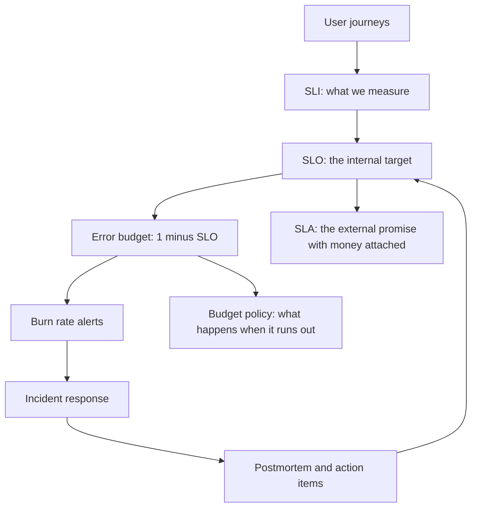
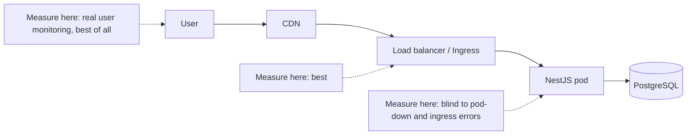

# Part 48 — Site Reliability Engineering

## 48.1 The SRE mindset

### 48.1.1 Reliability is a feature with a price

#### Concept

Site Reliability Engineering is what you get when you treat operations as a software problem and reliability as a **product feature that has a cost**. Not a virtue. Not a moral position. A feature, with a price tag, that competes for engineering time against every other feature.

That single reframing changes every conversation. "Should we be more reliable?" has only one answer and it is useless. "Is the checkout API's 99.9 percent worth spending two engineer-months to make it 99.99 percent, given that the last six months of outages cost us 41 lakh rupees in lost orders?" is a question a business can actually answer.

Everything else in this part — SLIs, SLOs, error budgets, incident process, postmortems — is machinery for having that conversation with data.

#### Why does it exist?

Because without it, two failure modes dominate, and both are expensive.

**Under-investment.** Nobody owns reliability. The team ships features. Outages are treated as bad luck. The same incident happens four times because nothing forced a fix. Customers leave quietly.

**Over-investment.** A team traumatized by one outage builds five nines of infrastructure for an internal admin tool used by nine people. Every deploy needs three approvals. Shipping slows to a crawl. The company loses to a competitor who shipped.

The right amount of reliability is **the least that keeps users happy and the business safe**, because every increment beyond that is engineering time not spent on something users would rather have. Going from 99.9 percent to 99.99 percent typically means multi-region, active-active data, automated failover, and a large increase in on-call load. If your users cannot tell the difference, you paid for nothing.

#### Mental model

Imagine a courier company. Nobody promises every parcel arrives. They promise a *rate* — "98 percent of next-day parcels arrive next day" — and they design the network, the depots and the staffing to hit that rate at a cost that still leaves a margin. Promising 100 percent would mean a van per parcel. The promise is a business decision; the operations are how you keep it.

Your API is the courier. The SLO is the promise. The error budget is the parcels you are allowed to be late with.

### 48.1.2 Toil

#### Concept

**Toil** is operational work that is manual, repetitive, automatable, tactical, devoid of enduring value, and grows linearly with the size of the service. Restarting a stuck pod every Tuesday. Manually clearing a queue. Running the same five `kubectl` commands to onboard a customer. Copying numbers into a spreadsheet for the weekly report.

Toil is not "work I dislike". Debugging a novel outage is unpleasant and is not toil, because it produces understanding. Toil produces nothing that lasts.

#### Why it matters

Toil scales with your system and your engineers do not. A team spending 15 percent of its time on toil at 20 services will spend 45 percent at 60 services, and then it stops shipping anything. Google's classic guidance — cap toil at 50 percent of an SRE's time — exists because teams reliably drift past it without noticing.

The discipline: **measure it, then delete it.** In every retro, name the top toil item. Every quarter, one engineer's time goes to eliminating it. Concretely, in a NestJS shop, this looks like:

| Toil | Elimination |
|---|---|
| Manually replaying failed jobs from Redis with a CLI | An admin endpoint with filtering, caps and spacing (Part 35) |
| Restarting a pod when the event loop wedges | A liveness probe that detects it, plus fixing the blocking code |
| Running a migration by hand at 2 a.m. | Expand-contract migrations in CI (Part 23) |
| Answering "is the site up?" in Slack | A status page and a public dashboard |
| Granting a customer a refund by SQL | A support tool with an audit log |
| Copying incident timelines into a doc | An incident bot that timestamps every command |

#### How a Senior Backend Engineer thinks about this

They notice the second time they do something manually, and they say so out loud. They also resist the opposite failure: automating a three-times-a-year task with a framework nobody maintains. The test is `frequency x time x risk` versus the cost of automation plus its own maintenance.

### 48.1.3 Error budgets as the arbitration mechanism

#### Concept

If the SLO is 99.9 percent successful requests over 30 days, then 0.1 percent of requests are **allowed** to fail. That allowance is the **error budget**. It is not a target to hit; it is a resource to spend.

This is the piece that makes SRE work as an organizational practice rather than a set of dashboards. Before error budgets, the argument goes:

> Product: "Ship the new checkout on Friday."
> Engineering: "It feels risky."
> Product: "Everything feels risky to you."

That argument is settled by seniority and volume. After error budgets:

> Engineering: "We have 8 percent of the month's error budget left with 11 days to go. Our policy says feature freeze below 10 percent. The checkout change ships after we land the two reliability fixes, or we agree to burn the rest of the budget and accept a possible SLA breach."

Same disagreement. Now it is arithmetic, agreed in advance, and both sides can read the same graph. The budget converts an argument about feelings into an argument about a number, and — this is the part people miss — **it gives product the right to spend it**. A team sitting at 97 percent of its budget unspent every month is over-invested in reliability and should be shipping faster.



## 48.2 SLI: what to actually measure

### 48.2.1 The four kinds that matter

#### Concept

A **Service Level Indicator** is a number, between 0 and 1, that says what fraction of something was good. Always a ratio. Always "good events divided by valid events". If you cannot express it that way, it is a diagnostic metric, not an SLI.

CPU is not an SLI. Memory is not an SLI. Pod count is not an SLI. Users do not experience CPU.

Four families cover almost everything:

**Availability** — the fraction of requests that succeeded.

```text
good  = requests that returned a non-5xx response
valid = all requests that reached us, excluding client errors we consider the client's fault
SLI   = good / valid
```

**Latency** — the fraction of requests served faster than a threshold. Note the shape: it is a *ratio*, not a percentile. "99 percent of checkout requests complete in under 800 ms" is an SLI. "p99 is 800 ms" is the same statement viewed sideways, but the ratio form composes with error budgets and the percentile form does not.

**Correctness** — the fraction of outputs that were right. Harder to measure and often the one that matters most. For checkout: the fraction of orders whose total equals the sum of their lines, or the fraction of paid orders that have a matching payment record.

**Freshness** — the fraction of data younger than some age. For a search index: the fraction of product updates visible in search within 60 seconds. For a queue (Part 35): the fraction of jobs started within 5 minutes of enqueue.

### 48.2.2 Measure from the user's side

#### Why does it exist?

This is the single most common SLI mistake, and it is worth stating bluntly: **if you measure inside your service, you will miss the outages your users actually saw.**

A NestJS pod that has crashed emits no metrics. Its request counter simply stops. Your `sum(rate(http_requests_total[5m]))` drops, and your error *ratio* — errors divided by requests — looks fine, because both numerator and denominator went to zero. Meanwhile the load balancer is returning 502 to every customer.

The same blindness hides: TLS handshake failures, ingress misconfiguration, DNS problems, connection-pool exhaustion at the proxy, requests killed by a timeout at the gateway before your handler returned, and every request that never reached a pod because there were no healthy pods.



Order of preference:

1. **Real user monitoring** in the browser or mobile app. It includes DNS, TLS, network and client rendering. It is also noisy, includes users on trains, and is hard to alert on. Use it to validate, not usually to page.
2. **The load balancer or ingress.** ALB access logs, nginx-ingress metrics, Envoy stats. This sees every request that reached your infrastructure, including the ones your pods never answered. **This is where your availability SLI should come from.**
3. **The service itself.** Rich, cheap, well-labelled by route. Excellent for diagnostics and for latency distributions. Use it, but know it is blind to your own absence.
4. **Black-box probes.** A synthetic request every 30 seconds from outside. Catches total outages fast, catches nothing partial, and gives a tiny sample. A good complement, a poor primary.

The practical answer for most teams: **compute availability from ingress metrics, compute latency from service histograms, and keep a black-box probe as a canary.** Then reconcile them monthly; a persistent gap between ingress and service error rates is itself a finding.

### 48.2.3 Real PromQL

Assume `nginx-ingress` exposes `nginx_ingress_controller_requests` with `status`, `ingress` and `path` labels, and your NestJS service exposes `http_request_duration_seconds` as a histogram with a `route` label (Part 42 — Observability).

**Availability SLI at the edge, over 30 days:**

```promql
# Fraction of checkout requests that did not return 5xx, measured at the ingress.
sum(rate(nginx_ingress_controller_requests{ingress="checkout", status!~"5.."}[30d]))
/
sum(rate(nginx_ingress_controller_requests{ingress="checkout"}[30d]))
```

Note what is excluded and what is not. 4xx stays in the denominator but counts as *good*: a `400 Bad Request` for a malformed payload is the client's problem, not an availability failure. But be careful — `429 Too Many Requests` because *you* under-provisioned is your failure, and `401` storms because your token service is down are your failure. Decide these deliberately and write them in the SLO document, because this line is where teams accidentally define away their own outages.

**Latency SLI as a ratio:**

```promql
# Fraction of checkout requests served in under 800 ms.
sum(rate(http_request_duration_seconds_bucket{route="/checkout",le="0.8"}[30d]))
/
sum(rate(http_request_duration_seconds_count{route="/checkout"}[30d]))
```

The `le="0.8"` bucket must actually exist. Histogram buckets are chosen at instrumentation time, so **define your buckets around your SLO thresholds**. If your SLO is 800 ms and your buckets are `[0.5, 1, 2.5]`, you cannot compute this SLI without interpolation error. Add 0.8.

```ts
// Buckets chosen to bracket the SLO thresholds we actually promise.
new Histogram({
  name: 'http_request_duration_seconds',
  help: 'HTTP request duration',
  labelNames: ['method', 'route', 'status'] as const,
  buckets: [0.025, 0.05, 0.1, 0.2, 0.4, 0.8, 1.5, 3, 8],  // 0.8 and 1.5 are SLO edges
});
```

**Correctness SLI**, exported by a checker job rather than by the request path:

```promql
# Fraction of paid orders in the last hour that have a matching payment record.
sum(rate(order_payment_reconciled_total{result="matched"}[30d]))
/
sum(rate(order_payment_reconciled_total[30d]))
```

**Freshness SLI** for the search index:

```promql
# Fraction of product updates indexed within 60 seconds.
sum(rate(search_index_lag_seconds_bucket{le="60"}[30d]))
/
sum(rate(search_index_lag_seconds_count[30d]))
```

**Recording rules**, because a `[30d]` range query over raw series will time out and hammer Prometheus. Pre-compute the ratio at short intervals and aggregate the recorded series:

```yaml
groups:
  - name: slo-checkout
    interval: 30s
    rules:
      - record: sli:checkout_availability:ratio_rate5m
        expr: |
          sum(rate(nginx_ingress_controller_requests{ingress="checkout", status!~"5.."}[5m]))
          /
          sum(rate(nginx_ingress_controller_requests{ingress="checkout"}[5m]))

      - record: sli:checkout_latency:ratio_rate5m
        expr: |
          sum(rate(http_request_duration_seconds_bucket{route="/checkout",le="0.8"}[5m]))
          /
          sum(rate(http_request_duration_seconds_count{route="/checkout"}[5m]))
```

#### Common mistakes

- Measuring availability with `up{job="orders-api"}`. That says a scrape succeeded, not that users were served.
- Averaging SLIs across all endpoints, so a broken checkout is hidden by a healthy `/health`.
- Putting `userId` or `orderId` in metric labels and destroying Prometheus.
- Excluding requests that timed out at the gateway because your service never saw them. Those are exactly the ones that matter.
- Counting 4xx as failures wholesale, so a bot scanning for `/wp-admin` ruins your SLI.
- Choosing a threshold by looking at current p99 and rounding up. That measures what you do, not what users need.

## 48.3 SLO: the internal target

### 48.3.1 Per journey, not per service

#### Concept

A **Service Level Objective** is a target value for an SLI over a window. "99.95 percent of checkout requests succeed, measured over a rolling 30 days."

The critical design choice: **write SLOs for user journeys, not for services.** Users do not experience `payment-service`. They experience "I could pay for my basket". A journey crosses several services, and its SLO is what the business cares about.

For an e-commerce checkout, the journey SLOs look like this:

| Journey | SLI | Target | Window | Why this number |
|---|---|---|---|---|
| Browse and search | availability | 99.9 % | 30d rolling | Users retry; brief blips are tolerable |
| Add to cart | availability | 99.95 % | 30d rolling | Losing a cart loses the session |
| **Checkout submit** | availability | **99.95 %** | 30d rolling | Direct revenue; every failure is a lost order |
| **Checkout submit** | latency < 800 ms | **99 %** | 30d rolling | Above ~1 s, abandonment rises measurably |
| Payment capture | correctness | 99.99 % | 30d rolling | Money. A wrong capture is worse than a slow one |
| Order confirmation email | freshness < 5 min | 99 % | 30d rolling | Beyond 5 min, support tickets start |
| Order history page | availability | 99.5 % | 30d rolling | Annoying, not revenue-critical |

Notice `99.5` on order history. Deliberately lower. A team that gives everything the same target is not making choices; it is copying a number. The point of an SLO is that some things are allowed to be worse so that other things can be better.

#### Choosing an achievable target

Three inputs, in this order:

1. **What do users need?** Ask support: at what point do tickets spike? Ask analytics: at what latency does conversion drop? For checkout at one retailer the answer was clear — conversion fell about 1.5 percent per extra 100 ms above 700 ms, and support volume tripled when the failure rate crossed 0.1 percent.
2. **What can you actually do?** Look at the last 90 days of measured SLI. If you have been running at 99.7 percent, an SLO of 99.99 percent is a fiction that will be permanently breached and therefore permanently ignored. Set 99.9 percent, meet it for a quarter, then tighten.
3. **What do your dependencies allow?** If your managed PostgreSQL has a 99.95 percent SLA and every checkout request touches it synchronously, your ceiling is 99.95 percent. Promising more is arithmetic you cannot win (48.6).

Start slightly looser than you think, and **tighten over time**. An SLO that is breached every month teaches everyone to ignore SLOs. An SLO that is never breached teaches nobody anything and probably means you are over-invested.

#### Dependency SLOs

Every internal dependency should have its own SLO, and yours should be built on theirs. Write them down as a table, because this is where fantasy targets get exposed:

| Dependency | Their SLO | Synchronous in checkout? | Effect on our ceiling |
|---|---|---|---|
| PostgreSQL primary (managed) | 99.95 % | Yes | Hard ceiling 99.95 % |
| Redis (cache) | 99.9 % | No — we degrade to the database | None if degradation works |
| Payment gateway | 99.9 % | Yes | Hard ceiling; we mitigate with a second provider |
| Inventory service (internal) | 99.95 % | Yes | Hard ceiling |
| Email provider | 99.5 % | No — queued | None on checkout; affects the freshness SLO |

That table is the single most useful artefact in an SLO document, because it turns "we want four nines" into "we would need to remove three synchronous dependencies first".

### 48.3.2 Writing an SLO document a product manager can read

Keep it to one page per journey. Real structure, real language:

```text
SLO: Checkout Submit
Owner: Orders team (Slack #orders, on-call rota "orders-primary")
Reviewed: 2026-09-01. Next review: 2026-12-01.

What it measures
  When a customer presses "Place order", we either create the order or tell them
  clearly why we could not.

SLI
  Availability = non-5xx responses / all responses for POST /api/orders,
  measured at the ingress. 429 counts as a failure (it means we ran out of capacity).
  Latency = fraction of those requests completing in under 800 ms.

Targets over a rolling 30 days
  Availability: 99.95 %   (allowed: ~21.6 minutes of full outage, or ~600 failed
                           orders out of 1.2 million)
  Latency:      99.0 % under 800 ms

Why these numbers
  Analytics shows conversion falls about 1.5 % per 100 ms above 700 ms.
  Support volume triples above a 0.1 % failure rate.
  Our managed database's own SLA is 99.95 %, so we cannot promise more without
  removing it from the synchronous path.

What is excluded
  Planned maintenance announced 7 days ahead (max 2 windows per quarter, max 30 min each).
  Requests rejected as malformed (400/422).
  Traffic from known scrapers, identified by user agent and rate.

What happens when the budget runs out
  See the Error Budget Policy. Short version: feature releases to checkout pause
  and reliability work takes priority until the budget recovers above 20 %.

Dashboards
  grafana.internal/d/checkout-slo
```

Every sentence in that document is designed to be read by someone who does not know what a histogram is. If a product manager cannot read your SLO document and tell you what happens when it is breached, it is not finished.

## 48.4 SLA: the external promise

#### Concept

A **Service Level Agreement** is a contract with a customer that says what you promise and what you owe them if you break it. Service credits, refunds, a right to terminate. It is a legal and commercial document, not an engineering one.

The relationship between the three, and it matters:

```text
SLI  = the measurement          "99.973 % of checkout requests succeeded this month"
SLO  = the internal target      "we aim for 99.95 %"   -> triggers engineering action
SLA  = the external promise     "we guarantee 99.9 %"  -> triggers money
```

#### The rule: the SLA is always looser than the SLO

Always. Never equal. The gap is your safety margin, and it is the difference between "we had a bad month and paused feature work" and "we had a bad month and owe forty customers a 10 percent credit".

A typical spread: SLA 99.9 percent, SLO 99.95 percent. That means by the time you breach the contract, your own alerting has been shouting for a while and your budget policy has already changed the team's behaviour. If SLO and SLA are the same number, your first warning is a lawyer's email.

| | Internal SLO | External SLA |
|---|---|---|
| Audience | Your engineers and product | Customers, procurement, legal |
| Target | 99.95 % | 99.9 % |
| Measurement | Rolling 30 days, ingress metrics | Calendar month, often a coarser definition |
| Consequence | Budget policy: freeze features, prioritize reliability | Service credits, contract remedies |
| Who changes it | The team, quarterly | Sales and legal, per contract |
| Exclusions | Few, documented | Many: maintenance, force majeure, customer misuse |

#### Practical notes from the field

- **Define measurement precisely in the contract.** "Availability" without a definition is a dispute waiting to happen. Say which endpoints, measured where, at what granularity, with what exclusions, and who provides the data. Ambiguity is always resolved in favour of the party with more lawyers.
- **Calendar month versus rolling window.** SLAs almost always use calendar months because billing does. Your SLO should use a rolling window because reliability does not reset on the first of the month. Expect them to disagree; that is normal and fine.
- **Internal SLAs are usually a bad idea.** Between two internal teams, an SLA with "consequences" produces defensive behaviour and gaming. Use SLOs between teams, and escalate through management if one is chronically missed.
- **You cannot promise more than your dependencies.** If you resell on top of a cloud provider with a 99.9 percent SLA and you offer 99.99 percent, you have written a cheque your infrastructure cannot cash. Either add redundancy that genuinely removes the dependency, or lower the promise.
- **Someone must actually compute it.** More SLAs are breached un-noticed than are breached and paid. A monthly automated report per contracted customer, generated from the same recording rules as your SLO dashboard, is thirty lines of code and prevents a class of embarrassment.

#### How a Senior Backend Engineer thinks about this

They are in the room when sales proposes an SLA number, or they make sure someone technical is. They ask: what is the measurement definition, what are the exclusions, what does it cost us if we breach, and what would we have to build to make this achievable? Then they check it against the last 90 days of measured SLI, and if the answer is "we have never once hit that", they say so before the contract is signed rather than after.

#### Interview questions

1. *Define SLI, SLO and SLA and give a checkout example of each.* Expected: measurement, internal target, external contract with consequences; SLA looser than SLO. Follow-up: why must the SLA be looser?
2. *Why measure availability at the load balancer rather than in the service?* Expected: a crashed service emits no metrics, so the error ratio looks fine while users get 502s; the edge also sees TLS, ingress and no-healthy-pod failures.
3. *Write the PromQL for "99 percent of checkout requests under 800 ms".* Expected: the `le="0.8"` bucket over the total count, plus the point that the bucket must exist and buckets should bracket SLO thresholds.
4. *Should 429 responses count against your availability SLI?* Expected: it depends on why — self-inflicted capacity shortfall counts as a failure, deliberate abuse protection does not; the decision belongs in the SLO document.
5. *How do you choose an SLO target?* Expected: user need from support and conversion data, historical achievability, and the ceiling imposed by synchronous dependencies.
6. *Your team wants a 99.99 percent SLO and the managed database offers 99.95 percent. What do you say?* Expected: it is arithmetically impossible while the database is synchronous; options are removing it from the path, adding redundancy that survives its failure, or lowering the target.

#### Practical exercise

Pick a real endpoint in a service you own and write its SLO document using the template above.

Acceptance criteria: the SLI is a ratio of good to valid events; the availability measurement comes from ingress or load-balancer metrics, not from inside the service; the latency histogram has a bucket exactly at your threshold; you have recording rules for both SLIs; you have computed the last 90 days of achieved SLI and your target is achievable but not already free; the exclusions are written down; and a non-engineer on your team can read the document and correctly answer "what happens if we miss it?"
