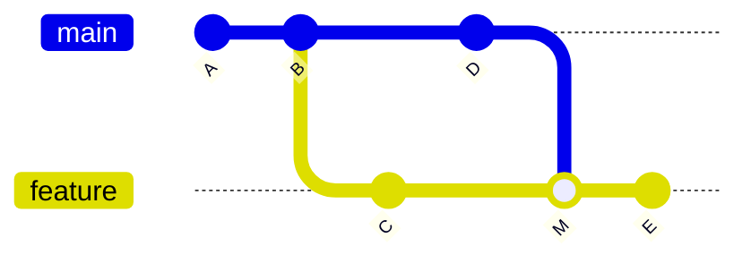
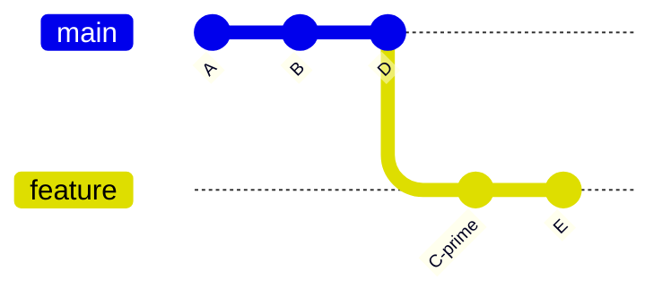
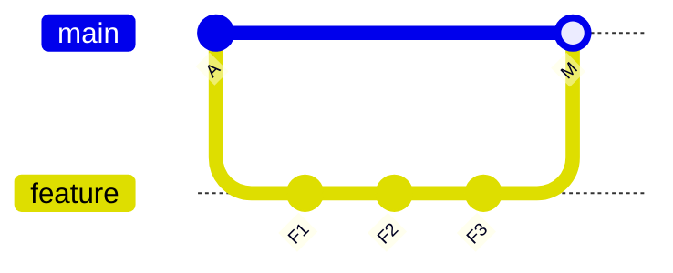
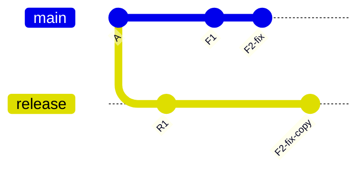
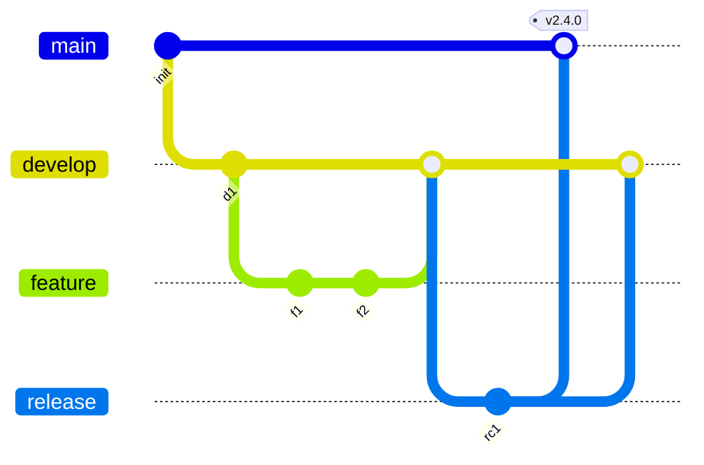
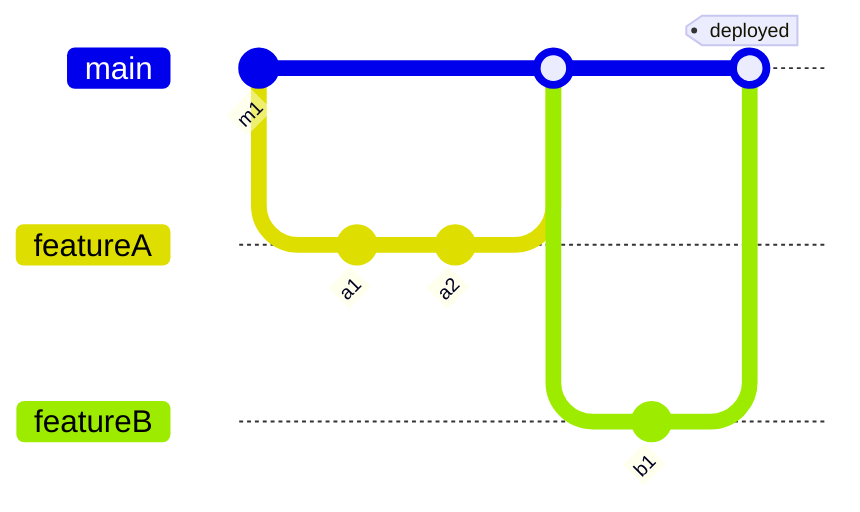
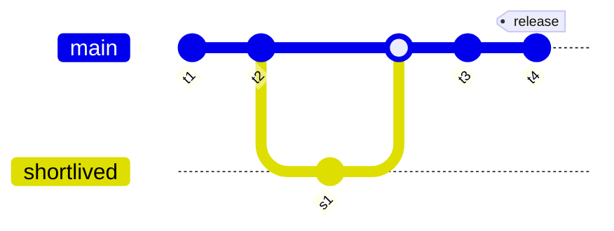

## 48.11 Merge vs rebase, reset vs revert, merge vs cherry-pick

### 48.11.1 Merge versus rebase

Both integrate `main` into your feature branch. They differ in what history records.

**Merge** preserves the actual sequence of events and adds a commit with two parents:



**Rebase** replays your commits on top of `main`, producing new commits and a straight line:



| | Merge | Rebase |
|---|---|---|
| History shape | Branched graph, records reality | Linear, records intent |
| Commit hashes | Preserved | New objects for every replayed commit |
| Safe on shared branches | Yes | No |
| Conflict resolution | Once, at the merge | Potentially once per commit (mitigate with `rerere`) |
| `git bisect` | Works; merges can complicate it (use `--first-parent`) | Cleanest possible |
| `git log` readability | Noisy on busy repositories | Very readable |
| Records "when this was integrated" | Yes, explicitly | No, that fact is erased |
| Recovery if it goes wrong | `git merge --abort` | `git rebase --abort`, or reflog |

**Decision guidance:**

- **Updating your own unmerged feature branch from `main`:** rebase. It keeps the PR diff clean and avoids "Merge branch 'main' into feature" commits that reviewers must scroll past.
- **A branch two or more people push to:** merge. Rebasing rewrites objects others hold.
- **Integrating a finished feature into `main`:** merge (usually `--no-ff`, or a squash — see 48.13). Never rebase `main` itself.
- **Tidying your own commits before review:** interactive rebase.
- **Anything already released or tagged:** never rebase.

The one-sentence rule: **rebase your work onto other people's; merge other people's work into shared branches.**

### 48.11.2 Reset versus revert

Both undo. They differ in whether history is rewritten.

```text
reset:   A - B - C - D          becomes   A - B          (C, D unreachable; force-push needed)
                     ^                        ^
                    main                     main

revert:  A - B - C - D          becomes   A - B - C - D - D' - C'
                     ^                                        ^
                    main                                     main
```

| | `reset` | `revert` |
|---|---|---|
| Effect on history | Rewrites: moves the branch pointer | Extends: adds new commits |
| Safe after pushing to a shared branch | No | Yes |
| Requires force-push | Yes | No |
| Auditability | The change vanishes from the branch | Explicit record of what was undone and why |
| Can destroy uncommitted work | Yes (`--hard`) | No |
| Recovery | Reflog | Revert the revert |
| Typical use | Cleaning up local commits, squashing | Backing out a bad change from `main` during an incident |

**Decision guidance:** ask one question — *has anyone else pulled this?* If no, `reset` is fine and often cleaner. If yes, `revert`, without exception. On `main`, `develop` or a release branch, the answer is always yes.

### 48.11.3 Merge versus cherry-pick

Both bring changes from one branch to another. They differ in whether the source history comes along.

**Merge** brings the whole branch and records the relationship, so the source commits become ancestors:



**Cherry-pick** copies one commit's change as a new commit; the source stays unrelated:



| | Merge | Cherry-pick |
|---|---|---|
| What moves | Every commit on the branch | One commit's diff (or a range) |
| Hashes | Preserved; source commits become ancestors | New commits, unrelated to the source |
| Relationship recorded | Yes, by the merge commit | Only if you use `-x` |
| Duplicate changes later | No | Possible, especially if the pick conflicted |
| Typical use | Integrating a finished feature | Hotfix onto a release branch |
| Effect on `git cherry` | Nothing to report | Reports equivalence by patch id |

**Decision guidance:**

- **You want everything from the branch:** merge.
- **You want exactly one fix on a different line of development:** cherry-pick with `-x`.
- **You find yourself cherry-picking routinely between long-lived branches:** the branching strategy is wrong (48.12). Prefer fixing on the oldest supported branch and merging forward, which keeps one commit instead of two.
- **You want a subset of a branch because the rest is not ready:** that is a signal the branch is doing too much. Split the work instead; a subset picked out of a coherent branch is rarely coherent on its own.

The one-sentence rule: **merge moves history, cherry-pick copies a change.** Everything surprising about cherry-pick follows from the word "copies".

## 48.12 Branching strategies

#### Concept

A branching strategy is a team agreement about which branches exist, what each one means, how work flows between them, and what triggers a release. Git supports any strategy; the strategy is a people decision, and it is where most teams' Git pain actually originates.

#### Why does it exist?

Because without an agreement, everyone invents their own, and the repository becomes a set of long-lived branches nobody dares merge. The strategy determines your integration frequency, and integration frequency determines merge cost, which is superlinear in divergence.

#### Mental model

Imagine a river system. Trunk-based development is one wide river: everyone paddles in the same water and any obstruction is immediately visible. Git Flow is a canal network with locks: safe, controlled, and every boat spends time waiting at gates. GitHub Flow is a river with short side channels that rejoin within a day.

The right answer depends on one thing: **how many versions of your software are alive at once?** A SaaS backend has one. A shipped on-premises product has several. Almost every argument about branching strategies is really an argument about that question with the question left unstated.

### 48.12.1 Git Flow



Five branch types: `main` (released code, tagged), `develop` (integration), `feature/*` (branched from and merged to `develop`), `release/*` (stabilisation, branched from `develop`, merged to both `main` and `develop`), `hotfix/*` (branched from `main`, merged to both).

**Fits:** teams shipping versioned software on a schedule to customers who install it — desktop applications, mobile releases tied to app store review, on-premises enterprise products, firmware. Anything where several versions are supported simultaneously and a release must be stabilised for days.

**Cadence:** weeks to months.

**Failure mode:** applied to a web backend that deploys continuously, it is pure overhead. `develop` and `main` diverge, every change is merged two or three times, hotfixes must be merged to both branches and someone always forgets one — so a bug fixed in production reappears in the next release. The double bookkeeping produces the classic symptom: "the fix is in `main` but not in `develop`", found weeks later by a customer. If you deploy `main` on every merge, `develop` has no purpose except to delay integration.

### 48.12.2 GitHub Flow



One long-lived branch: `main`, always deployable. Short-lived branches off `main`, a pull request, review, CI, merge, deploy. That is the whole model.

**Fits:** web services and SaaS backends with one live version, continuous deployment, and a team that can review quickly. This is the correct default for the stack this book targets.

**Cadence:** several times a day.

**Failure mode:** it depends entirely on branches being short-lived and `main` genuinely being deployable. A team that lets branches live two weeks has invented Git Flow's problems without Git Flow's release branch to contain them. It also has no answer for "we need to patch version 2.3 for a customer still on it" — if that requirement appears, you need release branches.

### 48.12.3 Trunk-based development



Everyone commits to `main` (the trunk), either directly or through branches that live hours, not days. Unfinished work ships behind feature flags (Part 47, section 47.8). Releases are cut as tags on `main`, or as short-lived release branches that receive only cherry-picked fixes.

**Fits:** teams with strong CI, comprehensive tests, feature flags and a culture of small changes. It is the model most strongly associated with elite DORA performance (Part 47, section 47.12), and the mechanism is simple: integration cost is near zero when the integration interval is four hours.

**Cadence:** continuous, many merges a day.

**Failure mode:** without the supporting practices it is chaos. Trunk-based development requires that `main` is never broken, which requires fast reliable tests, a merge queue or pre-merge CI on the combined result, and flags for anything incomplete. A team that adopts "commit to main" without those breaks `main` daily and blocks everyone.

### 48.12.4 Release branches, hotfixes and monorepos

**Release branches.** Even in GitHub Flow or trunk-based development, you need one the moment you must support a version that is not the tip of `main`. The pattern:

```bash
# Cut the release branch at the commit you are releasing.
$ git switch -c release/2.4 v2.4.0
$ git push -u origin release/2.4
```

Rules that keep release branches from becoming Git Flow by accident:

- A release branch receives **only fixes**, never features.
- Fix on the **oldest** supported branch, then merge forward: `release/2.3` into `release/2.4` into `main`. This produces one commit and avoids the cherry-pick duplication of 48.6. Cherry-pick backwards only when merging forward is impossible.
- Every release branch has an end-of-life date, published. Without one, you accumulate seven supported versions and a permanent merge burden.
- Protect release branches like `main`: reviews, CI, no force-push.

**Hotfix flow**, end to end:

```bash
$ git switch release/2.4 && git pull
$ git switch -c hotfix/ORD-4402-over-refund
# fix, with a regression test
$ git commit -m "fix(payments): reject refunds above the original charge"
$ git push -u origin hotfix/ORD-4402-over-refund
# PR into release/2.4, expedited review, CI green
$ git switch release/2.4 && git pull
$ git tag -a v2.4.7 -m "Hotfix: reject over-refunds"
$ git push origin v2.4.7
# then merge forward so the fix is not lost in the next release
$ git switch main && git pull
$ git merge release/2.4
$ git push
```

The merge-forward step is the one people skip at 23:00, and it is how a fixed bug returns in the next release. Automate it: a scheduled job that opens a PR merging each release branch forward, failing loudly if it conflicts.

**Monorepo considerations.** One repository holding many services changes several things:

- **Branch naming needs a scope**, because `fix/timeout` is ambiguous across 40 services: `fix/orders/ORD-4402-timeout`.
- **CI must be path-filtered.** Running all 40 services' tests on every PR is unaffordable. Use `paths:` filters or a build graph tool (Nx, Turborepo, Bazel) to test only what changed and what depends on it.
- **CODEOWNERS per directory** routes review to the owning team automatically.
- **Merge queues become essential**, because 40 engineers merging into one branch means constant "required branches to be up to date" churn without one.
- **Sparse checkout and partial clone** (48.10) keep local working copies manageable.
- **Tags need prefixes**: `orders-api/v2.4.7`, not `v2.4.7`, or two services cannot both release.
- **`git log -- services/orders`** becomes the default way to read history; teach it early.

### 48.12.5 Choosing

| | Git Flow | GitHub Flow | Trunk-based |
|---|---|---|---|
| Long-lived branches | `main`, `develop`, releases | `main` | `main` |
| Branch lifetime | Days to weeks | Hours to days | Hours |
| Live versions supported | Many | One | One (plus release tags) |
| Deploy cadence | Scheduled, weeks | On merge, daily | Continuous |
| Requires feature flags | No | Helpful | **Yes** |
| Requires fast reliable CI | Helpful | Yes | **Absolutely** |
| Merge pain | High | Low | Very low |
| Hotfix complexity | Defined but heavy | Needs a release branch bolted on | Cherry-pick or merge forward |
| Best for | Installed/versioned products | SaaS backends, most web teams | High-performing teams with flags and strong CI |

**How a senior engineer decides:** start from how many versions must be alive. One version and continuous deployment means GitHub Flow, moving toward trunk-based as CI and flags mature. Multiple supported versions means release branches, regardless of what you call the rest. `develop` is only justified when there is a genuine stabilisation phase that `main` cannot host — and for a service that deploys on every merge, there is not.

The strategy also has to match the tests. Trunk-based development with a 40-minute flaky suite is a broken `main` every afternoon. Fix the pipeline first (Part 47), then shorten the branches.

## 48.13 The pull request workflow at senior level

#### Concept

A pull request is a proposal to merge, plus the review conversation and the automated checks around it. Everything in this section is about making that proposal easy to say yes or no to.

#### Why small PRs get better reviews

This is not a style preference; it is a measurable effect. Review effectiveness collapses as diff size grows. Reviewers reliably find defects in changes up to roughly 200–400 lines; beyond that, comments shift from logic to naming and formatting, and above about 1,000 lines most reviews become an approval with a "looks good".

The mechanism is simple: a reviewer holds the change in working memory to reason about it. When it no longer fits, they stop reasoning and start skimming. A 900-line PR does not get 3x the scrutiny of a 300-line one; it gets less scrutiny in total, because the reviewer gives up.

Concretely, small PRs also: get reviewed sooner (a 60-line diff gets picked up in minutes, a 900-line one waits for someone to find an hour), conflict less, bisect better, and revert cleanly. If a change is genuinely large, split it: interface first, then implementation, then the call sites; or ship it behind a flag in three PRs.

**Stacked PRs** are how you keep them small without blocking: PR 2 targets PR 1's branch rather than `main`, and its diff shows only the increment. When PR 1 merges, PR 2 retargets to `main`. It costs some rebasing discipline and pays for itself immediately on any change over about 400 lines.

#### Description templates

The description is where the author does the reviewer's work for them. A template in `.github/pull_request_template.md`:

```markdown
## What and why
<!-- What changes, and what problem it solves. Link the ticket. -->

## Approach
<!-- Why this design. What alternatives you rejected and why. -->

## Risk
<!-- What could break. Blast radius. Is it behind a flag? -->

## Database
<!-- Migrations? Backward compatible? Expand/contract stage? -->

## Rollback
<!-- How do we undo this if it goes wrong in production? -->

## How to verify
<!-- Exact steps or commands a reviewer can run. -->

## Screenshots / output
```

The **Rollback** and **Database** sections are the senior additions, and they change behaviour before review even starts. An author who cannot fill in "how do we undo this" usually discovers the design problem themselves and restructures the change. That is the template earning its keep.

#### Draft PRs

Open a draft the moment you push the first commit. It costs nothing and buys three things: CI runs on every push so you find breakage early; colleagues can see direction before you have spent three days on it; and the PR body becomes the place you accumulate context while it is fresh, instead of reconstructing it at the end.

Mark it ready for review only when CI is green and you would be comfortable with it merging as-is. "Ready for review" with failing checks wastes a reviewer's time and trains people to ignore your notifications.

#### Review etiquette

For the reviewer:

- **Review within four hours during working hours.** A PR waiting a day is a branch diverging, an author context-switching, and a queue forming behind it. Fast review is the highest-leverage thing a senior can do for team throughput.
- **Distinguish blocking from non-blocking.** Prefix: `blocking:` for correctness, security or data-loss issues; `nit:` for preferences; `question:` when you genuinely do not know; `praise:` when something is good, which costs nothing and makes the rest land better.
- **Comment on the code, not the person.** "This query has no index on `customer_id` and will sequential-scan at 40M rows" rather than "you forgot the index again".
- **Give the reason, not just the instruction.** A review comment is teaching material.
- **Approve with comments** when the remaining points are nits. Blocking a PR over naming is a tax on the whole team.
- **If you cannot review it properly, say so.** "This is 1,400 lines and I cannot review it meaningfully; can we split it?" is a legitimate and useful review.

For the author:

- Respond to every comment, even with "done" or "disagree, because X".
- Push fixes as `--fixup` commits during review (48.5) so reviewers see increments, then autosquash before merge.
- Do not force-push mid-review unless you must; it destroys the reviewer's "changes since my last review" view. If you must, say so in a comment.
- Never merge over an unresolved blocking comment.

#### Squash vs merge vs rebase-merge

Three merge strategies, three different histories, and a real consequence for `git bisect`.

| Strategy | What lands on `main` | History | Effect on bisect | Effect on revert |
|---|---|---|---|---|
| **Merge commit** (`--no-ff`) | Every branch commit, plus a merge commit | Branched graph; `--first-parent` shows features | Full granularity; merges need `--first-parent` to be reliable | `revert -m 1` undoes the whole feature in one command |
| **Squash merge** | One commit containing the whole PR | Perfectly linear | Resolution is the whole PR; a 900-line PR is one bisect step | One revert undoes the whole PR; cannot revert part of it |
| **Rebase merge** | Every branch commit, replayed, no merge commit | Perfectly linear | Best possible: every commit, no merge complications | Revert individual commits; no single "undo the feature" commit |

Policy in practice:

- **Squash merge** is the pragmatic default for most teams, because it makes branch hygiene irrelevant: authors can commit "wip" freely and `main` stays clean. The price is bisect granularity. It is a good trade *if PRs are small*. It is a bad trade if PRs are 900 lines, because you have converted a fine-grained history into a coarse one exactly where you needed detail. **Squash merge and large PRs are the combination to avoid.**
- **Rebase merge** gives the best history and the best bisect, but requires that authors curate their commits (interactive rebase before merge) and that every commit builds. Worth it for teams that will do that; frustrating for teams that will not.
- **Merge commits** preserve the most information and make feature-level revert trivial. On a busy repository the graph gets dense, though `--first-parent` largely solves that.

Whichever you pick, pick **one** and configure the repository to allow only that. A repository where all three are enabled produces a history nobody can reason about.

#### Protecting main

The rules worth enforcing on `main`:

- Require a pull request; no direct pushes.
- Require at least one approval, two for high-risk paths (payments, auth, migrations) via CODEOWNERS.
- Require status checks: point at the single `ci-complete` job (Part 47, section 47.11) rather than listing every job.
- Dismiss stale approvals when new commits are pushed.
- Require conversation resolution before merge.
- Require signed commits (48.2).
- Block force-push and deletion.
- **Include administrators.** A protection that admins can bypass is a protection that gets bypassed at 17:55 on a Friday.
- Use a merge queue on busy repositories, so CI runs on the actual combined result rather than on each PR in isolation. This is the only defence against semantic conflicts (48.4).

#### CODEOWNERS

A `.github/CODEOWNERS` file maps paths to owning teams and auto-requests their review:

```text
# Default owners for everything.
*                             @acme/backend

# High-risk areas need their owners, and two approvals via branch protection.
/src/payments/                @acme/payments @acme/security
/src/auth/                    @acme/security
/src/migrations/              @acme/dba @acme/backend

# Infrastructure and pipeline changes.
/.github/workflows/           @acme/platform
/charts/                      @acme/platform
/terraform/                   @acme/platform

# Generated code: nobody needs to review it, but flag changes.
/src/generated/               @acme/backend
```

Two cautions. First, CODEOWNERS creates bottlenecks: if one small team owns a path every other team touches daily, that team becomes a queue. Review ownership boundaries when review latency rises. Second, a CODEOWNERS entry on `/.github/workflows/` is genuinely important — a PR that edits the pipeline can disable the checks that gate it, which is a privilege escalation path (Part 47, section 47.4).

