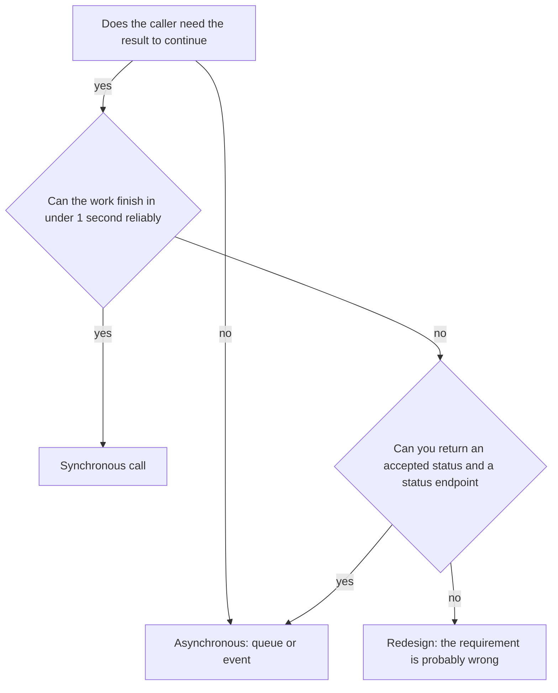
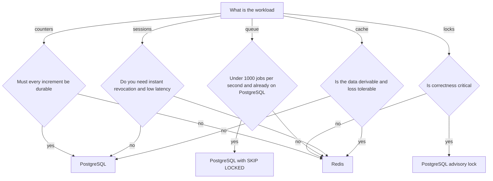
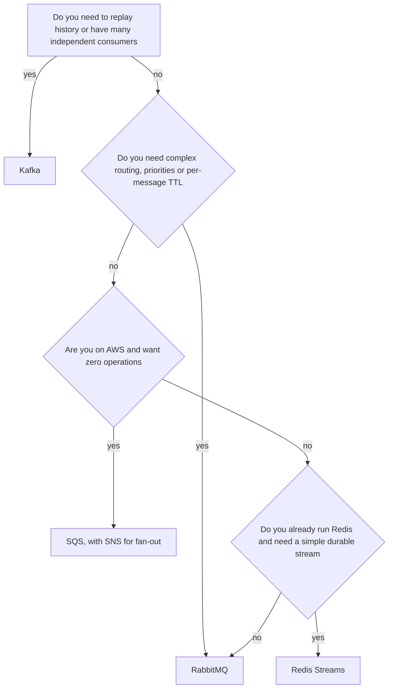
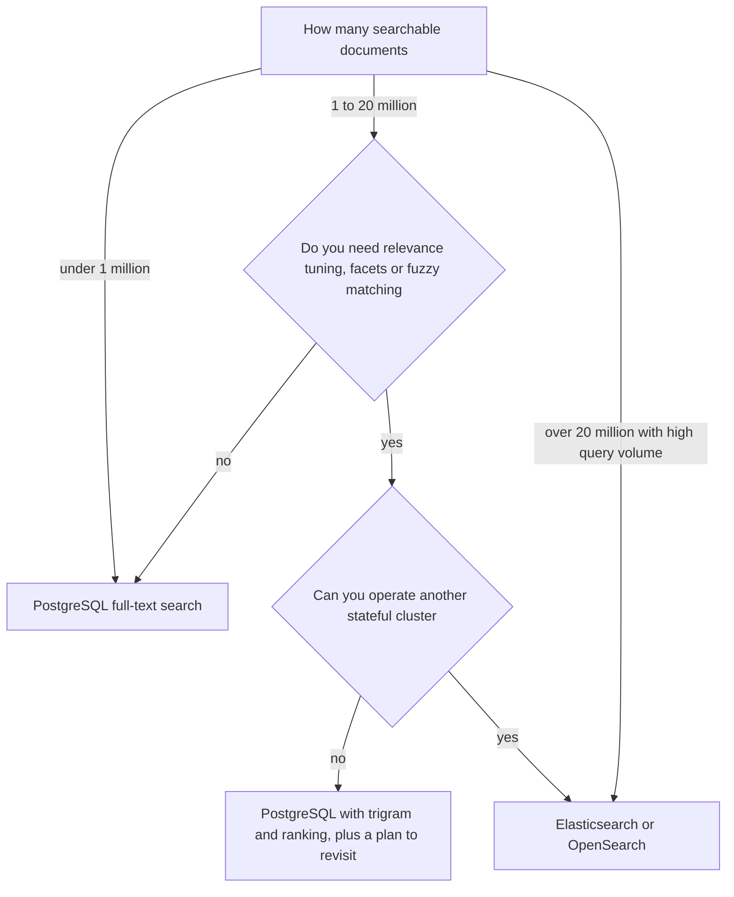

## 49.5 Synchronous versus asynchronous

### Decision tree



### If... then choose

```text
If the user cannot proceed without the answer, and it takes under a second
   -> Choose synchronous
If the work is slow, external, or allowed to fail and be retried
   -> Choose asynchronous with a durable queue
If you need a strict ordering guarantee per entity across services
   -> Choose asynchronous with a partition key, not synchronous chains
If the operation must be transactional with your own database write
   -> Choose synchronous inside one transaction, or the outbox pattern
If a spike of traffic must not take down the downstream
   -> Choose asynchronous, so the queue absorbs the burst
If you are calling a third party whose latency you do not control
   -> Choose asynchronous, or synchronous with a hard timeout and a fallback
If the answer must appear on the same screen and there is no acceptable loading state
   -> Choose synchronous, and make it fast enough
```

### Trade-offs

| Dimension | Synchronous | Asynchronous |
|---|---|---|
| Consistency | Immediate, read-your-write | Eventual; the client sees an intermediate state |
| Latency | Caller waits for the slowest hop | Caller returns in milliseconds; work completes later |
| Throughput | Limited by the slowest dependency | Limited by consumer capacity; producers never block |
| Operational cost | Simple: one request, one trace | Broker, consumers, lag monitoring, DLQ, replay tooling |
| Team skill | Universal | Requires idempotency, ordering and backpressure understanding |
| Flexibility | Adding a consumer means changing the caller | New consumers subscribe without touching the producer |
| Money cost | Lower for low volume | Broker cost, but far better utilisation under spiky load |
| Ecosystem | Everything | Mature but requires deliberate tooling |
| Failure modes | Cascading timeouts, retry storms, availability multiplication | Duplicates, out-of-order delivery, consumer lag, poison messages |

### Signals you chose wrong

- Your checkout endpoint has a p99 of 4 seconds because it waits for an email provider.
- A downstream outage takes your API down even though the feature is optional.
- You chose asynchronous and users constantly refresh because they cannot tell whether their action worked.
- Support tickets say "I clicked pay and nothing happened", which means the async design has no status feedback.
- You are building a synchronous polling loop over an async result, which is the worst of both.

### How to change your mind later

Synchronous to asynchronous is straightforward and can be incremental: publish the work as a message and return `202 Accepted` with a status URL, then move the caller to poll or subscribe. The hard part is the user experience, not the code — you need a visible pending state.

Asynchronous to synchronous is harder because clients have built around eventual results. The usual bridge is to keep the async pipeline and add a synchronous read-your-write path for the initiating user only, reading from the write model rather than the projection.

### Senior perspective

The test I apply is: does the user's next action depend on this result? Sending a confirmation email does not block anything, so it is asynchronous, full stop. Authorising a payment does block, so it is synchronous with a strict timeout and a clear failure path. Most systems get this wrong in one specific way: they do too much synchronously inside the request because it was easier to write, and then discover under load that their checkout availability is the product of six third-party availabilities. Moving optional work out of the request path is usually the single highest-leverage reliability change available to a team, and it costs one queue.

## 49.6 Redis versus PostgreSQL for caching, sessions, queues, locks and counters

### Decision tree



### If... then choose

```text
If you need a cache with TTLs, eviction and sub-millisecond reads
   -> Choose Redis
If you need sessions with instant revocation across many pods
   -> Choose Redis, with a PostgreSQL record of the user for audit
If you need a job queue under about 1,000 jobs per second and already run PostgreSQL
   -> Choose PostgreSQL with SELECT FOR UPDATE SKIP LOCKED
If you need a job queue above that, with delays, priorities and retries built in
   -> Choose Redis with BullMQ, or a real broker
If you need a mutual exclusion lock where losing it would corrupt data
   -> Choose a PostgreSQL advisory lock, because it is tied to a transaction you trust
If you need a best-effort lock to avoid duplicate work
   -> Choose Redis with SET NX PX and a fencing token
If you need counters that must never be lost, such as billing units
   -> Choose PostgreSQL, sharded if the row is hot
If you need counters for likes, views or rate limits
   -> Choose Redis, with periodic rollup into PostgreSQL
```

### Trade-offs

| Dimension | Redis | PostgreSQL |
|---|---|---|
| Consistency | Single-threaded per shard, atomic per command; replication is asynchronous so failover can lose writes | ACID, durable, synchronous commit available |
| Latency | 0.2 to 1 ms | 1 to 5 ms for an indexed query |
| Throughput | 100,000+ ops per second per node | 10,000 to 50,000 TPS with good schema and hardware |
| Operational cost | Simple until clustering; memory sizing matters | Well understood; more knobs but more tooling |
| Team skill | Easy to start, easy to misuse (unbounded keys, blocking commands) | Universal |
| Flexibility | Data structures are the API; no ad-hoc queries | Any query you can express in SQL |
| Money cost | Memory is expensive per GB | Disk is cheap; the same data costs far less |
| Ecosystem | Excellent for caching, queues, rate limiting, streams | Everything, plus extensions |
| Failure modes | Eviction under memory pressure, failover data loss, hot keys, blocking commands stalling the loop | Connection exhaustion, lock contention, bloat, replication lag |

The point people miss is that Redis failover can lose recently acknowledged writes, because replication is asynchronous. That is entirely fine for a cache and completely unacceptable for the only copy of a payment record. Choose per workload, not per system.

### Signals you chose wrong

- Redis is your source of truth for something you cannot rebuild, and you have no idea what a failover would cost you.
- Your Redis memory keeps growing because keys have no TTL, and evictions are now dropping data you needed.
- You built a job queue on PostgreSQL and it is doing 5,000 jobs per second, generating enormous table bloat and vacuum pressure.
- You used a Redis lock for a financial invariant and cannot explain what happens during a network partition.
- Your PostgreSQL cache table is being updated more often than it is read.

### How to change your mind later

Cache: trivially reversible. Delete the cache lookup, keep the database query. Always write the code so the cache is optional and a miss is correct.

Sessions: move from Redis to database-backed sessions or the reverse by writing to both for one session lifetime (typically 30 days for refresh tokens), then switching reads.

Queues: PostgreSQL to Redis or a broker is a producer and consumer swap. Keep draining the old table until empty, then delete it. Plan a day, not a sprint.

Counters: dual-increment for a period, compare totals, then cut over. Divergence between the two tells you exactly how much you were losing.

### Senior perspective

I treat Redis as a performance tool and PostgreSQL as a correctness tool, and the decision then answers itself workload by workload. The mistake I see most is a queue built on Redis with no durability configuration, used for work that must not be lost — orders, payments, notifications with legal significance. The mirror mistake is a queue on PostgreSQL that outgrew it, where `DELETE` churn on the jobs table causes bloat that eventually hurts unrelated queries. Both are fine choices in their range; the failure is not revisiting the choice when the volume changed. Put a number on the boundary when you decide, so future-you knows when to move.

## 49.7 Kafka versus RabbitMQ versus SQS versus Redis Streams

### Decision tree



### If... then choose

```text
If consumers must replay events from days ago, or new consumers must read history
   -> Choose Kafka
If you need ordered, partitioned event streams at hundreds of thousands of messages per second
   -> Choose Kafka
If you need routing rules, priority queues, per-message TTL and delayed delivery
   -> Choose RabbitMQ
If you want a queue with no servers to operate and you are already on AWS
   -> Choose SQS, with SNS or EventBridge when you need fan-out
If you need FIFO ordering per key with exactly-once processing on AWS
   -> Choose SQS FIFO, and accept the 300 messages per second per group limit
If you already run Redis, need a durable-ish stream, and volumes are moderate
   -> Choose Redis Streams
If you need a background job queue with retries, delays and a dashboard
   -> Choose BullMQ on Redis; it is a job queue, not an event bus
If you are a small team and cannot name a reason for Kafka
   -> Choose SQS or RabbitMQ
```

The distinction that resolves most of these arguments: Kafka is a **log**, the others are **queues**. In a log, consuming does not remove the message, many consumer groups read the same data independently, and you can rewind. In a queue, a message is delivered and deleted. If you have said the words "we need to replay", you want a log. If you have said "we need each job done once by one worker", you want a queue.

### Trade-offs

| Dimension | Kafka | RabbitMQ | SQS | Redis Streams |
|---|---|---|---|---|
| Consistency | Ordered per partition, at-least-once, exactly-once within Kafka transactions | Ordered per queue, at-least-once | At-least-once standard, FIFO variant ordered | Ordered per stream, at-least-once |
| Latency | 5 to 20 ms typical | 1 to 5 ms | 10 to 100 ms | Under 1 ms |
| Throughput | Millions per second with partitions | Tens of thousands per queue | Effectively unlimited, per-queue quotas apply | Hundreds of thousands, single-node bound |
| Operational cost | High: brokers, ZooKeeper or KRaft, rebalancing, retention tuning | Moderate: clustering and queue mirroring need care | Near zero | Low, but memory-bound and you own persistence config |
| Team skill | Steep learning curve; consumer groups and offsets are subtle | Moderate; AMQP concepts | Trivial | Easy if you already run Redis |
| Flexibility | Excellent for new consumers over existing data | Excellent routing topologies | Simple; fan-out needs SNS or EventBridge | Basic consumer groups |
| Money cost | Expensive: 3 brokers minimum, plus storage | Moderate | Pay per request; cheap at low volume | Memory cost per retained entry |
| Ecosystem | Huge: Connect, Streams, CDC, schema registry | Mature, many client libraries | AWS-native integrations | Small |
| Failure modes | Rebalance storms, consumer lag, partition skew, disk fill from retention | Queue backlog memory pressure, split-brain in clusters | Visibility timeout misuse, 256 KB limit, in-flight caps | Memory eviction dropping entries, no partition parallelism |

### Signals you chose wrong

- You chose Kafka and run a three-broker cluster for 50 messages per second. The cluster costs more than the feature.
- You chose Kafka and nobody has ever replayed a topic, and there is exactly one consumer group.
- You chose SQS and now need ordering and replay, so you are building an event store on top of DynamoDB.
- You chose RabbitMQ and your queue depth regularly grows into millions, pushing the broker into memory alarms and flow control.
- You chose Redis Streams for financial events and discovered that a failover can lose acknowledged entries.

### How to change your mind later

The producer and consumer interfaces are the migration surface, so wrap them from day one.

```ts
export interface EventPublisher {
  publish(topic: string, key: string, payload: unknown, headers?: Record<string, string>): Promise<void>;
}

@Injectable()
export class KafkaPublisher implements EventPublisher { /* ... */ }
@Injectable()
export class SqsPublisher implements EventPublisher { /* ... */ }
```

To migrate, dual-publish to both systems for a period, move consumers one at a time, verify counts match, then stop the old publisher. For queues this is usually a two-week exercise. Moving *to* Kafka is harder than moving away, because Kafka's ordering and partitioning assumptions leak into consumer design — plan for the consumers to be rewritten, not ported.

### Senior perspective

Kafka is excellent and most teams that adopt it do not need it. The honest test is a single question: name the consumer that will replay history, or name the second consumer group. If you cannot, you want a queue, and a queue you do not operate is better than one you do. I start teams on SQS or RabbitMQ, and I move them to Kafka when a real requirement appears — usually CDC, an analytics pipeline, or a third independent consumer of the same events. That migration is a known, bounded project. Running Kafka for two years "because we will need it" is an unbounded operational tax paid in advance.

## 49.8 PostgreSQL search versus Elasticsearch

### Decision tree



### If... then choose

```text
If you have under a million documents and need decent keyword search
   -> Choose PostgreSQL full-text search with a GIN index on tsvector
If you need typo tolerance and autocomplete at moderate scale
   -> Choose PostgreSQL with pg_trgm, which handles both surprisingly well
If you need per-field boosting, synonyms, faceted aggregation and relevance tuning
   -> Choose Elasticsearch or OpenSearch
If search is the product, not a feature
   -> Choose Elasticsearch or OpenSearch, and staff it
If you need search across data that must be transactionally consistent with writes
   -> Choose PostgreSQL, because an external index is always slightly behind
If you have a two-person team and no on-call capacity for a second cluster
   -> Choose PostgreSQL and revisit at a measured threshold
```

```sql
-- PostgreSQL search that is genuinely good enough for most products
ALTER TABLE products ADD COLUMN search_vector tsvector
  GENERATED ALWAYS AS (
    setweight(to_tsvector('english', coalesce(name, '')), 'A') ||
    setweight(to_tsvector('english', coalesce(description, '')), 'B')
  ) STORED;                                    -- maintained automatically, no triggers
CREATE INDEX products_search_gin ON products USING gin (search_vector);

SELECT id, name, ts_rank(search_vector, q) AS rank
FROM products, websearch_to_tsquery('english', $1) q
WHERE search_vector @@ q
ORDER BY rank DESC LIMIT 20;                   -- roughly 5 to 20 ms on a million rows
```

### Trade-offs

| Dimension | PostgreSQL FTS | Elasticsearch / OpenSearch |
|---|---|---|
| Consistency | Transactional with your data; always current | Near real-time, typically 1 second refresh; can lag much more under load |
| Latency | 5 to 50 ms up to a few million rows | 5 to 30 ms at far larger scale |
| Throughput | Shares capacity with your OLTP workload | Dedicated cluster, scales horizontally |
| Operational cost | None beyond what you already run | A stateful cluster: shards, replicas, heap tuning, rolling upgrades |
| Team skill | SQL you already know | Query DSL, analyzers, mappings, cluster operations |
| Flexibility | Limited relevance tuning; no built-in faceting beyond SQL aggregation | Very rich: analyzers, synonyms, boosting, aggregations, vector search |
| Money cost | Zero extra | Three nodes minimum for production; often the second largest infrastructure line |
| Ecosystem | Extensions like pg_trgm, unaccent, pgvector | Kibana, ingest pipelines, huge plugin ecosystem |
| Failure modes | Slow queries competing with OLTP; large GIN index maintenance | Index lag, split brain, yellow cluster during rebalance, mapping explosions, reindexing pain |

### Signals you chose wrong

- Search queries appear at the top of `pg_stat_statements` and are slowing down checkout. Your search workload is now competing with your transactional workload.
- Users complain that results are irrelevant and you have no lever to tune ranking beyond `ts_rank`.
- You run Elasticsearch and it holds a copy of one table with 40,000 rows, queried 20 times an hour.
- Your Elasticsearch index is regularly out of sync with PostgreSQL and nobody can say by how much.
- You have a reindex procedure that nobody has run in a year and that takes an unknown amount of time.

### How to change your mind later

PostgreSQL to Elasticsearch is a well-worn path: add CDC or an outbox-driven indexer, backfill with a batch job, run both behind a search interface, compare result quality on real queries, then switch reads with a feature flag. Two to six weeks. Keep PostgreSQL search working as a fallback for at least a quarter — when the cluster goes yellow, degraded search beats no search.

Elasticsearch to PostgreSQL happens more often than people admit, usually as a cost or complexity reduction when the data turned out to be small. It is easy: build the `tsvector` column, compare relevance on your top thousand queries, switch.

Either way, put search behind an interface with one method (`search(query, filters, page)`), so the swap touches one class.

### Senior perspective

Most products describe their need as "search" when they mean "filter with a text box". PostgreSQL full-text search plus `pg_trgm` handles that beautifully up to a few million rows, and it has the enormous advantage of being transactionally consistent — no indexer, no lag, no reindex runbook. I ask for a number before agreeing to a search cluster: document count, query rate, and one concrete relevance requirement that PostgreSQL cannot meet. When search is genuinely the product, Elasticsearch is the right tool and you should staff it properly. When search is a text box above a list, adding a second stateful cluster is one of the most expensive ways to solve a small problem.
