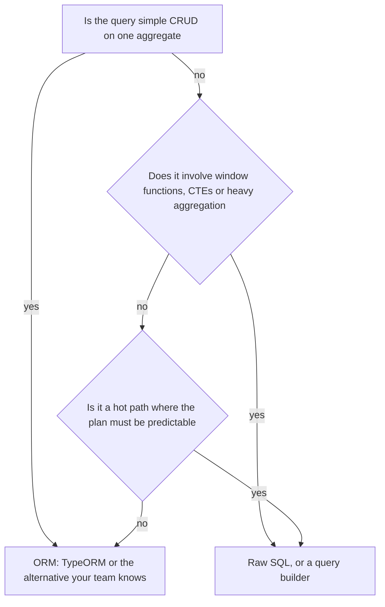
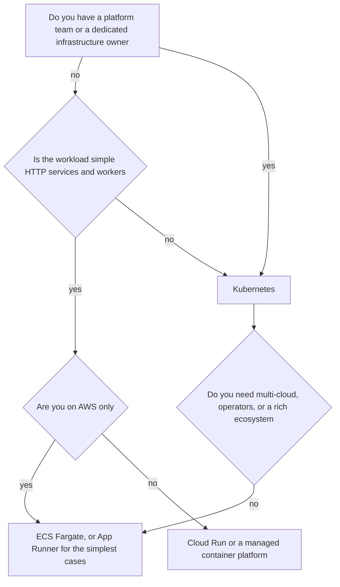
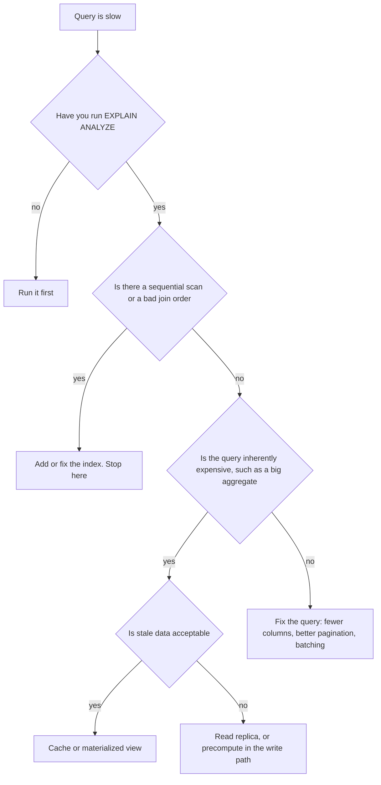
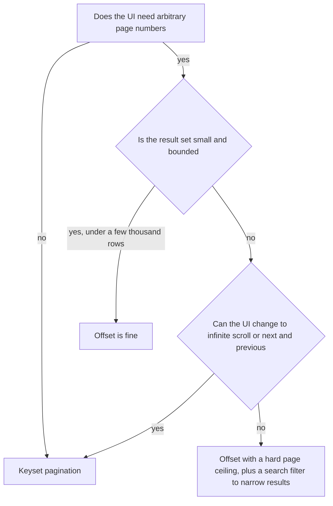

## 49.9 TypeORM versus Sequelize versus raw SQL

### Decision tree



### If... then choose

```text
If you are doing standard create, read, update and delete on entities with relations
   -> Choose an ORM, because migrations, relations and change tracking are real value
If you need window functions, recursive CTEs, lateral joins or complex aggregation
   -> Choose raw SQL, parameterised, living in a repository class
If you need the exact query plan to be stable under load on a hot path
   -> Choose raw SQL and check it with EXPLAIN ANALYZE in a test
If you want type-safe SQL without an ORM's abstraction
   -> Choose Kysely, which is a typed query builder, not an ORM
If you want a modern schema-first workflow with excellent generated types
   -> Choose Prisma, accepting less control over the emitted SQL
If you want something between Prisma and raw SQL with a SQL-shaped API
   -> Choose Drizzle
If your team already knows one of these and it is not on fire
   -> Choose the one your team knows
```

The honest position is that this is the least important decision in this part, and it consumes the most argument. Every option listed can serve a production system well. The mix that works is: an ORM for entity CRUD and migrations, raw SQL for the twenty queries that matter. Both, in the same codebase, on purpose.

```ts
@Injectable()
export class OrderRepository {
  constructor(@InjectDataSource() private readonly ds: DataSource) {}

  // ORM for CRUD: relations, cascades and change tracking earn their keep here.
  findWithItems(id: string) {
    return this.ds.getRepository(Order).findOne({ where: { id }, relations: { items: true } });
  }

  // Raw SQL for analytics: no ORM expresses this well, and the plan must be stable.
  topProductsByRevenue(sellerId: string, days: number) {
    return this.ds.query(
      `SELECT p.id, p.name, sum(oi.qty * oi.unit_price_minor) AS revenue_minor,
              rank() OVER (ORDER BY sum(oi.qty * oi.unit_price_minor) DESC) AS position
         FROM order_items oi
         JOIN orders o   ON o.id = oi.order_id AND o.status = 'PAID'
         JOIN products p ON p.id = oi.product_id
        WHERE p.seller_id = $1 AND o.placed_at > now() - ($2 || ' days')::interval
        GROUP BY p.id, p.name
        ORDER BY revenue_minor DESC LIMIT 20`,
      [sellerId, days],
    );
  }
}
```

### Trade-offs

| Dimension | TypeORM | Sequelize | Raw SQL |
|---|---|---|---|
| Consistency | Transactions and change tracking built in; some surprising cascade behaviour | Solid transaction API, explicit locking support | Complete control, and complete responsibility |
| Latency | Overhead is small but relation loading can be wasteful | Similar | Lowest; exactly the query you wrote |
| Throughput | Fine until N+1 or eager loading bites | Same | Best, and predictable |
| Operational cost | Migrations included; `synchronize` is a foot-gun | Migrations via umzug; `alter: true` is the same foot-gun | You own migrations separately |
| Team skill | Decorators and TypeScript-first; familiar to NestJS developers | Mature, more JavaScript-idiomatic | Requires real SQL skill on the team |
| Flexibility | Query builder covers a lot; complex SQL is awkward | Similar | Unlimited |
| Money cost | Indirect: wasteful queries cost database capacity | Same | Efficient queries cost less to run |
| Ecosystem | First-class NestJS integration | First-class NestJS integration | Universal |
| Failure modes | N+1 from lazy relations, `synchronize` data loss, opaque generated SQL | Same class of problems, plus looser typing | SQL injection if you interpolate, drift from entity definitions |

### Signals you chose wrong

- You spend more time fighting the ORM's generated SQL than you would spend writing SQL.
- Your hot endpoints all bypass the ORM already, and the ORM is now only doing `findOne`.
- You chose raw SQL everywhere and have hand-written 300 nearly identical CRUD queries with subtle differences.
- Nobody on the team can read `EXPLAIN` output, and query performance is nobody's job.
- You are choosing an ORM to avoid learning SQL. That never ends well; SQL is the durable skill.

### How to change your mind later

You do not need to migrate wholesale. Introduce the new tool for new modules and leave the old one in place; two data-access approaches in one codebase is normal and healthy. If you must migrate fully, do it module by module behind repository classes, and keep migrations in whichever tool owns the schema — the schema is the coupling point, not the query API.

The genuinely irreversible mistake is not choosing the wrong ORM. It is scattering ORM calls through controllers and services so there is no boundary to migrate. Keep data access in repository classes and any of these decisions becomes reversible in weeks.

### Senior perspective

I care far more about where data access lives than which library performs it. Repository classes, parameterised queries, no ORM calls in controllers, and an `EXPLAIN` check on anything that touches a large table — those practices make every library on this list work fine. What I look for in a candidate's answer is whether they know what SQL their ORM emits. Engineers who can enable query logging, read the generated SQL and explain the plan write good code in any of these tools; engineers who cannot will write N+1 queries in all of them.

## 49.10 ECS versus Kubernetes

### Decision tree



### If... then choose

```text
If you run on AWS, deploy stateless services, and have no platform team
   -> Choose ECS on Fargate
If you want the least possible operations for a single containerised web service
   -> Choose App Runner or Cloud Run
If your workload is event-driven, spiky, and each execution is short
   -> Choose Lambda
If you need operators, custom resources, service mesh, or portability across clouds
   -> Choose Kubernetes
If you have more than about 30 services and several teams deploying independently
   -> Choose Kubernetes; the ecosystem starts paying for itself
If you need GPUs, complex scheduling, or stateful workloads with operators
   -> Choose Kubernetes
If your reason is that Kubernetes is what serious companies use
   -> Choose ECS, and revisit when you can name the feature you need
```

### Trade-offs

| Dimension | ECS (Fargate) | Kubernetes (EKS/GKE) | Lambda / Cloud Run / App Runner |
|---|---|---|---|
| Consistency | Simple task model, predictable | Rich but complex; many ways to express the same thing | Simplest; the platform owns the model |
| Latency | No cold starts with running tasks | No cold starts | Cold starts: 100 ms to several seconds for Lambda; Cloud Run is usually faster |
| Throughput | Scales fine; scaling is slower to react | Fast HPA, KEDA on any metric | Scales to very high concurrency automatically |
| Operational cost | Low: AWS runs the control plane and you write task definitions | High: upgrades, CNI, ingress, RBAC, node pools, cluster autoscaler | Lowest |
| Team skill | Learnable in days | Weeks to months to be safe in production | Hours |
| Flexibility | Limited to the ECS model | Anything; you can extend the API itself | Constrained: execution limits, no long-lived connections in Lambda |
| Money cost | Fargate is roughly 20 percent more per vCPU than EC2 | Control plane fee plus node cost; better bin-packing at scale | Pay per use: very cheap when idle, expensive under sustained load |
| Ecosystem | AWS-native only | Enormous: Helm, operators, ArgoCD, mesh | Cloud-native only |
| Failure modes | Task placement failures, slow scaling, limited scheduling control | CrashLoopBackOff, OOMKilled, evictions, misconfigured RBAC, upgrade breakage | Cold starts, concurrency limits, timeout ceilings, connection-pool exhaustion against PostgreSQL |

### Signals you chose wrong

- You run Kubernetes for four services and someone spends a day a week on cluster upgrades.
- You cannot name a Kubernetes feature you use that ECS lacks.
- You chose ECS and are building custom tooling that reimplements Kubernetes primitives such as jobs, cron and config reloading.
- You chose Lambda for a service that holds database connections, and PostgreSQL is at `max_connections` because every concurrent invocation opened one.
- Your serverless bill exceeds what an always-on container would cost, which happens around continuous moderate load.

### How to change your mind later

Container platforms are among the most reversible decisions here, provided your application is a well-behaved twelve-factor container: configuration from the environment, logs to stdout, no local state, graceful shutdown on `SIGTERM`. Migrating ECS to Kubernetes is largely a translation of task definitions to Deployments, plus rebuilding CI/CD. Expect two to six weeks for a small fleet.

Lambda to containers is harder if you used platform-specific triggers and idioms heavily. Keep handlers thin and put the logic in plain classes, and the port becomes a new entry point rather than a rewrite.

### Senior perspective

Kubernetes is a platform for building platforms, and it is superb when you have the problems it solves: many teams, many services, heterogeneous workloads, a need for custom automation. It is a poor trade for a team of eight running five services, because you take on a full-time operational surface to gain flexibility you will not exercise. My rule of thumb is roughly thirty services or three independent deployment teams before Kubernetes clearly wins on merit. Below that, ECS Fargate or Cloud Run gives you 90 percent of the value with about 10 percent of the operational load, and the migration later is genuinely straightforward if you kept your containers boring.

## 49.11 Cache versus database (and when the real fix is a better index)

### Decision tree



### If... then choose

```text
If EXPLAIN shows a sequential scan on a large table
   -> Add the right index. Do not cache
If the query is fast but called 8,000 times per second on the same key
   -> Choose a cache with a TTL
If the query is an aggregate over millions of rows and 15-minute staleness is fine
   -> Choose a materialized view, refreshed concurrently
If the data must be current to the second and the query is unavoidably heavy
   -> Precompute it on the write path into a summary table
If read volume is the problem and staleness of a few hundred milliseconds is fine
   -> Choose a read replica
If you are caching to hide an unindexed query
   -> Fix the index. The cache will fail you during a cold start, which is the worst moment
```

### Trade-offs

| Dimension | Better index | Cache | Read replica |
|---|---|---|---|
| Consistency | Perfect; it is the same data | Stale up to the TTL, plus invalidation bugs | Stale by replication lag, typically 5 to 50 ms |
| Latency | 0.1 to 5 ms | 0.2 to 1 ms | Same as primary |
| Throughput | Improves both reads and the whole system | Enormous read amplification | Linear with replica count for reads |
| Operational cost | One migration | Redis to run, invalidation to maintain, hit rate to watch | Another database instance, lag to monitor |
| Team skill | Requires reading EXPLAIN | Requires cache-invalidation discipline | Requires read-write routing discipline |
| Flexibility | Helps every query that matches the access path | Helps only the cached shape | Helps all reads |
| Money cost | Free; small storage and write overhead | Memory is expensive per GB | A full extra instance |
| Ecosystem | Native | Mature | Native |
| Failure modes | Wrong column order does nothing; too many indexes slow writes | Stampede, stale data, cold start, hot key, Redis down | Lag spikes, read-your-write bugs, failover confusion |

### Signals you chose wrong

- Your cache hit rate is 60 percent and the misses are still slow, which means you cached instead of fixing the query.
- A Redis restart causes a full outage because the database cannot survive the cold-start load. That is proof the cache is hiding a capacity problem.
- You added a cache and the p99 barely moved, because the slow path was the 3 percent of requests that miss.
- You added an index and write latency doubled, which means you added the wrong one or too many.
- You have a cache invalidation bug list, and it keeps growing.

### How to change your mind later

Caches are the most reversible thing in this part: remove the lookup, keep the query. Always write cache code so that a miss is correct and a Redis failure degrades to the database with a short timeout.

Removing an index is one statement (`DROP INDEX CONCURRENTLY`), but verify with `pg_stat_user_indexes` first, over a full business cycle including month-end.

Adding a read replica is easy; removing the routing logic afterwards is the part people forget to clean up.

### Senior perspective

The order of operations matters more than the choice: measure, index, query shape, then cache. I have reviewed dozens of "we need Redis" proposals, and roughly half were a missing composite index. Caching an unindexed query is genuinely dangerous, because you have moved the load off the database *and* removed the signal that would have told you the query was bad — until a deploy or a Redis restart empties the cache and the database meets full traffic for the first time. That is the incident. Fix the query first, then cache what is still expensive, and always be able to say what happens to your database when the cache is empty.

## 49.12 Offset versus keyset pagination

### Decision tree



### If... then choose

```text
If the client scrolls forward through a feed or list
   -> Choose keyset pagination with a cursor
If the table is large and the sort key is indexed
   -> Choose keyset pagination
If an admin screen shows a few hundred rows and needs page numbers
   -> Offset is fine; do not over-engineer it
If rows are inserted frequently while users page through them
   -> Choose keyset, because offset will duplicate and skip rows
If you are exporting a large dataset with a script
   -> Choose keyset, or a server-side cursor, never deep offset
If your API is public and you cannot control client behaviour
   -> Choose keyset and return an opaque cursor, so clients cannot construct deep offsets
```

```ts
// Opaque cursor: encode the sort key so clients cannot craft arbitrary offsets.
const encode = (o: { placedAt: string; id: string }) =>
  Buffer.from(JSON.stringify(o)).toString('base64url');

async page(userId: string, cursor?: string, limit = 25) {
  const after = cursor ? JSON.parse(Buffer.from(cursor, 'base64url').toString()) : null;
  const rows = await this.ds.query(
    `SELECT id, placed_at, total_minor FROM orders
      WHERE user_id = $1
        AND ($2::timestamptz IS NULL OR (placed_at, id) < ($2, $3))
      ORDER BY placed_at DESC, id DESC
      LIMIT $4`,
    [userId, after?.placedAt ?? null, after?.id ?? null, Math.min(limit, 100) + 1],
  );
  const hasMore = rows.length > limit;
  const page = rows.slice(0, limit);
  return { items: page, nextCursor: hasMore ? encode(page[page.length - 1]) : null };
}
```

### Trade-offs

| Dimension | Offset | Keyset (cursor) |
|---|---|---|
| Consistency | Rows shift when data changes: duplicates and skips | Stable; the cursor anchors to a row, not a position |
| Latency | Degrades linearly: page 1 at 2 ms, page 10,000 at 1.8 s | Constant: every page costs the same |
| Throughput | Deep pages burn database CPU and I/O | Index range scan, minimal work |
| Operational cost | None | None, but needs a suitable composite index |
| Team skill | Trivial | Slightly more thought; needs a tiebreaker column |
| Flexibility | Jump to any page, show total pages | Forward and backward only; no page numbers, and total counts are expensive |
| Money cost | Wasted database capacity at depth | Efficient |
| Ecosystem | Every UI component supports it | Common in modern APIs; some UI libraries need adapting |
| Failure modes | Timeouts at depth, duplicate and missing rows, easy denial of service by requesting a huge offset | Cursor invalid after the anchor row is deleted; needs a total order to be correct |

### Signals you chose wrong

- Latency correlates with the page number in your dashboards.
- Users report seeing the same item twice while scrolling an active list.
- A crawler or export script regularly requests `OFFSET 500000` and your database notices.
- You chose keyset and the product genuinely needs "page 47 of 210", so you are now maintaining a fake page-number mapping.
- Your keyset query returns inconsistent results because the sort key is not unique and you never added a tiebreaker.

### How to change your mind later

Support both at the API level during a transition: accept either `?page=` or `?cursor=`, and return both `nextCursor` and, where cheap, a total count. Migrate clients one screen at a time and then remove the offset branch. This is a one-sprint change in most codebases.

Going from keyset back to offset is trivial but rarely a good idea. The usual compromise for an admin screen that wants page numbers is offset with a hard ceiling (`OFFSET` capped at a few thousand) plus better filters, so users narrow the result set instead of paging through it.

### Senior perspective

Keyset pagination is one of the highest ratio of benefit to effort changes available in a backend: constant latency, correct results under concurrent writes, and immunity to a trivial denial-of-service vector, all for one composite index and a cursor encoder. The only real objection is page numbers, and that is usually a design habit rather than a user need — nobody navigates to page 47; they refine their filter. When the product genuinely needs counts and page numbers, offset over a *bounded, filtered* result set is a perfectly reasonable answer. The failure is deep offset over an unbounded table, which is a performance cliff that arrives silently, months after the code was written.
