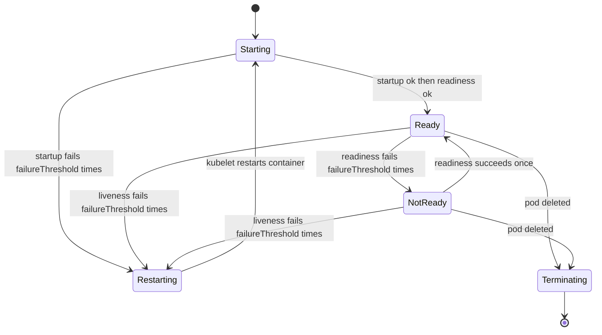
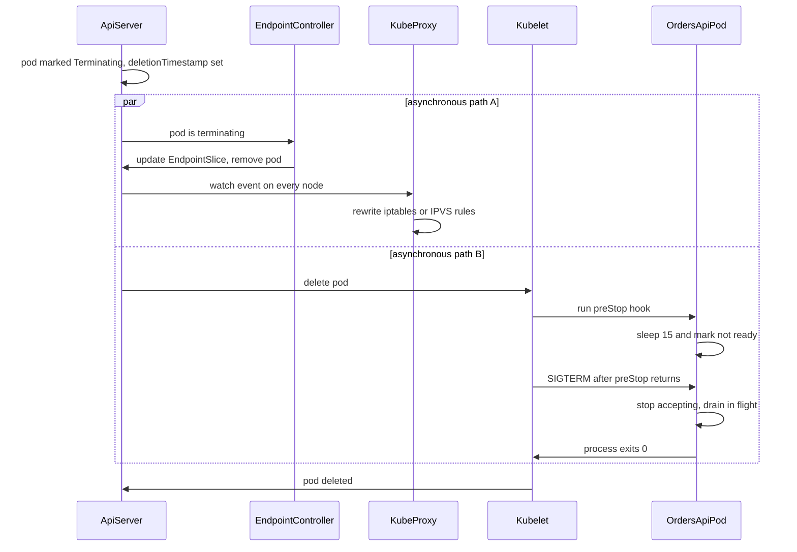

## 49.11 Probes

#### Concept

A probe is a question the kubelet asks your container on a schedule. There are three, and the difference between them is not what they check but **what happens to your pod when they fail**:

| Probe | On failure | Effect on traffic | Runs |
|---|---|---|---|
| `livenessProbe` | The container is **killed and restarted** | Indirect: the pod disappears for a few seconds while it restarts | For the whole life of the container |
| `readinessProbe` | The pod is **removed from Service endpoints** | Direct: it stops receiving new requests, keeps running | For the whole life of the container |
| `startupProbe` | The container is **killed and restarted** | None while it is running | Only until it first succeeds, then it stops and hands over to liveness and readiness |

Read that table again before writing a single probe. Almost every probe incident comes from choosing a probe whose *consequence* is wrong for the condition being checked.

#### Why does it exist?

A process can be running and useless. Node.js is single-threaded: an infinite loop in a request handler leaves the process alive, the port open, and every request hanging. A memory leak leaves it alive but thrashing. A deadlocked connection pool leaves it alive and unable to answer anything. `docker ps` says "Up 4 hours" for all of these.

Kubernetes needs two different signals, and they are genuinely different questions:

- **"Is this process broken beyond recovery?"** If yes, restarting is worth the disruption. That is liveness.
- **"Should this pod receive requests right now?"** It may be perfectly healthy and simply not ready yet (still warming up), or temporarily unable to serve (lost its database connection). Restarting would not help; not sending traffic would. That is readiness.

Without readiness, a rolling update sends traffic to a pod that has not finished booting, and users get connection refused for the 4 seconds it takes NestJS to build its DI container. Without liveness, a wedged process stays in the load balancer forever.

#### Mental model

Imagine a call centre. **Liveness** is the supervisor walking past and checking the agent is conscious. If not, they are sent home and a replacement comes in. **Readiness** is the little light on the desk: the agent is fine, but they are on a break, or their computer is rebooting, so the switchboard does not route calls to them. **Startup** is the induction period: for the first twenty minutes on their first day, the supervisor does not judge them for not answering, because they are still logging in.

The rule follows naturally: never send an agent home because the *computer network* is down. That is what a liveness probe that checks the database does. Every agent fails at once and you have emptied the building.

#### How it works



1. The **kubelet on the node** runs the probes, not the API server and not the Service. A probe is a local HTTP request from the node to the pod IP, or an exec into the container, or a TCP connect.
2. Probe types: `httpGet` (2xx or 3xx is success), `tcpSocket` (connection established is success), `exec` (exit code 0 is success), and `grpc` (the standard gRPC health protocol, Kubernetes 1.24+).
3. Timing parameters, all per probe:

| Parameter | Default | Meaning | How to choose |
|---|---|---|---|
| `initialDelaySeconds` | 0 | Wait this long after container start before the first probe | With a startup probe, leave at 0; without one, set to your slowest boot plus 50% |
| `periodSeconds` | 10 | How often to probe | Readiness 5 s (fast reaction to trouble); liveness 10 to 20 s; startup 5 s |
| `timeoutSeconds` | 1 | A probe that takes longer counts as a failure | Raise to 2 to 3 s; a 1 s timeout on a busy Node event loop causes false failures |
| `failureThreshold` | 3 | Consecutive failures before acting | Readiness 3; liveness 3 to 6 (be conservative, restarts are violent); startup high |
| `successThreshold` | 1 | Consecutive successes to be considered passing | Must be 1 for liveness and startup; 1 is right for readiness too |

The number that actually matters is the product. Time to act = `initialDelaySeconds + periodSeconds * failureThreshold` (plus up to `timeoutSeconds` on the last one). For a liveness probe with `periodSeconds: 10, failureThreshold: 3`, a wedged process is restarted about 30 seconds after it wedges. For readiness with `periodSeconds: 5, failureThreshold: 3`, a pod leaves the load balancer about 15 seconds after it stops being able to serve. Those two numbers are your blast radius and your recovery time; pick them deliberately.

4. **The cardinal rule: liveness must be cheap and must never check a dependency.** A liveness endpoint should do one thing: prove the event loop can still run a handler and respond. No database query, no Redis ping, no HTTP call, no disk I/O. Two reasons. First, correctness: if PostgreSQL is down, restarting your API pods does not fix PostgreSQL, and it does destroy your ability to serve cached content, return graceful errors, and reconnect when the database returns. Second, blast radius: liveness failures are *correlated*. Every pod checks the same database, so every pod fails within the same 30-second window, and the kubelets restart all of them at once. You have converted a degraded dependency into a full outage plus a `CrashLoopBackOff` storm plus a thundering herd of reconnects the moment the database recovers.

5. **Readiness may check dependencies, carefully.** A pod that cannot reach its database genuinely should not receive requests, if there is another pod that can. The words "if there is another pod that can" are the whole subtlety. If the dependency is shared by all replicas, readiness checks on it remove *every* pod from the Service at once, the Service has zero endpoints, and the ingress returns 503 for everything, including the endpoints that did not need the database at all. The safe pattern:
   - Check only dependencies that are **per-pod**, not global (this pod's connection pool, not "is the database up").
   - Prefer checking your own pool state (`is there at least one usable connection?`) over issuing a query.
   - Never let a check of an external third-party API affect readiness.
   - Consider a floor: if fewer than a certain fraction of pods would remain ready, report ready anyway and let requests fail with proper errors, so at least clients get your 503 with a retry hint instead of the ingress's blank one.

6. **Startup probes protect slow boots from liveness.** Before startup probes existed, you had to set `initialDelaySeconds` on liveness high enough for the worst boot (say 60 s), which meant that for the entire life of the pod, a wedge was only detected after a long delay, or you set it low and a cold start on a busy node got killed halfway. A startup probe decouples them: liveness and readiness do not run at all until the startup probe first succeeds. Give the startup probe a generous budget (`failureThreshold: 30, periodSeconds: 5` gives 150 seconds), and then give liveness tight, honest timings.

#### Practical example

`orders-api` boots in 3 to 5 seconds normally: NestJS builds the DI container, TypeORM connects and validates the schema, BullMQ connects to Redis, the Kafka producer connects. On a cold node, with a CPU request of 250m and an image just pulled, it can take 20 seconds. It serves 800 RPS across 6 pods. The chosen probe configuration:

- Startup: `/health/live`, every 5 s, up to 24 failures (120 seconds of grace).
- Liveness: `/health/live`, every 10 s, timeout 2 s, 3 failures (restart ~30 s after a wedge).
- Readiness: `/health/ready`, every 5 s, timeout 3 s, 3 failures to leave, 1 success to return.

#### NestJS example

`@nestjs/terminus` is the supported way to build these. The important design decision is that the two endpoints check different things.

```ts
// src/health/health.controller.ts
import { Controller, Get } from '@nestjs/common';
import {
  HealthCheck,
  HealthCheckService,
  TypeOrmHealthIndicator,
  MemoryHealthIndicator,
  HealthCheckResult,
} from '@nestjs/terminus';
import { RedisHealthIndicator } from './redis.health';
import { ShutdownState } from './shutdown.state';

@Controller('health')
export class HealthController {
  constructor(
    private readonly health: HealthCheckService,
    private readonly db: TypeOrmHealthIndicator,
    private readonly redis: RedisHealthIndicator,
    private readonly memory: MemoryHealthIndicator,
    private readonly shutdown: ShutdownState,
  ) {}

  // LIVENESS: is this process able to run a handler at all?
  // No dependencies. No I/O. If this fails, restarting is the correct remedy.
  @Get('live')
  @HealthCheck()
  live(): Promise<HealthCheckResult> {
    return this.health.check([
      // Heap above 1.5x the expected working set means the process is in trouble
      // and a restart genuinely helps. Keep this well below the container limit.
      () => this.memory.checkHeap('heap', 900 * 1024 * 1024),
    ]);
  }

  // READINESS: should this pod receive new requests right now?
  @Get('ready')
  @HealthCheck()
  ready(): Promise<HealthCheckResult> {
    return this.health.check([
      // During shutdown we report not-ready immediately so endpoints drain (49.13).
      () => this.shutdown.indicate(),
      // Own connection pool: a 1 s query proves this pod can reach its database.
      () => this.db.pingCheck('database', { timeout: 1000 }),
      // Redis backs idempotency keys and BullMQ; without it we cannot serve writes.
      () => this.redis.isHealthy('redis'),
      // Deliberately NOT here: the payments API, the shipping provider, the search
      // cluster. Their outages must degrade features, not remove pods from the LB.
    ]);
  }
}
```

The shutdown flag, which readiness consults, is a two-line provider:

```ts
// src/health/shutdown.state.ts
import { Injectable } from '@nestjs/common';
import { HealthIndicatorResult, HealthCheckError } from '@nestjs/terminus';

@Injectable()
export class ShutdownState {
  private draining = false;

  startDraining(): void {
    this.draining = true;
  }

  indicate(): HealthIndicatorResult {
    if (this.draining) {
      throw new HealthCheckError('draining', { shutdown: { status: 'down' } });
    }
    return { shutdown: { status: 'up' } };
  }
}
```

A custom Redis indicator, because Terminus does not ship one for ioredis:

```ts
// src/health/redis.health.ts
import { Injectable } from '@nestjs/common';
import { HealthIndicator, HealthIndicatorResult, HealthCheckError } from '@nestjs/terminus';
import Redis from 'ioredis';
import { InjectRedis } from './redis.tokens';

@Injectable()
export class RedisHealthIndicator extends HealthIndicator {
  constructor(@InjectRedis() private readonly redis: Redis) {
    super();
  }

  async isHealthy(key: string): Promise<HealthIndicatorResult> {
    try {
      // Bound the check; a hanging PING must not hold the readiness request open.
      const pong = await Promise.race([
        this.redis.ping(),
        new Promise<never>((_, rej) => setTimeout(() => rej(new Error('timeout')), 800)),
      ]);
      return this.getStatus(key, pong === 'PONG');
    } catch (err) {
      throw new HealthCheckError('redis down', this.getStatus(key, false, { message: String(err) }));
    }
  }
}
```

Two more things the health module must get right. Exclude health endpoints from your global `ThrottlerGuard` and from authentication (the kubelet sends no credentials), and exclude them from access logs, or 6 pods times 2 probes every 5 seconds will add 200,000 useless log lines a day.

```ts
// src/health/health.module.ts
import { Module } from '@nestjs/common';
import { TerminusModule } from '@nestjs/terminus';
import { HealthController } from './health.controller';
import { ShutdownState } from './shutdown.state';
import { RedisHealthIndicator } from './redis.health';

@Module({
  imports: [TerminusModule.forRoot({ logger: false, errorLogStyle: 'pretty' })],
  controllers: [HealthController],
  providers: [ShutdownState, RedisHealthIndicator],
  exports: [ShutdownState],
})
export class HealthModule {}
```

And the YAML that consumes them:

```yaml
        - name: api
          image: 123456789012.dkr.ecr.eu-west-1.amazonaws.com/orders-api:sha-3f9a1c2
          ports:
            - { name: http, containerPort: 3000 }
          startupProbe:
            httpGet: { path: /health/live, port: http }
            periodSeconds: 5
            timeoutSeconds: 2
            failureThreshold: 24          # 24 * 5 s = 120 s of boot grace
          livenessProbe:
            httpGet: { path: /health/live, port: http }
            periodSeconds: 10
            timeoutSeconds: 2
            failureThreshold: 3           # wedged process restarted after ~30 s
          readinessProbe:
            httpGet: { path: /health/ready, port: http }
            periodSeconds: 5
            timeoutSeconds: 3
            failureThreshold: 3           # out of the LB ~15 s after losing the DB
            successThreshold: 1
```

#### PostgreSQL example

The readiness database check must be cheap and must not queue behind application load. `TypeOrmHealthIndicator.pingCheck` runs `SELECT 1`, which costs well under a millisecond, but it still needs a **connection from the pool**. If your pool is exhausted by slow queries, the health check waits for a connection and times out, marking a pod not-ready precisely when it is busiest, removing capacity, and pushing load onto the remaining pods. That is a feedback loop that turns a slow query into an outage.

Two mitigations. First, size the pool with headroom and set an acquire timeout below the probe timeout so the check fails fast and deterministically rather than hanging. Second, prefer checking pool health over issuing a query:

```ts
// A pool-state readiness check: no query, no connection acquisition, no queueing.
import { DataSource } from 'typeorm';

export function poolIsUsable(ds: DataSource): boolean {
  // node-postgres pool internals, exposed via the TypeORM driver
  const pool = (ds.driver as any).master as { totalCount: number; idleCount: number; waitingCount: number };
  if (!ds.isInitialized) return false;
  // Unhealthy if every connection is busy AND requests are queueing behind them.
  return !(pool.waitingCount > 0 && pool.idleCount === 0 && pool.totalCount >= 10);
}
```

```sql
-- Watch the same thing from the database side during an incident.
SELECT state, count(*), max(now() - state_change) AS longest
FROM pg_stat_activity
WHERE datname = 'orders' AND application_name = 'orders-api'
GROUP BY state ORDER BY 2 DESC;
```

#### Production scenario

A 6-pod API at 800 RPS, probes as configured above. Cost of probing: 6 pods times (12 liveness + 12 readiness) per minute = 144 requests per minute, about 2.4 RPS, roughly 0.3% of traffic. Liveness responses are sub-millisecond; readiness runs two small checks and completes in 2 to 4 ms. During a rolling update, each new pod passes startup in 4 to 6 seconds and readiness on its next 5-second tick, so the rollout of 6 pods takes about 2 minutes with `maxSurge: 1`. Over six months, liveness restarted a pod eleven times: nine were a memory leak in a PDF library (fixed), two were genuine event-loop wedges from a pathological regular expression (fixed). Readiness removed pods from traffic 340 times, mostly during RDS failovers lasting 20 to 60 seconds, and no customer request failed because other pods absorbed the load.

#### Failure scenario

At 16:40 on a Tuesday, `checkout-api` returns 503 for every request. Not some requests: all of them, from the ingress, in under a minute. The API pods are all `Running`, `0/1 READY`. `kubectl get endpointslices` shows zero endpoints.

Three weeks earlier, someone had added a readiness check that called the shipping-rates provider's `/status` endpoint, with the reasoning "if we cannot quote shipping, we cannot check out". The provider's status endpoint got slow that afternoon: 8 to 12 seconds, no errors, just slow. The readiness probe's `timeoutSeconds: 3` turned that into a failure. Every pod checked the same third-party API, so every pod failed within one probe cycle. Kubernetes did exactly what it was told: it removed every pod from the Service. The ingress had nothing to route to.

What made it worse: without endpoints, no traffic reached the pods, so the pods' own metrics went flat and the dashboards looked *quiet*, not broken. The on-call engineer spent nine minutes looking at the application before running `kubectl describe pod` and seeing `Readiness probe failed: HTTP probe failed with statuscode: 503` with the shipping check named in the body.

Total outage: 21 minutes for 100% of checkout traffic. The provider was never down; it was slow.

The fixes:

1. Third-party dependencies were removed from readiness entirely. Shipping quotes now fall back to a cached rate table and a feature flag.
2. Readiness checks only own-pod state: database pool and Redis.
3. A synthetic alert fires when a Service has fewer than 50% of expected endpoints, which would have named the problem in 60 seconds.
4. Every readiness check now has a per-check timeout strictly below the probe timeout, so a slow dependency fails fast and is logged with the name of the failing check.

The principle: **readiness is a lever that removes capacity. Only pull it for conditions where removing this pod helps.**

#### Edge cases & failure modes

- **Liveness checking the database.** The canonical outage: all pods restart together during a database blip, cold caches, connection storm on recovery, `CrashLoopBackOff` with escalating back-off (10 s, 20 s, 40 s, up to 5 minutes) so recovery is slower than the original fault.
- **`timeoutSeconds: 1` (the default) on Node.** Under GC pause or event-loop pressure, an otherwise healthy pod misses the deadline. Three misses restart it. Use 2 to 3 s.
- **No startup probe on a slow-booting app.** Liveness kills the container mid-boot; it restarts; it is killed again. `CrashLoopBackOff` on an application that has no bug.
- **Probe endpoints behind auth or a global guard** return 401 or 429; the pod never becomes ready and the message in `describe` says `statuscode: 401`.
- **Probes hitting the same event loop as traffic.** At 100% CPU, probes queue behind requests and time out; liveness then restarts a pod that is merely overloaded, moving its load to the others, which then also fail. A cascading restart loop under load. Guard against it with generous liveness thresholds and by keeping `/health/live` free of any await.
- **Readiness that never fails.** A `return { status: 'ok' }` endpoint means a pod with a dead database stays in the load balancer.
- **`successThreshold` above 1 for liveness** is rejected by the API server.
- **Exec probes are expensive.** They fork a process in the container every period; on a 200-pod node that is real CPU. Prefer `httpGet`.
- **Probes during termination.** Once the pod is `Terminating`, the kubelet stops probing; readiness cannot be your only drain mechanism (see 49.13).
- **Ingress health checks are separate.** An ALB has its own health check on the target group; point it at `/health/ready` too, and remember its thresholds are independent of the kubelet's.
- **`initialDelaySeconds` on readiness delays rollouts.** Every pod swap waits that long; with 20 replicas a 30-second delay adds ten minutes.

#### How a Senior Backend Engineer thinks about this

They ask one question per probe: *what should happen when this fails?* If the answer is "restart the process", it is liveness, and the check must be local, cheap and unable to fail for external reasons. If the answer is "stop sending it traffic", it is readiness, and the check must be about this pod, not about the world. If the answer is "wait longer", it is a startup probe.

They think about correlation before they think about correctness. Any check shared by all replicas is a switch that turns a partial degradation into a total outage. They accept that a pod serving errors is often better than no pod at all, because your 503 with `Retry-After` is a better experience than the ingress's, and because a pod in the load balancer can recover while a pod removed from it cannot prove it has.

They budget probe cost, keep health endpoints out of logs and rate limits, and they alert on the *Service endpoint count*, because that is the number that describes whether anyone can reach you.

#### Common mistakes

- Using the same endpoint for liveness and readiness when that endpoint checks dependencies.
- Putting a third-party API in a readiness check.
- Leaving `timeoutSeconds` at 1.
- No startup probe, so `initialDelaySeconds` on liveness has to be huge and wedges go undetected for a minute.
- Probes that require authentication.
- Setting `failureThreshold: 1` on liveness, so one hiccup restarts the pod.
- Health endpoints that do heavy work (a `count(*)` on a large table is a real example).

#### Interview questions

1. *What is the difference between liveness and readiness?* Expected: consequences, restart versus endpoint removal; when each is correct. Follow-up: which one gates a rolling update? (Readiness.)
2. *Why must a liveness probe not check the database?* Expected: restarting does not fix the dependency; failures are correlated across all pods; CrashLoopBackOff and connection storms; you lose graceful degradation.
3. *When would you use a startup probe?* Expected: slow or variable boot; it suspends liveness and readiness until first success, allowing tight liveness timings afterwards.
4. *Choose probe timings for an API that boots in 5 s and must leave the load balancer within 20 s of losing its database.* Expected: startup 5 s period with 24 failures; readiness 5 s period, 3 failures, 3 s timeout; liveness 10 s period, 3 failures, 2 s timeout, no dependency checks.
5. *All pods are Running but the Service has no endpoints. What happened?* Expected: readiness failing across all replicas, usually a shared dependency; check `describe pod` for the probe message.
6. *How much load do probes add and how do you keep them from lying?* Expected: compute requests per minute; keep endpoints unauthenticated, unthrottled, unlogged, and free of heavy work; per-check timeouts under the probe timeout.

#### Practical exercise

Implement `/health/live` and `/health/ready` with Terminus as above. Wire the YAML. Then run four experiments and record what happens in each: (1) stop PostgreSQL and watch endpoints drain while pods stay Running; (2) move the database check into `/health/live` and repeat, timing how long until every pod is in `CrashLoopBackOff`; (3) add an `await setTimeout(5000)` to the readiness handler and watch pods flap with `timeoutSeconds: 3`; (4) delete the startup probe, set `initialDelaySeconds: 0` on liveness, and add a 30-second artificial boot delay. Acceptance criteria: a table of the four experiments with the observed pod states, endpoint counts and time-to-effect, plus a written statement of which probe you would fix first in each case.

## 49.12 Resource requests and limits

#### Concept

Every container can declare two numbers per resource:

- **`requests`** is what the scheduler reserves. It is the promise: this pod will always have at least this much. It decides *which node the pod lands on* and it is the number that quota and cost allocation use.
- **`limits`** is the ceiling the kernel enforces at runtime. For CPU it means throttling; for memory it means being killed.

Requests are about *placement*. Limits are about *containment*. They are enforced by completely different mechanisms and confusing them causes most resource incidents.

#### Why does it exist?

Nodes are shared. Without requests, the scheduler has no idea how much room a pod needs, so it packs pods onto nodes until they collapse. Without limits, one leaking container consumes all the memory on a node and the kernel starts killing processes, including other teams' pods and possibly the kubelet itself.

#### Mental model

Imagine booking desks in a co-working space. The **request** is the desk you reserve: the space guarantees it is there for you, and they will not sell the room beyond its capacity of reserved desks. The **limit** is the rule about how much of the shared room you may spread into when it happens to be free: exceed it on paper space (CPU) and security politely pushes your papers back onto your desk, slowing you down; exceed it on your locker (memory) and they throw you out of the building entirely.

#### How it works

**CPU is compressible.** It is measured in millicores: `1000m` = 1 core = 100% of one CPU. The kernel enforces it with the CFS bandwidth controller in cgroups, using two values: a period (100 ms by default) and a quota.

```text
quota = cpu_limit * period
limit 500m  -> quota = 50 ms of CPU per 100 ms period
limit 1000m -> quota = 100 ms per 100 ms period
limit 2000m -> quota = 200 ms per 100 ms (needs 2 cores to consume)
```

Within each 100 ms window, once the container's threads have consumed the quota, **every thread is stopped until the next period begins**. Not slowed: stopped. This is the arithmetic that surprises people. Suppose `orders-api` has `limits.cpu: 500m` and a request arrives that needs 80 ms of CPU (a big JSON serialisation, a bcrypt hash, a large query result mapped to entities). The container can use 50 ms in the first period, then sleeps 50 ms, then uses the remaining 30 ms. Wall-clock time: 130 ms for 80 ms of work. Now add a garbage collection pause, and the concurrent GC threads also consume quota; a V8 major GC that would take 40 ms of CPU becomes a 100+ ms stall.

That is why **a CPU limit can make p99 latency worse** while average latency looks fine. Requests that need slightly more CPU than the per-period quota get an extra 50 to 100 ms of pure waiting, and they are exactly the requests that were already slowest. The metric to watch is `container_cpu_cfs_throttled_seconds_total` and the ratio `throttled_periods / periods`. Anything above 1% deserves attention; above 25% your latency graph is a picture of throttling, not of your code.

The pragmatic guidance for Node.js APIs:

- **Always set a CPU request.** It is how the scheduler gives you a fair share and how you get a guaranteed floor under contention.
- **Consider omitting the CPU limit** for latency-sensitive services, so a pod can burst into idle capacity on the node. The request already guarantees your share under contention; the limit only stops you using capacity nobody else wants.
- **Set a CPU limit** when you need predictable, testable behaviour (so staging behaves like production), when you must protect a shared node from a runaway loop, or when the cluster's cost model requires it. If you set one, set it at 2 to 4 times the request, not equal to it.

**Memory is incompressible.** There is no throttling for memory: you cannot have "80% of a byte". When a container's resident memory exceeds its limit, the kernel's OOM killer terminates the process inside the cgroup. The container's `lastState` shows `Reason: OOMKilled, Exit Code: 137` (128 + 9, meaning killed by SIGKILL). The kubelet restarts the container per the restart policy, and repeated OOM kills produce `CrashLoopBackOff`. Nothing catches this in your code. There is no exception, no `process.on('exit')`, no graceful shutdown, no flushed logs. The process simply stops existing between two instructions.

**QoS classes** are derived automatically from the numbers, and they decide who gets evicted when a node runs out of memory:

| QoS class | Condition | Eviction order under node memory pressure |
|---|---|---|
| `Guaranteed` | Every container sets both requests and limits, and they are **equal**, for CPU and memory | Last. Only evicted if the node itself is critically starved |
| `Burstable` | Requests set, limits absent or higher than requests | Second. Pods using more than their request go first |
| `BestEffort` | No requests, no limits | First. Killed immediately under pressure |

Never run production workloads as `BestEffort`. For databases and other stateful workloads, `Guaranteed` is the right choice. For stateless APIs, `Burstable` with `requests.memory == limits.memory` and a higher-than-request CPU limit (or no CPU limit) is a good middle ground: memory is predictable, CPU can burst.

**Sizing a NestJS pod.** A recommended starting point for a typical NestJS REST API with TypeORM, Redis and a Kafka producer, serving JSON:

```yaml
          resources:
            requests:
              cpu: 250m          # baseline share; roughly 100 to 200 RPS of light JSON per pod
              memory: 512Mi      # NestJS + TypeORM + pools + V8 overhead
            limits:
              memory: 512Mi      # equal to request: predictable, no surprise eviction
              # cpu: deliberately omitted so the pod can burst into idle node capacity
          env:
            - name: NODE_OPTIONS
              value: "--max-old-space-size=384"   # ~75% of the 512Mi memory limit
```

The reasoning, number by number:

- **Memory 512Mi.** A NestJS process with 20 to 40 modules idles at 90 to 140 MB RSS. Under load, the V8 old space grows with in-flight request objects, query results and the connection pools; 250 to 350 MB is typical for a busy API. Native overhead (the Node binary, buffers, the pg driver's TypedArrays, `sharp` or `bcrypt` if present, thread pool stacks) adds 60 to 120 MB *outside* the JS heap. 512Mi leaves headroom without waste. Services that serialise large payloads or buffer uploads need 1Gi or more.
- **CPU 250m.** A Node process is single-threaded for JS, so it can never usefully consume more than about 1 core for JS work (plus a little for GC and libuv's 4-thread pool). 250m as a request means "reserve a quarter core", which comfortably covers a pod handling 100 to 200 light requests per second; the pod can burst to a full core when the node has room. Raise the request if your profile shows sustained usage above it, because sustained usage above request is exactly when you are exposed to contention.
- **Requests equal to limits for memory** gives you a `Burstable` pod that behaves predictably: it will be OOMKilled at exactly the number you can also test against locally, rather than being evicted at an unpredictable moment when a neighbour grows.

**`--max-old-space-size` and why 75%.** V8's old space is only part of the process's memory. The default heap limit in modern Node is derived from available system memory, and inside a container Node may or may not see the cgroup limit correctly depending on the version and runtime. If V8 believes it may grow its heap to 2 GB while the container limit is 512Mi, V8 will happily keep allocating instead of collecting, and the kernel kills the process before V8 ever feels pressure. You get an OOMKill with a heap that was only half full: V8 never had a reason to do a major GC.

Set the flag explicitly to roughly 75% of the memory limit, leaving 25% for everything that is not the JS old space: new space (typically 16 to 64 MB), code and compiled bytecode, `Buffer` allocations outside the heap, native module memory, thread stacks and the Node binary itself.

```text
memory limit 512Mi -> --max-old-space-size=384   (384 MB heap, ~128 MB for the rest)
memory limit 1Gi   -> --max-old-space-size=768
memory limit 2Gi   -> --max-old-space-size=1536
```

What happens when you forget: the process is OOMKilled (137) under load, with no JavaScript-visible error, no stack trace and no log line explaining it. Heap dumps look fine because the process died before hitting a heap limit. Teams often "fix" this by raising the memory limit, which raises the amount of memory V8 will waste before collecting, and the OOMKill returns at the new ceiling. The actual fix is the flag. The opposite mistake also exists: setting the flag *above* the container limit (say 1024 with a 512Mi limit) gives you all the same problems.

#### Practical example

`orders-api` is measured under load rather than guessed. A 15-minute load test at 250 RPS on one pod shows: CPU 0.42 cores sustained, p99 request CPU cost 6 ms, RSS steady at 310 MB after the heap warms up, heap used 190 MB, GC pauses under 12 ms. The resources set from that: `requests.cpu: 300m` (a little below observed peak, since peaks are brief and bursting is allowed), `requests.memory: 512Mi`, `limits.memory: 512Mi`, no CPU limit, `--max-old-space-size=384`. With an HPA target of 65% CPU, the pod scales at roughly 195m sustained, which corresponds to about 160 RPS per pod.

#### NestJS example

Make the container's own view of memory observable, so that "why did it OOM?" is answerable after the fact:

```ts
// src/observability/memory.metrics.ts
import { Injectable, OnModuleInit } from '@nestjs/common';
import { Gauge } from 'prom-client';
import * as v8 from 'node:v8';

@Injectable()
export class MemoryMetrics implements OnModuleInit {
  private readonly rss = new Gauge({ name: 'nodejs_rss_bytes', help: 'resident set size' });
  private readonly heapUsed = new Gauge({ name: 'nodejs_heap_used_bytes', help: 'v8 heap used' });
  private readonly heapLimit = new Gauge({ name: 'nodejs_heap_limit_bytes', help: 'v8 heap limit' });
  private readonly external = new Gauge({ name: 'nodejs_external_bytes', help: 'external memory' });

  onModuleInit(): void {
    setInterval(() => {
      const m = process.memoryUsage();
      this.rss.set(m.rss);
      this.heapUsed.set(m.heapUsed);
      this.external.set(m.external + m.arrayBuffers);
      // heap_size_limit is what V8 believes it may grow to; compare it with the
      // container memory limit on day one.
      this.heapLimit.set(v8.getHeapStatistics().heap_size_limit);
    }, 15_000).unref();          // unref so this timer never blocks shutdown
  }
}
```

Graph `nodejs_heap_limit_bytes` against the container limit once, on day one. If the heap limit is larger than the container limit, you have the bug described above, and you will find it before it finds you at 3 a.m.

#### Production scenario

A cluster of 40 nodes (8 vCPU, 32 GB each) runs 620 pods. Aggregate requests are 78% of allocatable CPU and 71% of memory, while actual usage sits at 34% CPU and 52% memory. That gap is normal and mostly healthy: requests are reservations sized for peaks, not averages. The platform team tracks two ratios per service, `usage / request` and `throttling`, and reviews outliers monthly. Services requesting four times what they use get trimmed (which frees real money); services with more than 5% throttled periods get their CPU limit raised or removed. One API's p99 dropped from 340 ms to 95 ms by removing a `limits.cpu: 500m` that was throttling 30% of periods, with no change to the code.

#### Failure scenario

At 21:05 `orders-api` pods start restarting, roughly one every two minutes, always under peak load. `kubectl describe pod` shows `Last State: Terminated, Reason: OOMKilled, Exit Code: 137`. Memory limit is 512Mi. The team raises it to 1Gi. The restarts stop for three days, then return, now at 1Gi. They raise it to 2Gi; it happens again a week later.

The actual cause: an export endpoint that loads all of a customer's orders with `find({ relations: ['items', 'items.product'] })` and serialises them into a single JSON response. For most customers that is 200 rows; for three wholesale accounts it is 90,000 rows and 400 MB of hydrated entities and strings. Raising the limit only raised the size of the customer that could kill the pod. `NODE_OPTIONS` was never set, so V8 had no incentive to collect before the kernel intervened.

The fixes: stream the export with a cursor and `JSON` written to the response in chunks, cap the result set, set `--max-old-space-size=384`, set the memory limit back to 512Mi, and add an alert on `kube_pod_container_status_last_terminated_reason{reason="OOMKilled"}`. Two lessons. Raising a memory limit is a diagnostic, not a fix: if it comes back, the problem is unbounded work, not sizing. And exit code 137 with no application logs is always the kernel, never your code.

#### Edge cases & failure modes

- **`BestEffort` pods** (no requests) are evicted first and can be scheduled onto a node with no room, causing an immediate eviction loop.
- **Requests far above usage** waste money and make the cluster autoscaler add nodes for pods that are mostly idle.
- **Requests far below usage** means the pod is only guaranteed a fraction of what it needs; under node contention it is the one that suffers, and its latency becomes a function of its neighbours.
- **CPU limit equal to request** guarantees throttling as soon as the pod has any burst at all.
- **Node.js and `UV_THREADPOOL_SIZE`.** Crypto, `fs` and DNS use the 4-thread libuv pool; raising it multiplies CPU consumption and interacts badly with a low CPU limit.
- **Init containers** count separately: the pod's effective request is the max of (largest init container, sum of app containers).
- **Sidecars are invisible in your sizing.** A service mesh proxy adds 100 to 200m CPU and 64 to 128Mi memory per pod; on 200 pods that is a node or two.
- **Ephemeral storage limits.** `ephemeral-storage` requests and limits exist too; a pod writing large files to `/tmp` or logging heavily can be evicted with `Evicted: The node was low on resource: ephemeral-storage`.
- **Memory limit met by page cache.** Files your process reads count towards the cgroup's memory usage as page cache; heavy file I/O can push a container over its limit even though the JS heap is small (the kernel usually reclaims cache first, but not always in time).
- **Overcommitted nodes.** Sum of limits far above node capacity means limits are a fiction until the moment several pods burst at once, then the node's kernel starts OOM killing.
- **`kubectl top` lags.** Metrics Server samples roughly every 15 seconds and shows a moving average, so a 2-second spike that OOMKilled you is invisible there. Use Prometheus with a shorter scrape or container memory working set at higher resolution.

#### How a Senior Backend Engineer thinks about this

They measure before setting numbers, and they set them from a load test rather than from a colleague's manifest. They treat requests as a promise to the scheduler and limits as protection for the neighbours, and they know CPU and memory limits behave nothing alike: one slows you down invisibly, the other kills you instantly.

They are suspicious of CPU limits on latency-sensitive services and check throttling metrics before believing a latency graph. They set memory request equal to memory limit for predictability, and always set `--max-old-space-size` because the runtime and the container disagree about how much memory exists. They treat an OOMKill as a question about unbounded work (unpaginated queries, large uploads buffered in memory, unbounded caches, leaking listeners) rather than as a sizing problem, and they only raise a limit once they know why.

And they review resource requests as a cost line: at scale, a service over-requesting 500m CPU across 20 pods is 10 cores of reserved, unused capacity, which the cluster autoscaler is dutifully paying for.

#### Common mistakes

- No requests at all, so pods are `BestEffort` and the scheduler is blind.
- Copying `cpu: 1000m, memory: 2Gi` from an example into every service.
- Setting a CPU limit equal to the CPU request, then wondering why p99 is bad.
- Forgetting `--max-old-space-size`, then treating repeated OOMKills as a sizing problem.
- Raising the memory limit until the OOMKills stop, without finding the unbounded allocation.
- Ignoring `container_cpu_cfs_throttled_periods_total` entirely.
- Not accounting for sidecars in capacity planning.

#### Interview questions

1. *What is the difference between a request and a limit?* Expected: scheduling reservation versus runtime enforcement; CPU throttles, memory kills; QoS class derived from the pair.
2. *Explain CPU throttling with numbers.* Expected: cgroup quota per 100 ms period; work needing more than the quota is stopped until the next period; p99 damage; the throttling metric.
3. *A pod restarts with exit code 137. What does that tell you and what do you check?* Expected: SIGKILL, almost always the OOM killer; `describe pod` last state, memory metrics, `--max-old-space-size`, unbounded queries or buffers; not a code exception.
4. *Why set `--max-old-space-size` to about 75% of the memory limit?* Expected: V8 may not see the cgroup limit; the old space is not the whole process; leave room for new space, buffers, native memory; otherwise V8 postpones GC until the kernel kills the process.
5. *Would you set a CPU limit on a latency-sensitive Node API?* Expected: usually no, or well above the request; the request guarantees the share; discuss predictability and shared-node protection as counterarguments.
6. *What are the QoS classes and why do they matter?* Expected: Guaranteed, Burstable, BestEffort; eviction ordering under node pressure; which to use for a database versus an API.

#### Practical exercise

Run `orders-api` with `requests.cpu: 250m, limits.cpu: 250m` and a load test at 200 RPS. Record p50, p95, p99 and `rate(container_cpu_cfs_throttled_periods_total[1m]) / rate(container_cpu_cfs_periods_total[1m])`. Remove the CPU limit and repeat. Then set `limits.memory: 256Mi` without `--max-old-space-size` and hit an endpoint that loads 50,000 rows; capture the exit code and the `describe pod` output. Add `--max-old-space-size=192` and repeat, observing that you now get a JavaScript heap out of memory error with a stack trace instead of a silent 137. Acceptance criteria: a table of latency and throttle ratio for both CPU configurations, the two different failure signatures captured, and a written recommendation of final resource values with the reasoning.

## 49.13 Pod lifecycle and graceful shutdown

#### Concept

Terminating a pod correctly is harder than starting one, because two independent things happen at the same time and neither waits for the other: the pod is removed from the Service's endpoints (so traffic stops arriving), and the container receives `SIGTERM` (so it should stop working). Kubernetes does **not** guarantee the first finishes before the second starts. In fact, in practice the second usually wins.

Graceful shutdown is the work you do to make those two events line up: keep serving for a short while after `SIGTERM`, then drain in-flight work, then exit.

#### Why does it exist?

Without it, every rolling update, every scale-down, every node drain and every spot-instance reclamation produces a burst of failed requests: connection resets on requests that were in flight, jobs picked up from BullMQ and abandoned mid-execution, Kafka messages consumed but never committed, and database transactions left to time out. At 800 RPS with 6 pods and 20 deploys a day, "a 2-second window of resets per pod swap" is roughly 190,000 failed requests a month. Users see them as 502s.

#### Mental model

Imagine a shop closing for the night. The correct order is: take the "Open" sign out of the window, stop letting new customers in, serve the customers already inside, then lock the door and switch off the lights. The failure mode is switching off the lights while three customers are still at the till and the sign is still lit outside, so more people keep walking in through the dark.

The `preStop` sleep is taking the sign out of the window *before* you start closing, and waiting long enough for people on the street to notice.

#### How it works

The exact sequence when a pod is deleted (by a rollout, a scale-down, an eviction or a node drain):



1. `kubectl delete pod` or a controller sets `deletionTimestamp`. The pod's phase becomes `Terminating`.
2. **Two things start in parallel.**
   - Path A: the endpoint controller removes the pod from its EndpointSlice; every node's kube-proxy watches that change and rewrites its rules; the ingress controller (which watches endpoints itself) updates its upstreams. This takes **1 to 5 seconds** in a normal cluster and longer in large ones. Existing connections that were already established are not touched.
   - Path B: the kubelet runs the `preStop` hook if there is one, and only after it returns does it send `SIGTERM` to PID 1 in the container.
3. `terminationGracePeriodSeconds` (default 30) is the total budget for path B, **including the preStop hook**. When it expires, the kubelet sends `SIGKILL`. There is no extension.
4. When the process exits (or is killed), the container stops, and the pod object is removed.

The problem is now obvious: if there is no `preStop` hook, `SIGTERM` arrives within milliseconds while kube-proxy on twelve nodes has not yet been told to stop sending traffic. Your app dutifully closes its HTTP server, and for the next 1 to 5 seconds new connections arrive at a port that is no longer listening: `ECONNREFUSED`, surfaced to users as 502.

The fix is a `preStop` hook that does nothing but wait:

```yaml
        - name: api
          lifecycle:
            preStop:
              exec:
                command: ["/bin/sh", "-c", "sleep 15"]
      terminationGracePeriodSeconds: 60      # 15 s preStop + up to 45 s of draining
```

Fifteen seconds of doing nothing looks wasteful and is the single highest-value line in the manifest. During the sleep the container keeps serving normally, while endpoint removal propagates everywhere. Only then does `SIGTERM` arrive. Choose the value as: endpoint propagation time (1 to 5 s) plus load balancer deregistration delay (an ALB with `deregistration_delay.timeout_seconds=15` needs 15) plus client keep-alive slack. 5 to 20 seconds covers almost everything.

If your image is distroless and has no `/bin/sh`, use `sleep` from the image if present, or Kubernetes 1.29+'s native sleep action:

```yaml
          lifecycle:
            preStop:
              sleep:
                seconds: 15            # native sleep action, no shell required (1.29+)
```

The budget arithmetic, which must hold:

```text
terminationGracePeriodSeconds  >=  preStop duration
                                 + time to finish the longest in-flight HTTP request
                                 + time to finish the longest in-flight background job
                                 + a safety margin
```

For an API with a 30-second request timeout and a 15-second preStop, 60 is a sane grace period. For a BullMQ worker processing jobs that take up to 5 minutes, you need `terminationGracePeriodSeconds: 400` or a job design that can be interrupted and retried. If the grace period is too short, `SIGKILL` arrives mid-work and you lose exactly what you were trying to protect.

#### NestJS example

NestJS has first-class support, but it is **off by default**. Without `enableShutdownHooks()`, `SIGTERM` terminates the process immediately and none of your `OnModuleDestroy` handlers run.

```ts
// src/main.ts
import { NestFactory } from '@nestjs/core';
import { Logger } from '@nestjs/common';
import { AppModule } from './app.module';
import { ShutdownState } from './health/shutdown.state';

async function bootstrap(): Promise<void> {
  const app = await NestFactory.create(AppModule, { bufferLogs: true });

  // Registers listeners for SIGTERM and SIGINT and runs the lifecycle hooks.
  // Without this line, SIGTERM kills the process instantly.
  app.enableShutdownHooks();

  // Node's own keep-alive settings must exceed the proxy's idle timeout (49.6)
  // so the proxy never reuses a socket Node has just closed.
  const server = await app.listen(Number(process.env.PORT ?? 3000), '0.0.0.0');
  server.keepAliveTimeout = 65_000;
  server.headersTimeout = 66_000;

  Logger.log(`orders-api listening, pid ${process.pid}`, 'Bootstrap');
}
void bootstrap();
```

The lifecycle hooks NestJS calls, in order, on `SIGTERM`:

1. `onModuleDestroy()` on every provider.
2. `beforeApplicationShutdown(signal)` on every provider.
3. The HTTP server is closed (stops accepting new connections, waits for in-flight responses).
4. `onApplicationShutdown(signal)` on every provider.

The ordering matters and is easy to get wrong. Anything that must run **while the HTTP server is still accepting** belongs in `onModuleDestroy` or `beforeApplicationShutdown`. Anything that must run **after all requests have finished** (closing the database pool) belongs in `onApplicationShutdown`; closing the pool earlier makes in-flight requests fail with "pool destroyed", which is the exact opposite of graceful.

A shutdown coordinator that flips readiness first:

```ts
// src/health/shutdown.service.ts
import { Injectable, Logger, BeforeApplicationShutdown } from '@nestjs/common';
import { ShutdownState } from './shutdown.state';

@Injectable()
export class ShutdownService implements BeforeApplicationShutdown {
  private readonly log = new Logger(ShutdownService.name);
  constructor(private readonly state: ShutdownState) {}

  async beforeApplicationShutdown(signal?: string): Promise<void> {
    this.log.log(`received ${signal}, draining`);
    // /health/ready now fails: belt and braces alongside the preStop sleep,
    // in case the endpoint update was slow or a proxy uses probes directly.
    this.state.startDraining();
    // Give proxies that poll readiness one or two cycles to notice.
    await new Promise((r) => setTimeout(r, 5_000));
  }
}
```

Draining a BullMQ worker. `worker.close()` waits for the jobs currently being processed to finish and stops fetching new ones:

```ts
// src/orders/order.worker.ts
import { Injectable, Logger, OnApplicationShutdown } from '@nestjs/common';
import { Worker, Job } from 'bullmq';

@Injectable()
export class OrderWorker implements OnApplicationShutdown {
  private readonly log = new Logger(OrderWorker.name);
  private readonly worker: Worker;

  constructor() {
    this.worker = new Worker('orders', async (job: Job) => this.handle(job), {
      connection: { host: process.env.REDIS_HOST, port: 6379 },
      concurrency: 10,
      // A job whose worker dies is re-delivered after this many ms; keep it above
      // the grace period so a hard kill does not double-process immediately.
      lockDuration: 120_000,
    });
  }

  private async handle(job: Job): Promise<void> {
    // Job bodies must be idempotent: a SIGKILL at the grace period boundary
    // means this job runs again on another pod after the lock expires.
    this.log.log(`processing ${job.id}`);
  }

  async onApplicationShutdown(): Promise<void> {
    // close(false) = graceful: stop fetching, wait for active jobs to finish.
    await this.worker.close(false);
    this.log.log('bullmq worker drained');
  }
}
```

Draining a Kafka consumer, where committing offsets before exit is what prevents reprocessing:

```ts
// src/events/order-events.consumer.ts
import { Injectable, Logger, OnApplicationShutdown } from '@nestjs/common';
import { Kafka, Consumer } from 'kafkajs';

@Injectable()
export class OrderEventsConsumer implements OnApplicationShutdown {
  private readonly log = new Logger(OrderEventsConsumer.name);
  private consumer!: Consumer;

  async onApplicationShutdown(): Promise<void> {
    // disconnect() commits offsets for processed messages and leaves the group
    // cleanly, so the rebalance happens immediately instead of after
    // session.timeout.ms (typically 30 s of stalled partitions).
    await this.consumer.disconnect();
    this.log.log('kafka consumer left the group cleanly');
  }
}
```

Finally, close the database pool last, so in-flight requests can finish their queries:

```ts
// src/database/database.shutdown.ts
import { Injectable, OnApplicationShutdown, Logger } from '@nestjs/common';
import { DataSource } from 'typeorm';

@Injectable()
export class DatabaseShutdown implements OnApplicationShutdown {
  private readonly log = new Logger(DatabaseShutdown.name);
  constructor(private readonly ds: DataSource) {}

  async onApplicationShutdown(): Promise<void> {
    if (this.ds.isInitialized) {
      await this.ds.destroy();   // waits for active queries, then closes sockets
      this.log.log('database pool closed');
    }
  }
}
```

One container-level detail that silently breaks all of this: **`SIGTERM` is delivered to PID 1**. If your Dockerfile uses the shell form (`CMD node dist/main.js` without `exec`), PID 1 is `/bin/sh`, which does not forward signals to its child. Node never sees `SIGTERM`, nothing drains, and the kubelet `SIGKILL`s after the grace period, every single time. Use the exec form (`CMD ["node", "dist/main.js"]`) or an init like `tini`. This is covered in Part 48; it is the most common reason "my graceful shutdown code does not run".

#### Production scenario

Before and after, on a 6-pod API at 800 RPS deploying 20 times a day:

| | No preStop, no shutdown hooks | preStop 15 s, hooks enabled, grace 60 s |
|---|---|---|
| Failed requests per pod swap | 900 to 1,400 (502 and connection reset) | 0 |
| Failed requests per deploy (6 pods) | roughly 6,000 | 0 |
| Failed requests per day (20 deploys) | roughly 120,000 | 0 |
| Time per pod swap | 3 s | 25 s |
| Time per full rollout | 30 s | 2 min 30 s |

The trade is explicit: rollouts take five times longer and cost nothing else. That is one of the easiest trades in operations, and it is why `preStop` sleeps are standard in every mature manifest.

#### Failure scenario

At 03:20 a spot instance carrying four `payments-worker` pods is reclaimed. AWS gives a 2-minute warning; the node is cordoned and drained. The workers had `terminationGracePeriodSeconds: 30` (the default) and jobs that take up to 90 seconds (a settlement batch calling an external provider). Each pod received `SIGTERM`, BullMQ's `close(false)` began waiting for 10 active jobs, and 30 seconds later the kubelet sent `SIGKILL`. Forty jobs were killed mid-execution.

Because BullMQ's `lockDuration` was 30 seconds, the abandoned jobs were re-delivered to other workers 30 seconds later. Eleven of them had already charged the payment provider before being killed but had not written the result, and the handler was not idempotent, so eleven customers were charged twice: 3,180 EUR to refund and a support ticket each.

The fixes, in the order they were shipped: idempotency keys on the provider calls, so a re-run returns the original charge rather than making a new one (the real fix, and the only one that would have prevented the loss); `terminationGracePeriodSeconds: 180` on the worker Deployment, above the longest job; `lockDuration` raised above the grace period; and a PodDisruptionBudget plus a node-termination handler so drains are more orderly. The lesson repeated in every distributed system: **graceful shutdown reduces the number of times you need idempotency; it never removes the need.**

#### Edge cases & failure modes

- **Shell-form `CMD`,** so PID 1 is `sh` and `SIGTERM` is never forwarded.
- **`enableShutdownHooks()` not called.** The single most common NestJS mistake here.
- **Grace period shorter than the longest unit of work.** `SIGKILL` mid-job or mid-request.
- **Closing the database pool in `onModuleDestroy`,** so in-flight requests fail with pool errors while the server is still accepting.
- **Long-lived connections are not drained by endpoint removal.** WebSocket and gRPC clients hold established connections; they must be told to reconnect (send a close frame with a reason, or a `GOAWAY`) or they are severed at exit. See 49.21.
- **`preStop` counts against the grace period.** `preStop: sleep 30` with `terminationGracePeriodSeconds: 30` means the app gets zero seconds and is `SIGKILL`ed the instant preStop returns.
- **A `preStop` hook that fails or hangs** still consumes the whole grace period.
- **Node drain without a PodDisruptionBudget** can terminate all replicas at once, so graceful shutdown per pod does not save you (49.15).
- **`SIGKILL` cannot be handled.** No hook, no log, nothing. Same for OOMKill.
- **Readiness during termination.** The kubelet stops running probes once the pod is terminating, so flipping readiness in your app is a useful belt-and-braces for proxies that poll readiness themselves, but it is not what removes you from the Service.
- **In-flight outbound calls.** A request you made to a payment provider does not stop because you got `SIGTERM`; either wait for it or make the operation idempotent and retryable.
- **Cron-style in-app jobs** started with `setInterval` keep the event loop alive and prevent exit unless you `unref()` them or clear them on shutdown.

#### How a Senior Backend Engineer thinks about this

They treat shutdown as part of the request lifecycle, not as cleanup. The order is fixed and they can recite it: stop being routable, keep serving, finish in-flight work, close resources outward-in (HTTP server, then workers, then queues and brokers, then the database), exit 0.

They set the grace period from the longest unit of work rather than from the default, and they check the container gets a real signal by testing `docker stop` locally and watching for their own log line. They add a `preStop` sleep to every Deployment that receives traffic without needing to be asked, because the endpoint race is a property of Kubernetes, not of their app.

Above all, they treat graceful shutdown as an optimisation on top of idempotency, never as a substitute for it. Pods die without warning: OOMKills, node failures, spot reclamations, `SIGKILL` at the grace boundary. Anything that must not happen twice needs an idempotency key, a unique constraint or a transactional outbox, and then graceful shutdown simply makes those safety nets fire much less often.

#### Common mistakes

- No `preStop` sleep, and blaming the ingress for 502s during deploys.
- Forgetting `app.enableShutdownHooks()`.
- Default 30-second grace period on workers with minute-long jobs.
- Closing the database connection before the HTTP server has drained.
- Assuming readiness going false removes existing connections (it does not).
- Not making job handlers idempotent because "we shut down gracefully".
- Shell-form `CMD` in the Dockerfile.

#### Interview questions

1. *Why do you need a `preStop` sleep?* Expected: endpoint removal and `SIGTERM` are asynchronous and parallel; kube-proxy and the ingress take seconds to update; the sleep keeps the pod serving until nobody is routing to it.
2. *What is `terminationGracePeriodSeconds` and what does it include?* Expected: total budget from `SIGTERM` initiation, including the preStop hook; `SIGKILL` at expiry; size it from the longest in-flight work.
3. *Order the shutdown steps for a NestJS API with BullMQ and Kafka.* Expected: mark not ready, sleep, stop accepting HTTP, drain requests, close BullMQ worker gracefully, disconnect Kafka consumer committing offsets, destroy the database pool, exit 0.
4. *Your shutdown code never runs. What do you check?* Expected: `enableShutdownHooks()`, PID 1 and shell-form `CMD`, whether the pod was OOMKilled or `SIGKILL`ed, grace period too short.
5. *How do you handle WebSocket clients during a rollout?* Expected: they are not drained by endpoint changes; send a close frame or a reconnect instruction in preStop, client-side reconnect with jitter, longer grace periods, and accept reconnection as normal.
6. *Does graceful shutdown remove the need for idempotency?* Expected: no; SIGKILL, OOMKill and node loss bypass it entirely; idempotency is the invariant, graceful shutdown is the optimisation.

#### Practical exercise

Run `orders-api` with 3 replicas and a load generator at 100 RPS with a 5-second request timeout. Deploy a new image and count failures with: (a) no `preStop`, no shutdown hooks; (b) `enableShutdownHooks()` only; (c) both plus `preStop: sleep 15` and `terminationGracePeriodSeconds: 60`. Then add an endpoint that sleeps 40 seconds, call it, delete the pod, and observe what happens with a 30-second grace period versus 60. Finally change the Dockerfile to shell-form `CMD` and show your shutdown logs disappear. Acceptance criteria: a table of failure counts for the three configurations (expect hundreds, then dozens, then zero), the `SIGKILL` at the grace boundary observed in `kubectl get events`, and the PID 1 signal problem demonstrated and explained in two sentences.
