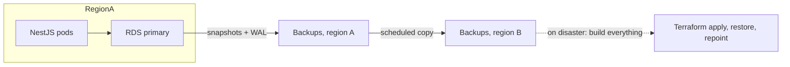
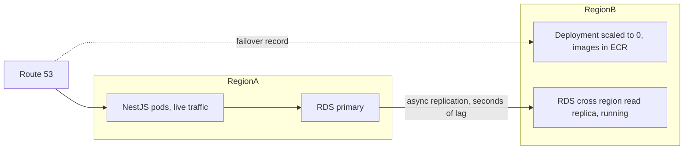
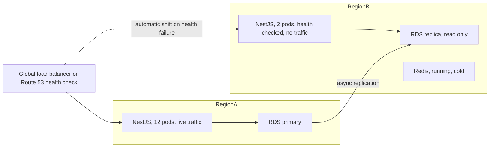
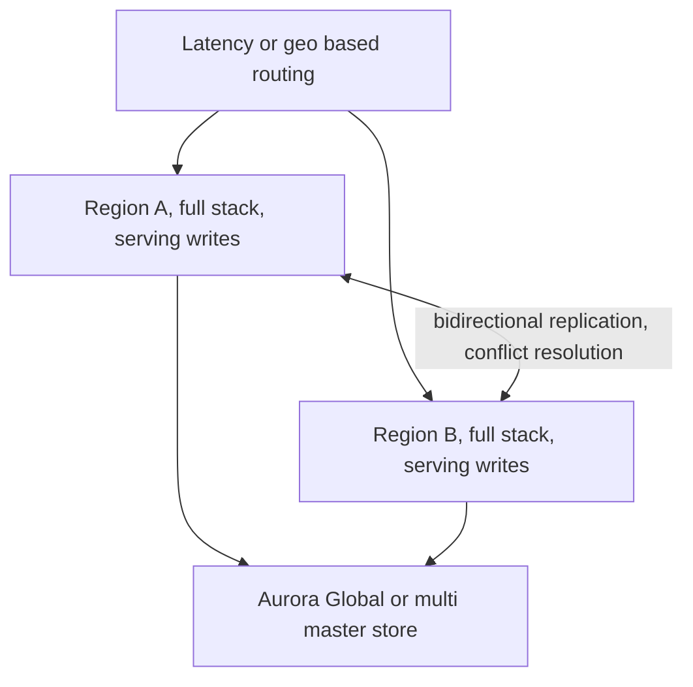
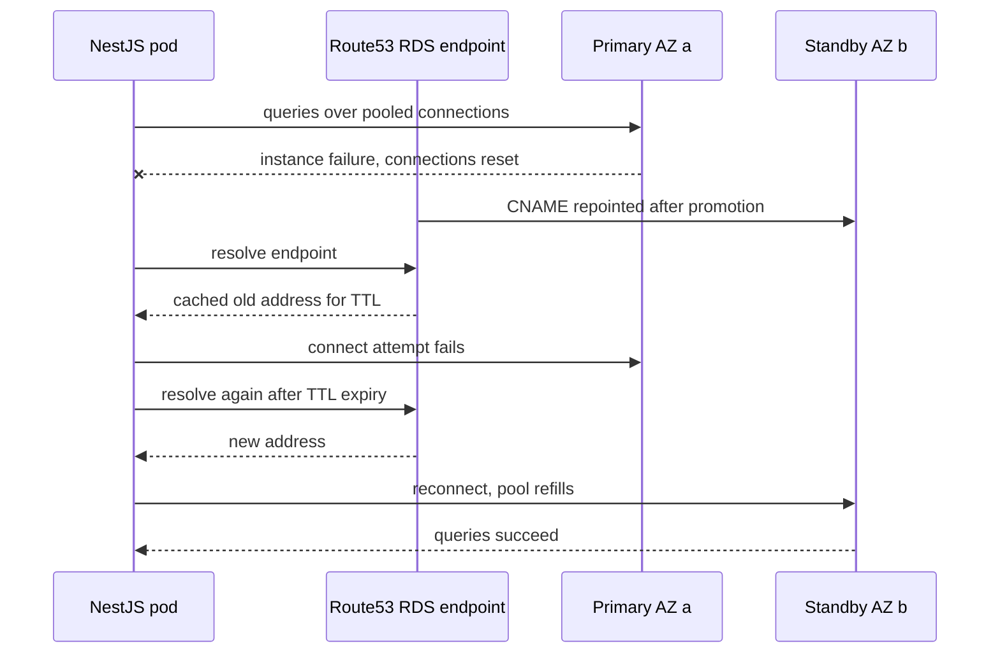

## 49.5 Disaster recovery strategies

#### Concept

There are four canonical DR postures. They form a ladder: each rung costs more, and each rung buys a lower RTO. Almost every real architecture is one of these four, or a deliberate hybrid where the critical data sits one rung higher than everything else.

1. **Backup and restore.** Nothing is running in the second region. On disaster, you build it.
2. **Pilot light.** The data is continuously replicated to the second region; the compute is defined but switched off.
3. **Warm standby.** A scaled-down but *running* copy of the whole system in the second region.
4. **Multi-site active-active.** Both regions serve production traffic all the time.

#### Why does it exist?

Because "be resilient" is not a design. These four names give a team a shared vocabulary and force the cost conversation into the open. When an architect says "pilot light", everyone in the room knows the database replica is running, the app is not, the RTO is tens of minutes, and someone has to write the promotion runbook.

#### Mental model

Imagine a restaurant that wants to survive its kitchen burning down.

- **Backup and restore**: you keep the recipes and supplier list in a safe. After a fire, you rent a new space, buy equipment and reopen in three weeks.
- **Pilot light**: you already rent a second empty unit with the gas and water connected and the recipes on the wall. After a fire, you move in ovens and staff and open in two days.
- **Warm standby**: the second unit is a small working kitchen serving five tables. After a fire, you hire more staff, open the rest of the dining room, and you are at full capacity in an hour.
- **Active-active**: two full restaurants in two cities, both serving customers. One burns down and the other absorbs the bookings. But you also now have two of every problem: two inventories to keep in sync, and an argument every time both take the last table.

#### How it works

**1. Backup and restore.**



Nothing exists in region B except backups. On disaster you run `terraform apply` for the whole stack, restore the newest snapshot, repoint DNS. RTO is hours to a day and depends entirely on how good your infrastructure-as-code is; if the VPC was clicked together by hand three years ago, your RTO is "unknown, probably days". RPO is your snapshot/WAL copy frequency, typically 15 minutes to a few hours because cross-region copies are not continuous.

Right for: internal tools, analytics platforms, anything where a day of downtime is survivable. Also right as the *baseline* under every other strategy, because pilot light and warm standby both fail if the data is corrupt and backups are your only escape from logical damage.

**2. Pilot light.**



The database replica is running and continuously replicating; the application tier exists as manifests and images but zero replicas; the load balancer and networking are provisioned by Terraform and idle. On disaster: promote the replica, scale the deployment from 0 to N, switch DNS.

RTO 15 to 45 minutes, dominated by three things: replica promotion (1 to 5 minutes on RDS), pod startup and readiness (2 to 10 minutes including image pulls and connection pool warm-up), and DNS propagation (your TTL). RPO is replication lag, normally under 5 seconds, but see 49.11 for what happens to lag at exactly the wrong moment.

Right for: most serious e-commerce and SaaS platforms. It is the best value on the ladder.

**3. Warm standby.**



Everything is running in region B, just small. Pods are healthy and answering health checks; Kafka consumers may be running against a mirrored cluster; Redis is up but cold. On disaster you promote the database, scale the app up, and shift traffic — but the app tier never had to cold-start.

RTO 5 to 15 minutes. RPO seconds. Cost is significant: you are paying for a real (if small) second environment, plus the operational burden of keeping two environments actually identical — which is the part teams underestimate. A warm standby that has not been deployed to in six weeks is a cold standby with a bigger bill.

Right for: systems where an hour of downtime costs more than the standby costs per month. Do the arithmetic; sometimes it genuinely does.

**4. Multi-site active-active.**



Both regions take writes. Losing one is a capacity event, not an outage. RTO approaches zero and RPO approaches zero *for infrastructure failures*.

The cost is not the second region. It is that you now own a distributed database problem. Two customers can buy the last unit of stock in two regions simultaneously. Two writes to the same order row can conflict. You need globally unique ids (UUIDv7 or ULID rather than sequences), conflict resolution rules per table, idempotency everywhere, and a team that understands what "eventual consistency" means for a refund. Aurora Global Database gives you fast cross-region replication with a *single* writer and a managed failover in typically under a minute, which is warm standby with excellent ergonomics; true multi-writer requires Aurora multi-master style architectures or application-level partitioning by region.

The honest senior take: most companies that say they want active-active want *fast failover*, which is Aurora Global Database or warm standby, not multi-writer. Ask what they actually need.

**Comparison table.**

| Strategy | RTO | RPO | Complexity | Approx. extra $/month (our 2 TB platform) | Failure it covers |
|---|---|---|---|---|---|
| Backup and restore | 4 to 24 h | 15 min to 24 h | Low | $100 to $400 | Everything, slowly. The only one that covers logical corruption |
| Pilot light | 15 to 45 min | seconds to 5 min | Medium | $1,000 to $1,500 | Region loss, primary loss |
| Warm standby | 5 to 15 min | seconds | High | $2,500 to $4,000 | Region loss with capacity preserved |
| Multi-site active-active | near 0 | near 0 | Very high | $8,000+ and one FTE | Region loss with no customer impact |

Every row *also* needs backup and restore underneath it, because replication does not protect you from `DELETE FROM order_items`.

#### Practical example

Our platform runs pilot light, deliberately:

- RDS Multi-AZ in `us-east-1` (this is availability, not DR).
- Cross-region read replica in `eu-west-1`.
- Terraform modules that build the entire `eu-west-1` stack, applied nightly in plan-only mode so drift is visible.
- ECR images replicated to `eu-west-1` automatically.
- Kubernetes manifests in Git, ArgoCD in region B pointed at the same repo with `replicas: 0` on the workloads.
- Secrets replicated to `eu-west-1` via Secrets Manager multi-region secrets.
- Route 53 health-check-based failover records with a 60 second TTL.

Drilled quarterly, the measured failover is 22 minutes. Cost: about $1,200 a month. RTO target of 4 hours for region loss is met with a wide margin, which is the point — you want headroom, because the drill is calm and the incident is not.

#### Production scenario

The upgrade path matters as much as the destination. A team can move up the ladder incrementally, and each step is independently valuable:

1. Get backups verified nightly (49.2). Now "backup and restore" is real rather than theoretical.
2. Put the whole stack in Terraform, including the parts built by hand. This alone often cuts RTO from days to hours.
3. Add a cross-region replica. Now you are pilot light.
4. Automate the promotion and repointing in a script, and drill it. RTO drops by half because human steps disappear.
5. Only then consider warm standby, and only if the arithmetic says an hour of downtime costs more than the standby.

Teams that jump to step 5 without step 1 have an expensive second environment and no protection from the failure that actually happens.

#### Failure scenario

A fintech built an active-active deployment across two regions with bidirectional replication. It worked beautifully for eight months. Then a schema migration was applied in region A and, because of a pipeline race, not in region B for 40 minutes. Replication from B to A began failing on rows with the new column; the operator, under pressure, disabled the failing replication direction "temporarily" to stop the alert storm.

Six hours later the two regions had diverged on 190,000 rows, including balances. Reconciliation took nine days and a temporary halt on withdrawals. The postmortem's key line: *"active-active doubled our availability and squared our consistency problems"*. They moved to Aurora Global Database with a single writer, gave up sub-second regional failover for roughly 60 second failover, and never had the class of incident again.

#### Edge cases & failure modes

- Pilot light where the manifests in region B have drifted; the deploy fails at exactly the wrong moment. Fix: deploy to region B on every release even at zero replicas, or run ArgoCD there against the same repo.
- Warm standby whose ECR images are not replicated; pods enter `ImagePullBackOff` during the failover.
- Cross-region replica whose instance class is smaller "to save money"; after promotion it cannot carry production load and falls over.
- Quotas: region B's account limits (EIPs, instance vCPU, NAT gateways) are lower because nothing runs there. Failover hits a quota error. Raise quotas in advance and check them in the drill.
- The second region's Kubernetes cluster is a version behind and your CRDs do not apply.
- Active-active with sequence-based primary keys: two regions generate id 1,000,001 for different orders.
- Every strategy above region-local assumes DNS. If your clients cache DNS aggressively or pin IPs, your failover does not reach them (49.11).

#### How a Senior Backend Engineer thinks about this

They pick the rung by arithmetic, not by aspiration: cost of an hour of downtime, multiplied by the realistic probability of the event, against the monthly cost and the engineering time. For most businesses the honest answer is pilot light.

They insist that whatever rung you choose, backup and restore sits underneath it, because the failure that actually happens is logical, not physical.

They ask "what is the *drift* cost?" A second environment that must be kept identical is a permanent tax on every release. If your team cannot commit to that tax, warm standby will silently decay into a broken pilot light.

And they reframe active-active requests: "Do you need both regions serving writes, or do you need to fail over in under a minute? Because those are very different projects."

#### Common mistakes

- Calling Multi-AZ "disaster recovery". It covers one AZ failing, not a region, and not a bad `DELETE`.
- Building a warm standby and never deploying to it.
- Assuming a cross-region replica gives RPO 0. It is asynchronous.
- Choosing active-active for a system whose write conflicts have no defined resolution.
- Forgetting that S3, Redis, Kafka, secrets and DNS all need a region-B story, not just the database.

#### Interview questions

1. **Compare the four DR strategies on RTO, RPO, cost and complexity.** Expected: the table above, with the point that all four need backups underneath.
2. **Why is Multi-AZ not disaster recovery?** Expected: it protects against one AZ; it replicates logical damage instantly; a region event or a bad delete defeats it.
3. **You have a pilot light setup. Walk me through the failover.** Expected: promote replica, update secrets/config with new endpoint, scale deployment, verify health, shift DNS/traffic, warm caches, replay queues, verify writes are landing. Follow-up: what is your longest step? Usually DNS and pod warm-up.
4. **When is active-active the wrong answer?** Expected: when write conflicts have no business resolution, when the team is small, when what is really wanted is fast failover; recommend Aurora Global Database or warm standby instead.
5. **What breaks in a DR region that you only discover in a drill?** Expected: quotas, image replication, secrets, manifest drift, undersized instances, IAM roles, security group rules, certificate issuance.

#### Practical exercise

Take a service you own and write the four-row table for it with *your* numbers: cost of an hour of downtime, monthly cost of each rung, and current rung. Then identify the single cheapest change that moves you one rung.

Acceptance criteria: the table has real dollar figures for at least three rows, the current rung is named honestly (including "we think it is pilot light but region B has not been deployed to in four months"), and the identified change costs less than $500 a month.

## 49.6 Failover and failback

#### Concept

Failover is moving production traffic from a failed primary to a standby. Failback is moving it back afterwards. Failover gets all the attention. Failback is usually harder, and it is where teams get hurt.

#### Why does it exist?

A standby that is never promoted is just an expensive backup. Failover is the act that converts standby capacity into availability, and it has to work under conditions where nothing else is working.

#### Mental model

Imagine a relay race where the runner collapses. Failover is the next runner taking the baton. That is not the hard part — the hard part is that the collapsed runner may still be holding the baton (a split brain), the crowd may still be cheering at the old runner's position (DNS and connection pools), and afterwards you must decide whether the first runner ever rejoins the race and how they catch up.

#### How it works

**Automatic Multi-AZ failover on RDS, and what the application experiences.**

RDS Multi-AZ keeps a synchronous standby in a second AZ. Writes are not acknowledged until they are durable on both. When AWS detects a primary failure (or you reboot with failover, or during patching), it promotes the standby and moves the DNS CNAME `shop-prod.abc.us-east-1.rds.amazonaws.com` to the new instance's address.

The application experience, in order:

1. **All existing connections break.** Every pooled connection returns an error. In Node.js with `pg` you see `Connection terminated unexpectedly` or `ECONNRESET`. In-flight queries fail. In-flight transactions are rolled back.
2. **New connections fail for 30 to 90 seconds** while the standby is promoted, with `ECONNREFUSED` or timeouts.
3. **DNS still resolves to the old address for up to the record's TTL.** RDS uses a 5 second TTL, but Node.js caches DNS lookups at the OS/libuv level and some environments (and `dns.lookup` behaviour with certain resolvers) hold on longer. The classic symptom is a pod that keeps failing for minutes after the database is healthy.
4. **The pool reconnects** and traffic recovers.

Typical total customer impact for RDS Multi-AZ: 60 to 120 seconds of errors. That is only true if your application handles it. Make it true:

```ts
// database.config.ts — TypeORM DataSource options tuned for failover.
export const dataSourceOptions = {
  type: 'postgres' as const,
  url: process.env.DATABASE_URL,
  // Pool behaviour during failover.
  extra: {
    max: 20,
    // Do not let a dead connection sit in the pool.
    idleTimeoutMillis: 30_000,
    // Fail fast on connect so retries can happen quickly, rather than hanging.
    connectionTimeoutMillis: 3_000,
    // Kill queries that outlive the failover instead of piling up.
    statement_timeout: 15_000,
    query_timeout: 15_000,
    // TCP keepalive so the OS notices a black-holed connection quickly.
    keepAlive: true,
    keepAliveInitialDelayMillis: 10_000,
  },
  // TypeORM will retry the initial connection at startup; important because a pod
  // that restarts mid-failover would otherwise CrashLoopBackOff.
  retryAttempts: 20,
  retryDelay: 3_000,
  // Never in production; a failover is not the time to auto-alter your schema.
  synchronize: false,
};
```

The three settings that matter most in practice: a short `connectionTimeoutMillis` so a broken endpoint fails fast instead of hanging for 30 seconds; `statement_timeout` so queries do not accumulate; and generous startup retries so pods restarting during the event do not enter `CrashLoopBackOff` and get backed off for five minutes.

Also, force Node.js to re-resolve DNS. Long-lived processes that cached the old address are a real and frequently misdiagnosed cause of "the database is up but the app is still broken":

```ts
// main.ts — bound the DNS cache so a failover CNAME change is picked up quickly.
import { setDefaultResultOrder } from 'node:dns';
setDefaultResultOrder('ipv4first');
// If you use a DNS caching layer (cacheable-lookup, dnscache), cap its TTL at ~5s
// so it can never outlive an RDS failover CNAME change.
```



**Manual promotion.** For a cross-region read replica there is no automation; you decide. On RDS:

```bash
# Promote the cross-region replica in eu-west-1 to a standalone writable instance.
aws rds promote-read-replica \
  --db-instance-identifier shop-replica-euw1 \
  --region eu-west-1
```

Promotion is irreversible. The replica becomes an independent primary on a new timeline; it will never resume replicating from the old primary. That single fact is why failback is hard.

Before promoting, ask two questions and write the answers in the incident channel:

1. **Is the old primary really gone, or is it isolated?** Promoting while the old primary is still accepting writes gives you two writable databases: split brain. If the old primary is reachable at all, fence it first — revoke its security group ingress, or stop it.
2. **How far behind is the replica?** That is your data loss.

**Verifying whether data was lost with asynchronous replication.**

```sql
-- On the OLD primary if you can still reach it:
SELECT pg_current_wal_lsn();

-- On the replica, before promotion:
SELECT pg_last_wal_receive_lsn() AS received,
       pg_last_wal_replay_lsn()  AS replayed,
       EXTRACT(EPOCH FROM (now() - pg_last_xact_replay_timestamp())) AS lag_seconds;

-- The gap in bytes between what the primary had and what the replica got:
SELECT pg_wal_lsn_diff('0/AB12C340'::pg_lsn, pg_last_wal_replay_lsn());
```

`lag_seconds` is the honest RPO for this event. On RDS the equivalent is the CloudWatch `ReplicaLag` metric, and `AuroraGlobalDBRPOLag` for Aurora Global Database.

Then translate bytes and seconds into business facts, which is what people actually need:

```sql
-- After promotion, on the new primary: what is the newest order we have?
SELECT max(id), max(created_at) FROM orders;
-- Compare against the payment provider's records for the same window (38.8).
-- Every payment they have with no order here is a customer charged with nothing to show.
```

**The failback problem.** You failed over to region B at 03:00. By 09:00 region A is healthy. Now what?

This is harder than the failover for four reasons:

1. **The old primary is stale and divergent.** It has writes that never reached B (the RPO gap) *and* it is missing six hours of writes that happened in B. You cannot just start replicating A from B; A's timeline has diverged.
2. **The only clean path is to rebuild A as a replica of B.** That means a fresh base backup or replica creation from B, which for 2 TB is 1 to 3 hours plus catch-up, plus cross-region transfer costs.
3. **The failback itself is a second planned outage.** Switching writes from B back to A means another promotion, another DNS change, another window of broken connections. You are choosing to have a second incident.
4. **You must extract the orphaned writes from A first.** Those writes in the RPO gap are real customer actions. Snapshot A before rebuilding it, restore that snapshot to a forensic instance, and reconcile those rows into B (the technique is 49.4's).

The senior answer is often: **do not fail back at all.** If region B can carry production indefinitely, make B the new primary, rebuild A as the new standby, and schedule the "failback" as a routine planned maintenance months later, or never. Failing back at 09:00 the same day because "A is our real region" is an emotional decision that causes a second outage.

If you must fail back, do it during a low-traffic window, announce it, drain writes, verify replication lag is zero, and treat it as a planned migration with a rollback plan.

#### Practical example

At 03:12 the `us-east-1` primary becomes unreachable. Multi-AZ failover fires automatically; 74 seconds of elevated errors; the application recovers on its own; nobody is paged beyond the automated notification. This is the 95 percent case and it is why Multi-AZ is worth its doubled instance cost.

At 03:40 the same night, a broader `us-east-1` networking event takes out the application subnets too. Multi-AZ cannot help. The on-call declares a region failover, promotes the `eu-west-1` replica (replica lag at promotion: 4 seconds, so roughly 30 orders potentially affected), scales the ArgoCD-managed deployment from 0 to 12 pods, updates the Route 53 health-check-driven record, and has checkout working at 04:04 — 24 minutes.

Failback happens 11 days later, on a Tuesday at 02:00, as a planned migration, after `us-east-1` has been rebuilt from `eu-west-1` and replicating cleanly for three days.

#### Failure scenario

A team failed over to their DR region during an outage. Twelve minutes later the original region recovered and the original primary came back online, still holding its old DNS entries in some caches and still accepting connections from a subset of pods whose DNS had not refreshed.

For 26 minutes, orders were written to *both* databases. 340 orders landed only on the old primary and 512 only on the new one. Neither database was complete. Reconciliation required a forensic restore of both, a manual merge, and a customer support campaign.

The missing control was fencing: the runbook did not include "before promoting, make the old primary unreachable". One `aws rds stop-db-instance` or a security group rule change would have prevented the entire second incident. Fencing is now step one of their failover runbook, before promotion, always.

#### Edge cases & failure modes

- Split brain: the old primary still takes writes. Fence before promoting, every time.
- Pods that cached the old DNS answer keep failing after the database is healthy; symptoms look like a database problem and are not.
- `CrashLoopBackOff` during failover because the app exits on startup when the database is unreachable, and Kubernetes backs off exponentially to 5 minutes. Use startup retries and a startup probe with a generous `failureThreshold`.
- Connection pool sized for steady state stampedes the freshly promoted database with 12 pods times 20 connections at once. Add jitter and pool warm-up.
- Read replicas of the old primary are now replicating from a dead machine and must be rebuilt.
- A promoted replica has no read replicas and no Multi-AZ standby of its own; you are running without redundancy until you add them. Add them the same day.
- Sequences on the promoted replica are correct (they replicate), but any sequence *cache* on the old primary means small gaps. Gaps are fine; duplicates are not.
- Aurora Global Database "managed planned failover" is clean and lossless, but "failover" during an actual regional outage is a different, potentially lossy operation. Know which one you are doing.

#### How a Senior Backend Engineer thinks about this

They design the application to survive a database restart *as a normal event*, not an incident. Failover then becomes 90 seconds of retries rather than a page. That means timeouts, bounded retries with jitter, idempotent writes and a circuit breaker (Part 30 — Resilience Patterns).

They fence before they promote. Always. It is one command and it prevents the worst class of DR incident.

They record the replication lag at the moment of promotion, in the incident channel, before doing anything else. That number is the RPO of this event and everyone will need it later.

They are deeply suspicious of failback urgency. "Region A is back" is not a reason to move production twice in one day.

#### Common mistakes

- Promoting without fencing.
- Not measuring lag at promotion, then being unable to tell customers what was lost.
- Treating failback as the reverse of failover; it is a fresh migration.
- Leaving the promoted instance without Multi-AZ or backups configured, so a second failure is unrecoverable.
- Forgetting that the promoted replica's parameter group, backup retention and monitoring may all differ from the original primary's.

#### Interview questions

1. **What does an application experience during an RDS Multi-AZ failover?** Expected: connections reset, 30–90s of failed connects, DNS CNAME change with TTL delay, pool reconnect; total 60–120s if the app retries correctly.
2. **What is split brain and how do you prevent it?** Expected: two writable primaries accepting writes; prevent by fencing the old primary (stop it, revoke network access) before promotion, and by promoting only once.
3. **How do you determine data loss after promoting an async replica?** Expected: replica lag at promotion (`pg_last_xact_replay_timestamp`, `ReplicaLag`), LSN diff against the old primary if reachable, then business-level reconciliation against the payment provider and outbox.
4. **Why is failback harder than failover?** Expected: divergent timelines, the old primary must be rebuilt as a replica, orphaned writes in the RPO gap must be extracted, and the failback is itself a second planned outage.
5. **Your pods keep failing after the database is confirmed healthy. What do you check?** Expected: DNS caching in the process, pool holding dead connections, CrashLoopBackOff backoff timer, security groups, secrets pointing at the old endpoint.

#### Practical exercise

In a test environment, run a NestJS service under sustained load against RDS Multi-AZ and trigger `reboot-db-instance --force-failover`. Measure: total error duration, number of failed requests, time until the pool is fully re-established, and whether any pod entered `CrashLoopBackOff`.

Acceptance criteria: total customer-visible error window under 120 seconds, no pod restarts, zero duplicate orders created by client retries, and a documented list of every configuration change you had to make to get there.
