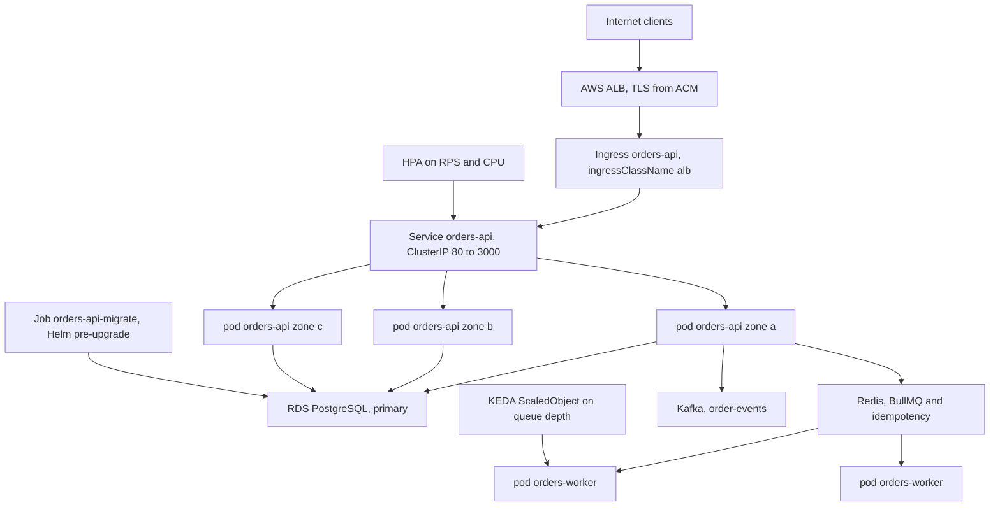
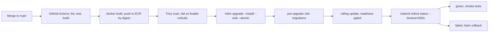

## 49.18 How a NestJS API actually gets deployed to Kubernetes

#### Concept

Everything in this part now goes into one place. This section is the complete production manifest set for `orders-api`: an HTTP API with 3 to 24 replicas, a BullMQ worker Deployment scaled on queue depth, a migration Job, and the objects that make them safe (Service, Ingress, HPA, PDB, NetworkPolicy). Every field is one you have already met; what follows is why each one is set the way it is, and then how CI drives it.

#### Why does it exist?

A manifest that omits probes, resources, a `preStop` hook, a PDB or an anti-affinity rule will work perfectly in staging and fail on the first node drain, the first deploy under load, or the first zone incident. This is the baseline that a senior engineer applies to every customer-facing service without being asked.

#### Mental model

Imagine a shop opening in a mall. The Deployment is the staff roster and the shop's fit-out. The Service is the unit number on the directory. The Ingress is the mall's main entrance and the sign pointing to you. The HPA is the rule for calling in extra staff. The PDB is your agreement with mall management about maintenance. The NetworkPolicy is which back corridors you are allowed to use. Miss one and the shop still opens, but something goes wrong the first busy weekend.

#### How it works



**The Deployment.** Every field annotated with its reason:

```yaml
apiVersion: apps/v1
kind: Deployment
metadata:
  name: orders-api
  namespace: shop
  labels:
    app.kubernetes.io/name: orders-api
    app.kubernetes.io/component: api
    app.kubernetes.io/version: "1.42.0"
spec:
  # replicas is deliberately ABSENT: the HPA owns it (27.14).
  revisionHistoryLimit: 5              # five rollback targets, not the default ten
  minReadySeconds: 10                  # a pod must stay ready 10 s before the rollout advances
  progressDeadlineSeconds: 600         # CI fails the deploy if no progress for 10 minutes
  strategy:
    type: RollingUpdate
    rollingUpdate:
      maxSurge: 1                      # one extra pod during the rollout
      maxUnavailable: 0                # never drop below the desired count: no capacity dip
  selector:
    matchLabels:
      app.kubernetes.io/name: orders-api
  template:
    metadata:
      labels:
        app.kubernetes.io/name: orders-api
        app.kubernetes.io/component: api
      annotations:
        checksum/config: "9c1f7a3e5b2d48c0a7e6f1b3d9c8e2a4"    # config change triggers a rollout (49.7)
        checksum/secret: "3b8d2f0a7c6e4915b2d8f1a0c7e39b46"
    spec:
      serviceAccountName: orders-api                 # IRSA-annotated (27.16)
      automountServiceAccountToken: false            # the app never calls the Kubernetes API
      terminationGracePeriodSeconds: 60              # 15 s preStop + up to 45 s of draining (49.13)
      securityContext:
        runAsNonRoot: true
        runAsUser: 1001
        runAsGroup: 1001
        fsGroup: 1001
        seccompProfile: { type: RuntimeDefault }
      topologySpreadConstraints:                     # 27.15: survive a zone loss
        - maxSkew: 1
          topologyKey: topology.kubernetes.io/zone
          whenUnsatisfiable: DoNotSchedule
          labelSelector:
            matchLabels: { app.kubernetes.io/name: orders-api }
          matchLabelKeys: [pod-template-hash]
      affinity:
        podAntiAffinity:                             # prefer separate nodes, do not require it
          preferredDuringSchedulingIgnoredDuringExecution:
            - weight: 100
              podAffinityTerm:
                topologyKey: kubernetes.io/hostname
                labelSelector:
                  matchLabels: { app.kubernetes.io/name: orders-api }
      containers:
        - name: api
          image: 123456789012.dkr.ecr.eu-west-1.amazonaws.com/orders-api@sha256:9f2b1c4e7a08d3f6b5c2e9a1d7f40b83c6e5a294f1d8b70e3c9a5f26d1b48e07
          imagePullPolicy: IfNotPresent
          ports:
            - { name: http, containerPort: 3000 }    # non-privileged port: non-root cannot bind 80
          envFrom:
            - configMapRef: { name: orders-api-config }
          env:
            - name: DB_PASSWORD
              valueFrom: { secretKeyRef: { name: orders-api-secrets, key: DB_PASSWORD } }
            - name: JWT_SIGNING_KEY
              valueFrom: { secretKeyRef: { name: orders-api-secrets, key: JWT_SIGNING_KEY } }
            - name: POD_NAME
              valueFrom: { fieldRef: { fieldPath: metadata.name } }
            - name: K8S_NAMESPACE
              valueFrom: { fieldRef: { fieldPath: metadata.namespace } }
            - name: NODE_NAME
              valueFrom: { fieldRef: { fieldPath: spec.nodeName } }
            - name: NODE_OPTIONS
              value: "--max-old-space-size=384"      # ~75% of the 512Mi limit (49.12)
            - name: GIT_SHA
              value: "3f9a1c2"
          startupProbe:                              # 120 s of boot grace, then liveness takes over
            httpGet: { path: /health/live, port: http }
            periodSeconds: 5
            timeoutSeconds: 2
            failureThreshold: 24
          livenessProbe:                             # cheap, no dependencies (49.11)
            httpGet: { path: /health/live, port: http }
            periodSeconds: 10
            timeoutSeconds: 2
            failureThreshold: 3
          readinessProbe:                            # own pool and Redis only
            httpGet: { path: /health/ready, port: http }
            periodSeconds: 5
            timeoutSeconds: 3
            failureThreshold: 3
          resources:
            requests: { cpu: 250m, memory: 512Mi }
            limits: { memory: 512Mi }                # no CPU limit: avoid CFS throttling (49.12)
          lifecycle:
            preStop:
              exec: { command: ["/bin/sh", "-c", "sleep 15"] }   # endpoint propagation (49.13)
          securityContext:
            allowPrivilegeEscalation: false
            readOnlyRootFilesystem: true
            capabilities: { drop: ["ALL"] }
          volumeMounts:
            - { name: tmp, mountPath: /tmp }
      volumes:
        - name: tmp
          emptyDir: { sizeLimit: 256Mi }
```

Two decisions worth defending out loud in a review. **No `replicas` field**, because the HPA owns it and an `apply` would otherwise reset the count on every deploy. **No CPU limit**, because the request already guarantees a share and a limit only buys throttling; if your platform policy requires one, set it to `1000m`, four times the request.

**The Service.** Nothing surprising, and that is the point:

```yaml
apiVersion: v1
kind: Service
metadata:
  name: orders-api
  namespace: shop
  labels:
    app.kubernetes.io/name: orders-api          # the ServiceMonitor selects on this (27.17)
spec:
  type: ClusterIP
  selector:
    app.kubernetes.io/name: orders-api
  ports:
    - { name: http, port: 80, targetPort: http, protocol: TCP }
```

**The Ingress**, with the annotations that actually matter in production:

```yaml
apiVersion: networking.k8s.io/v1
kind: Ingress
metadata:
  name: orders-api
  namespace: shop
  annotations:
    alb.ingress.kubernetes.io/scheme: internet-facing
    alb.ingress.kubernetes.io/target-type: ip                    # straight to pod IPs, no NodePort hop
    alb.ingress.kubernetes.io/listen-ports: '[{"HTTPS":443},{"HTTP":80}]'
    alb.ingress.kubernetes.io/ssl-redirect: "443"
    alb.ingress.kubernetes.io/certificate-arn: arn:aws:acm:eu-west-1:123456789012:certificate/abcd-1234
    alb.ingress.kubernetes.io/healthcheck-path: /health/ready    # ready, not live
    alb.ingress.kubernetes.io/healthcheck-interval-seconds: "10"
    alb.ingress.kubernetes.io/healthy-threshold-count: "2"
    alb.ingress.kubernetes.io/unhealthy-threshold-count: "3"
    # Idle timeout above Node's keepAliveTimeout would cause 502s; Node is set to 65 s,
    # so the ALB must be BELOW that: 60 s. See 49.6.
    alb.ingress.kubernetes.io/load-balancer-attributes: idle_timeout.timeout_seconds=60
    # Deregistration delay must be covered by the preStop sleep (15 s).
    alb.ingress.kubernetes.io/target-group-attributes: deregistration_delay.timeout_seconds=15
    alb.ingress.kubernetes.io/wafv2-acl-arn: arn:aws:wafv2:eu-west-1:123456789012:regional/webacl/prod/abcd
spec:
  ingressClassName: alb
  rules:
    - host: api.shop.example.com
      http:
        paths:
          - path: /orders
            pathType: Prefix
            backend:
              service: { name: orders-api, port: { name: http } }
```

Body size on an ALB is fixed at 1 MB for the request line and headers but the body is unbounded, so upload limits belong in the app (`bodyParser` limits) or in NGINX ingress via `proxy-body-size`. With NGINX instead of ALB, the equivalent annotations are `nginx.ingress.kubernetes.io/proxy-body-size: "10m"`, `proxy-read-timeout: "60"` and `proxy-connect-timeout: "5"`.

**The HPA:**

```yaml
apiVersion: autoscaling/v2
kind: HorizontalPodAutoscaler
metadata:
  name: orders-api
  namespace: shop
spec:
  scaleTargetRef: { apiVersion: apps/v1, kind: Deployment, name: orders-api }
  minReplicas: 3                        # one per zone; absorbs load while nodes are added
  maxReplicas: 24                       # 24 * DB_POOL_MAX 10 = 240 connections of 500 (27.14)
  metrics:
    - type: Pods
      pods:
        metric: { name: http_requests_per_second }
        target: { type: AverageValue, averageValue: "120" }
    - type: Resource
      resource:
        name: cpu
        target: { type: Utilization, averageUtilization: 75 }
  behavior:
    scaleUp:
      stabilizationWindowSeconds: 0
      policies:
        - { type: Percent, value: 100, periodSeconds: 30 }
        - { type: Pods, value: 4, periodSeconds: 30 }
      selectPolicy: Max
    scaleDown:
      stabilizationWindowSeconds: 300
      policies:
        - { type: Percent, value: 25, periodSeconds: 60 }
```

**The migration Job**, run as a Helm pre-upgrade hook so the schema is ready before new pods start (49.10). **The worker Deployment** is the same shape as the API with three differences: no Service or Ingress, no HTTP probes (use an `exec` liveness that touches a heartbeat file the worker writes), and a much longer grace period:

```yaml
apiVersion: apps/v1
kind: Deployment
metadata:
  name: orders-worker
  namespace: shop
  labels:
    app.kubernetes.io/name: orders-worker
spec:
  # replicas absent: KEDA owns it.
  strategy:
    type: RollingUpdate
    rollingUpdate: { maxSurge: 1, maxUnavailable: 0 }
  selector:
    matchLabels: { app.kubernetes.io/name: orders-worker }
  template:
    metadata:
      labels: { app.kubernetes.io/name: orders-worker }
    spec:
      serviceAccountName: orders-worker
      automountServiceAccountToken: false
      terminationGracePeriodSeconds: 300            # longest job is 4 minutes (49.13)
      securityContext:
        runAsNonRoot: true
        runAsUser: 1001
        seccompProfile: { type: RuntimeDefault }
      tolerations:
        - { key: dedicated, operator: Equal, value: workers, effect: NoSchedule }
      nodeSelector:
        workload: workers                           # dedicated node pool (27.15)
      containers:
        - name: worker
          image: 123456789012.dkr.ecr.eu-west-1.amazonaws.com/orders-api@sha256:9f2b1c4e7a08d3f6b5c2e9a1d7f40b83c6e5a294f1d8b70e3c9a5f26d1b48e07
          command: ["node", "dist/worker.js"]       # same image, different entrypoint
          envFrom:
            - configMapRef: { name: orders-api-config }
          env:
            - name: DB_PASSWORD
              valueFrom: { secretKeyRef: { name: orders-api-secrets, key: DB_PASSWORD } }
            - name: NODE_OPTIONS
              value: "--max-old-space-size=768"
          livenessProbe:
            exec:
              # The worker touches this file on every event loop tick group; if it stops,
              # the process is wedged and a restart is the right remedy.
              command: ["/bin/sh", "-c", "test $(( $(date +%s) - $(stat -c %Y /tmp/heartbeat) )) -lt 60"]
            periodSeconds: 30
            failureThreshold: 3
          resources:
            requests: { cpu: 500m, memory: 1Gi }
            limits: { memory: 1Gi }
          securityContext:
            allowPrivilegeEscalation: false
            readOnlyRootFilesystem: true
            capabilities: { drop: ["ALL"] }
          volumeMounts:
            - { name: tmp, mountPath: /tmp }
      volumes:
        - name: tmp
          emptyDir: { sizeLimit: 512Mi }
```

Its KEDA `ScaledObject` (49.14) scales it from 1 to 25 on `bull:orders:wait` length. **The PodDisruptionBudget** for each:

```yaml
apiVersion: policy/v1
kind: PodDisruptionBudget
metadata:
  name: orders-api
  namespace: shop
spec:
  maxUnavailable: 1                     # not minAvailable: works at any replica count
  selector:
    matchLabels: { app.kubernetes.io/name: orders-api }
```

**The NetworkPolicy** is the default-deny plus explicit allows from 49.16. That is the complete set: Deployment, Service, Ingress, HPA, PDB, NetworkPolicy, ConfigMap, ExternalSecret, ServiceAccount, ServiceMonitor, migration Job, worker Deployment, ScaledObject, worker PDB. Fourteen objects, all of them generated from one Helm chart with about 60 lines of values per environment.

#### Practical example

The CI/CD flow from a merged pull request to serving traffic:



```yaml
# .github/workflows/deploy.yml (excerpt)
      - name: Build and push
        run: |
          IMAGE="$ECR/orders-api"
          docker build -t "$IMAGE:sha-${GITHUB_SHA::7}" .
          docker push "$IMAGE:sha-${GITHUB_SHA::7}"
          DIGEST=$(docker inspect --format='{{index .RepoDigests 0}}' "$IMAGE:sha-${GITHUB_SHA::7}")
          echo "digest=$DIGEST" >> "$GITHUB_OUTPUT"

      - name: Deploy
        run: |
          helm upgrade --install orders-api ./charts/orders-api \
            --namespace shop \
            --values ./charts/orders-api/values-prod.yaml \
            --set image.digest="${{ steps.build.outputs.digest }}" \
            --set version="${GITHUB_SHA::7}" \
            --wait --timeout 10m --atomic          # --atomic rolls back automatically on failure

      - name: Verify
        run: |
          kubectl -n shop rollout status deployment/orders-api --timeout=600s
          kubectl -n shop get pods -l app.kubernetes.io/name=orders-api
```

The commands you use to watch a rollout, in the order you reach for them:

```bash
kubectl -n shop rollout status deployment/orders-api --timeout=600s     # blocks; the CI gate
kubectl -n shop get pods -l app.kubernetes.io/name=orders-api -w        # live pod states
kubectl -n shop get rs -l app.kubernetes.io/name=orders-api             # old and new ReplicaSets
kubectl -n shop describe deployment orders-api | tail -20               # conditions and events
kubectl -n shop get events --sort-by=.lastTimestamp | tail -30
kubectl -n shop logs -l app.kubernetes.io/name=orders-api --tail=50 --max-log-requests=10
watch -n2 'kubectl -n shop get endpointslices -l kubernetes.io/service-name=orders-api -o wide'
```

**A full rollback walkthrough.** At 15:12 a deploy goes out; at 15:14 the error rate rises from 0.1% to 6%. Not a crash, not a probe failure: a logic bug producing 500s on one endpoint, so the rollout completed successfully and Kubernetes is perfectly happy.

```bash
# 1. Confirm what is running and since when.
kubectl -n shop rollout history deployment/orders-api
# REVISION  CHANGE-CAUSE
# 12        image sha-3f9a1c2
# 13        image sha-b41c9d2   <- current, bad

kubectl -n shop describe deployment orders-api | grep -i image

# 2. Roll back. This scales revision 12's ReplicaSet up and 13 down, with the same
#    rolling strategy: maxSurge 1, maxUnavailable 0, readiness gated. No downtime.
kubectl -n shop rollout undo deployment/orders-api
# or, to a specific revision:
kubectl -n shop rollout undo deployment/orders-api --to-revision=12

# 3. Watch it complete.
kubectl -n shop rollout status deployment/orders-api --timeout=300s

# 4. Confirm the version actually serving.
kubectl -n shop exec deploy/orders-api -- wget -qO- localhost:3000/internal/version

# With Helm, the equivalent, which also reverts ConfigMaps and every other object:
helm -n shop history orders-api
helm -n shop rollback orders-api 12 --wait --timeout 5m
```

Elapsed time from decision to healthy: about 90 seconds for 6 replicas. Three things this walkthrough assumes, and each is a prerequisite you must have arranged in advance: `revisionHistoryLimit` above 0 so a rollback target exists; the previous image still present in the registry (never delete tags that are still in a rollout history); and **the database schema still compatible with the old code**, which is the one Kubernetes cannot help with. `rollout undo` reverts pods, never data. If revision 13 ran a migration that dropped a column, rolling back the pods gives you the old code against a schema it cannot use, and you have turned a 6% error rate into a 100% one. That is why migrations are expand-only and why Parts 27, 28 matter more than this chapter for deploy safety.

#### Production scenario

This exact setup at a mid-sized retailer: 6 to 18 API pods, 2 to 20 worker pods, 40 deploys a week, median rollout 2 minutes 10 seconds, zero-downtime by measurement (a synthetic checker at 5 RPS records no failures across deploys for 14 months). Automatic Helm rollbacks fire roughly twice a month, always for readiness failures caused by config. Manual rollbacks (like the one above, for a logic bug) happen about once a quarter and take under two minutes because the runbook is four commands.

#### Failure scenario

At 11:40 a deploy hangs: `rollout status` prints `Waiting for deployment "orders-api" rollout to finish: 1 out of 6 new replicas have been updated` for eight minutes, then `--atomic` rolls it back. `kubectl describe pod` on the new pod shows `Readiness probe failed: HTTP probe failed with statuscode: 503`, and `kubectl logs` shows `RedisConnectionError: getaddrinfo ENOTFOUND orders-redis-primary`. The values file for production had been updated with a Redis hostname from a planned migration that had not happened yet. Old pods served throughout; customers saw nothing; the fix was a one-line revert. This is what a correctly configured rollout is supposed to feel like: a failed pipeline, not an incident.

#### Edge cases & failure modes

- **`replicas` present in the chart while an HPA exists**: every deploy resets the count and the HPA scales back, a sawtooth under load.
- **`--atomic` without `--timeout`** waits the default 5 minutes, which is shorter than some rollouts.
- **Image by tag rather than digest** makes rollbacks and audits unreliable (49.21).
- **Migration hook that fails** leaves the release in a `pending-upgrade` state; `helm rollback` is needed before the next deploy.
- **`rollout undo` after two rapid deploys** may go back to a revision you did not expect; check history first.
- **A missing ImagePullSecret in a new namespace** looks like a broken deploy but is a credentials problem.
- **Smoke tests that hit the load balancer** may reach old pods mid-rollout; test the version endpoint, not just a 200.

#### How a Senior Backend Engineer thinks about this

They keep one chart and one deploy path for every service, so the twelfth service inherits every lesson from the first eleven. They gate CI on `rollout status` and make failure automatic (`--atomic`), because a human deciding whether to roll back at 15:14 is slower and worse than a pipeline that already did.

They rehearse rollback. A rollback command nobody has run is not a rollback plan. And they know exactly which failures Kubernetes can fix (a crashing pod, a failing probe, a bad config) and which it cannot (a schema change, a corrupted cache, a message published in a new format), and they make the second category impossible by design rather than recoverable by heroics.

#### Common mistakes

- Deploying with `kubectl apply` from a laptop instead of a pipeline.
- No `rollout status` gate, so CI is green while the rollout is stuck.
- Rolling back pods and assuming the database came with them.
- Deleting old image tags, so rollback targets do not exist.
- Copying a manifest without probes, resources, `preStop` or a PDB.
- One giant manifest file per service instead of a templated chart.

#### Interview questions

1. *Walk me through deploying a NestJS API to Kubernetes with zero downtime.* Expected: image by digest, migrations as a pre-upgrade Job, rolling update with `maxUnavailable: 0`, readiness gating, `preStop` and grace period, PDB, topology spread, `rollout status` in CI with automatic rollback.
2. *Where does the HPA fit and what must the manifest omit?* Expected: HPA owns `replicas`; omit it from the chart or the apply fights the autoscaler.
3. *A rollout is stuck at 1 of 6. Give me your first five commands.* Expected: `rollout status`, `get pods`, `describe pod`, `logs` (and `--previous`), `get events`.
4. *How do you roll back, and what does rollback not cover?* Expected: `rollout undo` or `helm rollback`; scales the previous ReplicaSet with the same strategy; does not revert schema, data, or messages already published.
5. *Why pin an image by digest?* Expected: immutability, reproducibility, the artifact scanned is the artifact deployed, tags can be repointed.

#### Practical exercise

Assemble the full object set for `orders-api` in a chart and deploy it to a test cluster. Run a load generator at 50 RPS with a synthetic checker recording every failure. Then perform, in order: a normal deploy, a deploy with a broken readiness probe (confirm automatic rollback), a `kubectl rollout undo` after a successful deploy, a node drain of the node hosting two pods, and a KEDA-driven worker scale-up by pushing 3,000 jobs. Acceptance criteria: zero failed requests across all five events, the automatic rollback triggered by `--atomic`, the drain respecting the PDB (visible in `kubectl get pdb`), and the worker replica count graphed against queue depth.

## 49.19 Helm and GitOps in practice

#### Concept

Helm is a templating and release system: a chart is a set of templated manifests plus a `values.yaml`, and `helm upgrade` renders them and applies the result as a versioned release. GitOps inverts the direction of deployment: instead of CI pushing to the cluster, an in-cluster agent (ArgoCD or Flux) pulls the desired state from Git and continuously reconciles the cluster towards it.

#### Why does it exist?

Fourteen objects per service times forty services is 560 YAML files, 90% identical. Templating removes the duplication and makes "every service gets a PDB" enforceable rather than aspirational. GitOps removes the other problem: a cluster whose actual state has drifted from what anyone believes is deployed, because six people ran `kubectl apply` from six laptops.

#### Mental model

Helm is a mail-merge: one letter template, many recipients, one variable list per recipient. GitOps is a thermostat: you set the target temperature in Git, and a device in the room continuously compares and corrects, whether or not anyone is watching.

#### How it works

The chart layout for this application:

```text
charts/orders-api/
  Chart.yaml                 # name, version, appVersion
  values.yaml                # defaults: the safe, production-shaped baseline
  values-dev.yaml            # 1 replica, debug logs, no HPA, relaxed resources
  values-staging.yaml        # 2 replicas, real probes, staging hostnames
  values-prod.yaml           # HPA 3 to 24, prod hostnames, strict policies
  templates/
    _helpers.tpl             # name, fullname, common labels
    deployment.yaml
    deployment-worker.yaml
    service.yaml
    ingress.yaml
    hpa.yaml
    scaledobject.yaml
    pdb.yaml
    configmap.yaml
    externalsecret.yaml
    serviceaccount.yaml
    servicemonitor.yaml
    networkpolicy.yaml
    job-migrate.yaml         # helm.sh/hook: pre-upgrade
    NOTES.txt
```

```yaml
# values-prod.yaml (excerpt): only what differs from the safe defaults
image:
  repository: 123456789012.dkr.ecr.eu-west-1.amazonaws.com/orders-api
  digest: ""                       # injected by CI, never a floating tag
replicaCount: null                 # HPA owns it
autoscaling:
  enabled: true
  minReplicas: 3
  maxReplicas: 24                  # 24 * dbPoolMax(10) = 240 of RDS max_connections 500
  targetRps: 120
resources:
  requests: { cpu: 250m, memory: 512Mi }
  limits: { memory: 512Mi }
nodeOptions: "--max-old-space-size=384"
ingress:
  enabled: true
  host: api.shop.example.com
  certificateArn: arn:aws:acm:eu-west-1:123456789012:certificate/abcd-1234
config:
  LOG_LEVEL: info
  DB_HOST: orders-prod.cluster-abc123.eu-west-1.rds.amazonaws.com
  DB_POOL_MAX: "10"
worker:
  enabled: true
  keda: { minReplicas: 1, maxReplicas: 25, listLength: 50 }
```

The discipline that makes this work: **defaults in `values.yaml` are the production-safe values**, and per-environment files only override what genuinely differs. The opposite (permissive defaults, hardened prod) means every new service ships insecure until someone remembers to harden it.

Two Helm behaviours worth knowing. `helm upgrade --atomic` rolls the release back automatically if it does not become ready within `--timeout`. And Helm does *not* delete objects that a previous chart version created but the new one does not render, unless the object is still tracked in the release; orphaned objects from a renamed template are a real source of confusion.

**ArgoCD in one page.** ArgoCD runs in the cluster, watches a Git repository, renders the chart, compares the result with live state, and either reports drift or corrects it.

```yaml
apiVersion: argoproj.io/v1alpha1
kind: Application
metadata:
  name: orders-api-prod
  namespace: argocd
spec:
  project: shop
  source:
    repoURL: https://github.com/acme/k8s-manifests.git
    targetRevision: main
    path: charts/orders-api
    helm:
      valueFiles: [values-prod.yaml]
      parameters:
        - name: image.digest
          value: sha256:9f2b1c4e7a08d3f6b5c2e9a1d7f40b83c6e5a294f1d8b70e3c9a5f26d1b48e07
  destination:
    server: https://kubernetes.default.svc
    namespace: shop
  syncPolicy:
    automated:
      prune: true                    # delete objects removed from Git
      selfHeal: true                 # revert manual kubectl changes
    syncOptions:
      - CreateNamespace=false
      - PruneLast=true
    retry:
      limit: 3
      backoff: { duration: 30s, factor: 2, maxDuration: 5m }
```

The flow becomes: CI builds and pushes the image, then commits the new digest to the manifests repository. ArgoCD notices within seconds (or immediately via webhook), renders, syncs, and reports health. What you gain: the repository is the single source of truth, drift is visible and auto-corrected (`selfHeal`), rollback is `git revert`, the audit trail is the Git history, and CI no longer needs cluster credentials, which removes the most dangerous secret in your pipeline.

What it costs: an extra system to run and upgrade, a slightly indirect debugging path ("why is this not deploying?" is now an ArgoCD question), and the need for discipline about `selfHeal`, which will cheerfully undo an emergency manual fix 30 seconds after you make it. During an incident, pause auto-sync before hand-editing anything.

**Kustomize as the alternative.** Kustomize takes plain YAML and applies overlays: a `base/` with real manifests, and `overlays/prod/` with patches. It is built into `kubectl` (`kubectl apply -k`), has no templating language and no release state, and produces manifests that are readable as YAML rather than as a template.

| | Helm | Kustomize |
|---|---|---|
| Mechanism | Go templates plus values | Strategic-merge and JSON patches on plain YAML |
| Learning curve | Template syntax, `_helpers.tpl`, quoting | Patch semantics, less to learn |
| Third-party software | The standard: most vendors ship charts | Awkward; usually wrap a rendered chart |
| Release state and rollback | `helm history`, `helm rollback` | None; rollback is `git revert` plus apply |
| Conditionals and loops | Yes, and easily overused | Deliberately absent |
| Best for | Reusable, parameterised, distributable apps | A handful of your own apps across environments |

The common production answer: Helm for third-party components (ingress controller, cert-manager, kube-prometheus-stack, KEDA) because that is how they are distributed, and either tool for your own services. Many teams end up with one shared internal chart used by every service, which is Helm's real value here: not templating, but standardisation.

#### Production scenario

A `k8s-manifests` repository holds one ArgoCD `Application` per service per environment, generated by an ApplicationSet from a list. Forty services, three environments, 120 Applications. CI's only cluster interaction is committing an image digest; it holds no kubeconfig. A production deploy is a commit, visible and revertable. Drift detection catches roughly two manual changes a month, auto-reverts them, and posts to Slack, which has ended the "who changed this?" genre of conversation entirely.

#### Failure scenario

At 22:30 an engineer fixes an incident by editing a ConfigMap directly and restarting the Deployment. Service recovers. Forty seconds later ArgoCD's `selfHeal` reverts the ConfigMap to the Git version and the incident returns, now more confusing because the engineer knows they fixed it. Ten minutes are lost before someone notices the ArgoCD sync events. The fix, added to the runbook: pause auto-sync (`argocd app set orders-api --sync-policy none`) before manual changes, and always follow an emergency change with a Git commit within the hour. GitOps is a strong guarantee, and strong guarantees are inconvenient exactly when you want to break the rules.

#### Edge cases & failure modes

- **`selfHeal` reverting emergency fixes**, as above.
- **`prune: true` deleting an object** you created out of band and depended on.
- **Helm release stuck** in `pending-upgrade` after a failed hook; `helm rollback` is required before the next attempt.
- **Values drift between environments**: staging works, production does not, because a key was added to only one file. Schema-validate values (`values.schema.json`).
- **Chart version and app version confusion** in `Chart.yaml`, so nobody can tell what is deployed.
- **Secrets in values files** committed to Git; use ESO or SOPS.
- **ArgoCD out of sync forever** because a mutating webhook or a controller changes a field the chart also sets (a classic with `replicas` and HPAs; use `ignoreDifferences`).
- **Rendered manifests that differ from what you reviewed**; always run `helm template` in CI and diff it.

#### How a Senior Backend Engineer thinks about this

They standardise once: one internal chart with production-safe defaults, so every new service is born with probes, resources, a PDB, a NetworkPolicy and a ServiceMonitor. They keep values files small and reviewable and put the reasoning for numbers (`maxReplicas` and connection budget) in comments next to them.

They prefer GitOps because it removes cluster credentials from CI and makes drift visible, and they accept its inconvenience during incidents by writing the pause step into the runbook. They diff rendered manifests in CI, because a template change that quietly drops a `securityContext` is invisible in a values diff.

#### Common mistakes

- Charts with permissive defaults so every new service ships insecure.
- Secrets in `values.yaml`.
- `helm upgrade` without `--wait` or `--atomic`, so a broken release is "successful".
- Manual `kubectl edit` in a GitOps cluster.
- Overusing template conditionals until nobody can predict the output.
- Not pinning chart versions of third-party components, so an upgrade arrives by surprise.

#### Interview questions

1. *Helm or Kustomize?* Expected: mechanism, release state and rollback, third-party distribution, complexity; a defensible either-way answer with reasons.
2. *What does GitOps change about your CI pipeline?* Expected: CI stops needing cluster credentials; it commits a digest; the in-cluster agent reconciles; rollback is a revert; drift is detected and healed.
3. *`selfHeal` fought your emergency fix. What is the process?* Expected: pause auto-sync, fix, commit, resume; runbook step; why the guarantee is worth the inconvenience.
4. *How do you keep environments from drifting?* Expected: production-safe defaults, minimal overrides, values schema validation, rendered-manifest diffs in CI, one chart per service family.
5. *How do you manage secrets with GitOps?* Expected: never in Git; External Secrets Operator or SOPS/Sealed Secrets; the tradeoffs of each.

#### Practical exercise

Convert the manifests from 49.18 into a chart with `values.yaml`, `values-dev.yaml` and `values-prod.yaml`, and verify with `helm template ... | kubectl apply --dry-run=server -f -`. Add a `values.schema.json` requiring `image.digest` and `resources.requests.memory`, and confirm a deploy fails without them. Then install ArgoCD in a test cluster, create an Application with `selfHeal: true`, edit a live ConfigMap with `kubectl`, and time how long until it is reverted. Acceptance criteria: three environments rendering correctly from one chart, the schema rejecting an incomplete values file, and the self-heal reversion timed and explained.

## 49.20 A debugging runbook

#### Concept

Nearly every Kubernetes incident a backend engineer meets is one of about ten states. This is the table you memorise, followed by the walkthrough for each.

| Symptom | Most likely cause | First command | Usual fix |
|---|---|---|---|
| `Pending` | No node with enough free requests; affinity or taint; PVC zone; quota | `kubectl describe pod` (Events) | Lower requests, add nodes, fix constraints, raise quota |
| `ContainerCreating` (stuck) | Volume attach, image pull, CNI IP exhaustion, secret missing | `kubectl describe pod` | Fix mount, subnet IPs, secret name |
| `CrashLoopBackOff` | App exits at boot: bad env var, missing config, port in use | `kubectl logs --previous` | Fix config, then redeploy |
| `OOMKilled` / exit 137 | Memory limit exceeded; no `--max-old-space-size` | `kubectl describe pod` (Last State) | Fix unbounded work, set the flag, size correctly |
| `ImagePullBackOff` | Wrong tag, wrong registry, missing pull secret, no ECR permission | `kubectl describe pod` (Events) | Fix reference or credentials |
| `Running` but `0/1 READY` | Readiness failing: dependency, wrong path or port, auth on probe | `kubectl describe pod` + `logs` | Fix the check or the dependency |
| `Evicted` | Node memory or ephemeral-storage pressure | `kubectl describe pod` + `describe node` | Set requests, stop writing files, add capacity |
| `Error` / `Completed` on a Job | Non-zero or zero exit from a batch task | `kubectl logs job/<name>` | Fix the script |
| `Terminating` (stuck) | Long grace period, finalizer, unresponsive node | `kubectl describe pod` | Wait, remove finalizer, `--force` last |
| High p99, CPU looks fine | CFS throttling, event loop lag, noisy neighbour | Throttling metric | Raise or remove the CPU limit |

**`Pending`.** The scheduler could not place the pod. The reason is always in the events:

```bash
kubectl -n shop describe pod orders-api-b41c9d2-x7k2p | tail -20
# Warning  FailedScheduling  0/12 nodes are available:
#   5 Insufficient cpu, 3 node(s) had untolerated taint {dedicated: workers},
#   4 node(s) didn't match pod topology spread constraints.
```

Read the sentence literally: it counts nodes per reason and they sum to your cluster size. `Insufficient cpu` means no node has that much *unreserved request* free, regardless of actual usage. Check the arithmetic and the autoscaler:

```bash
kubectl describe node ip-10-0-3-14 | grep -A6 "Allocated resources"
kubectl get nodes -o custom-columns='NAME:.metadata.name,CPU:.status.allocatable.cpu,MEM:.status.allocatable.memory'
kubectl -n kube-system logs deploy/cluster-autoscaler --tail=50 | grep -i "scale.up\|no.scale"
kubectl -n shop describe resourcequota                # quota rejection looks similar
```

Fixes, in order of preference: lower an inflated request (most common real cause), let the autoscaler add a node (check its logs to see why it did not), relax a `required` anti-affinity to `preferred`, or add a toleration. For a PVC-related `volume node affinity conflict`, see 49.9.

**`CrashLoopBackOff` from a bad env var.** The container starts, exits non-zero, and the kubelet backs off (10 s, 20 s, 40 s, doubling to 5 minutes). The exact sequence:

```bash
kubectl -n shop get pods                                   # RESTARTS climbing
kubectl -n shop logs orders-api-b41c9d2-x7k2p --previous   # the CRASHED container's output
# Error: Config validation error: "DB_HOST" is not allowed to be empty

kubectl -n shop describe pod orders-api-b41c9d2-x7k2p      # Last State, Exit Code, Events
kubectl -n shop get configmap orders-api-config -o yaml | grep DB_HOST
kubectl -n shop get secret orders-api-secrets -o jsonpath='{.data}' | tr ',' '\n'   # KEYS only

# Verify what the pod actually received, without a shell in the app container:
kubectl -n shop debug orders-api-b41c9d2-x7k2p -it --image=busybox --target=api -- env | sort
```

Exit codes tell you a lot: `1` is a generic application error (read the logs), `137` is SIGKILL (OOM or grace-period expiry), `139` is a segfault (a native module), `143` is SIGTERM handled correctly, and `127` is "command not found" (a wrong `command:` or a missing binary in a distroless image). Note the pod-level distinction: a *missing* ConfigMap key gives `CreateContainerConfigError`, not `CrashLoopBackOff`, and the container never starts at all.

**`OOMKilled` and exit code 137:**

```bash
kubectl -n shop describe pod orders-api-b41c9d2-x7k2p | grep -A6 "Last State"
#     Last State:     Terminated
#       Reason:       OOMKilled
#       Exit Code:    137
kubectl -n shop top pod -l app.kubernetes.io/name=orders-api --containers
kubectl -n shop get pod orders-api-b41c9d2-x7k2p -o jsonpath='{.spec.containers[0].resources}'
```

There will be no application error and no stack trace: the process was killed between two instructions. Ask three questions in order: is `--max-old-space-size` set to about 75% of the limit (49.12); is there an unbounded operation (a query without `LIMIT`, a file read into a Buffer, an in-memory cache with no eviction); and is the limit simply too small for the real working set? Raise the limit only after answering the first two.

**`ImagePullBackOff`:**

```bash
kubectl -n shop describe pod orders-api-b41c9d2-x7k2p | grep -A5 Events
# Failed to pull image "...:sha-b41c9d2": not found
# or: pull access denied, repository does not exist or may require authorization
aws ecr describe-images --repository-name orders-api --image-ids imageTag=sha-b41c9d2
kubectl -n shop get sa orders-api -o yaml | grep -A3 imagePullSecrets
```

Causes ranked by frequency: the tag does not exist (a CI push failed but the deploy ran anyway), the pull secret is missing in *this* namespace, the node role lacks ECR permissions, or a registry rate limit (Docker Hub's anonymous limit is the classic). `ErrImagePull` is the first attempt; `ImagePullBackOff` is the retry state.

**Readiness failing and traffic disappearing:**

```bash
kubectl -n shop get pods                    # 1/1 vs 0/1 in the READY column
kubectl -n shop get endpointslices -l kubernetes.io/service-name=orders-api -o yaml | grep -c 'ready: true'
kubectl -n shop describe pod orders-api-b41c9d2-x7k2p | grep -A3 "Readiness probe"
# Readiness probe failed: HTTP probe failed with statuscode: 503

# Ask the pod directly, bypassing the Service and the Ingress:
kubectl -n shop port-forward pod/orders-api-b41c9d2-x7k2p 3000:3000 &
curl -s localhost:3000/health/ready | jq .
# {"status":"error","error":{"redis":{"status":"down","message":"timeout"}}}
```

The `error` object names the failing check, which is the entire reason for using Terminus rather than a bare `return 'ok'`. Zero ready endpoints means the ingress has nothing to route to and everything returns 503; see the incident in 49.11.

**`Evicted` under node pressure:**

```bash
kubectl -n shop get pods --field-selector status.phase=Failed
kubectl -n shop describe pod orders-api-old-xxxxx | head -20
# Status: Failed   Reason: Evicted
# Message: The node was low on resource: ephemeral-storage.
#          Container api was using 4.2Gi, request is 0.
kubectl describe node ip-10-0-3-14 | grep -A5 Conditions      # MemoryPressure, DiskPressure
```

Evicted pods stay in the list as Failed objects until cleaned up. The two common causes: memory pressure evicting `BestEffort` or over-request pods (fix by setting requests, which also improves your QoS class), and ephemeral storage from logging to a file or writing large temporary uploads (fix by logging to stdout and setting `sizeLimit` on `emptyDir`).

**CPU throttling:**

```promql
rate(container_cpu_cfs_throttled_periods_total{pod=~"orders-api.*"}[5m])
  / rate(container_cpu_cfs_periods_total{pod=~"orders-api.*"}[5m])
```

Above 0.25 and your latency graph is a picture of the CPU limit, not of your code. See 49.12 and the incident in 49.17.

**DNS failures inside the cluster:**

```bash
kubectl -n shop run dnsutils --rm -it --image=registry.k8s.io/e2e-test-images/jessie-dnsutils:1.7 -- bash
  nslookup orders-api                          # same namespace, via search path
  nslookup orders-api.shop.svc.cluster.local   # fully qualified
  nslookup api.stripe.com.                     # trailing dot: skips the search path
  cat /etc/resolv.conf                         # nameserver, search list, ndots:5

kubectl -n kube-system get pods -l k8s-app=kube-dns
kubectl -n kube-system logs -l k8s-app=kube-dns --tail=100 | grep -i error
kubectl -n kube-system top pods -l k8s-app=kube-dns
```

Ranked causes: a NetworkPolicy blocking UDP/TCP 53 to kube-system (49.16), a missing `.namespace` suffix in a cross-namespace name, CoreDNS overloaded or under-replicated (scale it, or deploy NodeLocal DNSCache), and the `ndots:5` search-path tax on external names, which turns one lookup into five and shows up as mysterious 20 ms of added latency on every outbound call.

**`kubectl exec` and `port-forward` techniques:**

```bash
kubectl -n shop exec -it deploy/orders-api -- sh                        # a shell in one pod
kubectl -n shop exec deploy/orders-api -- node -e "console.log(process.memoryUsage())"
kubectl -n shop port-forward svc/orders-api 8080:80                     # through the Service
kubectl -n shop port-forward pod/orders-api-b41c9d2-x7k2p 3000:3000     # one specific pod
kubectl -n shop port-forward svc/orders-redis 6379:6379                 # then redis-cli locally

# Distroless image with no shell: attach a debug container sharing its namespaces.
kubectl -n shop debug -it orders-api-b41c9d2-x7k2p --image=nicolaka/netshoot --target=api
  # inside: curl localhost:3000/health/ready, dig, ss -tulpen, tcpdump

# Copy a heap snapshot out before the pod dies:
kubectl -n shop exec orders-api-b41c9d2-x7k2p -- \
  node -e "require('v8').writeHeapSnapshot('/tmp/heap.heapsnapshot')"
kubectl -n shop cp orders-api-b41c9d2-x7k2p:/tmp/heap.heapsnapshot ./heap.heapsnapshot
```

`kubectl debug` with an ephemeral container is the modern answer to "I cannot exec because the image has no shell", and it does not require rebuilding the image or weakening it. Remember that `exec` grants Secret access (49.8), so it should be an audited, break-glass permission rather than a daily one.

#### Practical exercise

Deliberately create all ten states above in a test namespace: a pod requesting 40 CPUs, a missing env var, a memory limit of 64Mi with a big query, a nonexistent image tag, a readiness probe on a wrong path, a pod writing 5 GB to `/tmp`, a Job exiting 1, a pod with a 600-second grace period, a CPU limit of 100m under load, and a NetworkPolicy blocking DNS. For each, record the first command that revealed the cause and the exact log or event line that named it. Acceptance criteria: a ten-row table of symptom, command, evidence and fix, produced without looking back at this section.

## 49.21 Edge cases and failure modes

- **A rolling update deploying a schema-incompatible version.** Old and new pods run together for minutes against one database. A migration that renames or drops a column breaks whichever version does not expect it, and a rollback then breaks the other one. Expand and contract: add nullable, dual-write, backfill, switch reads, deploy, then drop in a later release. See Part 27 and Part 28.
- **Liveness restarting healthy but GC-paused pods.** A major V8 GC on a large heap can pause 200 to 800 ms; with `timeoutSeconds: 1` and `failureThreshold: 3` on a busy pod, three unlucky pauses restart a healthy process, dropping in-flight requests and cold-starting caches. Use `timeoutSeconds: 2` to 3, `failureThreshold` of 3 to 6, and keep `/health/live` free of any `await`.
- **Readiness dependency checks cascading an outage.** Every replica checks the same dependency, so a slow dependency empties the Service in one probe cycle and the ingress returns 503 for endpoints that never needed it. Check only per-pod state; alert on available endpoints; consider serving degraded responses instead of leaving the load balancer.
- **Node drain without a PDB.** `kubectl drain` evicts every pod on the node at once. Three replicas on two nodes with no PDB can go to one replica instantly, which then falls over under full load. A PDB with `maxUnavailable: 1` makes the drain serial and slow, which is correct.
- **Long-lived WebSocket connections severed during a rollout.** Endpoint removal does not close established connections, and `preStop` plus grace period only delays the inevitable: at exit, every socket on that pod drops. With 6 pods and a rollout, 100% of connections reconnect within a few minutes, all at once. Mitigations: send a server-initiated close with a reason during `preStop`, reconnect on the client with exponential backoff and jitter, keep session state in Redis so a reconnect lands anywhere, and consider a longer grace period so reconnects spread out.
- **Secrets rotated but pods not restarted.** Environment variables are frozen at container start (49.7). A rotated database password takes effect only for new connections after a restart, producing intermittent authentication failures as pooled connections are recycled. Rotate with a dual-password window, then `rollout restart`, then retire the old credential; or use Reloader/checksum annotations to automate it.
- **A cluster upgrade removing a deprecated API version.** Kubernetes removes APIs on a schedule (`extensions/v1beta1` Ingress, `policy/v1beta1` PDB, `autoscaling/v2beta2` HPA are past examples). Manifests using a removed version fail to apply after the upgrade, and Helm releases whose stored manifests reference them can fail to upgrade at all. Run `kubectl deprecations` tooling (pluto, kubent) before every upgrade, and read the release notes for removals rather than features.
- **Ephemeral storage filling from logs.** A container logging 3 GB a day to a file, or writing uploads to `/tmp` without cleanup, triggers `DiskPressure` and eviction, and it takes neighbouring pods with it. Log to stdout, set `sizeLimit` on every `emptyDir`, set `ephemeral-storage` requests and limits, and alert on node disk usage.
- **Sidecar startup ordering.** A classic with service meshes: the app container starts before the proxy is ready, its first outbound calls fail, and the app crashes at boot. In the other direction, at shutdown the proxy exits first and the app's final calls fail. Kubernetes 1.29+ native sidecars (init containers with `restartPolicy: Always`) fix the ordering properly; before that, the workarounds are startup retries in the app and `holdApplicationUntilProxyStarts`.
- **Cross-AZ latency and its data-transfer bill.** Spreading pods across three zones for availability means most calls between your services cross a zone: about 0.5 to 1.5 ms extra per hop, and in AWS roughly 0.01 USD per GB in *each* direction. A chatty service pair exchanging 10 TB a month across zones costs around 200 USD a month in transfer alone, and a chain of five services multiplies the latency. Mitigate with `spec.trafficDistribution: PreferClose` (or topology-aware routing) for services that do not need cross-zone balancing, while keeping the spread that protects you from a zone loss. This is a real tradeoff, not a bug: pay it deliberately.
- **HPA thrashing.** Scaling up on a spiky metric, then down as soon as the spike passes, then up again, costs pod startups, cold caches and node churn, and each new pod's cold start temporarily raises the very metric driving the decision. Fix with `scaleDown.stabilizationWindowSeconds: 300`, percentage policies, longer metric windows (a 2-minute rate, not 30 seconds), and a higher `minReplicas`.
- **Image tag `latest` making rollbacks meaningless.** With `latest`, `rollout undo` restores a pod template whose image reference now resolves to different content, and two pods created a minute apart can run different code. `imagePullPolicy: Always` masks it further. Deploy by immutable digest, keep every deployed tag in the registry for at least the rollback window, and never use `latest` outside a laptop.
- **Zombie pods on an unresponsive node.** When a node stops reporting, its pods are marked for deletion but the kubelet is not there to stop the containers. For a Deployment, replacements start after the eviction timeout (about 5 minutes by default) while the originals may still be running and writing. Anything that must be a singleton needs a lease or a database-level lock, not a replica count of 1.
- **`kubectl apply` fighting controllers.** An HPA sets `replicas`, a mutating webhook injects a sidecar, a controller adds annotations; an apply that includes those fields flips them back and forth. Omit fields another controller owns, or use server-side apply with field ownership.
- **DNS `ndots:5` on external calls.** Every external hostname lookup tries four cluster-internal suffixes first, adding latency and CoreDNS load to every outbound HTTP call. Use a trailing dot in the hostname or set `dnsConfig.options` with `ndots: 2`.
- **Init containers holding the pod hostage.** An init container that waits for a dependency ("wait until the database answers") stops the pod from ever starting when that dependency is slow, and it is not covered by a startup probe. Prefer handling the wait in the application, where you can log it, time-box it, and serve a not-ready status.

## Senior Checklist — Part 49

- [ ] I understand the concept
- [ ] I can explain it simply
- [ ] I can implement it
- [ ] I understand its failure modes
- [ ] I understand its scaling limitations
- [ ] I understand its security implications
- [ ] I understand its operational implications
- [ ] I can choose between alternatives
- [ ] I can explain the tradeoffs
- [ ] I can answer senior-level interview questions
- [ ] I can decide honestly whether a team should use Kubernetes at all
- [ ] I can write a production Deployment with probes, resources, `preStop`, security context and spread constraints from memory
- [ ] I can explain what liveness, readiness and startup probes each do to traffic, and why liveness must never check a dependency
- [ ] I can explain CPU throttling with cgroup quota arithmetic and why a CPU limit can worsen p99
- [ ] I know why `--max-old-space-size` must be about 75% of the memory limit, and what happens when it is not set
- [ ] I can describe the shutdown sequence exactly, including why a `preStop` sleep is required
- [ ] I can size an HPA, including the database connection arithmetic behind `maxReplicas`
- [ ] I can scale workers on queue depth or consumer lag with KEDA, and I know the partition-count ceiling
- [ ] I can write a default-deny NetworkPolicy that does not break DNS
- [ ] I can grant AWS access with IRSA instead of static keys
- [ ] I can diagnose Pending, CrashLoopBackOff, OOMKilled, ImagePullBackOff, Evicted and readiness failures from `kubectl` alone
- [ ] I can perform and have rehearsed a rollback, and I know what a rollback does not revert
- [ ] I can explain why a rolling update forces backward-compatible schema changes

## Part 49 — Key Takeaways

- Kubernetes is a desired-state control loop, not a deployment tool; you describe what you want and controllers work continuously to make reality match. Its cost is real and a small team is often better served by ECS, Cloud Run or App Runner.
- Readiness gates rollouts, controls traffic and is the most powerful lever in the system. Liveness restarts. Never let liveness depend on anything outside the process, and never let readiness depend on something every replica shares.
- Requests decide scheduling; limits decide throttling and killing. CPU limits throttle in 100 ms windows and damage p99; memory limits kill instantly with exit code 137 and no stack trace.
- Set `--max-old-space-size` to roughly 75% of the memory limit, or V8 will happily let the kernel kill your process before it bothers to collect garbage.
- Graceful shutdown needs a `preStop` sleep because endpoint removal and `SIGTERM` happen in parallel, plus `enableShutdownHooks()`, a grace period sized from the longest unit of work, and draining in the right order. It reduces how often you need idempotency; it never replaces it.
- Configuration is part of the deployment artifact: validate it at boot with a schema, hash it into the pod template, and roll it out the way you roll out code. A Secret is base64, not encryption.
- Spread replicas across zones with topology spread constraints and protect them with a PodDisruptionBudget, or your replica count is decoration during a node drain or a zone incident.
- Autoscale on what describes the work: RPS or event loop lag for APIs, queue depth or consumer lag for workers. CPU is a poor proxy for I/O-bound Node.js. Scale up fast, scale down slowly, and always check what is downstream of the autoscaler.
- Security is decided before the bug exists: non-root, read-only root filesystem, dropped capabilities, no ServiceAccount token, default-deny NetworkPolicy, IRSA scoped to one prefix. Enforce it with admission policy, not with code review.
- Debug platform-first: is it scheduled, is it running, is it ready, did it restart, was it OOMKilled, is it throttled. `kubectl describe pod`, events and `kubectl logs --previous` answer most incidents in three commands.
- Deploy by immutable digest, gate CI on `rollout status`, roll back automatically, and rehearse the manual rollback. A rollback restores pods, never data, which is why every schema change must be backward compatible.
- Run stateless workloads in Kubernetes and buy your databases managed, unless you can name the person who handles failover at 3 a.m. and you have restored a backup from scratch at least once.
