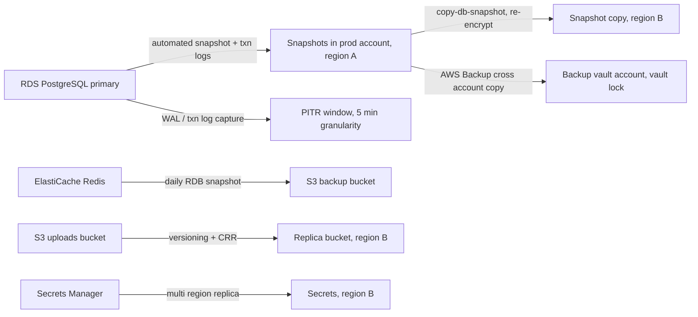

# Part 50 — Backup, Restore and Disaster Recovery

Every system in this book has assumed the data is there. This part is about the day it is not.

The running example is a real shape you have probably worked on: an e-commerce platform. NestJS services on Kubernetes (EKS), a primary RDS PostgreSQL instance holding orders, order items, payments, inventory and customers, ElastiCache Redis for sessions and hot product data, Kafka carrying order and inventory events, S3 holding invoices and product images. Roughly 400 requests per second at peak, 25,000 orders a day, a 2 TB database growing 40 GB a month.

The question this part answers is not "do you have backups". Almost everyone has backups. The question is: **when the primary database is gone at 02:14 on a Saturday, how long until customers can check out again, and how many orders did you lose?** Those two numbers are your RTO and your RPO, and everything else in this part exists to move them.

## 50.1 Backup

#### Concept

A backup is a copy of your data that lives somewhere the original failure cannot reach. That last clause is the whole discipline. A copy on the same disk is not a backup. A snapshot in the same AWS account as the database is barely a backup, because one compromised credential deletes both. A copy in another region, in another account, that a human cannot delete without a second approval, is a backup.

PostgreSQL gives you two fundamentally different kinds of copy, and you need to understand both because they solve different problems.

**Logical backups** export the *contents* of the database as SQL statements or a portable archive: `CREATE TABLE`, then the rows. `pg_dump` dumps one database; `pg_dumpall` adds cluster-wide objects such as roles and tablespaces. The output is portable across PostgreSQL versions and architectures, and you can restore a single table out of it.

**Physical backups** copy the *files on disk* — the data directory, byte for byte — plus the stream of Write-Ahead Log (WAL) records written after the copy started. `pg_basebackup` takes the base copy; an `archive_command` or `pg_receivewal` ships the WAL. The result is not readable as SQL. It restores as an entire cluster, at any point in time covered by the WAL you kept.

#### Why does it exist?

Without a backup, every failure is permanent. That is obvious. What is less obvious is *which* failures backups are actually for, because engineers usually design them for the wrong one.

Hardware failure is the failure everybody plans for and the one that almost never causes data loss any more. RDS stores data on replicated EBS with Multi-AZ; a disk dying is a non-event. The failures that actually destroy data in 2026 are:

1. **Human error.** `DELETE` without `WHERE`. A migration that drops a column with three years of data in it. A cleanup script that reads the wrong environment variable and points at production.
2. **Application bugs.** A soft-delete flag inverted in a release, marking 400,000 rows as deleted.
3. **Malicious action.** A leaked credential, ransomware that encrypts and then deletes snapshots, a disgruntled insider.
4. **Regional or provider outages.** Rare, but when a region has a bad day and you are single-region, you have no lever at all.

Backups exist because none of those are fixed by replication. A replica faithfully replicates your `DELETE` in under a second. Replication protects against infrastructure failure. Backups protect against *time* — the ability to go back to a moment before the mistake.

#### Mental model

Imagine a shop's accounts. A **logical backup** is a photocopy of the ledger: readable by anyone, you can photocopy just page 42 back into a fresh ledger, but copying 900 pages by hand takes all afternoon and the copy is a snapshot of one moment.

A **physical backup** is a photograph of the whole safe, plus a tape recorder that has been recording every transaction spoken aloud since the photo was taken. To reconstruct any moment, you develop the photo and then replay the tape up to the second you care about. You cannot read the photo with your eyes, and you cannot pull out page 42 alone — but you can land on 14:31:59 exactly.

You want both. The photograph and tape for "the database is gone" and "go back to before the mistake". The photocopy for "someone truncated one table and everything else is fine".

#### How it works

**Logical backup mechanics.** `pg_dump` opens a transaction with a `REPEATABLE READ` snapshot, so the dump is internally consistent as of its start time. It reads every table sequentially. Because of MVCC, a long dump holds an old snapshot open, which blocks `VACUUM` from cleaning up dead tuples for the duration — a 3 hour dump on a busy database causes measurable bloat. It also takes an `ACCESS SHARE` lock on every table it reads, which conflicts with `ACCESS EXCLUSIVE` — so a migration doing `ALTER TABLE` will queue behind the dump and then block every query behind itself.

```bash
# Custom format (-Fc): compressed, restorable selectively, parallel-restorable.
pg_dump \
  --host=orders-primary.internal --username=backup_ro --dbname=shop \
  --format=custom --compress=6 --jobs=1 \
  --no-owner --no-privileges \
  --file=/backup/shop-2026-09-09T02-00Z.dump

# Directory format (-Fd) is the only one that supports a PARALLEL dump.
pg_dump --format=directory --jobs=8 --file=/backup/shop-dir --dbname=shop

# Roles, tablespaces and per-database GRANTs live outside any single database.
pg_dumpall --globals-only --file=/backup/globals-2026-09-09.sql
```

Two things engineers forget. First, `pg_dump` does **not** dump roles, so a restore into a fresh cluster fails on every `GRANT` unless you also ran `pg_dumpall --globals-only`. Second, `--format=plain` (the default when you pipe to a file) cannot be restored selectively; use `--format=custom` so `pg_restore --table=order_items` works later.

Time cost is the real constraint: `pg_dump` of a 2 TB database at a realistic 80 to 150 MB/s of compressed throughput takes 4 to 7 hours, and `pg_restore` of it takes longer because indexes are rebuilt from scratch. That is why logical backups are a *surgical tool*, not your disaster recovery mechanism, above a few hundred gigabytes.

**Physical backup mechanics.** This is the mechanism behind every managed snapshot product.

1. Take a base backup: a consistent copy of the data directory. `pg_basebackup` calls `pg_backup_start()`, which forces a checkpoint, then streams every file, then `pg_backup_stop()`. The copy is "torn" (files change while being copied) but that is fine, because...
2. ...every change is also written to the WAL. WAL is an append-only record of every page modification, written *before* the page itself is flushed. Replaying WAL over a torn base copy makes it consistent.
3. Archive the WAL continuously. PostgreSQL calls `archive_command` for each completed 16 MB WAL segment. In production that command is `wal-g wal-push` or `pgbackrest archive-push`, which uploads to S3.
4. To restore: unpack the base backup, drop in a `recovery.signal` file, set `restore_command` to fetch WAL from the archive, and start PostgreSQL. It replays forward until it reaches the end of the archive or the target you specified.

```text
   base backup taken 02:00              WAL segments archived continuously
   +-----------------------+   +----+----+----+----+----+----+----+
   |  data directory copy  |   |02:03|02:07|02:14|02:31|...  |14:32|
   +-----------------------+   +----+----+----+----+----+----+----+
              |                                  |
              +---------- replay ----------------+ = database as of any second
```

The critical property: **your recovery point is the last archived WAL segment, not the last base backup.** If WAL archiving is healthy, an hourly snapshot plus continuous WAL gives you an RPO measured in seconds, not an hour. If WAL archiving is broken, your RPO silently becomes the age of your last snapshot, and nothing alerts you until you try to restore.

```sql
-- Minimum settings for physical backup + PITR on self-managed PostgreSQL.
ALTER SYSTEM SET wal_level = 'replica';            -- 'logical' if you also use logical replication
ALTER SYSTEM SET archive_mode = 'on';
ALTER SYSTEM SET archive_command = 'wal-g wal-push %p';
ALTER SYSTEM SET archive_timeout = '60s';          -- force a segment switch every 60s so a quiet
                                                   -- database still bounds RPO to ~60 seconds
ALTER SYSTEM SET wal_keep_size = '8GB';            -- headroom if the archive is briefly unreachable
-- Verify archiving is actually working; this view is the one you alert on.
SELECT archived_count, last_archived_wal, last_archived_time,
       failed_count, last_failed_wal, last_failed_time
FROM pg_stat_archiver;
```

If `failed_count` is climbing, or `now() - last_archived_time` is over a few minutes, your PITR window is broken *right now*. This is the single most under-monitored metric in PostgreSQL operations.

**RDS automated snapshots and manual snapshots.** On RDS, AWS runs the physical mechanism for you.

| | Automated backups | Manual snapshots |
|---|---|---|
| Created by | AWS, daily in the backup window | You, via console/API/CLI |
| Retention | 1 to 35 days, then deleted automatically | Until you delete them |
| Enables PITR | Yes, with continuous transaction log capture, typically to within 5 minutes | No, restores to that one moment |
| Deleted with the instance | Yes, unless you take a final snapshot | No, survives instance deletion |
| Cross-region | Copy or use automated backup replication | `copy-db-snapshot` to another region |

The snapshot itself is an EBS-level block snapshot: the first is full, later ones are incremental against changed blocks. That is why a daily snapshot of a 2 TB database costs far less than 2 TB per day of storage — you pay roughly for the churn, around 40 to 80 GB a day for our workload, at about $0.095 per GB-month for RDS snapshot storage in `us-east-1` (approximate list price, region-dependent).

The trap: **automated backups die with the instance.** If someone deletes the RDS instance without `--final-db-snapshot-identifier`, the automated backups go with it. Manual snapshots and cross-region copies do not.

**Frequency is driven by RPO, not by habit.** If the business accepts losing 5 minutes of orders, a nightly snapshot is irrelevant on its own — you need continuous WAL/transaction-log archiving. If you accept 24 hours for an analytics warehouse, a nightly dump is genuinely enough. Work backwards from the number, never forwards from "daily sounds right". Section 50.3 makes this explicit.

**Encryption.** Enable RDS storage encryption with a customer-managed KMS key at creation time (you cannot enable it later without a dump-and-reload or snapshot-copy-with-encryption). Snapshots of an encrypted instance are encrypted with the same key. To copy a snapshot to another region or account you must re-encrypt with a key in that region/account and grant the target principal `kms:Decrypt` and `kms:CreateGrant` — this is the step that fails during a real incident if you never tested it.

**Cross-region and cross-account copies.** Two different threats:

- **Cross-region** protects against a region-wide event. Either use RDS automated backup replication to a second region, or a scheduled Lambda/EventBridge job that copies the daily snapshot. Expect a 2 TB cross-region snapshot copy to take 1 to 3 hours, and to cost cross-region data transfer of roughly $0.02 per GB.
- **Cross-account** protects against *your own account being compromised or your own engineers being wrong*. Share the snapshot to a locked-down "backup vault" account whose credentials no application and no normal engineer holds. AWS Backup with a vault lock in compliance mode makes those recovery points genuinely immutable: nobody, including the account root, can delete them before their retention expires. This is the control that survives ransomware.



**The parts everyone forgets.** Ask a team "are you backed up?" and they mean the database. Here is the rest of the system, and what actually happens if you skip each one.

| Asset | Backup mechanism | What breaks without it |
|---|---|---|
| Redis (ElastiCache) | Daily RDB snapshot to S3; AOF where supported | Sessions gone (users logged out), rate-limit counters reset, and any *cache-only* data such as an unpersisted cart is permanently lost |
| S3 uploads | Versioning + lifecycle for old versions, Cross-Region Replication, optionally Object Lock | A bad delete or a wrong lifecycle rule removes invoices you are legally required to keep for 7 years |
| Secrets (Secrets Manager / Vault) | Multi-region replicas, exported and encrypted to the backup account | You restore the database and cannot connect to it, because nothing knows the password |
| Infrastructure state (Terraform) | Remote state in S3 with versioning + DynamoDB locking; state stored per environment | You can rebuild the database but not the VPC, subnets, security groups or IAM roles around it |
| Container images | ECR with immutable tags and lifecycle rules that keep the last N; a pull-through cache or mirror | You cannot redeploy the version that was running, because someone force-pushed `:latest` |
| Kafka topic data | Tiered storage / MirrorMaker2 to a second cluster, or the source-of-truth-in-DB pattern | Events in flight when the cluster died are gone; consumers cannot rebuild state |
| Kubernetes manifests | Git (this is why GitOps matters); plus Velero for stateful cluster resources | Rebuilding the cluster is archaeology from someone's shell history |
| Data warehouse / analytics | Reproducible from source systems, if the pipelines are in Git | You spend a week reconstructing dashboards nobody can audit |

Kafka deserves a note. Kafka is *not* a database and its retention is not a backup, but it is often the only record of events that were emitted and not yet processed. The senior pattern is not "back up Kafka" — it is **make Kafka reproducible**: every event that matters is also written to a transactional outbox table in PostgreSQL in the same transaction as the business change. Then the database backup implicitly backs up the event stream, and 50.8 can replay it.

**Who owns backups and how you prove they ran.** Ownership must be a named team, written down, with the DR runbook (50.10). "AWS does it" is not ownership; AWS runs the mechanism, you own the outcome.

Proof is not "the job exited 0". Proof is three signals, all alerted on:

1. **Existence and freshness.** Newest recovery point is younger than the RPO target. Alert if not.
2. **Continuity.** WAL/transaction-log archiving has no gap. On RDS, `LatestRestorableTime` should never be more than about 5 to 10 minutes behind now. On self-managed, `pg_stat_archiver.failed_count` must be flat and `last_archived_time` recent.
3. **Restorability.** A restore actually succeeded and the data passed checks — within the last 24 hours. That is 50.2, and it is the only one of the three that proves anything.

#### NestJS example

Backup freshness is an application-observable fact, so expose it like any other health signal. This job polls RDS and Redis recovery points, publishes gauges, and fails a health indicator when the newest recovery point breaches the RPO budget.

```ts
// backup-freshness.service.ts
import { Injectable, Logger } from '@nestjs/common';
import { Cron, CronExpression } from '@nestjs/schedule';
import { ConfigService } from '@nestjs/config';
import { RDSClient, DescribeDBInstancesCommand, DescribeDBSnapshotsCommand } from '@aws-sdk/client-rds';
import { InjectMetric } from '@willsoto/nestjs-prometheus';
import { Gauge } from 'prom-client';

@Injectable()
export class BackupFreshnessService {
  private readonly log = new Logger(BackupFreshnessService.name);
  private readonly rds: RDSClient;
  private readonly instanceId: string;

  constructor(
    config: ConfigService,
    @InjectMetric('backup_recovery_point_age_seconds') private readonly ageGauge: Gauge<string>,
  ) {
    this.rds = new RDSClient({ region: config.getOrThrow('AWS_REGION') });
    this.instanceId = config.getOrThrow('RDS_INSTANCE_ID');
  }

  @Cron(CronExpression.EVERY_5_MINUTES)
  async checkRecoveryPoints(): Promise<void> {
    // 1. PITR window: how far back can we actually restore to, right now?
    const instances = await this.rds.send(
      new DescribeDBInstancesCommand({ DBInstanceIdentifier: this.instanceId }),
    );
    const latestRestorable = instances.DBInstances?.[0]?.LatestRestorableTime;
    if (!latestRestorable) {
      // No restorable time means automated backups are OFF. This is a page, not a warning.
      this.ageGauge.set({ kind: 'pitr' }, Number.MAX_SAFE_INTEGER);
      this.log.error('No LatestRestorableTime: automated backups are disabled');
      return;
    }
    this.ageGauge.set({ kind: 'pitr' }, (Date.now() - latestRestorable.getTime()) / 1000);

    // 2. Newest snapshot, including cross-region copies we own.
    const snaps = await this.rds.send(
      new DescribeDBSnapshotsCommand({ DBInstanceIdentifier: this.instanceId, SnapshotType: 'automated' }),
    );
    const newest = (snaps.DBSnapshots ?? [])
      .filter((s) => s.Status === 'available' && s.SnapshotCreateTime)
      .sort((a, b) => b.SnapshotCreateTime!.getTime() - a.SnapshotCreateTime!.getTime())[0];
    this.ageGauge.set(
      { kind: 'snapshot' },
      newest ? (Date.now() - newest.SnapshotCreateTime!.getTime()) / 1000 : Number.MAX_SAFE_INTEGER,
    );
  }
}
```

The alert rule that goes with it is one line, and it is worth more than the code: `backup_recovery_point_age_seconds{kind="pitr"} > 900` for 10 minutes, severity page. A broken PITR window is an emergency even when nothing is currently wrong, because it is the moment your RPO silently became 24 hours.

#### PostgreSQL example

The restore-side checks you will want later are easier if you record facts at backup time. A tiny audit table costs nothing and answers "what was in the database when this backup was taken?" during a restore.

```sql
CREATE TABLE backup_markers (
  id            bigserial PRIMARY KEY,
  taken_at      timestamptz NOT NULL DEFAULT now(),
  lsn           pg_lsn      NOT NULL,
  orders_count  bigint      NOT NULL,
  max_order_id  bigint,
  db_size_bytes bigint      NOT NULL
);

-- Run immediately before/with each backup (cheap: counts are approximate from stats where needed).
INSERT INTO backup_markers (lsn, orders_count, max_order_id, db_size_bytes)
SELECT pg_current_wal_lsn(),
       (SELECT count(*) FROM orders),
       (SELECT max(id) FROM orders),
       pg_database_size(current_database());
```

After a restore you compare the restored `backup_markers` row against the restored `orders` table. If they disagree, the restore is incomplete and you know it in 10 seconds instead of 10 hours.

#### Production scenario

Our platform's backup posture, written as the numbers a senior would actually defend in a design review:

- RDS `db.r6g.4xlarge`, 2 TB gp3 storage, Multi-AZ, storage encrypted with a customer-managed KMS key.
- Automated backups, 35 day retention, backup window 02:00–02:30 UTC (traffic trough). PITR granularity ~5 minutes.
- Daily snapshot copy to `eu-west-1`, retained 14 days. Cost: roughly 60 GB/day of changed blocks, so about $30–60/month of cross-region snapshot storage plus transfer.
- AWS Backup plan copying the daily recovery point into a separate backup account with a 30 day vault lock in compliance mode. No human in the production account can delete it.
- ElastiCache: daily snapshot, 7 day retention. Sessions are treated as *disposable*; carts are persisted to PostgreSQL, not only Redis. This is a design decision made specifically so Redis never needs a real backup.
- S3 uploads bucket: versioning on, non-current versions expire after 90 days, CRR to `eu-west-1`, invoices prefix under Object Lock in governance mode for 7 years.
- Terraform state: S3 with versioning and DynamoDB lock table, in the shared-services account.
- ECR: immutable tags, lifecycle keeps the last 50 images per repository.

Monthly cost of the entire backup posture: on the order of $300 to $500. Compare that against a single hour of a checkout outage at 25,000 orders a day and an average basket of $60: roughly $60,000 of gross merchandise value per full day, so about $2,500 per hour of complete downtime, before reputational cost. The backup budget is not where you save money.

#### Failure scenario

A team runs `pg_dump` nightly from a cron job on a bastion host, uploading to S3. It has "worked" for two years. In March, the DBA adds a new schema `analytics` and the dump command still says `--schema=public`. Nobody notices, because the job exits 0 and the file appears in S3 every night at the right size (the `public` schema is 95 percent of the data).

In September, a bad migration drops `analytics.order_facts`, 400 GB of derived data with 18 months of history that was never re-derivable because the source events had aged out of Kafka. The restore recovers `public` perfectly and `analytics` not at all.

The postmortem finds the cause is not the migration. It is that the backup was never *verified against what the database contains* — only against whether the command exited successfully. The fix is a check that compares the list of schemas and tables in the dump manifest (`pg_restore --list`) against `information_schema.tables` in production, and fails the job on any table present in production and absent from the backup.

#### Edge cases & failure modes

- `pg_dump` running for hours blocks `VACUUM` from reclaiming dead tuples cluster-wide; on a high-churn table that is measurable bloat by morning. Dump from a replica instead, but see 50.11 for the lag trap.
- `pg_dump` takes `ACCESS SHARE` on every table; a concurrent `ALTER TABLE` queues behind it and then blocks all reads on that table. Always set `lock_timeout` on migrations (see Part 24 — Database Migrations).
- Large objects (`pg_largeobject`) are not included with `--table` selective dumps.
- Sequences are dumped with their current value at dump time; restoring an old dump into a live system reissues ids (50.11).
- Encrypted snapshots cannot be shared cross-account until copied and re-encrypted with a key the target account can use; and a KMS key scheduled for deletion makes every snapshot encrypted with it permanently unreadable.
- Snapshot storage bills grow silently: 35 daily snapshots plus every developer's "before I try this" manual snapshot. Tag and expire them (Part 51).
- A backup that is stored in the same account, same region, with the same credentials that run the application is one compromised token away from deletion.
- Backups of encrypted-at-rest data are useless if the application-level encryption keys (envelope keys for PII columns) are not also backed up, separately.

#### How a Senior Backend Engineer thinks about this

They start from the loss, not the mechanism. "If we lose everything right now, what do we owe customers?" produces a much better backup plan than "how often should we snapshot?".

They separate replication from backup out loud, every time, because the confusion is universal. Replicas protect against a machine dying. Backups protect against a decision being wrong.

They insist on a second custody boundary. The question they ask an architecture review is: *"Which single credential can delete both the data and the backups?"* If there is one, the design is not finished.

They treat backup age and archive continuity as SLIs with pages attached, not as dashboards someone looks at quarterly.

And they know the cost of the whole thing is small enough that arguing about it is a waste of a meeting. Explain it to a product manager as insurance: "we spend about $400 a month so that the worst realistic day costs us two hours instead of the company."

#### Common mistakes

- Believing a read replica is a backup.
- Enabling RDS automated backups with 1 day retention because it is the default, so the detection window for a subtle data bug is shorter than the retention.
- Taking `pg_dump` from a replica with 40 minutes of lag and recording the wrong recovery point.
- Never dumping globals, so restores fail on missing roles at the worst possible time.
- Storing snapshots only in the account that also runs production.
- Backing up the database but not the secrets, so the restored database is unreachable.
- Measuring backup success by exit code.

#### Interview questions

1. **What is the difference between a logical and a physical backup, and when do you use each?** Expected: logical is portable SQL/archive, selective restore, slow at scale, snapshot of one moment; physical is a file-level copy plus WAL, restores whole clusters to any point in time, fast for TB-scale. Use physical for DR, logical for surgical single-table recovery and version migrations. Follow-up: which one lets you restore one table? (Logical, or a physical restore to a side instance then extract.)
2. **Is a read replica a backup? Why not?** Expected: no; replication propagates mistakes in under a second. It gives availability, not the ability to go back in time.
3. **What determines your actual RPO on RDS?** Expected: transaction log capture frequency, not snapshot frequency; `LatestRestorableTime` is the honest number, typically ~5 minutes behind. Follow-up: what breaks it? Archive failures, storage full, disabled backups.
4. **How would you protect backups from ransomware or a compromised admin credential?** Expected: separate account, separate credential path, AWS Backup vault lock in compliance mode or S3 Object Lock, MFA delete, no cross-linking of IAM.
5. **What do you back up besides the database?** Expected: secrets, IaC state, container images, object storage with versioning, Redis if it holds non-reproducible state, and a plan for in-flight events. Follow-up: why is Kafka usually not backed up? Because the outbox in PostgreSQL is the reproducible source of truth.
6. **Your `pg_dump` takes 6 hours. What is the operational side effect on production?** Expected: an old MVCC snapshot held open blocks VACUUM, causing bloat; `ACCESS SHARE` locks block DDL; network and CPU load on the source.

#### Practical exercise

Take a local PostgreSQL in Docker with a `shop` database containing `orders` and `order_items` (seed 500,000 rows). Configure `archive_mode=on` with an `archive_command` that copies segments to a local directory. Take a `pg_basebackup`. Then:

1. Insert 10,000 more orders and note the time.
2. Delete the archive directory's newest two segments (simulate an archive gap).
3. Try to restore to a point after the gap.

Acceptance criteria: you can state exactly which timestamp you can recover to, you can show the error PostgreSQL logs when it cannot find the next WAL segment, and you have a query or script that would have alerted you to the gap before you needed it.
