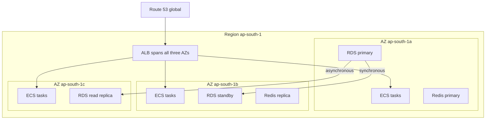
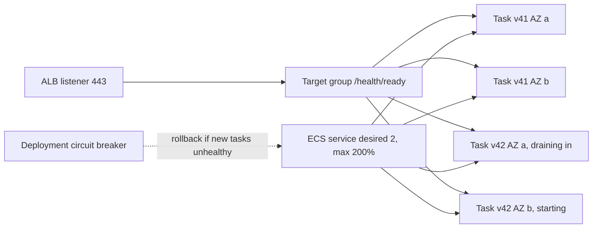
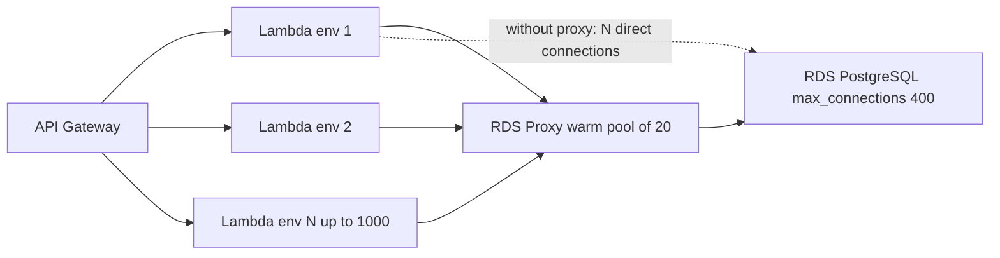

# Part 50 — Cloud Architecture (AWS as the Example)

The cloud is not a different discipline. It is the same engineering you already know (compute, storage, networking, failure) rented by the hour, with someone else's hands on the hardware. What changes is *where the boundaries sit*: which failures are yours to handle, which knobs exist, and what every decision costs per month. This part teaches the architectural concepts first and uses AWS as the concrete mapping because it is the platform you are most likely to meet. Every concept here has an equivalent on GCP and Azure; the names differ, the physics does not.

## 50.1 The cloud mental model

#### Concept

A cloud provider runs data centers around the world and sells slices of them through APIs. You describe what you want (a virtual machine with 4 vCPUs, a PostgreSQL database with a standby, a queue), the provider creates it in minutes, and you pay for what you use while it runs. The three ideas that shape every architecture on top of this are **regions and availability zones** (where things physically live), **shared responsibility** (which failures are yours), and **managed versus self-managed** (how much operations work you keep).

#### Why does it exist?

Before the cloud, adding a server meant a purchase order, a rack, a six-week lead time, and a capacity plan made a year in advance. You over-provisioned for the Diwali or Black Friday peak and paid for idle hardware the other eleven months. Failure handling was a second data center that half the companies never finished wiring. The cloud turns capacity into an API call with a per-hour price, which makes elasticity (grow for the peak, shrink after) and redundancy (a copy in another building) affordable for a five-person team.

#### Mental model

Imagine a region as a city and each availability zone as a separate power station district inside it. The districts are far enough apart that a fire or flood in one does not touch the others, but close enough that a phone call between them is instant. A region-wide event is something like a city-wide blackout: rare, but not impossible. Building in two districts protects you against the common failure (one building goes dark). Building in two cities protects you against the rare one, at several times the cost and complexity.

#### How it works

**Regions.** A region is a geographic area with its own independent set of services: `us-east-1` (N. Virginia), `eu-west-1` (Ireland), `ap-south-1` (Mumbai), `ap-southeast-1` (Singapore) and about thirty more. Resources are regional by default; an RDS instance in Mumbai does not exist in Ireland. Data does not leave a region unless you move it, which is why regions matter for data-residency law as much as for latency.

**Availability zones (AZs).** Each region has several AZs, typically three or more. An AZ is one or more data centers with independent power, cooling and network, physically separated from the other AZs by kilometers but linked by private fiber. The numbers that matter:

| Path | Typical round-trip latency |
|---|---|
| Same AZ | 0.1 to 0.3 ms |
| Cross-AZ, same region | 0.5 to 2 ms |
| Cross-region, same continent (Virginia to Ohio) | 10 to 15 ms |
| Cross-region, transatlantic (Virginia to Ireland) | 75 to 90 ms |
| Cross-region, Virginia to Mumbai | 180 to 200 ms |

AZ names (`ap-south-1a`) are shuffled per account, so your `1a` may be someone else's `1c`; use AZ IDs (`aps1-az1`) when coordinating with another account.



**Shared responsibility.** AWS is responsible for security *of* the cloud: the physical buildings, the hypervisor, the hardware, the managed service software. You are responsible for security *in* the cloud: your data, your IAM policies, your security groups, your operating system patches on EC2, your application code, your encryption choices. The line moves with how managed the service is. On EC2 you patch the OS; on RDS AWS patches PostgreSQL but you choose the maintenance window and the parameter values; on Lambda you only own the code.

| Layer | EC2 | ECS on Fargate | RDS | Lambda |
|---|---|---|---|---|
| Hardware, network, facilities | AWS | AWS | AWS | AWS |
| OS and runtime patches | You | AWS | AWS | AWS |
| Database engine upgrades | You | n/a | AWS, you schedule | n/a |
| Application code and dependencies | You | You | n/a | You |
| IAM, encryption keys, network rules | You | You | You | You |
| Backups | You | n/a | AWS, you configure retention | n/a |

**Managed versus self-managed.** For almost every component there is a ladder. PostgreSQL: run it yourself on EC2 (full control, full ops burden), RDS (AWS handles backups, patching, failover; you lose superuser and filesystem access), Aurora (AWS rewrote the storage layer; faster failover, more expensive per instance), Aurora Serverless v2 (capacity scales automatically; highest cost per unit at steady load). Each step up removes an operational chore and a knob, and raises the unit price. The senior question is not "which is best" but "which chores does my team have the skill and the headcount to own".

**Pay-per-use and elasticity.** Compute is billed per second (EC2, Fargate) or per request and millisecond (Lambda). Storage is billed per GB-month. Network is billed per GB moved, with the rules that surprise people: traffic *into* AWS is free, traffic *out* to the internet costs about $0.09/GB, and traffic *between AZs* costs $0.01/GB in each direction. Elasticity is the ability to add capacity when load rises and remove it when load falls. Stateless things (API containers) are elastic in minutes; stateful things (an RDS instance) resize with a restart and cannot shrink their disk at all.

**The concept-to-service map.** Learn the concept, then look up the name.

| Concept | AWS service | Notes |
|---|---|---|
| Virtual machines | EC2 | Instance families, auto scaling groups, spot |
| Container orchestration | ECS, EKS | ECS is AWS-native and simpler; EKS is Kubernetes |
| Serverless functions | Lambda | Event-driven, 15-minute limit |
| Relational database | RDS PostgreSQL, Aurora PostgreSQL | Multi-AZ, replicas, PITR |
| Key-value or wide-column DB | DynamoDB | Partition-key design, single-digit ms |
| Cache | ElastiCache for Redis or Valkey | Cluster mode, Multi-AZ |
| Queue | SQS | Standard and FIFO, DLQ |
| Pub/sub | SNS | Fan-out to SQS, Lambda, HTTP |
| Event bus | EventBridge | Rules, schema registry, scheduler |
| Log or stream | MSK (Kafka), Kinesis | Ordered, replayable |
| Object storage | S3 | Unlimited, eleven nines durability |
| CDN | CloudFront | Edge caching, signed URLs |
| DNS | Route 53 | Routing policies, health checks |
| Identity | IAM, STS, Cognito | Roles over keys |
| Secrets | Secrets Manager, Parameter Store | Rotation, KMS-encrypted |
| Encryption keys | KMS | Envelope encryption |
| Network | VPC | Subnets, route tables, security groups |
| Load balancing | ALB (L7), NLB (L4) | Target groups, health checks |
| API edge | API Gateway | Throttling, auth, WebSocket |
| Monitoring | CloudWatch, X-Ray | Metrics, logs, alarms, traces |
| Web firewall | WAF, Shield | Rate rules, managed rule sets |

#### Practical example

An e-commerce backend written in NestJS needs, at minimum: something to run the API containers (ECS on Fargate), a PostgreSQL database that survives a data-center failure (RDS Multi-AZ), a cache (ElastiCache Redis), a queue for order-confirmation emails and inventory updates (SQS), a place for product images (S3 behind CloudFront), DNS and TLS (Route 53 and ACM), and monitoring (CloudWatch). Every one of these is a regional resource placed in two or three AZs. The bill for a modest deployment of this shape is a few hundred dollars a month; at 1,000 requests per second it is a few thousand (we size it precisely in section 50.13).

#### Production scenario

A food-delivery platform runs eight NestJS API tasks on Fargate at a normal 300 RPS. Friday at 19:00 the traffic climbs toward 1,800 RPS. Target-tracking auto scaling on `ALBRequestCountPerTarget` adds tasks every minute until 36 are running by 19:20; the scale-out takes about 90 seconds per step (task pull, start, health check, register). The RDS instance does not scale; its 4 vCPUs handle the load only because 85% of reads hit Redis. At 23:30 the tasks scale back in and the platform pays for the extra capacity for roughly four hours instead of all week. That difference (paying for 36 tasks for 4 hours versus 168 hours) is the entire economic argument for the cloud, and it only works because the API tier was designed stateless.

#### Failure scenario

At 02:14 the on-call was paged: 33% of API requests were failing with connection timeouts. One AZ in the region had lost network connectivity. The API tasks were spread over three AZs and the ALB stopped routing to the dark one within 30 seconds, so the API itself recovered on its own. But the Redis cluster had been created single-AZ, in the AZ that failed, to save $75 a month. Every cache read timed out, every request fell through to PostgreSQL, and the database hit 100% CPU inside two minutes. The fix during the incident was to fail over to a new Redis node in another AZ (12 minutes, cache cold). The permanent fix was Multi-AZ Redis with automatic failover and a load test that proves the database survives a cold cache. Lesson: an architecture is only as multi-AZ as its least redundant component.

#### Edge cases & failure modes

- **A single-AZ resource inside a multi-AZ design**: one NAT gateway, one Redis node, one EFS mount target, one bastion. The AZ failure takes it and everything that depends on it.
- **Cross-AZ traffic surprise**: a chatty service that calls a database in another AZ pays $0.02/GB round trip. At 1 TB/day that is $600/month you did not plan.
- **Region-wide service degradation**: rare (a few times a year across all regions), but real. Regional control-plane APIs (launching new instances, updating IAM) fail while already-running resources keep working. Your architecture must not need to *create* things to survive.
- **Quotas**: every service has soft limits (EC2 vCPUs per family, Lambda concurrency 1,000, ENIs per region). Auto scaling silently stops at the quota. Request increases before the sale, not during.
- **Elasticity lag**: a Fargate task takes 60 to 120 seconds to become healthy; a traffic spike that doubles in 30 seconds arrives before the capacity does. Keep headroom or scale on a leading indicator.
- **Clock skew**: instance clocks drift; AWS provides the Time Sync service (`169.254.169.123`), and signed requests fail if your clock is more than 5 minutes off.

#### How a Senior Backend Engineer thinks about this

They ask, for every component, "which AZ is this in, and what happens to the user if that AZ disappears?" They treat the managed-service ladder as a staffing decision: a team without a DBA does not self-host PostgreSQL. They know the three prices that dominate a bill (compute-hours, database instance, data transfer) and can estimate a design's monthly cost before drawing it. They refuse to build multi-region until someone can state the revenue lost per hour of regional outage, because multi-region roughly doubles cost and triples complexity. To a product manager they explain: "Multi-AZ means we survive a building failure automatically. Multi-region means we survive a city failure, and it costs this much more."

#### Common mistakes

- Treating the cloud as "someone else's computer" and copying an on-prem design onto EC2, losing every benefit of managed services.
- Choosing a region by habit (`us-east-1`) when the users are in India, adding 200 ms to every request.
- Assuming AWS backs up your data. RDS snapshots are on by default, but S3 versioning, DynamoDB PITR and EBS snapshots are not.
- Forgetting the account and region quotas until the auto-scaler stalls at peak.
- Reading "99.99% SLA" as a promise about your app. The SLA credits you a few percent of the bill; it does not restore your orders table.

#### Interview questions

1. *What is the difference between a region and an availability zone, and which one does Multi-AZ RDS protect you from?* Expected: AZ is an isolated data-center group inside a region; Multi-AZ protects against an AZ failure, not a regional one. Follow-up: what does a regional failure look like in practice?
2. *Explain shared responsibility for an RDS instance.* Expected: AWS patches the engine and manages storage; you own parameter tuning, IAM, security groups, encryption choice, backup retention, and the schema.
3. *Why is cross-AZ traffic a cost concern and how do you reduce it?* Expected: $0.01/GB each direction; AZ-aware routing, keeping chatty pairs in the same AZ, compressing payloads, caching.
4. *When would you pick a self-managed PostgreSQL on EC2 over RDS?* Expected: rarely; needs like custom extensions not on RDS, filesystem-level access, extreme cost sensitivity with an experienced DBA on staff.
5. *A traffic spike doubles load in 20 seconds. Will auto scaling save you?* Expected: not by itself; 60 to 120 second lead time; keep headroom, use predictive or scheduled scaling, protect the database with a cache and admission control.

#### Practical exercise

Take the architecture of a system you know and draw it as an AZ map like the diagram above. For each box write its AZ count. Acceptance criteria: every stateful component is in at least two AZs or has a documented recovery time; you can list the three most expensive line items and estimate the monthly cost within 30%; you can name the one component whose failure would take the whole system down.

## 50.2 Compute: EC2, ECS and EKS

#### Concept

Compute is where your NestJS process runs. On AWS you choose the level at which you want to think: a virtual machine you manage (EC2), a container you hand to an orchestrator (ECS or EKS), or a function that runs only when an event arrives (Lambda, covered in 50.3). Each level trades control for less operational work.

#### Why does it exist?

A single machine cannot be patched, replaced or scaled without downtime. Orchestration exists so that a fleet of identical containers can be rolled out, health-checked, scaled and replaced automatically, and so that the machine underneath becomes disposable. AWS offers two orchestrators because Kubernetes (EKS) is the portable industry standard with a huge ecosystem, while ECS is the AWS-native option with far fewer moving parts.

#### Mental model

Imagine renting space for a restaurant. EC2 is renting the whole building: you install the kitchen, fix the plumbing, and decide when to renovate. ECS on Fargate is renting a furnished kitchen by the hour: you bring the recipes (container images) and the staff show up where told. EKS is joining a franchise with a thick operations manual: enormous flexibility, a global community of franchisees, and a manual you must actually read. Lambda is a food stall you only pay for while a customer stands in front of it.

#### How it works

**EC2 instances.** An instance is a virtual machine from a family sized for a workload. General purpose (`m7g`, `m7i`; burstable `t3`, `t4g`) for API servers; compute optimized (`c7g`, `c7i`) for CPU-bound work such as image resizing; memory optimized (`r7g`, `r7i`) for databases and caches; storage optimized (`i4i`) for local NVMe throughput. The letter after the family number tells you the processor: `g` is Graviton (arm64), about 20% cheaper per unit of work than the equivalent Intel instance. Node.js runs natively on arm64; the only thing you must do is build multi-architecture Docker images. Burstable `t` instances earn CPU credits while idle and spend them under load; a NestJS API on a `t3.medium` that runs at 40% CPU all day will exhaust credits and throttle to baseline, which looks like a mysterious afternoon slowdown.

**Auto Scaling Groups (ASG).** An ASG owns a launch template (AMI, instance type, user data, IAM instance profile) and maintains a desired count between a minimum and a maximum across chosen subnets. Scaling policies: target tracking ("keep average CPU at 60%"), step scaling (add 2 instances when CPU is above 70% for 3 minutes), scheduled (30 instances at 18:00 on Fridays). Health checks can be EC2-level (the VM responds) or ELB-level (the load balancer's health check passes), and you almost always want ELB-level, because a VM that is up with a crashed process is not healthy. Instance refresh rolls out a new AMI in batches.

**Spot instances.** Spare capacity sold at up to 90% discount, with a two-minute interruption notice when AWS wants it back. Excellent for stateless workers, batch jobs, CI runners and even API capacity if you mix on-demand and spot (a mixed-instances policy with, say, 40% on-demand base). Never for the database, never for anything that cannot lose a node with two minutes' warning. Diversify across several instance types; a single-type spot pool is the one that runs dry.

**ECS.** Amazon's own orchestrator. The objects: a **cluster** (a logical group), a **task definition** (a versioned recipe: containers, CPU and memory, ports, environment, secrets, log driver, health check), a **task** (one running copy of a task definition) and a **service** (keeps N tasks running, registers them with a load balancer target group, and manages deployments). Deployments are rolling by default, controlled by `minimumHealthyPercent` (how many old tasks must stay during the rollout, typically 100) and `maximumPercent` (how many total tasks may exist, typically 200, meaning new tasks start before old ones stop). The deployment circuit breaker watches for tasks that fail to become healthy and rolls back automatically. Blue/green is available through CodeDeploy integration. Scaling uses Application Auto Scaling on CPU, memory or `ALBRequestCountPerTarget`.

**Fargate versus EC2 launch type.** With Fargate you never see a VM: you declare `cpu: 1024` (1 vCPU) and `memory: 2048` (MB) per task and pay per vCPU-second and GB-second, about $0.040 per vCPU-hour and $0.0044 per GB-hour in `us-east-1`. A 1 vCPU, 2 GB task costs about $36 per month. With the EC2 launch type you run an ASG of instances with the ECS agent and pack tasks onto them; it is cheaper at scale (better bin-packing, reserved pricing, spot) and needed for GPUs or privileged containers, but you patch and right-size the instances. Most teams start with Fargate and move hot services to EC2 capacity when the bill justifies the ops.



**EKS.** Managed Kubernetes. AWS runs the control plane (API server, etcd, scheduler) across three AZs for about $73 per month per cluster; you run the worker nodes. Node options: managed node groups (ASG-backed, AWS handles the AMI and drain on upgrade), self-managed nodes, Fargate profiles (pods without nodes, with restrictions), or Karpenter for just-in-time node provisioning. Networking uses the VPC CNI, which gives every pod a real VPC IP address; a `/24` subnet with 251 IPs fills up faster than you expect. Kubernetes versions are supported for about 14 months and then you pay for extended support, so a cluster upgrade every year is mandatory operations work.

**IRSA (IAM Roles for Service Accounts).** The clean way for a pod to get AWS permissions. The cluster has an OIDC identity provider; a Kubernetes service account is annotated with an IAM role ARN; the pod receives a projected service-account token; the AWS SDK exchanges it through `sts:AssumeRoleWithWebIdentity` for temporary credentials. No access keys in the pod, no shared node role. The newer **EKS Pod Identity** feature achieves the same with an agent and simpler setup. Either way the rule is the same: one role per workload, least privilege.

**When ECS is simpler than EKS.** ECS has no control plane to upgrade, no CRDs, no Helm charts, no ingress controllers to choose, no CNI IP arithmetic, and IAM is native. A team of six running twelve NestJS services will ship faster on ECS. Choose EKS when you already have Kubernetes expertise, need operators (a PostgreSQL operator, Argo Rollouts, cert-manager), need portability across clouds, or run hundreds of services where the Kubernetes ecosystem pays for its weight. Kubernetes concepts themselves are covered in Part 49 — Kubernetes.

#### Practical example

A trimmed task definition for the NestJS orders API on Fargate. The important choices: secrets come from Secrets Manager by ARN and are injected as environment variables at start; the container health check is the readiness endpoint; logs go to CloudWatch; the task role (what the app may call) is separate from the execution role (what ECS needs to pull the image and read the secret).

```json
{
  "family": "orders-api",
  "networkMode": "awsvpc",
  "requiresCompatibilities": ["FARGATE"],
  "cpu": "1024",
  "memory": "2048",
  "runtimePlatform": { "cpuArchitecture": "ARM64", "operatingSystemFamily": "LINUX" },
  "taskRoleArn": "arn:aws:iam::123456789012:role/orders-api-task",
  "executionRoleArn": "arn:aws:iam::123456789012:role/orders-api-exec",
  "containerDefinitions": [
    {
      "name": "api",
      "image": "123456789012.dkr.ecr.ap-south-1.amazonaws.com/orders-api:9f3c2ab",
      "portMappings": [{ "containerPort": 3000, "protocol": "tcp" }],
      "environment": [
        { "name": "NODE_ENV", "value": "production" },
        { "name": "PORT", "value": "3000" }
      ],
      "secrets": [
        { "name": "DATABASE_URL", "valueFrom": "arn:aws:secretsmanager:ap-south-1:123456789012:secret:prod/orders/db-Ab12Cd" },
        { "name": "JWT_SECRET", "valueFrom": "arn:aws:secretsmanager:ap-south-1:123456789012:secret:prod/orders/jwt-Ef34Gh" }
      ],
      "healthCheck": {
        "command": ["CMD-SHELL", "wget -qO- http://localhost:3000/health/ready || exit 1"],
        "interval": 15, "timeout": 5, "retries": 3, "startPeriod": 30
      },
      "stopTimeout": 30,
      "logConfiguration": {
        "logDriver": "awslogs",
        "options": { "awslogs-group": "/ecs/orders-api", "awslogs-region": "ap-south-1", "awslogs-stream-prefix": "api" }
      }
    }
  ]
}
```

The image tag is a git SHA, never `latest` (see Part 51 — CI/CD). `stopTimeout: 30` is how long ECS waits after `SIGTERM` before `SIGKILL`; your NestJS shutdown must finish inside it.

#### NestJS example

Two things every container behind an ALB must do: drain gracefully on `SIGTERM`, and keep HTTP keep-alive connections open *longer* than the load balancer's idle timeout (the reason is in section 50.7; the short version is that if Node closes an idle connection at the same moment the ALB reuses it, the ALB returns a 502).

```ts
// src/main.ts
import { NestFactory } from '@nestjs/core';
import { NestExpressApplication } from '@nestjs/platform-express';
import { Logger, ValidationPipe } from '@nestjs/common';
import type { Server } from 'node:http';
import { AppModule } from './app.module';

async function bootstrap(): Promise<void> {
  const app = await NestFactory.create<NestExpressApplication>(AppModule, { bufferLogs: true });
  app.useGlobalPipes(new ValidationPipe({ whitelist: true, transform: true }));
  app.set('trust proxy', 1); // ALB sets X-Forwarded-For; needed for correct client IP and rate limits

  // Lets OnModuleDestroy / OnApplicationShutdown hooks run on SIGTERM
  // (close DB pools, stop SQS consumers, finish in-flight work).
  app.enableShutdownHooks();

  const server = app.getHttpServer() as Server;
  // ALB idle timeout is 60 s by default; backend keep-alive must be longer.
  server.keepAliveTimeout = 65_000;
  server.headersTimeout = 66_000; // must be greater than keepAliveTimeout

  await app.listen(Number(process.env.PORT ?? 3000), '0.0.0.0');
  new Logger('Bootstrap').log(`orders-api listening, pid ${process.pid}`);
}
bootstrap();
```

And the readiness endpoint the ALB and the ECS health check both call, using `@nestjs/terminus`:

```ts
// src/health/health.controller.ts
import { Controller, Get } from '@nestjs/common';
import { HealthCheck, HealthCheckService, TypeOrmHealthIndicator, MemoryHealthIndicator } from '@nestjs/terminus';

@Controller('health')
export class HealthController {
  constructor(
    private readonly health: HealthCheckService,
    private readonly db: TypeOrmHealthIndicator,
    private readonly memory: MemoryHealthIndicator,
  ) {}

  // Liveness: is the process alive? Never touch dependencies here.
  @Get('live')
  @HealthCheck()
  live() {
    return this.health.check([]);
  }

  // Readiness: can this task serve traffic right now?
  @Get('ready')
  @HealthCheck()
  ready() {
    return this.health.check([
      () => this.db.pingCheck('postgres', { timeout: 1500 }), // SELECT 1 through the pool
      () => this.memory.checkHeap('heap', 1_500 * 1024 * 1024), // fail before OOMKill
    ]);
  }
}
```

The 1.5 GB heap threshold matches a 2 GB task with `--max-old-space-size=1536` set in the Dockerfile `CMD`; a task that exceeds its memory is killed by ECS with exit code 137 and no log line, which is the container equivalent of OOMKilled (see Part 48 — Docker).

#### Production scenario

The orders API at 1,000 RPS peak runs eight Fargate tasks of 1 vCPU and 2 GB across three AZs, each handling around 150 RPS at 35% CPU with p95 of 60 ms; the headroom is deliberate so that losing one AZ (three tasks) leaves the remaining five at about 60% CPU. Auto scaling targets 200 requests per target and adds up to four tasks per minute. A deploy replaces the eight tasks in about six minutes with `minimumHealthyPercent: 100` and `maximumPercent: 150`. The four background workers (SQS consumers) run on a separate service with 0.5 vCPU and 1 GB each, because their scaling signal is queue depth, not HTTP request count.

#### Failure scenario

A team moved the orders API from `t3.large` EC2 instances to Fargate and, to save money, set the task to 0.5 vCPU and 1 GB. Load tests passed at 300 RPS. In production, every deploy caused two minutes of 5xx errors. The cause: with 0.5 vCPU, the NestJS bootstrap (TypeORM metadata build, 40 modules, connection pool warm-up) took 45 seconds, but `startPeriod` in the health check was 10 seconds, so ECS marked new tasks unhealthy, killed them, started replacements, and the circuit breaker eventually rolled back. Meanwhile the ALB had already deregistered old tasks. The fix was `startPeriod: 60`, a 1 vCPU task (bootstrap dropped to 12 seconds), and a rule: measure cold start on the production task size before setting health-check timers.

#### Edge cases & failure modes

- **Task cannot pull image**: ECR permission missing on the *execution* role, or no route to ECR from a private subnet without a NAT or VPC endpoint. Symptom: `CannotPullContainerError`, service stuck at 0 running.
- **ENI exhaustion**: `awsvpc` mode gives every task its own network interface and IP. A `/26` subnet runs out at about 59 tasks.
- **Spot interruption during deploy**: capacity vanishes mid-rollout; keep an on-demand base and use capacity-provider strategies that fall back.
- **SIGTERM ignored**: Node started via a shell (`sh -c node main.js`) does not receive the signal; use exec form in the Dockerfile `CMD ["node", "dist/main.js"]`.
- **Deregistration delay**: ALB keeps sending in-flight requests to a task for up to 300 seconds (default) after deregistration begins; set it to 30 seconds for APIs and make sure the app keeps serving during that window.
- **EKS IP exhaustion**: pods fail to schedule with `failed to assign an IP address`; fix with larger subnets, prefix delegation, or custom networking.
- **Burstable credit exhaustion**: `t3` instances silently throttle; the metric `CPUCreditBalance` at zero is the tell.
- **Node group upgrade drains pods too fast**: without a `PodDisruptionBudget`, the upgrade evicts every replica at once.

#### How a Senior Backend Engineer thinks about this

They pick the simplest orchestrator the team can operate, which for most teams under fifty engineers is ECS on Fargate, and they say so plainly even when Kubernetes is fashionable. They size tasks by measuring, not guessing: cold-start time, steady-state CPU at target RPS, heap under load. They ask "what happens during a deploy" and "what happens when an AZ dies" before "how many tasks". They insist that scaling signals match the workload: request count for APIs, queue depth for workers, never CPU alone for a Node process that is I/O bound. They put a `PodDisruptionBudget` or `minimumHealthyPercent` in place before the first production deploy, because the first deploy is when it matters.

#### Common mistakes

- Running a single task or a single replica in production "for now".
- Using `latest` image tags so that a scale-out event silently deploys a new version.
- Setting CPU-based scaling for a Node API, which sits at 25% CPU while its event loop is saturated by I/O waits.
- Sharing one IAM role across every service on the cluster.
- Choosing EKS for three services because a blog post said Kubernetes is the standard.

#### Interview questions

1. *Explain the difference between an ECS task role and an execution role.* Expected: execution role is used by the ECS agent to pull images and read secrets; task role is assumed by your code to call AWS APIs. Follow-up: what breaks if you swap them?
2. *How does a rolling deployment on ECS avoid downtime, and what settings control it?* Expected: `minimumHealthyPercent`, `maximumPercent`, ALB health checks, deregistration delay, circuit breaker.
3. *When would you choose EKS over ECS?* Expected: existing Kubernetes skills, need for operators or Helm ecosystem, portability, large scale; otherwise ECS is simpler.
4. *How does a pod on EKS get AWS credentials safely?* Expected: IRSA or Pod Identity, OIDC token exchanged via STS for temporary credentials, one role per workload.
5. *What is spot capacity good for and what is it dangerous for?* Expected: stateless workers, batch, CI; dangerous for databases and anything unable to tolerate two-minute eviction.

#### Practical exercise

Deploy a NestJS service to ECS Fargate behind an ALB across two AZs with a task definition that injects a Secrets Manager secret. Acceptance criteria: a deploy of a new image tag completes with zero failed requests under a 100 RPS load test; killing one task by hand is invisible to the load test; the task role can read only its own S3 prefix and nothing else; `SIGTERM` handling is proven by watching the pool close in the logs during a deploy.

## 50.3 Compute: Lambda and serverless functions

#### Concept

Lambda runs a function in response to an event: an HTTP request through API Gateway, a message in SQS, an object landing in S3, a schedule, a change in DynamoDB. You upload code, choose memory, and pay per request and per millisecond. There is no server to size, patch or scale; there is also no process that stays alive between events unless AWS decides to keep it warm.

#### Why does it exist?

Many workloads are bursty or rare: a webhook that arrives three times a minute, an image thumbnail job that runs when a product photo is uploaded, a nightly report. Paying for a container 24 hours a day to handle three events per minute wastes 99% of the money. Lambda makes idle time free and scaling automatic, and for event glue between AWS services it removes almost all operational work.

#### Mental model

Imagine a call center that hires a new agent for every incoming call, trains them in a few hundred milliseconds, lets them handle the call, and then keeps them at their desk for a while in case another call arrives. If a thousand calls arrive at once, a thousand agents are hired. Each one opens their own line to the database.

#### How it works

1. **Execution environment.** On the first invocation Lambda creates a micro-VM, downloads your code, starts the Node runtime, and runs your module's top-level code. This is the **cold start**. For a plain Node handler it is 100 to 250 ms; for a NestJS application that builds a dependency graph of forty modules and initialises TypeORM it is commonly 800 ms to 3 seconds. The environment is then reused for subsequent invocations (warm), and frozen when idle; after some minutes of inactivity it is destroyed.
2. **Concurrency.** Each in-flight invocation needs its own environment. 500 simultaneous requests means 500 environments, each with its own cold start if not already warm. The account default limit is 1,000 concurrent executions per region (a soft limit). Reserved concurrency caps one function; provisioned concurrency keeps N environments pre-warmed, at a price.
3. **Limits.** 15-minute maximum duration, 128 MB to 10 GB memory (CPU scales with memory; below about 1,769 MB you get less than one full vCPU), 512 MB to 10 GB of `/tmp`, 6 MB synchronous payload, 250 MB unzipped deployment package (10 GB with container images).
4. **Triggers.** Synchronous (API Gateway, ALB, function URL: the caller waits), asynchronous (S3, SNS, EventBridge: Lambda queues internally and retries twice), and poll-based (SQS, Kinesis, DynamoDB Streams: Lambda polls and invokes with batches, respecting a `maximumConcurrency`).
5. **The connection-pooling problem.** A container-based API holds a pool of 10 connections and serves thousands of requests through it. A Lambda fleet holds one connection *per environment*, and the fleet can be 1,000 environments wide. A traffic spike therefore opens hundreds of new PostgreSQL connections at once. PostgreSQL forks a process per connection and RDS `max_connections` for a `db.t3.medium` is about 400. The result is `FATAL: remaining connection slots are reserved` and a database that spends its CPU on connection setup instead of queries.
6. **RDS Proxy.** A managed connection pooler that sits between Lambda and RDS. Lambdas connect to the proxy (cheap, fast), and the proxy multiplexes them onto a small warm pool of real database connections. It also survives failover with less disruption (it re-routes to the new primary without the client seeing DNS delays) and supports IAM authentication so no password is needed. Caveat: **pinning**. If a session does something the proxy cannot safely share (a `SET` statement, an advisory lock, `LISTEN`, a temporary table), the proxy pins that client to a dedicated connection and the multiplexing benefit disappears. Some ORMs run `SET` statements on connect; check yours. Pricing is about $0.015 per vCPU-hour of the target instance, minimum 2 vCPUs, roughly $22 per month.



**When to use Lambda.** Webhook receivers (Stripe, Razorpay, Shopify) that validate a signature and drop a message on SQS. S3-triggered processing (thumbnails, virus scan, CSV import). EventBridge glue that transforms one event into another. Scheduled jobs. Low-traffic internal APIs. Anything where the code runs for under a minute, a few times a minute.

**When not to use Lambda.** Long-lived connections (WebSocket servers, Kafka consumers, database `LISTEN`): the environment freezes between events. Latency-critical hot paths with a strict p99, because cold starts land on real users. Sustained high throughput: at a steady 1,000 RPS with 100 ms at 512 MB, Lambda costs about $2,700 per month (2.6 billion requests at $0.20 per million plus 130 million GB-seconds at $0.0000167) versus about $300 for the equivalent Fargate tasks. Jobs longer than 15 minutes. Anything that needs a warm in-process cache to be fast.

#### Practical example

A Razorpay payment webhook arrives at API Gateway. The Lambda verifies the HMAC signature with the secret from Secrets Manager, writes an idempotent record keyed by the event id, publishes `payment.captured` to SQS, and returns 200 within 50 ms. The heavy work (updating the order, notifying the warehouse, sending email) happens in the ECS workers that consume the queue. The Lambda is tiny, has no ORM, and its cold start is 120 ms. This is Lambda at its best: an always-available front door that does almost nothing.

#### NestJS example

If you do run NestJS on Lambda (a reasonable choice for a low-traffic admin API), bootstrap once per environment and keep the app in module scope. Use `@codegenie/serverless-express` to translate API Gateway events into Express requests.

```ts
// src/lambda.ts
import { NestFactory } from '@nestjs/core';
import { ExpressAdapter } from '@nestjs/platform-express';
import serverlessExpress from '@codegenie/serverless-express';
import express from 'express';
import type { APIGatewayProxyEvent, Context, Handler } from 'aws-lambda';
import { AppModule } from './app.module';

let cachedHandler: Handler | undefined; // survives across warm invocations

async function bootstrap(): Promise<Handler> {
  const expressApp = express();
  const app = await NestFactory.create(AppModule, new ExpressAdapter(expressApp), {
    logger: ['error', 'warn'], // less startup logging shaves cold start
  });
  await app.init(); // no listen(): API Gateway hands us each request
  return serverlessExpress({ app: expressApp });
}

export const handler: Handler = async (event: APIGatewayProxyEvent, context: Context, callback) => {
  // Return as soon as the response is ready; do not wait for the pool's idle sockets.
  context.callbackWaitsForEmptyEventLoop = false;
  cachedHandler ??= await bootstrap(); // cold start pays this once per environment
  return cachedHandler(event, context, callback);
};
```

And the TypeORM configuration that goes with it: a pool of one, connecting to RDS Proxy, with short timeouts so a frozen environment does not hold a dead socket.

```ts
// src/database/typeorm.config.ts
import { TypeOrmModuleOptions } from '@nestjs/typeorm';

export const lambdaTypeOrmConfig = (): TypeOrmModuleOptions => ({
  type: 'postgres',
  host: process.env.DB_PROXY_HOST, // orders-proxy.proxy-abc.ap-south-1.rds.amazonaws.com
  port: 5432,
  username: process.env.DB_USER,
  password: process.env.DB_PASSWORD, // or an IAM auth token generated per invocation
  database: 'orders',
  ssl: { rejectUnauthorized: true },
  autoLoadEntities: true,
  synchronize: false,
  extra: {
    max: 1,                       // one environment, one connection
    idleTimeoutMillis: 5_000,     // drop idle sockets quickly; the proxy holds the real pool
    connectionTimeoutMillis: 3_000,
  },
});
```

Bundle with esbuild into a single file: Lambda cold start is dominated by the number of files it must read, and a NestJS `node_modules` tree has tens of thousands.

#### Production scenario

An image-processing pipeline: product photos land in `s3://shop-uploads/`, an S3 event notification invokes a 1,769 MB Lambda (one full vCPU) that produces three sizes with `sharp` and writes them to `s3://shop-images/`. At 20,000 uploads a day, each taking 900 ms, the monthly cost is under $2. The same job on a permanently running Fargate task would cost $36 and require a queue and a consumer. This is the shape where Lambda wins without argument.

#### Failure scenario

At 11:00 a marketing email went out and 3,000 users opened the "track my order" page within a minute. The page was served by a NestJS Lambda talking directly to RDS. Lambda scaled to 700 environments, each opening a connection. RDS `max_connections` was 420. Two-thirds of the environments failed with `too many connections`, retried, and made it worse; the database's CPU went to 100% on connection handling, and the ECS-based checkout API (sharing the same database) started timing out. Orders were lost for eleven minutes. The fixes: RDS Proxy in front (connections capped at the proxy's pool), reserved concurrency of 100 on the tracking function so it cannot swamp shared resources, and a Redis cache for tracking lookups. The general lesson: a Lambda fleet is an unbounded client; every shared dependency behind it needs a bound.

#### Edge cases & failure modes

- **Cold start on the critical path**: p50 of 40 ms and p99 of 2,500 ms because 1% of requests hit a new environment. Provisioned concurrency fixes it for a fixed cost.
- **Connection storm** as above; also seen with Redis (`ECONNRESET` under 1,000 clients) and third-party APIs with per-client rate limits.
- **Frozen environment with an open socket**: the DB server times out the idle connection while the environment is frozen; the next invocation gets `ECONNRESET`. Short idle timeouts and a retry-on-first-query fix it.
- **Async retries produce duplicates**: asynchronous invocations retry twice on error; without idempotency the S3 event processes three times.
- **SQS partial batch failure**: return `batchItemFailures` or the whole batch is retried, including the messages that succeeded.
- **15-minute timeout mid-transaction**: the transaction is rolled back by the server; the function has no chance to clean up.
- **Throttling** (`429 TooManyRequestsException`) when regional concurrency is exhausted by another team's function.
- **Deployment package too large** after adding `sharp` or a headless browser; use layers or container images.

#### How a Senior Backend Engineer thinks about this

They see Lambda as a tool for events, not as a replacement for the API tier. The question they ask is "what is the invocation pattern?": bursty and rare means Lambda; steady and hot means containers. They bound every Lambda with reserved concurrency when it touches a shared database. They refuse to put a NestJS monolith on Lambda for a 1,000 RPS API, because the cold-start tail and the cost curve both punish it. They explain to a product manager: "Serverless is cheapest when idle and most expensive when busy; our checkout is busy all day."

#### Common mistakes

- Creating the NestJS app inside the handler on every invocation.
- Opening a TypeORM pool of 10 per environment "for performance", multiplying the connection storm by ten.
- Forgetting `callbackWaitsForEmptyEventLoop = false`, so every invocation waits for the idle socket timeout.
- Treating Lambda logs in CloudWatch as free; at scale they cost more than the compute.
- No dead-letter queue on asynchronous triggers, so failed events vanish after two retries.

#### Interview questions

1. *Why does Lambda cause database connection exhaustion and how do you fix it?* Expected: one connection per environment, unbounded fleet; RDS Proxy, reserved concurrency, cache, or move the hot path to containers.
2. *What is a cold start, what makes it slow for NestJS, and how do you reduce it?* Expected: environment creation plus module init; DI graph and ORM setup; bundle, lazy modules, smaller apps, provisioned concurrency.
3. *When is Lambda more expensive than containers?* Expected: sustained load; give the crossover intuition with numbers.
4. *How do asynchronous Lambda invocations retry, and what does that imply for your handler?* Expected: two retries then DLQ or destination; handler must be idempotent.
5. *What is RDS Proxy pinning?* Expected: session-state statements force a dedicated connection, losing multiplexing; audit `SET` statements from the ORM.

#### Practical exercise

Build a payment-webhook receiver on Lambda that validates a signature, stores the event id in PostgreSQL through RDS Proxy with `INSERT ... ON CONFLICT DO NOTHING`, and enqueues to SQS. Acceptance criteria: replaying the same webhook 50 times creates one row and one queue message; a load test of 500 concurrent webhooks shows database connections staying under 30 in `pg_stat_activity`; a forced Lambda error lands the event in a DLQ that an alarm watches.
