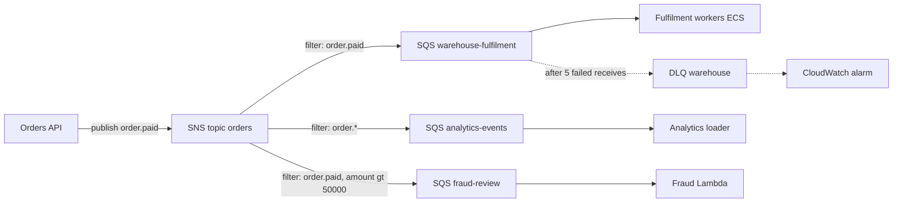

## 50.4 Relational data: RDS and Aurora PostgreSQL

#### Concept

RDS is PostgreSQL (or MySQL, and others) installed, patched, backed up and failed over by AWS. You get an endpoint, a parameter group, and a console; you do not get `ssh`, superuser, or the filesystem. Aurora is AWS's own storage engine underneath a PostgreSQL-compatible front end; it changes how replication and failover behave, and it costs more per instance. Everything you learned about PostgreSQL internals in Parts 22–26 still applies; what changes is the operational envelope around it.

#### Why does it exist?

Running PostgreSQL well means WAL archiving, base backups tested by restore, streaming replication, failover with fencing, minor-version patching, monitoring for disk and connections, and a person who wakes up when it breaks. RDS packages all of that behind an API so that a team without a database administrator can have a Multi-AZ PostgreSQL with point-in-time recovery in fifteen minutes. The price is loss of low-level control and a higher hourly rate than raw EC2.

#### Mental model

Imagine a serviced office versus an empty warehouse. In the serviced office the landlord handles power, cleaning, security, and will move you to an identical office next door if yours floods (Multi-AZ), but you cannot knock down a wall (no superuser, no custom kernel). Aurora is the same office, but the filing cabinets are in a vault shared with your neighbours in three buildings; any of you can read the same files instantly (shared storage replicas), and moving offices takes seconds because the files never move.

#### How it works

**Instance classes.** `db.t4g` burstable for dev and small workloads; `db.m7g` and `db.m6g` general purpose; `db.r7g` and `db.r6g` memory optimized, which is what production PostgreSQL usually wants because `shared_buffers` and the OS page cache are what make queries fast. A `db.r6g.xlarge` has 4 vCPUs and 32 GB and costs about $0.48 per hour single-AZ in `us-east-1`.

**Multi-AZ instance deployment.** A synchronous standby in a second AZ receives every WAL record before the primary acknowledges the commit (adding about 1 to 3 ms per commit). The standby is not readable. On failure of the primary (or its AZ, or during your patch window) RDS promotes the standby and repoints the DNS endpoint. Failover takes 60 to 120 seconds, during which writes fail. The cost is exactly double the instance price. The newer **Multi-AZ DB cluster** deployment uses one writer and two readable standbys with semi-synchronous replication, fails over in about 35 seconds, and exposes a reader endpoint; it is the better default when the budget allows three instances.

**Read replicas.** Asynchronous streaming replicas (up to 15, in-region or cross-region) with their own endpoints. Lag is normally tens of milliseconds, but a long-running report query on the replica or a burst of writes on the primary can push it to seconds or minutes (the mechanics and `hot_standby_feedback` are in Part 26 — Database Scaling). Replicas can be promoted to standalone instances, which is a manual disaster-recovery path, not automatic failover.

**Parameter groups.** The RDS way to edit `postgresql.conf`. A parameter group is attached to an instance; dynamic parameters apply immediately, static ones (`shared_buffers`, `max_connections`, `wal_level`) need a reboot. Defaults worth knowing: `shared_buffers` is 25% of memory, `max_connections` is derived from memory as `LEAST(DBInstanceClassMemory / 9531392, 5000)` (about 1,700 for 16 GB, about 400 for 4 GB), `rds.force_ssl` forces TLS, and `log_min_duration_statement` is off by default, so slow-query logging must be turned on by you.

**Performance Insights.** A dashboard of database load measured in average active sessions, broken down by wait event and by SQL. It answers "what was the database doing at 14:05" better than any ad hoc query, and the seven-day retention tier is free. Enhanced Monitoring adds OS-level metrics (per-process CPU, actual free memory) at one-second granularity.

**Backups and PITR.** RDS takes a daily snapshot and ships transaction logs to S3 every five minutes. With a retention of 1 to 35 days you can restore to any second within that window (the latest restorable time is usually about five minutes behind now). A restore creates a *new* instance with a *new* endpoint; it does not roll the existing one back, and it takes from ten minutes to well over an hour depending on data size. Manual snapshots persist until deleted and can be copied cross-region. Practice a restore quarterly; a backup you have never restored is a hope, not a plan.

**Storage and IOPS.** `gp3` storage gives a baseline of 3,000 IOPS and 125 MiB/s below 400 GiB, and 12,000 IOPS and 500 MiB/s at 400 GiB and above; more can be provisioned. `io2` goes far higher for the money. Storage autoscaling grows the volume when free space drops below 10% (it cannot shrink). The classic surprise: a 200 GiB database with a write-heavy batch job pins `WriteIOPS + ReadIOPS` at 3,000 and every query queues behind the disk.

**Aurora PostgreSQL.** Aurora replaces the storage layer with a distributed, log-structured volume spread as six copies across three AZs; a write is durable when four of six copies acknowledge. The database instance ships only redo log records, not full pages, so write amplification drops. Consequences:

- Up to 15 replicas read the *same* storage volume, so replica lag is typically under 20 ms and does not grow with write volume the way streaming-replica lag does.
- Failover to a replica takes roughly 30 seconds, sometimes less, because no data needs to catch up. A reader endpoint load-balances across replicas.
- Storage grows automatically to 128 TiB and is billed per GB used; I/O is billed per request in the standard tier, or included in the I/O-Optimized tier which is cheaper above roughly 25% I/O share of the bill.
- Aurora Serverless v2 scales capacity in units of ACUs within seconds; Aurora Global Database replicates to another region with typical lag under a second.

Aurora is not always the right choice: instance prices are about 20% higher, I/O charges can surprise write-heavy workloads on the standard tier, and some PostgreSQL extensions and features lag behind RDS. Pick Aurora when failover time and replica lag matter, or when read scaling is the bottleneck; pick RDS PostgreSQL when you want the closest thing to vanilla PostgreSQL.

**RDS Proxy.** A managed pooler in front of either engine (section 50.3 covered the Lambda motivation). It also helps container fleets: 40 tasks with a pool of 10 each is 400 connections; through the proxy the database sees perhaps 60. It shortens failover disruption because the proxy tracks the new primary itself. PgBouncer on your own cluster is cheaper and more configurable (see Part 22 — PostgreSQL Internals); RDS Proxy is the answer when you would rather not run PgBouncer.

#### Practical example

The orders database for the 1,000 RPS platform: `db.r6g.xlarge` Multi-AZ (writes, about 2,000 queries per second at peak), one `db.r6g.large` read replica for product-catalogue and order-history reads, 500 GiB `gp3` (past the 400 GiB threshold on purpose for the 12,000 IOPS baseline), 14-day backup retention, Performance Insights on, `log_min_duration_statement = 500`, `idle_in_transaction_session_timeout = 30000`, `statement_timeout` set per role rather than globally so migrations can run long.

#### NestJS example

Reading from the replica is a deliberate decision per query, not a global switch, because a user who just placed an order must see it on the next request (read-your-writes). TypeORM's replication support sends `find` and select query-builder queries to a replica by default and everything else to the master; you force the master where consistency matters.

```ts
// src/database/database.module.ts
import { Module } from '@nestjs/common';
import { TypeOrmModule } from '@nestjs/typeorm';
import { ConfigModule, ConfigService } from '@nestjs/config';

@Module({
  imports: [
    TypeOrmModule.forRootAsync({
      imports: [ConfigModule],
      inject: [ConfigService],
      useFactory: (config: ConfigService) => ({
        type: 'postgres',
        replication: {
          master: {
            host: config.getOrThrow('DB_WRITER_HOST'), // orders.cluster-xyz.ap-south-1.rds.amazonaws.com
            port: 5432,
            username: config.getOrThrow('DB_USER'),
            password: config.getOrThrow('DB_PASSWORD'),
            database: 'orders',
          },
          slaves: [
            { host: config.getOrThrow('DB_READER_HOST'), port: 5432,
              username: config.getOrThrow('DB_USER'), password: config.getOrThrow('DB_PASSWORD'), database: 'orders' },
          ],
        },
        ssl: { rejectUnauthorized: true },
        autoLoadEntities: true,
        synchronize: false,
        extra: {
          max: 10,                      // per task; 8 tasks = 80 connections on the writer
          idleTimeoutMillis: 30_000,    // recycle so DNS is re-resolved after failover
          connectionTimeoutMillis: 3_000,
          keepAlive: true,
          keepAliveInitialDelayMillis: 10_000,
          statement_timeout: 5_000,     // applied on connect by node-postgres
        },
      }),
    }),
  ],
})
export class DatabaseModule {}
```

#### TypeORM example

```ts
// src/orders/orders.service.ts
import { Injectable } from '@nestjs/common';
import { DataSource } from 'typeorm';
import { Order } from './order.entity';

@Injectable()
export class OrdersService {
  constructor(private readonly dataSource: DataSource) {}

  // Order history: replica lag of a few hundred ms is acceptable.
  async listHistory(userId: string): Promise<Order[]> {
    return this.dataSource.getRepository(Order).find({
      where: { userId }, order: { createdAt: 'DESC' }, take: 50,
    }); // find() goes to a slave under replication config
  }

  // Just-placed order confirmation: must read the primary.
  async getForConfirmation(orderId: string): Promise<Order | null> {
    const runner = this.dataSource.createQueryRunner('master');
    try {
      return await runner.manager.findOne(Order, { where: { id: orderId } });
    } finally {
      await runner.release();
    }
  }
}
```

#### Sequelize example

Sequelize has the same split: a `replication` block with `write` and `read`, and `useMaster: true` on any query that must not see replica lag.

```ts
// src/database/sequelize.config.ts
import { Sequelize } from 'sequelize';

export const sequelize = new Sequelize('orders', undefined, undefined, {
  dialect: 'postgres',
  replication: {
    write: { host: process.env.DB_WRITER_HOST, username: process.env.DB_USER, password: process.env.DB_PASSWORD },
    read: [{ host: process.env.DB_READER_HOST, username: process.env.DB_USER, password: process.env.DB_PASSWORD }],
  },
  pool: { max: 10, idle: 30_000, acquire: 3_000 },
  dialectOptions: { ssl: { rejectUnauthorized: true }, statement_timeout: 5_000 },
  logging: false,
});

// Elsewhere: a read that must reflect a write from the same request.
// const order = await Order.findByPk(orderId, { useMaster: true });
```

#### PostgreSQL example

What you actually run on RDS to see the state of replication and connections, because the console shows averages and you need the current truth.

```sql
-- On the primary: who is replicating and how far behind, in bytes.
SELECT client_addr, state,
       pg_wal_lsn_diff(sent_lsn, replay_lsn) AS bytes_behind,
       replay_lag
FROM pg_stat_replication;

-- On a replica: lag in wall-clock terms (NULL means idle primary, not zero lag).
SELECT now() - pg_last_xact_replay_timestamp() AS replica_lag;

-- Connection budget: RDS derives max_connections from memory.
SHOW max_connections;
SELECT usename, state, count(*)
FROM pg_stat_activity
GROUP BY usename, state
ORDER BY count(*) DESC;

-- Per-role safety limits instead of a global parameter-group change:
ALTER ROLE orders_api SET statement_timeout = '5s';
ALTER ROLE orders_api SET idle_in_transaction_session_timeout = '30s';
ALTER ROLE reporting SET statement_timeout = '5min';
```

Typical output of the first query on a healthy replica: `bytes_behind = 0` to a few kilobytes and `replay_lag` of `00:00:00.02`. During a bulk import, `bytes_behind` climbs into the hundreds of megabytes and `replay_lag` into seconds; that is when your read-from-replica paths start showing stale orders.

#### Production scenario

The daily "reconcile inventory" job runs at 03:00 and rewrites 8 million `stock_levels` rows. On RDS with a streaming replica, the replica lags 40 seconds during the job and product pages served from the replica show yesterday's stock for that window; the team accepts it because the job runs at night. When the business asked for the job to run hourly, the team moved to Aurora, where the replica lag during the same job stayed under 30 ms because replicas read the shared volume. That is a concrete reason to pay the Aurora premium; "it is newer" is not.

#### Failure scenario

At 14:05 the on-call saw write latency jump from 2 ms to 80 ms and the API p95 climb past 2 seconds. CPU on the `db.r6g.large` was 30%. CloudWatch showed `ReadIOPS + WriteIOPS` flat at exactly 3,000 and `DiskQueueDepth` at 45. The database was 180 GiB on `gp3`, so its IOPS baseline was 3,000, and a new "recently viewed products" feature had started writing one row per page view, about 900 writes per second with index updates. Every other query queued behind the disk. The immediate fix was to provision 12,000 IOPS on the volume (applied online, took 20 minutes to take effect). The real fix was moving page-view tracking to Redis with batched flushes. Lesson: on RDS, disk is a quota you chose, and CPU at 30% tells you nothing about it.

#### Edge cases & failure modes

- **Failover DNS and stale connections**: the endpoint CNAME flips, but a pool that never recycles keeps sockets to the old primary (now standby, read-only) and every write fails with `cannot execute INSERT in a read-only transaction`. Idle timeouts and TCP keepalives fix it; details in Part 26.
- **Replica lag exposed to users**: an order placed then not visible on refresh. Route read-your-writes queries to the primary.
- **Storage full**: without autoscaling the instance goes to `storage-full` status and refuses writes; with autoscaling there is a cooldown of six hours between increases, so a runaway job can still fill it.
- **Long transaction blocking a minor-version upgrade**: the maintenance window fails and retries next week; your logs show nothing.
- **`max_connections` hit from too many tasks**: every new task adds a pool; use RDS Proxy or PgBouncer, or lower per-task `max`.
- **PITR restores to a new endpoint**: the runbook must include repointing secrets and restarting tasks; the old instance keeps taking writes until you stop it.
- **Aurora I/O bill surprise**: a write-heavy workload on the standard tier pays per I/O; switch to I/O-Optimized.
- **Parameter change needing a reboot** applied "immediately" restarts the instance during business hours.

#### How a Senior Backend Engineer thinks about this

They treat Multi-AZ as non-negotiable for any database whose loss costs money, and they know its failover time to the second because they have tested it. They put the replica lag metric on the same dashboard as API latency. They resist "just add a bigger instance" until Performance Insights shows the load is CPU and not a missing index. They keep the backup retention at 14 to 35 days and schedule a restore drill. When asked "RDS or Aurora", they answer with the failover and replica-lag requirements, then the I/O profile, then the price.

#### Common mistakes

- Single-AZ production database to save $300 a month on a system earning $50,000 a day.
- Reading everything from the replica, including the confirmation page after checkout.
- Global `statement_timeout` in the parameter group that kills the nightly migration.
- Leaving `log_min_duration_statement` off and debugging slow queries blind.
- Never running a restore, then discovering the backup retention was set to zero days by a Terraform default.

#### Interview questions

1. *What does Multi-AZ RDS protect against and what does it not?* Expected: instance and AZ failure with automatic promotion; not bad deploys, not deleted rows, not regional outage. Follow-up: how does PITR fit in?
2. *Why is Aurora replica lag so much lower than an RDS read replica's?* Expected: replicas read shared distributed storage instead of replaying WAL over a stream.
3. *A restore from PITR completed. Are you done?* Expected: no; new endpoint, repoint app, verify data, consider the writes that landed on the old instance since.
4. *Your write latency spiked with CPU at 30%. What do you check?* Expected: IOPS versus baseline, queue depth, lock waits in Performance Insights, checkpoint activity.
5. *When would you send a query to a read replica and when not?* Expected: lag-tolerant reads (history, catalogue); never read-your-writes or anything feeding a decision that writes.

#### Practical exercise

Stand up an RDS PostgreSQL Multi-AZ instance and one read replica. Point a NestJS service at both using the replication config above. Run 200 RPS of mixed traffic and trigger a reboot with failover from the console. Acceptance criteria: writes recover within 120 seconds with no manual action; the replica-lag chart shows the failover; a PITR restore to five minutes earlier is completed and the app repointed within 30 minutes, following a written runbook.

## 50.5 DynamoDB and ElastiCache Redis

#### Concept

DynamoDB is a managed key-value and wide-column database: you fetch items by a partition key (and optionally a sort key), it scales horizontally without you thinking about it, and it answers in single-digit milliseconds at any size. ElastiCache is managed Redis (or the Redis-compatible Valkey), the cache and data-structure server you met in Part 30 — Caching, with replication and failover handled by AWS.

#### Why does it exist?

PostgreSQL scales writes vertically; past a point you shard by hand. DynamoDB exists for workloads with simple access patterns and enormous or spiky write volume where that hand-sharding is not worth it. ElastiCache exists because running Redis with replication and failover yourself is another operations job, and because a cache in a different AZ from its replica is what survives an AZ loss.

#### Mental model

Imagine DynamoDB as a vast wall of numbered lockers. If you know the locker number (partition key) you get your item instantly, and adding a million more lockers is free of thought. But asking "which lockers contain a red jacket" means opening every locker (a scan), and the wall does not know that two lockers relate to each other (no joins). ElastiCache Redis is the whiteboard next to your desk: fastest thing in the building, wiped if the building loses power, so you keep a copy on the whiteboard next door.

#### How it works

**DynamoDB basics.** A table has a partition key (hash key) and optionally a sort key (range key). Items are up to 400 KB. Data is spread across partitions by the hash of the partition key; each physical partition serves up to 3,000 read units and 1,000 write units per second and holds up to 10 GB. Reads are eventually consistent by default (a few hundred ms window) or strongly consistent on request at double the cost. Secondary indexes: a **GSI** has its own keys and capacity and is eventually consistent; an **LSI** shares the partition key, must be created with the table, and caps the total size per partition-key value at 10 GB. Capacity is on-demand (pay per request; writes cost about five times reads) or provisioned (cheaper at steady load, throttles above the number). Extras: TTL for automatic expiry, Streams for change capture, transactions across up to 100 items at double cost, PITR, and global tables for multi-region active-active.

**Partition-key design.** Everything about DynamoDB performance is "how evenly are requests spread across partition keys". A key like `date` puts every write of the day into one partition and throttles at 1,000 writes per second no matter how big the table is. A key like `userId` spreads writes well but makes "all orders today" a scan. Adaptive capacity moves throughput toward hot partitions, but it cannot exceed the per-partition ceiling.

**Single-table design.** The idiomatic pattern: one table with generic `PK` and `SK` attributes, where a user, their orders, and each order's items share the same `PK` (`USER#42`) with different `SK` prefixes (`PROFILE`, `ORDER#2025-09-01#abc`, `ORDER#...#ITEM#1`). One `Query` on `PK = USER#42 AND SK BEGINS_WITH ORDER#` returns the user's orders without a join. The design starts from the list of access patterns, not from the entities; adding a new access pattern later may require a new GSI or a data migration. That rigidity is the price of the speed.

**When DynamoDB beats PostgreSQL.** Sessions and carts (get and put by id), idempotency keys with TTL, device state, activity feeds, rate-limit counters, anything with hundreds of thousands of writes per second and key-shaped access, and workloads that must be serverless from top to bottom.

**When DynamoDB is a mistake.** Reporting and analytics, ad hoc queries, anything with joins or aggregates, evolving access patterns in a young product, uniqueness constraints across non-key attributes, and multi-row invariants that need real transactions with isolation levels. The classic failure is a team that models an e-commerce catalogue with filters ("size 42, colour red, price under 3,000, in stock") in DynamoDB and ends up building a search index anyway.

**ElastiCache Redis topologies.** *Cluster mode disabled*: one shard, a primary and up to five replicas, a primary endpoint for writes and a reader endpoint for reads, everything fits in one node's memory. *Cluster mode enabled*: data is split across up to 500 shards by the 16,384 hash slots, each shard with its own replicas, and clients use the configuration endpoint and must be cluster-aware (multi-key commands only work when keys share a hash tag `{userId}`). **Multi-AZ with automatic failover** promotes a replica in another AZ when the primary fails and updates DNS; it typically completes in well under a minute, during which writes fail and reads may continue from replicas. Persistence is by RDB snapshot only; treat ElastiCache as a cache or a rebuildable store, not a system of record. `maxmemory-policy` defaults to `volatile-lru`, meaning only keys with a TTL are evicted; a cache full of keys without TTL fails writes with `OOM command not allowed`.

**Client behaviour during failover.** `ioredis` reconnects on `ECONNRESET`, follows `MOVED` redirects in cluster mode, and can be told how many times to retry a command (`maxRetriesPerRequest`). The two knobs that matter: a short `connectTimeout` (a few seconds) and a per-command timeout in your code, so a Redis failover degrades to "cache miss, go to PostgreSQL" instead of "every request hangs for 30 seconds".

#### Practical example

An idempotency store for the payments API in DynamoDB: `PK = IDEMPOTENCY#<key>`, attributes `status`, `responseBody`, `expiresAt` (TTL 24 hours). A conditional `PutItem` with `attribute_not_exists(PK)` is the atomic "claim this key" operation: the first request wins, a concurrent duplicate gets `ConditionalCheckFailedException` and returns the stored response. This is the same pattern as the PostgreSQL `INSERT ... ON CONFLICT` version in Part 18 — API Design, but it costs nothing when idle and scales to any burst.

#### NestJS example

A cache-aside read for product details against ElastiCache with a hard per-command timeout, so a Redis failover cannot take the product page down.

```ts
// src/products/product-cache.service.ts
import { Injectable, Logger } from '@nestjs/common';
import Redis from 'ioredis';

@Injectable()
export class ProductCacheService {
  private readonly logger = new Logger(ProductCacheService.name);
  private readonly redis = new Redis({
    host: process.env.REDIS_PRIMARY_HOST, // cluster-mode-disabled primary endpoint
    port: 6379,
    tls: {},                              // in-transit encryption enabled on the cluster
    connectTimeout: 2_000,
    maxRetriesPerRequest: 1,              // fail fast during failover
    enableOfflineQueue: false,            // do not buffer commands while disconnected
    commandTimeout: 150,                  // a cache slower than the DB is not a cache
  });

  async getOrLoad<T>(key: string, ttlSeconds: number, loader: () => Promise<T>): Promise<T> {
    try {
      const hit = await this.redis.get(key);
      if (hit) return JSON.parse(hit) as T;
    } catch (err) {
      this.logger.warn(`redis get failed for ${key}: ${(err as Error).message}`); // degrade, do not fail
    }
    const value = await loader(); // PostgreSQL, ~2 ms local
    this.redis.set(key, JSON.stringify(value), 'EX', ttlSeconds).catch(() => undefined); // fire and forget
    return value;
  }
}
```

#### Production scenario

A ride-booking platform stores live driver locations in ElastiCache (`GEOADD` per driver every 4 seconds, 50,000 drivers, about 12,000 writes per second on a `cache.r7g.large`) and ride records in PostgreSQL. Trip state that must survive anything goes to PostgreSQL; the location grid is rebuilt in under a minute from the drivers' next updates if Redis is lost. The team chose cluster mode disabled with two replicas across AZs because the working set is 3 GB and one shard's throughput is enough; cluster mode would only add client complexity.

#### Failure scenario

A notifications team stored "notifications per user per day" in DynamoDB with `PK = <date>` and `SK = <userId>` so that a nightly job could query one day cheaply. At 09:00 every weekday a batch of 400,000 push notifications was recorded within five minutes. All of them hit the single partition for that date, which caps at 1,000 writes per second. Writes throttled (`ProvisionedThroughputExceededException` even on on-demand), the SDK retried with backoff, the Lambda writers scaled to 900 concurrent, and the batch that should have taken five minutes took forty while burning ten times the write cost in retries. The fix was `PK = <userId>`, `SK = <date>#<notificationId>`, with a GSI on a sharded date key (`<date>#<random 0-9>`) for the nightly job. Lesson: in DynamoDB the partition key is the throughput plan.

#### Edge cases & failure modes

- **Hot partition** from a low-cardinality key; symptom is throttling with plenty of total capacity.
- **Eventually consistent read after write** returns the old item; use `ConsistentRead: true` where it matters.
- **Item over 400 KB** fails; move blobs to S3 and store the key.
- **GSI throttling back-pressures the base table**: an under-provisioned index throttles writes to the table itself.
- **Redis eviction with `volatile-lru` and no TTLs**: writes fail with OOM while memory sits at 100%.
- **Redis failover mid-pipeline**: `READONLY You can't write against a read only replica` from a client still talking to the demoted node; reconnect on that error.
- **Cluster-mode `CROSSSLOT` error** for multi-key operations without hash tags.
- **Cache stampede** after failover: an empty cache sends every request to PostgreSQL; request coalescing and warming are covered in Part 30.
- **Reserved memory** (`reserved-memory-percent` 25%) is needed for replication buffers; set it to zero and a full sync can crash the node.

#### How a Senior Backend Engineer thinks about this

They start every DynamoDB conversation with "list the access patterns", and if the list is unstable they choose PostgreSQL. They keep Redis as a cache or rebuildable state, never the only copy of anything, and they can say how long the system limps without it. They pick cluster mode disabled until a single shard's memory or throughput is actually exceeded. They put a timeout on every cache call because a slow cache is worse than no cache.

#### Common mistakes

- Using DynamoDB because it is "web scale" for a system with 50 writes per second and evolving requirements.
- Modelling DynamoDB like a relational schema: one table per entity, then trying to join in application code.
- Single-node Redis in production as the session store; a failover logs everyone out.
- No command timeout on Redis, so a failover becomes a full outage.
- Storing sessions in Redis without a TTL and being surprised by OOM six months later.

#### Interview questions

1. *How do you choose a DynamoDB partition key?* Expected: high cardinality, evenly spread by access, matches the dominant query; sharded keys for time series.
2. *When is DynamoDB the wrong choice?* Expected: ad hoc queries, joins, reporting, unstable access patterns, cross-attribute uniqueness.
3. *What happens to your app during an ElastiCache Multi-AZ failover?* Expected: writes fail for tens of seconds, DNS flips, clients must reconnect; design for cache-miss degradation.
4. *Cluster mode enabled or disabled?* Expected: disabled until one shard's memory or throughput is exceeded; enabled brings hash slots and client constraints.
5. *Explain single-table design in two sentences.* Expected: one table, generic PK/SK, items co-located by access pattern so one Query returns a whole aggregate.

#### Practical exercise

Implement the idempotency store twice: in DynamoDB with a conditional put and TTL, and in PostgreSQL with `INSERT ... ON CONFLICT`. Fire 1,000 concurrent duplicate requests at each. Acceptance criteria: exactly one side effect per key in both; p99 latency of the claim operation recorded for both; a written half-page on which you would ship and why, including the monthly cost at 10 million requests.

## 50.6 Messaging: SQS, SNS and EventBridge

#### Concept

SQS is a queue: a producer puts a message in, one consumer takes it out, and if the consumer crashes the message comes back. SNS is a publisher: one message goes in, every subscriber gets a copy. EventBridge is an event bus with routing rules: events go in, rules match on content, and matching events are delivered to targets, with a schema registry and a scheduler on the side. The messaging patterns themselves (outbox, idempotent consumers, ordering, DLQs) are in Part 31 — Messaging: Queues, Topics, Kafka, RabbitMQ and SQS; this section is about what the AWS services guarantee and cost.

#### Why does it exist?

Kafka is a powerful log, and it is also a cluster you operate (or pay MSK to operate) with partitions, consumer groups and rebalancing to understand. Most backends have a dozen places that need "do this later, reliably" or "tell everyone this happened" and none of the properties that justify a log. SQS and SNS give you those two things with zero servers, per-request pricing, and at-least-once delivery. EventBridge exists for the routing problem: many producers, many consumers, and rules in the middle so that producers do not know who listens.

#### Mental model

Imagine SQS as a restaurant's order rail: tickets go up, any free cook takes one, and if a cook drops it the ticket goes back up after a while. SNS is the kitchen bell: everyone who cares hears it, and each takes their own copy of what it means. EventBridge is a receptionist with a rule book: "if the letter mentions a refund, copy it to finance and support; if it is from a partner, forward to integrations".

#### How it works

**SQS standard queues.** At-least-once delivery, best-effort ordering, effectively unlimited throughput. A consumer calls `ReceiveMessage` (use long polling with `WaitTimeSeconds: 20` to avoid empty responses and cost); the message becomes invisible for the **visibility timeout** (default 30 seconds, maximum 12 hours); the consumer must `DeleteMessage` after success or the message reappears. If work takes longer than the timeout, extend it with `ChangeMessageVisibility` (a heartbeat). After `maxReceiveCount` failed receives, the redrive policy moves the message to a **dead-letter queue** (DLQ), which you alarm on and can redrive back. Messages are up to 256 KB (larger payloads go through S3 with the extended client library), retained 4 days by default (up to 14), and can be delayed up to 15 minutes. Price: $0.40 per million requests after the first million, and a batch of ten messages counts as one request.

**SQS FIFO queues.** Ordered within a `MessageGroupId`, deduplicated by `MessageDeduplicationId` (or a content hash) for five minutes, delivered exactly once *to the consumer* (you still need idempotency if your side effect can fail after delete). Throughput is 300 messages per second per API action without batching, 3,000 with batching, and much higher in high-throughput mode where ordering is per message group. Use FIFO when order per entity matters (events for one order) and the volume is moderate.

**SNS.** A topic with subscriptions: SQS queues, Lambda functions, HTTPS endpoints, email, SMS, Firehose. Publishing once delivers to all; this is **fan-out**. **Filter policies** on message attributes (or on the body) let each subscription receive only what it wants, so the `orders` topic can feed the warehouse queue only `order.paid` and the analytics queue everything. Subscribing an SQS queue to a topic is the standard durable fan-out: SNS retries HTTP endpoints for a while and gives up; an SQS subscriber holds the message until the consumer is back. Turn on **raw message delivery**, or the SQS body arrives wrapped in an SNS JSON envelope with your payload as a string inside `Message`. FIFO topics deliver in order to FIFO queues.



**EventBridge.** An event bus (the default bus receives AWS service events; you create custom buses for your domain) with **rules**: JSON patterns that match on any field of the event (`"detail-type": ["OrderPaid"]`, `"detail": {"amount": [{"numeric": [">", 50000]}]}`) and route to up to five targets each (Lambda, SQS, SNS, Step Functions, ECS tasks, another bus in another account or region, API destinations with stored credentials). The **schema registry** stores event schemas, can discover them from traffic, and generates code bindings. The **Scheduler** runs cron and rate schedules at scale, including one-time schedules ("cancel this reservation at 18:30 if unpaid"), replacing home-made cron tables. **Archive and replay** let you re-deliver past events to a rule after a bug fix. **Pipes** connect a source (SQS, DynamoDB Streams, Kinesis) to a target with optional filtering and enrichment. Delivery is at-least-once with retries for up to 24 hours and a DLQ per target. Price: about $1 per million custom events. Latency is typically around half a second, and `PutEvents` throughput is a soft limit in the thousands per second per region.

**Choosing between them.**

| Need | SQS | SNS | EventBridge | Kafka / MSK |
|---|---|---|---|---|
| One consumer does the work later | Yes | | | Possible, heavier |
| Fan-out to several consumers | via SNS to SQS | Yes | Yes | Consumer groups |
| Content-based routing, many producers | | Attributes only | Yes | In consumers |
| Ordering per entity | FIFO | FIFO topics | No | Per partition |
| Replay history | No | No | Archive, coarse | Yes, native |
| Throughput 100k+ msg/s sustained | Yes, standard | Yes | No | Yes |
| Retention beyond 14 days | No | No | Archive | Yes |
| Cross-account, cross-region routing | Manual | Manual | Native | MirrorMaker |
| Ops burden | None | None | None | Cluster to run |
| Cost at 100M msg/month | About $40 | About $50 | About $100 | About $500 plus |

The rule of thumb: SQS for work queues, SNS plus SQS for fan-out of the same event to several workers, EventBridge for a domain event bus with routing and scheduling across services and accounts, Kafka when you need replay, strict ordering at high volume, or stream processing. Do not run Kafka to send emails.

#### Practical example

Order placement: the API writes the order and an outbox row in one transaction (the outbox pattern, Part 31 — Messaging). A relay publishes `OrderPaid` to the `orders` SNS topic with attributes `eventType=order.paid`, `amount=7200`. Three SQS queues are subscribed with filters: fulfilment, analytics, fraud review (only above 50,000). Each queue has a DLQ with `maxReceiveCount: 5` and an alarm on `ApproximateNumberOfMessagesVisible > 0` in the DLQ. The fulfilment consumers are ECS tasks scaling on `ApproximateNumberOfMessagesVisible` of their queue. The whole thing costs a few dollars a month at a million orders.

#### NestJS example

A long-polling SQS consumer with a visibility heartbeat and no-delete-on-failure, so a crashed worker's message comes back and a poison message reaches the DLQ.

```ts
// src/fulfilment/order-paid.consumer.ts
import { Injectable, Logger, OnModuleDestroy, OnModuleInit } from '@nestjs/common';
import { ConfigService } from '@nestjs/config';
import { SQSClient, ReceiveMessageCommand, DeleteMessageCommand, ChangeMessageVisibilityCommand, Message } from '@aws-sdk/client-sqs';
import { FulfilmentService } from './fulfilment.service';

@Injectable()
export class OrderPaidConsumer implements OnModuleInit, OnModuleDestroy {
  private readonly logger = new Logger(OrderPaidConsumer.name);
  private readonly sqs = new SQSClient({ region: process.env.AWS_REGION }); // credentials from the task role
  private readonly queueUrl = this.config.getOrThrow<string>('FULFILMENT_QUEUE_URL');
  private running = false;

  constructor(private readonly config: ConfigService, private readonly fulfilment: FulfilmentService) {}

  onModuleInit() { this.running = true; void this.loop(); }
  async onModuleDestroy() { this.running = false; } // SIGTERM: stop receiving; in-flight messages finish

  private async loop(): Promise<void> {
    while (this.running) {
      try {
        const { Messages = [] } = await this.sqs.send(new ReceiveMessageCommand({
          QueueUrl: this.queueUrl, MaxNumberOfMessages: 10, WaitTimeSeconds: 20, VisibilityTimeout: 60,
        }));
        await Promise.all(Messages.map((m) => this.handle(m)));
      } catch (err) {
        this.logger.error(`receive failed: ${(err as Error).message}`);
        await new Promise((r) => setTimeout(r, 2_000)); // do not hot-loop on an SQS outage
      }
    }
  }

  private async handle(m: Message): Promise<void> {
    const heartbeat = setInterval(() => {
      this.sqs.send(new ChangeMessageVisibilityCommand({
        QueueUrl: this.queueUrl, ReceiptHandle: m.ReceiptHandle!, VisibilityTimeout: 60,
      })).catch(() => undefined);
    }, 30_000); // extend while a slow fulfilment call runs
    try {
      const event = JSON.parse(m.Body!) as { eventId: string; orderId: string };
      await this.fulfilment.reserveAndShip(event); // idempotent on eventId (Part 31 — Messaging)
      await this.sqs.send(new DeleteMessageCommand({ QueueUrl: this.queueUrl, ReceiptHandle: m.ReceiptHandle! }));
    } catch (err) {
      this.logger.warn(`message ${m.MessageId} failed, will retry: ${(err as Error).message}`);
      // no delete: SQS redelivers after the visibility timeout; DLQ after maxReceiveCount
    } finally {
      clearInterval(heartbeat);
    }
  }
}
```

#### Production scenario

The notifications platform pushes 30 million messages a month through one SNS topic to four SQS queues (email, push, SMS, audit). The SMS consumer talks to a provider limited to 100 requests per second, so its ECS service is capped at two tasks and the queue simply grows during a campaign and drains over an hour; the email consumer scales to twenty tasks and drains in minutes. Same event, different back-pressure per consumer, and nobody had to size a Kafka cluster. Monthly messaging cost: under $60.

#### Failure scenario

At 09:40 finance reported customers receiving two invoices for one order. The invoice worker called a PDF service that had slowed from 3 seconds to 45 seconds per document. The SQS visibility timeout was 30 seconds. Each message became visible again while the first worker was still generating the PDF; a second worker picked it up, and both emailed the customer. Nothing had "failed", so no alarm fired. Fixes: a visibility heartbeat as in the example above; an idempotency check on `invoiceGeneratedFor(orderId)` *before* the slow call and a conditional update after; and an alarm on `ApproximateAgeOfOldestMessage`, which had been climbing for half an hour. At-least-once delivery is not a corner case; it is the normal behaviour under slowness.

#### Edge cases & failure modes

- **Duplicate delivery** from redelivery, from producer retries, and from SNS retries to SQS; the consumer must be idempotent by event id.
- **Visibility timeout shorter than processing** produces duplicates as above; heartbeat or set it to six times the p99 processing time.
- **Poison message without a DLQ** cycles forever, consuming a worker slot each time.
- **DLQ with no alarm** is a black hole; messages expire after 14 days unseen.
- **FIFO throughput ceiling** hit during a campaign; one message group per entity, or standard queue plus idempotency.
- **SNS envelope surprise**: consumer JSON-parses the body and finds `Type`, `MessageId`, `Message`; enable raw delivery.
- **EventBridge rule pattern silently matching nothing** after a producer renames a field; test patterns with `test-event-pattern` and alarm on `FailedInvocations` and on zero `MatchedEvents`.
- **Consumer crash after side effect, before delete**: the message returns; idempotency is the only defence.
- **Large payload**: a 300 KB event fails to publish; send a reference (S3 key or order id) instead of the document.
- **Queue growing while workers are healthy**: the downstream dependency is slow; scale on oldest-message age, not just depth.

#### How a Senior Backend Engineer thinks about this

They ask "does this need ordering, replay, or more than 3,000 messages per second?" and if the answer is no three times, Kafka is not on the table. They insist every queue has a DLQ, every DLQ has an alarm, and every consumer is idempotent, before a single message flows. They scale consumers on queue age, because depth is fine and age is what the customer feels. They keep events small and self-describing (`eventId`, `eventType`, `occurredAt`, `orderId`) and put the schema in a registry once more than two teams consume it.

#### Common mistakes

- Deleting the message before processing it "so it is not processed twice".
- No visibility heartbeat on a consumer that calls a slow third party.
- One giant queue for every job type, so a slow job type starves the fast ones.
- Fan-out by publishing to three queues from application code instead of one SNS topic, and forgetting the third one in the retry path.
- Using EventBridge as a work queue and being surprised by 24-hour retry semantics and half-second latency.

#### Interview questions

1. *Explain the SQS visibility timeout and what goes wrong when it is too short or too long.* Expected: duplicates when too short, slow recovery from crashes when too long; heartbeat for variable work.
2. *How do you implement fan-out with at-least-once durability on AWS?* Expected: SNS topic with SQS subscribers, filter policies, DLQs per queue.
3. *SQS FIFO promises exactly-once processing. Do you still need idempotency?* Expected: yes; exactly-once covers delivery to the consumer, not your side effects after a partial failure.
4. *When would you pick EventBridge over SNS?* Expected: content-based routing, many producers and consumers, cross-account, schema registry, scheduler; SNS for simple high-throughput fan-out.
5. *Where does Kafka earn its cost over SQS?* Expected: replay, ordering at high volume, stream processing, long retention.

#### Practical exercise

Build the `orders` fan-out: one SNS topic, three filtered SQS queues with DLQs, one NestJS consumer per queue. Publish 10,000 events with 5% forced failures in one consumer. Acceptance criteria: the failed messages land in that queue's DLQ after five attempts and an alarm fires; replaying the DLQ after a fix processes them exactly once (verified by a database count); slowing the consumer to 50 seconds per message produces zero duplicates thanks to the heartbeat.
