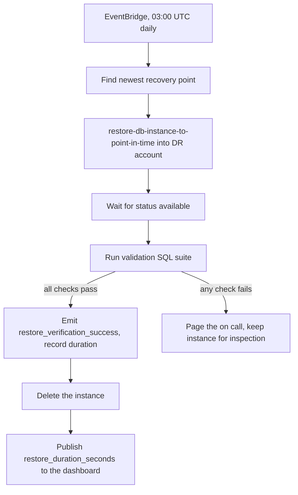

## 50.2 Restore

#### Concept

Here is the central argument of this entire part, and it is worth putting in bold:

**The restore is the product. The backup is only the input.**

Nobody has ever been paid for having a backup. They are paid for having a working database again. A backup you have never restored is a hypothesis, and the incident is a terrible time to test a hypothesis. Teams that take this seriously stop measuring "backup success rate" and start measuring "time to a validated restore", because that number is the one their customers experience.

#### Why does it exist?

Restore is a separate discipline because it has failure modes that the backup path never exercises:

- The backup is corrupt, truncated, or missing tables (50.1's failure scenario).
- The KMS key needed to decrypt is in another region or another account, and the grant does not exist.
- The restore takes nine hours because you restored to a smaller instance class with lower IOPS.
- The restored cluster has no roles, so the application's user does not exist.
- Extensions (`pg_trgm`, `postgis`, `pgcrypto`) are not installed in the target and half your queries fail.
- The application still points at the old hostname.
- Nobody on call knows the procedure and the person who wrote it left.

Every one of those is discovered for free in a drill and discovered expensively in an incident.

#### Mental model

Imagine a fire drill in an office. Having fire extinguishers on the wall is the backup. Knowing that the third-floor stairwell door is locked, that the extinguisher on floor two was discharged last year and never refilled, and that it takes 4 minutes not 90 seconds to get everyone out — that is the restore. You only learn those by walking the route.

#### How it works

**Estimating restore time for a 2 TB database.** This is a calculation seniors are expected to do on a whiteboard. Break it into stages; each has a different bottleneck.

| Stage | What is happening | Realistic time, 2 TB |
|---|---|---|
| Decide and approve | Detect, declare, choose recovery target | 5 to 20 min (mostly human) |
| Provision the instance | RDS creates the instance and attaches restored storage | 10 to 20 min |
| Snapshot restore to "available" | EBS volume created from the snapshot in S3 | 20 to 40 min |
| WAL / transaction log replay | Replaying from snapshot time to target time. Recovery is largely single-threaded; expect 100 to 400 MB of WAL per minute replayed | 6 hours of WAL at 40 GB total: 20 to 60 min |
| Lazy block hydration | EBS blocks are fetched from S3 on first read. Until then, reads are slow | Hours of degraded performance unless you force-read or use fast snapshot restore |
| Validation | Row counts, latest order, checksums, smoke tests | 10 to 20 min |
| Repoint the application | Secrets, DNS or config change, rolling restart, pool reconnect | 5 to 15 min |
| Cache warming | Redis is empty; the database takes full read load | 15 to 60 min of elevated latency |

Total for a full PITR restore of 2 TB: realistically **90 minutes to 3 hours** to a usable database, and another **30 to 60 minutes** before performance is normal. If your published RTO is 1 hour and you rely on restore-from-snapshot, your RTO is fiction. That gap is exactly what 50.3 and 50.5 are for.

Two details that dominate the numbers:

**Lazy loading is the hidden cost.** A restored EBS volume is not a copy; blocks are pulled from S3 on first access. The instance says "available" long before it is fast. A cold restored 2 TB database can serve queries at a fraction of normal throughput for hours. Mitigations: use Aurora (which has no per-block hydration in the same way), pre-warm by reading the hot tables (`SELECT count(*) FROM orders;` and friends, or `pg_prewarm`), or accept the degradation and shed load.

**Instance class and IOPS matter more than you think.** Restoring a production-sized database onto `db.t3.medium` "to save money during the drill" produces a 9 hour restore and teaches you nothing useful. Restore to the same class you run in production, or you have not measured your RTO.

**Restoring a single table from a logical dump.** This is the surgical path, and it is the reason you keep logical dumps despite their cost.

```bash
# What is actually in this dump? Always look before you restore.
pg_restore --list /backup/shop-2026-09-09T02-00Z.dump | grep -i order_items

# Restore ONLY order_items, into a scratch schema in a scratch database.
createdb shop_restore
psql -d shop_restore -c 'CREATE SCHEMA recovered;'

# --data-only avoids recreating the table; --schema/--table select precisely.
pg_restore --dbname=shop_restore --table=order_items --jobs=4 \
  /backup/shop-2026-09-09T02-00Z.dump
```

Never restore a table directly over the live one. Restore into a scratch database or schema, inspect it, then move exactly the rows you need with an explicit `INSERT ... SELECT` and an `ON CONFLICT DO NOTHING`. 50.4 walks through the full reconciliation.

**Restoring to a separate instance for forensics.** When the question is "what did this row look like yesterday?" or "when exactly did this data change?", you do not touch production. You restore to a new, isolated instance:

- Different security group, reachable only from a bastion or a jump role. No application connects to it.
- Tagged `purpose=forensic`, `expires=<date>`, with an automatic teardown job — forensic instances are a top-5 source of surprise cloud bills (Part 51).
- Read-only usage. If you must run analysis queries, take a snapshot of the forensic instance first so you can redo the analysis after you inevitably break something.

This is also how you answer legal and compliance questions ("prove what the price was on 3 September") without any production risk at all.

**The nightly automated restore verification job.** This is the practice that separates teams that have backups from teams that have disaster recovery. Run it every night, in a non-production account, automatically:



The validation suite is where the value is. It must ask business questions, not just "did it start":

```sql
-- 1. Freshness: how far behind the target is the restored data?
SELECT now() - max(created_at) AS newest_order_age FROM orders;

-- 2. Structural completeness: every table production has, the restore has.
SELECT table_schema, table_name
FROM information_schema.tables
WHERE table_type = 'BASE TABLE' AND table_schema NOT IN ('pg_catalog','information_schema')
ORDER BY 1, 2;

-- 3. Referential sanity: orphans mean a torn or partial restore.
SELECT count(*) AS orphan_items
FROM order_items oi
LEFT JOIN orders o ON o.id = oi.order_id
WHERE o.id IS NULL;

-- 4. Financial invariant: order totals still equal the sum of their lines.
SELECT count(*) AS mismatched_orders
FROM orders o
JOIN (
  SELECT order_id, sum(unit_price_cents * quantity) AS lines_total
  FROM order_items GROUP BY order_id
) t ON t.order_id = o.id
WHERE o.total_cents <> t.lines_total;

-- 5. Extensions and roles exist (the two most common restore surprises).
SELECT extname FROM pg_extension ORDER BY 1;
SELECT rolname FROM pg_roles WHERE rolcanlogin ORDER BY 1;
```

Publish `restore_duration_seconds` as a metric with a graph. When it starts creeping from 70 minutes toward 3 hours as the database grows, you find out months before an incident does. That single graph is the most valuable artefact this whole practice produces, because it turns RTO from a promise in a document into a measured number that trends.

#### NestJS example

The validation suite belongs in your codebase next to your migrations, not in a wiki page. A small Nest standalone application runs it against any connection string, so the same code validates a nightly automated restore, a drill, and a real incident.

```ts
// restore-check.command.ts
import { Injectable, Logger } from '@nestjs/common';
import { DataSource } from 'typeorm';

export interface CheckResult { name: string; ok: boolean; detail: string }

@Injectable()
export class RestoreCheckService {
  private readonly log = new Logger(RestoreCheckService.name);
  constructor(private readonly ds: DataSource) {}

  async runAll(maxDataAgeSeconds: number): Promise<CheckResult[]> {
    const results: CheckResult[] = [];

    const [{ age }] = await this.ds.query<{ age: string }[]>(
      `SELECT COALESCE(EXTRACT(EPOCH FROM (now() - max(created_at))), 1e9) AS age FROM orders`,
    );
    results.push({
      name: 'data_freshness',
      ok: Number(age) <= maxDataAgeSeconds,
      detail: `newest order is ${Math.round(Number(age))}s old (budget ${maxDataAgeSeconds}s)`,
    });

    const [{ orphans }] = await this.ds.query<{ orphans: string }[]>(
      `SELECT count(*) AS orphans FROM order_items oi
       LEFT JOIN orders o ON o.id = oi.order_id WHERE o.id IS NULL`,
    );
    results.push({ name: 'no_orphan_items', ok: orphans === '0', detail: `${orphans} orphans` });

    const [{ mismatched }] = await this.ds.query<{ mismatched: string }[]>(
      `SELECT count(*) AS mismatched FROM orders o
       JOIN (SELECT order_id, sum(unit_price_cents * quantity) AS t
             FROM order_items GROUP BY order_id) x ON x.order_id = o.id
       WHERE o.total_cents <> x.t`,
    );
    results.push({ name: 'order_totals_match', ok: mismatched === '0', detail: `${mismatched} mismatched` });

    const required = ['pgcrypto', 'pg_trgm', 'uuid-ossp'];
    const rows = await this.ds.query<{ extname: string }[]>(`SELECT extname FROM pg_extension`);
    const present = new Set(rows.map((r) => r.extname));
    const missing = required.filter((e) => !present.has(e));
    results.push({ name: 'extensions_present', ok: missing.length === 0, detail: `missing: ${missing.join(',') || 'none'}` });

    for (const r of results) {
      this.log[r.ok ? 'log' : 'error'](`check ${r.name}: ${r.ok ? 'PASS' : 'FAIL'} - ${r.detail}`);
    }
    return results;
  }
}
```

Run it with a `NestFactory.createApplicationContext` entrypoint so it works as a CLI in a Kubernetes `Job`, exiting non-zero on any failure. Now "verify the restore" is a container image, not a tribal ritual.

#### Production scenario

The platform's nightly job restores the previous day's recovery point into the DR account on a `db.r6g.4xlarge`, runs the checks, records `restore_duration_seconds`, and deletes the instance. Cost: about 100 minutes of a `db.r6g.4xlarge` per night, roughly $2 to $3 a day, plus storage for the restore duration. Roughly $100 a month to know, every single morning, that the restore works.

That number is the easiest budget conversation you will ever have. "We spend $100 a month to guarantee that our worst day is survivable" needs no further argument.

#### Failure scenario

A payments company had 90 days of `pg_dump` files in S3, monitored, alerted, green. In an incident they discovered the dumps were 4 GB when the database was 900 GB. The cron job piped `pg_dump` into `gzip` into `aws s3 cp`, and when `pg_dump` failed partway through, `gzip` still produced a valid (truncated) gzip stream and `aws s3 cp` still exited 0. Pipelines hide failures: the exit status of a pipeline is the exit status of its *last* command.

The fix was two lines: `set -o pipefail` in the script, and a post-upload check that the object size is within 20 percent of the previous day's. Both would have caught it on night one. Instead it was caught 90 days later, during a restore, with the CTO on the call.

#### Edge cases & failure modes

- The restore succeeds but the app cannot connect: roles missing (`pg_dumpall --globals-only` was never taken), or `pg_hba`/security group differs in the target.
- Extensions missing in the target; RDS requires them to be in the allowed list and `CREATE EXTENSION` to run.
- Restoring into a smaller instance class silently changes `shared_buffers`, `work_mem` and `max_connections`, so query plans and connection limits differ from production.
- Parameter groups and option groups are not part of a snapshot in the way people assume; a restored instance gets the default group unless you specify yours.
- Sequences after a partial logical restore are behind the max id, so the first insert throws a duplicate key error (50.11).
- Restore time grows superlinearly with unused indexes: `pg_restore` rebuilds every index. Dropping unused indexes speeds restores and saves money (Part 51).
- A restore into an existing database with `--clean` drops objects first; if the restore then fails, you have destroyed the target.
- Concurrent restores throttle: EBS snapshot restore bandwidth is shared, so restoring six databases at once is not six times faster.

#### How a Senior Backend Engineer thinks about this

They ask, in every architecture review that touches data: *"When did we last restore this, and how long did it take?"* If the answer is a shrug, the backup line item in the design is not done.

They know RTO is a *measured* number with a trend line, and they refuse to publish an RTO the team has not demonstrated. Saying "our RTO is 1 hour" when the last drill took 3 hours and 40 minutes is not optimism, it is a false promise to the business.

They restore to a separate instance by default. Production is never the place you experiment during an incident; a side instance costs $3 an hour and removes an entire class of "we made it worse" outcomes.

And they automate the verification, because a manual quarterly restore test is a test of whoever happened to be free that afternoon, while a nightly automated restore is a property of the system.

#### Common mistakes

- Testing restores "when we have time", which is never.
- Testing the restore on a 5 GB staging database and claiming the number applies to 2 TB.
- Restoring over the live database during an incident because it feels faster.
- Not checking `pg_restore --list` before restoring, so you do not notice what is missing.
- Forgetting that the application needs new credentials, a new host, and a rolling restart before the restore counts as finished.
- Deleting the damaged original instance before the restored one is validated. Keep the evidence.

#### Interview questions

1. **Estimate the time to restore a 2 TB PostgreSQL database from a snapshot plus 6 hours of WAL.** Expected: staged answer — provisioning 10–20 min, snapshot restore 20–40 min, WAL replay 20–60 min, validation and repoint 15–30 min, plus degraded performance from lazy block loading. Total 1.5 to 3 hours. Follow-up: what makes it faster? Smaller RPO gap, warm standby, Aurora, larger instance class, pre-warming.
2. **How do you restore one table without touching the rest of the database?** Expected: logical dump with `pg_restore --table` into a scratch database, or PITR to a side instance then `INSERT ... SELECT` the rows across. Never restore over the live table.
3. **What does a nightly restore verification job check?** Expected: it completes, within the expected time, and passes business invariants (freshness, referential integrity, financial totals, extensions, roles). Follow-up: what metric would you graph? Restore duration over time.
4. **Your backup job exits 0 every night but the file is a tenth of the expected size. How would that happen and how do you catch it?** Expected: shell pipeline masking the failure, no `pipefail`; catch it with size-delta checks, manifest comparison, and restore verification.
5. **Why restore to a separate instance for forensics?** Expected: no production risk, isolation, can be destroyed and repeated, preserves evidence, no contention with recovery.

#### Practical exercise

Build the nightly restore verification job for a database you control. It must: find the newest recovery point, restore it to an isolated instance, run at least five business-invariant checks, publish a `restore_duration_seconds` metric, tear the instance down, and page on failure.

Acceptance criteria: it runs unattended for seven consecutive nights; you can show a graph of restore duration; and when you deliberately corrupt or truncate a backup, the job fails loudly and keeps the instance for inspection rather than deleting it.
