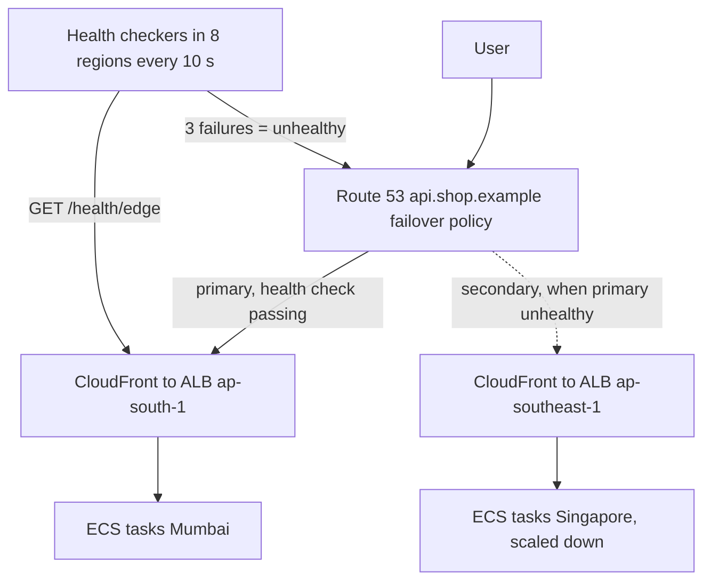
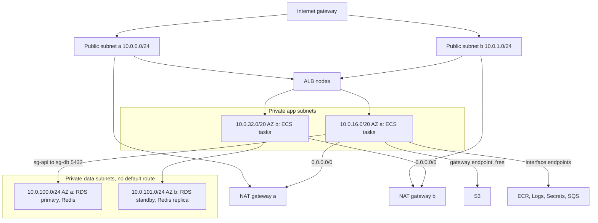

## 50.7 Load balancing and the API edge: ALB, NLB and API Gateway

#### Concept

A load balancer is the one stable address in front of a fleet of replaceable containers. AWS gives you two: the Application Load Balancer (ALB) understands HTTP (layer 7) and routes by host, path and headers; the Network Load Balancer (NLB) forwards TCP and UDP connections (layer 4) at very high speed without reading them. API Gateway is a third kind of front door: a managed API layer with authentication, throttling per client, request validation and WebSocket support, designed mostly for Lambda backends but able to front containers too.

#### Why does it exist?

Containers come and go: deploys replace them, auto scaling adds and removes them, an AZ failure kills a third of them. Clients need one DNS name, one TLS certificate and one place where unhealthy targets are removed from rotation within seconds. Beyond that, an API edge needs cross-cutting features (TLS termination, WAF, rate limiting, routing between services) that you do not want to build into every NestJS application.

#### Mental model

Imagine a hotel. The ALB is the concierge who reads your booking (host, path, headers) and sends you to the right desk, and who quietly stops sending guests to a desk whose clerk has stepped away. The NLB is the revolving door: it moves people through as fast as physically possible and reads nothing. API Gateway is a front desk with a guest register: it checks ID, counts how many times each guest has asked for something today, and can call room service (Lambda) without any clerk being on shift.

#### How it works

**ALB.** A listener on 443 terminates TLS with an ACM certificate and evaluates rules in priority order: host header, path pattern, HTTP method, headers, query string, source IP. Each rule forwards to one or more **target groups**, optionally weighted (95% to `orders-v41`, 5% to `orders-v42` is a canary). Targets are instances, IP addresses (what Fargate tasks register as) or Lambda functions. The ALB runs **health checks** against each target (path `/health/ready`, interval 30 s default, timeout 5 s, healthy after 5 successes and unhealthy after 2 failures by default; production settings are usually interval 10, healthy 2, unhealthy 2, so a dead task leaves rotation within 20 s). Targets being removed enter **draining** for the deregistration delay (300 s default; set 30 s for APIs), during which in-flight requests finish and no new ones arrive. ALB speaks HTTP/2 and gRPC to clients and to targets (gRPC target groups), supports WebSocket upgrades, sticky sessions by cookie (avoid; keep state in Redis), and attaches to WAF. Cross-zone load balancing is always on, which means every target receives an equal share regardless of AZ. Access logs go to S3. Pricing is about $16 per month plus $0.008 per load-balancer capacity unit hour; an LCU is 25 new connections per second, 3,000 active connections per minute, 1 GB per hour processed, or 1,000 rule evaluations per second, whichever is highest.

**NLB.** Forwards TCP, UDP and TLS connections with sub-millisecond added latency and millions of requests per second. It offers one static IP per AZ (or your own Elastic IPs), preserves the client's source IP to the target, and has a fixed 350 s TCP idle timeout. It does not see HTTP, so no path routing, no header-based rules, no WAF. Choose it for non-HTTP protocols (a PostgreSQL proxy, MQTT, Kafka brokers exposed to a partner), when a partner must allow-list fixed IPs, for PrivateLink endpoint services (which require an NLB or a Gateway Load Balancer), and when you need raw throughput with a stable IP.

**The keep-alive timeout rule.** The ALB keeps connections to your targets open and reuses them. Its idle timeout is 60 s by default. Node's HTTP server closes an idle keep-alive connection after `server.keepAliveTimeout`, which defaults to **5 s**. Picture the race: a connection has been idle for 5.000 s; Node decides to close it; at 5.001 s the ALB picks that same connection for a new request. The request hits a closing socket, the ALB gets a reset, and the client receives **502 Bad Gateway** with nothing in your application logs. The fix is a rule you will apply everywhere: **the backend's keep-alive timeout must be longer than the proxy's idle timeout**. For ALB set `keepAliveTimeout = 65_000` and `headersTimeout = 66_000` (Node requires headers timeout to exceed keep-alive timeout). The same rule applies to NLB (350 s), to an Nginx ingress (`keepalive_timeout` upstream, 60 s default), and to CloudFront's origin keep-alive (5 s default, raise it to 60 s at the origin setting and keep Node above that).

**API Gateway.** Three products under one name.

- *REST API*: the full-featured one. Request validation against JSON schemas, mapping templates to reshape requests, usage plans with API keys and per-client quotas, response caching, canary stages, WAF, private APIs inside a VPC, direct integrations with AWS services (write to SQS or DynamoDB with no Lambda). About $3.50 per million requests plus data, and it adds tens of milliseconds.
- *HTTP API*: the lighter, cheaper one. About $1.00 per million, lower latency, built-in JWT authorizer (perfect for Cognito or any OIDC issuer), CORS handling, and integration with a private ALB or NLB through a VPC link. No usage plans, no caching, no request validation, no WAF attachment.
- *WebSocket API*: manages persistent client connections for you. Routes `$connect`, `$disconnect`, `$default` and custom routes to Lambda or HTTP backends; your backend pushes to a client by calling the `@connections` management API with the connection id. Connections last at most two hours with a ten-minute idle timeout. This is how you do WebSockets without running a WebSocket server.

Throttling: an account-level default of 10,000 requests per second with a burst of 5,000 per region, overridable per stage and per route, and per client through usage plans. Exceeding it returns **429 Too Many Requests**; your clients must retry with backoff. The integration timeout is 29 s by default (raisable for regional REST APIs on request) and the payload limit is 10 MB. Authorizers: IAM (SigV4-signed requests), Cognito user pools, Lambda authorizers (custom logic, cacheable), JWT (HTTP API).

**API Gateway versus ALB.**

| Question | ALB | API Gateway |
|---|---|---|
| Backend is containers at high, steady RPS | Yes; $50 to $150 per month at 1,000 RPS | Expensive: $2,600 to $9,000 per month at 1,000 RPS |
| Backend is Lambda | Possible (Lambda target) | Native, better fit |
| Per-client API keys, quotas, plans | No (build it in the app) | REST API usage plans |
| Request schema validation at the edge | No | REST API |
| JWT validation at the edge | No (use the app or Cognito with ALB auth action) | HTTP API built in |
| WebSockets | Pass-through to your servers | Managed, serverless |
| WAF | Yes | REST API only |
| Path and host routing across services | Yes, rich | Per route |
| Added latency | About 1 ms | 5 to 30 ms |

Most container platforms run CloudFront in front of an ALB and use API Gateway only for Lambda-backed pieces (webhooks, a WebSocket notification channel).

#### Practical example

The listener rules for the e-commerce ALB, in priority order: host `api.shop.example` and path `/v1/orders*` to target group `orders-api`; `/v1/catalog*` to `catalog-api`; `/v1/payments/webhooks/*` to a Lambda target group; a default rule that returns a fixed 404 JSON response so that unknown paths never reach any service. During a canary, the orders rule forwards to two target groups weighted 95 and 5. WAF in front applies a rate-based rule (2,000 requests per 5 minutes per IP) and the AWS managed core rule set.

#### NestJS example

A WebSocket gateway that lives behind an ALB. Two things matter: the ALB idle timeout (60 s) also applies to WebSocket frames, so the server must send a ping more often than that; and horizontal scaling needs shared state, so the gateway publishes through Redis rather than holding rooms in memory.

```ts
// src/notifications/notifications.gateway.ts
import { Logger } from '@nestjs/common';
import { OnGatewayConnection, OnGatewayDisconnect, WebSocketGateway, WebSocketServer } from '@nestjs/websockets';
import type { Server, WebSocket } from 'ws';

@WebSocketGateway({ path: '/ws' }) // @nestjs/platform-ws adapter registered in main.ts
export class NotificationsGateway implements OnGatewayConnection, OnGatewayDisconnect {
  @WebSocketServer() server!: Server;
  private readonly logger = new Logger(NotificationsGateway.name);
  private readonly heartbeats = new Map<WebSocket, NodeJS.Timeout>();

  handleConnection(client: WebSocket) {
    // ALB idle timeout is 60 s; a frame every 25 s keeps the connection alive
    // and detects dead clients (a phone that lost signal never sends close).
    const timer = setInterval(() => {
      if (client.readyState !== client.OPEN) return;
      client.ping();
    }, 25_000);
    this.heartbeats.set(client, timer);
  }

  handleDisconnect(client: WebSocket) {
    clearInterval(this.heartbeats.get(client));
    this.heartbeats.delete(client);
  }

  // Called by a Redis subscriber: any task can fan out to its own clients.
  broadcastOrderUpdate(payload: { orderId: string; status: string }) {
    const frame = JSON.stringify({ type: 'order.updated', ...payload });
    for (const client of this.server.clients) {
      if (client.readyState === client.OPEN) client.send(frame);
    }
  }
}
```

Set the `keepAliveTimeout` from section 50.2 as well; it protects the plain HTTP requests on the same ALB.

#### Production scenario

At 1,000 RPS the ALB for the platform handles roughly 6 GB per hour of traffic, a few hundred new connections per second (CloudFront reuses connections, so far fewer than the client count), and one or two rule evaluations per request. That is about 7 LCUs, or $40 per month on top of the $16 base. Target groups use interval 10, healthy 2, unhealthy 2, timeout 4 and a 30 s deregistration delay. A deploy of the orders service therefore shows a target leaving rotation within 20 s of failing and joining within 20 s of passing, and a rollout of 8 tasks takes about 6 minutes end to end.

#### Failure scenario

For three weeks the orders API showed a steady 0.04% rate of 502s: about 35 per hour at peak. Application logs showed nothing; every request the app saw was answered. The ALB metric `HTTPCode_ELB_502_Count` (errors generated *by the load balancer*, distinct from `HTTPCode_Target_5XX_Count`) matched the number exactly. Access logs showed the 502s had a target processing time of `-1`: the ALB never got a response. The service had been migrated from an EC2 host with Nginx in front (whose upstream keep-alive was tuned) to Fargate with Node directly behind the ALB and the default 5 s `keepAliveTimeout`. Setting it to 65 s dropped the 502s to zero the same afternoon. The senior lesson is not the number; it is the diagnostic habit of separating "errors the load balancer made" from "errors the target made".

#### Edge cases & failure modes

- **Health check hitting a heavy endpoint**: a readiness check that runs three database queries at interval 10 across 8 tasks and 3 AZ checkers is 7 queries per second of pure overhead; keep it to `SELECT 1`.
- **Health check passing while the app is broken**: `/health/live` returns 200 but every real endpoint 500s; smoke tests after deploy catch it (Part 51 — CI/CD).
- **Deregistration delay longer than task stop timeout**: ECS kills the task while the ALB still routes to it; align `stopTimeout` and the delay.
- **Sticky sessions with auto scaling**: scale-in logs out a share of users; keep sessions in Redis.
- **Idle timeout during a long request**: an export endpoint that takes 90 s gets a 504 from the ALB at 60 s; make it asynchronous or raise the idle timeout for that listener.
- **Cross-zone data charges**: ALB-to-target traffic across AZs is not charged for ALB, but your target-to-database traffic is.
- **API Gateway 429s** during a burst because the stage limit is below the account limit; `Retry-After` is not sent, so clients need jittered backoff.
- **API Gateway 29 s timeout** killing a slow report; the Lambda keeps running and the client retries, doubling the load.
- **WebSocket behind ALB without pings** silently dropped at 60 s of idle.
- **NLB and security groups**: NLB (newer ones) supports security groups; older setups saw the client IP directly at the target, so the target's security group had to allow the whole internet.

#### How a Senior Backend Engineer thinks about this

They put every service behind a target group with an honest readiness check and a short deregistration delay before the first deploy. They know the keep-alive rule cold and apply it to every proxy layer in the path. They choose ALB for container APIs by default and reach for API Gateway when the backend is Lambda or the requirement is per-client quotas. They read `HTTPCode_ELB_5XX` and `HTTPCode_Target_5XX` as two different alarms with two different owners.

#### Common mistakes

- Leaving the Node default `keepAliveTimeout` of 5 s behind any proxy.
- Using the ALB's 60 s idle timeout as the request timeout for the whole system, so a slow database query fails at the edge while the server keeps working.
- Fronting a 1,000 RPS container API with API Gateway REST and discovering a $9,000 line item.
- One target group for all services with path routing done in the app, which makes canaries and per-service scaling impossible.
- Health checks with a 30 s interval and 5 healthy threshold, so a new task takes two and a half minutes to receive traffic.

#### Interview questions

1. *Why does a Node service behind an ALB return sporadic 502s, and what is the fix?* Expected: keep-alive race; backend timeout longer than the ALB idle timeout, plus headers timeout above it.
2. *ALB or NLB for a gRPC service? For a PostgreSQL proxy?* Expected: ALB supports gRPC natively at L7; a PostgreSQL proxy is raw TCP, so NLB.
3. *How do you run a canary with an ALB?* Expected: weighted target groups on the listener rule, metrics per target group, automated promotion (Part 51).
4. *When is API Gateway worth its price?* Expected: Lambda backends, per-client keys and quotas, edge validation, managed WebSockets; not for high-RPS container APIs.
5. *What does `HTTPCode_ELB_5XX` tell you that `HTTPCode_Target_5XX` does not?* Expected: the load balancer generated the error (no healthy targets, keep-alive resets, timeouts) versus your app returned it.

#### Practical exercise

Put a NestJS service behind an ALB with the default Node settings and run a 200 RPS load test for ten minutes with a mix of request sizes. Acceptance criteria: you observe a non-zero `HTTPCode_ELB_502_Count`; you find the matching access-log lines with target processing time `-1`; applying the keep-alive rule brings the count to zero over a second ten-minute run; a weighted target group canary at 10% is demonstrated with per-target-group latency graphs.

## 50.8 CloudFront and Route 53

#### Concept

CloudFront is the content delivery network: several hundred edge locations that cache your responses close to users and carry uncached traffic to your origin over AWS's backbone. Route 53 is DNS with routing policies and health checks, which makes it the tool for sending users to the nearest, healthiest, or chosen endpoint.

#### Why does it exist?

A user in Mumbai calling an origin in Virginia pays 200 ms of physics per round trip before any work happens; a cached product image served from the Mumbai edge arrives in 10 ms. Even for uncacheable API calls, terminating TLS at the edge and reusing warm backbone connections to the origin saves two to three round trips. Route 53 exists because "which IP should this name resolve to" is a decision (nearest region, healthy endpoint, 5% to the new stack) rather than a static fact.

#### Mental model

Imagine CloudFront as a chain of neighbourhood shops stocked from one central warehouse. Popular items sit on local shelves (cached); rare items are fetched from the warehouse on request (origin fetch); and a regional depot (Origin Shield) sits between the shops and the warehouse so that a thousand shops asking for the same new item send one request, not a thousand. Route 53 is the phone book that gives a different warehouse address depending on who is asking and which warehouses are open.

#### How it works

**CloudFront distributions.** A distribution has one or more **origins** (an S3 bucket with Origin Access Control so the bucket stays private, an ALB, an API Gateway, any HTTPS host) and **behaviors** matched by path pattern (`/static/*` to S3, `/api/*` to the ALB, default to S3). Each behavior has a **cache policy** (what forms the cache key: which headers, cookies and query strings; minimum, default and maximum TTL), an **origin request policy** (what is forwarded to the origin beyond the cache key) and optionally a **response headers policy**. The origin's `Cache-Control` header drives TTL: `s-maxage=86400` caches a day at the edge, `no-store` or `private` is never cached (as long as the cache policy respects it, which the managed `CachingDisabled` policy does). Cached objects live first at the edge, then at a regional edge cache. **Origin Shield** adds one more layer in a region of your choice, collapsing requests from all edges into a single origin fetch per object; it costs about $0.0075 per 10,000 requests and is worth it when origin load or cost matters.

**Dynamic content.** With `CachingDisabled`, CloudFront still adds value for an API: TLS terminates at the edge (saving round trips on the handshake), HTTP/3 to the client, persistent warm connections to the origin, and WAF and DDoS protection at the edge. The cost is per request (about $0.01 per 10,000 HTTPS requests) plus data transfer (around $0.085 per GB out in North America and Europe, more in India and South America), so at 900 million requests a month the request cost is about $900, which is a real line item to weigh against a direct ALB.

**Signed URLs and signed cookies.** A key group (public key registered in CloudFront, private key kept in Secrets Manager) lets your backend mint a URL that works for one object until an expiry time (and optionally only from one IP range), or a set of cookies that grant access to a whole path pattern. Use signed URLs for "download this invoice"; use signed cookies for "stream any file of this video course". This is separate from S3 pre-signed URLs (section 50.10): a CloudFront signed URL serves from the cache, an S3 pre-signed URL goes straight to the bucket.

**Invalidation and versioning.** Invalidating `/static/app.js` at every deploy costs money after the first thousand paths per month and takes a minute to propagate. Versioned file names (`app.3f9a2c.js` with a one-year TTL) and short TTLs for HTML avoid invalidations entirely.

**Edge compute.** CloudFront Functions run tiny JavaScript (sub-millisecond, no network) for header rewrites, redirects and A/B cookie assignment; Lambda@Edge runs full Lambda at regional edges for heavier work like authentication against a token service.

**Route 53 routing policies.**

| Policy | Answer depends on | Use |
|---|---|---|
| Simple | Nothing | One endpoint |
| Weighted | Weights 0 to 255 | Canary a new stack at 5%, migrate gradually |
| Latency | Resolver's measured latency to each region | Multi-region active-active |
| Failover | Health check of primary | Active-passive DR |
| Geolocation | User's country or continent | Data residency, localized content |
| Geoproximity | Distance with bias | Shift load between regions |
| Multivalue answer | Up to 8 healthy records | Cheap client-side load balancing |
| IP-based | Client CIDR | Partner-specific routing |

**Health checks.** Route 53 checkers in several regions probe an endpoint every 30 s (10 s optional) and mark it unhealthy when a threshold of consecutive failures is reached (3 by default), so detection takes 30 to 90 s. Checks can be HTTP with string matching, TCP, calculated (aggregate of others) or based on a CloudWatch alarm (the way to health-check a private resource). Failover records only work with health checks attached.

**TTL reality.** You set 60 s on a failover record. Route 53 honours it, but the user's operating system, browser and corporate resolver may not. Some clients keep the old answer for minutes. Failover via DNS is therefore "most clients within a couple of minutes", never "everyone in 60 seconds"; for the rest you rely on the old endpoint returning errors quickly so clients retry and re-resolve.



#### Practical example

The storefront: `shop.example` is a CloudFront distribution. `/static/*` and `/images/*` go to S3 with a one-year TTL and versioned names; `/api/*` goes to the ALB with `CachingDisabled` and an origin request policy that forwards `Authorization`, `Accept-Language` and all query strings; `/api/catalog/products/*` has its own behavior with a 60 s TTL and a cache key that includes the `Accept-Language` header but no cookies, because the catalogue is public and identical for every user. Invoice downloads are CloudFront signed URLs valid for 15 minutes, minted by the NestJS orders service.

#### NestJS example

Minting a CloudFront signed URL for a private invoice PDF stored in S3 behind the distribution.

```ts
// src/invoices/invoice-link.service.ts
import { Injectable } from '@nestjs/common';
import { ConfigService } from '@nestjs/config';
import { getSignedUrl } from '@aws-sdk/cloudfront-signer';

@Injectable()
export class InvoiceLinkService {
  constructor(private readonly config: ConfigService) {}

  // Returns a URL that serves from the edge cache and expires in 15 minutes.
  signedInvoiceUrl(orderId: string, invoiceKey: string): string {
    const url = `https://cdn.shop.example/invoices/${encodeURIComponent(invoiceKey)}`;
    return getSignedUrl({
      url,
      keyPairId: this.config.getOrThrow('CF_KEY_PAIR_ID'),          // public key id from the key group
      privateKey: this.config.getOrThrow('CF_PRIVATE_KEY'),         // loaded from Secrets Manager at boot
      dateLessThan: new Date(Date.now() + 15 * 60 * 1000).toISOString(),
    });
  }
}
```

The object itself is stored with `Cache-Control: private, max-age=0` so that an edge never serves it to a request without a valid signature, and the behavior for `/invoices/*` has "restrict viewer access" enabled with the key group.

#### Production scenario

During a flash sale the product page is requested 4,000 times per second. The catalogue behavior with a 60 s TTL and Origin Shield means the ALB sees about 15 requests per second per distinct product-and-language pair instead of thousands, and the origin CPU barely moves. The API behavior (`/api/cart`, `/api/checkout`) is uncached and sees the real 1,000 RPS. When the on-call watches the sale, the CloudFront cache hit ratio (above 95% on the catalogue behavior) is the number that tells them the origin is safe.

#### Failure scenario

At 10:22 support received three tickets within a minute: users saw someone else's name and address in the account header. The team had added a `/api/*` behavior the previous evening using the managed `CachingOptimized` policy "to make things faster". That policy builds the cache key from the URL only, ignoring cookies and the `Authorization` header, and the `/api/me` endpoint returned `Cache-Control: max-age=60` from an old interceptor. For 60 seconds after the first user in each edge location loaded the page, every other user at that edge got that user's profile. The distribution was switched to `CachingDisabled` for `/api/*` within ten minutes and an invalidation of `/api/*` issued. The permanent fix: `Cache-Control: private, no-store` as the default for every authenticated response in the NestJS global interceptor, and a rule that a cache policy for any authenticated path must include the `Authorization` header in the cache key. This is the most expensive kind of caching bug: not slow, but wrong.

#### Edge cases & failure modes

- **Private response cached at the edge** as above; defence in depth: `no-store` from the app *and* a cache policy that respects it.
- **`Vary` ignored**: CloudFront only varies on what is in the cache key; a response that differs by `Accept-Encoding` or `Accept-Language` needs those in the key.
- **Stale after overwrite**: S3 is strongly consistent, but CloudFront serves the old object until TTL or invalidation; use versioned names.
- **Origin timeout at 30 s** (default, raisable to 60 s) kills long API requests before the ALB's 60 s.
- **Origin keep-alive**: CloudFront's origin keep-alive of 5 s with Node's 5 s default is the same 502 race as the ALB.
- **Signed URL clock skew**: a URL minted with a 1-minute expiry fails for clients whose clocks drift; use 10 minutes or more.
- **DNS failover flapping** when a health check threshold is too tight; a 1-in-3 packet loss toggles the primary every minute.
- **Health check probing a cached path** returns 200 from the edge while the origin is down; probe an uncacheable path.
- **Resolvers ignoring TTL** keep users on a dead primary for minutes.
- **Route 53 hosted-zone deletion or NS record change** takes down everything with a TTL of two days on the NS records at the registrar.

#### How a Senior Backend Engineer thinks about this

They separate content by cacheability before touching CloudFront: static and versioned, public and short-lived, private and never. They default every authenticated response to `no-store` and treat any exception as a reviewed decision. They use Route 53 failover only where a real, tested secondary exists, because a failover record pointing at an unscaled stack is a promise the system cannot keep. They explain to a product manager: "The CDN makes public pages fast and cheap; personal pages get faster TLS but are never cached, on purpose."

#### Common mistakes

- Putting `/api/*` behind a caching policy that ignores `Authorization`.
- Invalidating the whole distribution at every deploy instead of versioning file names.
- Health checks hitting an endpoint that succeeds without touching the origin.
- Assuming a 60 s TTL means a 60 s failover.
- Serving user uploads straight from S3 public URLs instead of signed CloudFront URLs, exposing the bucket.

#### Interview questions

1. *How would you cache a public product endpoint at the edge without ever caching a user's cart?* Expected: separate behaviors, cache key design, `Cache-Control` from the app, `CachingDisabled` for authenticated paths.
2. *CloudFront signed URL or S3 pre-signed URL?* Expected: CloudFront for cached, edge-served, path-scoped access; S3 for direct upload or download to the bucket.
3. *What is Origin Shield and when is it worth paying for?* Expected: a collapsing layer between edges and origin; worth it for expensive origins or many edges requesting the same objects.
4. *Design DNS failover for an API and state its real recovery time.* Expected: failover policy, health checks on an uncacheable path, 60 to 90 s detection plus TTL and resolver behaviour, so two to five minutes for most clients.
5. *Why can a 60 s DNS TTL still leave users on a dead endpoint?* Expected: OS, browser and corporate resolvers cache beyond TTL; rely on fast failure and client retries.

#### Practical exercise

Put a NestJS catalogue API and an S3 bucket behind one CloudFront distribution with three behaviors (static, public catalogue with a 60 s TTL, authenticated API uncached). Acceptance criteria: `curl -I` shows `x-cache: Hit from cloudfront` on the catalogue and `Miss` or `RefreshHit` never on `/api/me`; two different users fetching `/api/me` through the same edge never see each other's data (verify with a script); a Route 53 failover record with a health check flips to a secondary within three minutes when you stop the primary's tasks.

## 50.9 VPC networking

#### Concept

A VPC is your private network inside AWS: an IP address range you choose, cut into subnets placed in specific AZs, with route tables that decide where packets go, and two kinds of firewall. Every EC2 instance, Fargate task, RDS instance and ElastiCache node lives in a subnet and gets a private IP from it. Nothing reaches the internet, and nothing reaches your resources, unless a route and a firewall rule say so.

#### Why does it exist?

Without a private network, every database would need a public IP and a password as its only defence. The VPC makes "the database is reachable only from the API's security group" a fact of the network rather than a hope about configuration. It also determines the two most surprising line items on a bill: NAT gateway processing and cross-AZ traffic.

#### Mental model

Imagine an office building you designed. Floors are AZs; rooms are subnets. Some rooms have windows to the street (public subnets with a route to the internet gateway); most do not (private subnets). To send mail out from an inner room you use the mail room (NAT gateway), which charges per letter. The badge on each door (security group) remembers who it let in and lets them back out; the guard at the stairwell (network ACL) checks every person in both directions and remembers nothing. A pneumatic tube straight to the archive (VPC endpoint) means you never pay the mail room to fetch a document from S3.

#### How it works

**Address space and subnets.** Choose a CIDR that will not collide with an office or partner network you may peer with later; `10.0.0.0/16` gives 65,536 addresses. Cut it per AZ and per tier: in each of three AZs a public `/24` (load balancer nodes, NAT gateway), a private application `/20` (ECS tasks and EKS pods, which consume an IP each, so be generous) and a private data `/24` (RDS, ElastiCache) with no route to the internet at all. AWS reserves five addresses in every subnet.

**Routing.** Each subnet is associated with a route table. A public subnet's table has `0.0.0.0/0` to the **internet gateway** (free, highly available). A private subnet's table has `0.0.0.0/0` to a **NAT gateway** that sits in a public subnet of the *same AZ*. A data subnet's table has no default route. Inbound from the internet to a private subnet is impossible regardless of security groups, because there is no route back.

**NAT gateways and their cost.** A NAT gateway costs about $0.045 per hour (around $33 per month) plus **$0.045 per GB processed** in both directions. Pulling a 2 GB container image from ECR through the NAT costs 9 cents each time; a fleet pulling 1 TB of images and S3 objects a month through the NAT pays $45 for the privilege, and an app that fetches 20 TB of S3 data pays $900. The other trap: one NAT gateway in one AZ. Tasks in the other AZs route through it (paying cross-AZ charges) and lose all outbound connectivity when that AZ fails. Production means one NAT gateway per AZ and per-AZ route tables.

**Security groups versus network ACLs.**

| | Security group | Network ACL |
|---|---|---|
| Attached to | Elastic network interface (instance, task, RDS, ALB) | Subnet |
| State | Stateful: reply traffic is automatically allowed | Stateless: you must allow ephemeral return ports |
| Rules | Allow only | Allow and deny, evaluated by number |
| Can reference | Other security groups, CIDRs, prefix lists | CIDRs only |
| Typical use | Everything | Block a hostile CIDR at the subnet edge |

The idiom that makes security groups powerful is **referencing**: the RDS security group allows port 5432 from `sg-orders-api`, not from an IP range. Tasks come and go with new IPs; the rule still holds. Chain it: `sg-alb` allows 443 from the internet; `sg-api` allows 3000 from `sg-alb`; `sg-db` allows 5432 from `sg-api` and `sg-workers`; `sg-redis` allows 6379 from `sg-api` and `sg-workers`. Nothing else can reach the database, including a developer's laptop, which is the point.

**VPC endpoints.** A **gateway endpoint** for S3 or DynamoDB adds a route-table entry so traffic to those services stays inside AWS; it is free and should exist in every VPC. An **interface endpoint** (PrivateLink) places an elastic network interface with a private IP in your subnets, with private DNS so `sqs.ap-south-1.amazonaws.com` resolves to it; about $0.01 per hour per AZ plus $0.01 per GB. Create them for the services your private tasks call constantly: ECR (`ecr.api` and `ecr.dkr`, plus the S3 gateway endpoint for image layers), CloudWatch Logs, Secrets Manager, STS, SQS, SNS, KMS. With those in place, a private subnet may need no NAT gateway at all. **PrivateLink** in the other direction lets you expose your own service (through an NLB) to another VPC or account as an endpoint, without peering and without public IPs.

**Connecting VPCs.** Peering is point-to-point and not transitive (A to B and B to C does not give A to C); Transit Gateway is a regional hub that scales to dozens of VPCs and on-premises links. Both charge per GB.

**Flow logs.** VPC Flow Logs record accepted and rejected connections per interface; they are how you answer "who tried to reach the database on 5432 last night".



#### Practical example

Debugging production data without a bastion host or a public database: SSM Session Manager port forwarding through a small private instance (or an ECS task with the SSM agent) whose security group is allowed by `sg-db`. No inbound ports, no SSH keys, every session logged to CloudTrail.

```bash
# Forward local 5433 to the RDS endpoint through an SSM-managed instance.
aws ssm start-session \
  --target i-0abc123def456 \
  --document-name AWS-StartPortForwardingSessionToRemoteHost \
  --parameters '{"host":["orders.cluster-xyz.ap-south-1.rds.amazonaws.com"],"portNumber":["5432"],"localPortNumber":["5433"]}'

# In another terminal, an ordinary psql session (read-only role, statement_timeout set on the role).
psql "host=127.0.0.1 port=5433 dbname=orders user=readonly sslmode=require"
```

Expected output of the first command: `Starting session with SessionId: praveen-0f1e...` followed by `Port 5433 opened for sessionId ...`; the session ends when you press Ctrl+C, and the tunnel is gone.

#### Production scenario

The platform VPC is `10.20.0.0/16` in three AZs with the layout above. The ECS API tasks run in the private app subnets and reach ECR, CloudWatch Logs, Secrets Manager, SQS and S3 through endpoints; the only traffic through the NAT gateways is calls to third-party APIs (payment provider, SMS gateway), about 40 GB a month, so NAT processing costs under $2 and the three gateways' hourly charge (about $100) is the whole NAT bill. Before the endpoints existed, image pulls and S3 traffic through a single NAT gateway cost $260 a month and the NAT's AZ was a single point of failure for every outbound call.

#### Failure scenario

At 06:30 an AZ lost power. The API tasks in the other two AZs kept serving. But every payment failed: the payment provider is called over the internet, and the VPC had one NAT gateway, in the dark AZ. The route tables of all private subnets pointed at it, so outbound traffic from the healthy AZs went nowhere. The fix under pressure was creating a NAT gateway in a healthy AZ and rewriting the route tables (25 minutes, during which no order could be paid). The permanent fix: one NAT gateway per AZ, one route table per AZ, and a Terraform module that makes it impossible to build it any other way. Cost of the fix: $66 a month. Cost of the incident: 25 minutes of checkout.

#### Edge cases & failure modes

- **NAT gateway as a bottleneck**: it scales to 100 Gbps but has a limit of 55,000 simultaneous connections *per destination*; a worker fleet hammering one third-party IP hits `ErrorPortAllocation`.
- **Subnet exhaustion**: `/24` app subnets fill up at 251 tasks or pods; scale-out fails with an ENI allocation error and nothing obvious in the app logs.
- **Security group rule to a CIDR that changes**: the "office IP" changes and every developer is locked out, or worse, a stale CIDR now belongs to someone else.
- **NACL without ephemeral ports**: outbound allowed, but the reply on ports 1024 to 65535 is denied; connections hang.
- **Cross-AZ database traffic** when the pool always talks to the primary in AZ a from tasks in AZ b; unavoidable for writes, but reads can prefer a same-AZ replica.
- **Endpoint policy too tight** blocks ECR pulls with a misleading `CannotPullContainerError`.
- **Private DNS for an interface endpoint disabled**, so the SDK still resolves the public IP and goes through the NAT.
- **RDS in a public subnet** with `PubliclyAccessible: true` and a security group open to `0.0.0.0/0`; scanners find it within hours.
- **Peering CIDR overlap**: two VPCs with `10.0.0.0/16` can never be peered; choose distinct ranges from day one.

#### How a Senior Backend Engineer thinks about this

They design the VPC once, with three AZs, three tiers, per-AZ NAT and endpoints for every AWS service the app calls, and they codify it so no environment drifts. They can draw the security-group chain from memory and use it as the access-control model instead of IP lists. They look at the NAT gateway processing metric when a bill surprises them, because that is where it hides. They refuse a public database or a bastion with SSH keys when SSM exists.

#### Common mistakes

- One NAT gateway for the whole VPC.
- No S3 gateway endpoint, paying NAT fees for every image layer and every upload.
- Security groups allowing `0.0.0.0/0` on 5432 "temporarily".
- `/24` subnets for a Kubernetes cluster.
- Ignoring the difference between the ALB's security group and the tasks' security group, so tasks accept traffic from anywhere.

#### Interview questions

1. *Explain how a request from the internet reaches a Fargate task in a private subnet and how the reply gets back.* Expected: internet gateway to ALB in a public subnet, ALB to task over the VPC, reply through the stateful security group and the same path; no NAT involved.
2. *Stateful versus stateless firewall, with the concrete consequence for outbound HTTPS.* Expected: security group allows the reply automatically; a NACL needs an ephemeral port allow rule.
3. *Why does a single NAT gateway violate multi-AZ design and what does it cost to fix?* Expected: outbound single point of failure plus cross-AZ charges; one per AZ, about $33 each.
4. *Your bill shows $700 of NAT processing. First three things you check?* Expected: S3 and DynamoDB gateway endpoints, ECR and Logs interface endpoints, which workload is pulling data from the internet.
5. *How do you give a developer read access to production PostgreSQL safely?* Expected: SSM port forwarding, a read-only role with timeouts, no public endpoint, audit logging.

#### Practical exercise

Build the three-tier, three-AZ VPC above in Terraform or CDK. Deploy a NestJS task in a private subnet that pulls from ECR, writes logs, reads a secret and uploads to S3 with the NAT gateway routes *removed*. Acceptance criteria: the task starts and works using only endpoints; VPC Flow Logs show zero traffic to the NAT; the RDS security group has exactly one inbound rule and it references a security group, not a CIDR; a `psql` session through SSM port forwarding succeeds while a direct connection from your laptop times out.
