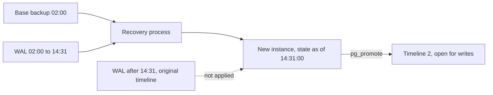

## 50.4 Point-in-time recovery

#### Concept

Point-in-time recovery (PITR) is restoring a database to any chosen moment, not just to the moment a backup was taken. You pick a timestamp — 14:31:00 on 9 September — and the database is reconstructed exactly as it existed at that second.

It is the only tool that fixes logical damage. Replication does not (it replicates the damage). Snapshots alone do not (they land you on a snapshot boundary, potentially hours off). PITR lets you land one minute before the mistake.

#### Why does it exist?

Because the most common data disaster is a *correct* database faithfully executing a *wrong* command. `DELETE FROM order_items;` is valid SQL. PostgreSQL executes it, WAL records it, replicas apply it, and the snapshot taken 10 minutes later contains the empty table.

The only escape is time travel: reconstruct the state before the command ran. That requires a base copy plus an ordered record of every change, which is precisely what WAL is.

#### Mental model

Imagine a video recording of a whiteboard. The base backup is a photo of the board at 02:00. The WAL is the video of every hand movement since. To see the board at 14:31, you print the photo and then fast-forward the video to 14:31, redrawing each stroke. Stop the video one second before the person wipes the board, and you have the content back.

The catch, and it matters: you must have the *unbroken* video. A missing 10 minutes in the middle means you cannot get past that point at all. This is why a WAL archive gap is fatal to PITR from that moment forward (50.11).

#### How it works

**WAL replay to a timestamp, mechanically.**

1. Restore the most recent base backup taken *before* your target time. If you target 14:31 and your base backup is from 02:00, you restore the 02:00 copy.
2. Configure recovery. In PostgreSQL 12 and later this is in `postgresql.conf` plus a `recovery.signal` file:

```ini
# Fetch archived WAL segments as recovery needs them.
restore_command = 'wal-g wal-fetch %f %p'
# Stop exactly here.
recovery_target_time = '2026-09-09 14:31:00+00'
# 'pause' lets you inspect before promoting; 'promote' opens for writes immediately.
recovery_target_action = 'pause'
# Do not overshoot: stop BEFORE the first transaction that committed after the target.
recovery_target_inclusive = off
```

3. Start PostgreSQL. It replays WAL from the base backup's start LSN forward, applying every page change in order, and stops at the first commit record whose timestamp is at or after the target.
4. With `recovery_target_action = 'pause'`, the instance sits read-only. You connect, run `SELECT count(*) FROM order_items;`, and confirm you landed where you meant to. If you are one minute off, you throw it away and redo with a different target rather than promoting a wrong state.
5. `SELECT pg_promote();` ends recovery and opens the database for writes. This creates a new timeline (timeline 2). Any WAL from the original timeline after your target point still exists in the archive but is now on a divergent branch — which is how you can, if you must, restore *again* to a different point later and extract more.

Other recovery targets exist and are occasionally exactly what you want: `recovery_target_lsn` (precise, if you know the LSN), `recovery_target_xid` (stop before a specific transaction id), and `recovery_target_name` (a label set earlier with `pg_create_restore_point('before-migration-2026-09-09')` — worth doing before every risky migration).

**RDS PITR.** AWS wraps all of this. You call:

```bash
aws rds restore-db-instance-to-point-in-time \
  --source-db-instance-identifier shop-prod \
  --target-db-instance-identifier shop-recovery-1431 \
  --restore-time 2026-09-09T14:31:00Z \
  --db-instance-class db.r6g.4xlarge \
  --db-subnet-group-name private-db \
  --vpc-security-group-ids sg-0recovery \
  --no-multi-az \
  --no-publicly-accessible
```

Points that matter in an incident:

- RDS **always restores to a new instance.** You cannot PITR in place. This is a feature: the damaged original is preserved as evidence and as a fallback.
- The window is `EarliestRestorableTime` to `LatestRestorableTime`. `LatestRestorableTime` is typically about 5 minutes behind now. You cannot restore to 30 seconds ago.
- Granularity is one second, but the underlying log shipping means the practical floor is the ~5 minute lag above.
- The restored instance gets the *default* parameter group unless you pass yours. Pass yours.
- Restore it into the same VPC with a **different security group** so the application cannot accidentally connect to it before you are ready.



#### Practical example

**The scenario every engineer eventually meets.** At 14:32 on a Tuesday, an engineer running a data cleanup in a psql session against what they believed was staging executes:

```sql
DELETE FROM order_items;
```

No `WHERE`. Autocommit on. 8.4 million rows gone in 40 seconds. The `orders` table is intact; only the line items are gone.

Here is the full walkthrough. The timings are what a drilled team actually achieves.

**14:33 — Detection.** Two signals fire almost together: the checkout error rate alert (order confirmation pages throw because `order_items` is empty), and a business metric alert on "items per order" dropping to zero. Support tickets start 4 minutes later. Detection speed here comes from having a *business* metric alert, not just an infrastructure one.

**14:35 — Stop the bleeding.** The first action is not recovery, it is containment. The on-call revokes the engineer's session (`SELECT pg_terminate_backend(pid)`), and the team decides whether to keep taking orders. Decision: **keep the site up, disable order-history and invoice pages** behind a feature flag, because new orders write new `order_items` rows correctly and blocking checkout would multiply the damage. This is a judgement call and it is the most important one of the incident.

**14:38 — Establish exactly what happened and when.** Not "roughly 14:32". You need a defensible boundary:

```sql
-- What was the last good moment? Ask the audit log / pg_stat_statements / CloudTrail-equivalent.
-- If you have pgaudit or a WAL-based CDC stream, find the transaction.
SELECT xact_start, state, query
FROM pg_stat_activity
WHERE query ILIKE 'delete from order_items%';

-- Cheap, universal fallback: the highest id that still exists tells you nothing here
-- (all rows are gone), so use the orders side to bound it.
SELECT max(created_at) FROM orders;  -- orders kept flowing; items did not
```

The team settles on a recovery target of **14:31:00**, one minute before the transaction started, with `recovery_target_inclusive = off`. Rounding *backwards* is always right: you can replay forward from the outbox, you cannot un-restore.

**14:40 — Choose the strategy.** Two options are on the table:

| Option | What it means | Downside |
|---|---|---|
| Fail over: restore to 14:31 and make it the new primary | Everything after 14:31 is lost, including ~40 minutes of real orders | Loses good data. Almost never right for a single-table incident |
| Repair in place: restore to a side instance, extract `order_items`, copy the rows back | Production keeps running; only the deleted rows are restored | More work, needs careful reconciliation |

The team picks **repair in place**. The rule of thumb: *if the damage is scoped to some rows or tables and the rest of the database is healthy, repair in place. Fail over only when the whole database is untrustworthy or unavailable.*

**14:41 — Provision the recovery instance.** `restore-db-instance-to-point-in-time` to `shop-recovery-1431`, same instance class, `--no-multi-az`, isolated security group.

**15:35 — Instance available.** 54 minutes, in line with the estimate in 50.2. Validation first: does it actually contain the rows?

```sql
SELECT count(*) FROM order_items;                 -- 8,412,904 rows: good
SELECT max(created_at) FROM order_items;          -- 14:30:58: correct target
SELECT count(*) FROM orders WHERE created_at > '2026-09-09 14:00Z';  -- sanity
```

**15:40 — Extract only the affected rows.** Do not copy 8.4 million rows blindly. Copy what production is missing. `postgres_fdw` makes this a single query and avoids a dump-and-load round trip:

```sql
-- On PRODUCTION, reaching into the recovery instance read-only.
CREATE EXTENSION IF NOT EXISTS postgres_fdw;
CREATE SERVER recovery_1431 FOREIGN DATA WRAPPER postgres_fdw
  OPTIONS (host 'shop-recovery-1431.abc.us-east-1.rds.amazonaws.com', dbname 'shop', port '5432');
CREATE USER MAPPING FOR CURRENT_USER SERVER recovery_1431
  OPTIONS (user 'recovery_ro', password_required 'true', password 'from-secrets-manager');

CREATE SCHEMA recovered;
IMPORT FOREIGN SCHEMA public LIMIT TO (order_items)
  FROM SERVER recovery_1431 INTO recovered;

-- Now the reconciliation query. Three rules:
--   1. Only rows whose parent order still exists in production.
--   2. Only rows that are actually missing now (some may have been re-created).
--   3. Idempotent, so re-running it is safe.
INSERT INTO order_items (id, order_id, product_id, quantity, unit_price_cents, created_at)
SELECT r.id, r.order_id, r.product_id, r.quantity, r.unit_price_cents, r.created_at
FROM recovered.order_items r
JOIN orders o ON o.id = r.order_id
LEFT JOIN order_items live ON live.id = r.id
WHERE live.id IS NULL
ON CONFLICT (id) DO NOTHING;
```

Run it in batches, not as one 8.4 million row transaction, or you will hold locks and bloat WAL:

```sql
-- Batched variant: 20,000 rows at a time, resumable, low lock footprint.
DO $$
DECLARE moved bigint;
BEGIN
  LOOP
    WITH batch AS (
      SELECT r.* FROM recovered.order_items r
      JOIN orders o ON o.id = r.order_id
      LEFT JOIN order_items live ON live.id = r.id
      WHERE live.id IS NULL
      LIMIT 20000
    )
    INSERT INTO order_items (id, order_id, product_id, quantity, unit_price_cents, created_at)
    SELECT id, order_id, product_id, quantity, unit_price_cents, created_at FROM batch
    ON CONFLICT (id) DO NOTHING;
    GET DIAGNOSTICS moved = ROW_COUNT;
    EXIT WHEN moved = 0;
    COMMIT;  -- requires a procedure or a client-side loop; in psql use \gexec batches
  END LOOP;
END $$;
```

**16:20 — Reconcile everything that happened since 14:32.** This is the step teams skip and regret. Between the deletion and the repair, the system kept running. Things to check:

1. **Orders placed after 14:32** wrote their own `order_items` rows normally. The `ON CONFLICT DO NOTHING` and the `live.id IS NULL` filter protect them. Verify: no order created after 14:32 has duplicated items.
2. **Cancellations and returns processed after 14:32** may have deleted `order_items` rows *legitimately*. Restoring them resurrects cancelled lines. Check the audit log or `order_status_history` for cancellations in the window, and delete the resurrected rows for those orders.
3. **Sequences.** If `order_items.id` uses a sequence, production's sequence advanced during the window while the restored rows use old ids. No conflict here (old ids are lower), but if you had restored the *whole table* the sequence would need `setval` to `max(id)`.
4. **Financial invariants.** Re-run the totals check from 50.2. Any order whose `total_cents` no longer matches the sum of its items is a row that needs human review.
5. **Downstream systems.** The warehouse, the search index and the accounting export all consumed the "items deleted" state. Each needs a targeted re-sync (50.8).

```sql
-- The invariant that tells you whether the repair actually worked.
SELECT o.id, o.total_cents, COALESCE(sum(oi.unit_price_cents * oi.quantity), 0) AS items_total
FROM orders o
LEFT JOIN order_items oi ON oi.order_id = o.id
WHERE o.created_at >= '2026-09-01'
GROUP BY o.id, o.total_cents
HAVING o.total_cents <> COALESCE(sum(oi.unit_price_cents * oi.quantity), 0)
ORDER BY o.id;
```

**16:45 — Re-enable the disabled pages, keep the recovery instance for 48 hours, then delete it.** Do not delete it the same day. You will find one more discrepancy tomorrow.

Total: 4 hours 13 minutes from deletion to full repair, with no customer-facing checkout downtime and zero lost orders. Compare to a naive "fail over to 14:31" which would have been faster to execute and would have destroyed 40 minutes of real business.

#### NestJS example

The reconciliation should be code you can review and test, not a psql session someone types under pressure.

```ts
// order-items-recovery.service.ts
import { Injectable, Logger } from '@nestjs/common';
import { DataSource } from 'typeorm';

@Injectable()
export class OrderItemsRecoveryService {
  private readonly log = new Logger(OrderItemsRecoveryService.name);
  constructor(private readonly ds: DataSource) {}

  /**
   * Copies missing order_items from the foreign `recovered` schema in batches.
   * Idempotent: safe to run repeatedly, and safe to stop and resume.
   * Excludes orders cancelled during the incident window so we do not
   * resurrect legitimately removed lines.
   */
  async repair(batchSize = 20_000, incidentStart = '2026-09-09T14:32:00Z'): Promise<number> {
    let total = 0;
    for (;;) {
      const result = await this.ds.transaction(async (em) => {
        const rows = await em.query(
          `INSERT INTO order_items (id, order_id, product_id, quantity, unit_price_cents, created_at)
           SELECT r.id, r.order_id, r.product_id, r.quantity, r.unit_price_cents, r.created_at
           FROM recovered.order_items r
           JOIN orders o ON o.id = r.order_id
           LEFT JOIN order_items live ON live.id = r.id
           WHERE live.id IS NULL
             AND NOT EXISTS (
               SELECT 1 FROM order_status_history h
               WHERE h.order_id = r.order_id AND h.status = 'CANCELLED' AND h.changed_at >= $2
             )
           ORDER BY r.id
           LIMIT $1
           ON CONFLICT (id) DO NOTHING
           RETURNING 1`,
          [batchSize, incidentStart],
        );
        return rows.length as number;
      });
      if (result === 0) break;
      total += result;
      this.log.log(`recovered ${total} order_items so far`);
    }
    return total;
  }
}
```

Note what makes this production-safe: a bounded batch, an explicit transaction per batch, `ON CONFLICT DO NOTHING` for idempotency, an exclusion for cancellations, and structured logging so the incident timeline is reconstructable afterwards.

#### Production scenario

PITR is not only for disasters. Uses that earn their keep every month:

- **Before every risky migration**, call `SELECT pg_create_restore_point('pre-migration-add-status-column');` (self-managed) or take a manual snapshot (RDS). It costs seconds and gives you a named target.
- **Investigating a data bug**: restore to before the suspected bad release, diff the affected rows, and prove or disprove the hypothesis without touching production.
- **Legal and compliance**: "what was this customer's shipping address on 3 September" is answered by a forensic restore.
- **Testing the restore path**: the nightly verification job in 50.2 is itself a PITR.

#### Failure scenario

A team hit exactly the `DELETE` scenario, restored to a side instance, extracted the rows and copied them back — and then discovered three days later that their order confirmation emails had been re-sent to 40,000 customers. The reason: the reconciliation `INSERT` fired an application-level trigger via a CDC stream, which the notification service consumed as "new order item created", which the templating layer turned into "your order has shipped".

The lesson is in 50.8 and worth stating here: **restoring data can trigger side effects.** Before any bulk repair, pause the CDC connector, the outbox publisher and the notification consumers, then resume them with a filter or a watermark that ignores the repair window.

#### Edge cases & failure modes

- Target time outside the retention window: PITR simply refuses. Retention must be longer than your detection time (50.11).
- Target time inside a WAL archive gap: recovery stops at the gap and cannot proceed. You get the state at the gap, not your target.
- `recovery_target_inclusive = on` (the default) can include the very transaction you were trying to escape when your timestamp is exactly the commit time. Use `off` and round backwards.
- Time zones. `recovery_target_time` without an offset is interpreted in the server's timezone. Always write UTC with an explicit offset.
- Promoting the restored instance creates a new timeline; if you later need to restore to a *different* point on the original timeline, you must set `recovery_target_timeline` explicitly.
- On RDS, restoring uses the default parameter group unless specified; `work_mem` and `max_connections` differ and your app pool may fail to connect.
- A PITR restore is a *whole cluster*. There is no "PITR one table" — you restore everything and extract.
- Extracting via `postgres_fdw` pulls rows across the network; 8 million rows is minutes, 800 million is not. For very large extractions use `COPY` to a file and `COPY` back, or restore into a staging instance in the same AZ.

#### How a Senior Backend Engineer thinks about this

Their first instinct in a logical-damage incident is **not** to restore. It is to stop the damage from spreading and to preserve evidence. The damaged database is the most valuable artefact you have; do not overwrite it.

Their second instinct is to *round the recovery target backwards* and repair forward, because forward repair is reconcilable and a too-late target is not.

They default to repair-in-place over failover for scoped damage, and they say the reason out loud: failing over to 14:31 throws away every good transaction since 14:31 to fix a subset of bad ones.

They think about side effects before they think about rows. "If I insert these 8 million rows, what fires?" Triggers, CDC, outbox, cache invalidation, notification consumers, search indexers, the accounting export. Every one is a potential second incident.

And they keep the recovery instance around for two days, tagged with an expiry, because the follow-up question always comes.

#### Common mistakes

- Restoring over production because it feels like the fastest path.
- Picking the recovery target from memory instead of from evidence.
- Copying the whole restored table back instead of only the missing rows, creating duplicates and resurrecting legitimately deleted data.
- Running the repair as one enormous transaction, blocking writes and bloating WAL.
- Forgetting the sequences after a full-table restore, so the next insert throws a duplicate key error.
- Leaving CDC and notification consumers running during the repair, so customers get thousands of duplicate emails.
- Deleting the recovery instance immediately, then needing it the next day.

#### Interview questions

1. **Walk me through recovering from `DELETE FROM order_items` with no `WHERE`, discovered 3 minutes later.** Expected: contain, preserve evidence, decide scope, PITR to a *new* instance one minute before the transaction, validate the target landed correctly, extract only missing rows joined against surviving parents, batch the insert idempotently, reconcile with events since, handle downstream side effects. Follow-up: why not fail over? Because you would lose all good writes since.
2. **How does WAL replay to a timestamp work?** Expected: restore base backup, replay WAL records in LSN order, stop at the first commit at or after the target, promote to a new timeline.
3. **What is `recovery_target_inclusive` and why does it matter?** Expected: whether the transaction committing exactly at the target is included; set `off` to stop strictly before.
4. **What is the practical minimum recovery point on RDS?** Expected: `LatestRestorableTime`, usually about 5 minutes behind now; you cannot restore to 30 seconds ago.
5. **You restore rows back into a live table. What could go wrong beyond duplicates?** Expected: triggers, CDC streams, outbox publishers and notification consumers firing side effects such as duplicate emails or re-charges; sequences behind; resurrecting legitimately deleted rows; downstream indexes now inconsistent.
6. **How do you pick the recovery target defensibly?** Expected: from audit logs, `pg_stat_activity`, CloudTrail, application logs and business metrics; round backwards; validate on the restored instance before promoting.

#### Practical exercise

On a local PostgreSQL with continuous archiving, seed `orders` and `order_items`. Note the time, then run `DELETE FROM order_items;`. Keep the database running and insert 200 new orders (with items) afterwards to simulate ongoing business.

Now recover: PITR to one minute before the delete on a *second* instance, connect them with `postgres_fdw`, and write an idempotent batched repair that restores only the missing rows without touching the 200 new orders.

Acceptance criteria: after the repair, `count(*)` on `order_items` equals the pre-delete count plus the new orders' items; the financial invariant query returns zero mismatched orders; running the repair script a second time inserts zero rows.
