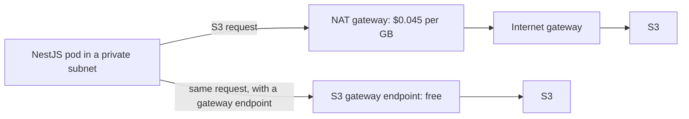

## 50.4 Storage, network egress and observability cost

#### Concept

These three categories are where cloud bills surprise people, because none of them appear in an architecture diagram. Nobody draws a NAT gateway. Nobody draws the AZ boundary that a service call crosses. Nobody draws the log line inside the `for` loop. And yet, on a mature system, these three together are routinely 25 to 40 percent of the bill.

#### Why does it exist?

Storage, network and telemetry are all *metered by volume of something an engineer produces incidentally*. You do not decide to spend $900 on data transfer; you decide to put a service in three AZs and have it call another service, and $900 is the consequence. The cost is real, but the decision that caused it did not feel like a cost decision.

#### Mental model

Imagine a factory that charges you per pallet moved between buildings, per truck that leaves the site, and per page of paperwork filed. You would design the floor plan differently. Cloud pricing is that factory, and most architectures are drawn as though moving pallets between buildings is free.

#### How it works

**S3 classes and lifecycle rules.** Approximate `us-east-1` list prices per GB-month:

| Class | $/GB-month | Retrieval | Minimum duration |
|---|---|---|---|
| Standard | 0.023 | Instant, free | None |
| Intelligent-Tiering | 0.023, auto-lowers | Instant | None (small monitoring fee per object) |
| Standard-IA | 0.0125 | Instant, $0.01/GB | 30 days |
| Glacier Instant Retrieval | 0.004 | Milliseconds, $0.03/GB | 90 days |
| Glacier Flexible Retrieval | 0.0036 | Minutes to hours | 90 days |
| Glacier Deep Archive | 0.00099 | ~12 hours | 180 days |

A lifecycle rule that moves objects through those tiers automatically is a few lines and often halves the S3 bill:

```json
{
  "Rules": [
    {
      "ID": "invoices-tiering",
      "Filter": { "Prefix": "invoices/" },
      "Status": "Enabled",
      "Transitions": [
        { "Days": 90, "StorageClass": "STANDARD_IA" },
        { "Days": 365, "StorageClass": "GLACIER_IR" },
        { "Days": 1095, "StorageClass": "DEEP_ARCHIVE" }
      ]
    },
    {
      "ID": "expire-temp-exports",
      "Filter": { "Prefix": "exports/" },
      "Status": "Enabled",
      "Expiration": { "Days": 7 }
    },
    {
      "ID": "clean-old-versions",
      "Filter": {},
      "Status": "Enabled",
      "NoncurrentVersionExpiration": { "NoncurrentDays": 90 },
      "AbortIncompleteMultipartUpload": { "DaysAfterInitiation": 7 }
    }
  ]
}
```

The last two rules are the ones people forget and they are frequently the largest. **Non-current versions** on a versioned bucket accumulate forever: a bucket with versioning enabled and no expiry rule, holding files that are overwritten daily, grows without bound while the console shows a small object count. **Incomplete multipart uploads** are invisible in the console entirely and are billed as storage; buckets with years of failed 5 GB uploads holding hundreds of gigabytes are common.

Watch the minimum-duration charges too: moving an object to Glacier Deep Archive and deleting it a week later bills you for 180 days. Do not lifecycle short-lived data into deep tiers.

**Snapshot sprawl.** EBS and RDS snapshots are incremental and cheap individually, which is exactly why they accumulate. The pattern is always the same: an engineer takes a manual snapshot before a risky change, the change works, the snapshot stays forever. Multiply by 30 engineers and 4 years.

```bash
# Manual RDS snapshots older than 90 days, with their size and creation time.
aws rds describe-db-snapshots --snapshot-type manual \
  --query 'DBSnapshots[?SnapshotCreateTime<`2026-06-01`].[DBSnapshotIdentifier,AllocatedStorage,SnapshotCreateTime]' \
  --output table
```

RDS snapshot storage is about $0.095 per GB-month; EBS snapshots about $0.05. Forty orphaned 2 TB-allocated snapshots is not a small number. Fix it with a tag policy (`expires`), a scheduled job that deletes expired manual snapshots, and AWS Backup lifecycle rules for the ones that must persist.

**Surprise one: cross-AZ data transfer.** AWS charges roughly **$0.01 per GB in each direction** for traffic between Availability Zones in the same region — so about **$0.02 per GB** for a round trip. Traffic within an AZ is free. Traffic to the internet is more expensive still (about $0.09 per GB for the first 10 TB).

The arithmetic for a chatty service:

```text
A service moving 2 TB/month across AZs:
  2,000 GB x $0.02 = $40/month

That sounds harmless. Now scale it the way real systems scale:
  - 40 services in a mesh, each doing the same         -> $1,600/month
  - Traffic grows 5x over two years                    -> $8,000/month
  - Add a service mesh: sidecar-to-sidecar hops double -> $16,000/month
```

The point is not that 2 TB is expensive. It is that cross-AZ transfer is *per-gigabyte forever*, invisible in any diagram, and it scales with both traffic and service count. It is the classic microservices tax.

Where it comes from, in order of how often it surprises people:

1. **Service-to-service calls** landing on a pod in another AZ, because Kubernetes `Service` load balancing is AZ-agnostic by default.
2. **Application to database** when the pod and the RDS writer are in different AZs. Every query result crosses the boundary.
3. **Kafka producers and consumers** in different AZs from the partition leader. Kafka replication between brokers in three AZs multiplies this: every message crosses AZ boundaries twice for a replication factor of 3.
4. **Multi-AZ RDS synchronous replication.** Included in the Multi-AZ price, but a reason your write path is doing cross-AZ I/O.

The mitigations, in order of value:

```yaml
# Topology-aware routing: prefer endpoints in the caller's own zone.
apiVersion: v1
kind: Service
metadata:
  name: inventory-api
  annotations:
    service.kubernetes.io/topology-mode: Auto
spec:
  selector:
    app: inventory-api
  ports:
    - port: 80
      targetPort: 3000
```

Topology-aware routing keeps traffic in-zone when there is enough capacity in the zone, and falls back across zones when there is not — so you get the saving without losing the availability property. Combine it with pod topology spread constraints so each zone actually has capacity:

```yaml
topologySpreadConstraints:
  - maxSkew: 1
    topologyKey: topology.kubernetes.io/zone
    whenUnsatisfiable: ScheduleAnyway   # never fail scheduling to save network cost
    labelSelector:
      matchLabels:
        app: inventory-api
```

Note `whenUnsatisfiable: ScheduleAnyway`. Cost optimisation must never be allowed to prevent a pod from being scheduled during an incident.

For Kafka, the equivalent lever is rack awareness plus `client.rack` on consumers, which lets a consumer fetch from an in-AZ replica instead of the cross-AZ leader.

**Surprise two: NAT gateway charges.** A NAT gateway costs about **$0.045 per hour** (roughly $33 a month) *plus* **$0.045 per GB processed**. Most production VPCs run one per AZ for availability, so the baseline is about $100 a month before a single byte moves.

The per-gigabyte charge is the part that hurts, because everything your private pods fetch from the internet goes through it: container images, npm packages, S3 objects, external API calls, telemetry sent to a SaaS vendor.

```text
A cluster pulling 200 GB/day of container images and S3 objects through NAT:
  200 GB x 30 = 6,000 GB/month
  6,000 x $0.045 = $270/month
  Plus 3 gateways x $33 = $100/month baseline
  Total: $370/month
```

**The fix is VPC endpoints, and for S3 it is free.** Gateway endpoints for S3 and DynamoDB cost nothing at all and route traffic over the AWS network instead of through NAT. Interface endpoints (PrivateLink) for ECR, Secrets Manager, CloudWatch Logs, KMS, STS and the rest cost about $0.01 per hour per AZ (roughly $7.30 per month per endpoint per AZ) plus about $0.01 per GB.



For our platform, adding an S3 gateway endpoint and ECR, Logs and Secrets Manager interface endpoints:

```text
Before: 6,000 GB/month through NAT           = $270 + $100 baseline = $370
After:  S3 traffic (4,000 GB) via gateway EP = $0
        ECR/Logs/Secrets (1,800 GB) via 4 interface endpoints in 3 AZs
          = 12 x $7.30 = $88 + 1,800 x $0.01 = $18  -> $106
        Remaining 200 GB through NAT = $9 + $100 baseline = $109
  Total after: $215/month. Saving: $155/month, and lower latency.
```

The S3 gateway endpoint in particular is free money: it takes ten minutes, costs nothing, and removes NAT charges for every S3 byte. If you take one action from this section, take that one.

**Surprise three: log volume.** Logs are the most reliably underestimated line item in the industry, because the cost is per gigabyte ingested and a single misplaced log statement can produce gigabytes.

Approximate prices: CloudWatch Logs ingestion is about **$0.50 per GB**, storage about $0.03 per GB-month. Third-party platforms charge for both ingestion and *indexing*: Datadog is roughly $0.10 per GB to ingest and around $1.70 per million log events to index and retain for 15 days.

The arithmetic for a debug-level logger:

```text
A service logging at debug level, writing 500 GB/month:

CloudWatch Logs
  Ingestion: 500 GB x $0.50            = $250/month
  Storage:   500 GB x $0.03, growing   = $15 and rising each month

Datadog (same volume, ~1 KB per line, so ~500 million events)
  Ingestion: 500 GB x $0.10            = $50/month
  Indexing:  500 x $1.70 per million   = $850/month
  Total                                = $900/month

One service. At debug level. Producing almost no diagnostic value,
because 500 GB of debug output is not something a human ever reads.
```

Now multiply by 12 services, or by an incident in which someone enables debug logging "temporarily" and forgets (50.9).

The levers, from most to least valuable:

1. **Log level is a runtime decision, not a build-time one.** `info` in production, with the ability to raise a single service to `debug` for 30 minutes via config, with an automatic revert.
2. **Sample high-volume, low-value events.** A log line per cache hit is telemetry, not a log; count it as a metric instead.
3. **Structured logs with bounded fields.** Never log full request or response bodies by default. A single endpoint returning a 200 KB JSON payload, logged at 100 RPS, is 1.7 TB a month.
4. **Short retention in the expensive tier, long retention in the cheap one.** 7 to 15 days indexed and searchable; archive to S3 for the rest and query with Athena when you need to.
5. **Drop what you never query.** Health check logs, readiness probe logs and successful `200 OK` access logs for static assets are almost always pure volume.

```ts
// logger.config.ts — Pino, with production defaults that keep volume sane.
import { LoggerModule } from 'nestjs-pino';

LoggerModule.forRoot({
  pinoHttp: {
    // Runtime-controlled level. Default info; raise deliberately, never by default.
    level: process.env.LOG_LEVEL ?? 'info',
    // Do not log health and readiness probes: pure volume, zero value.
    autoLogging: {
      ignore: (req) => ['/health', '/health/live', '/health/ready', '/metrics']
        .includes((req as { url?: string }).url ?? ''),
    },
    // Redact secrets, and never serialise whole bodies.
    redact: {
      paths: ['req.headers.authorization', 'req.headers.cookie', 'req.body.password', 'req.body.card'],
      remove: true,
    },
    serializers: {
      req: (req) => ({ id: req.id, method: req.method, url: req.url }),   // not headers, not body
      res: (res) => ({ statusCode: res.statusCode }),
    },
  },
});
```

**Metric cardinality.** A time series is created for every unique combination of metric name and label values. Cardinality multiplies:

```text
http_request_duration_seconds with labels:
  route (40) x method (5) x status (12)              = 2,400 series. Fine.

Add one bad label:
  ... x user_id (250,000)                            = 600 million series.
```

That kills a Prometheus server outright (each series costs roughly 1 to 3 KB of RAM, so 600 million series is not survivable), and on a per-custom-metric SaaS pricing model at roughly $0.05 per custom metric per month it is an invoice nobody will believe.

The rule: **labels must be bounded and low-cardinality by construction.** Never label with a user id, order id, request id, email, full URL path with parameters, or an error message. Those belong in traces and logs, which are designed for high cardinality. Use the *route pattern* (`/orders/:id`), not the URL (`/orders/8f3c...`).

**Trace sampling.** Distributed tracing at 100 percent on a 500 RPS service produces 1.3 billion spans a month, and vendors charge per span or per ingested GB. Head-based sampling at 1 to 10 percent keeps the statistical picture at a tenth of the cost. Tail-based sampling is better still: sample 100 percent of errors and slow requests, and 1 percent of successful fast ones, so you keep the traces you actually open while discarding the ones you never will.

```ts
// tracing.ts — OpenTelemetry with parent-based ratio sampling.
import { NodeSDK } from '@opentelemetry/sdk-node';
import { ParentBasedSampler, TraceIdRatioBasedSampler } from '@opentelemetry/sdk-trace-base';

const sdk = new NodeSDK({
  // Respect an upstream sampling decision; otherwise sample 5 percent of new traces.
  sampler: new ParentBasedSampler({
    root: new TraceIdRatioBasedSampler(Number(process.env.OTEL_SAMPLE_RATIO ?? 0.05)),
  }),
});
sdk.start();
```

#### Production scenario

The platform's storage, network and observability line after a review:

| Item | Before | After | Action |
|---|---|---|---|
| S3 (2.6 TB, no lifecycle) | $60 | $28 | Lifecycle to IA and Glacier IR; expired non-current versions and incomplete multiparts (410 GB recovered) |
| RDS + EBS snapshot sprawl | $310 | $140 | Deleted 40 orphaned manual snapshots; `expires` tag enforced |
| Cross-AZ transfer | $640 | $290 | Topology-aware routing, Kafka rack awareness, pods co-located with the RDS writer AZ where safe |
| NAT gateway | $370 | $215 | S3 gateway endpoint (free) plus ECR, Logs, Secrets interface endpoints |
| CloudWatch + Datadog logs | $1,900 | $560 | Log level to info, probe logs dropped, bodies redacted, 15 day indexed retention with S3 archive |
| Custom metrics | $700 | $210 | Removed three high-cardinality labels |
| Traces | $480 | $95 | 100 percent to 5 percent head sampling with 100 percent on errors |
| **Total** | **$4,460** | **$1,538** | **-66 percent** |

Note that nothing here reduced the team's ability to debug. Dropping health-check logs and 95 percent of successful traces removes noise; keeping 100 percent of error traces keeps the signal.

#### Failure scenario

A retailer's monthly bill jumped by $31,000 with no traffic change. Cost Explorer showed the growth in "EC2-Other: DataTransfer-Regional-Bytes" — cross-AZ transfer.

The cause was a service mesh rollout. Every service-to-service call now traversed two sidecar proxies, and the mesh's default load balancing was round-robin across all endpoints regardless of zone. A request that previously made 6 in-AZ hops now made 6 hops that were each cross-AZ with two-thirds probability, and each hop was counted in both directions.

The fix was locality-aware load balancing in the mesh configuration, which took an afternoon and reduced the charge to $4,200. The lesson the team wrote down: **any change to how services find each other is a cost change, and it should be reviewed as one.**

#### Edge cases & failure modes

- Versioned S3 buckets with no non-current expiry rule, growing invisibly.
- Incomplete multipart uploads billed as storage and not visible in the console object list.
- Lifecycle rules that move short-lived objects to Glacier, triggering 90 or 180 day minimum charges plus retrieval fees.
- Cross-region S3 replication doubling storage cost *and* charging cross-region transfer per GB.
- A NAT gateway per AZ multiplied across three environments: nine gateways, $300 a month of baseline before any traffic.
- Interface VPC endpoints priced per AZ; creating them in three AZs for six services is $130 a month, which can exceed the NAT charge they were meant to replace. Do the arithmetic per endpoint.
- CloudWatch Logs with `Never expire` retention, the default on some log groups, accumulating for years.
- A metric label added in a hotfix (`error_message`) creating unbounded cardinality overnight.
- Topology-aware routing configured with `whenUnsatisfiable: DoNotSchedule`, so a zone outage prevents pods from being scheduled at all.
- Egress to the internet for telemetry: shipping 500 GB a month to a SaaS observability vendor costs $45 in egress on top of the vendor's bill.

#### How a Senior Backend Engineer thinks about this

They read the bill by *usage type*, not by service. "EC2-Other" hides data transfer; "CloudWatch" hides ingestion versus storage. The usage-type breakdown is where the surprises live, and looking at it once a month takes ten minutes.

They treat AZ boundaries as a design element. When they draw a request path, they mark where it crosses a zone, because that mark is both latency and money.

They put an S3 gateway endpoint in every VPC on day one, because it is free and it removes a whole category of charge.

They treat logs as a product with a budget: every service has a GB-per-day expectation, and exceeding it is a bug to be fixed, not a bill to be paid.

And they hold the line on cardinality, because it is the only one of these mistakes that takes down the monitoring system itself, which means you lose visibility exactly when you need it.

#### Common mistakes

- Enabling S3 versioning without a non-current version expiry rule.
- Logging full request and response bodies at info level.
- Leaving debug logging on after an incident.
- Labelling metrics with user or request ids.
- Assuming traffic between services in the same region is free.
- Sending observability data to a SaaS vendor through a NAT gateway and paying twice.
- Deleting logs to save money without checking a compliance retention requirement first.

#### Interview questions

1. **Name three cost categories that do not appear in an architecture diagram but dominate real bills.** Expected: cross-AZ data transfer, NAT gateway per-GB charges, and log/telemetry volume.
2. **How do you eliminate NAT gateway charges for S3 traffic?** Expected: an S3 gateway VPC endpoint, which is free; contrast with interface endpoints, which cost per AZ-hour plus per GB.
3. **A service moves 2 TB a month across AZs. What does that cost and how do you reduce it?** Expected: about $40 at $0.02 per GB round trip, but it scales with service count and traffic; reduce with topology-aware routing, pod spread constraints, Kafka rack awareness, and co-locating chatty components. Note that availability must win over cost when they conflict.
4. **Your logging bill is $900 a month for one service. Diagnose it.** Expected: log level, request/response bodies, health check logs, per-event indexing charges; fix with runtime log levels, sampling, redaction, bounded serializers and tiered retention.
5. **What is metric cardinality and why does it matter for cost?** Expected: one series per unique label combination; unbounded labels like user id produce millions of series, exhausting Prometheus memory and generating per-custom-metric charges. Route patterns, not URLs.
6. **How would you keep useful traces while cutting tracing cost by 90 percent?** Expected: head-based ratio sampling for successful requests plus 100 percent retention of errors and slow requests, ideally tail-based.

#### Practical exercise

Open Cost Explorer, group by *usage type* rather than by service, and list your top ten usage types for last month. For each, name the engineering decision that produced it.

Acceptance criteria: you can identify your cross-AZ transfer charge, your NAT per-GB charge and your log ingestion charge as separate numbers; you have created an S3 gateway endpoint if one is missing; and you have found at least one usage type nobody on the team could explain.
