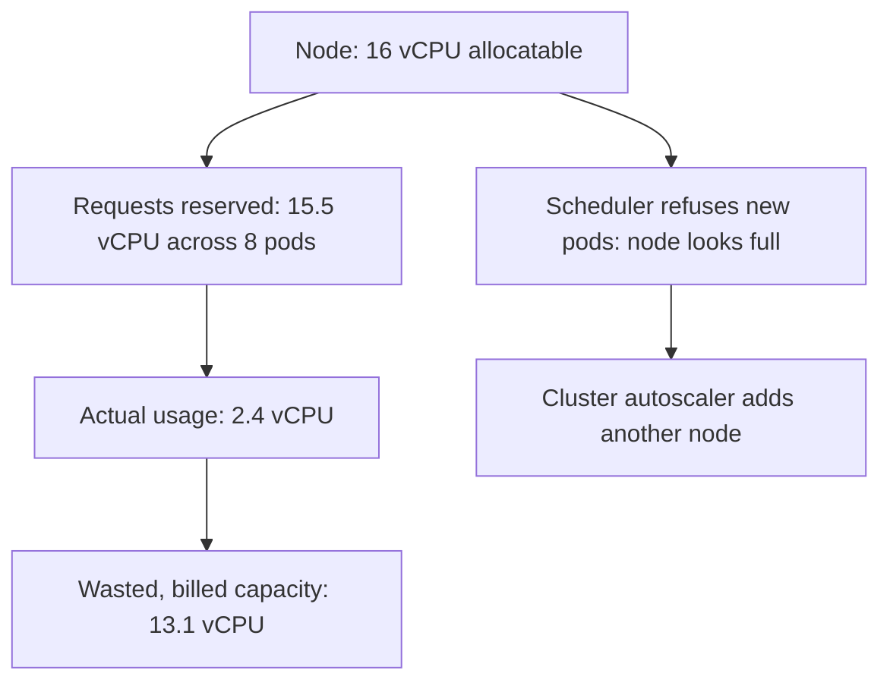

## 51.2 Compute cost

#### Concept

Compute is CPU and memory you rent by the second: EC2 instances, Fargate tasks, Kubernetes nodes, Lambda invocations. It is usually 30 to 50 percent of a cloud bill, and it is the line item with the most *structural* waste, because the gap between what you provision and what you use is invisible unless you go looking.

#### Why does it exist?

You pay for capacity, not for work done. A node that is 12 percent utilised costs exactly the same as one that is 85 percent utilised. Every layer of the stack introduces another opportunity to reserve capacity you do not use: an instance sized for peak, a node pool sized for the instance, a pod request sized for a guess, and a JVM-era habit of over-allocating memory to a Node.js process that will never use it.

#### Mental model

Imagine renting a van. You pay for the van, not for the boxes. If you rent a 20-cubic-metre van to move 3 cubic metres of boxes, you paid for 17 cubic metres of air. Now imagine you rent that van 24 hours a day, 365 days a year, and you only move boxes for 6 hours on weekdays.

Cloud compute waste is exactly that: air, rented continuously.

#### How it works

**Right-sizing.** The method is unglamorous and it works: look at actual utilisation over a representative period (at least two weeks including a peak), then size for peak plus headroom, not for the number that felt safe when you created it.

For a Node.js service the profile is distinctive and worth knowing: Node is single-threaded for JavaScript execution, so a pod rarely benefits from more than 1 to 2 CPUs unless you are running the cluster module or heavy `libuv` thread-pool work (crypto, zlib, `fs`). Meanwhile the default V8 old-space heap on a 64-bit system is around 1.5 to 2 GB unless you set `--max-old-space-size`. Giving a Node pod 8 GB of memory and 4 CPUs usually buys nothing at all.

```text
Typical NestJS API pod, measured over 14 days:
  CPU request 1000m, actual p95 220m, actual p99 410m   -> request 500m, limit 1000m
  Memory request 2Gi, actual p95 380Mi, RSS ceiling 620Mi -> request 512Mi, limit 1Gi
Result: 2x more pods fit per node. Node count drops from 8 to 4.
```

**Requests versus limits, and where the waste hides.** This is the single most misunderstood cost lever in Kubernetes, so be precise.

- **Request** is what the scheduler reserves. It is subtracted from the node's allocatable capacity whether or not the pod uses it. **Requests are what you pay for.**
- **Limit** is the ceiling the kernel enforces. Exceeding a CPU limit causes throttling (CFS quota); exceeding a memory limit causes `OOMKilled`.

The waste: a pod requesting 2 CPUs and using 0.2 occupies 2 CPUs of schedulable space forever. Ten such pods consume a whole 16-vCPU node while using 2 vCPUs of it. You pay for the node.



The practical policy that most teams land on for Node.js services:

| Resource | Setting | Why |
|---|---|---|
| CPU request | p95 of measured usage, e.g. `300m` | Reserves what you actually need |
| CPU limit | 2 to 4x the request, or **unset** | CPU throttling causes latency spikes; unset limits let a pod burst into idle node capacity. Set limits only where noisy-neighbour risk is real |
| Memory request | p99 RSS plus 25 percent, e.g. `640Mi` | Memory is incompressible |
| Memory limit | equal to the request | Prevents one leaking pod from evicting others; makes OOM behaviour predictable |

CPU limits deserve a note, because it is a genuine trade-off rather than a rule. Aggressive CPU limits on a latency-sensitive Node.js service cause throttling that shows up as unexplained p99 spikes. Many mature teams set CPU requests carefully and leave CPU limits off, accepting some noisy-neighbour risk in exchange for burst capacity that costs nothing. Memory limits, by contrast, should always be set.

Also set `--max-old-space-size` to roughly 75 percent of the memory limit, or V8 will happily grow its heap until the kernel kills the container:

```dockerfile
# Dockerfile — keep V8's heap inside the container's memory limit.
ENV NODE_OPTIONS="--max-old-space-size=768"
```

**Autoscaling and scale-to-zero.** Traffic on an e-commerce platform is not flat. Ours runs 500 RPS at 20:00 and 40 RPS at 04:00 — a 12x range. Provisioning for peak 24 hours a day means paying for peak capacity for the 18 hours a day you do not need it.

Horizontal Pod Autoscaler on CPU is the default and is adequate for API pods:

```yaml
apiVersion: autoscaling/v2
kind: HorizontalPodAutoscaler
metadata:
  name: orders-api
spec:
  scaleTargetRef:
    apiVersion: apps/v1
    kind: Deployment
    name: orders-api
  minReplicas: 3        # never below 3: one per AZ, survives a node loss
  maxReplicas: 24
  metrics:
    - type: Resource
      resource:
        name: cpu
        target:
          type: Utilization
          averageUtilization: 65   # headroom for a scale-up that takes ~90s
  behavior:
    scaleUp:
      stabilizationWindowSeconds: 30    # react quickly to a traffic spike
    scaleDown:
      stabilizationWindowSeconds: 600   # descend slowly; flapping costs more than it saves
```

The two settings people get wrong: a `scaleDown` window that is too short (pods flap, and every scale-up has a cold start), and a `minReplicas` set to 1 to save money, which removes redundancy for a saving of one pod.

For *workers*, queue depth is a far better signal than CPU, and workers can genuinely scale to zero. KEDA does this (see 51.5):

```yaml
apiVersion: keda.sh/v1alpha1
kind: ScaledObject
metadata:
  name: invoice-worker
spec:
  scaleTargetRef:
    name: invoice-worker
  minReplicaCount: 0        # zero pods when the queue is empty
  maxReplicaCount: 30
  cooldownPeriod: 300
  triggers:
    - type: redis
      metadata:
        address: redis.shop.svc.cluster.local:6379
        listName: bull:invoices:wait
        listLength: "50"    # one pod per 50 queued jobs
```

An invoice worker that runs for 40 minutes a day costs 3 percent of a worker that runs 24 hours a day. That is a real saving and it requires no cleverness.

**Spot instances.** Spot is spare AWS capacity at a 60 to 90 percent discount, typically around 70 percent, with a 2 minute interruption notice. The rule is simple: **spot for interruptible work, on-demand for the rest.**

| Workload | Spot? | Why |
|---|---|---|
| Batch jobs, report generation, image processing | Yes | Retryable and idempotent |
| Kafka consumers with committed offsets | Yes, carefully | Rebalancing on interruption is normal behaviour |
| CI runners | Yes | A killed build is re-run |
| Stateless API pods | Partially: a mixed node group, e.g. 60 percent spot | Needs `PodDisruptionBudget`, graceful shutdown and multiple instance types |
| Stateful sets, databases, Kafka brokers | No | Interruption means data movement or loss |
| Anything holding a lease or a lock | No | Interruption mid-lease causes correctness problems, not just latency |

A 60/40 spot/on-demand split on an $8,000 monthly EC2 line saves roughly $3,300. The prerequisites are non-negotiable: `terminationGracePeriodSeconds` long enough to drain, a `preStop` hook, correct `SIGTERM` handling in NestJS (`app.enableShutdownHooks()`), `PodDisruptionBudget`s, and node groups spread over several instance types so one capacity pool draining does not take you out.

**ARM and Graviton.** AWS Graviton processors (`m7g`, `c7g`, `r7g`, `db.r6g`) are roughly 20 percent cheaper than the equivalent x86 instance and frequently deliver better performance per vCPU for interpreted, memory-bound workloads. Node.js is a very good fit: it has first-class `linux/arm64` builds, and the ecosystem's native modules (`sharp`, `bcrypt`, `argon2`, `node-gyp` builds) have had arm64 binaries for years.

The migration is usually smaller than teams expect:

```dockerfile
# Multi-arch build; buildx produces a manifest list so the same tag runs on both.
# docker buildx build --platform linux/amd64,linux/arm64 -t repo/orders-api:1.4.2 --push .
FROM --platform=$BUILDPLATFORM node:22-alpine AS build
WORKDIR /app
COPY package*.json ./
RUN npm ci --omit=dev
COPY . .
RUN npm run build

FROM node:22-alpine
WORKDIR /app
ENV NODE_ENV=production NODE_OPTIONS="--max-old-space-size=768"
COPY --from=build /app/node_modules ./node_modules
COPY --from=build /app/dist ./dist
USER node
CMD ["node", "dist/main.js"]
```

Expect a 20 percent instance-price saving plus, commonly, 10 to 20 percent better throughput per vCPU on Node.js HTTP workloads — a combined effect that often lands near 30 percent on the compute line. The work is: build multi-arch images, verify every native dependency, and run a canary. For a $8,000 EC2 line that is a ~$2,400 monthly saving for a few days of work, which is one of the best returns available anywhere in this part.

**Fargate versus EC2.** Fargate charges per vCPU-second and GB-second of the task, with no node to manage. Approximate list prices: $0.04048 per vCPU-hour and $0.004445 per GB-hour.

A 1 vCPU / 2 GB task running continuously: `(0.04048 + 2 x 0.004445) x 730 hours` = about **$36 per month**.

An `m7g.large` (2 vCPU, 8 GB) at about $0.0816 per hour is about **$60 per month** for 2 vCPU, so roughly $30 per vCPU — slightly cheaper than Fargate per vCPU, *before* you account for the fact that you never achieve 100 percent bin-packing, you pay for the node's OS and DaemonSet overhead, and you pay for the EKS control plane ($73 per month per cluster).

The honest comparison:

| | Fargate | EC2 / managed node groups |
|---|---|---|
| Price per vCPU | Slightly higher list price | Lower, but only at high utilisation |
| Effective price | You pay exactly what you request | You pay for the node, including unused capacity and DaemonSets |
| Bin-packing waste | None | 20 to 40 percent typical |
| Spot | Fargate Spot available for ECS | Full spot flexibility |
| Graviton | Yes | Yes |
| Operational cost | No node patching, no AMI upgrades, no cluster autoscaler tuning | Real, ongoing engineer time |
| Best for | Spiky, bursty, small or few workloads; teams without a platform engineer | Large, steady fleets where utilisation can be driven above ~70 percent |

The rule of thumb: **below roughly 20 to 30 continuously-running tasks, Fargate is usually cheaper once you price engineer time. Above that, well-packed EC2 with spot and Graviton wins clearly.** Teams that run a small EKS cluster at 25 percent utilisation are paying more than Fargate *and* paying an engineer to maintain it.

**Idle non-production environments.** This is consistently the largest pot of pure waste in mid-sized companies, and it is embarrassing how easy it is to fix.

A staging environment that mirrors production costs roughly what production costs. It is used from about 09:00 to 19:00 on weekdays: 50 of 168 hours a week, which is 30 percent. The other 70 percent is pure waste.

```text
Weekly hours          = 168
Used (Mon-Fri, 9-19)  = 50
Waste                 = 118 hours = 70 percent

Staging at $3,000/month, shut down nights and weekends
  -> $900/month. Saving: $2,100/month, for one scheduled job.
```

Implement it as a scheduled scale-down, not a teardown, so it comes back in minutes:

```yaml
# Kubernetes CronJob that scales the staging namespace to zero at 20:00 UTC
apiVersion: batch/v1
kind: CronJob
metadata:
  name: staging-shutdown
  namespace: staging
spec:
  schedule: "0 20 * * 1-5"
  jobTemplate:
    spec:
      template:
        spec:
          serviceAccountName: scaler
          restartPolicy: OnFailure
          containers:
            - name: kubectl
              image: bitnami/kubectl:1.31
              command:
                - /bin/sh
                - -c
                - kubectl scale deployment --all --replicas=0 -n staging
```

Pair it with `aws rds stop-db-instance` for the staging database (RDS allows a stopped instance for up to 7 days before it auto-starts, so a weekday schedule works) and a cluster autoscaler that removes the now-empty nodes. Add a self-service "wake staging" button so nobody is blocked at 21:00.

The same applies to: developer sandboxes, load-test environments, preview environments per pull request (add a TTL and delete them on merge), and demo environments created for a sales call two years ago.

**The serverless crossover point.** Lambda is not "cheaper than containers". It is cheaper for *low or spiky average utilisation* and dramatically more expensive for sustained load. Here is the arithmetic, which is the thing to remember.

Lambda pricing (approximate): $0.20 per 1 million requests, plus $0.0000166667 per GB-second.

For a 512 MB function averaging 100 ms:

```text
Compute per request = 0.100 s x 0.5 GB x $0.0000166667 = $0.00000083
Request charge      = $0.00000020
Total per request   = $0.00000103   ->  about $1.03 per million requests
```

A single Fargate task at $36 per month can comfortably serve 150 to 300 RPS of that same light work. At 200 RPS it handles about 518 million requests a month, which is **$0.07 per million**. Lambda is roughly 15x more expensive per request at that utilisation.

The crossover, for a service that must be highly available (so at least two tasks, about $72 per month, plus a shared ALB at roughly $20 per month):

```text
Container baseline    = $92/month
Lambda at $1.03/M     = $92 / $1.03 = ~89 million requests/month
                      = ~34 requests per second, sustained average
```

So: **below roughly 30 to 50 RPS of sustained average traffic, Lambda is usually cheaper. Above it, containers win, and the gap widens fast.** At our platform's 400 RPS average, Lambda for the main API would cost around $1,050 a month against roughly $250 for the equivalent Fargate capacity.

But cost is not the only axis, and the honest senior answer includes the rest:

| Factor | Favours Lambda | Favours containers |
|---|---|---|
| Traffic shape | Spiky, bursty, mostly idle | Steady, high |
| Cold starts | Tolerable (async, batch) | Latency-critical p99 |
| Execution time | Short (under a few seconds) | Long-running, streaming, WebSockets |
| Database connections | Poor fit; needs RDS Proxy | Natural connection pooling |
| Operational overhead | Near zero | Real |
| Cost at 5 RPS | Pennies | ~$92 minimum |
| Cost at 500 RPS | ~$1,300 | ~$250 |

Lambda earns its place on our platform for exactly the right things: the nightly restore verification job (50.2), the snapshot copier, S3 event handlers for image processing, and webhook receivers with bursty traffic. Not for the checkout API.

#### Production scenario

The platform's compute line before and after a deliberate optimisation quarter:

| Item | Before | After | Change |
|---|---|---|---|
| Production EKS nodes (x86, over-requested) | $4,800 | $2,650 | Right-sized requests, Graviton, 40 percent spot |
| Worker nodes (24/7) | $1,200 | $310 | KEDA scale-to-zero |
| Staging (24/7) | $2,900 | $870 | Nights and weekends off |
| Two forgotten load-test environments | $1,400 | $0 | Deleted; `expires` tag now mandatory |
| EKS control plane | $73 | $73 | Unchanged |
| Lambda (image processing, webhooks) | $180 | $180 | Correct workload for it |
| **Total** | **$10,553** | **$4,083** | **-61 percent** |

Roughly three engineer-weeks of work. Nothing in that table reduced resilience: `minReplicas` stayed at 3, Multi-AZ stayed on, and backup retention was untouched.

#### Failure scenario

A team enabled cluster autoscaling and aggressive HPA to save money before a sales event. They set `minReplicas: 2` and `scaleDown.stabilizationWindowSeconds: 30`.

Traffic arrived in a burst. The HPA scaled up, the cluster autoscaler requested nodes, and node provisioning took 4 minutes: image pull, kubelet registration, readiness. During those 4 minutes the two existing pods absorbed 100 percent of the burst, saturated their event loops, failed readiness probes, and were removed from the load balancer. The remaining traffic hit the newly starting pods, which were not warm.

Meanwhile the 30 second scale-down window meant that every brief dip in load removed pods that were needed 40 seconds later. The service flapped for 25 minutes.

Three fixes, in order of importance: a longer `scaleDown` stabilisation window (600 seconds), a higher `minReplicas` sized for the burst that arrives before autoscaling can react, and over-provisioning with low-priority placeholder pods so the cluster always has warm capacity ready to be preempted. The last one costs about $120 a month and removes the node-provisioning latency from the critical path entirely.

Aggressive autoscaling is a cost optimisation that can buy you an outage. Scale up fast, scale down slowly, and never let `minReplicas` drop below what a node failure plus a burst requires.

#### Edge cases & failure modes

- CPU limits causing throttling that presents as mysterious p99 latency, with no error and no OOM.
- Memory limit set well above the request, so the scheduler packs the node and then evicts pods under memory pressure.
- `--max-old-space-size` unset, so V8 grows past the container limit and the pod is `OOMKilled` at 03:00 under load.
- Spot interruptions on pods holding a distributed lock or a Kafka partition lease, causing correctness problems rather than latency.
- Graviton migration broken by one native dependency with no arm64 build; find it in CI, not in production.
- Scale-to-zero on a worker whose cold start is 40 seconds, so the first job after a quiet period times out.
- Fargate tasks sized in the allowed CPU/memory combinations only; asking for 0.75 vCPU rounds up and you pay for 1.
- Cluster autoscaler unable to remove a node because one pod without a `PodDisruptionBudget`, or a pod with local storage, is pinned to it. One such pod keeps an entire node alive.
- Reserved Instances or Savings Plans bought for x86 immediately before a Graviton migration.

#### How a Senior Backend Engineer thinks about this

They measure before they resize. The utilisation graph over two weeks is the input; anything else is a guess dressed as a decision.

They know that requests, not limits, are what you pay for, and that this one sentence explains most Kubernetes cost waste they will ever see.

They are willing to leave headroom on purpose and say why: "we run at 55 percent utilisation because a node loss plus a traffic burst must not page anyone". Cost optimisation that removes headroom is borrowing from the on-call rota.

They pick the cheapest *safe* compute per workload rather than standardising for tidiness: spot for batch, Graviton everywhere it builds, Lambda for spiky and event-driven, containers for sustained.

And they always price engineer time. A $200 a month saving that takes two weeks and adds a permanent maintenance burden is a bad trade, and saying so out loud is part of the job.

#### Common mistakes

- Copying resource requests from another service's manifest.
- Setting requests equal to limits everywhere "for QoS Guaranteed" without checking utilisation, doubling the reserved footprint.
- `minReplicas: 1` to save money, deleting redundancy for the price of one pod.
- Running staging 24/7.
- Choosing Lambda for a sustained high-throughput API because it is "serverless and cheap".
- Choosing Kubernetes for four services and paying the control plane, the platform engineer and the bin-packing waste.
- Buying a 3-year Reserved Instance for a workload the team plans to rearchitect next quarter.

#### Interview questions

1. **In Kubernetes, do you pay for requests or limits?** Expected: requests, because the scheduler reserves them from node capacity regardless of usage; limits only cap runtime. Follow-up: what happens if you set CPU requests too high? Nodes look full, the autoscaler adds nodes, and you pay for idle capacity.
2. **When is Lambda cheaper than a container, and where is the crossover?** Expected: below roughly 30 to 50 RPS sustained average for a small function, using $1 per million requests against a ~$90 per month HA container baseline; above that containers win by roughly an order of magnitude. Follow-up: what non-cost factors matter? Cold starts, execution time, database connections.
3. **How would you cut compute cost by 40 percent without reducing resilience?** Expected: right-size requests from measured utilisation, Graviton, spot for interruptible workloads, scale-to-zero workers, shut down non-production out of hours, delete orphaned environments; explicitly preserve `minReplicas`, Multi-AZ and backup retention.
4. **What are the risks of aggressive autoscaling?** Expected: scale-up latency during bursts, flapping from short scale-down windows, cold starts, retry storms amplified by scaling; mitigate with longer scale-down stabilisation, sensible `minReplicas` and over-provisioning placeholder pods.
5. **Which workloads should never run on spot?** Expected: databases, brokers, stateful sets, anything holding a lease or lock, anything where a 2 minute notice is not enough to drain safely.
6. **Why might a Node.js pod not benefit from 4 CPUs?** Expected: single-threaded JavaScript execution; extra CPUs help only via cluster mode or libuv thread-pool work; over-requesting CPU wastes schedulable capacity.

#### Practical exercise

Pick one production service. Pull 14 days of CPU and memory utilisation. Compute p95 and p99. Set requests to those values plus headroom, remove the CPU limit if one exists, set the memory limit equal to the request, and set `--max-old-space-size` to 75 percent of it. Deploy behind a canary and watch p99 latency and OOM kills for a week.

Acceptance criteria: node count or Fargate spend for that service falls by at least 25 percent; p99 latency is unchanged or better; zero `OOMKilled` events; and you can state the monthly dollar saving.
