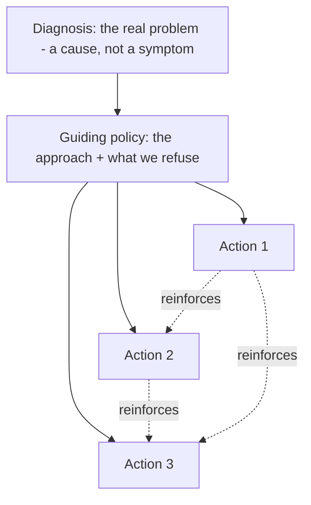

## 52.2 Writing a strategy: diagnosis, guiding policy, coherent actions

#### Concept

A good strategy has exactly three parts, and they must appear in order: a **diagnosis** that names the real problem honestly, a **guiding policy** that chooses an overall approach to that problem (including what you will not do), and a set of **coherent actions** that carry out the policy and reinforce one another. This structure comes from Richard Rumelt's work on strategy and it is the single most useful frame an engineering leader can hold. Most documents called strategy are missing the diagnosis entirely and are therefore a list of actions solving an unstated, often wrong, problem.

#### Why does it exist?

Imagine a doctor who skips the diagnosis and jumps straight to treatment: "take these pills, do this exercise, change your diet". The treatments might be individually fine, but without a diagnosis they are a guess, and if the real problem is something else entirely, the treatments waste time while the patient gets worse. Strategy without diagnosis is exactly this: a set of actions that might be fine but are untethered from the actual problem, so they often treat a symptom while the disease progresses.

The three-part structure exists to force the diagnosis to come first, and to make the actions provably follow from it. It also exists to make strategy *falsifiable*: if you state the diagnosis, someone can check whether it is right, and if the actions do not follow from the policy, someone can point that out. A list of goals cannot be wrong; a diagnosis can, which is what makes it useful.

#### Mental model

Imagine a detective. The bad detective arrests the first plausible suspect (jumps to an action). The good detective first works out *what actually happened* (diagnosis), then decides on an *approach* to catch the culprit given the constraints (guiding policy — "we cannot prove intent, so we build the timeline from the physical evidence"), then takes *specific steps* that each advance that approach and support the others (coherent actions — interview the witness whose testimony anchors the timeline, then get the records that corroborate it). The structure is: understand, decide an approach, act coherently. Skip the understanding and you arrest the wrong person confidently.

#### How it works

Each part has a job and a quality test.

**1. Diagnosis.** Name the crux of the problem — the one or two things that, if addressed, unlock the rest. Good diagnosis is simplifying: it cuts through the overwhelming detail of the situation to the thing that matters. It must be honest, including the parts that embarrass you. Quality test: does it identify a *cause*, not a *symptom*, and is it specific enough to be wrong?

**2. Guiding policy.** The overall approach to the diagnosed problem. It is a method, not a goal. It channels effort in one direction and, crucially, rules out others. Quality test: does it say what you will *not* do, and would a smart colleague be able to propose a different policy for the same diagnosis (if not, it is not really a choice)?

**3. Coherent actions.** The concrete, coordinated moves that carry out the policy. "Coherent" is the operative word: the actions must reinforce each other, not pull in different directions or merely coexist. Quality test: does each action make another cheaper, safer, or more likely to succeed — or are they just a list?



The dotted reinforcement arrows are what separate coherent actions from a to-do list. If you remove them and the actions still stand alone, you have a list, not a strategy.

#### Practical example — good versus bad

A ride-booking company has a reliability problem. Here is the same situation strategised badly and well.

**Bad strategy (goals disguised):**
> Our strategy is to achieve 99.95% availability, reduce incident count by 50%, improve our on-call experience, and adopt chaos engineering.

This is four goals. No diagnosis (why is reliability bad?), no policy (what is the approach?), no coherence (chaos engineering and on-call experience are unrelated moves). It cannot adjudicate anything and it says no to nothing.

**Good strategy:**
> **Diagnosis:** 70% of our customer-facing incidents in the last year originated in two places: the shared payments database (a single point of failure three services depend on) and uncontrolled retry storms (services retry aggressively with no backoff or circuit breaking, so one slow dependency cascades into a full outage). Reliability is not a culture problem or an effort problem; it is these two specific architectural weaknesses.
>
> **Guiding policy:** We will eliminate the two structural causes before investing in anything else reliability-related. We will NOT spend this year on chaos engineering, extra on-call tooling, or a general "reliability culture" push — those address symptoms or come later. We concentrate force on the two causes.
>
> **Coherent actions:** (1) Give payments its own database and remove the other two services' direct access, replacing it with an API — this removes the single point of failure. (2) Ship a shared resilience library (timeouts, backoff, circuit breaker) and make it the default in the service template — this ends retry storms. (3) Add the two alerts that would have caught both failure classes early (payments-DB saturation, retry-rate spike). Action 2's library is what makes action 1's new payments API safe to call; action 3 catches regressions of both. They reinforce.

The good version diagnoses a cause, refuses three tempting-but-wrong investments, and its three actions reinforce each other. That is a strategy.

#### Artifact example

A one-page technical vision document (2-3 year horizon) connected explicitly to business goals — the artifact that sits above the strategy and gives it a destination.

```markdown
# Technical Vision 2026-2028: Independent, reliable delivery

## The future we are building toward (3 years)
Any product team can design, ship, and operate a customer-facing change
end to end — in under a day, during business hours, without coordinating
a release with another team, and without fearing a cascading outage.

## Why this matters to the business
- Faster time-to-market: today a feature takes ~30 days of lead time;
  the business wants to test 3x as many ideas per quarter. That is only
  possible if teams ship independently.
- Reliability as a growth lever: each hour of payment downtime costs an
  estimated $45k in lost orders and churn. Structural reliability
  protects revenue, not just uptime SLAs.
- Scaling the org: we plan to grow from 45 to ~100 engineers. Coupled
  systems do not scale with headcount; independent teams do.

## The three pillars (what must be true)
1. OWNERSHIP: every bounded context has one team, its own data, and its
   own deploy pipeline.
2. SAFETY: every service ships with timeouts, backoff, circuit breaking
   and the standard alerts, by default, from the template.
3. SELF-SERVICE: creating, deploying and observing a service is a
   paved-road operation, not a ticket to the platform team.

## How we will know we are getting there (the measures)
- Lead time for change: 30 days -> under 1 day (DORA).
- Deploy frequency: weekly -> on-demand, multiple per day.
- Change failure rate: hold under 15% while frequency rises.
- Cross-team blocking dependencies per feature: ~3 -> near 0.

## What this vision is NOT
Not a mandate for microservices everywhere. Not a rewrite. Not a reason
to adopt every modern tool. The simplest architecture that delivers
independent, reliable delivery wins.
```

The vision is inspiring but grounded: it names the future state, ties each benefit to a business number ($45k/hour, 3x ideas, 45-to-100 engineers), states the pillars that must be true, gives DORA-style measures so progress is checkable, and — like a good strategy — says what it is not. A vision that cannot be measured is a slogan; this one can.

#### Real-world scenario

A principal engineer writes the vision above and the reliability strategy from the practical example. A quarter later, an enthusiastic team proposes adopting a fashionable service mesh "for reliability". The principal does not argue about the mesh on its merits. He points at the diagnosis: our incidents come from a shared database and retry storms, not from a lack of mesh features. A mesh would add operational surface without touching either cause. The proposal is declined in five minutes, with the strategy as the reason, and the team redirects its energy to the resilience library, which *does* address the diagnosed cause. That is strategy doing its job: making a hard decision easy and fast because the reasoning was done in advance.

#### Failure scenario

An org adopts a strategy with a strong guiding policy ("concentrate on the two structural causes") but incoherent actions, chosen by committee so every team got their pet project in: give payments its own database (good, on-policy), *and* adopt a new programming language (unrelated), *and* rewrite the mobile API (unrelated), *and* ship the resilience library (on-policy). The two on-policy actions get half the resources because the two off-policy ones consumed the rest. A year later reliability is marginally better, the language migration is half-done and now a liability, and the strategy is declared a failure. The diagnosis was right and the policy was right; the actions were an incoherent compromise that diluted the force the policy demanded. Coherence is not optional; it is where strategies are usually killed.

#### Edge cases & failure modes

- **No diagnosis.** Jumps to actions; often treats a symptom while the real cause worsens.
- **Diagnosis that is a symptom.** "We have too many incidents" is a symptom; "a shared database is a single point of failure for three services" is a cause.
- **Guiding policy that is a goal.** "Be more reliable" is a goal; "eliminate the two structural causes before anything else" is a policy.
- **Incoherent actions.** A committee-compromise list where off-policy items dilute the on-policy ones. The most common way good strategies die.
- **No refusal.** The policy does not rule anything out, so force is never concentrated.
- **Diagnosis nobody will say aloud.** The real cause is politically awkward (a VP's pet project, a sacred-cow service), so the strategy quietly addresses something safer and achieves nothing.

#### How a Principal Engineer thinks about this

They spend most of their strategy effort on the diagnosis, because it is the hardest and most valuable part and because a wrong diagnosis makes everything downstream wrong. They are willing to name the awkward cause — the sacred-cow service, the decision a senior leader made — because a strategy that flinches from the real problem is theatre. They treat the guiding policy's refusals as the heart of the choice, and they guard the coherence of the actions fiercely against committee dilution, because they have watched good strategies die not from a bad diagnosis but from an action list that tried to please everyone.

They also connect the strategy upward to a measurable vision and a business number, because a strategy that engineers love but that leadership cannot connect to revenue, cost or risk will lose its funding to one that can. The vision is how the strategy earns its budget.

#### Common mistakes

- **Skipping the diagnosis** and producing an action list that treats symptoms.
- **Writing a symptom as the diagnosis,** so the actions miss the cause.
- **A guiding policy that is secretly a goal,** choosing no approach.
- **Letting the action list become a committee compromise,** destroying coherence.
- **Avoiding the politically awkward real cause,** so the strategy quietly addresses something safe and useless.

#### Interview questions

1. **What are the three parts of a strategy, and which is hardest and most valuable?**
   *Expected answer:* diagnosis, guiding policy, coherent actions; the diagnosis is hardest and most valuable because a wrong one makes everything downstream wrong, and most "strategies" skip it. *Follow-up:* give an example of a cause versus a symptom in a diagnosis.

2. **Your strategy has a good diagnosis and policy, but after a year it failed. What is the most likely reason?**
   *Expected answer:* incoherent actions — a committee compromise where off-policy initiatives diluted the on-policy ones, so force was never concentrated as the policy demanded. *Why it matters:* tests whether they know where strategies actually die, which is usually in the actions, not the thinking.

3. **Why must a technical vision be measurable, and how do you tie it to the business?**
   *Expected answer:* an unmeasurable vision is a slogan with no way to know if you are progressing; you tie it to business by connecting each pillar to a number leadership cares about — revenue protected, time-to-market, cost, ability to scale the org. *Follow-up:* turn "world-class reliability" into a measurable, business-connected vision.

#### Practical exercise

Take the strategy kernel you wrote in 52.1 and stress-test its three parts. For the diagnosis, ask a trusted colleague whether it names a cause or a symptom, and whether there is a more honest (possibly more awkward) diagnosis you avoided. For the actions, draw the reinforcement arrows: can you show each action making another cheaper or safer? Remove any action that stands alone and does not reinforce the others. Then write the one-page vision it serves, with at least three business-connected measures.

**Acceptance criteria:** your diagnosis survives the cause-versus-symptom test; your guiding policy contains at least one refusal a reasonable person might have chosen differently; every surviving action demonstrably reinforces at least one other; and your vision has at least three measures each tied to a business number (revenue, cost, time-to-market, or org scale).
