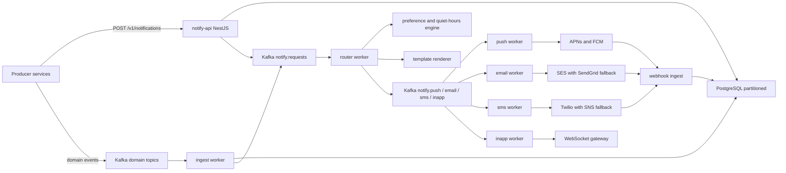
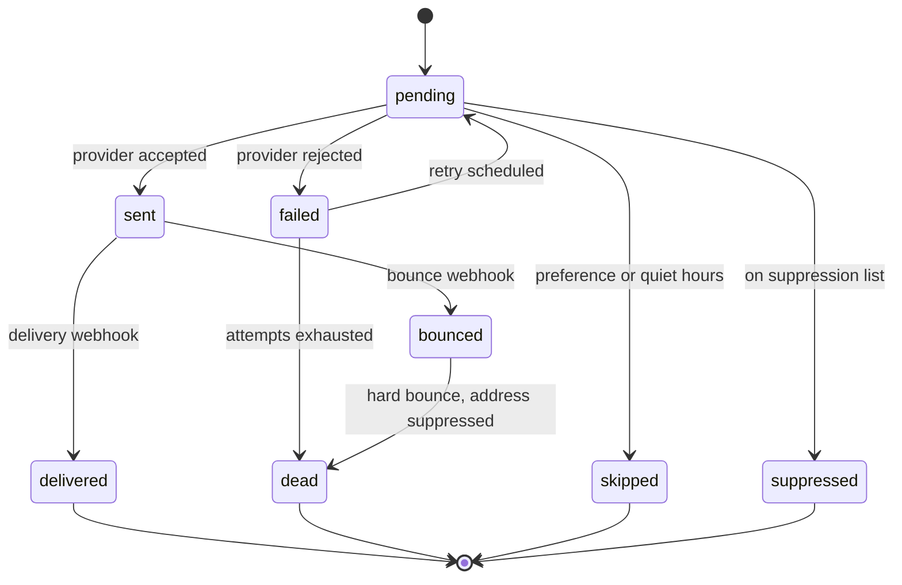
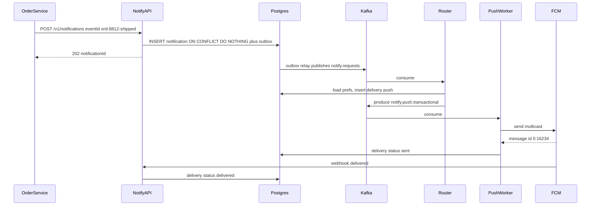
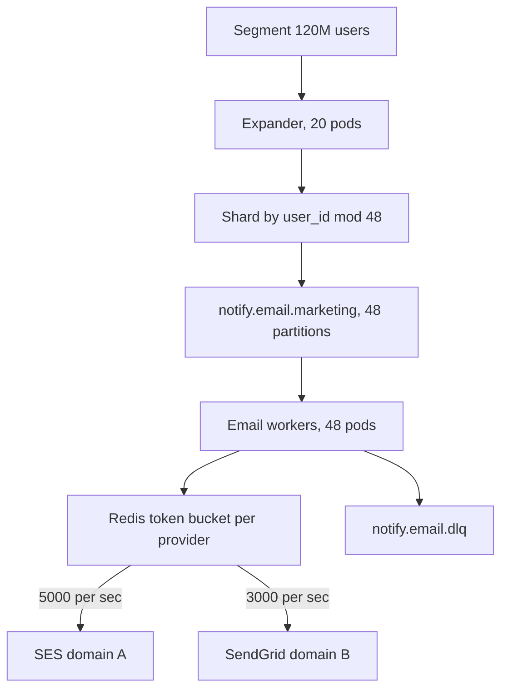

## 52.4 Notification System

### 52.4.1 Requirements

A notification system is the part of the platform that talks to a human when the human is not looking at the screen. An order ships, a payment fails, a driver is two minutes away, a password was changed from a new device, a flash sale starts in an hour. Every one of those is a message that must find the right person on the right channel at the right time, in their language, without waking them at 03:00, and without sending the same thing twice.

The callers are every other service in the company. The order service does not want to know that Firebase exists, that Apple rotates device tokens, or that SES has a per-second send rate. It wants to publish "order 8812 was shipped" and be done. So the notification system is a platform service with one job: turn business events into delivered messages, and be honest about what it delivered.

Imagine a large hotel with one front desk. Guests leave standing instructions at the desk: "Wake me at seven, but never between midnight and six. Reach me by phone for anything urgent, otherwise slip a note under the door. I read Spanish." Departments across the hotel send requests to the desk, not to the guests. The desk knows the instructions, picks the delivery method, keeps a log of what it delivered, and retries the ones that bounced. That desk is the notification service; the standing instructions are preferences; the log is the deliveries table; and the fact that the kitchen never phones a guest directly is the whole architectural point.

The hard parts are not "call the FCM SDK". They are: not sending duplicates when a Kafka consumer restarts mid-batch; fanning out one marketing campaign to twelve million users without starving the order-shipped notifications behind it; respecting quiet hours across 40 timezones; and being able to answer, three weeks later, "did this customer actually get the refund email, and when?"

### 52.4.2 Functional requirements

1. Accept a notification request from any internal service, either synchronously over HTTP or asynchronously by publishing to Kafka.
2. Support five channels: mobile push (APNs and FCM), email (SES), SMS (Twilio or SNS), in-app inbox, and live WebSocket delivery to an open session.
3. Render content from versioned templates with variable substitution and localization, falling back to a default locale when a translation is missing.
4. Honor per-user, per-category channel preferences and quiet hours in the user's timezone.
5. Deduplicate: the same `(user_id, event_id, channel)` must never be delivered twice, even if the producing service publishes the event five times.
6. Route by priority: `critical` (one-time passcodes, fraud alerts), `transactional` (order updates), `marketing` (campaigns). A campaign must never delay a passcode.
7. Fan out one-to-few (an order update to one user and two watchers) and one-to-millions (a campaign to a segment).
8. Retry failed sends with backoff, and fall back to a secondary provider when the primary is failing.
9. Ingest provider delivery-status webhooks and update delivery state (delivered, bounced, complained, opened, clicked).
10. Batch and digest: collapse 40 "someone liked your post" events into one message per hour.
11. Handle unsubscribe, one-click list-unsubscribe headers, suppression lists and compliance holds.
12. Expose an in-app inbox API with unread counts and read receipts.

### 52.4.3 Non-functional requirements

| Property | Target | Why |
|---|---|---|
| Critical path latency | p95 under 3 s from event publish to provider accept | A passcode that arrives after the user gave up is worthless |
| Transactional latency | p95 under 30 s | Order updates are not real-time but must feel prompt |
| Marketing throughput | 12M messages drained within 2 hours | Campaign windows are a business input |
| Durability | Zero accepted-then-lost notifications | "We sent it" must be true |
| Duplicate rate | Under 1 in 10^6 delivered messages | Duplicate passcodes look like an account compromise |
| Availability of the accept API | 99.95 percent | Producers should not have to handle our outage |
| Provider isolation | One dead provider degrades one channel only | SES throttling must not stop push |
| Auditability | Every delivery attempt retained 13 months | Disputes, GDPR requests, compliance |

### 52.4.4 Constraints

- Providers impose their own limits: SES starts at 14 emails per second and is raised on request; APNs allows many parallel HTTP/2 streams but throttles per topic; Twilio meters per messaging service; FCM caps at 500 device tokens per multicast call.
- Push tokens rot. Roughly 2 percent per month become invalid, and APNs reports this only through its feedback path or a 410 response.
- Email deliverability is a reputation game. A spike of bounces or complaints damages the sending domain for weeks, so send rate must ramp, not jump.
- SMS costs real money (around 0.007 USD per message in the US, far more elsewhere), so a runaway loop is a financial incident, not just a bug.
- Regulations: CAN-SPAM and GDPR require unsubscribe and a lawful basis for marketing; TCPA restricts SMS hours. Transactional messages are exempt from marketing opt-out but the boundary must be enforced in code, not by convention.
- Existing platform: NestJS services on EKS, PostgreSQL (Aurora), Redis (ElastiCache), MSK for Kafka, S3, and an existing WebSocket gateway.

### 52.4.5 Capacity estimation

| Quantity | Assumption | Calculation | Result |
|---|---|---|---|
| Registered users | | given | 40,000,000 |
| Daily active users | 15 percent | 40M x 0.15 | 6,000,000 |
| Transactional notifications per DAU per day | Orders, deliveries, security | 6M x 1.5 | 9,000,000 per day |
| Marketing notifications per day | 2 campaigns, 6M targeted each | 2 x 6M | 12,000,000 per day |
| Total notification requests per day | | 9M + 12M | 21,000,000 |
| Average requests per second | | 21M / 86,400 | 243 |
| Peak transactional RPS | 5x average during a sale evening | 104 x 5 | 520 |
| Campaign drain rate | 12M over a 2-hour window | 12M / 7,200 | 1,667 per second |
| Peak total sends per second | Campaign plus transactional peak | 1,667 + 520 | about 2,200 |
| Deliveries per notification | Push plus in-app for most, email for some | | 1.6 |
| Peak delivery rows written per second | | 2,200 x 1.6 | 3,520 |
| Read/write ratio | Inbox reads dominate: 6M DAU x 4 inbox opens | 24M reads vs 21M writes per day | about 1.1 to 1 |

Storage:

| Table | Bytes per row | Rows per year | Size per year |
|---|---|---|---|
| `notifications` | 400 B (ids, type, payload jsonb, timestamps) | 21M x 365 = 7.7B | 3.1 TB |
| `deliveries` | 250 B | 7.7B x 1.6 = 12.3B | 3.1 TB |
| `inbox` | 200 B, only in-app rows, 60 percent | 4.6B | 0.9 TB |
| `preferences` | 150 B x 40M users x 8 categories | 320M rows | 48 GB |
| Total year 1 | | | about 7.1 TB |

That number decides the design. Seven terabytes a year in one PostgreSQL table is not workable, so `notifications`, `deliveries` and `inbox` are range-partitioned by month, hot partitions stay on fast storage, partitions older than 90 days are detached and exported to S3 as Parquet for the audit trail, and only 13 months of delivery metadata is queryable online. That drops the live footprint to roughly 800 GB.

Bandwidth and memory:

| Quantity | Calculation | Result |
|---|---|---|
| Kafka ingress | 2,200 msg/s x 1.5 KB | 3.3 MB per second |
| Kafka retention, 7 days | 3.3 MB/s x 604,800 s | 2.0 TB with replication factor 3 |
| Redis dedupe keys | 21M per day x 100 B x 2-day TTL | 4.2 GB |
| Redis preference cache | 6M active users x 400 B | 2.4 GB |
| Redis total with overhead | | about 10 GB, one 3-shard cluster |
| PostgreSQL connections | 30 API pods x 10 + 60 workers x 5 | 600, so PgBouncer in transaction mode is mandatory |
| Provider egress | 12M emails x 40 KB | 480 GB per campaign day |

### 52.4.6 API design

| Method | Path | Request | Response | Status codes | Idempotency | Auth |
|---|---|---|---|---|---|---|
| POST | `/v1/notifications` | `{ userId, eventId, type, payload, priority, channels?, locale?, sendAt? }` | `{ notificationId, status: "accepted" }` | 202, 400, 409, 429 | Yes, by `eventId` plus `type`; a repeat returns the original `notificationId` with 200 | Service token, scope `notify:send` |
| POST | `/v1/notifications/bulk` | `{ items: [...] }` up to 500 | `{ accepted, rejected: [{index, reason}] }` | 207, 400 | Yes, per item | Service token |
| POST | `/v1/campaigns` | `{ name, segmentId, templateKey, channel, scheduleAt, throttlePerSec }` | campaign | 201, 400 | Yes, `Idempotency-Key` header | Marketing role |
| POST | `/v1/campaigns/{id}/cancel` | | | 204, 409 | Yes | Marketing role |
| GET | `/v1/notifications/{id}` | | notification with delivery attempts | 200, 404 | Yes | Service token or owner |
| GET | `/v1/inbox` | `?cursor=&limit=&unreadOnly=` | `{ items, nextCursor, unreadCount }` | 200 | Yes | User access token |
| POST | `/v1/inbox/{id}/read` | | `{ readAt }` | 200, 404 | Yes, repeat is a no-op | User access token |
| POST | `/v1/inbox/read-all` | `{ before }` | `{ updated }` | 200 | Yes | User access token |
| GET | `/v1/preferences` | | categories with per-channel flags and quiet hours | 200 | Yes | User access token |
| PUT | `/v1/preferences` | `{ categories: {...}, quietHours: { start, end, tz }, digest: "hourly" }` | preferences | 200, 400 | Yes | User access token |
| POST | `/v1/devices` | `{ token, platform, appVersion }` | device | 201, 200 on repeat | Yes, by `(user_id, token)` | User access token |
| DELETE | `/v1/devices/{token}` | | | 204 | Yes | User access token |
| GET | `/unsubscribe` | `?t=<signed token>` | HTML page | 200, 410 | Yes | Signed token, no session |
| POST | `/v1/webhooks/ses` | SNS message | | 200 always after signature check | Yes, by provider message id | SNS signature |
| POST | `/v1/webhooks/twilio` | form body | | 204 | Yes, by `MessageSid` plus status | HMAC signature |

Two design decisions are visible in that table. The accept endpoint returns `202 Accepted`, not `200 OK`, because acceptance means "durably queued", not "delivered" - and saying otherwise would be a lie the caller builds on. And `eventId` is supplied by the caller, not generated by us: only the producer knows that its retry is the same business event.

### 52.4.7 Data model

```mermaid
erDiagram
    USERS ||--o{ PREFERENCES : configures
    USERS ||--o{ DEVICES : owns
    USERS ||--o{ NOTIFICATIONS : receives
    NOTIFICATIONS ||--o{ DELIVERIES : attempts
    NOTIFICATIONS ||--o| INBOX : materializes
    TEMPLATES ||--o{ TEMPLATE_VERSIONS : has
    TEMPLATE_VERSIONS ||--o{ NOTIFICATIONS : renders
    NOTIFICATIONS {
        uuid id PK
        uuid user_id FK
        text event_id
        text type
        text priority
        jsonb payload
        timestamptz created_at
    }
    DELIVERIES {
        uuid id PK
        uuid notification_id FK
        text channel
        text provider
        text status
        int attempt
        text provider_message_id
        timestamptz updated_at
    }
    PREFERENCES {
        uuid user_id FK
        text category
        boolean push_enabled
        boolean email_enabled
        text quiet_start
        text timezone
    }
    TEMPLATES {
        text key PK
        text category
        text default_locale
    }
    INBOX {
        uuid id PK
        uuid user_id FK
        text title
        timestamptz read_at
    }
```



```sql
CREATE TYPE notification_priority AS ENUM ('critical', 'transactional', 'marketing');
CREATE TYPE delivery_channel     AS ENUM ('push', 'email', 'sms', 'in_app', 'websocket');
CREATE TYPE delivery_status      AS ENUM ('pending','sent','delivered','bounced','failed','suppressed','skipped');

CREATE TABLE notifications (
  id             uuid        NOT NULL DEFAULT gen_random_uuid(),
  user_id        uuid        NOT NULL,
  event_id       text        NOT NULL,              -- supplied by the producing service
  type           text        NOT NULL,              -- 'order.shipped', 'auth.otp'
  category       text        NOT NULL,              -- maps to a preference row
  priority       notification_priority NOT NULL,
  locale         text        NOT NULL DEFAULT 'en',
  template_key   text        NOT NULL,
  template_ver   integer     NOT NULL,
  payload        jsonb       NOT NULL,
  send_at        timestamptz NOT NULL DEFAULT now(),
  created_at     timestamptz NOT NULL DEFAULT now(),
  PRIMARY KEY (id, created_at)
) PARTITION BY RANGE (created_at);

CREATE TABLE notifications_2026_09 PARTITION OF notifications
  FOR VALUES FROM ('2026-09-01') TO ('2026-10-01');

-- The dedupe contract. One row per business event per user, enforced by the database,
-- not by an application "check then insert" that races under concurrency.
CREATE UNIQUE INDEX notifications_dedupe_uidx
  ON notifications (user_id, event_id, type, created_at);

-- Serves GET /v1/notifications for a user, newest first, and the inbox backfill.
CREATE INDEX notifications_user_recent_idx
  ON notifications (user_id, created_at DESC);

-- Serves the scheduler that picks up future-dated sends.
CREATE INDEX notifications_due_idx
  ON notifications (send_at) WHERE send_at > created_at;

CREATE TABLE deliveries (
  id                  uuid NOT NULL DEFAULT gen_random_uuid(),
  notification_id     uuid NOT NULL,
  user_id             uuid NOT NULL,
  channel             delivery_channel NOT NULL,
  provider            text,                          -- 'ses', 'sendgrid', 'apns', 'fcm', 'twilio'
  status              delivery_status NOT NULL DEFAULT 'pending',
  attempt             smallint NOT NULL DEFAULT 0,
  provider_message_id text,
  error_code          text,
  destination_hash    bytea,                         -- sha256 of the address, never the address itself
  created_at          timestamptz NOT NULL DEFAULT now(),
  updated_at          timestamptz NOT NULL DEFAULT now(),
  PRIMARY KEY (id, created_at)
) PARTITION BY RANGE (created_at);

-- The exactly-once-effect constraint: one delivery per notification per channel.
CREATE UNIQUE INDEX deliveries_once_uidx
  ON deliveries (notification_id, channel, created_at);

-- Serves the webhook handler that looks a delivery up by what the provider gives back.
CREATE INDEX deliveries_provider_msg_idx
  ON deliveries (provider, provider_message_id) WHERE provider_message_id IS NOT NULL;

-- Serves the retry sweeper: find failed attempts still eligible for another try.
CREATE INDEX deliveries_retry_idx
  ON deliveries (status, updated_at) WHERE status IN ('pending','failed');

CREATE TABLE preferences (
  user_id        uuid NOT NULL,
  category       text NOT NULL,                      -- 'orders','security','social','marketing'
  push_enabled   boolean NOT NULL DEFAULT true,
  email_enabled  boolean NOT NULL DEFAULT true,
  sms_enabled    boolean NOT NULL DEFAULT false,
  in_app_enabled boolean NOT NULL DEFAULT true,
  digest         text NOT NULL DEFAULT 'none' CHECK (digest IN ('none','hourly','daily')),
  quiet_start    time,                               -- local wall clock
  quiet_end      time,
  timezone       text NOT NULL DEFAULT 'UTC',
  updated_at     timestamptz NOT NULL DEFAULT now(),
  PRIMARY KEY (user_id, category)                    -- serves the single lookup on the send path
);

CREATE TABLE templates (
  key            text PRIMARY KEY,                   -- 'order.shipped'
  category       text NOT NULL,
  default_locale text NOT NULL DEFAULT 'en',
  active_version integer NOT NULL DEFAULT 1
);

CREATE TABLE template_versions (
  template_key text NOT NULL REFERENCES templates(key) ON DELETE CASCADE,
  version      integer NOT NULL,
  locale       text NOT NULL,
  channel      delivery_channel NOT NULL,
  subject      text,
  body         text NOT NULL,                        -- handlebars-style source
  PRIMARY KEY (template_key, version, locale, channel)
);

CREATE TABLE inbox (
  id              uuid NOT NULL DEFAULT gen_random_uuid(),
  user_id         uuid NOT NULL,
  notification_id uuid NOT NULL,
  title           text NOT NULL,
  body            text NOT NULL,
  deep_link       text,
  read_at         timestamptz,
  created_at      timestamptz NOT NULL DEFAULT now(),
  PRIMARY KEY (id, created_at)
) PARTITION BY RANGE (created_at);

-- Serves keyset pagination of the inbox: WHERE user_id = $1 AND created_at < $2 ORDER BY created_at DESC.
CREATE INDEX inbox_user_feed_idx ON inbox (user_id, created_at DESC);
-- Serves the unread badge count without scanning read rows.
CREATE INDEX inbox_unread_idx ON inbox (user_id) WHERE read_at IS NULL;

CREATE TABLE suppressions (
  destination_hash bytea PRIMARY KEY,                -- hashed email or phone
  reason           text NOT NULL,                    -- 'hard_bounce','complaint','unsubscribe','legal_hold'
  created_at       timestamptz NOT NULL DEFAULT now()
);
```

Two notes on the schema. `destination_hash` rather than the address itself keeps personal data out of the high-volume table, which makes GDPR erasure a matter of deleting the user record and leaving statistically useful rows behind. And the unique index on `(notification_id, channel)` is what turns "we try not to duplicate" into "the database will not let us duplicate" - a property you can rely on during an incident.

### 52.4.8 High-level architecture



The shape is deliberate: one accept path, one router, and one worker deployment per channel. Channels are separated because their failure modes and rate limits have nothing in common. SES throttling should slow email and nothing else. A router that called providers inline would couple them all together and make the slowest provider the system's latency.

Priority is enforced by topic, not by a field. `notify.push.critical`, `notify.push.transactional` and `notify.push.marketing` are separate topics with separate consumer groups and separate pod counts. A twelve-million-message campaign sitting in `notify.push.marketing` cannot delay a passcode in `notify.push.critical`, because they do not share a partition, a consumer, or a thread. Putting a priority field on one topic and hoping the consumer sorts it is the classic mistake: Kafka partitions are FIFO, and you cannot skip ahead.

### 52.4.9 Component design

```text
src/
  notify-api/
    notifications.controller.ts
    notifications.service.ts
    inbox.controller.ts
    preferences.controller.ts
    devices.controller.ts
    dto/create-notification.dto.ts
  routing/
    router.consumer.ts
    preference.service.ts
    quiet-hours.service.ts
    fanout.service.ts
  templates/
    template.service.ts
    renderer.ts                 -- handlebars with escaping per channel
  channels/
    channel.interface.ts
    push/push.worker.ts
    push/apns.provider.ts
    push/fcm.provider.ts
    email/email.worker.ts
    email/ses.provider.ts
    email/sendgrid.provider.ts
    sms/sms.worker.ts
    inapp/inapp.worker.ts
  webhooks/
    ses-webhook.controller.ts
    twilio-webhook.controller.ts
  campaigns/
    campaign.controller.ts
    campaign-expander.worker.ts
  common/
    outbox.service.ts
    dedupe.guard.ts
  notification.module.ts
```

The accept path does one thing well: write the notification durably with the dedupe constraint, write an outbox row in the same transaction, and return. It does not call Kafka inside the transaction, because a Kafka publish that succeeds after the transaction rolls back produces a notification the database has never heard of.

```ts
// notify-api/notifications.service.ts
import { ConflictException, Injectable, Logger } from '@nestjs/common';
import { DataSource } from 'typeorm';
import { CreateNotificationDto } from './dto/create-notification.dto';
import { TemplateService } from '../templates/template.service';

@Injectable()
export class NotificationsService {
  private readonly logger = new Logger(NotificationsService.name);

  constructor(private readonly ds: DataSource, private readonly templates: TemplateService) {}

  async accept(dto: CreateNotificationDto): Promise<{ notificationId: string; deduped: boolean }> {
    const tpl = await this.templates.resolveActive(dto.type);           // cached, throws on unknown type

    return this.ds.transaction(async (m) => {
      const inserted = await m.query(
        `INSERT INTO notifications
           (user_id, event_id, type, category, priority, locale, template_key, template_ver, payload, send_at)
         VALUES ($1,$2,$3,$4,$5,$6,$7,$8,$9, COALESCE($10, now()))
         ON CONFLICT (user_id, event_id, type, created_at) DO NOTHING
         RETURNING id`,
        [dto.userId, dto.eventId, dto.type, tpl.category, dto.priority, dto.locale ?? 'en',
         tpl.key, tpl.activeVersion, dto.payload, dto.sendAt ?? null],
      );

      if (inserted.length === 0) {
        // Same (user, event, type) already accepted. Return the original id: the caller retried.
        const [existing] = await m.query(
          `SELECT id FROM notifications
            WHERE user_id = $1 AND event_id = $2 AND type = $3
            ORDER BY created_at DESC LIMIT 1`,
          [dto.userId, dto.eventId, dto.type],
        );
        if (!existing) throw new ConflictException('duplicate accepted but not found');
        return { notificationId: existing.id, deduped: true };
      }

      const id = inserted[0].id;
      // Outbox row in the SAME transaction. A separate relay publishes it to Kafka.
      await m.query(
        `INSERT INTO outbox (aggregate_type, aggregate_id, topic, key, payload)
         VALUES ('notification', $1, 'notify.requests', $2, $3)`,
        [id, dto.userId, JSON.stringify({ notificationId: id, priority: dto.priority })],
      );
      return { notificationId: id, deduped: false };
    });
  }
}
```

The router consumes `notify.requests`, decides which channels apply, and produces one message per channel. Preferences, quiet hours and suppression all run here, once, so that the channel workers stay dumb.

```ts
// routing/router.consumer.ts (excerpt)
async handle(msg: { notificationId: string }): Promise<void> {
  const n = await this.repo.loadWithUser(msg.notificationId);
  if (!n) return;                                              // partition replay of a deleted user

  const prefs = await this.prefs.get(n.userId, n.category);    // Redis-cached, PG fallback
  const channels = this.channelsFor(n, prefs);                 // priority overrides marketing opt-outs never

  for (const channel of channels) {
    const decision = this.quietHours.evaluate(n, prefs, channel);
    if (decision.action === 'skip') {
      await this.repo.recordSkip(n.id, channel, decision.reason);
      continue;
    }
    const sendAt = decision.action === 'defer' ? decision.deferUntil : n.sendAt;

    // Claim the (notification, channel) pair. The unique index makes this the single
    // point where duplicate work is stopped, regardless of consumer restarts.
    const claimed = await this.repo.insertDeliveryIfAbsent(n.id, n.userId, channel);
    if (!claimed) continue;

    await this.producer.send(`notify.${channel}.${n.priority}`, {
      key: n.userId,                                           // per-user ordering within a channel
      value: { deliveryId: claimed.id, notificationId: n.id, sendAt },
    });
  }
}
```

Quiet hours are more subtle than they look. A `critical` notification ignores them entirely. A `transactional` one is delivered anyway on in-app and push-silent but held for email. A `marketing` one is deferred to the end of the quiet window, with jitter so that ten million users in Europe do not all receive their message at exactly 08:00:00.

```ts
// routing/quiet-hours.service.ts
evaluate(n: Notification, p: Preferences, channel: DeliveryChannel): QuietDecision {
  if (n.priority === 'critical' || !p.quietStart || !p.quietEnd) return { action: 'send' };

  const local = DateTime.fromJSDate(n.sendAt, { zone: p.timezone });
  const start = this.at(local, p.quietStart);
  const end   = this.at(local, p.quietEnd);
  // Windows that cross midnight (22:00 -> 07:00) need the OR form, not a simple range test.
  const inQuiet = start <= end ? local >= start && local < end : local >= start || local < end;
  if (!inQuiet) return { action: 'send' };

  if (n.priority === 'transactional' && (channel === 'in_app' || channel === 'push')) {
    return { action: 'send', silent: true };                   // no sound, no vibration
  }
  const resume = local < end ? end : end.plus({ days: 1 });
  const jitterMs = Math.floor(Math.random() * 15 * 60 * 1000); // spread the 08:00 thundering herd
  return { action: 'defer', deferUntil: resume.plus({ milliseconds: jitterMs }).toJSDate(), reason: 'quiet_hours' };
}
```

The channel worker owns provider selection, batching, rate limiting and fallback. This is the push worker's core, showing the parts that matter: token batching for FCM, the 410 handling that keeps the device table clean, and the fallback to a secondary provider.

```ts
// channels/push/push.worker.ts (excerpt)
async send(job: PushJob): Promise<void> {
  const tokens = await this.devices.activeTokens(job.userId);
  if (tokens.length === 0) {
    return this.deliveries.finish(job.deliveryId, 'skipped', { error_code: 'no_device' });
  }
  const rendered = await this.templates.render(job.notificationId, 'push');

  for (const group of chunk(tokens, 500)) {                    // FCM multicast limit
    await this.providerLimiter.acquire('fcm', group.length);    // token bucket in Redis, per provider
    const res = await this.withFallback(
      () => this.fcm.sendMulticast(group, rendered),
      () => this.apns.sendBatch(group.filter((t) => t.platform === 'ios'), rendered),
    );
    // 410 Gone / UNREGISTERED means the token is dead. Delete it, or the next campaign
    // wastes 2 percent of its budget on ghosts and hurts the sender score.
    const dead = res.results.filter((r) => r.error === 'UNREGISTERED' || r.status === 410);
    if (dead.length) await this.devices.deactivate(dead.map((d) => d.token));
    await this.deliveries.recordAttempt(job.deliveryId, res);
  }
}
```

The delivery lifecycle is a state machine, and drawing it once saves a hundred arguments about what "sent" means.



And the happy path, end to end:



### 52.4.10 Database design

The three big tables are range-partitioned by `created_at` on a monthly boundary. `pg_partman` creates next month's partition four weeks ahead and detaches partitions older than 13 months; a nightly job copies detached partitions to S3 in Parquet and drops them. Partitioning does three things at once: `DELETE FROM notifications WHERE created_at < ...` becomes a `DROP TABLE` that takes milliseconds instead of hours of vacuum pressure; index size stays bounded so the hot partition's indexes fit in shared buffers; and autovacuum only has to work on the current month.

The inbox query is keyset paginated, never `OFFSET`:

```sql
SELECT id, title, body, deep_link, read_at, created_at
  FROM inbox
 WHERE user_id = $1
   AND created_at < $2                       -- cursor from the previous page
 ORDER BY created_at DESC
 LIMIT 21;                                   -- 20 plus one to know if there is a next page
```

```text
Limit  (cost=0.56..38.12 rows=21 width=142) (actual time=0.041..0.118 rows=21 loops=1)
  Buffers: shared hit=24
  ->  Index Scan Backward using inbox_user_feed_idx on inbox_2026_09
        Index Cond: ((user_id = $1) AND (created_at < $2))
        Buffers: shared hit=24
Planning Time: 0.212 ms
Execution Time: 0.146 ms
```

Twenty-four buffer hits and no sort - that is what the `(user_id, created_at DESC)` index buys. With `OFFSET 10000` the same query reads 10,021 rows and takes 40 ms, and it gets worse as the user accumulates history.

The unread badge is a counted query on a partial index, and for users with thousands of unread rows it is cached in Redis and invalidated on write:

```sql
SELECT count(*) FROM inbox WHERE user_id = $1 AND read_at IS NULL;
```

The write path never does `SELECT ... then INSERT`. It relies on `ON CONFLICT DO NOTHING` against the unique indexes, which is atomic under concurrency. Two router pods processing the same rebalanced partition both try to insert the same `(notification_id, channel)` delivery; exactly one wins, and the loser silently drops the job. This is the inbox pattern applied to the effect rather than the message: Kafka gives at-least-once delivery of the message, and the unique constraint turns it into exactly-once execution of the side effect.

### 52.4.11 Caching

| What | Where | TTL | Invalidation | Why |
|---|---|---|---|---|
| User preferences | Redis hash `pref:{userId}` | 1 h | Write-through on `PUT /v1/preferences` | Every notification reads them; PostgreSQL would see 2,200 reads per second |
| Device tokens | Redis set `dev:{userId}` | 30 min | Invalidated on register and deactivate | Push worker reads on every send |
| Rendered template AST | In-process LRU, 2,000 entries | Until version bump | Redis pub/sub on template publish | Handlebars compilation is 0.5 ms; rendering a compiled AST is 20 microseconds |
| Suppression list membership | Redis Bloom filter plus exact set | Rebuilt hourly | Additive on new suppressions | Checking 12M campaign addresses against PostgreSQL would take an hour by itself |
| Dedupe marker | Redis `SET NX` on `dd:{userId}:{eventId}:{type}`, 48 h | 48 h | Time | A cheap pre-filter so the common duplicate never reaches PostgreSQL; the unique index is still the authority |
| Unread count | Redis `inbox:unread:{userId}` | 10 min | Incremented on insert, decremented on read | Badge is polled on every app foreground |

The dedupe cache deserves care. Redis is a filter, not the truth. If Redis says "already seen" we skip; if Redis is empty or down we fall through to PostgreSQL, where the unique index gives the correct answer. Never the other way round - a design where Redis is the only dedupe store sends duplicate passcodes the first time a node fails over.

### 52.4.12 Messaging

| Topic | Partitions | Key | Producers | Consumer group | Retention |
|---|---|---|---|---|---|
| `notify.requests` | 24 | `user_id` | Outbox relay, ingest worker | `notify-router` | 7 days |
| `notify.push.critical` | 12 | `user_id` | Router | `push-critical` | 3 days |
| `notify.push.transactional` | 24 | `user_id` | Router | `push-transactional` | 3 days |
| `notify.push.marketing` | 48 | `user_id` | Campaign expander | `push-marketing` | 3 days |
| `notify.email.*` | 12 / 24 / 48 | `user_id` | Router, expander | one group per priority | 3 days |
| `notify.sms.*` | 6 / 12 | `user_id` | Router | one group per priority | 3 days |
| `notify.status` | 12 | `delivery_id` | Webhook ingest | `status-writer` | 7 days |
| `notify.*.dlq` | 3 | original key | Any worker after 5 attempts | `dlq-inspector` (manual replay) | 30 days |

Keying by `user_id` gives per-user ordering within a channel, which matters more than it sounds: "your order shipped" arriving before "your order was confirmed" is a support ticket. It also means a single very active user is confined to one partition, which is fine because no single user generates enough traffic to be a hot partition.

Consumer groups are per channel and per priority so that lag is measurable and actionable per lane. `push-marketing` lagging by 4 million messages during a campaign is normal. `push-critical` lagging by 500 is a page.

Retries live inside the worker with exponential backoff (1 s, 4 s, 15 s, 60 s, 300 s) and full jitter, implemented by re-publishing to a delay topic rather than by sleeping in the consumer - a sleeping consumer stops polling and Kafka evicts it from the group. After five attempts the message goes to the channel's DLQ with the last error, and the delivery row moves to `dead`. A daily job reports DLQ contents by error code; a bug that broke one template shows up as 40,000 identical DLQ entries, which is exactly the signal you want.

The inbox pattern completes exactly-once effect. The message may be consumed many times; the `deliveries` unique index means the provider call happens once. For the few providers that accept a client-supplied idempotency key (SendGrid, Twilio), the worker passes `delivery_id` as that key, so even a duplicate HTTP call at the provider is collapsed on their side.

### 52.4.13 Scaling

**At 1x (2,200 sends per second peak).** Three router pods, four workers per channel, one 3-shard Redis cluster, a single Aurora writer with two readers, MSK with three brokers. Campaign expansion runs as a batch job reading a segment from the analytics warehouse and producing to Kafka at a throttled 1,700 messages per second.

**At 10x (22,000 sends per second, 120M marketing messages per campaign).** Three things break in order.

First, the outbox relay becomes a bottleneck because it is a single logical reader of one table. It moves to logical replication with Debezium reading the WAL, which removes polling entirely and scales with PostgreSQL rather than against it.

Second, campaign expansion cannot go through the notification insert path: 120M rows in `notifications` per campaign is 48 GB of write amplification for messages that mostly nobody opens. Marketing switches to a lightweight path - the expander writes a compact `campaign_targets` row set (user_id, status) and produces directly to the marketing topic, with delivery records aggregated per campaign rather than per message. Transactional notifications keep full per-message records because that is where disputes happen.

Third, provider limits bind before your own infrastructure does. SES at a raised quota of 5,000 emails per second means a 120M campaign takes 6.7 hours no matter how many pods you run. The fix is warming a second sending domain and splitting traffic, plus a per-provider distributed token bucket in Redis so pods do not collectively exceed the quota and trigger throttling.



**At 100x (220,000 sends per second).** The system becomes multi-region and per-channel autonomy becomes per-channel ownership. Each region runs its own routers and workers over its own Kafka, users are homed to a region, and only the suppression list and preferences are replicated globally (Aurora Global Database, read-local write-forward). `notifications` moves off a single PostgreSQL cluster: transactional metadata shards by `user_id` across 16 clusters using a directory service, or moves to a wide-column store (Cassandra or DynamoDB) keyed by `(user_id, created_at)`, which fits the access pattern exactly - always read by user, always by recency, never joined. The audit requirement moves entirely to S3 plus Athena. At that scale the in-app inbox is also better served by a separate store, because 4.6B rows a year of feed data is a timeline problem, not a relational one.

### 52.4.14 Security

- **Authorization on send.** Any service can send a notification, so any compromised service can phish your users. Service tokens carry scopes (`notify:send:orders`) and a service may only use template keys in its allowed namespace. Free-text bodies are not accepted from callers at all - only template key plus variables - which also removes the injection surface.
- **Template injection.** Variables are escaped per channel: HTML-escaped for email bodies, URL-encoded inside links, and stripped of control characters for SMS. A user display name of `` must not become HTML in an email.
- **PII minimization.** Delivery rows store `destination_hash`, not addresses. Logs never contain a full email, phone or push token; they contain the delivery id. Payloads in `notifications` are inspected by a linter in CI that rejects known PII field names in template variables when the channel is a third party.
- **Unsubscribe links.** The token is an HMAC over `(user_id, category, version)` with a rotating key, not a raw user id, so nobody can enumerate ids and unsubscribe strangers. `List-Unsubscribe` and `List-Unsubscribe-Post` headers are set so mailbox providers offer one-click unsubscribe.
- **Webhook authenticity.** SES webhooks arrive via SNS and the SNS signature is verified against Amazon's certificate, with the certificate URL validated against `*.amazonaws.com`. Twilio webhooks are verified with the `X-Twilio-Signature` HMAC. An unverified webhook is dropped and counted, never processed - otherwise anyone can mark deliveries as bounced and get users suppressed.
- **SMS cost abuse.** A per-user, per-day SMS cap (5) and a per-country spend cap stop both bugs and "SMS pumping" fraud, where an attacker triggers passcodes to premium-rate numbers in a country you do not serve. Countries outside the served list are blocked by default.
- **Quiet-hours bypass.** Only `critical` bypasses quiet hours, and the set of types allowed to be `critical` is a hard-coded allowlist reviewed in code review, not a caller-supplied field.
- **Marketing consent.** The `marketing` category checks a consent record with a lawful basis and timestamp before every send, and consent withdrawal is honored within minutes because the suppression check happens in the worker, not only at expansion time.

### 52.4.15 Failure scenarios

| Failure | Detection | Impact | Mitigation | What the user sees |
|---|---|---|---|---|
| Producer publishes the same event 5 times after its own timeout | Dedupe counter rises | Would be 5 identical pushes | `(user_id, event_id, type)` unique index; Redis pre-filter absorbs most | One notification |
| Router pod dies after producing to the push topic but before committing its offset | Consumer lag blip, duplicate-claim counter | The message is redelivered | `deliveries` unique index rejects the second claim; the redelivered job is dropped | Nothing |
| FCM times out after accepting the message | Provider latency histogram, timeout counter | Unknown outcome: it may have delivered | 10 s timeout, one retry with the same `delivery_id` as provider idempotency key where supported; otherwise accept a rare duplicate on a non-critical channel and never retry an SMS blindly | Rarely, a duplicate push |
| SES throttles at 14 per second because the quota was never raised | 454 error rate, send rate flat | Email backs up, lag grows | Distributed token bucket set to the actual quota; alert on quota utilization over 80 percent; SendGrid fallback for transactional email only | Email arrives late |
| Hard bounce storm from a bad imported list | Bounce ratio over 5 percent | Sending domain reputation drops; future email lands in spam | Circuit breaker pauses the campaign at 2 percent bounce rate; addresses go to `suppressions`; separate sending domain for marketing protects transactional mail | Some users stop getting email |
| Template deployed with a broken variable | Render error counter spikes, DLQ fills | Whole notification type fails | Templates are versioned and validated against a JSON schema of the payload in CI; render failure marks delivery `failed` and DLQs rather than crashing the consumer; instant rollback to previous version | No notification for that type for a few minutes |
| Redis cluster down | Connection errors | Preferences and dedupe caches unavailable | Fall through to PostgreSQL with a circuit breaker; throughput drops maybe 40 percent, correctness unaffected because PostgreSQL holds the constraints | Slight delay |
| PostgreSQL writer failover, 40 s | Health checks, write errors | Accept API returns 503; workers cannot record deliveries | Accept API returns 503 so producers retry with the same `eventId`; workers pause consumption and resume, Kafka retains the work | Producers retry; notifications arrive late |
| Kafka partition leader election | Producer retries, brief lag | Sends stall for seconds | `acks=all`, `enable.idempotence=true`, retries with backoff | Nothing |
| Campaign accidentally targets everyone instead of a segment | Send-rate anomaly alert versus 7-day baseline | 40M unwanted messages, reputation damage, six-figure SMS bill | Campaigns require an approver, a dry-run count shown before launch, and a hard cap of 1.5x the estimated audience that pauses the job | Ideally nothing; the job halts |
| Consumer group rebalance storm during a deploy | Rebalance rate metric | Throughput drops, duplicates increase | Cooperative sticky assignor, `session.timeout.ms` tuned above the p99 processing time, rolling deploy with `maxUnavailable: 1` | Nothing |
| Webhook arrives before the delivery row is committed | Webhook 404 counter | Status update lost | Webhook handler writes to `notify.status` with the provider message id; the status writer retries for up to 15 minutes before DLQ | Status shows `sent` briefly instead of `delivered` |
| Clock skew across pods puts a quiet-hours decision on the wrong side of midnight | Skip-reason distribution shift | A few users get a message one hour early | All timestamps are UTC from PostgreSQL `now()`, conversion happens with the IANA timezone, chrony on all nodes | One early message |
| Device token belongs to a user who reinstalled and logged in as someone else | Complaint reports | Wrong user receives a notification: an actual data leak | Tokens are bound to `(user_id, token)` and deleted on logout; the client sends a fresh token on login; the worker re-checks ownership before sending | Nothing, once fixed |

### 52.4.16 Observability

Metrics, all labeled by `channel`, `priority` and `type`:

1. `notify_accepted_total` and `notify_deduped_total` - the ratio tells you which producers retry aggressively.
2. `notify_delivery_status_total` by status. The `delivered / sent` ratio per provider is the real deliverability number, and a drop of 5 points is an incident before anyone complains.
3. `notify_end_to_end_seconds` histogram, measured from `notifications.created_at` to `deliveries.status = 'sent'`. Alert on p95 above 3 s for `critical`.
4. `notify_provider_request_duration_seconds` and `notify_provider_errors_total` by provider and error code. This is what the circuit breaker watches.
5. `kafka_consumergroup_lag` per group, with different thresholds per lane: 500 for critical, 50,000 for marketing.
6. `notify_bounce_ratio` and `notify_complaint_ratio` over a 1-hour window. Alert at 2 percent bounce, 0.1 percent complaint - the thresholds mailbox providers use.
7. `notify_sms_spend_usd_total` by country, with a budget alert.
8. `notify_dlq_depth` by topic and error code.
9. `notify_suppressed_total` by reason, to catch a suppression bug that silently stops all email.

Traces: the trace id from the producing service is carried in the Kafka header and re-attached in every worker, so a support engineer can paste an order id, find the trace, and see the accept, the routing decision (including "skipped: quiet hours"), the provider call and its latency. That single capability removes most notification support tickets.

Logs: one structured line per delivery attempt with `delivery_id`, `notification_id`, `channel`, `provider`, `status`, `attempt`, `error_code`, `latency_ms`. No addresses, no payload bodies. Dashboards: a lane board (throughput and lag per priority), a provider board (latency, errors, quota utilization, bounce rates), a campaign board (progress, send rate, opt-outs per minute), and a business board (notifications per type, open rate, click rate).

### 52.4.17 Deployment

| Workload | Kind | Replicas | Notes |
|---|---|---|---|
| `notify-api` | Deployment + HPA | 6 to 30 | CPU 60 percent and RPS target; PodDisruptionBudget minAvailable 4 |
| `notify-router` | Deployment | 6 | Scaled by KEDA on `notify.requests` lag |
| `push-critical` / `push-transactional` / `push-marketing` | Deployments | 2 / 8 / 0 to 48 | Marketing scales from zero on lag; critical has a fixed floor so cold start never delays a passcode |
| `email-*`, `sms-*` | Deployments | similar | Concurrency bounded by the provider token bucket, not by pod count |
| `outbox-relay` | Deployment | 2 | Leader election via a PostgreSQL advisory lock; only one publishes |
| `campaign-expander` | Job | per campaign | Runs on spot nodes; checkpoints progress so it resumes after eviction |
| `webhook-ingest` | Deployment | 4 | Public ingress, WAF in front, signature verification |
| `partition-maintenance` | CronJob | nightly | Creates and detaches partitions, exports to S3 |

Rollout: template changes are data and go through a publish flow with a preview render and a required approval; code goes through canary (5 percent of pods for 20 minutes, watching provider error rate and end-to-end latency). Database migrations are expand-then-contract; adding a channel means adding an enum value and a new deployment, with no change to the router's contract.

Testing: unit tests for quiet-hours arithmetic across DST transitions and midnight-crossing windows (this is where the bugs are); contract tests against provider sandboxes; an integration test with Testcontainers that publishes the same event three times and asserts exactly one delivery row and one provider call; a load test that drives 5,000 sends per second for an hour and asserts zero duplicates and zero lost notifications; and a chaos test that kills the router mid-batch and asserts the delivery count is unchanged.

### 52.4.18 Cost considerations

| Item | Sizing | Monthly (USD, approximate) |
|---|---|---|
| SES | 12M marketing plus 5M transactional emails at 0.10 per 1,000 | 1,700 |
| SES data transfer | 500 GB of attachments and images | 45 |
| SNS/FCM/APNs push | Free from Apple and Google; SNS mobile push 0.50 per million | 20 |
| SMS (Twilio) | 900,000 per month at 0.0079 US average | 7,100 |
| Aurora PostgreSQL | db.r6g.2xlarge writer plus 2 readers, 900 GB | 2,600 |
| MSK | 3 x kafka.m5.large, 2 TB storage | 850 |
| ElastiCache Redis | 3 shards, cache.r6g.large, Multi-AZ | 700 |
| EKS compute | About 60 pods average, 30 vCPU | 1,400 |
| S3 archive plus Athena | 7 TB per year in Glacier Instant Retrieval | 90 |
| Total | | about 14,500 |

SMS is half the bill and 4 percent of the volume. That single line justifies the per-user cap, the country allowlist and the push-first policy where SMS is only a fallback for users without a working device token. The second lesson: the marketing email cost is dominated by volume, and a 10 percent improvement in list hygiene (removing dead addresses) pays for the deduplication work several times over.

### 52.4.19 Tradeoffs

- **Topic-per-priority instead of a priority field.** Costs more topics and more deployments, but it is the only way to guarantee a campaign cannot delay a passcode on a FIFO log.
- **Database-enforced deduplication instead of Redis-only.** Costs a PostgreSQL write on the accept path, roughly 2 ms; buys a guarantee that survives Redis failover, which is exactly when duplicates would otherwise happen.
- **Full per-message records for transactional, aggregated records for marketing.** Costs a split code path and inconsistent introspection between lanes; buys 90 percent of the storage back and keeps the audit where disputes actually occur.
- **Templates as data with a publish flow.** Costs a small internal tool and an approval step; buys copy changes without deploys and instant rollback when a template breaks.
- **Provider fallback for email and SMS, not for push.** Push has effectively one provider per platform, so fallback there means only APNs direct versus FCM; email and SMS have real alternatives worth the integration cost.
- **Accepting a rare duplicate push after a provider timeout, but never a duplicate SMS or charge-triggering notification.** Push duplicates are a minor annoyance; SMS duplicates cost money and alarm users.
- **Quiet hours with jitter.** Users get messages up to 15 minutes later than the window allows, which product will question; the alternative is a 10-million-message spike at 08:00:00 that no provider will accept.

### 52.4.20 Alternative architectures

**Buy it: Braze, Iterable, OneSignal or Customer.io.** A managed platform gives you templates, segmentation, campaign scheduling, deliverability expertise, marketer-facing tooling and provider relationships on day one. For a company whose differentiator is not notification infrastructure, this is usually the right call: the build described here is roughly four engineer-years to reach parity on the marketing side alone. It becomes the wrong call when transactional volume is high enough that per-message pricing exceeds the build cost (these platforms charge per monthly active profile, and at 40M profiles that is a seven-figure annual contract), when data residency or PII rules prevent shipping user data to a third party, or when notification logic is genuinely part of the product (a trading app's price alerts, a logistics platform's driver dispatch) and cannot be expressed in a campaign builder. A common hybrid is the correct answer: buy the marketing platform, build the transactional path.

**Serverless fan-out: SNS topics plus SQS queues plus Lambda.** SNS handles the fan-out to per-channel SQS queues, Lambda functions consume them, DynamoDB holds preferences and delivery state. This wins at low and spiky volume: there is nothing to run at 3 a.m., scaling is automatic, and the operational surface is tiny. It also wins when the team has no Kafka experience, because SQS's visibility timeouts and DLQs are far simpler than consumer groups and rebalancing. It loses at sustained high volume, where Lambda invocation cost and SQS per-request cost overtake always-on pods by a wide margin (at 2,200 per second, SQS requests alone run to several thousand dollars a month), and it loses on ordering, because standard SQS does not preserve it and FIFO queues cap at 3,000 messages per second per queue with batching.

**Per-service notifications with a shared library.** Every service sends its own emails using a common NestJS module. This is genuinely the right starting point for a small company: no new service to operate, no extra hop, and the code lives next to the domain that owns the message. It stops working when you need cross-cutting behavior - global preferences, a suppression list, quiet hours, one deduplication rule, one place to see what a customer received. At that point you either build the platform service or accept that every team implements quiet hours slightly differently and the compliance team gets a different answer from each one. The migration path is straightforward because the shared library can keep its API and start calling the platform service behind the scenes.
