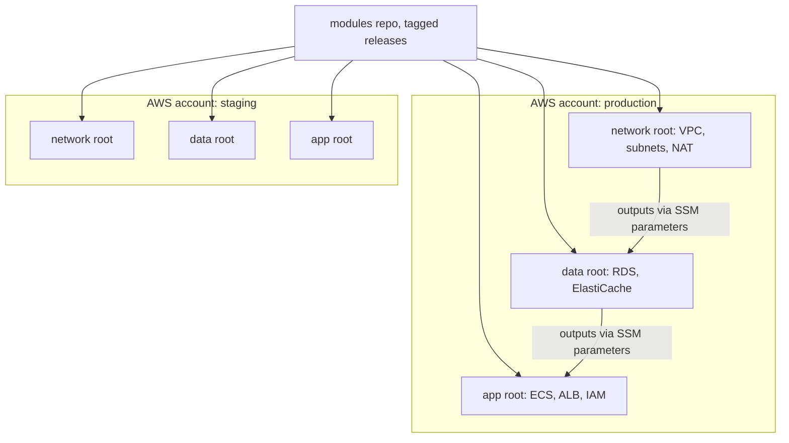

## 52.7 Terraform in depth: addresses, `for_each`, lifecycle and safe refactoring

#### Concept

Every resource in Terraform has an **address**, such as `aws_db_instance.orders` or `module.orders_db.aws_db_instance.this` or `aws_subnet.private["app-a"]`. State maps each address to a real resource id. Almost every "Terraform deleted my thing" incident is an address problem: the code changed in a way that made Terraform believe one address disappeared and another appeared. This section covers the language features that create addresses (`count`, `for_each`, modules), the blocks that change them safely (`moved`, `import`, `removed`), the `lifecycle` rules that constrain changes, and version pinning that keeps plans stable.

#### Why does it exist?

Infrastructure code is refactored like any code: resources get renamed, moved into modules, split out, adopted from clickops, or handed to another team. Before Terraform 1.1 each of those required `terraform state mv` or `state rm` commands run by hand against production state, unreviewed and easy to get wrong. The `moved` (8.1), `import` (8.5) and `removed` (8.7) blocks put those operations in code, so they appear in the pull request and in the plan like any other change.

#### Mental model

State is a phone book: each entry links a name (the address) to a phone number (the AWS resource id). Renaming a resource in code without telling Terraform is like reprinting the phone book with a new name and no number: Terraform calls nobody at the old name ("destroy") and gets a new number for the new name ("create"). A `moved` block is the forwarding notice: "the person you knew as `orders` is now `module.orders_db.this`, same number".

#### How it works — `count` versus `for_each`

```hcl
# Fragile: addresses are list positions aws_sqs_queue.jobs[0], [1], [2]
variable "queue_names" { default = ["order-emails", "invoice-pdf", "loyalty-points"] }

resource "aws_sqs_queue" "jobs" {
  count = length(var.queue_names)
  name  = var.queue_names[count.index]
}

# Robust: addresses are keys aws_sqs_queue.jobs["invoice-pdf"], independent of order
resource "aws_sqs_queue" "jobs_by_name" {
  for_each                   = toset(["order-emails", "invoice-pdf", "loyalty-points"])
  name                       = each.key
  message_retention_seconds  = 345600
  visibility_timeout_seconds = 60
}
```

With `count`, removing `"order-emails"` from the front of the list shifts every index: `[0]` becomes `invoice-pdf` and `[1]` becomes `loyalty-points`. SQS queue names cannot be changed in place, so the plan replaces two queues that were never meant to change and destroys the third. With `for_each`, removing a key plans exactly one destroy. Use `count` only for "zero or one" (`count = var.enable_bastion ? 1 : 0`); use `for_each` for collections.

#### How it works — `moved`, `import` and `removed` blocks

```hcl
# 1. Rename or move into a module without destroying anything (Terraform 1.1+)
moved {
  from = aws_db_instance.orders
  to   = module.orders_db.aws_db_instance.this
}

moved {
  from = aws_sqs_queue.jobs[1]
  to   = aws_sqs_queue.jobs_by_name["invoice-pdf"]
}

# 2. Adopt a resource created by hand (Terraform 1.5+); generate a starting config with
#    terraform plan -generate-config-out=generated.tf
import {
  to = aws_elasticache_replication_group.sessions
  id = "orders-sessions"
}

# 3. Stop managing a resource WITHOUT deleting it, for example when handing it to another team (1.7+)
removed {
  from = aws_s3_bucket.legacy_exports
  lifecycle {
    destroy = false
  }
}
```

The plan shows these explicitly: `# aws_db_instance.orders has moved to module.orders_db.aws_db_instance.this`, `# aws_elasticache_replication_group.sessions will be imported`, `# aws_s3_bucket.legacy_exports will no longer be managed by Terraform`. A refactor pull request whose plan says `0 to add, 0 to change, 0 to destroy` plus moves is the goal. Keep `moved` blocks in shared modules for at least one major version so every caller's state migrates.

#### How it works — lifecycle rules and checks

```hcl
variable "environment" {
  type = string
  validation {
    condition     = contains(["dev", "staging", "production"], var.environment)
    error_message = "environment must be dev, staging or production."
  }
}

resource "aws_ecs_service" "api" {
  name            = "orders-api"
  cluster         = aws_ecs_cluster.main.id
  task_definition = aws_ecs_task_definition.api.arn
  desired_count   = 3

  lifecycle {
    ignore_changes = [desired_count]     # Application Auto Scaling owns this after creation
  }
}

resource "aws_db_parameter_group" "orders" {
  name_prefix = "orders-pg17-"           # a prefix lets create_before_destroy work for named resources
  family      = "postgres17"
  parameter {
    name  = "rds.logical_replication"
    value = "1"
    apply_method = "pending-reboot"
  }
  lifecycle {
    create_before_destroy = true         # new group exists before the old one is removed
  }
}

resource "aws_db_instance" "orders" {
  # ... arguments as in 64.14 ...
  lifecycle {
    prevent_destroy = true
    precondition {
      condition     = var.environment != "production" || var.multi_az
      error_message = "Production databases must be Multi-AZ."
    }
  }
}
```

`ignore_changes` stops Terraform fighting another controller; `create_before_destroy` avoids gaps when something must be replaced; `replace_triggered_by` forces replacement when a dependency changes; `precondition` and `postcondition` fail the plan or apply with a clear message when an assumption is broken.

#### How it works — pin everything

```hcl
terraform {
  required_version = "~> 1.10"
  required_providers {
    aws = {
      source  = "hashicorp/aws"
      version = "~> 6.0"                 # allow minor and patch updates, never a new major
    }
  }
}
```

`terraform init` writes the exact provider versions and checksums to `.terraform.lock.hcl`. Commit it, and upgrade providers in their own pull request (`terraform init -upgrade`) so a provider change never hides inside a feature change.

#### Production scenario

A team migrating 140 hand-built resources into a module-based layout did it in nine pull requests over two weeks: three of `import` blocks (with `-generate-config-out` as a starting point, then cleaned up by hand), five of `moved` blocks into modules, and one of `removed` blocks for resources handed to the data team. Every plan showed zero creates and zero destroys. The only production change during the migration was tags.

#### Failure scenario

At 11:05 on a weekday, a pull request removed the retired `"order-emails"` queue from a `count`-based list of three SQS queues. The plan said `2 to add, 0 to change, 3 to destroy`; the reviewer, expecting "one queue removed", saw "destroy" and the queue name and approved. On apply, Terraform deleted all three queues and recreated two of them with the same names after AWS's 60-second wait for reusing a deleted queue's name. About 14,000 unprocessed invoice and loyalty jobs were in those queues and were lost; producers got `QueueDoesNotExist` errors for a minute. The jobs were rebuilt from the orders table over the afternoon. The fix was `for_each` with `moved` blocks from each index to its key, and a pipeline rule that any plan destroying an SQS queue, RDS instance or ElastiCache group needs a second approver. The lesson: read the plan's counts against what you expected; "3 to destroy" for a one-line removal is the plan telling you something is wrong.

#### Edge cases & failure modes

- **`moved` cannot cross state files.** Moving a resource to another root configuration needs `removed` (with `destroy = false`) in one and `import` in the other, applied in that order.
- **Generated config is a draft.** `-generate-config-out` writes every attribute, including computed ones; trim it, or the next plan shows noise.
- **`ignore_changes = all`.** Silences all drift forever; almost never what you want.
- **`for_each` keys from unknown values.** Keys must be known at plan time; keying by a resource id created in the same apply fails.
- **Provider major upgrades.** Version 6 of the AWS provider changed defaults and removed deprecated arguments; read the upgrade guide and expect a noisy plan.

#### How a Senior Backend Engineer thinks about this

A senior thinks in addresses. Before approving a refactor, they ask "which addresses change?" and expect a `moved` block for each. They use `for_each` for anything that is a collection, `count` only for optional singletons, and they treat the plan summary line as a test assertion: if a rename shows any destroy, the pull request is wrong. They adopt clickops resources with `import` blocks in reviewed pull requests rather than with CLI commands against production state, and they pin Terraform and provider versions so the only changes in a plan are the ones someone wrote.

#### Common mistakes

- `count` over a list of named things.
- Renaming a resource or moving it into a module without a `moved` block.
- `terraform state rm` to "fix" a plan, leaving an orphaned real resource nobody manages.
- Uncommitted `.terraform.lock.hcl`, so CI and laptops use different provider versions.
- Using `ignore_changes` to hide drift instead of finding who changes the resource.

#### Interview questions

1. **Why is `for_each` safer than `count` for collections?** Addresses are keys, not positions, so removing one element affects only that element; with `count`, removing an early element shifts indexes and replaces later resources.
2. **How do you move a resource into a module without recreating it?** Add a `moved` block from the old address to the new one; the plan shows a move and no destroy.
3. **How do you bring a hand-made resource under Terraform?** An `import` block with the resource id, a matching resource block (optionally generated with `-generate-config-out`), and a plan that shows only the import.
4. **How do you stop managing a resource without deleting it?** A `removed` block with `lifecycle { destroy = false }` (or `terraform state rm` in older versions).
5. **What does `ignore_changes` solve, and how is it abused?** It stops Terraform reverting fields another controller owns (autoscaled counts, task definitions deployed by CI); it is abused to hide drift.

#### Practical exercise

Create three SQS queues with `count` in a sandbox account, then migrate them to `for_each` using `moved` blocks so the plan shows zero changes. Then import a queue created in the console with an `import` block, and stop managing another with a `removed` block. Acceptance criteria: every plan in the sequence shows no destroys; `terraform state list` matches the final code; the unmanaged queue still exists in AWS.

## 52.8 Layout, blast radius, environments and testing

#### Concept

How you split Terraform into **root configurations** (directories you run `plan` and `apply` in, each with its own state) decides the **blast radius** of a mistake: how much infrastructure one bad apply can touch. This section covers splitting by environment, account and layer, why workspaces are a poor boundary between staging and production, how to version modules, and how to test Terraform before it reaches any account.

#### How it works — the layout



```text
infra/
  modules/                     (or a separate repo with tagged releases)
    network/  postgres/  redis/  ecs-service/
  envs/
    staging/
      network/  data/  app/    each: backend.tf, providers.tf, main.tf, terraform.tfvars
    production/
      network/  data/  app/
```

Why split by layer: the app layer changes daily (task definitions, scaling), the data layer monthly, the network layer rarely. A routine app change then runs a 20-second plan over 60 resources and holds a lock nobody else needs, and it *cannot* touch the database because the database is not in that state at all. Why one AWS account per environment: credentials for staging cannot change production, and the provider can refuse to run in the wrong account:

```hcl
# envs/production/data/providers.tf
provider "aws" {
  region              = "ap-south-1"
  allowed_account_ids = ["444455556666"]          # fail fast if credentials point anywhere else
  assume_role {
    role_arn = "arn:aws:iam::444455556666:role/terraform-apply-data"
  }
  default_tags {
    tags = { environment = "production", service = "orders", managed_by = "terraform" }
  }
}
```

#### How it works — workspaces, directories or a wrapper

| Approach | How environments differ | Risk | Use for |
|---|---|---|---|
| Directory per environment | Separate backend, providers, tfvars | Some duplication of small root files | Staging and production (recommended) |
| Workspaces (`terraform workspace select`) | Same code and backend, one state per workspace | Wrong workspace selected = change in the wrong environment; same credentials for all | Short-lived copies, such as per-PR preview environments |
| Terragrunt or a similar wrapper | Generated backends and inputs from a hierarchy | Another tool to learn | Many accounts and regions |

The incident in 52.6 and 52.15 began with a laptop pointed at the wrong workspace. With directories and per-account roles, the equivalent mistake requires running in the production directory with production credentials, which only CI has.

#### How it works — module versions

Publish modules with semantic version tags and reference them by version: `source = "git::https://github.com/acme/terraform-modules.git//postgres?ref=v2.3.0"` for Git, or `source = "app.terraform.io/acme/postgres/aws"` with `version = "~> 2.3"` for a registry. A breaking change to inputs or a change that replaces resources is a major version; ship `moved` blocks with it. Roll out a new module version to staging, let it soak, then production.

#### How it works — testing before apply

```hcl
# modules/postgres/tests/postgres.tftest.hcl (terraform test, 1.7+ for mock providers)
mock_provider "aws" {}

variables {
  name              = "orders"
  environment       = "production"
  instance_class    = "db.r6g.large"
  subnet_ids        = ["subnet-0a1b2c3d", "subnet-4e5f6a7b"]
  security_group_id = "sg-0123456789abcdef0"
}

run "production_database_is_protected" {
  command = plan

  assert {
    condition     = aws_db_instance.this.deletion_protection == true
    error_message = "Production databases must have deletion_protection enabled."
  }
  assert {
    condition     = aws_db_instance.this.manage_master_user_password == true
    error_message = "The master password must be managed by RDS, never passed in."
  }
  assert {
    condition     = aws_db_instance.this.backup_retention_period >= 7
    error_message = "Backups must be kept for at least 7 days."
  }
}
```

The pipeline order, cheapest first: `terraform fmt -check`, `terraform validate`, a linter (TFLint, with the AWS ruleset catching invalid instance types), a security scanner (Trivy's config scanning or Checkov), `terraform test` for modules, then `plan` and policy checks (52.10, 52.11). Integration tests that create real resources in a sandbox account and destroy them are worth it for shared modules, and only there.

#### Production scenario

A 25-service company runs 3 accounts (dev, staging, production) times about 20 root configurations each. Median plan time is 25 seconds; the slowest root (the shared network) takes 90 seconds. The modules repository has 14 modules with about 120 `terraform test` runs, all with mock providers, finishing in under a minute in CI. Module releases go to dev and staging the day they ship and to production a week later.

#### Failure scenario

A single root configuration held an entire environment: network, three databases, Redis, 22 ECS services and their IAM, 1,900 resources. Plans took 6 minutes, so engineers used `-target` to plan only their resources, which skipped dependencies and made the full state drift from the code. One day a full plan, run for an unrelated change, proposed 40 updates nobody understood, including a change to the main route table. The team spent two days splitting the state into layer roots with `removed` and `import` blocks. The lesson: a state too big to plan in full will be planned in part, and partial plans hide drift until it is dangerous.

#### Edge cases & failure modes

- **`-target` as a habit.** It exists for emergencies; regular use means the root is too big.
- **Circular dependencies between roots.** Network needs an app security group, app needs network subnets; move shared pieces down a layer.
- **Shared resources owned by nobody.** A Route 53 zone used by every service belongs in its own root with a clear owner.
- **Mock providers return made-up values.** Tests of computed attributes against mocks prove nothing; test inputs to outputs and invariants.

#### How a Senior Backend Engineer thinks about this

A senior designs the layout around one question: what is the most a single mistake can break? They separate environments by account, layers by state, and make the database unreachable from the root that changes every day. They avoid workspaces for long-lived environments, version modules like libraries, and test the invariants that matter (protection, encryption, backups) in the module itself so no caller can forget them.

#### Interview questions

1. **How would you lay out Terraform for 3 environments and 20 services?** Accounts per environment, root configurations per layer and service with their own state, shared versioned modules, outputs shared through SSM parameters or remote state outputs, CI-only applies per root.
2. **Why are workspaces risky for staging versus production?** The same code, backend and usually credentials serve both, so the only thing standing between a staging change and production is which workspace is selected.
3. **What does `allowed_account_ids` protect against?** Running a configuration with credentials for the wrong AWS account; the provider refuses before making any call.
4. **What would you test in a Terraform module, and how?** Invariants (protection, encryption, backups, tags) with `terraform test` and mock providers; formatting, validation, lint and security scans before plan.

#### Practical exercise

Split a single-root configuration of a VPC, an RDS instance and an ECS service into three roots (network, data, app) without recreating anything, using `removed` blocks in the old root and `import` blocks in the new ones; publish the subnet ids from the network root to SSM Parameter Store and read them in the data root with `aws_ssm_parameter`. Add `allowed_account_ids` to every provider and a `terraform test` file for the postgres module. Acceptance criteria: all plans after the split show no changes; a plan run with the wrong account's credentials fails immediately; `terraform test` passes and fails when `deletion_protection` is turned off.
