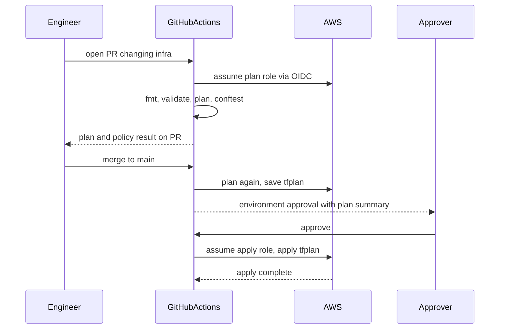

## 52.9 The same database in Pulumi and CDK

#### Concept

Section 52.4.2 compared the tools in a table. Here is the orders database from 52.4.1 written in Pulumi TypeScript and AWS CDK TypeScript, so you can see what actually differs: how environments are expressed, where state lives, how deletion protection works, and how you test it.

#### Practical example — Pulumi

```ts
// infra/pulumi/orders-data/index.ts  (one Pulumi stack per environment: staging, production)
import * as aws from '@pulumi/aws';
import * as pulumi from '@pulumi/pulumi';

const cfg = new pulumi.Config();
const env = pulumi.getStack();                       // "staging" or "production"
const isProd = env === 'production';

const subnetGroup = new aws.rds.SubnetGroup('orders', {
  subnetIds: cfg.requireObject<string[]>('privateDataSubnetIds'),
});

const ordersDb = new aws.rds.Instance('orders', {
  identifier: `orders-${env}`,
  engine: 'postgres',
  engineVersion: '17',
  instanceClass: isProd ? 'db.r6g.large' : 'db.t4g.medium',
  allocatedStorage: 100,
  username: 'orders_admin',
  manageMasterUserPassword: true,                    // password lives in Secrets Manager, not in state
  dbSubnetGroupName: subnetGroup.name,
  vpcSecurityGroupIds: [cfg.require('dbSecurityGroupId')],
  multiAz: isProd,
  backupRetentionPeriod: 30,
  storageEncrypted: true,
  deletionProtection: true,
}, { protect: true });                               // Pulumi refuses to delete it, even if the code is removed

export const endpoint = ordersDb.endpoint;
```

#### Practical example — AWS CDK

```ts
// infra/cdk/lib/orders-data-stack.ts
import { Duration, RemovalPolicy, Stack, StackProps } from 'aws-cdk-lib';
import * as ec2 from 'aws-cdk-lib/aws-ec2';
import * as rds from 'aws-cdk-lib/aws-rds';
import { Construct } from 'constructs';

export interface OrdersDataStackProps extends StackProps {
  vpc: ec2.IVpc;
  production: boolean;
}

export class OrdersDataStack extends Stack {
  constructor(scope: Construct, id: string, props: OrdersDataStackProps) {
    super(scope, id, props);

    new rds.DatabaseInstance(this, 'OrdersDb', {
      engine: rds.DatabaseInstanceEngine.postgres({ version: rds.PostgresEngineVersion.VER_17 }),
      vpc: props.vpc,
      vpcSubnets: { subnetType: ec2.SubnetType.PRIVATE_ISOLATED },
      instanceType: props.production
        ? ec2.InstanceType.of(ec2.InstanceClass.R6G, ec2.InstanceSize.LARGE)
        : ec2.InstanceType.of(ec2.InstanceClass.T4G, ec2.InstanceSize.MEDIUM),
      allocatedStorage: 100,
      credentials: rds.Credentials.fromGeneratedSecret('orders_admin'),  // generated into Secrets Manager
      multiAz: props.production,
      backupRetention: Duration.days(30),
      storageEncrypted: true,
      deletionProtection: true,
      removalPolicy: RemovalPolicy.SNAPSHOT,          // CloudFormation snapshots it if the stack ever deletes it
    });
  }
}
```

And a CDK unit test with the real assertions library, run by Jest:

```ts
// infra/cdk/test/orders-data-stack.test.ts
import { App, Stack } from 'aws-cdk-lib';
import { Template } from 'aws-cdk-lib/assertions';
import * as ec2 from 'aws-cdk-lib/aws-ec2';
import { OrdersDataStack } from '../lib/orders-data-stack';

test('production database is protected and Multi-AZ', () => {
  const app = new App();
  const vpc = new ec2.Vpc(new Stack(app, 'Net'), 'Vpc');
  const stack = new OrdersDataStack(app, 'OrdersData', { vpc, production: true });

  Template.fromStack(stack).hasResourceProperties('AWS::RDS::DBInstance', {
    DeletionProtection: true,
    MultiAZ: true,
    StorageEncrypted: true,
  });
});
```

#### How they differ where it matters

| Concern | Terraform | Pulumi | AWS CDK |
|---|---|---|---|
| Environments | Directory and tfvars per environment | A stack per environment with its own config | A stack instance per environment, props in code |
| State | S3 (or HCP Terraform), you run it | Pulumi Cloud or a self-managed backend such as S3 | CloudFormation holds it; nothing to run |
| Delete protection in the tool | `prevent_destroy`, lost if the block is removed | `protect: true`, stored in state, survives removal of the code | `RemovalPolicy.RETAIN` or `SNAPSHOT` (CloudFormation `DeletionPolicy`) |
| Delete protection in AWS | `deletion_protection = true` | `deletionProtection: true` | `deletionProtection: true` |
| Preview | `terraform plan` | `pulumi preview` | `cdk diff` (CloudFormation change set underneath) |
| Unit tests | `terraform test` | Mocks via `pulumi.runtime.setMocks` with Jest or Mocha | `aws-cdk-lib/assertions` with Jest |
| Typical surprise | Address changes cause destroys | Logical name changes cause replaces (use `aliases`) | Construct id changes cause replaces; stuck rollbacks |

The row worth remembering: every tool can protect a database from itself, and every one can lose that protection through a rename or a removed line. Only the AWS-side `deletion_protection` is enforced by the API whoever calls it.

#### How a Senior Backend Engineer thinks about this

A senior judges the three by their failure modes and by the people who will read them at 03:00, not by syntax. TypeScript infrastructure is attractive to a TypeScript team, and CDK's high-level constructs remove a lot of boilerplate, but the review artefact (a readable plan or diff) and the engine's failure behaviour matter more. Whatever the tool, the same invariants are tested in code: protection on, encryption on, backups on.

#### Interview questions

1. **How does Pulumi's `protect` differ from Terraform's `prevent_destroy`?** `protect` is recorded in state, so deleting the resource from code still fails until it is explicitly unprotected; `prevent_destroy` is configuration and disappears with the block.
2. **What does CDK's `RemovalPolicy.SNAPSHOT` do?** Sets the CloudFormation deletion policy so the database is snapshotted before CloudFormation deletes it.
3. **How do you unit-test CDK infrastructure?** Synthesize the stack and assert on the template with `Template.fromStack(...).hasResourceProperties(...)`.

#### Practical exercise

Write the orders database in all three tools in a sandbox account. In each, try to delete it by removing it from the code and record what stops the deletion (or does not). Acceptance criteria: a table of the three results, and in every tool the AWS-side deletion protection blocks the delete even when the tool-level protection is gone.

## 52.10 The Terraform pipeline in practice

#### Concept

Section 52.5.1 described the flow. This is a working GitHub Actions implementation for one root configuration: AWS credentials through OIDC (no stored keys), plan on every pull request, policy checks, a production environment approval that reviews the exact plan, and an apply of the saved plan file, serialized so two applies never overlap. It complements the application pipeline in Part 47 — CI/CD (47.11).

#### How it works



#### Practical example

```yaml
# .github/workflows/tf-production-data.yml
name: terraform production data
on:
  pull_request:
    paths: ["infra/envs/production/data/**", "infra/modules/**", "policy/**"]
  push:
    branches: [main]
    paths: ["infra/envs/production/data/**", "infra/modules/**"]

permissions:
  id-token: write          # OIDC token for AWS, no long-lived keys
  contents: read
  pull-requests: write

concurrency:
  group: tf-production-data
  cancel-in-progress: false  # never kill a running apply

env:
  TF_DIR: infra/envs/production/data
  TF_IN_AUTOMATION: "true"

jobs:
  plan:
    runs-on: ubuntu-latest
    steps:
      - uses: actions/checkout@v4
      - uses: hashicorp/setup-terraform@v3
        with: { terraform_version: "1.10.5", terraform_wrapper: false }
      - uses: aws-actions/configure-aws-credentials@v4
        with:
          role-to-assume: arn:aws:iam::444455556666:role/gha-terraform-plan
          aws-region: ap-south-1
      - run: terraform -chdir=$TF_DIR init -input=false
      - run: terraform -chdir=$TF_DIR fmt -check -recursive && terraform -chdir=$TF_DIR validate
      - run: terraform -chdir=$TF_DIR plan -input=false -lock-timeout=5m -out=tfplan
      - run: terraform -chdir=$TF_DIR show -json tfplan > plan.json
      - name: Install conftest
        run: |
          curl -sSL https://github.com/open-policy-agent/conftest/releases/download/v0.56.0/conftest_0.56.0_Linux_x86_64.tar.gz \
            | tar xz conftest && sudo mv conftest /usr/local/bin/
      - name: Policy
        run: conftest test plan.json --policy policy --data policy/waivers.json --namespace terraform.guardrails
      - name: Summarize destroys
        run: |
          jq -r '.resource_changes[] | select(.change.actions | index("delete")) | "DESTROY: \(.address)"' plan.json \
            | tee -a "$GITHUB_STEP_SUMMARY"
          terraform -chdir=$TF_DIR show -no-color tfplan >> "$GITHUB_STEP_SUMMARY"
      - uses: actions/upload-artifact@v4
        if: github.event_name == 'push'
        with: { name: tfplan, path: "${{ env.TF_DIR }}/tfplan", retention-days: 3 }

  apply:
    if: github.event_name == 'push'
    needs: plan
    runs-on: ubuntu-latest
    environment: production          # required reviewers configured on this environment
    steps:
      - uses: actions/checkout@v4
      - uses: hashicorp/setup-terraform@v3
        with: { terraform_version: "1.10.5", terraform_wrapper: false }
      - uses: aws-actions/configure-aws-credentials@v4
        with:
          role-to-assume: arn:aws:iam::444455556666:role/gha-terraform-apply-data
          aws-region: ap-south-1
      - uses: actions/download-artifact@v4
        with: { name: tfplan, path: "${{ env.TF_DIR }}" }
      - run: terraform -chdir=$TF_DIR init -input=false
      - run: terraform -chdir=$TF_DIR apply -input=false tfplan   # exactly the plan the approver saw
```

The details that carry the safety:

- **Two roles.** The plan role is read-only for AWS (plus read on the state bucket and write on the lock file, because `use_lockfile` writes a `.tflock` object even during plan). The apply role can write, and its trust policy allows only this repository's `production` environment, so a workflow on a feature branch cannot assume it.
- **The approver reviews the merge-time plan.** The PR plan is for discussion; the plan saved in the push run is what the environment approval shows and what `apply tfplan` executes. If state changed in between, Terraform rejects the saved plan as stale.
- **Concurrency per root.** Two merges queue rather than race.
- **The policy step is owned centrally.** `policy/` has its own code owners; service teams cannot weaken it in the same pull request that needs the exception.

The trust policy for the apply role, written in Terraform:

```hcl
data "aws_iam_policy_document" "gha_apply_trust" {
  statement {
    actions = ["sts:AssumeRoleWithWebIdentity"]
    principals {
      type        = "Federated"
      identifiers = ["arn:aws:iam::444455556666:oidc-provider/token.actions.githubusercontent.com"]
    }
    condition {
      test     = "StringEquals"
      variable = "token.actions.githubusercontent.com:aud"
      values   = ["sts.amazonaws.com"]
    }
    condition {
      test     = "StringEquals"
      variable = "token.actions.githubusercontent.com:sub"
      values   = ["repo:acme/infra:environment:production"]   # only the approved environment job
    }
  }
}
```

A scheduled workflow runs `terraform plan -detailed-exitcode` nightly for every root and opens an issue when the exit code is 2 (changes present), which is drift detection for free (see Part 46 — Cloud Architecture, 46.16). Atlantis, HCP Terraform, Spacelift and env0 package this same flow as a product; the principles do not change.

#### Failure scenario

A team's apply role was `AdministratorAccess` and its trust policy allowed `repo:acme/infra:*`. A contractor's pull request added a workflow file on a feature branch that ran `terraform apply` directly; because the trust condition matched any ref, the job assumed the production apply role and applied a half-finished change that recreated an ElastiCache parameter group and restarted the Redis nodes during business hours. The fix: trust only `environment:production`, require environment reviewers, protect workflow files with code owners, and scope the apply role to the services in that root. The lesson: the pipeline's credentials are production access, so the conditions on who can use them are as important as the code it runs.

#### Edge cases & failure modes

- **Plan artifacts hold sensitive values.** Keep retention short and the artifact private.
- **Forks.** Pull requests from forks must not get OIDC tokens for any AWS role; GitHub withholds secrets and OIDC from fork PRs by default for `pull_request`, so do not switch to `pull_request_target` for Terraform.
- **Wrapper output.** The setup action's wrapper changes stdout; disable it when piping `show -json`.
- **Lock timeouts.** `-lock-timeout=5m` lets a queued plan wait for a running apply instead of failing.

#### Interview questions

1. **Why apply a saved plan file instead of running `apply` fresh?** So what is executed is exactly what was reviewed; Terraform rejects a saved plan if state changed since it was made.
2. **How does CI get AWS credentials without stored keys?** GitHub's OIDC token is exchanged for a role via `sts:AssumeRoleWithWebIdentity`, with trust conditions on audience and subject (repository, branch or environment).
3. **How do you detect drift continuously?** A scheduled `plan -detailed-exitcode` per root; exit code 2 means differences, which open an issue or alert.

#### Practical exercise

Build the workflow above for a sandbox root with a plan role and an apply role. Acceptance criteria: a feature-branch workflow cannot assume the apply role; two merges in quick succession apply one after the other; changing a resource between plan and apply makes the apply fail as stale; the nightly drift job opens an issue after a manual console change.

## 52.11 Policy as code in practice: Conftest and Rego against the plan

#### Concept

Conftest runs **Open Policy Agent (OPA)** policies written in **Rego** against structured files. For Terraform, the input is the plan rendered as JSON (`terraform show -json tfplan`), whose `resource_changes` array lists every resource with its `address`, `type`, `change.actions` (`["create"]`, `["update"]`, `["delete"]`, `["delete", "create"]` for a replacement) and `change.before` / `change.after` attribute values. A policy is a set of rules that produce `deny` (fail) or `warn` (report) messages.

#### Practical example — the guardrails in Rego

Written in Rego v1 syntax (the default in OPA 1.0), these are the rules from 52.5.2 plus the one that would have stopped the incident in 52.15:

```rego
# policy/guardrails.rego
package terraform.guardrails

import rego.v1

data_store_types := {"aws_db_instance", "aws_rds_cluster", "aws_elasticache_replication_group", "aws_s3_bucket", "aws_dynamodb_table"}

allowed_db_classes := {"db.t4g.medium", "db.r6g.large", "db.r6g.xlarge", "db.r6g.2xlarge"}

# 1. No deleting or replacing a data store, unless a current, owned waiver exists.
deny contains msg if {
	some rc in input.resource_changes
	rc.type in data_store_types
	"delete" in rc.change.actions
	not waived(rc.address)
	msg := sprintf("%s: deleting or replacing a data store is blocked (actions %v)", [rc.address, rc.change.actions])
}

# 2. Databases must keep backups and deletion protection.
deny contains msg if {
	some rc in input.resource_changes
	rc.type == "aws_db_instance"
	after := rc.change.after
	after != null
	after.backup_retention_period < 7
	msg := sprintf("%s: backup_retention_period must be at least 7", [rc.address])
}

deny contains msg if {
	some rc in input.resource_changes
	rc.type == "aws_db_instance"
	rc.change.after != null
	not rc.change.after.deletion_protection
	msg := sprintf("%s: deletion_protection must be true", [rc.address])
}

# 3. Every bucket's public access block must have all four flags on.
deny contains msg if {
	some rc in input.resource_changes
	rc.type == "aws_s3_bucket_public_access_block"
	rc.change.after != null
	some flag in ["block_public_acls", "block_public_policy", "ignore_public_acls", "restrict_public_buckets"]
	not rc.change.after[flag]
	msg := sprintf("%s: %s must be true", [rc.address, flag])
}

# 4. Cost guardrail: database instance classes from an approved list.
deny contains msg if {
	some rc in input.resource_changes
	rc.type == "aws_db_instance"
	rc.change.after != null
	not rc.change.after.instance_class in allowed_db_classes
	msg := sprintf("%s: instance_class %s is not on the approved list", [rc.address, rc.change.after.instance_class])
}

# 5. Tags, as a warning: ownership and cost allocation.
warn contains msg if {
	some rc in input.resource_changes
	rc.change.after != null
	tags := object.get(rc.change.after, "tags_all", null)
	tags != null
	missing := {"service", "environment", "owner"} - {k | some k, _ in tags}
	count(missing) > 0
	msg := sprintf("%s: missing tags %v", [rc.address, missing])
}

waived(address) if {
	w := data.waivers[address]
	time.now_ns() < time.parse_rfc3339_ns(w.expires)
}
```

A waiver is data, reviewed by the policy owners, with an owner and an expiry:

```json
{
  "waivers": {
    "aws_db_instance.reports_legacy": { "owner": "data-platform", "expires": "2026-12-15T00:00:00Z", "reason": "Decommission ticket DP-412, final snapshot verified" }
  }
}
```

Policies get unit tests like any code, run with `conftest verify --policy policy`:

```rego
# policy/guardrails_test.rego
package terraform.guardrails

import rego.v1

test_replacing_database_is_denied if {
	msgs := deny with input as {"resource_changes": [{
		"address": "aws_db_instance.orders", "type": "aws_db_instance",
		"change": {"actions": ["delete", "create"], "after": {"backup_retention_period": 30, "deletion_protection": true, "instance_class": "db.r6g.large"}},
	}]}
	some msg in msgs
	contains(msg, "data store is blocked")
}

test_compliant_database_passes if {
	count(deny) == 0 with input as {"resource_changes": [{
		"address": "aws_db_instance.orders", "type": "aws_db_instance",
		"change": {"actions": ["update"], "after": {"backup_retention_period": 30, "deletion_protection": true, "instance_class": "db.r6g.large"}},
	}]}
}
```

#### How it works — Sentinel and other policy points

HCP Terraform and Terraform Enterprise run policies (Sentinel, or OPA) between plan and apply, with enforcement levels: **advisory** (report only), **soft-mandatory** (fails, but an authorized person can override with a record) and **hard-mandatory** (cannot be overridden). Conftest in your own CI gives you the same with `deny` versus `warn` plus a waiver file. Policy also belongs at other layers: cost estimates in the pull request (Infracost) with a threshold policy on the monthly delta; Kubernetes admission control (OPA Gatekeeper or Kyverno) for what GitOps applies (52.12); and AWS Organizations service control policies as the last layer, such as denying `rds:DeleteDBInstance` in production accounts to every role except a break-glass role.

#### Edge cases & failure modes

- **Replacements look like updates to naive rules.** Check for `"delete" in actions`, which matches both `["delete"]` and `["delete", "create"]`.
- **Resources inside modules.** `resource_changes` lists resources inside modules with full addresses like `module.orders_db.aws_db_instance.this`, so type-based rules still work.
- **Unknown values.** Attributes `(known after apply)` appear in `change.after_unknown`, not in `after`; decide whether a rule fails closed on unknown.
- **Policy drift.** Policies copied into each repository diverge; publish them from one repository with versions, like modules.

#### Interview questions

1. **What does a Terraform policy evaluate, the code or the plan?** The plan JSON, because it contains the resolved values after variables and modules, and the actions (create, update, delete) the code would cause.
2. **How do you write a policy that blocks replacing a database?** Deny when the resource type is a data store and `"delete"` is in `change.actions`, which covers both deletion and replacement.
3. **How do exceptions work without disabling the policy?** A reviewed waiver with an owner and an expiry, read as data by the policy, or a soft-mandatory override with an audit record.

#### Practical exercise

Add the policies and tests above to the pipeline from 52.10. Acceptance criteria: `conftest verify` passes; a plan replacing the database fails with the rule-1 message; a waiver with an expiry in the past does not help; a bucket with `block_public_policy = false` fails; an untagged resource produces a warning only.
