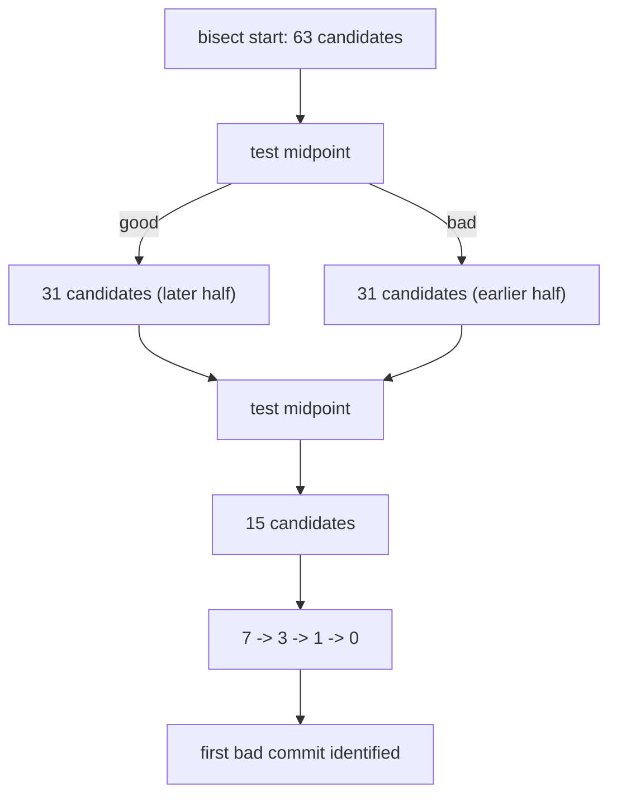

## 52.9 Stash, tag, bisect, reflog, detached HEAD

These five are grouped because they share a theme: they are the tools you reach for when something is *unexpected* — an urgent interruption, a release that needs naming, a bug with no obvious cause, work that seems to have vanished, or a state you did not intend to be in.

### 52.9.1 Stash

#### Concept

`git stash` takes your uncommitted changes (staged and unstaged), saves them as real commit objects, and restores your working tree to a clean state.

#### Why does it exist?

Because interruptions are real. You are halfway through a refactor when a production incident needs a one-line fix on `main`. Git refuses to switch branches when the switch would overwrite modified files, and committing half a refactor pollutes history.

#### How it works

Under the hood a stash is two or three commits: one for the index state, one for the working tree, and optionally one for untracked files, all pointed at by the `refs/stash` ref with its own reflog. That is why a stash is recoverable even after `git stash drop` — the objects survive until garbage collection.

```bash
$ git stash push -m "wip: extracting RefundCalculator"
Saved working directory and index state On feature/refunds: wip: extracting RefundCalculator

$ git stash list
stash@{0}: On feature/refunds: wip: extracting RefundCalculator
stash@{1}: On main: debugging pool exhaustion

$ git stash show -p stash@{0}          # view the diff
$ git stash pop                        # apply and remove from the list
$ git stash apply stash@{1}            # apply and keep it in the list
$ git stash push -u -m "with untracked"  # include untracked files
$ git stash push -m "just this file" -- src/orders/orders.service.ts
$ git stash branch fix/refunds stash@{0} # create a branch and apply the stash there
```

Two flags that matter. `-u` includes untracked files, which the default does not — the most common stash surprise is a brand-new file left behind and then destroyed by a later `git clean`. `-p` stages hunks interactively so you can stash only part of your work.

`git stash pop` can conflict. If it does, the stash is **not** dropped (Git is careful here), so you can resolve, `git add`, and then `git stash drop` manually.

Recovering a dropped stash:

```bash
$ git fsck --no-reflog | awk '/dangling commit/ {print $3}'
c4d3e2f1a0b9c8d7e6f5a4b3c2d1e0f9a8b7c6d5
$ git stash apply c4d3e2f1
```

#### Edge cases & failure modes

- **Untracked files not stashed by default**, then deleted by `git clean -fd`.
- **Stash stack forgotten.** Twelve stashes from six months ago, none with useful messages. Always use `-m`.
- **`pop` conflicts** leave you mid-resolution with the stash still present; people then pop again and duplicate the changes.
- **Stashes are local.** They do not push, and they are lost with the clone.
- **Stashing during a merge or rebase** produces a confusing state; abort the operation first.

The senior habit: prefer a `wip` commit on a throwaway branch over a stash for anything you might not return to within the hour. A commit has a message, a branch name, and shows up in `git log`; a stash is invisible until you remember it exists.

### 52.9.2 Tag

#### Concept

A tag is a named pointer to a commit. **Lightweight** tags are just a ref file containing a hash. **Annotated** tags are full objects with a tagger, date, message and optional signature.

#### Why does it exist?

To name releases immutably. `v2.4.7` should mean one exact commit forever, so that "which code is running in production?" and "what changed between v2.4.6 and v2.4.7?" have precise answers.

#### How it works

```bash
$ git tag -a v2.4.7 -m "Hotfix: reject over-refunds"      # annotated (use this)
$ git tag v2.4.7-rc1                                       # lightweight
$ git tag -s v2.4.7 -m "Release 2.4.7"                     # signed
$ git push origin v2.4.7                                   # tags are NOT pushed by default
$ git push origin --tags                                   # push all tags
$ git tag -l 'v2.4.*'
$ git show v2.4.7
$ git describe --tags                                      # v2.4.7-12-g9f3c1a2
```

`git describe` output reads as: 12 commits after `v2.4.7`, currently at `9f3c1a2`. Build tooling uses this to produce version strings, which is why a shallow clone (which may not fetch tags) breaks versioning in CI (52.15).

Always use annotated tags for releases: they carry who tagged, when, and why, they can be signed, and `git describe` prefers them.

#### Edge cases & failure modes

- **Moving a tag after release.** `git tag -f` plus a force-push makes `v2.4.7` mean two different commits for different people. Never move a release tag; cut `v2.4.8`.
- **Tags not pushed.** A local-only release tag that CI cannot see.
- **Tags not fetched.** `git fetch --tags` or `fetch.tags=true`; shallow clones and `--filter` clones often omit them.
- **Lightweight tags for releases**, losing the tagger and message.
- **Deleting a tag** locally does not delete it on the remote (`git push origin :refs/tags/v2.4.7` does).

### 52.9.3 Bisect

#### Concept

`git bisect` performs a binary search over history to find the commit that introduced a behaviour change. You mark one commit as good and one as bad; Git checks out the midpoint; you test and mark it; repeat. `n` commits take about `log2(n)` steps.

#### Why does it exist?

Because "when did this break?" is often the hardest question in an incident, and reading 400 commit diffs is not a strategy. Bisect turns it into eight or nine tests.

#### An incident story

At 08:50 on a Monday, a report lands: order totals on invoices are off by one cent for about 3% of orders. Nobody knows when it started. The last release everyone trusts is `v2.3.0`, tagged eleven weeks ago. Since then there are 412 commits on `main`.

The engineer writes a test script first, because a manual bisect over nine steps invites human error:

```bash
#!/usr/bin/env bash
# scripts/bisect-test.sh
# Exit 0 = good, 1 = bad, 125 = skip (cannot test this commit).
set -e

# The build must succeed for the test to mean anything. If it does not,
# skip rather than marking bad, or we will blame an unrelated broken commit.
npm ci --prefer-offline --no-audit >/dev/null 2>&1 || exit 125
npm run build >/dev/null 2>&1 || exit 125

# One focused test that reproduces the defect and nothing else.
npx jest --config jest.unit.config.js -t 'invoice total rounding' --silent
```

Then the crucial optimisation: the defect is in invoice totals, so only commits touching that area can be responsible. Bisect accepts a path filter, which restricts the candidate set:

```bash
$ chmod +x scripts/bisect-test.sh
$ git bisect start -- src/invoices src/orders/pricing
$ git bisect bad HEAD
$ git bisect good v2.3.0
Bisecting: 31 revisions left to test after this (roughly 5 steps)
```

412 commits became 63 candidates, because only those touched the relevant paths. Then:

```bash
$ git bisect run ./scripts/bisect-test.sh
running './scripts/bisect-test.sh'
Bisecting: 15 revisions left to test after this (roughly 4 steps)
running './scripts/bisect-test.sh'
Bisecting: 7 revisions left to test after this (roughly 3 steps)
running './scripts/bisect-test.sh'
Bisecting: 3 revisions left to test after this (roughly 2 steps)
running './scripts/bisect-test.sh'
Bisecting: 1 revision left to test after this (roughly 1 step)
running './scripts/bisect-test.sh'
Bisecting: 0 revisions left to test after this (roughly 0 steps)
running './scripts/bisect-test.sh'

a3c9f04e2b1d7c6f5a4b3c2d1e0f9a8b7c6d5e4f is the first bad commit
commit a3c9f04e2b1d7c6f5a4b3c2d1e0f9a8b7c6d5e4f
Author: Sam Okafor <sam@example.com>
Date:   Thu Jul 24 16:12:03 2025 +0100

    refactor(pricing): centralise tax calculation in PricingService

 src/orders/pricing/pricing.service.ts | 42 +++++++++++++-----------
 1 file changed, 23 insertions(+), 19 deletions(-)

bisect run success
```

Six automated steps, four minutes of wall clock, and a 42-line diff to read. The refactor had replaced a `Math.round(x * 100) / 100` on a decimal string with floating-point arithmetic on a `number`, which is correct for 97% of values and wrong for the rest.

```bash
$ git bisect reset          # return to where you started
```

#### How it works



Details that make bisect work in practice:

- **Exit code 125 means skip.** Use it for commits that will not build; marking them bad blames the wrong change.
- **Path filters** (`git bisect start -- <paths>`) can cut the candidate set dramatically.
- **`git bisect log`** records the session; `git bisect replay <file>` reruns it. Save it before doing anything risky.
- **Bisect requires that the property is monotonic.** If the bug was introduced, fixed, and reintroduced, bisect finds *a* transition, not necessarily the interesting one.
- **Merge commits complicate it.** The build may be broken on one side of a merge; use `--first-parent` (Git 2.29+) to bisect only mainline commits, which is much more reliable when the history is full of feature merges.

This is also the strongest practical argument for atomic commits, small PRs, and against squash-merging everything (52.13): bisect's resolution is exactly your commit granularity. Landing a 4,000-line squashed commit means the best bisect can tell you is "it is somewhere in these 4,000 lines".

### 52.9.4 Reflog

#### Concept

The reflog is a per-ref journal of every value that ref has held, local to your clone. It is how you find commits that no branch points at any more.

#### How it works

```bash
$ git reflog                            # HEAD's history
$ git reflog show main                  # one branch's history
$ git reflog show --date=iso stash

$ git reflog
9f3c1a2 HEAD@{0}: rebase (finish): returning to refs/heads/feature/refunds
9f3c1a2 HEAD@{1}: rebase (pick): feat(orders): add partial refund support
4a1c2b9 HEAD@{2}: rebase (start): checkout origin/main
7b2e5d1 HEAD@{3}: commit: feat(orders): add partial refund support
```

`HEAD@{3}` is the pre-rebase tip. `git branch pre-rebase 7b2e5d1` recreates it. You can also use time syntax: `git show 'main@{2 days ago}'`, `git diff 'HEAD@{yesterday}'`.

The three facts to internalise: it is **local only** (a fresh clone has none), it expires (90 days, 30 for unreachable entries), and `git gc --prune=now` clears it immediately. Which means: never re-clone and never gc while recovering.

### 52.9.5 Detached HEAD

#### Concept

`HEAD` normally contains a symbolic ref (`ref: refs/heads/main`). In detached HEAD it contains a commit hash directly. You are on a commit, not on a branch. Commits you make advance `HEAD` but no branch follows, so when you switch away, nothing points at them.

#### When you meet it

```bash
$ git switch --detach v2.4.7
$ git checkout 9f3c1a2
$ git rebase -i main            # detached for the duration
$ git bisect start             # detached at each tested commit
```

```bash
$ git status
HEAD detached at v2.4.7
nothing to commit, working tree clean
```

Legitimate uses: inspecting an old release, testing a specific commit, building a tagged version, and every rebase and bisect (which is why understanding it matters even if you never detach deliberately).

The danger, and the fix:

```bash
$ git switch main
Warning: you are leaving 2 commits behind, not connected to
any of your branches:

  c8f1a92 experiment: try batching the pricing calls
  a3c9f04 experiment: measure with 500 concurrent orders

If you want to keep them by creating a new branch, this may be a good time
to do so with:

 git branch <new-branch-name> c8f1a92
```

Git warns you. If you miss the warning, the reflog still has them for 30 days:

```bash
$ git reflog | head -5
$ git branch experiments c8f1a92
```

The habit: the moment you make a commit in detached HEAD, create a branch. It costs 41 bytes and removes the entire class of problem.

## 52.10 The senior's toolbox

These are the commands that separate someone who uses Git from someone who investigates with it.

**`git log --oneline --graph --decorate`.** The single most useful log invocation. `--graph` draws the branch topology, `--decorate` shows which refs point where, `--oneline` keeps it readable.

```bash
$ git log --oneline --graph --decorate --all -12
*   3a9f04c (HEAD -> main, origin/main) Merge pull request #412 from acme/feature/refunds
|\
| * c8f1a92 (origin/feature/refunds) feat(orders): return existing order on duplicate key
| * a3c9f04 test(orders): cover duplicate key path
| * 5e1d8b7 feat(orders): add idempotency key column
|/
* 9f3c1a2 (tag: v2.4.6) chore: bump dependencies
* 4a1c2b9 fix(payments): reject refunds above the original charge
```

Add `--first-parent` to collapse merged branches and see only the mainline — the fastest way to answer "what features landed this week?" Alias it:

```bash
$ git config --global alias.lg "log --oneline --graph --decorate --all"
$ git config --global alias.lgm "log --oneline --graph --decorate --first-parent"
```

**`git blame -w -C`.** Blame answers "who last touched this line, and in which commit?" The flags are what make it usable:

- `-w` ignores whitespace changes, so a reformatting commit does not claim every line.
- `-C` detects lines moved or copied *within the same commit* from other files. `-C -C` also looks at files the commit modified; `-C -C -C` searches all files in the parent commit.
- `-M` detects moves within the same file.
- `-L 40,80` limits to a line range.

```bash
$ git blame -w -C -L 42,48 src/orders/pricing/pricing.service.ts
a3c9f04e (Sam Okafor 2025-07-24 16:12:03 +0100 42)   const subtotal = items.reduce(
5e1d8b7c (Priya Nair 2025-06-02 09:41:55 +0100 43)     (sum, i) => sum + i.priceMinor * i.qty, 0);
a3c9f04e (Sam Okafor 2025-07-24 16:12:03 +0100 44)   const tax = subtotal * rate;
```

Without `-w -C`, a file that was moved and reformatted shows one commit for every line and tells you nothing. Blame is a starting point, not an accusation: the commit it names is where the line arrived, and the *message* is what you actually wanted.

**The pickaxe: `log -S` and `log -G`.** Blame finds who last touched a line that exists. The pickaxe finds when a string appeared or disappeared anywhere in history — including in code that has since been deleted.

```bash
# Commits where the NUMBER OF OCCURRENCES of the string changed.
# This is how you find where something was introduced or removed.
$ git log -S 'ThrottlerGuard' --oneline
c8f1a92 feat(api): add rate limiting to public endpoints
3a9f04c Merge pull request #412 from acme/feature/refunds

# Commits whose diff MATCHES a regex (more matches, noisier).
$ git log -G 'Math\.round\(.*\* 100\)' --oneline -p

# Restrict to a path, and follow renames.
$ git log -S 'idempotencyKey' --oneline -- src/orders/
$ git log --follow --oneline -- src/orders/pricing/pricing.service.ts
```

`-S` is the one to reach for first. "When did this configuration value disappear?", "Which commit removed this guard?", "When was this feature flag introduced?" are all one command. It is the tool that found the silently-reverted rate limiter in 52.4.

**`git worktree`.** Multiple working directories from one repository, sharing the object store.

```bash
$ git worktree add ../orders-hotfix release/2.4
Preparing worktree (checking out 'release/2.4')

$ git worktree list
/home/priya/orders           9f3c1a2 [feature/refunds]
/home/priya/orders-hotfix    e4a9c02 [release/2.4]

$ git worktree remove ../orders-hotfix
```

Why this beats stashing: you keep your in-progress refactor untouched in one directory, fix the incident in another, and each has its own `node_modules`, its own running dev server and its own IDE window. On a large monorepo where a fresh clone takes eleven minutes and `npm ci` takes three, a worktree takes seconds because the objects are already there. The one rule: two worktrees cannot have the same branch checked out.

**`git sparse-checkout`.** Check out only part of the tree. Essential in a monorepo where you work on one service out of forty.

```bash
$ git clone --filter=blob:none --sparse git@github.com:acme/platform.git
$ cd platform
$ git sparse-checkout set services/orders libs/shared
$ git sparse-checkout list
services/orders
libs/shared
```

`--filter=blob:none` makes a *partial clone*: commit and tree objects are fetched, blobs only on demand. On a repository with ten years of history this can cut a 4 GB clone to 400 MB and eleven minutes to ninety seconds. The tradeoff is that operations needing historical file content (`log -p`, `blame` on old ranges) fetch blobs on demand and are slower offline.

**Hooks, husky and lint-staged.** Hooks are scripts in `.git/hooks` that Git runs at defined points. They are not versioned and not installed by clone, which is what husky solves: it stores hooks in the repository and points `core.hooksPath` at them on `npm install`.

```json
{
  "scripts": { "prepare": "husky" },
  "lint-staged": {
    "*.ts": ["eslint --fix --max-warnings=0", "prettier --write"],
    "*.{json,md,yml}": ["prettier --write"]
  }
}
```

```bash
# .husky/pre-commit
npx lint-staged

# .husky/commit-msg
npx commitlint --edit "$1"
```

`lint-staged` runs tools only on staged files, so a pre-commit hook takes 2 seconds instead of 40. The discipline:

- Hooks are a **convenience**, not a control. They run on developer machines, can be skipped with `--no-verify`, and do not run in CI. Every rule that matters must also be enforced in the pipeline (Part 51).
- Keep `pre-commit` under about 3 seconds. A slow hook gets bypassed, and then it protects nothing.
- Put lint and format in `pre-commit`, message validation in `commit-msg`, and anything slow (typecheck, tests) in `pre-push` at most — or better, only in CI.

**`.gitattributes` and line endings.** Windows uses CRLF, Linux and macOS use LF. Without configuration, the same file gets different blob hashes on different machines, producing phantom whole-file diffs and unresolvable conflicts.

The robust setup is a committed `.gitattributes`, because it applies to everyone regardless of their local config:

```text
# Normalise: LF in the repository, native on checkout where it matters.
* text=auto eol=lf

# Files that must stay LF even on Windows.
*.sh text eol=lf
Dockerfile text eol=lf

# Files that must be CRLF.
*.bat text eol=crlf

# Binary: never convert, never diff as text.
*.png binary
*.pdf binary
*.woff2 binary

# Generated: collapse in diffs and mark for review tooling.
package-lock.json linguist-generated=true -diff
dist/** linguist-generated=true

# Custom merge driver for lockfiles (see 52.14).
package-lock.json merge=ours
```

`.gitattributes` also controls export filtering (`export-ignore`), diff drivers per language, and LFS tracking.

**Git LFS.** Large File Storage replaces large binaries with small text pointers in Git, storing the real bytes on a separate server fetched on checkout.

```bash
$ git lfs install
$ git lfs track "*.psd" "*.mp4" "fixtures/*.sqlite"
$ git add .gitattributes
```

Use it for assets you genuinely must version: design files, video fixtures, ML model weights, large test fixtures. Do not use it as a general dumping ground — LFS storage costs money, `git lfs pull` is a new failure mode in CI, and not every host supports it identically. And critically: LFS only helps for files added *after* you enable it. Existing history keeps its blobs (52.1).

**`.gitignore` patterns.** The rules people get wrong:

```text
node_modules/          # trailing slash: directories only
dist/
*.log
.env                   # but NOT .env.example
.env.*
!.env.example          # negation re-includes
coverage/
*.tsbuildinfo

/build                 # leading slash: only at repository root
build/                 # anywhere in the tree
docs/**/tmp/           # ** matches across directories
```

Three facts that cause most confusion:

1. **`.gitignore` only affects untracked files.** Adding `config/local.json` to `.gitignore` after committing it changes nothing. Use `git rm --cached config/local.json` to untrack it.
2. **A negation cannot re-include a file inside an excluded directory.** `logs/` followed by `!logs/keep.txt` does not work, because Git never descends into `logs/`. Write `logs/*` then `!logs/keep.txt`.
3. **`.gitignore` is not security.** A file being ignored does not stop `git add -f`. Secrets are prevented by scanning and push protection (Part 51, section 51.6), not by ignore rules.

`git check-ignore -v <path>` tells you exactly which rule in which file matched.

**Submodules versus subtrees versus a package.** A submodule is a pointer from your repository to a specific commit in another repository. It sounds like the right answer for shared code and usually is not.

| Approach | Clone experience | Update flow | Failure mode |
|---|---|---|---|
| Submodule | `--recurse-submodules` or an empty directory | Enter submodule, commit, return, commit the pointer | Detached HEAD inside; forgotten pointer commits; CI clones without `--recurse-submodules` and the build fails mysteriously; every engineer must learn a second workflow |
| Subtree | Normal clone, files just there | `git subtree pull --prefix=libs/shared <remote> main --squash` | History gets noisy; pushing changes upstream is awkward |
| **Published package** | Normal clone plus `npm ci` | Version bump in `package.json` | Requires a registry and a release process — which you already have |

For a Node.js backend, the package almost always wins. You already run a registry (npm, GitHub Packages, Verdaccio, CodeArtifact), you already have semantic versioning, and consumers get an explicit version pin rather than an implicit commit pointer that half the team forgets to commit. Submodules earn their place for vendored third-party source you must build from, or for genuinely separate deliverables with independent lifecycles — not for "our shared types library".

