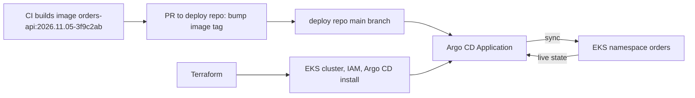

## 52.12 GitOps in practice: Argo CD, Kustomize, Helm and Flux

#### Concept

Section 52.6.1 introduced GitOps. In practice there is a clean split of ownership: **Terraform** creates the cloud resources and the cluster itself (VPC, EKS, node groups, IAM roles for service accounts, RDS, and Argo CD's own installation), and **Argo CD or Flux** owns everything inside the cluster that changes with application releases (Deployments, Services, HPAs, ConfigMaps, ExternalSecrets). A release is a commit to a deployment repository that changes an image tag; the controller notices and syncs. The Helm chart layout for the orders API is in Part 45 — Kubernetes (45.19); this section shows the Argo CD and Kustomize objects that deploy it.

#### How it works



1. CI builds and pushes an immutable image tag (date plus commit SHA, never `latest`).
2. CI opens a pull request on the deployment repository: `kustomize edit set image ghcr.io/acme/orders-api=ghcr.io/acme/orders-api:2026.11.05-3f9c2ab` in the staging overlay; after staging verification, the same change in the production overlay.
3. Argo CD polls the repository (or receives a webhook), renders the overlay, compares it with the live cluster, and applies the difference.
4. With `selfHeal`, a manual `kubectl edit` is reverted within minutes; with `prune`, objects deleted from Git are deleted from the cluster.

#### Practical example

```yaml
# deploy/apps/orders-api/overlays/production/kustomization.yaml
apiVersion: kustomize.config.k8s.io/v1beta1
kind: Kustomization
namespace: orders
resources:
  - ../../base                       # Deployment, Service, HPA, PDB, ExternalSecret
patches:
  - path: resources-production.yaml  # bigger requests and limits in production
images:
  - name: ghcr.io/acme/orders-api
    newTag: "2026.11.05-3f9c2ab"     # the only line a normal release changes
```

```yaml
# deploy/argocd/orders-api-production.yaml
apiVersion: argoproj.io/v1alpha1
kind: Application
metadata:
  name: orders-api-production
  namespace: argocd
spec:
  project: orders
  source:
    repoURL: https://github.com/acme/deploy.git
    targetRevision: main
    path: apps/orders-api/overlays/production
  destination:
    server: https://kubernetes.default.svc
    namespace: orders
  syncPolicy:
    automated:
      prune: true
      selfHeal: true
    syncOptions:
      - CreateNamespace=true
      - PruneLast=true                 # delete removed objects after everything else is healthy
      - RespectIgnoreDifferences=true  # do not overwrite fields listed below during sync
    retry:
      limit: 5
      backoff: { duration: 10s, factor: 2, maxDuration: 3m }
  ignoreDifferences:
    - group: apps
      kind: Deployment
      jsonPointers: [/spec/replicas]   # the HPA owns replicas, not Git
```

With Helm instead of Kustomize, the `source` points at the chart and lists value files (`helm: { valueFiles: [values-prod.yaml] }`); Argo CD renders the chart itself, so there is no Tiller-style release state to drift. Flux expresses the same idea with two objects, a `GitRepository` (`source.toolkit.fluxcd.io/v1`) and a `Kustomization` (`kustomize.toolkit.fluxcd.io/v1`) with `interval`, `path`, `prune: true` and a `sourceRef`. Choose one per organization; Argo CD has the richer UI, Flux is lighter and fully CRD-driven.

#### Failure scenario

A refactor of the deployment repository moved the orders API's ConfigMap from `base/` into a new `base/config/` folder but forgot to add the folder to `resources:` in `kustomization.yaml`. The rendered manifests no longer contained the ConfigMap, and with `prune: true` Argo CD deleted it from the cluster within three minutes of the merge. Running pods kept working (their environment was already loaded), so nothing alerted. Forty minutes later the HPA scaled out for the lunch peak, and every new pod failed with `CreateContainerConfigError` because the ConfigMap they referenced did not exist; the service ran on its old pods at 100% CPU until someone noticed. The fixes: a CI check that renders every overlay (`kustomize build`) and diffs the object list against the live cluster in the pull request, the `argocd.argoproj.io/sync-options: Prune=false` annotation on objects that must never be pruned automatically, and an alert on `CreateContainerConfigError`. The lesson: in GitOps the repository is the cluster, so a refactor of YAML is a production change and deserves a rendered diff in review.

#### Edge cases & failure modes

- **Deleting the Application.** With the `resources-finalizer.argocd.argoproj.io` finalizer, deleting an Application cascades and deletes every object it managed.
- **Mutable tags.** Deploying `latest` makes Git unable to say what is running; use immutable tags or digests.
- **Secrets in the deploy repo.** Never; use External Secrets Operator or Sealed Secrets (52.13).
- **Too many Applications to manage by hand.** An `ApplicationSet` with a Git directory or cluster generator creates one Application per service or environment from a template.
- **Sync waves.** Database migration Jobs must run before the new Deployment; use `argocd.argoproj.io/sync-wave` annotations or a PreSync hook.

#### How a Senior Backend Engineer thinks about this

A senior draws the Terraform–GitOps boundary explicitly (cloud and cluster in Terraform, workloads in Git reconciled by a controller) and keeps a single owner for every object, because two controllers on one object means an endless fight. They treat the deployment repository as production access, require rendered diffs in review, and configure self-heal to respect fields that autoscalers own.

#### Interview questions

1. **Where does Terraform stop and Argo CD start?** Terraform creates cloud resources and the cluster, including installing Argo CD; Argo CD reconciles the in-cluster workload manifests from Git.
2. **Why does `selfHeal` fight the HPA, and how do you fix it?** Git declares `replicas` and the HPA changes it; remove `replicas` from the manifest or list it in `ignoreDifferences` with `RespectIgnoreDifferences=true`.
3. **How is a release promoted from staging to production in GitOps?** A pull request changing the image tag in the production overlay after staging is verified; the merge is the deploy and the Git history is the audit log.

#### Practical exercise

Set up Argo CD in a kind cluster, deploy the orders API with a base and two overlays, and automate promotion with a script that runs `kustomize edit set image` and opens a pull request. Acceptance criteria: a `kubectl scale` is reverted by self-heal except where the HPA owns replicas; removing a ConfigMap from Git with `Prune=false` annotation leaves it in place; deleting a pod-only resource from Git prunes it.

## 52.13 Secrets in IaC in practice

#### Concept

Terraform stores in state every attribute a provider returns. If Terraform generates a database password, reads one from Secrets Manager with a data source, or passes one as an argument, that password is in the state file in plaintext. `sensitive = true` on a variable or output only hides it from CLI output; it does not encrypt or remove it from state. The practical patterns below keep secrets out of state, out of Git and out of plan files.

#### How it works — four patterns

| Pattern | How | Secret in state? | Use for |
|---|---|---|---|
| Let AWS generate and own it | `manage_master_user_password = true` on RDS; the password lives in Secrets Manager and rotates (every 7 days by default) | No, only the secret ARN | RDS master credentials |
| Write-only arguments (Terraform 1.11+) | Pass a value from an `ephemeral` resource to a `*_wo` argument with a version counter | No | Secrets Terraform must set, such as an app user's password in Secrets Manager |
| Reference at runtime | ECS task definition `secrets` with `valueFrom` an ARN; External Secrets Operator in Kubernetes | No, only the ARN | Every application secret |
| Data source or `random_password` resource | Read or generate during plan | **Yes** | Avoid for real secrets |

```hcl
# Pattern 2: create an application secret without it ever touching state (Terraform 1.11+)
ephemeral "random_password" "reporting_db" {
  length  = 32
  special = false
}

resource "aws_secretsmanager_secret" "reporting_db" {
  name       = "orders/production/reporting-db"
  kms_key_id = aws_kms_key.secrets.arn
}

resource "aws_secretsmanager_secret_version" "reporting_db" {
  secret_id                = aws_secretsmanager_secret.reporting_db.id
  secret_string_wo         = ephemeral.random_password.reporting_db.result
  secret_string_wo_version = 1          # bump to rotate: Terraform sends a new value
}
```

```yaml
# Pattern 3 on Kubernetes: External Secrets Operator copies from Secrets Manager into a Secret
apiVersion: external-secrets.io/v1
kind: ExternalSecret
metadata:
  name: orders-db
  namespace: orders
spec:
  refreshInterval: 1h
  secretStoreRef:
    name: aws-secrets-manager
    kind: ClusterSecretStore
  target:
    name: orders-db
    creationPolicy: Owner
  data:
    - secretKey: DATABASE_PASSWORD
      remoteRef:
        key: orders/production/app-db
        property: password
```

On ECS, the same reference goes in the task definition (52.14.5), and the NestJS app reads `DATABASE_PASSWORD` from its environment through `ConfigService`, never from a file in the image.

#### Edge cases & failure modes

- **Rotation versus pooled connections.** RDS rotates the managed master secret; existing connections keep working, new ones need the new value. Applications should use their own database user (created by a migration with a secret of its own), not the master user, and re-read the secret on authentication failure.
- **State still needs protection.** Even with these patterns, state holds endpoints, ARNs and some provider-generated values; encrypt it with KMS and restrict who can read it.
- **`terraform output` in CI logs.** A sensitive output printed with `-json` is shown in full; do not print outputs in pipelines.
- **ElastiCache auth tokens.** The `auth_token` argument lands in state; prefer ElastiCache users with IAM authentication, or a write-only workflow.
- **Plan files.** Saved plans contain state values; treat them as secrets (52.10).

#### Interview questions

1. **Does `sensitive = true` keep a secret out of Terraform state?** No. It only redacts CLI output; the value is stored in state in plaintext.
2. **How do you give an RDS database a master password without it appearing in state?** `manage_master_user_password = true`, so RDS generates and rotates it in Secrets Manager and state holds only the secret's ARN.
3. **How does a container get a database password at runtime on ECS?** The task definition's `secrets` list maps an environment variable to a Secrets Manager ARN (optionally a JSON key); the task execution role needs `secretsmanager:GetSecretValue` on that ARN.

## 52.14 Worked example: Terraform for a NestJS service on AWS

This section writes the infrastructure for the orders API from start to finish: VPC, PostgreSQL on RDS, Redis on ElastiCache, ECS Fargate behind an ALB, and the IAM that connects them, split into three root configurations as in 52.8. The architecture is the reference design of Part 46 — Cloud Architecture (46.13); here it becomes code.

### 52.14.1 Requirements and decisions

- **Traffic:** about 400 requests per second average, 1,500 at peak, p99 under 250 ms. NestJS tasks at 1 vCPU and 2 GB handle about 250–300 requests per second each at 60% CPU, so 4 tasks minimum, 12 at peak, ceiling 20.
- **Data:** PostgreSQL 17, about 300 GB growing 15 GB a month, Multi-AZ, 30 days of point-in-time recovery; Redis for cache, rate limits and idempotency keys, about 6 GB hot set, Multi-AZ with automatic failover.
- **Region:** `ap-south-1`, three Availability Zones.
- **Security:** nothing but the ALB in public subnets; database and Redis reachable only from the API's security group; TLS everywhere; no secrets in state or images.
- **Compute choice: ECS Fargate, not EKS.** One team, one service family, no Kubernetes platform team. EKS adds a control-plane fee (about $73 a month per cluster) and, more importantly, the cluster upgrades, add-ons and node management of Part 45. If the company already runs EKS with GitOps, the network and data roots below stay the same, and the app root is replaced by the EKS module plus the Argo CD objects of 52.12.

```text
infra/envs/production/
  network/   VPC, subnets, NAT, security groups        changes: rarely
  data/      RDS, ElastiCache, parameter groups        changes: monthly
  app/       ECS, ALB, IAM, autoscaling, logs          changes: weekly
```

### 52.14.2 The network root

```hcl
# infra/envs/production/network/main.tf
module "vpc" {
  source  = "terraform-aws-modules/vpc/aws"
  version = "~> 6.0"

  name = "orders-prod"
  cidr = "10.20.0.0/16"
  azs  = ["ap-south-1a", "ap-south-1b", "ap-south-1c"]

  public_subnets   = ["10.20.0.0/24", "10.20.1.0/24", "10.20.2.0/24"]      # ALB and NAT only
  private_subnets  = ["10.20.10.0/23", "10.20.12.0/23", "10.20.14.0/23"]   # ECS tasks
  database_subnets = ["10.20.20.0/24", "10.20.21.0/24", "10.20.22.0/24"]   # RDS and ElastiCache

  create_database_subnet_group = true
  enable_nat_gateway           = true
  one_nat_gateway_per_az       = true   # an AZ failure does not take egress down for the others
  enable_dns_hostnames         = true
}

resource "aws_security_group" "alb" {
  name   = "orders-alb"
  vpc_id = module.vpc.vpc_id
}

resource "aws_security_group" "api" {
  name   = "orders-api"
  vpc_id = module.vpc.vpc_id
}

resource "aws_security_group" "db" {
  name   = "orders-db"
  vpc_id = module.vpc.vpc_id
}

resource "aws_security_group" "redis" {
  name   = "orders-redis"
  vpc_id = module.vpc.vpc_id
}

resource "aws_vpc_security_group_ingress_rule" "alb_https" {
  security_group_id = aws_security_group.alb.id
  cidr_ipv4         = "0.0.0.0/0"
  from_port         = 443
  to_port           = 443
  ip_protocol       = "tcp"
}

resource "aws_vpc_security_group_ingress_rule" "api_from_alb" {
  security_group_id            = aws_security_group.api.id
  referenced_security_group_id = aws_security_group.alb.id      # only the ALB reaches the tasks
  from_port                    = 3000
  to_port                      = 3000
  ip_protocol                  = "tcp"
}

resource "aws_vpc_security_group_ingress_rule" "db_from_api" {
  security_group_id            = aws_security_group.db.id
  referenced_security_group_id = aws_security_group.api.id
  from_port                    = 5432
  to_port                      = 5432
  ip_protocol                  = "tcp"
}

resource "aws_vpc_security_group_ingress_rule" "redis_from_api" {
  security_group_id            = aws_security_group.redis.id
  referenced_security_group_id = aws_security_group.api.id
  from_port                    = 6379
  to_port                      = 6379
  ip_protocol                  = "tcp"
}

resource "aws_vpc_security_group_egress_rule" "all_out" {
  for_each          = { alb = aws_security_group.alb.id, api = aws_security_group.api.id }
  security_group_id = each.value
  cidr_ipv4         = "0.0.0.0/0"
  ip_protocol       = "-1"
}

# Publish what the other roots need (no terraform_remote_state, no access to this state).
resource "aws_ssm_parameter" "network" {
  for_each = {
    vpc_id               = module.vpc.vpc_id
    public_subnet_ids    = join(",", module.vpc.public_subnets)
    private_subnet_ids   = join(",", module.vpc.private_subnets)
    database_subnet_ids  = join(",", module.vpc.database_subnets)
    db_subnet_group      = module.vpc.database_subnet_group_name
    sg_alb               = aws_security_group.alb.id
    sg_api               = aws_security_group.api.id
    sg_db                = aws_security_group.db.id
    sg_redis             = aws_security_group.redis.id
  }
  name  = "/orders/production/network/${each.key}"
  type  = "String"
  value = each.value
}
```

Three NAT gateways cost about $100 a month plus data processing; a single shared NAT saves about $65 and makes one AZ a single point of failure for all outbound calls (payment providers, email). For production, pay it.

### 52.14.3 The data root

```hcl
# infra/envs/production/data/main.tf
data "aws_ssm_parameter" "net" {
  for_each = toset(["db_subnet_group", "database_subnet_ids", "sg_db", "sg_redis"])
  name     = "/orders/production/network/${each.key}"
}

resource "aws_db_parameter_group" "orders" {
  name_prefix = "orders-pg17-"
  family      = "postgres17"
  parameter {
    name         = "rds.logical_replication"     # CDC for the analytics pipeline (Parts 13 and 383.7)
    value        = "1"
    apply_method = "pending-reboot"
  }
  parameter {
    name  = "log_min_duration_statement"
    value = "500"
  }
  lifecycle { create_before_destroy = true }
}

resource "aws_db_instance" "orders" {
  identifier            = "orders-prod"
  engine                = "postgres"
  engine_version        = "17"
  instance_class        = "db.r6g.large"
  allocated_storage     = 300
  max_allocated_storage = 1000                    # storage autoscaling ceiling
  storage_type          = "gp3"
  storage_encrypted     = true

  db_name                     = "orders"
  username                    = "orders_admin"
  manage_master_user_password = true              # no password in code or state (64.13)

  db_subnet_group_name   = data.aws_ssm_parameter.net["db_subnet_group"].value
  vpc_security_group_ids = [data.aws_ssm_parameter.net["sg_db"].value]
  parameter_group_name   = aws_db_parameter_group.orders.name
  multi_az               = true

  backup_retention_period   = 30
  backup_window             = "20:30-21:00"       # UTC, which is 02:00-02:30 IST
  maintenance_window        = "sun:21:30-sun:22:30"
  copy_tags_to_snapshot     = true
  deletion_protection       = true                # AWS refuses DeleteDBInstance
  skip_final_snapshot       = false
  final_snapshot_identifier = "orders-prod-final"
  delete_automated_backups  = false               # keep PITR backups even if the instance is deleted

  performance_insights_enabled = true
  auto_minor_version_upgrade   = true
  apply_immediately            = false            # changes wait for the maintenance window

  lifecycle { prevent_destroy = true }
}

resource "aws_elasticache_subnet_group" "cache" {
  name       = "orders-prod-cache"
  subnet_ids = split(",", data.aws_ssm_parameter.net["database_subnet_ids"].value)
}

resource "aws_elasticache_replication_group" "cache" {
  replication_group_id       = "orders-prod"
  description                = "orders API cache, rate limits and idempotency keys"
  engine                     = "redis"
  engine_version             = "7.1"
  node_type                  = "cache.r7g.large"   # about 13 GB memory per node
  num_cache_clusters         = 2                   # primary plus one replica in another AZ
  automatic_failover_enabled = true
  multi_az_enabled           = true
  subnet_group_name          = aws_elasticache_subnet_group.cache.name
  security_group_ids         = [data.aws_ssm_parameter.net["sg_redis"].value]
  at_rest_encryption_enabled = true
  transit_encryption_enabled = true
  snapshot_retention_limit   = 3
  apply_immediately          = false
  lifecycle { prevent_destroy = true }
}

resource "aws_ssm_parameter" "data" {
  for_each = {
    db_endpoint     = aws_db_instance.orders.address
    db_secret_arn   = aws_db_instance.orders.master_user_secret[0].secret_arn
    redis_endpoint  = aws_elasticache_replication_group.cache.primary_endpoint_address
  }
  name  = "/orders/production/data/${each.key}"
  type  = "String"
  value = each.value
}
```

Look at the four lines grouped under the backup settings: `deletion_protection`, `skip_final_snapshot = false` with a `final_snapshot_identifier`, `delete_automated_backups = false`, and `prevent_destroy`. Each covers a different way the database can disappear, and 52.15 shows what happens when they are missing. (The ECS tasks below use the master secret for brevity; in production the first migration creates a least-privilege `orders_app` role with its own secret, created as in 52.13, and the task definition references that one.)
