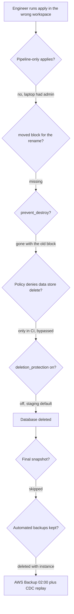

### 52.14.4 The app root: ECS, ALB, IAM and autoscaling

```hcl
# infra/envs/production/app/main.tf
variable "image_tag"       { type = string }        # set by the deploy pipeline
variable "certificate_arn" { type = string }

data "aws_ssm_parameter" "p" {
  for_each = toset([
    "network/vpc_id", "network/public_subnet_ids", "network/private_subnet_ids", "network/sg_alb", "network/sg_api",
    "data/db_endpoint", "data/db_secret_arn", "data/redis_endpoint",
  ])
  name = "/orders/production/${each.key}"
}

locals {
  p = { for k, v in data.aws_ssm_parameter.p : k => v.insecure_value }   # plain String parameters, not secrets
}

resource "aws_ecs_cluster" "main" {
  name = "orders-prod"
  setting {
    name  = "containerInsights"
    value = "enabled"
  }
}

resource "aws_cloudwatch_log_group" "api" {
  name              = "/ecs/orders-api"
  retention_in_days = 30
}

# --- IAM: two roles with different jobs -----------------------------------------------
data "aws_iam_policy_document" "ecs_tasks_trust" {
  statement {
    actions = ["sts:AssumeRole"]
    principals {
      type        = "Service"
      identifiers = ["ecs-tasks.amazonaws.com"]
    }
  }
}

# Execution role: used by the ECS agent to pull the image, write logs and fetch secrets.
resource "aws_iam_role" "execution" {
  name               = "orders-api-execution"
  assume_role_policy = data.aws_iam_policy_document.ecs_tasks_trust.json
}

resource "aws_iam_role_policy_attachment" "execution_managed" {
  role       = aws_iam_role.execution.name
  policy_arn = "arn:aws:iam::aws:policy/service-role/AmazonECSTaskExecutionRolePolicy"
}

resource "aws_iam_role_policy" "execution_secrets" {
  name = "read-db-secret"
  role = aws_iam_role.execution.id
  policy = jsonencode({
    Version   = "2012-10-17"
    Statement = [{ Effect = "Allow", Action = ["secretsmanager:GetSecretValue"], Resource = [local.p["data/db_secret_arn"]] }]
  })
}

# Task role: what the NestJS code itself may call. Only what it needs.
resource "aws_iam_role" "task" {
  name               = "orders-api-task"
  assume_role_policy = data.aws_iam_policy_document.ecs_tasks_trust.json
}

resource "aws_iam_role_policy" "task_metrics" {
  name = "put-orders-metrics"
  role = aws_iam_role.task.id
  policy = jsonencode({
    Version = "2012-10-17"
    Statement = [{
      Effect    = "Allow"
      Action    = ["cloudwatch:PutMetricData"]
      Resource  = "*"
      Condition = { StringEquals = { "cloudwatch:namespace" = "Orders" } }
    }]
  })
}

# --- Task definition ---------------------------------------------------------------------
resource "aws_ecs_task_definition" "api" {
  family                   = "orders-api"
  requires_compatibilities = ["FARGATE"]
  network_mode             = "awsvpc"
  cpu                      = "1024"
  memory                   = "2048"
  execution_role_arn       = aws_iam_role.execution.arn
  task_role_arn            = aws_iam_role.task.arn
  runtime_platform {
    operating_system_family = "LINUX"
    cpu_architecture        = "ARM64"              # Graviton: about 20% cheaper per vCPU-hour
  }
  container_definitions = jsonencode([{
    name         = "api"
    image        = "111122223333.dkr.ecr.ap-south-1.amazonaws.com/orders-api:${var.image_tag}"
    essential    = true
    portMappings = [{ containerPort = 3000, protocol = "tcp" }]
    stopTimeout  = 30                              # time for graceful shutdown of the NestJS app
    environment = [
      { name = "NODE_ENV", value = "production" },
      { name = "DB_HOST", value = local.p["data/db_endpoint"] },
      { name = "DB_NAME", value = "orders" },
      { name = "REDIS_HOST", value = local.p["data/redis_endpoint"] },
    ]
    secrets = [                                    # resolved by ECS at task start; never in state or image
      { name = "DB_USER", valueFrom = "${local.p["data/db_secret_arn"]}:username::" },
      { name = "DB_PASSWORD", valueFrom = "${local.p["data/db_secret_arn"]}:password::" },
    ]
    logConfiguration = {
      logDriver = "awslogs"
      options = {
        "awslogs-group"         = aws_cloudwatch_log_group.api.name
        "awslogs-region"        = "ap-south-1"
        "awslogs-stream-prefix" = "api"
      }
    }
  }])
}

# --- Load balancer -----------------------------------------------------------------------
resource "aws_lb" "api" {
  name               = "orders-prod"
  load_balancer_type = "application"
  subnets            = split(",", local.p["network/public_subnet_ids"])
  security_groups    = [local.p["network/sg_alb"]]
}

resource "aws_lb_target_group" "api" {
  name                 = "orders-api"
  port                 = 3000
  protocol             = "HTTP"
  target_type          = "ip"                      # required for Fargate awsvpc tasks
  vpc_id               = local.p["network/vpc_id"]
  deregistration_delay = 30
  health_check {
    path                = "/health/ready"          # @nestjs/terminus readiness endpoint
    healthy_threshold   = 2
    unhealthy_threshold = 3
    interval            = 10
  }
}

resource "aws_lb_listener" "https" {
  load_balancer_arn = aws_lb.api.arn
  port              = 443
  protocol          = "HTTPS"
  ssl_policy        = "ELBSecurityPolicy-TLS13-1-2-2021-06"
  certificate_arn   = var.certificate_arn
  default_action {
    type             = "forward"
    target_group_arn = aws_lb_target_group.api.arn
  }
}

# --- Service and autoscaling -------------------------------------------------------------
resource "aws_ecs_service" "api" {
  name                               = "orders-api"
  cluster                            = aws_ecs_cluster.main.id
  task_definition                    = aws_ecs_task_definition.api.arn
  launch_type                        = "FARGATE"
  desired_count                      = 4
  deployment_minimum_healthy_percent = 100
  deployment_maximum_percent         = 200
  health_check_grace_period_seconds  = 30
  deployment_circuit_breaker {
    enable   = true
    rollback = true                                # a bad image rolls itself back
  }
  network_configuration {
    subnets          = split(",", local.p["network/private_subnet_ids"])
    security_groups  = [local.p["network/sg_api"]]
    assign_public_ip = false
  }
  load_balancer {
    target_group_arn = aws_lb_target_group.api.arn
    container_name   = "api"
    container_port   = 3000
  }
  lifecycle {
    ignore_changes = [desired_count]               # Application Auto Scaling owns it
  }
  depends_on = [aws_lb_listener.https]
}

resource "aws_appautoscaling_target" "api" {
  service_namespace  = "ecs"
  resource_id        = "service/${aws_ecs_cluster.main.name}/${aws_ecs_service.api.name}"
  scalable_dimension = "ecs:service:DesiredCount"
  min_capacity       = 4
  max_capacity       = 20
}

resource "aws_appautoscaling_policy" "api_cpu" {
  name               = "orders-api-cpu-60"
  policy_type        = "TargetTrackingScaling"
  service_namespace  = aws_appautoscaling_target.api.service_namespace
  resource_id        = aws_appautoscaling_target.api.resource_id
  scalable_dimension = aws_appautoscaling_target.api.scalable_dimension
  target_tracking_scaling_policy_configuration {
    target_value       = 60
    scale_in_cooldown  = 120
    scale_out_cooldown = 60
    predefined_metric_specification {
      predefined_metric_type = "ECSServiceAverageCPUUtilization"
    }
  }
}

output "alb_dns_name" { value = aws_lb.api.dns_name }
```

On the application side, NestJS reads exactly the variables the task definition provides, and nothing else:

```ts
// app.module.ts (excerpt): configuration comes from the task definition's environment and secrets
TypeOrmModule.forRootAsync({
  inject: [ConfigService],
  useFactory: (config: ConfigService) => ({
    type: 'postgres',
    host: config.getOrThrow<string>('DB_HOST'),
    port: 5432,
    database: config.getOrThrow<string>('DB_NAME'),
    username: config.getOrThrow<string>('DB_USER'),
    password: config.getOrThrow<string>('DB_PASSWORD'),   // injected by ECS from Secrets Manager
    ssl: { rejectUnauthorized: true },                     // RDS CA bundle trusted in the image
    extra: { max: 20, connectionTimeoutMillis: 2000 },     // 20 tasks x 20 = 400 < max_connections
    autoLoadEntities: true,
  }),
}),
```

### 52.14.5 Applying it, verifying it, paying for it

Apply order is network, data, app, each through the pipeline of 52.10. The first production plans summarize as:

```text
network:  Plan: 41 to add, 0 to change, 0 to destroy.   apply about 3 min (NAT gateways)
data:     Plan: 9 to add, 0 to change, 0 to destroy.    apply about 25 min (Multi-AZ RDS, ElastiCache)
app:      Plan: 17 to add, 0 to change, 0 to destroy.   apply about 4 min (ALB, service steady state)
```

Afterwards, a routine deploy (new `image_tag`) shows `1 to add, 1 to change, 0 to destroy` (a new task definition revision and the service update), and nothing else; any other line in that plan is drift or a mistake. Verification after the first apply: the ALB DNS name returns 200 on `/health/ready`; the ECS service reaches steady state with 4 tasks; `aws rds describe-db-instances` shows `DeletionProtection: true`; a deliberately failing image triggers the circuit breaker and rolls back.

Approximate monthly cost in `ap-south-1` at average load:

| Component | Configuration | About per month |
|---|---|---|
| RDS PostgreSQL | db.r6g.large Multi-AZ, 300 GB gp3, 30-day backups | $430 |
| ElastiCache Redis | 2 x cache.r7g.large | $330 |
| ECS Fargate | average 6 tasks, 1 vCPU / 2 GB, ARM64 | $175 |
| ALB | 1 load balancer plus LCUs | $50 |
| NAT gateways | 3, plus about 200 GB processed | $110 |
| CloudWatch logs and metrics | 30-day retention, Container Insights | $60 |
| Total | | about $1,150 |

The two largest lines are the data stores, which is normal; the most negotiable is NAT (VPC endpoints for ECR, S3, Secrets Manager and CloudWatch Logs remove much of the NAT data processing; see Part 51 — Cost-Aware Engineering).

#### How a Senior Backend Engineer thinks about this

The senior's eye goes to four places in this code: the boundaries between roots (the app root cannot destroy the database because it does not contain it), the security group references (nothing reachable that should not be), the two IAM roles (the code gets one CloudWatch permission, not `*`), and the data-store protection block. They also notice what is deliberately absent: no passwords, no `terraform_remote_state`, no `count`, no laptop in the path to production.

#### Interview questions

1. **Why split this into network, data and app roots?** Different change rates and blast radius: the daily-changing root cannot touch the database, plans are faster, and locks do not block other teams.
2. **What is the difference between the ECS execution role and the task role?** The execution role is used by ECS to pull images, write logs and fetch secrets at start; the task role is what the application code assumes for its own AWS calls.
3. **Which settings protect the RDS instance, and from what?** `deletion_protection` (API refuses delete), `prevent_destroy` (Terraform refuses while the block exists), `skip_final_snapshot = false` (a snapshot is taken if deleted), `delete_automated_backups = false` (PITR backups survive deletion), `backup_retention_period` (how far back you can restore).
4. **Why ignore `desired_count` in the ECS service?** Application Auto Scaling changes it; without `ignore_changes`, every apply would reset the service to 4 tasks during peak.

#### Practical exercise

Apply the three roots in a sandbox account with smaller sizes (`db.t4g.medium`, `cache.t4g.small`, single NAT) and deploy a NestJS app with a `/health/ready` endpoint. Acceptance criteria: the app reads its database password only from the task's environment; `terraform state pull | grep -i password` finds nothing; deleting the RDS instance from the console fails because of deletion protection; a plan that changes the database `identifier` is rejected by the Conftest policy from 52.11.

## 52.15 Incident story: the `terraform apply` that deleted a production database

#### Concept

Section 52.6.1 summarized this incident. Here it is in full, as a blameless postmortem, because the details are where the lessons are. It is a composite of several real incidents at different companies; every individual failure in it has happened in production somewhere.

#### What happened

- **The setup.** One root configuration per environment, selected with Terraform workspaces (`staging`, `production`) over one S3 backend. Engineers had an AWS profile with administrator access to both accounts "for emergencies". The database module had been written for staging first: `deletion_protection = false` and `skip_final_snapshot = true` ("so we can tear staging down quickly"), and production overrode neither. `delete_automated_backups` was not set, so it took the provider default, `true`. `prevent_destroy = true` was on `aws_db_instance.main`.
- **The change.** An engineer refactored the database into a reusable module on a branch, moving `aws_db_instance.main` to `module.orders_db.aws_db_instance.this`, without a `moved` block. The pull request was still open; the plan in CI ran against staging only.

Timeline (local time):

- **17:38** To test the refactor before going home, the engineer runs `terraform plan` from the branch on a laptop. The shell's workspace is still `production` from a morning investigation.
- **17:41** The plan prints 300 lines ending in `Plan: 14 to add, 3 to change, 12 to destroy.` The engineer, expecting a large diff from the refactor, scrolls to the bottom and does not read the destroy list. `prevent_destroy` does not fire: it lived in the old resource block, which no longer exists in the code.
- **17:44** `terraform apply`, types `yes`. Terraform deletes `aws_db_instance.main` (the old address) before creating the new one. RDS accepts the delete: deletion protection is off. No final snapshot is taken: `skip_final_snapshot = true`. Automated backups are deleted with the instance: `delete_automated_backups` defaulted to `true`.
- **17:52** The API's error rate climbs to 100% for writes; Redis-cached reads mask it partially. Pager fires at 17:53.
- **18:06** On-call finds the RDS instance gone and a new, empty `orders-db` being created by the still-running apply. The apply is stopped.
- **18:15** Recovery sources assessed: no final snapshot, no automated backups. The last restorable copy is a daily AWS Backup recovery point at 02:00, in a vault in the same account that the deletion did not touch because AWS Backup recovery points are separate resources.
- **18:30** Restore from the 02:00 recovery point starts (about 300 GB).
- **19:50** Restored instance available. Data between 02:00 and 17:44 is missing.
- **19:55 to 23:20** The analytics team's CDC topics (Parts 13 and 383.7) retained seven days of row changes for `orders`, `order_items`, `payments` and `refunds`. A replay script applies every change with an LSN after the 02:00 snapshot, idempotently by primary key. Tables not captured by CDC (carts, sessions, saved addresses edited that day) are lost for the day.
- **23:40** Writes re-enabled. About 6 hours of write outage, and the loss of a day of non-CDC tables.

#### Why every layer failed, and what each would have done



| Guardrail | Layer | Would it have prevented deletion? | Would it have prevented data loss? |
|---|---|---|---|
| Applies only from CI; humans have read-only production credentials | Process and IAM | Yes | Yes |
| Directory and AWS account per environment, `allowed_account_ids` (52.8) | Layout | Yes (wrong workspace impossible) | Yes |
| `moved` block for the refactor (52.7) | Code | Yes (no destroy in the plan at all) | Yes |
| `prevent_destroy` | Terraform | **No** (removed with the block) | No |
| Conftest deny on data-store delete (52.11) | Policy | Yes, in CI; no, from a laptop | Yes, in CI |
| `deletion_protection = true` | AWS API | Yes, whoever runs it | Yes |
| SCP denying `rds:DeleteDBInstance` in production except break-glass | AWS Organizations | Yes | Yes |
| `skip_final_snapshot = false` | AWS | No | Yes (to the minute of deletion) |
| `delete_automated_backups = false` | AWS | No | Yes (point-in-time recovery) |
| AWS Backup in a separate account with vault lock | AWS | No | Yes (worst case: last backup) |
| Plan review that highlights destroys (52.10) | Process | Likely | Likely |

The pattern is defence in depth: any one of six independent guardrails would have stopped the deletion, and any one of three would have prevented the data loss. The organization had one guardrail (`prevent_destroy`), and it was the one with a hole shaped exactly like this mistake.

#### Postmortem actions

1. Production credentials for humans are read-only; applies run only from the pipeline's role, trusted only from the protected environment (52.10). Break-glass access exists, is time-limited and alerts the team.
2. Workspaces replaced by directories and one account per environment, with `allowed_account_ids` in every provider block.
3. The database module defaults flipped to safe: `deletion_protection = true`, `skip_final_snapshot = false`, `delete_automated_backups = false`; staging must opt out explicitly, and a `terraform test` asserts the production values (52.8).
4. Conftest policy denying deletion or replacement of data stores without a waiver; an SCP denying `rds:DeleteDBInstance` and `rds:DeleteDBCluster` in the production account for every role except break-glass.
5. AWS Backup copies to a separate backup account with vault lock; quarterly restore drills that measure real restore time (see Part 50 — Backup, Restore and Disaster Recovery, 50.10).
6. The plan comment in pull requests lists destroys first, in bold, and any destroy of a stateful type requires a second approver.

#### How a Senior Backend Engineer thinks about this

A senior reads this story and does not conclude "the engineer should have been more careful". Careful people make this mistake at 17:41 on a Friday; systems must make it impossible or survivable. They layer guardrails so that no single one is load-bearing, they prefer guardrails enforced by AWS itself (deletion protection, SCPs, a separate backup account) over guardrails that live in code which can be refactored away, and they test recovery, not just backups, because "we have backups" is a belief until a restore drill turns it into a measured fact.

#### Interview questions

1. **Why did `prevent_destroy` not stop the deletion?** It is part of the resource block; the refactor removed the block (renaming the address without a `moved` block), so Terraform saw a resource with no configuration and planned to destroy it with no lifecycle rule attached.
2. **What is the difference between `deletion_protection` and `prevent_destroy`?** `deletion_protection` is an RDS setting enforced by the AWS API for any caller; `prevent_destroy` is a Terraform plan-time check that exists only while the resource's block exists.
3. **Which settings decide whether you lose data when an RDS instance is deleted?** `skip_final_snapshot` (whether a final snapshot is taken), `delete_automated_backups` (whether point-in-time backups survive), and whether independent backups exist elsewhere, such as AWS Backup in another account.
4. **Design the guardrails so this cannot happen again.** CI-only applies with scoped OIDC roles, per-account environments with `allowed_account_ids`, `moved` blocks enforced in review, policy denying data-store deletion, `deletion_protection`, an SCP, safe module defaults with tests, and cross-account backups with restore drills.

#### Practical exercise

In a sandbox account, reproduce the incident safely: create a small RDS instance with the original unsafe settings, rename its address without a `moved` block, and apply. Then rebuild it with every guardrail from the table, repeat the same rename, and record which guardrail stops it first, and which stop it if you disable the first. Acceptance criteria: a written table showing, for each guardrail, whether it blocked the delete or preserved the data, and a restore from a final snapshot completed and timed.

## Senior Checklist — Part 52

- [ ] I understand the concept
- [ ] I can explain it simply
- [ ] I can implement it
- [ ] I understand its failure modes
- [ ] I understand its scaling limitations
- [ ] I understand its security implications
- [ ] I understand its operational implications
- [ ] I can choose between alternatives
- [ ] I can explain the tradeoffs
- [ ] I can answer senior-level interview questions
- [ ] I can explain why IaC beats clickops and codify infrastructure in Terraform
- [ ] I always read the plan and can tell `~` from `-/+`, and I know which arguments force replacement of a database
- [ ] I use remote state with versioning, encryption and locking (`use_lockfile`), and I treat a lock error as a question
- [ ] I think in resource addresses: `for_each` for collections, `moved` for renames, `import` to adopt, `removed` to hand off
- [ ] I lay out Terraform by account, environment and layer so the daily-changing root cannot touch the database
- [ ] I version modules like libraries and test their invariants with `terraform test`
- [ ] I can compare Terraform, OpenTofu, Pulumi, CDK and CloudFormation by state, protection semantics and failure modes
- [ ] I run IaC through CI with OIDC roles, plan on PR, policy, approval and apply of the saved plan, serialized per root
- [ ] I can write Conftest/Rego policies against plan JSON, with tests and expiring waivers
- [ ] I keep Kubernetes workloads in Git reconciled by Argo CD or Flux, with one owner per object
- [ ] I keep secrets out of code, state and plans (managed passwords, write-only arguments, runtime references)
- [ ] I protect databases with layered guardrails: `deletion_protection`, final snapshots, retained automated backups, SCPs, cross-account backups and tested restores

## Part 52 — Key Takeaways

- IaC replaces clickops with version-controlled, reviewed, repeatable, auditable infrastructure; manual changes are undocumented drift that hides until it causes an incident.
- `plan` is the review artefact: read the summary line against what you expected, and treat every `-/+` or destroy on a stateful resource as a conversation before an approval.
- State maps addresses to real resources; most "Terraform deleted it" incidents are address changes, prevented with `for_each` and `moved` blocks.
- Remote state must be versioned, encrypted, locked and access-controlled, because it is critical and may contain sensitive values.
- Split Terraform by account, environment and layer to limit blast radius; avoid workspaces as the boundary between staging and production.
- Version modules like libraries, ship `moved` blocks with refactors, and test invariants such as deletion protection and encryption in the module.
- All IaC tools can protect a resource from themselves and all can lose that protection through a rename; only provider-side settings like `deletion_protection` hold for every caller.
- The pipeline is the only path to production: OIDC roles scoped to a protected environment, plan on PR, policy, human approval, and apply of exactly the saved plan.
- Policy as code evaluates the plan JSON, blocks real risks (data-store deletion, missing backups, public buckets), and needs reviewed, expiring waivers or it gets disabled.
- GitOps keeps cluster workloads in Git with a controller reconciling them; give every object one owner and review rendered diffs, because the deploy repository is production.
- Keep secrets out of code, state and plan files: AWS-managed passwords, write-only arguments, and runtime references from ECS or External Secrets.
- Defence in depth beats carefulness: any one of several independent guardrails should stop a destructive apply, and backups only count once a restore drill has proven them.
