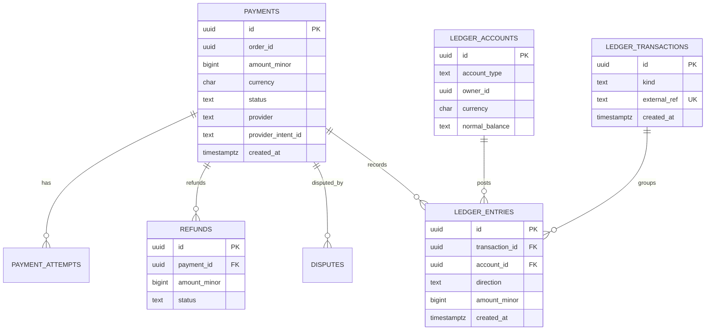
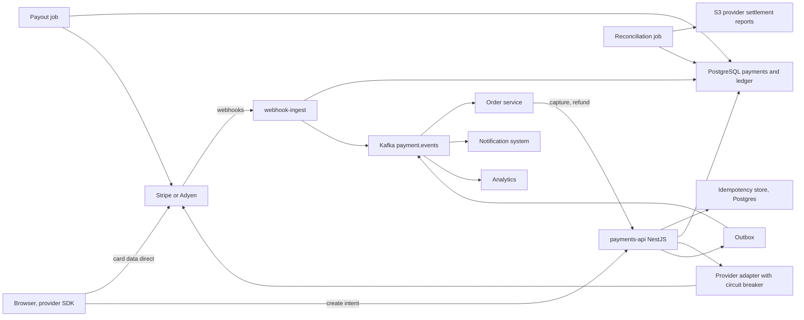
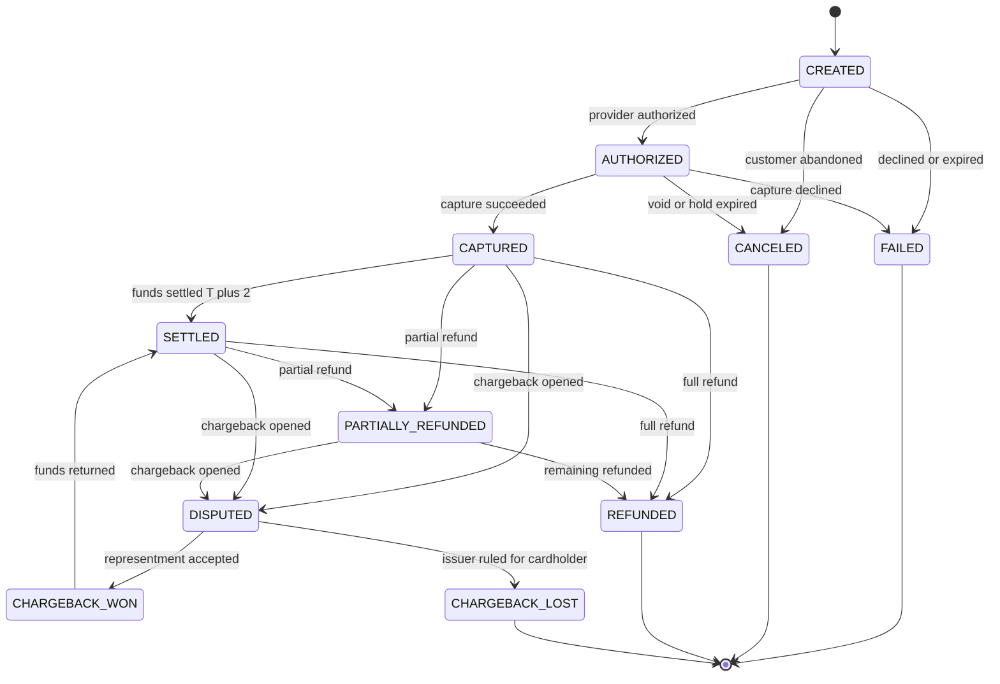
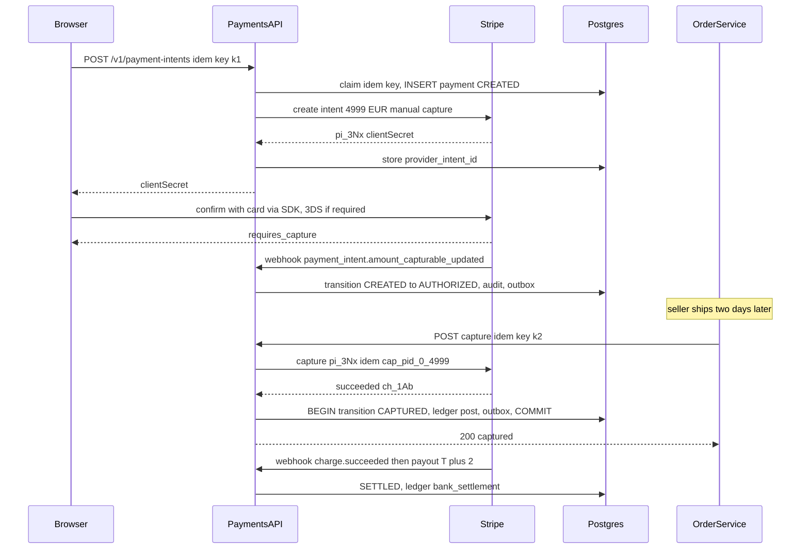
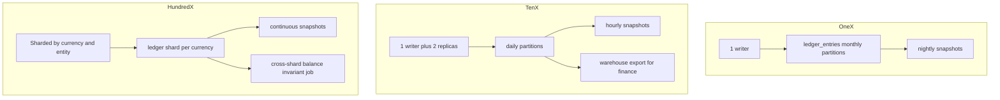

## 52.7 Payment System

### 52.7.1 Requirements

A payment system moves money and must never be wrong about it. Every other system in this book can lose a cache entry, drop a notification or serve a stale read and recover. A payment system that charges a customer twice, or captures money and never records it, produces a support ticket, a chargeback, a regulatory question and a line item in a finance reconciliation that someone will spend a week hunting down. The engineering bar is different, and it is worth naming what the difference actually is: in a payment system you are not allowed to have an unknown state that nobody can resolve.

The scope here is the payments service for a marketplace: a customer checks out, we authorize their card, the seller ships, we capture the money, funds settle from the acquirer a few days later, and sometimes the customer wants a refund or files a dispute. Card data itself never touches our servers - the browser tokenizes it directly with the provider - so our job is orchestration, correctness and record-keeping, not card handling.

Imagine a bank's back office before computers. Every transaction is written twice in a bound ledger: once as a debit in one account's column, once as a credit in another's. Nothing is ever erased; a mistake is corrected by writing a new, opposite entry. At the end of the day the clerk adds every debit and every credit, and if the two totals differ by even one cent, nobody goes home until they find out why. That discipline is not nostalgia - it is the only bookkeeping method that makes errors *detectable*. Our ledger is that bound book: append-only, double-entry, and balanced by construction. Balances are never stored, only derived, because a stored balance can silently drift from the entries that produced it and you will not know until an auditor asks.

The second organizing idea is the **payment intent**. A payment is not an instantaneous action; it is a long-lived object with a state machine that a customer, a provider and several of our own workers all interact with over minutes, days or months. Modeling it as an object with states, rather than as a function call that returns success or failure, is what makes retries, webhooks, refunds and disputes tractable.

### 52.7.2 Functional requirements

1. Create a payment intent for an order with an amount, currency and customer, and return a client secret the browser uses to confirm with the provider.
2. Authorize a card (place a hold), then capture later when the seller ships, supporting partial capture.
3. Support immediate capture (auth-and-capture in one step) for digital goods.
4. Full and partial refunds, multiple partial refunds up to the captured amount.
5. Handle disputes and chargebacks: representment evidence, provisional debit, and final win or loss.
6. Multiple providers (Stripe primary, Adyen secondary) behind one adapter interface, with a circuit breaker and failover for new authorizations.
7. Receive and verify provider webhooks, processed exactly once in effect.
8. Maintain a double-entry ledger recording every movement of money, with derived balances.
9. Daily reconciliation against the provider's settlement report, flagging every discrepancy.
10. Payouts to sellers based on ledger balances, with holds and reserves.
11. Multi-currency: charge in the customer's currency, settle and pay out in the seller's, recording the FX rate used.
12. A complete audit trail: who or what changed a payment, when, from which state to which, and why.
13. Emit domain events (`payment.authorized`, `payment.captured`, `payment.refunded`) through an outbox so the order, notification and analytics systems react without being coupled to us.

### 52.7.3 Non-functional requirements

| Property | Target | Why |
|---|---|---|
| Correctness | Zero unreconciled cents at end of day | This is the product |
| Duplicate charges | Zero, structurally prevented | A double charge is a trust event, not a bug report |
| Intent creation latency | p95 under 150 ms | It is in the checkout path |
| Authorization latency | p95 under 2.5 s (provider-bound) | Users abandon slow checkouts |
| Availability of checkout | 99.99 percent | Every minute down is lost revenue |
| Ledger durability | Synchronous replication, zero RPO | You cannot re-derive money movements you never wrote |
| Webhook processing lag | p95 under 5 s | Order fulfillment waits on it |
| Reconciliation | Daily, complete within 30 min of report availability | Finance close |
| Auditability | 7 years, immutable | Regulatory retention |
| PCI scope | SAQ A (no card data in our systems) | Every card byte we touch multiplies compliance cost |

### 52.7.4 Constraints

- Card data must never reach our servers, our logs or our database. The browser posts the card directly to the provider's iframe or SDK and receives a token. This is what keeps us in SAQ A rather than SAQ D, and the difference is roughly a quarter of an engineer's year in compliance work.
- Authorizations expire. Card holds typically last 7 days (some issuers 30, some 5). Capture after expiry fails, so orders that take longer need re-authorization.
- Providers are eventually consistent with their own webhooks. A webhook can arrive before the API response that created the object reaches you, and it can arrive twice.
- Settlement is T+2 to T+7 depending on the scheme and the acquirer, so "captured" and "money in our bank" are different dates and different ledger accounts.
- Disputes can arrive up to 120 days (Visa) or 540 days (some issuer categories) after the transaction. The record must still be there.
- Money is never a float. `0.1 + 0.2 !== 0.3` in IEEE 754, and a rounding error in a currency conversion becomes a reconciliation break.
- Existing platform: NestJS on EKS, Aurora PostgreSQL, Redis, MSK, S3.

### 52.7.5 Capacity estimation

| Quantity | Assumption | Calculation | Result |
|---|---|---|---|
| Orders per day | | given | 400,000 |
| Payment attempts per order | Retries after decline, 1.15 average | 400,000 x 1.15 | 460,000 per day |
| Average payment RPS | 460,000 / 86,400 | | 5.3 |
| Peak payment RPS | 8x during a flash sale hour | 5.3 x 8 | 43 |
| Webhooks received per payment | authorized, captured, settled, plus occasional | 3.4 | 1.56M per day, 18 average RPS, 145 peak |
| Ledger entries per payment | Auth 0, capture 4 (customer, gateway, revenue, fees), refund 4, payout 2 | 6 average | 2.76M entries per day |
| Refund rate | | 4 percent of captures | 16,000 per day |
| Dispute rate | | 0.06 percent | 240 per day |
| API reads (status polling, admin, order service) | 30 per payment | 13.8M per day | 160 average RPS, 640 peak |
| Read/write ratio | 13.8M reads / 2.76M writes | | 5 to 1 |

Storage, and this is the table that matters because it is retained for seven years:

| Table | Bytes per row | Rows per year | Size per year | 7-year total |
|---|---|---|---|---|
| `payments` | 600 B | 168M | 101 GB | 706 GB |
| `payment_attempts` | 400 B (one per provider call) | 250M | 100 GB | 700 GB |
| `ledger_entries` | 180 B | 1.01B | 181 GB | 1.27 TB |
| `refunds` | 350 B | 5.8M | 2 GB | 14 GB |
| `webhook_events` | 2 KB (raw payload retained) | 570M | 1.14 TB | 8 TB |
| `audit_log` | 500 B | 400M | 200 GB | 1.4 TB |
| Total | | | about 1.7 TB per year | about 12 TB |

Two consequences. `webhook_events` at 8 TB dominates, so raw payloads move to S3 after 90 days with only the hash, id and outcome kept in PostgreSQL, cutting it to about 600 GB. And `ledger_entries` at a billion rows a year needs monthly partitioning with a rolled-up monthly balance snapshot per account, so that deriving a balance does not mean summing seven years of history.

| Quantity | Calculation | Result |
|---|---|---|
| Redis idempotency keys | 460,000 per day x 500 B x 24 h TTL | 230 MB |
| PostgreSQL connections | 12 API pods x 10 + 15 workers x 5 | 195, comfortable |
| Kafka volume | 2M events per day x 1 KB | 2 GB per day |
| Provider API calls | 460,000 auth + 400,000 capture + refunds | about 900,000 per day |

The numbers are small. That is the point worth internalising: a payment system is not a scale problem, it is a correctness problem. Forty-three requests per second is nothing; the difficulty is entirely in never being wrong about any one of them.

### 52.7.6 API design

| Method | Path | Request | Response | Status codes | Idempotency | Auth |
|---|---|---|---|---|---|---|
| POST | `/v1/payment-intents` | `{ orderId, amountMinor, currency, customerId, captureMethod }` | `{ id, status, clientSecret, amountMinor }` | 201, 200 on replay, 400, 409 | Required `Idempotency-Key` header | Service token or user token |
| GET | `/v1/payment-intents/{id}` | | intent with attempts and refunds | 200, 403, 404 | Yes | Owner or service |
| POST | `/v1/payment-intents/{id}/capture` | `{ amountMinor? }` | intent | 200, 400, 409 wrong state, 422 provider declined | Required `Idempotency-Key` | Service token, scope `payments:capture` |
| POST | `/v1/payment-intents/{id}/cancel` | `{ reason }` | intent | 200, 409 | Required | Service token |
| POST | `/v1/payment-intents/{id}/refunds` | `{ amountMinor, reason }` | refund | 201, 200 on replay, 409, 422 | Required `Idempotency-Key` | Service token, scope `payments:refund` |
| GET | `/v1/payment-intents/{id}/refunds` | | list | 200 | Yes | Owner or service |
| GET | `/v1/ledger/accounts/{id}/balance` | `?asOf=` | `{ balanceMinor, currency, asOf }` | 200, 404 | Yes | Finance role |
| GET | `/v1/ledger/accounts/{id}/entries` | `?cursor=&limit=` | entries, keyset paginated | 200 | Yes | Finance role |
| POST | `/v1/disputes/{id}/evidence` | evidence document ids | dispute | 200, 409 past deadline | Yes | Support role |
| POST | `/v1/webhooks/stripe` | provider payload | | 200 always after verification, 400 on bad signature | Yes, by provider event id | Signature only, no session |
| POST | `/v1/webhooks/adyen` | provider payload | `[accepted]` | 200, 401 | Yes | HMAC |
| GET | `/v1/reconciliation/{date}` | | `{ matched, unmatchedProvider, unmatchedLedger, deltaMinor }` | 200 | Yes | Finance role |

`Idempotency-Key` is **required**, not optional, on every state-changing endpoint. A request without one is rejected with 400. This is a deliberate choice that annoys integrators for a week and saves you for years: it makes it impossible for a caller to retry a charge unsafely, because there is no unsafe path to retry on.

The semantics are precise. The key is scoped to `(endpoint, key)` and stored with a hash of the request body. A repeat with the same key and the same body returns the original response with the original status code. A repeat with the same key and a *different* body returns `409 Conflict` with `idempotency_key_reuse` - because that is a client bug, and silently honoring it would either duplicate a charge or return the wrong answer. A key whose original request is still in flight returns `409` with `request_in_progress`, so the client retries with backoff rather than racing.

```ts
// common/idempotency.interceptor.ts (excerpt)
async intercept(ctx: ExecutionContext, next: CallHandler) {
  const req = ctx.switchToHttp().getRequest();
  const key = req.headers['idempotency-key'];
  if (!key) throw new BadRequestException('Idempotency-Key header is required');

  const scope = `${req.method}:${req.route.path}`;
  const bodyHash = sha256(canonicalJson(req.body));

  // Atomic claim. Only one concurrent request for a key gets to run.
  const claimed = await this.ds.query(
    `INSERT INTO idempotency_keys (scope, key, body_hash, state)
     VALUES ($1,$2,$3,'in_progress')
     ON CONFLICT (scope, key) DO NOTHING
     RETURNING id`, [scope, key, bodyHash]);

  if (claimed.length === 0) {
    const [prior] = await this.ds.query(
      `SELECT state, body_hash, status_code, response FROM idempotency_keys WHERE scope=$1 AND key=$2`, [scope, key]);
    if (prior.body_hash !== bodyHash) throw new ConflictException('idempotency_key_reuse');
    if (prior.state === 'in_progress') throw new ConflictException('request_in_progress');
    return of(new StoredResponse(prior.status_code, prior.response));   // replay the original
  }

  return next.handle().pipe(
    tap(async (response) => {
      await this.ds.query(
        `UPDATE idempotency_keys SET state='completed', status_code=200, response=$3, completed_at=now()
          WHERE scope=$1 AND key=$2`, [scope, key, response]);
    }),
    catchError(async (err) => {
      // Only release the key for errors that are definitely retryable and definitely
      // did not reach the provider. A 5xx after a provider call stays claimed.
      if (err instanceof BadRequestException) {
        await this.ds.query(`DELETE FROM idempotency_keys WHERE scope=$1 AND key=$2`, [scope, key]);
      }
      throw err;
    }),
  );
}
```

### 52.7.7 Data model



```sql
CREATE TYPE payment_status AS ENUM
  ('CREATED','AUTHORIZED','CAPTURED','SETTLED','FAILED','CANCELED',
   'PARTIALLY_REFUNDED','REFUNDED','DISPUTED','CHARGEBACK_LOST','CHARGEBACK_WON');

CREATE TABLE payments (
  id                 uuid PRIMARY KEY DEFAULT gen_random_uuid(),
  order_id           uuid NOT NULL,
  customer_id        uuid NOT NULL,
  -- Money is ALWAYS an integer in the currency's minor unit. 1250 = 12.50 EUR.
  -- bigint, not numeric, not float. Never a decimal string that someone parses.
  amount_minor       bigint NOT NULL CHECK (amount_minor > 0),
  currency           char(3) NOT NULL,                      -- ISO 4217
  captured_minor     bigint NOT NULL DEFAULT 0 CHECK (captured_minor >= 0),
  refunded_minor     bigint NOT NULL DEFAULT 0 CHECK (refunded_minor >= 0),
  status             payment_status NOT NULL DEFAULT 'CREATED',
  capture_method     text NOT NULL DEFAULT 'manual' CHECK (capture_method IN ('manual','automatic')),
  provider           text NOT NULL,                         -- 'stripe','adyen'
  provider_intent_id text,
  payment_method_token text,                                -- provider token, NEVER a PAN
  card_brand         text, card_last4 char(4), card_exp_month smallint, card_exp_year smallint,
  auth_expires_at    timestamptz,
  failure_code       text, failure_message text,
  version            integer NOT NULL DEFAULT 0,            -- optimiztic locking
  created_at         timestamptz NOT NULL DEFAULT now(),
  updated_at         timestamptz NOT NULL DEFAULT now(),
  CONSTRAINT captured_within_authorized CHECK (captured_minor <= amount_minor),
  CONSTRAINT refunded_within_captured   CHECK (refunded_minor <= captured_minor)
);
CREATE UNIQUE INDEX payments_order_uidx ON payments (order_id) WHERE status NOT IN ('FAILED','CANCELED');
CREATE UNIQUE INDEX payments_provider_intent_uidx ON payments (provider, provider_intent_id) WHERE provider_intent_id IS NOT NULL;
-- Serves the webhook handler and the reconciliation join.
CREATE INDEX payments_status_created_idx ON payments (status, created_at);
-- Serves the auth-expiry sweeper: holds about to lapse.
CREATE INDEX payments_auth_expiry_idx ON payments (auth_expires_at) WHERE status = 'AUTHORIZED';

CREATE TABLE payment_attempts (
  id             uuid PRIMARY KEY DEFAULT gen_random_uuid(),
  payment_id     uuid NOT NULL REFERENCES payments(id),
  operation      text NOT NULL,                             -- 'authorize','capture','refund','void'
  provider       text NOT NULL,
  idempotency_key text NOT NULL,                            -- the key we sent to the PROVIDER
  request_hash   bytea NOT NULL,
  outcome        text NOT NULL CHECK (outcome IN ('pending','succeeded','failed','unknown')),
  provider_ref   text,
  http_status    integer,
  error_code     text,
  latency_ms     integer,
  created_at     timestamptz NOT NULL DEFAULT now()
);
-- Serves the unknown-outcome resolver: attempts stuck in 'unknown' or 'pending'.
CREATE INDEX payment_attempts_unresolved_idx ON payment_attempts (created_at) WHERE outcome IN ('unknown','pending');
CREATE UNIQUE INDEX payment_attempts_key_uidx ON payment_attempts (provider, idempotency_key);

-- ---------- The ledger ----------
CREATE TABLE ledger_accounts (
  id             uuid PRIMARY KEY DEFAULT gen_random_uuid(),
  account_type   text NOT NULL,      -- 'customer_receivable','gateway_clearing','platform_revenue',
                                     -- 'seller_payable','fees_expense','bank_settlement','dispute_reserve'
  owner_id       uuid,               -- seller id for seller_payable, NULL for platform accounts
  currency       char(3) NOT NULL,
  normal_balance text NOT NULL CHECK (normal_balance IN ('debit','credit')),
  created_at     timestamptz NOT NULL DEFAULT now(),
  UNIQUE (account_type, owner_id, currency)
);

CREATE TABLE ledger_transactions (
  id           uuid PRIMARY KEY DEFAULT gen_random_uuid(),
  kind         text NOT NULL,        -- 'capture','refund','payout','fee','dispute_hold','fx'
  -- The idempotency anchor for the ledger. 'capture:<payment_id>' can exist only once,
  -- so no code path, retry or replayed webhook can ever post a capture twice.
  external_ref text NOT NULL,
  description  text,
  created_at   timestamptz NOT NULL DEFAULT now(),
  created_by   text NOT NULL
);
CREATE UNIQUE INDEX ledger_transactions_ref_uidx ON ledger_transactions (external_ref);

CREATE TABLE ledger_entries (
  id             uuid NOT NULL DEFAULT gen_random_uuid(),
  transaction_id uuid NOT NULL,
  account_id     uuid NOT NULL,
  direction      text NOT NULL CHECK (direction IN ('debit','credit')),
  amount_minor   bigint NOT NULL CHECK (amount_minor > 0),
  currency       char(3) NOT NULL,
  payment_id     uuid,
  created_at     timestamptz NOT NULL DEFAULT now(),
  PRIMARY KEY (id, created_at)
) PARTITION BY RANGE (created_at);

-- Serves balance derivation and the account statement, both scoped to one account over time.
CREATE INDEX ledger_entries_account_idx ON ledger_entries (account_id, created_at);
-- Serves "show me every movement for this payment", used by support and reconciliation.
CREATE INDEX ledger_entries_payment_idx ON ledger_entries (payment_id) WHERE payment_id IS NOT NULL;

-- Entries are immutable. Enforce it in the database, not by convention.
CREATE RULE ledger_entries_no_update AS ON UPDATE TO ledger_entries DO INSTEAD NOTHING;
CREATE RULE ledger_entries_no_delete AS ON DELETE TO ledger_entries DO INSTEAD NOTHING;

CREATE TABLE refunds (
  id           uuid PRIMARY KEY DEFAULT gen_random_uuid(),
  payment_id   uuid NOT NULL REFERENCES payments(id),
  amount_minor bigint NOT NULL CHECK (amount_minor > 0),
  currency     char(3) NOT NULL,
  reason       text NOT NULL,
  status       text NOT NULL DEFAULT 'pending' CHECK (status IN ('pending','succeeded','failed','canceled')),
  provider_ref text,
  created_at   timestamptz NOT NULL DEFAULT now()
);

CREATE TABLE webhook_events (
  id                uuid PRIMARY KEY DEFAULT gen_random_uuid(),
  provider          text NOT NULL,
  provider_event_id text NOT NULL,
  event_type        text NOT NULL,
  payload           jsonb NOT NULL,
  signature_valid   boolean NOT NULL,
  processed_at      timestamptz,
  attempts          smallint NOT NULL DEFAULT 0,
  last_error        text,
  received_at       timestamptz NOT NULL DEFAULT now()
);
-- The webhook idempotency contract: one row per provider event, forever.
CREATE UNIQUE INDEX webhook_events_uidx ON webhook_events (provider, provider_event_id);
-- Serves the retry sweeper for events we could not process yet.
CREATE INDEX webhook_events_unprocessed_idx ON webhook_events (received_at) WHERE processed_at IS NULL;

CREATE TABLE audit_log (
  id          bigserial,
  entity_type text NOT NULL, entity_id uuid NOT NULL,
  action      text NOT NULL,
  actor_type  text NOT NULL,  -- 'user','service','webhook','job'
  actor_id    text,
  from_state  text, to_state text,
  metadata    jsonb,
  created_at  timestamptz NOT NULL DEFAULT now(),
  PRIMARY KEY (id, created_at)
) PARTITION BY RANGE (created_at);
```

Balances are derived, never stored:

```sql
CREATE VIEW ledger_balances AS
SELECT account_id, currency,
       SUM(CASE WHEN direction = 'debit'  THEN amount_minor ELSE 0 END) AS debits_minor,
       SUM(CASE WHEN direction = 'credit' THEN amount_minor ELSE 0 END) AS credits_minor,
       SUM(CASE WHEN direction = 'debit'  THEN amount_minor ELSE -amount_minor END) AS balance_minor
  FROM ledger_entries
 GROUP BY account_id, currency;
```

For seven years of entries that sum is too slow, so a nightly job writes `ledger_balance_snapshots (account_id, currency, as_of_date, balance_minor)` and the balance query becomes "latest snapshot plus entries since". The snapshot is a cache of a derivation, not a source of truth, so it can be rebuilt from scratch at any time - which is exactly the property a stored balance would not have.

The invariant that makes the whole thing checkable:

```sql
-- Must return zero rows. Run it every 5 minutes and page if it does not.
SELECT transaction_id,
       SUM(CASE WHEN direction='debit' THEN amount_minor ELSE -amount_minor END) AS imbalance
  FROM ledger_entries
 GROUP BY transaction_id
HAVING SUM(CASE WHEN direction='debit' THEN amount_minor ELSE -amount_minor END) <> 0;
```

### 52.7.8 High-level architecture



The browser-to-provider arrow is the most important line in the diagram. Card numbers travel from the customer's browser to Stripe or Adyen and never through anything we operate. What comes back to us is a token. That single arrow is the difference between SAQ A and a full PCI DSS audit of every server, network segment and log pipeline we own.

### 52.7.9 Component design

```text
src/
  payments/
    payment-intents.controller.ts
    payment-intent.service.ts       -- the state machine
    capture.service.ts
    refund.service.ts
    dto/
  ledger/
    ledger.service.ts               -- posts balanced transactions
    ledger.controller.ts
    balance.service.ts
  providers/
    provider.interface.ts
    stripe.adapter.ts
    adyen.adapter.ts
    circuit-breaker.ts
    provider-router.service.ts
  webhooks/
    stripe-webhook.controller.ts
    adyen-webhook.controller.ts
    webhook-processor.worker.ts
  reconciliation/
    settlement-import.job.ts
    reconcile.job.ts
  disputes/
    dispute.service.ts
  workers/
    unknown-outcome-resolver.job.ts
    auth-expiry-sweeper.job.ts
    outbox-relay.ts
  common/
    idempotency.interceptor.ts
    money.ts
  payments.module.ts
```

The state machine is the spine:



Transitions are validated centrally, and every one writes an audit row inside the same transaction:

```ts
// payments/payment-intent.service.ts (excerpt)
const ALLOWED: Record<PaymentStatus, PaymentStatus[]> = {
  CREATED:            ['AUTHORIZED', 'CAPTURED', 'FAILED', 'CANCELED'],
  AUTHORIZED:         ['CAPTURED', 'CANCELED', 'FAILED'],
  CAPTURED:           ['SETTLED', 'PARTIALLY_REFUNDED', 'REFUNDED', 'DISPUTED'],
  SETTLED:            ['PARTIALLY_REFUNDED', 'REFUNDED', 'DISPUTED'],
  PARTIALLY_REFUNDED: ['REFUNDED', 'DISPUTED'],
  DISPUTED:           ['CHARGEBACK_WON', 'CHARGEBACK_LOST'],
  CHARGEBACK_WON:     ['SETTLED'],
  FAILED: [], CANCELED: [], REFUNDED: [], CHARGEBACK_LOST: [],
};

async transition(m: EntityManager, id: string, to: PaymentStatus, actor: Actor, meta: object) {
  // Optimiztic lock: version guards against two workers transitioning the same payment.
  const [p] = await m.query(`SELECT status, version FROM payments WHERE id=$1 FOR UPDATE`, [id]);
  if (!p) throw new NotFoundException();
  if (p.status === to) return;                                    // idempotent replay of a webhook
  if (!ALLOWED[p.status].includes(to)) {
    throw new ConflictException(`illegal transition ${p.status} -> ${to}`);
  }
  await m.query(
    `UPDATE payments SET status=$2, version=version+1, updated_at=now() WHERE id=$1 AND version=$3`,
    [id, to, p.version]);
  await m.query(
    `INSERT INTO audit_log (entity_type, entity_id, action, actor_type, actor_id, from_state, to_state, metadata)
     VALUES ('payment',$1,'transition',$2,$3,$4,$5,$6)`,
    [id, actor.type, actor.id, p.status, to, meta]);
}
```

Capture is where money actually moves, so it is where the ledger posting and the outbox event live, all in one transaction:

```ts
// payments/capture.service.ts (excerpt)
async capture(paymentId: string, amountMinor: number | undefined, actor: Actor) {
  const payment = await this.repo.findOrFail(paymentId);
  if (payment.status !== 'AUTHORIZED') throw new ConflictException(`cannot capture from ${payment.status}`);
  const amount = amountMinor ?? payment.amountMinor;
  if (amount > payment.amountMinor - payment.capturedMinor) throw new BadRequestException('exceeds authorized amount');

  // Provider call happens OUTSIDE the transaction. Never hold a database transaction
  // open across a network call that can take 3 seconds; you will exhaust the pool
  // and hold row locks while a third party is slow.
  const attemptKey = `cap_${paymentId}_${payment.capturedMinor}_${amount}`;   // deterministic, so a retry reuses it
  const result = await this.providers.capture(payment, amount, attemptKey);

  await this.ds.transaction(async (m) => {
    await this.transition(m, paymentId, 'CAPTURED', actor, { amount, partial: amount < payment.amountMinor });
    await m.query(`UPDATE payments SET captured_minor = captured_minor + $2 WHERE id = $1`, [paymentId, amount]);

    const fee = this.fees.calculate(amount, payment.currency);          // integer minor units, banker's rounding
    await this.ledger.post(m, {
      externalRef: `capture:${paymentId}:${result.providerRef}`,        // unique -> cannot post twice
      kind: 'capture',
      createdBy: actor.id,
      entries: [
        { account: 'gateway_clearing',   direction: 'debit',  amount },
        { account: 'seller_payable',     direction: 'credit', amount: amount - fee, ownerId: payment.sellerId },
        { account: 'platform_revenue',   direction: 'credit', amount: fee },
      ],
      currency: payment.currency, paymentId,
    });

    await m.query(
      `INSERT INTO outbox (aggregate_type, aggregate_id, topic, key, payload)
       VALUES ('payment',$1,'payment.events',$1,$2)`,
      [paymentId, JSON.stringify({ type: 'payment.captured', paymentId, amountMinor: amount })]);
  });
}
```

The ledger service refuses to post anything that does not balance. This is a five-line check that has caught more real bugs than any test suite:

```ts
// ledger/ledger.service.ts
async post(m: EntityManager, tx: LedgerTransactionInput): Promise<void> {
  const debits  = tx.entries.filter((e) => e.direction === 'debit').reduce((s, e) => s + e.amount, 0);
  const credits = tx.entries.filter((e) => e.direction === 'credit').reduce((s, e) => s + e.amount, 0);
  if (debits !== credits) throw new Error(`unbalanced transaction: ${debits} != ${credits}`);
  if (tx.entries.some((e) => !Number.isInteger(e.amount) || e.amount <= 0)) throw new Error('invalid amount');
  if (new Set(tx.entries.map((e) => e.currency ?? tx.currency)).size > 1) throw new Error('mixed currency in one transaction');

  const inserted = await m.query(
    `INSERT INTO ledger_transactions (kind, external_ref, description, created_by)
     VALUES ($1,$2,$3,$4) ON CONFLICT (external_ref) DO NOTHING RETURNING id`,
    [tx.kind, tx.externalRef, tx.description ?? null, tx.createdBy]);
  if (inserted.length === 0) return;                     // already posted; replay is a no-op

  for (const e of tx.entries) {
    await m.query(
      `INSERT INTO ledger_entries (transaction_id, account_id, direction, amount_minor, currency, payment_id)
       VALUES ($1,$2,$3,$4,$5,$6)`,
      [inserted[0].id, await this.accountId(e.account, e.ownerId, tx.currency), e.direction, e.amount, tx.currency, tx.paymentId]);
  }
}
```

The provider adapter normalizes two very different APIs behind one interface and wraps each in a circuit breaker.

```ts
// providers/provider.interface.ts
export interface PaymentProvider {
  readonly name: 'stripe' | 'adyen';
  createIntent(input: CreateIntentInput, idempotencyKey: string): Promise<ProviderIntent>;
  capture(providerIntentId: string, amountMinor: number, idempotencyKey: string): Promise<ProviderResult>;
  refund(providerChargeId: string, amountMinor: number, idempotencyKey: string): Promise<ProviderResult>;
  void(providerIntentId: string, idempotencyKey: string): Promise<ProviderResult>;
  getIntent(providerIntentId: string): Promise<ProviderIntent>;   // the unknown-outcome resolver
  verifyWebhook(rawBody: Buffer, headers: Record<string, string>): WebhookEvent;
}
```

```ts
// providers/circuit-breaker.ts (excerpt)
async execute<T>(op: string, fn: () => Promise<T>): Promise<T> {
  if (this.state === 'open') {
    if (Date.now() < this.openUntil) throw new ProviderUnavailableError(this.name);
    this.state = 'half_open';                       // let one probe through
  }
  const started = Date.now();
  try {
    const result = await withTimeout(fn(), this.timeoutMs);
    this.onSuccess();
    return result;
  } catch (err) {
    // A TIMEOUT IS NOT A FAILURE. It is an unknown outcome. It trips the breaker for
    // routing purposes but the caller must resolve the actual state, never assume.
    if (err instanceof TimeoutError) { this.onFailure(); throw new UnknownOutcomeError(op, this.name); }
    if (isTransport(err)) { this.onFailure(); throw err; }
    this.onSuccess();                               // a card decline is a healthy provider
    throw err;
  } finally {
    this.metrics.observe(op, Date.now() - started);
  }
}
```

The distinction in that comment is the heart of payment engineering. A declined card is a *successful* provider interaction with a negative business answer; it must not trip the breaker, and retrying it is pointless. A timeout is an *unknown* - the charge may have succeeded. Failover to a second provider is allowed for `createIntent` on a transport failure before any authorization could exist, and forbidden for `capture` and `refund`, because the money is already at one provider.

Authorize-then-capture, end to end:



### 52.7.10 Database design

Everything above lives in one PostgreSQL cluster with synchronous replication to a standby in another AZ. Zero RPO is a hard requirement: asynchronous replication means a failover can lose the last few committed transactions, and in a payment system those are captures whose money exists at the provider and nowhere in your records.

Isolation level is `READ COMMITTED` with explicit `SELECT ... FOR UPDATE` on the payment row for every state-changing operation, plus the `version` column as a second guard. `SERIALIZABLE` was considered and rejected: the contention is naturally per-payment and the row lock expresses it precisely, whereas serializable would add retry handling to every path for no additional safety here.

`ledger_entries` and `audit_log` are partitioned monthly. Ledger partitions are never dropped - they are the seven-year record - but old ones move to cheaper storage and are marked read-only. The `RULE` statements that make entries immutable are belt-and-braces alongside a database role for the application that has `INSERT` and `SELECT` on `ledger_entries` but not `UPDATE` or `DELETE`. Two mechanisms, because "someone will eventually write an UPDATE in a migration" is not a hypothetical.

The balance query with snapshots:

```sql
SELECT s.balance_minor
     + COALESCE(SUM(CASE WHEN e.direction='debit' THEN e.amount_minor ELSE -e.amount_minor END), 0) AS balance_minor
  FROM ledger_balance_snapshots s
  LEFT JOIN ledger_entries e
    ON e.account_id = s.account_id AND e.created_at > s.as_of
 WHERE s.account_id = $1
 ORDER BY s.as_of DESC LIMIT 1;
```

```text
Aggregate  (cost=8.94..8.95 rows=1 width=8) (actual time=0.061..0.062 rows=1 loops=1)
  Buffers: shared hit=14
  ->  Nested Loop Left Join
        ->  Index Scan Backward using ledger_snapshots_pkey on ledger_balance_snapshots s
        ->  Index Scan using ledger_entries_account_idx on ledger_entries_2026_09 e
              Index Cond: ((account_id = $1) AND (created_at > s.as_of))
Planning Time: 0.331 ms
Execution Time: 0.089 ms
```

Reconciliation is a job, not a report. Every morning the settlement file from each provider is downloaded from S3, parsed into `provider_settlement_lines`, and matched against our ledger three ways: by provider reference, by amount and date, and finally by fuzzy amount within a tolerance for FX rounding. Anything unmatched in either direction is an exception with an owner and an SLA. The output is a single number - the delta in minor units between what the provider says it holds for us and what our ledger says - and that number must be zero. When it is not, the job files a ticket automatically with the specific transactions involved. Systems without this job do not discover discrepancies; they accumulate them.

Currency handling: `amount_minor` is always in the currency's own minor unit, and the number of minor units per major unit varies (100 for EUR and USD, 1 for JPY which has no minor unit, 1000 for BHD). A shared `Money` type carries `{ amountMinor, currency }` together and refuses arithmetic across currencies. Cross-currency movements are never a single transaction; they are two balanced transactions joined by an FX account, with the rate, its source and its timestamp recorded, so that a rounding remainder lands in a designated `fx_rounding` account rather than silently unbalancing anything.

### 52.7.11 Caching

Payments cache almost nothing, deliberately. Any cached value that influences a money decision is a chance to act on stale data.

| What | Where | TTL | Invalidation | Why it is safe |
|---|---|---|---|---|
| Idempotency responses | PostgreSQL, 24 h | 24 h | Time | Must survive Redis failover; correctness depends on it, so it lives in the durable store |
| In-flight idempotency claim | Redis `SET NX`, 60 s | 60 s | On completion | Fast rejection of concurrent duplicates; PostgreSQL is still the authority |
| Payment status for reads | Redis, 5 s | 5 s | Deleted on every transition | Only serves polling clients; a 5-second stale status cannot cause a wrong action because no writer reads it |
| Ledger balance snapshots | PostgreSQL table | Nightly | Rebuilt | A derivation cache, verifiable against entries at any time |
| FX rates | Redis, 5 min, plus the rate stored on every transaction | 5 min | Refresh | The rate actually used is persisted with the entry, so the cache only affects quoting |
| Provider capability metadata | In-process, 1 h | 1 h | Deploy | Not money |
| Circuit breaker state | In-process per pod | Rolling window | Continuous | Per-pod state is correct; a shared breaker would be a single point of failure |

The rule that governs all of it: **no write path ever reads a cached value.** Capture reads the payment row `FOR UPDATE` from the primary. Refund reads `captured_minor` and `refunded_minor` from the primary. The read replica is used only for finance reporting and support screens, where a few hundred milliseconds of replication lag is harmless.

### 52.7.12 Messaging

| Topic | Partitions | Key | Producer | Consumer group | Purpose |
|---|---|---|---|---|---|
| `payment.events` | 12 | `payment_id` | Outbox relay | `order-service`, `notification-fanout`, `analytics`, `fraud` | The only way other services learn about payments |
| `payment.webhooks.inbound` | 12 | `provider_event_id` | Webhook ingest controller | `webhook-processor` | Decouples receiving from processing |
| `payment.payouts` | 6 | `seller_id` | Payout job | `payout-executor` | |
| `payment.reconciliation.exceptions` | 3 | `date` | Reconcile job | `finance-ops` | Feeds a ticket queue |
| `payment.*.dlq` | 3 | original | Any worker after 5 attempts | manual, alerted immediately | A payment DLQ message is always a page |

Every event `payments` publishes goes through the outbox, and the reason is exact. If you publish `payment.captured` to Kafka and the transaction then rolls back, the order service ships goods for money you do not have. If you commit the transaction and the Kafka publish then fails, the order sits unshipped until someone notices. The outbox makes the event part of the same commit as the state change, and a relay publishes it afterwards with at-least-once delivery - so the failure mode becomes "the event arrives twice", which consumers handle with their own idempotency, rather than "the event and the truth disagree", which nothing can handle.

The webhook path is the mirror image. The controller does the minimum: verify the signature against the **raw** body bytes (parsing to JSON and re-serializing changes the bytes and breaks the HMAC, which is a classic and confusing bug), insert into `webhook_events` with `ON CONFLICT DO NOTHING`, and return 200 immediately.

```ts
// webhooks/stripe-webhook.controller.ts
@Post('stripe')
@HttpCode(200)
async handle(@Req() req: RawBodyRequest<Request>, @Headers('stripe-signature') sig: string) {
  let event: Stripe.Event;
  try {
    // Raw bytes, not req.body. bodyParser must be configured with rawBody: true for this route.
    event = this.stripe.webhooks.constructEvent(req.rawBody!, sig, process.env.STRIPE_WEBHOOK_SECRET!);
  } catch {
    this.metrics.inc('webhook_signature_invalid_total', { provider: 'stripe' });
    throw new BadRequestException('invalid signature');   // 400, never 200: do not teach the provider to stop retrying
  }

  // Idempotent ingest. A provider retry inserts nothing and we still return 200.
  await this.ds.query(
    `INSERT INTO webhook_events (provider, provider_event_id, event_type, payload, signature_valid)
     VALUES ('stripe', $1, $2, $3, true) ON CONFLICT (provider, provider_event_id) DO NOTHING`,
    [event.id, event.type, event]);

  await this.producer.send('payment.webhooks.inbound', { key: event.id, value: { provider: 'stripe', eventId: event.id } });
  return { received: true };          // fast 200 so the provider does not time out and retry a storm
}
```

The processor claims each event with a conditional update, applies it inside a transaction, and marks it processed in that same transaction, so a crash between "applied" and "marked" is impossible.

### 52.7.13 Scaling

**At 1x (43 peak payments per second).** Twelve API pods, one PostgreSQL cluster with a synchronous standby, four webhook processors, and the jobs. Nothing is stressed. The operational effort goes into correctness, monitoring and reconciliation, not throughput.

**At 10x (430 peak payments per second, 10M ledger entries per day).** The write path is still fine - 430 transactions per second with a few inserts each is well within one Aurora writer. What changes is the read side and the retention: `ledger_entries` at 10 billion rows a year needs the balance snapshots to be hourly rather than nightly, and reporting moves entirely to a read replica or a warehouse export, because a finance analyst running an unbounded aggregate against the primary is a genuine outage risk. Reconciliation moves from a single-process job to a partitioned one, matching by date range in parallel.

**At 100x (4,300 peak payments per second, 100M ledger entries per day).** Now the ledger is the constraint. The options, in the order most teams try them:

1. Split the ledger by currency or by legal entity. Natural boundaries, no cross-shard transactions, because a balanced transaction never spans currencies anyway.
2. Move `ledger_entries` writes to an append-optimized path: batched inserts with `COPY`, `UNLOGGED` staging tables flushed periodically, and partitioning by day rather than month.
3. Shard `payments` by `customer_id` and keep the ledger separate and sharded by account, accepting that a capture now writes to two shards and needs a two-phase commit or a saga with a compensating entry.

Option 3 is where most large payment platforms end up, and it is a serious step: distributed transactions in a ledger mean you must prove, continuously, that no transaction is half-posted. The invariant query from section 52.7.7 becomes a per-shard job plus a cross-shard job, and the answer must still be zero.



The honest note on scaling a payment system: revenue rarely grows 100x without the business also acquiring a finance team, a compliance function and a fraud team, all of whom will impose requirements that reshape the architecture more than throughput does.

### 52.7.14 Security

- **PCI scope minimization.** Card data goes browser-to-provider through their hosted fields or SDK. Our servers see a token like `pm_1Ab...`. We store `card_last4`, brand and expiry for display only - all explicitly permitted. Nothing else. Our validated scope is SAQ A, which means we attest rather than audit, and the network segmentation, key management and log-scrubbing requirements of full DSS never apply to us. Every proposal to "just accept the card number for this one flow" must be refused, because it moves the entire company into a different compliance regime.
- **No card data in logs, ever.** A log scrubber redacts any 13-to-19-digit sequence passing a Luhn check, and CI fails on a diff that logs a request body from a payment route. The scrubber exists because someone will eventually log the wrong object.
- **Webhook signature verification is mandatory and fails closed.** An unsigned or badly signed webhook is a 400 and an alert. Without it, anyone who learns the URL can mark payments as captured and get goods shipped for free. Verification uses raw bytes and a constant-time comparison, and the timestamp in the signature is checked against a 5-minute window to prevent replay.
- **Authorization on internal endpoints.** `capture` and `refund` require scoped service tokens. A refund endpoint reachable by any internal service is a way for a compromised low-value service to drain money.
- **Amount validation server-side.** The amount comes from the order, recomputed on the server. A client-supplied amount is a price-manipulation vulnerability, and it is astonishing how often it appears.
- **Refund limits and approvals.** Refunds above a threshold require a second approver; a per-operator daily refund total is capped and alerted. Insider refund fraud is a real and common loss category.
- **Least privilege in the database.** The application role can `INSERT` and `SELECT` on `ledger_entries` and nothing else. Migrations run as a different role. `audit_log` is insert-only for everyone.
- **Encryption and key management.** KMS with a dedicated customer-managed key for the payments database, key rotation, and separate keys per environment. Provider API keys live in AWS Secrets Manager, are rotated quarterly, and are never in environment variables baked into an image.
- **Fraud is a separate concern with a hook.** A `payment.created` event goes to the fraud service, which can put an intent on hold before authorization. Fraud rules do not live in the payment service, because they change weekly and the payment service must change rarely.

### 52.7.15 Failure scenarios

| Failure | Detection | Impact | Mitigation | What the user sees |
|---|---|---|---|---|
| **Provider times out after the charge actually succeeded** | Timeout with no response body; `payment_attempts.outcome = 'unknown'` | The worst case: money is taken, we have no record. Blind retry would charge twice | The attempt row is written **before** the provider call with a deterministic idempotency key. On timeout the status stays `unknown` and the payment stays `CREATED`. The unknown-outcome resolver runs every 30 s, calls `getIntent` (or re-sends the same idempotency key, which the provider collapses) and settles the real state. Never, under any circumstance, is a charge retried without the original idempotency key | "We are confirming your payment" for a few seconds, then a definite answer |
| **Webhook arrives before the creating transaction committed** | `webhook_events` row with no matching payment | Event references a payment we cannot find | The event is stored regardless and left `processed_at IS NULL`; a retry sweeper reprocesses unprocessed events with backoff for up to 24 hours. Nothing is dropped and nothing 500s back to the provider | Nothing; resolves within seconds |
| **Duplicate webhook for the same event** | `ON CONFLICT DO NOTHING` returns zero rows | Would double-post the ledger | Unique index on `(provider, provider_event_id)`, plus `ledger_transactions.external_ref` uniqueness as a second, independent guard | Nothing |
| **Refund on a payment that is later disputed** | Dispute webhook on a `PARTIALLY_REFUNDED` or `REFUNDED` payment | Risk of paying twice: refund to the card and a chargeback debit for the same money | The dispute handler checks refunded amounts first. If already fully refunded, the case is submitted as representment with the refund as evidence, which issuers accept in the large majority of cases. The dispute provisional debit posts to `dispute_reserve`, and if lost the ledger shows the double outflow explicitly rather than hiding it. Refunds are blocked while a dispute is open | Refund goes through; the dispute is contested |
| Capture attempted after the authorization hold expired | Provider error `expired_authorization` | Order cannot be fulfilled | `payments_auth_expiry_idx` sweeper warns 24 h before expiry and asks the order service to capture or re-authorize; expiry moves the payment to `CANCELED` with a notification | "Please confirm your payment again" |
| Provider fully down | Circuit breaker open, error rate | Checkout fails | Breaker opens after 5 failures in 10 s; new intents route to the secondary provider. Captures and refunds for existing payments queue and retry against the original provider, because the money is there | Checkout works; some captures are delayed |
| Partial success: provider captured, our transaction rolled back | Ledger missing a capture the provider reports | Money captured, unrecorded | Reconciliation catches it the next morning; the unknown-outcome resolver catches it in 30 s by comparing provider state to ours. The idempotency key means the corrective replay cannot re-capture | Nothing |
| Two concurrent captures on one payment | Row lock wait, version conflict | Would double-capture | `SELECT ... FOR UPDATE` plus the `version` column plus the deterministic provider idempotency key derived from `captured_minor` - three independent guards | One capture |
| Refund exceeds captured amount | `refunded_within_captured` check constraint | Would create money | Application check, then the database constraint as the backstop; the transaction aborts | 400 with a clear message |
| Unbalanced ledger transaction from a code bug | 5-minute invariant query returns rows | Books do not balance; every downstream number is suspect | The balance check in `LedgerService.post` refuses the write in the first place; the invariant query is the detector for anything that bypassed it; the alert is a page | Nothing yet, which is why detection matters |
| PostgreSQL failover mid-capture | Write error | Capture in unknown state | Synchronous replica means zero committed-data loss; the operation is retried with the same idempotency key and resolves | A retry, then success |
| Kafka down, outbox backing up | Outbox depth metric | Orders not notified of successful payments | Payments still complete and are recorded; the relay drains when Kafka returns; the order service also polls payment status as a fallback | Order status updates late |
| Settlement report shows an amount we never recorded | Reconciliation delta non-zero | Unknown money | Exception ticket with the provider reference; ledger corrected by a new adjusting transaction, never by editing entries | Nothing |
| FX rate changed between quote and capture | Rate-drift metric | Captured amount differs from quoted | The rate used is locked at intent creation and stored on the payment; the customer is charged the quoted amount and the difference lands in an FX gain/loss account | Charged what they were quoted |
| Operator issues a fraudulent refund | Refund-per-operator anomaly alert | Direct financial loss | Second-approver requirement above a threshold, daily caps, and a full audit trail with actor identity on every transition | Nothing |

### 52.7.16 Observability

Metrics:

1. `payment_intents_created_total`, `payment_authorized_total`, `payment_captured_total` by provider and currency, with `authorization_success_rate` as the headline business metric. A two-point drop is revenue, and it is usually a provider or issuer problem, not yours.
2. `payment_decline_total` by `failure_code`. Watching `insufficient_funds` versus `do_not_honor` versus `card_declined` distinguishes customer problems from configuration problems.
3. `provider_request_duration_seconds` and `provider_errors_total` by provider and operation; `circuit_breaker_state` gauge.
4. `payment_unknown_outcome_total` and `payment_unknown_outcome_age_seconds` - the most important reliability metric in the system. Any unknown older than 5 minutes is a page.
5. `ledger_imbalance_total` from the 5-minute invariant query. The alert threshold is one.
6. `reconciliation_delta_minor` per provider per day, and `reconciliation_unmatched_count`. Both must be zero; an alert fires on any non-zero value.
7. `webhook_lag_seconds` (provider event timestamp to our processing) and `webhook_unprocessed_count`.
8. `refund_total_minor` by reason and operator, with anomaly detection.
9. `dispute_opened_total` and `dispute_rate` - card networks impose penalties above 0.9 percent, so this is a compliance metric, not just a business one.
10. `outbox_depth` and `outbox_oldest_seconds`.

Every payment carries a trace from intent creation through authorization, capture, webhook and settlement, linked by `payment_id` as a span attribute so that the whole multi-day lifecycle is queryable as one story. Logs are structured with `payment_id`, `attempt_id`, `provider`, `operation`, `outcome`, `amount_minor`, `currency`, `latency_ms`, and never a token, a card number or a full webhook payload. Dashboards: a checkout funnel (created, authorized, captured, with drop-offs), a provider health board, a finance board (daily volume, fees, refunds, reconciliation delta), and a correctness board whose only content is four numbers that must all be zero: unbalanced transactions, unresolved unknowns, unprocessed webhooks older than an hour, and reconciliation delta.

### 52.7.17 Deployment

| Workload | Kind | Replicas | Notes |
|---|---|---|---|
| `payments-api` | Deployment + HPA | 6 to 20 | PodDisruptionBudget minAvailable 5; graceful shutdown waits for in-flight provider calls up to 30 s |
| `webhook-ingest` | Deployment | 4 | Public ingress, WAF, IP allowlist for provider ranges where published |
| `webhook-processor` | Deployment | 4 | Consumer group on `payment.webhooks.inbound` |
| `outbox-relay` | Deployment | 2 | Advisory-lock leader election |
| `unknown-outcome-resolver` | CronJob every 30 s | 1 | The safety net; alerts if it has not run in 2 minutes |
| `auth-expiry-sweeper` | CronJob hourly | 1 | |
| `settlement-import` + `reconcile` | CronJob daily | 1 | Runs after the provider report lands in S3 |
| `payout-job` | CronJob daily | 1 | Requires a green reconciliation for the previous day before it runs |

Deployment discipline is stricter than elsewhere in the platform. Migrations are expand-then-contract with no exceptions, and any migration touching `ledger_entries` requires a written plan and a second reviewer. Releases go out as canary at 5 percent for 30 minutes with automatic rollback on authorization success rate, provider error rate or unknown-outcome count. Deploys are blocked during the daily reconciliation window and during known peak sale hours. Provider credentials differ per environment and staging points at provider sandboxes, with a startup assertion that fails the pod if a production key appears outside production.

Testing: unit tests for every state transition including the illegal ones; property tests asserting that a randomly generated sequence of captures, partial refunds and disputes always leaves a balanced ledger and `refunded_minor <= captured_minor`; contract tests against provider sandboxes for every operation; a chaos suite that injects timeouts at each step of capture and asserts that the resolver reaches the correct state with exactly one charge; and a nightly job in staging that replays a day of production-shaped traffic and runs reconciliation against a simulated settlement file.

### 52.7.18 Cost considerations

| Item | Sizing | Monthly (USD, approximate) |
|---|---|---|
| Provider processing fees | 400,000 orders x 45 average, at 1.5 percent + 0.25 | 370,000 |
| Aurora PostgreSQL | db.r6g.2xlarge writer + sync standby + reader, 2 TB | 4,200 |
| Aurora backups and 7-year archival to S3 | 12 TB in Glacier | 60 |
| EKS compute | About 25 pods | 900 |
| MSK share | 2 GB per day | 400 |
| Redis | 2 shards | 350 |
| PCI SAQ A compliance | Attestation, scanning, an auditor's time | 1,500 |
| Fraud tooling | Provider's radar-style product | 4,000 |
| Total infrastructure | | about 11,400 |
| Total including processing fees | | about 381,400 |

The infrastructure is 3 percent of the cost of running payments. Processing fees are everything else, which reframes what optimization means here. Moving 20 percent of volume from cards to bank debit (SEPA, ACH) at a flat fee instead of a percentage saves more than the entire engineering budget for the service. Improving authorization success rate by one point - through network tokens, retry logic on soft declines, and correct 3D Secure exemption handling - is worth roughly 216,000 USD of recovered annual revenue. And keeping the dispute rate below the network threshold avoids penalty programs that cost far more than they look. The lesson generalises: in a payment system the engineering that pays is the engineering that touches the money flow, not the compute.

### 52.7.19 Tradeoffs

- **Payment intent as a stateful object rather than a synchronous charge call.** More code, more states, more webhooks to handle; buys the ability to represent 3D Secure, delayed capture, unknown outcomes and disputes honestly instead of pretending payment is a function that returns a boolean.
- **Double-entry ledger rather than a `balance` column.** Roughly six ledger rows per payment instead of one update, and an invariant job to run; buys detectability - every error shows up as an imbalance rather than as a number that is quietly wrong.
- **Derived balances rather than stored ones.** Every balance read is a sum or a snapshot lookup instead of a single column read; buys the guarantee that the balance always equals the entries, which is the only thing an auditor will accept.
- **Mandatory idempotency keys.** Rejects integrator requests for a week; makes duplicate charges structurally impossible rather than a matter of discipline.
- **Provider calls outside the database transaction.** Introduces the window where the provider succeeded and our commit failed, which the resolver must clean up; the alternative - holding a transaction open across a 3-second network call - exhausts the connection pool and holds row locks under load, which is worse and fails at exactly the wrong moment.
- **Multi-provider with an adapter.** Roughly 30 percent more integration work and a lowest-common-denominator interface that hides some provider-specific features; buys survival when the primary provider has a bad hour, and negotiating leverage on fees that is worth far more than the engineering.
- **Failover for new authorizations only, never for capture or refund.** Accepts that captures stall during a provider outage; refuses to risk operating on money that lives at a different provider.
- **Seven-year immutable retention.** Significant storage and archival work for data almost nobody reads; it is a legal requirement, and disputes really do arrive 400 days later.

### 52.7.20 Alternative architectures

**Provider-hosted checkout with minimal orchestration (Stripe Checkout, Stripe Billing, or PayPal's hosted flow).** The provider owns the payment page, the state machine, retries, 3D Secure, tax, receipts and even the customer's saved cards. You store a `checkout_session_id`, listen for one webhook, and mark the order paid. For a single-seller business with one currency and no split payouts, this is almost always the correct architecture, and building the system described above instead is a straightforward waste of a quarter. It stops being sufficient the moment money must be split between parties, when you need your own ledger for seller balances and payouts, when a second provider is required for redundancy or regional coverage, or when finance needs reconciliation and reporting the provider's dashboard cannot express. The tell is simple: if you can answer every finance question by logging into the provider's dashboard, you do not need your own ledger yet.

**A ledger-as-a-service or an event-sourced ledger (TigerBeetle, Formance, or a custom event-sourced core).** TigerBeetle in particular is a purpose-built double-entry accounting database that does millions of transfers per second with strict serializability, built-in two-phase transfers that map exactly onto authorize-then-capture, and no possibility of an unbalanced transaction because the schema does not permit one. Choosing it means the ledger stops being your problem and starts being a well-tested component; the cost is another datastore to operate, a different query model (it is not SQL, and reporting must happen elsewhere), and the loss of transactional coupling between the ledger write and the `payments` row update - which becomes a saga with a reconciliation job instead of a single commit. It is the right choice when ledger throughput genuinely exceeds what one PostgreSQL writer can do, or when the correctness guarantees are worth more than the operational simplicity, which is often true for a company whose product *is* money movement.

**Direct acquirer integration, bypassing a payment service provider.** Connecting straight to an acquiring bank over ISO 8583 or their modern API removes the PSP's markup, which at 370,000 USD a month in fees is a very large number to be tempted by. It also means implementing the card network's certification requirements, tokenization, 3D Secure, scheme compliance, settlement file parsing, and full PCI DSS Level 1 - a compliance regime that touches every server and every log line. Realistically this becomes worthwhile somewhere above 100M USD of annual volume, with a dedicated payments team of a dozen people, and it is a multi-year program rather than a project. The intermediate step most companies take first is negotiating interchange-plus pricing with their existing PSP, which recovers a meaningful fraction of the saving for none of the risk.
