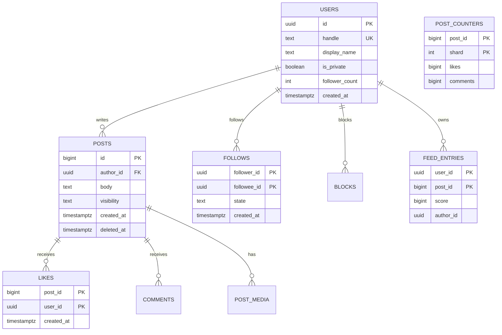
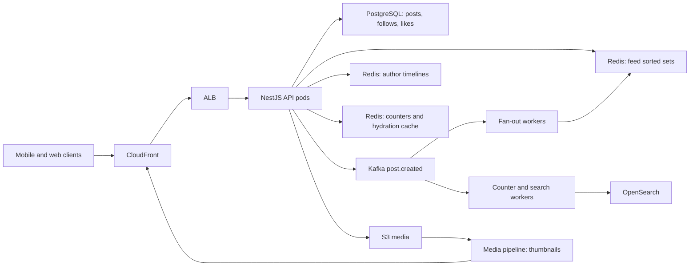
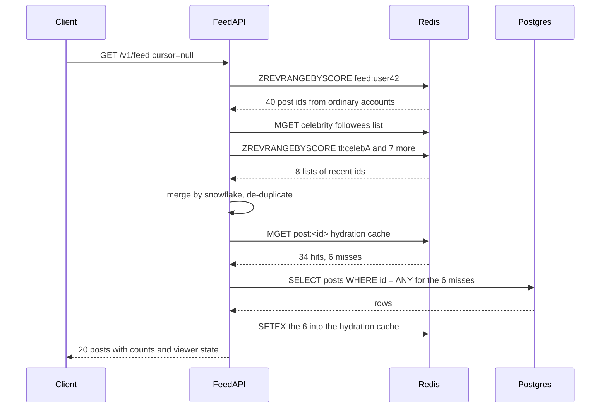
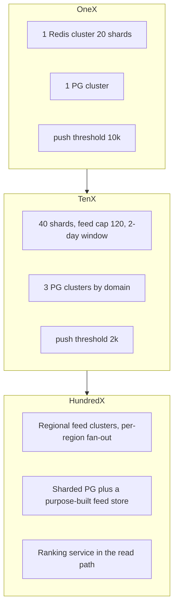

## 52.12 Social Media Feed

### 52.12.1 Requirements

A social media feed is the screen a user opens first: a list of recent posts from the accounts they follow, newest or most interesting first, refreshed every time they pull down. Behind that simple list is one of the most instructive problems in backend engineering, because the naive implementation ("select posts from people I follow, order by time, limit 20") is correct, obvious, and completely unusable at scale.

The users are two groups with opposite needs. Readers want the feed to open in under 200 ms, always, on a phone with three bars of signal. Writers want their post to appear for their followers within seconds. Between them sits a fan-out problem: one write from a writer must become visible in millions of readers' feeds, and one read from a reader must merge content from hundreds of writers.

Imagine a newspaper delivery service in a city. Option one: every morning the printing press prints a personalised paper for every subscriber and a van delivers it to their door. Reading is instant (the paper is already on the doormat), but printing is enormous work, and when a very popular columnist writes something, the press must print fifty million copies of that column. Option two: nobody delivers anything. When you want to read, you walk to every columnist's office and collect their latest pages yourself. Writing is free, but reading takes an hour. Every real feed system is a mix: deliver the papers for ordinary columnists, and let readers pick up the famous ones on the way in. That mix is the hybrid fan-out, and the rest of this design is the machinery that makes it work.

### 52.12.2 Functional requirements

1. A user can follow and unfollow another user; follows may require approval for private accounts.
2. A user can create a post with text up to 2,000 characters and up to four images or one video, and can delete it.
3. A user's **home feed** shows posts from the accounts they follow, newest first, with cursor-based pagination.
4. A user's **profile timeline** shows only their own posts, newest first.
5. A user can like and unlike a post, and comment on a post. Both show counts.
6. Counts (likes, comments, reposts) are shown on every post in the feed.
7. Blocked users' content never appears; private accounts' posts appear only to approved followers.
8. Deleting a post removes it from every feed, including feeds already materialised.
9. Media is uploaded directly to object storage and served from a CDN.
10. The feed supports two ranking modes: strictly chronological, and a scored "For you" ranking.

### 52.12.3 Non-functional requirements

| Property | Target | Why |
|---|---|---|
| Feed read latency | p50 under 80 ms, p99 under 250 ms server-side | The first screen decides whether the app feels alive |
| Post visibility lag | p95 under 5 s for ordinary accounts, under 60 s for accounts with millions of followers | Users refresh right after posting and expect to see it |
| Availability of reads | 99.99 percent | A feed that does not load is an outage in the news |
| Availability of writes | 99.9 percent | A failed post is annoying but recoverable by retry |
| Consistency of the feed | Eventual, seconds | Nobody can tell whether a post arrived 2 s or 5 s ago |
| Consistency of privacy | Strong. A blocked or private post must never leak | This is a trust and legal boundary, not a cache concern |
| Counter accuracy | Approximate above 1,000, exact below | "12.4K likes" is fine; "3 likes" must be right |
| Durability of posts | No post ever lost once acknowledged | PostgreSQL is the source of truth, feeds are derived |

### 52.12.4 Constraints

- Existing stack: NestJS on Kubernetes, PostgreSQL (Aurora), Redis Cluster (ElastiCache), Kafka (MSK), S3 plus CloudFront.
- Team of twelve; no capacity to run a custom storage engine. Everything must be managed AWS or a well-known open-source component.
- Mobile clients on flaky networks, so every read must be retry-safe and every write must accept a client-supplied idempotency key.
- Regulatory: deletion must be honoured within 30 days across all derived stores, including feeds and analytics.
- Budget target under 60,000 USD per month at the modelled scale.

### 52.12.5 Capacity estimation

| Quantity | Assumption | Calculation | Result |
|---|---|---|---|
| Registered users | | given | 300 million |
| Daily actives | | given | 50 million |
| Posts per active user per day | Most users read, few write | 0.2 | |
| Posts per day | 50M x 0.2 | | 10 million |
| Posts per second, average | 10M / 86,400 | | 116 |
| Posts per second, peak | 4x during evening peak | 116 x 4 | 464 |
| Feed opens per active user per day | Sessions plus pull-to-refresh | 8 | |
| Feed reads per day | 50M x 8 | | 400 million |
| Feed reads per second, average | 400M / 86,400 | | 4,630 |
| Feed reads per second, peak | 4x | 4,630 x 4 | 18,500 |
| Read to write ratio | 400M / 10M | | 40 to 1 |
| Average followers per posting account | Long tail, mean pulled up by big accounts | 200 | |
| Naive fan-out writes per day | 10M posts x 200 followers | | 2 billion |
| Naive fan-out writes per second, average | 2B / 86,400 | | 23,150 |
| Naive fan-out writes per second, peak | 4x | | 92,600 |

Ninety thousand Redis writes per second is survivable. The problem is not the average; it is the shape of the distribution.

| Celebrity arithmetic | Assumption | Calculation | Result |
|---|---|---|---|
| Accounts with more than 10,000 followers | 0.5 percent of active accounts | | about 250,000 |
| Share of all posts from those accounts | They post more than average | | 8 percent, 800,000 posts per day |
| Share of all follow edges pointing at those accounts | Popularity concentrates | | 70 percent |
| Fan-out writes caused by those accounts per day | 70 percent of 2 billion | | 1.4 billion |
| Fan-out writes from ordinary accounts per day | 2B - 1.4B | | 600 million |
| Ordinary fan-out per second, peak | 600M / 86,400 x 4 | | 27,800 |
| Largest account | | given | 50 million followers |
| Redis writes for one post by that account | 50M `ZADD` operations | | 50 million |
| Time to fan out on a 20-shard cluster | 50M / 20 shards / 200,000 pipelined ops per second per shard | | 12.5 seconds of the entire cluster |
| Ten such accounts posting in the same minute | 10 x 12.5 s | | 125 seconds of cluster time in a 60 s window |

That last row is the whole argument. Fan-out on write for the top accounts does not merely cost money; it makes the cluster unable to keep up with itself, and while it is busy the ordinary users' posts queue behind it. So the top accounts must be pulled at read time.

| Hybrid read cost | Assumption | Calculation | Result |
|---|---|---|---|
| Celebrity accounts followed by an average user | | | 8 |
| Extra Redis reads per feed request | One `ZREVRANGE` per followed celebrity, from a shared per-author cache | 8 | |
| Extra Redis reads per second, peak | 18,500 x 8 | | 148,000 |
| Cache hit ratio on author timelines | The same 250,000 lists serve everyone | | above 99 percent |

148,000 small reads per second across 20 shards is 7,400 per shard: nothing. The hybrid moves 1.4 billion daily writes into 148,000 cheap, highly cacheable reads per second.

| Storage | Assumption | Calculation | Result |
|---|---|---|---|
| Post row size | ids, text, counters, timestamps | | about 600 B |
| Posts per year | 10M x 365 | | 3.65 billion rows, 2.2 TB |
| Follow edge row | two uuids plus timestamps | | 64 B |
| Follow edges | 300M users x 150 follows | | 45 billion, 2.9 TB |
| Feed entries in Redis | Only users active in the last 3 days | 30 million users | |
| Entries per feed | Capped list | 200 | |
| Bytes per sorted-set entry | 8 B member plus 8 B score plus skiplist overhead | about 70 B | |
| Redis memory for feeds | 30M x 200 x 70 B | | 420 GB |
| Redis memory with author timelines and counters | plus 25 percent | | about 530 GB |
| Media per day | 10M posts x 0.4 media x 800 KB | | 3.2 TB per day, 1.2 PB per year |
| CDN egress | 400M feed opens x 20 posts x 0.4 media x 200 KB thumbnail | | about 640 TB per day |

CDN egress is the largest single line in the bill, which is why thumbnails are aggressively sized and why the feed returns image URLs rather than bytes.

### 52.12.6 API design

| Method | Path | Request | Response | Status codes | Idempotent | Auth |
|---|---|---|---|---|---|---|
| POST | `/v1/posts` | `{ text, mediaIds[], replyToId? }` plus `Idempotency-Key` | `{ id, createdAt, author }` | 201, 400, 401, 409, 429 | Yes, via key | User token |
| DELETE | `/v1/posts/{id}` | | | 204, 403, 404 | Yes | Owner or moderator |
| GET | `/v1/posts/{id}` | | post with counts and viewer state | 200, 403, 404 | Yes | Optional |
| GET | `/v1/feed` | `?cursor=&limit=20&mode=chrono` | `{ items[], nextCursor }` | 200, 401 | Yes | User token |
| GET | `/v1/users/{id}/posts` | `?cursor=&limit=20` | `{ items[], nextCursor }` | 200, 403 | Yes | Optional |
| POST | `/v1/follows` | `{ targetUserId }` | `{ state: 'active' or 'pending' }` | 201, 409, 403 | Yes | User token |
| DELETE | `/v1/follows/{targetUserId}` | | | 204, 404 | Yes | User token |
| PUT | `/v1/posts/{id}/like` | | `{ liked: true, count }` | 200, 404 | Yes | User token |
| DELETE | `/v1/posts/{id}/like` | | `{ liked: false, count }` | 200, 404 | Yes | User token |
| POST | `/v1/posts/{id}/comments` | `{ text }` plus `Idempotency-Key` | comment | 201, 403, 404 | Yes, via key | User token |
| GET | `/v1/posts/{id}/comments` | `?cursor=&limit=20` | `{ items[], nextCursor }` | 200, 404 | Yes | Optional |
| POST | `/v1/media/upload-url` | `{ contentType, bytes }` | `{ mediaId, uploadUrl, fields }` | 201, 400, 413 | No | User token |
| POST | `/v1/blocks` | `{ targetUserId }` | | 201 | Yes | User token |

Two API decisions deserve a note. Likes use `PUT` and `DELETE` rather than `POST /like` and `POST /unlike` because a like is a *state*, not an event: a client that retries `PUT` three times on a bad network must end with exactly one like, and `PUT` says that in the protocol. And the feed uses a **cursor**, never an offset. The cursor is an opaque base64 of `(score, postId)`; the server decodes it into `WHERE (score, post_id) < ($1, $2)` or a Redis `ZREVRANGEBYSCORE` upper bound. Offsets break in a feed because rows are inserted at the head constantly: `LIMIT 20 OFFSET 40` on a moving list shows the reader duplicates and skips items.

### 52.12.7 Data model



```sql
CREATE TABLE users (
  id             uuid PRIMARY KEY DEFAULT gen_random_uuid(),
  handle         citext NOT NULL,
  display_name   text NOT NULL,
  is_private     boolean NOT NULL DEFAULT false,
  follower_count integer NOT NULL DEFAULT 0,   -- denormalised; drives the push/pull decision
  created_at     timestamptz NOT NULL DEFAULT now()
);
CREATE UNIQUE INDEX users_handle_uidx ON users (handle);         -- serves login and @mention lookup

CREATE TABLE follows (
  follower_id uuid NOT NULL REFERENCES users(id),
  followee_id uuid NOT NULL REFERENCES users(id),
  state       text NOT NULL DEFAULT 'active' CHECK (state IN ('active','pending')),
  created_at  timestamptz NOT NULL DEFAULT now(),
  PRIMARY KEY (follower_id, followee_id)                          -- serves "do I follow X" and "who do I follow"
);
CREATE INDEX follows_followee_idx ON follows (followee_id, follower_id)
  WHERE state = 'active';                                         -- serves fan-out: "who follows the author"

CREATE TABLE posts (
  id          bigint PRIMARY KEY,               -- Snowflake id: time-ordered, so id sorts like created_at
  author_id   uuid NOT NULL REFERENCES users(id),
  body        text NOT NULL CHECK (length(body) <= 2000),
  visibility  text NOT NULL DEFAULT 'public' CHECK (visibility IN ('public','followers')),
  reply_to_id bigint,
  created_at  timestamptz NOT NULL DEFAULT now(),
  deleted_at  timestamptz
) PARTITION BY RANGE (created_at);
CREATE INDEX posts_author_idx ON posts (author_id, id DESC) WHERE deleted_at IS NULL;
  -- serves the profile timeline and the pull half of the hybrid feed

CREATE TABLE likes (
  post_id    bigint NOT NULL,
  user_id    uuid NOT NULL REFERENCES users(id),
  created_at timestamptz NOT NULL DEFAULT now(),
  PRIMARY KEY (post_id, user_id)                                   -- makes a double-like a no-op, not a duplicate
) PARTITION BY HASH (post_id);

CREATE TABLE post_counters (
  post_id  bigint NOT NULL,
  shard    smallint NOT NULL CHECK (shard BETWEEN 0 AND 15),
  likes    bigint NOT NULL DEFAULT 0,
  comments bigint NOT NULL DEFAULT 0,
  PRIMARY KEY (post_id, shard)                                     -- 16 rows per post spread lock contention
);
```

`feed_entries` exists in PostgreSQL as a durable backup of the materialised feed, but it is written only for a sampled subset of users and for accounts whose feed we want to rebuild cheaply. The live feed lives in Redis.

```sql
CREATE TABLE feed_entries (
  user_id   uuid NOT NULL,
  post_id   bigint NOT NULL,
  author_id uuid NOT NULL,
  score     bigint NOT NULL,                    -- snowflake id for chrono, ranking score for 'for you'
  PRIMARY KEY (user_id, score DESC, post_id)    -- serves keyset pagination on rebuild
) PARTITION BY HASH (user_id);
```

Posts are partitioned by month, which makes retention a `DETACH PARTITION` instead of a 3-billion-row `DELETE`, and keeps each index small enough to stay in memory. Likes and feed entries are partitioned by hash because there is no time-based access pattern for them, only per-key lookups, and hash partitioning spreads the write load evenly across 32 partitions instead of hammering the tail of one index.

Post ids are Snowflake-style 64-bit integers: 41 bits of millisecond timestamp, 10 bits of worker id, 12 bits of sequence. This matters more than it looks. A time-ordered integer id means the feed's sort key, the pagination cursor and the primary key are the same value, so `ORDER BY id DESC` needs no extra index, cursors are 8 bytes, and Redis sorted-set scores can hold the id directly.

### 52.12.8 High-level architecture



The read path and the write path touch almost nothing in common, which is deliberate. A write goes to PostgreSQL, then to Kafka, and returns. A read goes to Redis, and only touches PostgreSQL when Redis has nothing. The two paths can be scaled, deployed and broken independently.

### 52.12.9 Component design

| Component | Responsibility |
|---|---|
| `PostsController` and `PostsService` | Validate, persist a post, write the outbox row, publish `post.created` |
| `FeedService` | Read the hybrid feed: pull the push list from Redis, merge celebrity timelines, hydrate, filter |
| `FanoutWorker` | Consume `post.created`, expand followers in batches, write into follower feeds |
| `TimelineCache` | Per-author capped list of recent post ids, shared by all followers of that author |
| `CounterService` | Sharded counters in PostgreSQL, cached approximate counts in Redis |
| `HydrationService` | Turn a list of post ids into full post objects using a multi-get cache |
| `VisibilityFilter` | Apply blocks, mutes, private-account rules at read time |
| `FeedRebuilder` | Rebuild a feed from PostgreSQL when Redis has no entry |

```text
src/
  posts/
    posts.module.ts
    posts.controller.ts
    posts.service.ts
    entities/post.entity.ts
  feed/
    feed.module.ts
    feed.controller.ts
    feed.service.ts
    feed-store.service.ts        -- all Redis access for feeds
    hydration.service.ts
    visibility.filter.ts
    rebuild/feed-rebuilder.service.ts
  fanout/
    fanout.module.ts
    fanout.worker.ts             -- Kafka consumer
    follower-page.service.ts
  social/
    follows.service.ts
    likes.service.ts
    counters.service.ts
  media/
    media.controller.ts
```

The heart of the design is one decision made per post: push or pull.

```ts
// fanout/fanout.worker.ts
import { Injectable, Logger } from '@nestjs/common';
import { FollowerPageService } from './follower-page.service';
import { FeedStoreService } from '../feed/feed-store.service';

const PUSH_THRESHOLD = 10_000;   // above this follower count we do not fan out on write
const PAGE = 2_000;              // follower ids per batch, one Redis pipeline per batch

@Injectable()
export class FanoutWorker {
  private readonly logger = new Logger(FanoutWorker.name);
  constructor(private readonly followers: FollowerPageService, private readonly feeds: FeedStoreService) {}

  // Called for every post.created message. Kafka key = authorId so one author is ordered.
  async handle(msg: { postId: string; authorId: string; followerCount: number; createdAt: number }) {
    // Every post always lands in the author's own timeline list: this is the pull side.
    await this.feeds.pushToAuthorTimeline(msg.authorId, msg.postId);

    if (msg.followerCount > PUSH_THRESHOLD) {
      this.logger.log(`post ${msg.postId} is pull-only, author has ${msg.followerCount} followers`);
      return;                                     // celebrity: readers will merge it at read time
    }

    let cursor: string | null = null;
    let written = 0;
    do {
      const page = await this.followers.page(msg.authorId, cursor, PAGE);   // keyset over follows
      if (page.ids.length > 0) {
        // ZADD score=postId member=postId into each follower's feed, then trim, in one pipeline
        await this.feeds.fanoutBatch(page.ids, msg.postId, msg.authorId);
        written += page.ids.length;
      }
      cursor = page.nextCursor;
    } while (cursor);

    this.logger.debug(`post ${msg.postId} fanned out to ${written} feeds`);
  }
}
```

The feed store owns every Redis key shape, so nothing else in the codebase knows what a feed looks like.

```ts
// feed/feed-store.service.ts
import { Inject, Injectable } from '@nestjs/common';
import type { Cluster } from 'ioredis';
import { REDIS_CLIENT } from '../redis/redis.module';

const FEED_CAP = 200;             // entries kept per user feed
const AUTHOR_CAP = 100;           // entries kept per author timeline
const FEED_TTL = 7 * 24 * 3600;   // idle feeds expire; rebuild on demand

@Injectable()
export class FeedStoreService {
  constructor(@Inject(REDIS_CLIENT) private readonly redis: Cluster) {}

  feedKey(userId: string) { return `feed:{${userId}}`; }
  authorKey(authorId: string) { return `tl:{${authorId}}`; }

  async fanoutBatch(followerIds: string[], postId: string, authorId: string): Promise<void> {
    const pipe = this.redis.pipeline();
    for (const uid of followerIds) {
      const k = this.feedKey(uid);
      pipe.zadd(k, postId, `${postId}:${authorId}`);       // score is the snowflake id: time ordering for free
      pipe.zremrangebyrank(k, 0, -(FEED_CAP + 1));         // keep only the newest FEED_CAP entries
      pipe.expire(k, FEED_TTL);
    }
    await pipe.exec();
  }

  async pushToAuthorTimeline(authorId: string, postId: string): Promise<void> {
    const k = this.authorKey(authorId);
    await this.redis.multi().zadd(k, postId, postId).zremrangebyrank(k, 0, -(AUTHOR_CAP + 1)).exec();
  }

  async readFeed(userId: string, beforeScore: string, limit: number) {
    return this.redis.zrevrangebyscore(this.feedKey(userId), `(${beforeScore}`, '-inf', 'LIMIT', 0, limit);
  }

  async readAuthorTimeline(authorId: string, beforeScore: string, limit: number) {
    return this.redis.zrevrangebyscore(this.authorKey(authorId), `(${beforeScore}`, '-inf', 'LIMIT', 0, limit);
  }
}
```

Two details in `fanoutBatch` carry the whole memory budget. `ZREMRANGEBYRANK` after every insert is what caps a feed at 200 entries, so memory is bounded by active users rather than by post volume. And `EXPIRE` is what limits materialised feeds to users who actually come back; a user who has not opened the app in a week costs nothing until they return, at which point the rebuilder fills their feed from PostgreSQL in about 40 ms.

The read side merges the two halves.

```ts
// feed/feed.service.ts
import { Injectable } from '@nestjs/common';
import { FeedStoreService } from './feed-store.service';
import { HydrationService } from './hydration.service';
import { VisibilityFilter } from './visibility.filter';
import { FollowsService } from '../social/follows.service';
import { FeedRebuilderService } from './rebuild/feed-rebuilder.service';

const MAX_SNOWFLAKE = '9223372036854775807';

@Injectable()
export class FeedService {
  constructor(
    private readonly store: FeedStoreService,
    private readonly hydration: HydrationService,
    private readonly visibility: VisibilityFilter,
    private readonly follows: FollowsService,
    private readonly rebuilder: FeedRebuilderService,
  ) {}

  async getFeed(userId: string, cursor: string | null, limit = 20) {
    const before = cursor ?? MAX_SNOWFLAKE;

    // 1. Push half: the materialised feed. Over-fetch because filtering removes some.
    let pushed = await this.store.readFeed(userId, before, limit * 2);
    if (pushed.length === 0 && !(await this.store.exists(userId))) {
      pushed = await this.rebuilder.rebuild(userId, before, limit * 2);   // cold or evicted feed
    }

    // 2. Pull half: recent posts from the few big accounts this user follows.
    const bigOnes = await this.follows.celebrityFollowees(userId);        // cached list, usually under 20 ids
    const pulled = await Promise.all(
      bigOnes.map((a) => this.store.readAuthorTimeline(a, before, limit)),
    );

    // 3. Merge by snowflake id descending, de-duplicate, cut to the page size after filtering.
    const ids = [...new Set([...pushed.map(stripAuthor), ...pulled.flat()])]
      .sort((a, b) => (BigInt(b) > BigInt(a) ? 1 : -1));

    const visible = await this.visibility.filter(userId, ids);
    const page = visible.slice(0, limit);
    const items = await this.hydration.hydrate(userId, page);
    return { items, nextCursor: page.length === limit ? page[page.length - 1] : null };
  }
}

function stripAuthor(entry: string) { return entry.split(':')[0]; }
```



### 52.12.10 Database design

PostgreSQL is the source of truth for posts, follows, likes and comments; nothing in Redis is authoritative. The write path uses the **transactional outbox** so that a post and its Kafka event cannot diverge: the insert into `posts` and the insert into `outbox` happen in one transaction, and a relay process reads the outbox and publishes to Kafka. Without it, a crash between `COMMIT` and `producer.send` gives you a post that exists but never fans out, which the user experiences as "my post disappeared".

```ts
// posts/posts.service.ts (excerpt)
async create(authorId: string, dto: CreatePostDto, idempotencyKey: string) {
  return this.dataSource.transaction(async (m) => {
    const existing = await m.findOne(IdempotencyRecord, { where: { key: idempotencyKey } });
    if (existing) return existing.response;                       // retry-safe

    const id = this.snowflake.next();
    await m.insert(Post, { id, authorId, body: dto.text, visibility: dto.visibility });
    await m.insert(Outbox, {
      topic: 'post.created',
      key: authorId,                                              // per-author ordering in Kafka
      payload: { postId: id, authorId, followerCount: dto.followerCount, createdAt: Date.now() },
    });
    await m.insert(IdempotencyRecord, { key: idempotencyKey, response: { id } });
    return { id };
  });
}
```

Reads are split across replicas: the feed hydration misses and the profile timeline go to a read replica, while anything read inside a write transaction (a follow check before creating a private post reply) goes to the writer, because replica lag of 20 to 200 ms is enough to produce a wrong authorisation answer. The rule the team follows is blunt and easy to review: *if the result of the read decides whether a write is allowed, it reads from the primary.*

Retention: post partitions older than five years move to cheaper storage; `feed_entries` partitions are dropped after 30 days because they are pure derived data. Vacuum settings on `likes` are tuned aggressively (`autovacuum_vacuum_scale_factor = 0.02`) because unlike-then-like churn creates dead tuples faster than the default threshold reacts.

### 52.12.11 Caching

| What | Where | Structure | TTL | Invalidation |
|---|---|---|---|---|
| Home feed | Redis Cluster | Sorted set `feed:{userId}`, capped at 200 | 7 days idle | Rebuilt from PostgreSQL on miss |
| Author timeline | Redis Cluster | Sorted set `tl:{authorId}`, capped at 100 | 30 days | Post delete removes the member |
| Post hydration | Redis | String `post:{id}` with a packed JSON body | 6 hours | Delete or edit publishes an invalidation |
| Counters | Redis | Hash `cnt:{postId}` with `likes`, `comments` | 60 s for hot posts | Refreshed by the counter worker |
| Viewer state | Redis | Bitmap-free set `liked:{userId}:{bucket}` of liked post ids | 24 h | Written on like and unlike |
| Celebrity followee list | Redis | Set `cel:{userId}` | 10 min | Follow and unfollow rewrite it |
| Blocks and mutes | Redis | Set `blk:{userId}` | 1 h | Block writes invalidate immediately |

The hydration cache is the one that carries the traffic. A feed page needs 20 posts; a popular post appears in millions of feeds within minutes, so the hit ratio on `post:{id}` sits above 97 percent and PostgreSQL sees only the tail. Stampede protection matters here: when a very popular post's cache entry expires, thousands of concurrent requests would all query PostgreSQL for it. The hydration service uses a short per-key lock (`SET post:lock:{id} NX PX 200`); the winner queries and refills, the losers serve the slightly stale value they already have or wait up to 50 ms.

Blocks are cached but never *only* cached. The visibility filter reads the Redis block set, and the post-detail endpoint additionally re-checks in PostgreSQL, because a leak through a stale cache is a trust failure, not a performance issue.

### 52.12.12 Messaging

| Topic | Key | Partitions | Events | Consumers |
|---|---|---|---|---|
| `post.created` | `authorId` | 64 | new post with author follower count | Fan-out workers, search indexer, ranking feature builder |
| `post.deleted` | `authorId` | 64 | post id, author id | Feed cleaner, search indexer, media reaper |
| `social.engagement` | `postId` | 32 | like, unlike, comment | Counter aggregator, ranking signals |
| `follow.changed` | `followerId` | 32 | follow, unfollow, approve | Celebrity-list cache, backfill worker |
| `post.created.dlq` | | 8 | poison messages | On-call inspection |

Keying `post.created` by `authorId` guarantees per-author ordering, so a create followed 200 ms later by a delete cannot be processed out of order for the same author. Keying `social.engagement` by `postId` means all likes for one post land in one partition, which lets the counter aggregator batch them: it accumulates deltas in memory for two seconds, then issues one `UPDATE post_counters SET likes = likes + $delta WHERE post_id = $1 AND shard = $2`. Fifty thousand likes per second on one viral post become 30 database writes per minute instead of 3 million.

Consumers are idempotent by construction. The fan-out worker's operation is `ZADD` with a fixed member, which is naturally idempotent: processing the same message twice produces the same sorted set. The counter aggregator is not naturally idempotent (adding a delta twice double-counts), so it commits the Kafka offset in the same PostgreSQL transaction as the counter update, using a `consumer_offsets` table. That turns at-least-once delivery into effectively-once accounting.

Retries use a tiered backoff: three in-process retries at 100 ms, 500 ms, 2 s, then a re-publish to `post.created.retry` with a 30-second delay, then the DLQ after five attempts. Anything in the DLQ pages the on-call during business hours and creates a ticket otherwise, because a post that never fanned out is invisible to its followers forever unless someone replays it.

### 52.12.13 Scaling

**At 1x (50 million daily actives, 18,500 feed reads per second peak).** Sixty API pods, twenty fan-out worker pods, a 20-shard Redis Cluster with replicas holding about 530 GB, an Aurora PostgreSQL cluster with a writer and four readers, 64 Kafka partitions on `post.created`. The push threshold is 10,000 followers. Nothing exotic; the design as described.

**At 10x (500 million daily actives).** Three things break in order.

First, Redis memory: 4.2 TB of feeds. The fix is not more RAM but a smaller working set. The feed cap drops from 200 to 120 entries (nobody scrolls past 120 without triggering a rebuild anyway), the materialisation window shrinks from 7 days of inactivity to 2 days, and the entry becomes a bare 8-byte snowflake instead of `postId:authorId`, cutting per-entry cost by 30 percent. Combined, memory lands near 1.8 TB, which is 40 shards.

Second, fan-out throughput: 280,000 ordinary fan-out writes per second at peak. The push threshold drops from 10,000 to 2,000 followers, moving more accounts to the pull side, and fan-out workers are sharded by author-id hash so that consumer rebalances do not shuffle work. Follower pages grow from 2,000 to 5,000 ids per pipeline to cut round trips.

Third, PostgreSQL write volume on `likes` and `follows`. The cluster is split by domain: a graph database cluster for `follows` and `blocks`, a content cluster for `posts` and `comments`, and an engagement cluster for `likes` and counters. Each is independently sharded by hash of the leading key using Citus or application-level routing.



**At 100x (5 billion daily actives, which is beyond any real product but useful as an exercise).** The feed stops being a cache and becomes a service with its own storage engine, because Redis's memory cost per feed entry is no longer acceptable: a log-structured store on NVMe with an in-memory index for the hot head of each feed halves the cost. Fan-out becomes regional: a post fans out only within the author's region synchronously, and cross-region followers pull. Ranking moves into the read path as a separate service that scores a candidate set of about 500 posts per request with a model, which changes the feed from "merge two sorted lists" to "retrieve candidates, score, sort", and adds a 30 ms budget the current design does not have.

### 52.12.14 Security

- **Authorisation on read, not only on write.** A post's visibility is checked at read time against the current follow and block state, because a user can be blocked after a post was already fanned out into their feed. The filter runs on every feed page; being in someone's materialised feed is never proof of permission.
- **Private accounts.** When a public account switches to private, a background job removes its posts from the feeds of non-approved followers. Until that job finishes, the read-time filter is what protects the content, which is the reason the filter exists at all.
- **Enumeration.** Snowflake ids are time-ordered and therefore guessable. The post-detail endpoint enforces visibility on every fetch, and unauthenticated access to `/v1/posts/{id}` is rate limited per IP to stop scraping the whole corpus by walking ids.
- **Media.** Upload URLs are presigned S3 POST policies scoped to one key, one content type and a byte range, valid for 5 minutes. Uploaded files are scanned and re-encoded before being served, which strips EXIF GPS data and defuses polyglot files that pretend to be images.
- **Abuse and spam.** Post creation is rate limited per user and per IP (see 52.3), new accounts have a lower limit, and follow actions are limited to stop follow-churn bots. A `report` endpoint feeds a moderation queue.
- **Blocked-user leakage through counters.** A blocked user's like still increments a counter the blocker can see. That is accepted; hiding it would leak the block. What must not leak is identity, so the "liked by" list is filtered.
- **Deletion.** `DELETE /v1/posts/{id}` sets `deleted_at`, publishes `post.deleted`, and the hydration cache entry is removed immediately, which makes the post vanish from every feed within the next hydration even before the feed cleaner runs.

### 52.12.15 Failure scenarios

| Failure | Detection | Impact | Mitigation | What the user sees |
|---|---|---|---|---|
| Celebrity post storm: ten large accounts post in the same minute and fan-out lag spikes | Kafka consumer lag on `post.created`, fan-out duration histogram | Ordinary users' posts are delayed behind celebrity work | Push threshold makes large accounts pull-only, so the storm never enters the fan-out path; a runtime-tunable threshold can be lowered during an incident | Nothing |
| Redis eviction or node loss wipes a set of feeds | `feed_miss_total` spike, Redis `evicted_keys` | Affected users' feeds are empty | `FeedRebuilder` detects the missing key and rebuilds from `posts` joined to `follows` with a keyset query, capped at 200 entries, in about 40 ms; the rebuild is protected by a per-user lock so a thundering herd of retries rebuilds once | A slightly slower first load |
| Duplicate fan-out after a consumer rebalance | Duplicate detection counter on `ZADD` returning 0 | Same post appears twice in a feed | `ZADD` with a deterministic member makes duplicates a no-op; the merge step also de-duplicates by post id | Nothing |
| Stale counters: the aggregator lags and likes appear frozen | Aggregator lag metric, counter age gauge | Counts under-report for minutes | Redis holds an optimistic delta applied on top of the last aggregated value; the client's own like is always reflected immediately from viewer state | Count may jump when it catches up |
| Fan-out worker crashes mid-post, having written 300,000 of 900,000 feeds | Consumer restart, offset not committed | Partial fan-out | The message is redelivered from the last committed offset; because `ZADD` is idempotent the first 300,000 are rewritten harmlessly and the rest complete | A short delay for some followers |
| PostgreSQL writer failover | Connection errors, Aurora event | Posting fails for 20 to 40 s | Retries with jittered backoff in the client, feed reads unaffected because they are served from Redis | "Could not post, tap to retry" |
| Kafka partition unavailable | Producer errors, outbox backlog grows | Posts persist but do not fan out | The outbox relay retries; posts are already durable, so nothing is lost, only delayed | Post visible on own profile but not in followers' feeds for a while |
| Deleted post still visible in materialised feeds | Reports, `deleted_hydration_total` | A removed post is displayed | Hydration returns a tombstone for `deleted_at IS NOT NULL` and the client drops it; the feed cleaner removes members asynchronously | Post disappears on next refresh |
| Hot post: one item gets 200,000 likes per minute | Per-key Redis CPU, counter shard contention | Counter row contention, cache stampede on hydration | Sharded counters spread writes over 16 rows; the hydration entry gets a longer TTL and a lock-protected refill | Nothing |
| Feed rebuild storm after a full Redis cluster restart | 30 million missing feeds at once | PostgreSQL overwhelmed by rebuild queries | Rebuild is admission-controlled by a semaphore of 500 concurrent rebuilds per pod; over the limit the API serves a pull-only feed built from the user's followees, which is slower but works | Slower feeds for a few minutes |
| Follow-graph read on a lagging replica | Replica lag metric | A just-followed account's posts do not appear | Follow writes also push the new followee into the user's Redis followee cache synchronously | Nothing |
| Clock skew produces out-of-order snowflake ids | Monitoring on id generator clock | Feed ordering slightly wrong | The generator refuses to emit ids if the clock moves backwards and waits; ordering errors are bounded by milliseconds | Nothing |

### 52.12.16 Observability

Metrics that matter: `feed_read_duration_seconds` split by push-only, hybrid and rebuild paths; `feed_entries_returned` histogram (a drop means the visibility filter is removing too much); `fanout_lag_seconds` measured as the difference between `post.created` timestamp and the moment the last follower's feed was written, at p50 and p99; `fanout_followers_written_total`; `feed_rebuild_total` and its duration; `hydration_cache_hit_ratio`; `counter_lag_seconds`; Kafka consumer lag per topic; Redis memory, evictions and per-shard key count.

The single most valuable alert is on `fanout_lag_seconds` p99 above 60 seconds, because it is the number that describes the product promise ("your post reaches your followers"). The second is on `feed_entries_returned` p10 falling below five, which catches a broken visibility filter faster than any error rate, since a filter bug returns 200 OK with an empty feed.

Traces cover the read path with spans for `feed.readPush`, `feed.readPull`, `feed.filter` and `feed.hydrate`, which makes it obvious in one flame graph whether a slow feed is Redis, PostgreSQL or the merge. Logs record every rebuild with the user id and the reason, sampled at 1 percent for successes and 100 percent for failures.

### 52.12.17 Deployment

| Workload | Kind | Replicas | Notes |
|---|---|---|---|
| `feed-api` | Deployment | 60, HPA on p95 latency and CPU | Read path only; scaled by request volume |
| `posts-api` | Deployment | 20 | Write path; PDB keeps two available during rollouts |
| `fanout-worker` | Deployment | 20, KEDA scaled on Kafka lag | The lag-driven autoscaler is what absorbs evening peaks |
| `counter-aggregator` | Deployment | 6 | Consumer group on `social.engagement` |
| `outbox-relay` | Deployment | 3 | Leader-elected via advisory lock, only one active |
| `feed-cleaner` | CronJob every 5 min | 1 | Removes deleted posts from materialised feeds |
| `media-transcoder` | Deployment | 10 | S3 event driven |

Migrations are expand-and-contract: add nullable columns, deploy code that writes both, backfill in batches of 10,000 rows with a sleep, deploy code that reads the new column, drop the old one a release later. Partition creation for `posts` runs a month ahead via a scheduled job, because a missing partition turns every insert into an error at midnight on the first of the month.

Rollout is canary at 5 percent for 30 minutes with automatic rollback if `feed_read_duration_seconds` p99 or the empty-feed ratio regresses. Feature flags gate the push threshold, the feed cap and the ranking mode, so an incident can be mitigated by changing a number rather than by deploying.

### 52.12.18 Cost considerations

| Item | Sizing | Monthly (USD, approximate) |
|---|---|---|
| CloudFront egress for media | 640 TB per day at negotiated rates | 28,000 |
| S3 storage and requests | 1.2 PB growing, Intelligent-Tiering | 9,000 |
| ElastiCache Redis Cluster | 20 shards of cache.r6g.4xlarge with replicas | 12,500 |
| Aurora PostgreSQL | 1 writer plus 4 readers, r6g.8xlarge, 6 TB | 9,000 |
| EKS compute for API and workers | about 120 pods across 30 nodes | 6,000 |
| MSK Kafka | 6 brokers, 64 plus partitions, 3-day retention | 2,500 |
| OpenSearch for search | 6 data nodes | 2,000 |
| Media transcoding | 3.2 TB per day of images and short video | 3,500 |
| Observability | metrics, logs, traces | 2,500 |
| Total | | about 75,000 |

The dominant cost is CDN egress, not compute or storage, and it scales with *reads*, not with posts. That single fact drives more engineering than anything else: aggressive thumbnail sizing (a 200 KB feed thumbnail instead of a 900 KB original saves about 18,000 USD per month), modern formats (AVIF over JPEG saves another 30 percent), long cache lifetimes on immutable media URLs, and lazy loading below the fold. Redis is the second driver, which is why the feed cap and the inactivity TTL are treated as budget levers, not implementation details.

### 52.12.19 Tradeoffs

- **Hybrid fan-out instead of pure push or pure pull.** Two code paths, a merge step and a threshold to tune, in exchange for bounded write amplification and a read path that stays under 100 ms. Pure push is simpler until one account has ten million followers; pure pull is simpler until a user follows a thousand accounts.
- **Capped feeds.** A user who scrolls past 200 items pays a rebuild. The alternative, unbounded feeds, multiplies Redis memory by ten for a behaviour under 1 percent of sessions exhibits.
- **Redis as the feed store with PostgreSQL as the source of truth.** Losing Redis loses no data, only speed. The price is the rebuild path, which must be written, tested and load-tested even though it runs rarely, because when it does run it runs for everyone at once.
- **Approximate counters above 1,000.** Users cannot tell 12,412 from 12,438, and the exact version costs a synchronous write per like on a hot row. Below 1,000 the number is exact, because "3 likes" being wrong is noticeable.
- **Visibility filtering at read time.** Every feed page pays a set-membership check against blocks and follows. Filtering at write time would be cheaper but wrong, because permissions change after fan-out.
- **Snowflake ids instead of UUIDs.** Time-ordered ids give free sort order, 8-byte cursors and clustered inserts, at the cost of leaking creation time and needing a worker-id allocation scheme.
- **Chronological by default, scored behind a flag.** Chronological is explainable, debuggable and cheap. Scoring needs a feature store, a model service and a 30 ms budget, and it makes "why did I see this?" a support question.

### 52.12.20 Alternative architectures

**Pure fan-out on read with a materialised view per author.** Keep no per-user feeds at all. On every feed request, fetch the user's followee list and merge the newest N posts from each author's cached timeline. This is dramatically simpler: no fan-out workers, no Kafka topic, no rebuild path, no duplicate handling, and posting is instant for everyone including celebrities. It wins when the average user follows few accounts (under about 50) or when the product is a professional network where feeds are read a few times a day rather than continuously. It loses when users follow hundreds of accounts, because a merge across 500 timelines costs 500 Redis reads per page, or 9 million reads per second at our peak, and the tail latency becomes the number of followees rather than a constant.

**A purpose-built feed store instead of Redis.** Replace the sorted sets with a partitioned log-structured store (Cassandra, ScyllaDB, or a custom NVMe-backed service) keyed by `(user_id, bucket)` with the newest posts in a wide row. Storage cost per feed entry drops by roughly 10x compared to RAM, feeds can be much longer, and durability comes for free so the rebuild path becomes an optimisation rather than a necessity. It wins above a few hundred million active feeds where Redis memory becomes the dominant bill. It loses on latency (1 to 5 ms instead of 0.3 ms), on operational complexity (you now run a distributed database), and on the sheer convenience of `ZADD` plus `ZREMRANGEBYRANK` being one atomic capped insert.

**Ranking-first architecture with a candidate generator.** Drop the idea of a stored feed entirely. On each request, a retrieval service produces a few thousand candidate posts from several sources (followed accounts, topical interest, trending, friends-of-friends), a model scores them, and the top 20 are returned. This is what large recommendation-driven feeds actually do. It wins on engagement and on cold-start users who follow nobody, and it makes the "one celebrity, fifty million followers" problem disappear because nothing is materialised. It loses on cost (a scoring pass per request instead of a sorted-set read), on latency budget, on explainability, and on the enormous machine-learning platform investment it presumes: a feature store, training pipelines, online model serving and an experimentation framework are all prerequisites, not details.
