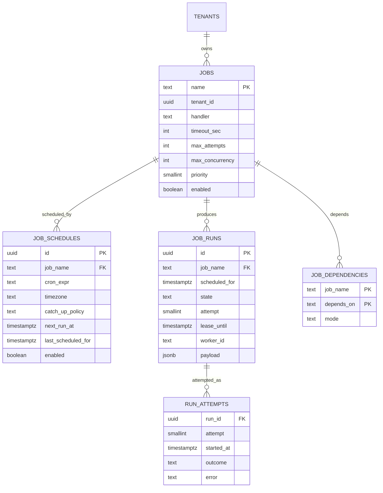
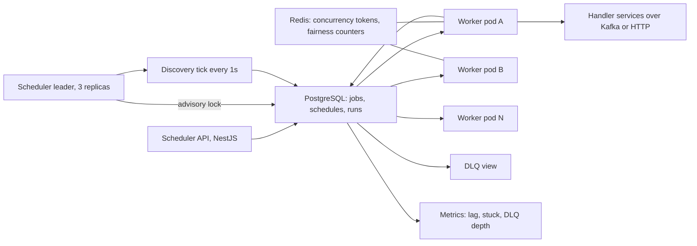
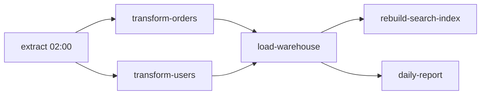
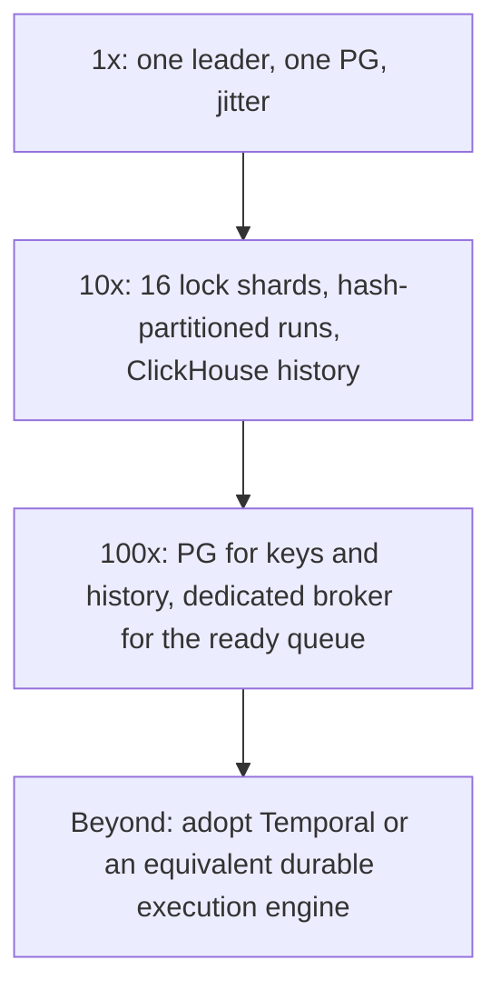

## 52.15 Distributed Job Scheduler

### 52.15.1 Requirements

Every backend platform grows a scheduler. It starts as a `@Cron()` decorator in one service, becomes three services with overlapping cron expressions, and ends as an incident where the nightly invoice job ran twice on two pods and charged everybody twice. This design is the grown-up version: a service that runs recurring and one-off jobs across many workers, exactly once in *effect*, on time, with retries, dependencies, priorities, tenant isolation and an audit trail.

The users are engineering teams who register jobs ("send the daily digest at 07:00 in each tenant's local timezone", "reconcile payments every 15 minutes", "rebuild the search index after the nightly import"), and the on-call engineer who at 03:00 needs to know why a job did not run, whether it is safe to re-run it, and how to cancel the one that is stuck.

Imagine a factory foreman with a clipboard. The clipboard lists tasks and the times they are due. The foreman does not do the work; he walks the floor, and when a task becomes due he puts a card in a tray. Workers take cards from the tray, and while a worker holds a card they wear a badge with the card number and a timer. If a worker collapses, the timer runs out, the card goes back in the tray, and someone else picks it up. There is exactly one foreman on duty at a time, chosen by whoever holds the foreman's key, and if he disappears someone else takes the key after a minute. That is the entire architecture: a leader-elected clock, a durable tray, and leases with heartbeats.

### 52.15.2 Functional requirements

1. Register a **job definition**: a name, a handler type, a payload schema, timeout, retry policy, concurrency limits and an owning team.
2. Attach one or more **schedules** to a job: a cron expression with a timezone, a fixed interval, or a one-off run at a specific time.
3. Enqueue **one-off jobs** programmatically with an optional delay (`runAt`).
4. Execute each scheduled occurrence **exactly once in effect**, even when schedulers and workers crash, restart or duplicate.
5. Retry failed runs with exponential backoff and jitter, up to a maximum attempt count, then move to a dead-letter queue.
6. Support **priorities** and fairness so a large tenant's batch cannot starve a small tenant's job.
7. Enforce **concurrency limits** per job type and per tenant.
8. Support **DAG dependencies**: job B runs only after job A succeeds for the same logical date, in topological order.
9. Support **backfills**: run a job for a range of past scheduled times, and a catch-up policy for runs missed during an outage.
10. Cancel a scheduled or running job, and pause or resume a schedule.
11. Keep a queryable **execution history**: when it ran, on which worker, how long it took, the outcome and the logs.
12. Isolate tenants: one tenant's poison job must not stop another tenant's runs.

### 52.15.3 Non-functional requirements

| Property | Target | Why |
|---|---|---|
| Scheduling lag | p95 under 5 s, p99 under 15 s from due time to claim | "Every 15 minutes" must not drift into "every 17 minutes" |
| Duplicate execution rate | Zero duplicate *effects*; duplicate attempts are allowed and must be harmless | The handler contract is idempotency |
| Missed runs | Zero, except runs explicitly skipped by a catch-up policy | A missed invoice run is a finance incident |
| Availability of scheduling | 99.95 percent | A short scheduler outage is recoverable by catch-up |
| Availability of the API | 99.9 percent | Registering a job can wait |
| Throughput | 1 million runs per day, 20,000 claims per minute at midnight | The peak is not the average |
| History retention | 90 days queryable, 2 years archived | Audit and debugging |
| Clock correctness | Runs are computed from a single authority, never from a worker's local clock | Clock skew is the classic source of double fires |

### 52.15.4 Constraints

- PostgreSQL is already operated well by this team, and Redis is available. There is no appetite to run ZooKeeper or etcd for leader election.
- Handlers live in the teams' own NestJS services, not in the scheduler, so the scheduler dispatches work rather than executing business logic.
- Multi-tenant SaaS: about 4,000 tenants across 30 timezones, so DST is a real problem, not a footnote.
- Some jobs must run in a specific region for data-residency reasons.
- The team must be able to answer "did job X run for 2026-09-08, and what happened" in one query.

### 52.15.5 Capacity estimation

| Quantity | Assumption | Calculation | Result |
|---|---|---|---|
| Job definitions | 4,000 tenants x 12 tenant jobs plus 400 platform jobs | | about 48,400 |
| Schedules | 1.2 per job | | about 58,000 |
| Runs per day | given | | 1,000,000 |
| Runs per second, average | 1,000,000 / 86,400 | | 11.6 |
| Share of runs on an hour boundary | Cron expressions cluster on `0 * * * *` | 45 percent | 450,000 |
| Share of runs at exactly 00:00 | Daily jobs cluster at midnight | 20 percent | 200,000 |
| Claims per second in the midnight minute | 200,000 spread over the discovery window | | 3,300 per second if spread over 60 s |
| Claims per second if not spread | All at the first tick | | 200,000 in one second, which is the thundering herd |
| Average run duration | Mixed: most under 2 s, some minutes | | 4 s mean |
| Concurrent runs, average | 11.6 per second x 4 s | | 47 |
| Concurrent runs at midnight peak | 3,300 per second x 4 s | | 13,200 |
| Workers needed at peak | 13,200 / 40 concurrent slots per worker pod | | 330 pods, or 100 pods with a 3-minute spread |

| Storage | Calculation | Result |
|---|---|---|
| `job_runs` row size | ids, timestamps, state, attempt, error, worker id | about 400 B |
| `job_runs` per day | 1M rows x 400 B | 400 MB per day |
| `job_runs` for 90 days | 90 x 400 MB | 36 GB |
| Index overhead | about 60 percent of table size | 22 GB |
| Total hot history | | about 58 GB, comfortable in one PostgreSQL cluster |
| Rows scanned by the due-job query | With the right index, only rows due now | tens to thousands, never 90 million |

| Discovery cost | Calculation | Result |
|---|---|---|
| Discovery tick interval | | 1 s |
| Ticks per day | | 86,400 |
| Rows returned per tick, average | 1M / 86,400 | 11.6 |
| Rows returned at the midnight tick without jitter | | 200,000 |
| Index used | `(next_run_at) WHERE enabled` | Index-only range scan |
| Cost per tick, normal | Index scan of a few rows | under 1 ms |

Two numbers dominate every decision below. The average of 11.6 runs per second is trivially small, so this is not a throughput problem. The 200,000-runs-at-midnight spike is 17,000 times the average, so it is entirely a *burst* problem, and the design is shaped around spreading and absorbing that burst rather than around raw capacity.

### 52.15.6 API design

| Method | Path | Request | Response | Status codes | Idempotent | Auth |
|---|---|---|---|---|---|---|
| POST | `/v1/jobs` | `{ name, handler, timeoutSec, retryPolicy, maxConcurrency, tenantId? }` | job | 201, 409 | Yes, by `name` | Service token |
| PUT | `/v1/jobs/{name}` | full definition | job | 200, 404 | Yes | Owner team |
| POST | `/v1/jobs/{name}/schedules` | `{ cron, timezone, catchUpPolicy, enabled }` | schedule | 201, 400 | Yes, by `(job,cron,tz)` | Owner team |
| PUT | `/v1/schedules/{id}` | `{ cron?, timezone?, enabled? }` | schedule | 200, 404 | Yes | Owner team |
| POST | `/v1/schedules/{id}/pause` | | | 204 | Yes | Owner team |
| POST | `/v1/jobs/{name}/runs` | `{ payload, runAt?, priority?, dedupeKey? }` | `{ runId, state }` | 201, 202, 409 | Yes, by `dedupeKey` | Service token |
| GET | `/v1/runs/{id}` | | run with attempts and logs | 200, 404 | Yes | Owner or admin |
| GET | `/v1/jobs/{name}/runs` | `?from=&to=&state=&cursor=` | list | 200 | Yes | Owner |
| POST | `/v1/runs/{id}/cancel` | `{ reason }` | run | 200, 409 | Yes | Owner |
| POST | `/v1/runs/{id}/retry` | | new run | 201, 409 | Yes, by `(runId,attempt)` | Owner |
| POST | `/v1/jobs/{name}/backfill` | `{ from, to, maxParallel }` | `{ backfillId, plannedRuns }` | 202, 400 | Yes, by `(job,from,to)` | Owner |
| GET | `/v1/dlq` | `?job=&cursor=` | failed runs | 200 | Yes | Owner |
| POST | `/v1/dlq/{runId}/requeue` | | run | 201 | Yes | Owner |

Worker-facing endpoints are deliberately absent. Workers do not poll an HTTP API; they claim rows directly from PostgreSQL with `FOR UPDATE SKIP LOCKED`, which removes an entire tier from the hot path and makes the claim atomic with the state transition. The HTTP API is for humans and for services that enqueue jobs.

`dedupeKey` on one-off enqueue is the caller-side idempotency key. `POST /v1/jobs/send-invoice/runs` with `dedupeKey: "invoice-2026-09-payer-77"` returns the existing run on a second call rather than creating a duplicate, which is what makes it safe for an upstream service to retry a network timeout.

### 52.15.7 Data model



```sql
CREATE TABLE jobs (
  name            text PRIMARY KEY,                    -- 'billing.daily-invoice'
  tenant_id       uuid,                                -- NULL means a platform job
  handler         text NOT NULL,                       -- routing key to the owning service
  region          text NOT NULL DEFAULT 'eu-west-1',   -- data residency
  timeout_sec     integer NOT NULL DEFAULT 300 CHECK (timeout_sec BETWEEN 1 AND 21600),
  max_attempts    smallint NOT NULL DEFAULT 5,
  backoff_base_ms integer NOT NULL DEFAULT 2000,
  max_concurrency smallint NOT NULL DEFAULT 10,        -- per job name
  priority        smallint NOT NULL DEFAULT 5 CHECK (priority BETWEEN 1 AND 9),
  enabled         boolean NOT NULL DEFAULT true
);

CREATE TABLE job_schedules (
  id                  uuid PRIMARY KEY DEFAULT gen_random_uuid(),
  job_name            text NOT NULL REFERENCES jobs(name) ON DELETE CASCADE,
  cron_expr           text NOT NULL,                   -- '0 7 * * *'
  timezone            text NOT NULL DEFAULT 'UTC',     -- IANA name, e.g. 'Europe/Berlin'
  catch_up_policy     text NOT NULL DEFAULT 'skip'
                        CHECK (catch_up_policy IN ('skip','run_once','run_all')),
  next_run_at         timestamptz NOT NULL,            -- always stored in UTC
  last_scheduled_for  timestamptz,
  enabled             boolean NOT NULL DEFAULT true,
  UNIQUE (job_name, cron_expr, timezone)               -- registering the same schedule twice is a no-op
);
CREATE INDEX schedules_due_idx ON job_schedules (next_run_at)
  WHERE enabled;                                        -- serves the due-schedule scan: the hottest query

CREATE TABLE job_runs (
  id            uuid NOT NULL DEFAULT gen_random_uuid(),
  job_name      text NOT NULL,
  tenant_id     uuid,
  scheduled_for timestamptz NOT NULL,                   -- the logical time, not the actual time
  state         text NOT NULL DEFAULT 'pending'
                  CHECK (state IN ('pending','claimed','running','succeeded','failed','dead','cancelled','skipped')),
  attempt       smallint NOT NULL DEFAULT 0,
  priority      smallint NOT NULL DEFAULT 5,
  run_after     timestamptz NOT NULL DEFAULT now(),     -- backoff target for retries
  lease_until   timestamptz,
  worker_id     text,
  payload       jsonb NOT NULL DEFAULT '{}'::jsonb,
  dedupe_key    text,
  created_at    timestamptz NOT NULL DEFAULT now(),
  PRIMARY KEY (id, created_at)
) PARTITION BY RANGE (created_at);

-- The execution key. One row per (job, logical time) makes a duplicate schedule tick a no-op.
CREATE UNIQUE INDEX job_runs_exec_key_uidx ON job_runs (job_name, scheduled_for);
CREATE UNIQUE INDEX job_runs_dedupe_uidx ON job_runs (job_name, dedupe_key) WHERE dedupe_key IS NOT NULL;

-- The claim query's index: only rows a worker could take, ordered the way it takes them.
CREATE INDEX job_runs_claim_idx ON job_runs (priority, run_after, id)
  WHERE state = 'pending';
-- The takeover query's index: running rows whose lease has expired.
CREATE INDEX job_runs_lease_idx ON job_runs (lease_until)
  WHERE state IN ('claimed','running');
-- History lookups: "did job X run for date D".
CREATE INDEX job_runs_history_idx ON job_runs (job_name, scheduled_for DESC);

CREATE TABLE job_dependencies (
  job_name   text NOT NULL REFERENCES jobs(name) ON DELETE CASCADE,
  depends_on text NOT NULL REFERENCES jobs(name) ON DELETE CASCADE,
  mode       text NOT NULL DEFAULT 'success' CHECK (mode IN ('success','completion')),
  PRIMARY KEY (job_name, depends_on),
  CHECK (job_name <> depends_on)
);
```

`UNIQUE (job_name, scheduled_for)` is the single most important line in this design. It is the **idempotent execution key**. The scheduler does not need to be perfect; it needs to be allowed to try twice. Two scheduler instances that both believe they are the leader will both compute `scheduled_for = 2026-09-09 00:00:00+00` for the same job and both try to insert; the database accepts one and rejects the other with a unique-violation, which the scheduler swallows as "already scheduled". Split-brain becomes a metric instead of an incident.

`scheduled_for` is a *logical* time, not the moment the run actually started. That distinction is what makes backfills, dependencies and re-runs coherent: a run for `2026-09-08` means the same thing whether it executed on time, six hours late, or during a backfill three weeks later.

### 52.15.8 High-level architecture



There are exactly two moving parts. The **scheduler leader** turns schedules into `job_runs` rows. The **workers** turn `job_runs` rows into executed work. They communicate only through PostgreSQL, which means there is no queue to lose, no broker to partition, and the entire state of the system is one table you can query.

Why not Kafka between them? Because the claim, the lease and the state transition must be atomic with each other, and because cancellation of a queued item is a `UPDATE ... WHERE state='pending'` in PostgreSQL versus an unsolvable problem in a log-based broker. At a million runs a day PostgreSQL is not the bottleneck; at a hundred million it would be, and 52.15.13 covers that.

### 52.15.9 Component design

| Component | Responsibility |
|---|---|
| `LeaderElection` | Holds a PostgreSQL session advisory lock; only the holder ticks |
| `DiscoveryService` | Every second, finds schedules whose `next_run_at` has passed, creates runs, computes the next occurrence |
| `CronParser` | Turns a cron expression plus an IANA timezone into the next UTC instant, DST-aware |
| `WorkerService` | Claims runs with `FOR UPDATE SKIP LOCKED`, heartbeats leases, dispatches, records outcomes |
| `ConcurrencyGate` | Redis token buckets for per-job and per-tenant concurrency |
| `DependencyResolver` | Checks whether all upstream jobs succeeded for the same `scheduled_for` |
| `ReaperService` | Reclaims runs whose lease expired, applies backoff, moves exhausted runs to `dead` |
| `BackfillService` | Materialises a range of `scheduled_for` values with bounded parallelism |
| `HistoryService` | Queries, partition rotation, archival |

```text
src/
  scheduler/
    scheduler.module.ts
    leader-election.service.ts
    discovery.service.ts
    cron-parser.service.ts
    reaper.service.ts
  worker/
    worker.module.ts
    worker.service.ts
    claim.repository.ts
    concurrency-gate.service.ts
    dependency-resolver.service.ts
    dispatch/kafka.dispatcher.ts
  api/
    jobs.controller.ts
    runs.controller.ts
    backfill.controller.ts
    dlq.controller.ts
```

**Leader election** uses a PostgreSQL session-level advisory lock. It is not a general-purpose consensus system, and that is the point: it is fifteen lines, it needs no new infrastructure, and its failure mode is well understood.

```ts
// scheduler/leader-election.service.ts
@Injectable()
export class LeaderElectionService implements OnModuleInit, OnModuleDestroy {
  private readonly LOCK_KEY = 0x5CHED01;          // any stable 64-bit integer
  private client?: PoolClient;
  private leader = false;

  async onModuleInit() { this.timer = setInterval(() => this.tryAcquire(), 5_000); }

  private async tryAcquire(): Promise<void> {
    if (this.leader) return;
    // A dedicated connection: session advisory locks live as long as the session, and are released
    // automatically if the pod dies or the TCP connection drops. That is the failover mechanism.
    this.client = await this.pool.connect();
    const { rows } = await this.client.query('SELECT pg_try_advisory_lock($1) AS ok', [this.LOCK_KEY]);
    if (rows[0].ok) {
      this.leader = true;
      this.metrics.gauge('scheduler_is_leader', 1);
      this.logger.log('acquired scheduler leadership');
    } else {
      this.client.release();
      this.client = undefined;
    }
  }

  isLeader() { return this.leader; }

  async onModuleDestroy() {
    // Release explicitly on graceful shutdown so failover takes milliseconds, not the TCP timeout.
    if (this.client) { await this.client.query('SELECT pg_advisory_unlock($1)', [this.LOCK_KEY]); this.client.release(); }
  }
}
```

The honest caveat: a pod that is alive but network-partitioned from PostgreSQL loses the lock (the server drops the session) while still believing it is the leader for a few seconds. That is genuine split-brain, and the unique execution key is what makes it harmless. Belt and braces: the discovery loop re-checks `pg_advisory_lock` ownership before every tick, and a run whose insert fails on conflict is counted in `scheduler_duplicate_schedule_total`, which should be near zero and is an early warning when it is not.

**Discovery** turns time into rows.

```ts
// scheduler/discovery.service.ts
@Interval(1000)
async tick(): Promise<void> {
  if (!this.election.isLeader()) return;
  const now = new Date();

  const due = await this.schedules.query(
    `SELECT id, job_name, cron_expr, timezone, next_run_at, last_scheduled_for, catch_up_policy
       FROM job_schedules
      WHERE enabled AND next_run_at <= $1
      ORDER BY next_run_at
      LIMIT 5000
      FOR UPDATE SKIP LOCKED`, [now]);     // bounded batch: a midnight spike cannot block a tick

  for (const s of due) {
    const occurrences = this.plan(s, now);            // catch-up policy decides how many
    for (const scheduledFor of occurrences) {
      try {
        await this.runs.insert({
          jobName: s.job_name, scheduledFor,
          runAfter: this.jitter(scheduledFor, s.job_name),   // spread the midnight herd
          state: 'pending', priority: await this.jobs.priorityOf(s.job_name),
        });
      } catch (e) {
        if (isUniqueViolation(e)) { this.metrics.inc('scheduler_duplicate_schedule_total'); continue; }
        throw e;
      }
    }
    const next = this.cron.nextAfter(s.cron_expr, s.timezone, occurrences.at(-1) ?? s.next_run_at);
    await this.schedules.update(s.id, { nextRunAt: next, lastScheduledFor: occurrences.at(-1) });
  }
}

// Deterministic jitter: the same job always gets the same offset, so ordering stays stable across restarts.
private jitter(scheduledFor: Date, jobName: string): Date {
  const spreadSec = 180;
  const offset = hash32(jobName) % spreadSec;
  return new Date(scheduledFor.getTime() + offset * 1000);
}
```

The jitter is what turns 200,000 midnight runs into 1,100 per second over three minutes. It is deterministic on the job name so a job always fires at the same offset, which keeps behaviour reproducible and keeps dependent jobs in a sensible order. Jobs that genuinely must fire at exactly `00:00:00` set `spread_sec = 0` explicitly and are counted; there are eleven of them, and every one had to justify itself.

**Timezones and DST** are where correctness quietly dies. All storage is UTC (`timestamptz`). The cron parser takes the expression and the IANA timezone and computes the next instant using a real timezone database, then converts to UTC. Two rules handle the transitions:

- **Spring forward** (02:30 does not exist on the transition day): the run is scheduled at the first valid instant after the gap, so `0 30 2 * * *` in `Europe/Berlin` fires at 03:00 local on that day. It fires once.
- **Autumn back** (02:30 happens twice): the run fires on the **first** occurrence only. The parser computes the next occurrence strictly greater than `last_scheduled_for` *in UTC*, and because the two local 02:30s are different UTC instants, the second one would produce the same `scheduled_for` only if the parser worked in local time. It does not, so the second occurrence yields a UTC instant one hour later, which would be a genuine second run. The guard is the unique key on `(job_name, scheduled_for)` combined with computing `scheduled_for` as the **local wall-clock time labelled with the date**, so both 02:30s map to the same logical `2026-10-25T02:30` key and the second insert is rejected.

**Claiming** is the worker's hot path.

```ts
// worker/claim.repository.ts
async claimBatch(workerId: string, batch: number, region: string): Promise<JobRun[]> {
  return this.dataSource.query(
    `UPDATE job_runs r
        SET state = 'claimed', attempt = r.attempt + 1, worker_id = $1,
            lease_until = now() + make_interval(secs => j.timeout_sec + 30)
       FROM jobs j
      WHERE r.id IN (
        SELECT r2.id
          FROM job_runs r2
          JOIN jobs j2 ON j2.name = r2.job_name
         WHERE r2.state = 'pending'
           AND r2.run_after <= now()
           AND j2.enabled AND j2.region = $3
         ORDER BY r2.priority ASC, r2.run_after ASC
         LIMIT $2
         FOR UPDATE SKIP LOCKED)          -- the whole concurrency story in one clause
        AND j.name = r.job_name
      RETURNING r.*, j.handler, j.timeout_sec, j.max_attempts, j.backoff_base_ms`,
    [workerId, batch, region]);
}
```

`FOR UPDATE SKIP LOCKED` is what allows 330 worker pods to poll the same table without blocking each other: each transaction locks the rows it selects and skips rows another transaction already holds. Without `SKIP LOCKED`, 330 workers would queue behind one another on the same hot rows and throughput would collapse to one claim at a time.

The run loop then heartbeats the lease and records the outcome.

```ts
// worker/worker.service.ts (execution of one claimed run)
private async execute(run: ClaimedRun): Promise<void> {
  const gate = await this.concurrency.acquire(run.jobName, run.tenantId);   // Redis token, or requeue
  if (!gate) { await this.runs.release(run.id, /* run_after */ addMs(now(), 250)); return; }

  const hb = setInterval(() => this.runs.extendLease(run.id, run.timeoutSec), (run.timeoutSec * 1000) / 3);
  const started = Date.now();
  try {
    await this.runs.setState(run.id, 'running');
    // The execution key travels to the handler so the handler can be idempotent too.
    await this.dispatcher.dispatch(run.handler, {
      runId: run.id, jobName: run.jobName, scheduledFor: run.scheduledFor,
      idempotencyKey: `${run.jobName}:${run.scheduledFor.toISOString()}`,
      payload: run.payload, attempt: run.attempt,
    }, run.timeoutSec * 1000);
    await this.runs.succeed(run.id, Date.now() - started);
  } catch (err) {
    const permanent = err instanceof NonRetryableError;
    const exhausted = run.attempt >= run.maxAttempts;
    if (permanent || exhausted) await this.runs.markDead(run.id, String(err));
    else await this.runs.scheduleRetry(run.id, backoffWithJitter(run.attempt, run.backoffBaseMs), String(err));
  } finally {
    clearInterval(hb);
    await this.concurrency.release(run.jobName, run.tenantId);
  }
}
```

**Fairness and concurrency.** Two Redis counters guard execution: `conc:job:{name}` capped at `jobs.max_concurrency` and `conc:tenant:{tenantId}` capped at the tenant's plan limit. A worker that cannot acquire a token releases the run back to `pending` with a 250 ms delay rather than holding it, so a saturated job does not occupy worker slots. On top of that, the claim query's `ORDER BY priority, run_after` gives strict priority, which alone would let a high-priority tenant starve others; the fix is a fairness pass that caps how many consecutive claims one tenant can win, implemented as a per-tenant claim counter in Redis with a sliding window. When a tenant exceeds its share, the worker adds `AND tenant_id <> $starved` to the next claim.

**DAG dependencies** are resolved at claim time, not at schedule time, so an upstream job that is late delays its downstream rather than skipping it.



Before a run for `load-warehouse` with `scheduled_for = D` can be claimed, the resolver checks that runs for `transform-orders` and `transform-users` with the same `scheduled_for` are in state `succeeded`. If any upstream is still `pending` or `running`, the run's `run_after` is pushed forward by 30 seconds and it goes back to `pending`. If an upstream reached `dead`, the downstream run is marked `skipped` with the reason, and skipping propagates transitively. Cycles are rejected when a dependency is created, by running a topological sort over the dependency graph and refusing an edge that closes a loop.

**Backfills** materialise the same rows the scheduler would have created, with the same execution key, which is why a backfill for a date that already ran is automatically a no-op:

```sql
INSERT INTO job_runs (job_name, scheduled_for, state, priority, run_after, payload)
SELECT 'reports.daily', gs, 'pending', 8, now(), '{"backfill":true}'::jsonb
  FROM generate_series($1::timestamptz, $2::timestamptz, interval '1 day') AS gs
ON CONFLICT (job_name, scheduled_for) DO NOTHING;
```

Backfill runs get a low priority (8 of 9) so they never compete with live traffic, and `maxParallel` is enforced by a dedicated concurrency token so a 400-day backfill trickles rather than floods.

**Catch-up policy** decides what happens to occurrences missed while the scheduler was down.

| Policy | Behaviour after a 6-hour outage on a 15-minute job | Use for |
|---|---|---|
| `skip` | Run once at the next due time; the 24 missed occurrences are recorded as `skipped` | Cache warmers, health pings, anything where only "now" matters |
| `run_once` | Run once immediately for the most recent missed occurrence, then resume | Reports, digests: you want the latest, not twenty-four of them |
| `run_all` | Create all 24 missed runs, in order, at low priority | Anything that processes a window of data, where every window matters |

Default is `skip`, because the failure mode of `run_all` on a per-minute job after a long outage is a self-inflicted denial of service. Choosing `run_all` requires setting a `maxCatchUp` bound.

### 52.15.10 Database design

The scheduler is one of the few systems where PostgreSQL *is* the queue, and that works only with attention to three things.

**Bloat.** A million runs a day with several state transitions each produces millions of dead tuples. `job_runs` gets `autovacuum_vacuum_scale_factor = 0.01` and `autovacuum_vacuum_cost_limit = 2000`, and a `fillfactor = 85` so `HOT` updates keep state transitions off the indexes where possible. Without this, the claim index bloats within days and the claim query goes from 2 ms to 200 ms.

**Partitioning.** `job_runs` is range-partitioned by `created_at`, one partition per week. Retention is `DETACH PARTITION` plus an archive to S3 in Parquet, never a `DELETE`. Partitioning also keeps the claim index small: only the current partition contains `pending` rows, so the index the workers hammer holds thousands of entries, not ninety million.

**Connections.** 330 worker pods claiming every 200 ms would be 1,650 queries per second and 330 connections. PgBouncer in transaction mode fronts them, and workers claim in batches of 10 to 50 rather than one at a time, cutting query rate by an order of magnitude. Workers also back off adaptively: an empty claim doubles the poll interval up to 2 seconds, so an idle cluster costs almost nothing.

The claim query's plan is worth checking on every schema change:

```text
EXPLAIN (ANALYZE, BUFFERS) claim query at midnight
 Update on job_runs r  (cost=... rows=50) (actual time=3.911..3.913 rows=50 loops=1)
   ->  Nested Loop  (cost=... rows=50) (actual time=0.512..3.104 rows=50 loops=1)
         ->  LockRows  (actual time=0.498..1.882 rows=50 loops=1)
               ->  Index Scan using job_runs_claim_idx on job_runs r2
                     (actual time=0.031..0.402 rows=50 loops=1)
                     Index Cond: (run_after <= now())
                     Filter: (state = 'pending')
                     Rows Removed by Filter: 0
         ->  Index Scan using jobs_pkey on jobs j  (actual time=0.010..0.011 rows=1 loops=50)
   Buffers: shared hit=612 read=4
 Planning Time: 0.412 ms
 Execution Time: 4.021 ms
```

Four milliseconds for a batch of 50 at the worst moment of the day is the number that makes "PostgreSQL as a queue" defensible.

### 52.15.11 Caching

| What | Where | TTL | Why |
|---|---|---|---|
| Job definitions | In-process `Map` per worker | 30 s refresh plus pub/sub invalidation | Read on every claim; a database lookup per run would triple query load |
| Concurrency tokens | Redis counters `conc:job:*`, `conc:tenant:*` | Lease-bound, auto-expiring | Must be shared across pods; PostgreSQL would serialise on hot rows |
| Fairness counters | Redis sliding window per tenant | 60 s | Cheap, approximate by design |
| Dependency results | Redis `dep:{job}:{scheduledFor}` | 10 min | Avoids re-querying upstream state on every retry of a blocked run |
| Cron next-occurrence | In-process memo keyed by expression plus timezone plus anchor | until process restart | Parsing 58,000 expressions per tick would dominate the tick budget |
| Leader identity | In-process | | The lock itself is the truth |

Nothing in Redis is authoritative. If Redis is unavailable, the concurrency gate fails **closed** for jobs with a concurrency limit (they wait) and **open** for jobs without one (they run), because a limit that silently stops applying is how a job with `max_concurrency = 2` opens 300 database connections and takes down a downstream service.

### 52.15.12 Messaging

The scheduler uses PostgreSQL for the queue and Kafka for dispatch and observability.

| Topic | Key | Events | Consumers |
|---|---|---|---|
| `jobs.dispatch.{handler}` | `jobName` | the run envelope with `idempotencyKey` | The owning team's service |
| `jobs.result` | `runId` | success, failure, error class, duration | Worker service to close the run |
| `jobs.lifecycle` | `jobName` | scheduled, started, succeeded, failed, dead, cancelled, skipped | Metrics, audit, team notifications |
| `jobs.dlq` | `jobName` | runs that exhausted attempts | On-call tooling |

Dispatch is either a direct in-process handler (for jobs owned by the scheduler itself), an HTTP call with a timeout (for simple handlers), or a Kafka message (for heavy handlers owned by other teams). The Kafka path is asynchronous, so the worker keeps the lease alive until it receives a matching `jobs.result` or the lease expires. The `idempotencyKey` of `{jobName}:{scheduledFor}` travels with every dispatch, and handler teams are contractually required to use it: exactly-once *effect* is a property of the handler, and the scheduler's job is to give it a stable key and a bounded number of attempts.

Notifications on `jobs.lifecycle` are what make the system usable by other teams: a job that reaches `dead` posts to the owning team's Slack channel with the run id, the error and a one-click requeue link.

### 52.15.13 Scaling

**At 1x (1 million runs per day).** Three scheduler replicas with one leader, 40 worker pods scaling to 120 at midnight, one PostgreSQL cluster, one Redis. The bottleneck is the midnight burst, handled by deterministic jitter over 180 seconds and KEDA scaling on `pending` row count.

**At 10x (10 million runs per day, 2 million at midnight).** Three changes. First, the single leader becomes a **sharded leader**: sixteen advisory locks, each covering `hash(job_name) % 16`, so discovery parallelises across replicas and one slow shard does not delay the rest. Second, the claim path moves to per-shard partitions of `job_runs` (`PARTITION BY HASH (job_name)` under the weekly range partitions) so claim indexes stay small and workers can be pinned to shards, eliminating cross-worker contention. Third, history moves out: runs older than 7 days go to ClickHouse for querying, and `job_runs` keeps only the live window.

**At 100x (100 million runs per day).** PostgreSQL stops being the right queue. The durable state (schedules, execution keys, history) stays in PostgreSQL, but the ready-to-run queue moves to a dedicated broker with per-key ordering and delayed delivery, and the claim becomes a broker operation with the database used only for the idempotent execution key check. At this point the honest recommendation is to stop building and adopt Temporal, which has already solved this and adds durable execution semantics this design does not have.



### 52.15.14 Security

- **Multi-tenant isolation.** Every job carries a `tenant_id`; the API enforces that a tenant's token can only register, list, cancel and backfill its own jobs. Handlers receive a scoped token derived from the job's tenant, so a job cannot read another tenant's data even if its payload is tampered with.
- **Payload integrity.** Payloads are validated against the job's registered JSON schema at enqueue time, not at execution time, so a malformed payload fails fast and visibly instead of at 03:00.
- **Handler authentication.** Dispatch over HTTP is signed with a short-lived token containing the run id and job name; a handler that receives an unsigned request rejects it. This prevents anyone who can reach the handler's URL from triggering arbitrary jobs.
- **Cron as an attack surface.** A user-supplied cron expression of `* * * * *` on an expensive job is a resource exhaustion attack. Minimum intervals are enforced per plan (free tier: no more often than every 15 minutes), and the parser rejects expressions producing more than N occurrences per day.
- **Backfill blast radius.** A backfill of two years on a per-minute job is a million runs. The API caps planned runs per backfill, requires an explicit confirmation above a threshold, and always assigns the lowest priority.
- **Cancellation authorisation and auditing.** Cancelling or pausing a platform job requires an elevated role, and every mutation writes an audit row with actor, before and after.
- **Secrets.** Job payloads must not contain credentials; handlers fetch secrets from the secret manager using the job's identity. Payloads are stored in `job_runs` for 90 days and would otherwise leak into history, logs and backups.
- **Denial of service by poison job.** A job that reliably crashes its worker is a per-tenant availability problem; the concurrency gate and the attempt cap contain it, and repeated deaths auto-disable the schedule with a notification.

### 52.15.15 Failure scenarios

| Failure | Detection | Impact | Mitigation | What the user sees |
|---|---|---|---|---|
| **Scheduler split-brain**: two replicas both believe they are leader after a network partition | `scheduler_is_leader` gauge summing above 1; `scheduler_duplicate_schedule_total` rising | Both create runs for the same occurrence | `UNIQUE (job_name, scheduled_for)` rejects the second insert; the loser counts a metric and continues; the lock is re-verified before every tick | Nothing |
| **Clock skew**: a scheduler pod's clock is 90 seconds ahead | Comparison of pod clock with `now()` from PostgreSQL, alert above 2 s | Runs created early or late | Discovery uses `now()` from the database, never the pod clock; the `scheduled_for` value comes from the cron parser anchored to database time; NTP is enforced by the node image | Runs are on time |
| **Worker dies mid-run** (OOMKilled, spot reclaim) | Lease expiry; `runs_leases_expired_total` | The run is stuck in `running` | The reaper reclaims runs whose `lease_until < now()`, increments the attempt and returns them to `pending` with backoff; a `preStop` hook releases the lease immediately on graceful shutdown | The job runs slightly later |
| **Duplicate run**: a reclaimed run executes while the original worker was actually alive and slow | Two `run_attempts` rows with overlapping times | The handler runs twice | The `idempotencyKey` of `{jobName}:{scheduledFor}` is passed to the handler, which must be idempotent; the lease is `timeout + 30 s` so a healthy worker always renews before expiry; long jobs must set a realistic `timeout_sec` | Nothing, if the handler honours the key |
| **Thundering herd at midnight**: 200,000 runs due at 00:00:00 | Claim latency spike, `pending` backlog, PostgreSQL CPU | Claims slow, scheduling lag climbs to minutes | Deterministic per-job jitter over 180 s; bounded discovery batches of 5,000; KEDA pre-scales workers at 23:55; claim batches of 50 | Runs start within 3 minutes instead of all at once |
| **DST double-fire**: a job scheduled at 02:30 local on the autumn transition day | `scheduler_duplicate_schedule_total` on that date | The job would run twice | `scheduled_for` is the local wall-clock label, so both instants map to the same execution key and the second insert is rejected; spring-forward gaps schedule at the next valid instant | The job runs exactly once |
| **Poison job**: a payload that crashes the worker process every time | Repeated attempts with the same error, `job_deaths_total` per job | A worker slot cycles; a tenant's other jobs are delayed | Attempt cap moves it to `dead` and the DLQ; three consecutive deaths auto-disable the schedule; per-tenant concurrency stops it from consuming the whole fleet | "Job disabled after repeated failures" with the error |
| **PostgreSQL failover** | Connection errors on both scheduler and workers | Scheduling and claiming pause for 20 to 40 s | The advisory lock is released with the session, so a new leader is elected on the new primary within seconds; workers retry claims with jitter; leases were sized to survive the gap | A short delay; catch-up policy handles anything missed |
| **Redis unavailable** | Gate errors | Concurrency limits cannot be enforced | Jobs with a limit fail closed and wait; jobs without one proceed; alert fires immediately | Limited jobs are delayed |
| **Reaper stops running** | Gauge of runs in `running` past their lease | Dead runs never recovered | The reaper is itself a scheduled job with a liveness metric and a separate alert on `stuck_runs` above zero for 5 minutes | Some jobs never complete until the alert is handled |
| **Handler is up but slow**, exceeding `timeout_sec` | Timeout counter per job | Run marked failed, retried, handler now runs twice concurrently | The dispatcher sends a cancellation signal on timeout; handlers are required to be idempotent; `max_concurrency` prevents an unbounded pile-up | Longer completion, no duplicate effect |
| **Long outage then catch-up storm** | `pending` backlog after recovery | Thousands of missed runs flood the fleet | Catch-up policy defaults to `skip`; `run_all` is bounded by `maxCatchUp` and runs at low priority | Historical runs trickle through |
| **Dependency deadlock**: someone creates a cycle A -> B -> A | Rejected at creation | Nothing runs | Topological check on every dependency insert refuses the edge | An error when saving the dependency |

### 52.15.16 Observability

The two metrics that define this system are **scheduling lag** and **stuck runs**.

`scheduler_lag_seconds` is `claimed_at - scheduled_for`, reported as a histogram per job and per priority. It answers "is the scheduler keeping up" in one number. The alert is p95 above 60 seconds for 5 minutes, and it fires for leader failure, worker starvation, database slowness and a midnight herd alike.

`scheduler_stuck_runs` counts rows in `claimed` or `running` whose `lease_until` has passed. It should always be zero within one reaper interval. Any sustained non-zero value means the reaper is broken or leases are being set too short, both of which are silent failures otherwise.

Other metrics: `job_runs_created_total` and `job_runs_completed_total` by outcome and job; `job_duration_seconds` histogram per job with an alert when p95 exceeds twice the 7-day baseline; `job_attempts_total` by attempt number (a rising second-attempt rate is the earliest signal of a flaky downstream); `dlq_depth` per job; `scheduler_is_leader` summed across replicas (must equal 1); `scheduler_duplicate_schedule_total`; `pending_backlog` by priority; `concurrency_gate_rejections_total` by job and tenant; per-tenant claim share for fairness.

Every run carries a trace id propagated into the handler, so a slow nightly job shows its full downstream call tree. `run_attempts` stores the error class and a truncated stack per attempt, which is what makes "why did this fail three weeks ago" answerable. A single dashboard per team lists their jobs with last run, next run, success rate over 7 days, p95 duration and DLQ depth, and it is the page the on-call opens first.

### 52.15.17 Deployment

| Workload | Kind | Replicas | Notes |
|---|---|---|---|
| `scheduler-leader` | Deployment | 3 | Only one holds the advisory lock; the others are warm standbys |
| `scheduler-api` | Deployment | 3 | CRUD, backfills, DLQ |
| `job-worker` | Deployment | 40 to 330, KEDA on `pending` backlog | `terminationGracePeriodSeconds: 120`, `preStop` releases leases |
| `reaper` | Deployment | 2 with leader election | Reclaims expired leases every 10 s |
| `history-archiver` | CronJob daily | 1 | Detaches old partitions, exports to S3 |
| `partition-manager` | CronJob weekly | 1 | Creates next week's partitions three weeks ahead |

Worker pods are the only ones that scale, and they scale on backlog rather than CPU, because a worker waiting on a slow downstream uses no CPU while the backlog grows. KEDA is configured with a scheduled pre-scale at 23:50 so the midnight burst meets a warm fleet rather than a cold autoscaler.

Graceful shutdown matters more here than in most services. On `SIGTERM` a worker stops claiming, finishes in-flight runs up to the grace period, and releases the leases of anything it cannot finish so the reaper does not have to wait for expiry. Without that, every rolling deploy adds a lease-timeout-sized delay to a handful of jobs.

The `partition-manager` running three weeks ahead is not paranoia. A missing partition turns every `INSERT` into an error, which means the scheduler stops creating runs entirely, which means nothing runs, which is the worst possible failure of this system and one that a calendar boundary can cause at midnight when nobody is awake.

Migrations follow expand-and-contract, and there is one extra rule: never change the meaning of `scheduled_for` or the uniqueness of the execution key in a rolling deploy, because old and new pods computing different keys for the same occurrence would produce exactly the duplicate the key exists to prevent.

### 52.15.18 Cost considerations

| Item | Sizing | Monthly (USD, approximate) |
|---|---|---|
| PostgreSQL (Aurora) | writer r6g.2xlarge plus 1 reader, 200 GB | 1,800 |
| Worker compute | 40 pods baseline, bursting to 330 for 10 minutes a day | 1,400 |
| Scheduler and API pods | 6 small pods | 250 |
| Redis | 1 small cluster | 300 |
| Kafka share | dispatch and lifecycle topics | 400 |
| ClickHouse or S3 archive for history | 2 years of Parquet | 200 |
| Observability | 1M runs a day of metrics and traces, sampled | 900 |
| Total | | about 5,250 |

This is a cheap system, and that is the point of comparing it with the alternatives in 52.15.20. The real cost is not infrastructure; it is the engineering time to build and operate correctness features that Temporal or Airflow already ship. Roughly six engineer-months to build this properly and about 10 percent of one engineer's time to run it. If your workload is 1 million runs a day of simple jobs, that trade can be worth it; if your workload is complex multi-step workflows with human approvals and long timers, it never is.

### 52.15.19 Tradeoffs

- **PostgreSQL as the queue.** Atomic claim plus state transition, trivially queryable state, cancellation as an `UPDATE`, and no extra infrastructure. The price is vacuum discipline, index care, connection management and a ceiling somewhere around ten million runs a day.
- **Advisory lock leader election instead of etcd or ZooKeeper.** Fifteen lines and no new operational surface, at the cost of a genuine split-brain window on a network partition, made harmless by the idempotent execution key rather than by consensus.
- **Exactly-once effect, not exactly-once delivery.** The scheduler guarantees a stable key and a bounded number of attempts; the handler guarantees the effect. This is the only honest contract in a distributed system, and pretending otherwise is how systems ship double invoices.
- **Deterministic jitter.** Spreads the midnight herd over three minutes and makes lag predictable, at the cost of jobs not firing at the exact second, which eleven jobs opted out of.
- **Dependencies resolved at claim time.** A late upstream delays the downstream rather than skipping it, which is almost always what teams want; the price is polling and a `run_after` push instead of an event-driven trigger.
- **Catch-up defaults to `skip`.** Prevents a self-inflicted flood after an outage, at the cost of silently not running things; every `skipped` run is recorded and visible, so the choice is auditable.
- **Leases sized as `timeout + 30 s`.** Fast recovery from worker death, but a job whose real duration exceeds its configured timeout will be duplicated. Configuring `timeout_sec` honestly is a requirement, not a suggestion.
- **Building this at all.** The largest tradeoff. See below.

### 52.15.20 Alternative architectures

**BullMQ (Redis-backed queues, with `@nestjs/bullmq`).** Job queues with delayed jobs, repeatable jobs (cron), retries with backoff, priorities, rate limiting and a good dashboard, all in a library you add in an afternoon. It wins for a single team, for hundreds of thousands of jobs a day, and when the jobs are "do this thing soon" rather than "run this pipeline for this logical date". It loses on durability semantics (Redis persistence is weaker than PostgreSQL WAL, and a failover can lose recently added jobs), on history (there is no queryable multi-month execution record without exporting it yourself), on DAG dependencies and backfills, and on multi-tenant fairness. If BullMQ meets your needs, use BullMQ; most teams that build the system in this section should have used it.

**Temporal (or Cadence).** A durable execution engine: your workflow is ordinary code whose state is persisted at every step, so a process crash resumes exactly where it stopped, timers survive restarts for months, retries and compensation are first-class, and every execution has a complete replayable history. It wins whenever the unit of work is a *multi-step workflow* rather than a single job: order sagas, onboarding flows, anything with human approvals or long waits. It also subsumes cron (`ScheduleClient`). It loses on operational weight (a Temporal cluster is a real system to run, or a per-action bill on Temporal Cloud), on the determinism constraints workflow code must obey, and on the learning curve for a team that only needs "run this every hour".

**Apache Airflow (or Dagster, Prefect).** Purpose-built for DAGs on logical dates. It has exactly the concepts this design reinvented: `execution_date` as a logical time, backfills, catch-up policies, sensors, pools for concurrency, and a UI where a data engineer can see the grid of runs and clear one cell to re-run it. It wins overwhelmingly for data pipelines and ETL. It loses for low-latency operational jobs (its scheduler loop and task startup overhead make sub-minute scheduling awkward), for high job counts (tens of thousands of small runs a day strain it), and for multi-tenant SaaS use, where its permission model and Python-centric operators are a poor fit.

**Quartz (JVM) or a database-backed cron in the application.** Quartz is the mature JVM answer: clustered scheduling with database locking, misfire policies (its name for catch-up policies) and calendars. It wins in a JVM shop that already runs it. In a Node stack the equivalent is `@nestjs/schedule` plus a distributed lock, which is fine for a handful of platform jobs and becomes the mess described in the opening paragraph the moment there are fifty of them across ten services.

The decision table:

| Situation | Choose |
|---|---|
| A few dozen jobs in one service | `@nestjs/schedule` plus a Redis or advisory lock |
| Hundreds of thousands of "do this soon" jobs, one team | BullMQ |
| Data pipelines on logical dates, backfills, a data team | Airflow or Dagster |
| Multi-step business workflows, long timers, compensation | Temporal |
| Multi-tenant SaaS scheduling as a *product feature*, with per-tenant limits, regions and an audit trail | Build it, roughly as described here |
