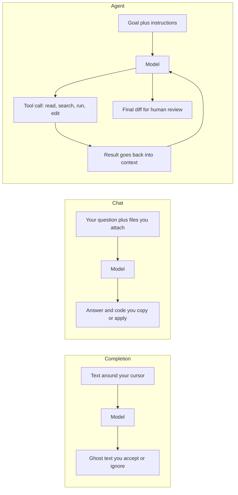
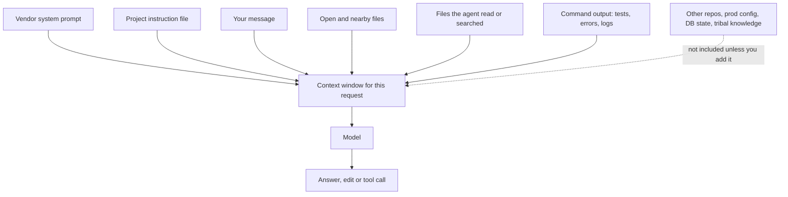

# Part 53 — AI-Assisted Engineering

Parts 37 and 38 taught you to build features *with* language models: an order-support assistant, a catalog search, an agent that can look up an order. This Part is about something different and more personal. It is about engineering *alongside* AI tools: the completion that appears as you type, the chat panel you paste a stack trace into, and the agent in your terminal that reads files, runs your tests and edits code in a loop while you watch.

Almost every engineer now uses these tools daily, from the person on their first job to the principal setting policy for four hundred engineers. They are genuinely useful. They are also confidently wrong often enough that an engineer who trusts them blindly ships bugs faster than ever before. The skill is not "using AI". The skill is knowing what the tool actually sees, what it is good and bad at, how to check its work, how much power to give it, and who is accountable when it is wrong. (The short answer to the last one: you are.)

The Part is organised by level, so you can find your layer:

| Section | Who it is for | The question it answers |
|---|---|---|
| 53.1 | Everyone | What are these tools, and what is happening underneath? |
| 53.2 | Beginners | How do I learn with an assistant instead of being replaced by one? |
| 53.3 | Working engineers | What loop reliably turns AI output into shippable code? |
| 53.4 and 53.5 | Seniors | How do I review AI-written code, and what should I delegate at all? |
| 53.6 and 53.7 | Seniors and tech leads | How do I give an agent tools and permissions without giving it the keys? |
| 53.8 | Team leads | How does a team keep quality, ownership and learning intact? |
| 53.9 | Principals and architects | Policy, vendors, cost, measurement and rollout across an organisation |
| 53.10 | Everyone | Interview questions by level |

The voice here is that of an engineer who uses these tools every day and has cleaned up after them. No hype, no doom. Model mechanics (tokens, temperature, context windows as an API concept) live in Part 37 — Building Backends with LLMs: Foundations, and evaluation lives in Part 38 — Retrieval, Agents and Evaluation; we link there instead of repeating them.

## 53.1 What AI coding tools are and how they work underneath

### 53.1.1 Three shapes: completion, chat and agents

#### Concept

AI coding tools come in three broad shapes, and most products now offer more than one of them.

1. **Inline completion.** As you type in the editor, the tool predicts the next few lines and shows them as grey "ghost text". You press Tab to accept. GitHub Copilot made this shape popular; most AI-enabled editors offer it.
2. **Chat.** A panel or window where you ask questions in natural language ("why does this query do a sequential scan?", "write a DTO for this payload") and get answers and code blocks back. You copy, apply or discard them.
3. **Agentic tools (agents).** You give a goal ("make the failing refund test pass"), and the tool works in a loop: it reads files, searches the code, runs commands such as your test suite, edits files, looks at the result, and repeats until it thinks it is done or it needs you. Claude Code runs this way in a terminal; editors such as Cursor and GitHub Copilot also offer agent modes inside the IDE, and some services run agents in the cloud against a repository and open a pull request.

The product names and feature lists change every few months. The three shapes do not, and each one carries a different amount of risk.

#### Why does it exist?

Writing software has always involved a lot of typing that is not thinking: boilerplate, glue code, test scaffolding, looking up an API you used last month and forgot. The tools exist to compress that work. Chat exists because a lot of engineering time goes into *understanding* (unfamiliar code, an error message, a library) rather than typing. Agents exist because a lot of work is a loop of "edit, run, read the error, edit again", and a tool that can run the loop itself saves the human from being the copy-paste mechanism between the editor and the terminal.

#### Mental model

Imagine three kinds of help in a workshop.

- **Completion** is a helper who hands you the next tool before you ask for it. Usually right, sometimes the wrong size, and you notice immediately because you are holding it.
- **Chat** is a well-read colleague at the next bench. You describe the problem, they suggest an approach. They have never seen your workshop, so they only know what you tell them.
- **An agent** is an apprentice you send off to do a job on their own. They can pick up tools, cut wood and try things. They work fast and never get tired, but they cannot tell a load-bearing wall from a partition unless someone marked it, and they will cheerfully cut through either.

The further down that list you go, the more work happens before a human looks at it, and the more the safety of the result depends on the guardrails around the tool rather than on your attention.

#### How it works

All three shapes are the same machine underneath: a large language model that takes text in and produces text out (Part 37, 37.1.1). What differs is who builds the input, how big it is, and what happens to the output.

Step by step, for an agent session:

1. The tool builds a prompt: a system prompt from the vendor, your project instruction file if there is one (53.3.2), your request, and a list of the tools it can call (read file, search, run shell command, edit file).
2. The model replies either with text or with a *tool call*, for example "run `npm test -- refund.service.spec.ts`".
3. The tool checks its permission settings. Depending on configuration it runs the command, asks you first, or refuses.
4. The command's output (test results, a file's contents, an error) is appended to the conversation.
5. The model reads that output and decides the next step. This is the same tool loop Part 38 describes in 38.3.1 for product agents; here the tools happen to be your file system and your shell.
6. The loop ends when the model says it is done, hits a step limit, or asks you something.

| Shape | Who builds the context | Size of change per step | Where the human checks | Main risk |
|---|---|---|---|---|
| Completion | The editor, automatically, from nearby code | A few lines | Every acceptance, in place | Small wrong details accepted on autopilot |
| Chat | You, by what you paste or attach | A function or a file | When you copy or apply it | Answer fits the question, not your codebase |
| Agent | The agent, by reading and running things | Many files, many commands | At the end, or at permission prompts | Large, plausible diffs; actions with side effects |

#### Practical example

You need a new endpoint, `GET /orders/:id/tracking`, in a NestJS orders service.

- With **completion**, you write the controller method signature and the tool suggests the body, guessing that you call `this.ordersService.getTracking(id)`. Useful if that method exists. If it does not, you have just accepted a call to a function that is not real, and the compiler will tell you in a second.
- With **chat**, you paste the controller, the service and the `Order` entity and ask for the endpoint plus a unit test. You get decent code that matches what you pasted, but it may not know that your team wraps every response in a `ResponseEnvelope` because you did not paste that file.
- With **an agent**, you ask "add a tracking endpoint following the existing patterns; run the tests". It searches for existing controllers, finds the envelope, writes the code, runs `npm test`, sees a failing lint rule, fixes it, and presents a diff touching four files. Faster, and now you have four files to review instead of one function.

#### Production scenario

On a team of twelve backend engineers working on an e-commerce platform, a typical day looks like this: completion is on for everyone all day; chat is used dozens of times per person for explanations, regexes, SQL and test cases; agents are used a few times per person per day for bounded tasks such as "migrate these six controllers to the new validation pipe" or "find why this test is flaky". The team's pull request volume goes up noticeably after adoption. That last fact matters more than any of the others, and we return to it in 53.8: the bottleneck moves from writing code to reviewing it.

#### Failure scenario

An engineer uses an agent to "clean up unused code" in a payments module. The agent searches for references to each exported function, finds none for `reconcileStalePayments`, and deletes it. The function was invoked by name from a cron configuration in a separate infrastructure repository that the agent could not see. All tests passed, because no test called it. Nine days later finance notices that stale payments are no longer being reconciled. The agent did exactly what it was asked, using exactly the information it had. The human approved a deletion without asking "who else calls this?"

#### Edge cases & failure modes

- **Code outside the context.** Callers in another repository, a cron definition, a database trigger, a feature flag config: invisible to the tool unless you provide it.
- **Stale knowledge.** The model was trained up to some date; a library's API may have changed since, so it suggests the old method name with full confidence.
- **Generated code that compiles but is wrong.** Types line up, tests pass, behaviour is wrong in a case nobody tested.
- **Side effects during the loop.** An agent that can run commands can run a migration, call an API or delete a directory as part of "trying something".
- **Non-determinism.** Ask the same question twice and get two different answers (Part 37, 37.1.2). A result you cannot reproduce is a result you must verify.

#### How a Senior Backend Engineer thinks about this

A senior treats these tools as a new kind of junior collaborator with unusual properties: extremely fast, widely read, never tired, no memory of yesterday unless written down, and no stake in the outcome. They choose the shape by risk. Completion for the boilerplate they could write in their sleep. Chat for exploration and explanation. Agents for bounded, well-tested, reversible tasks, inside a sandbox, with a diff at the end that they read line by line. They never let the tool's speed set the pace of review.

#### Common mistakes

- Treating all three shapes as equally safe. Accepting a two-line completion and accepting a forty-file agent diff are not the same act.
- Believing the tool "knows the codebase". It knows what it has read in this session.
- Measuring the tool by how much code it wrote rather than how much correct, maintained code reached production.

#### Interview questions

1. **What is the difference between a chat assistant and an agentic coding tool?** Chat returns text and code for a human to apply; an agent calls tools (read, search, run, edit) in a loop and changes the working tree itself. Why it matters: agents have side effects and produce larger diffs, so they need permissions and sandboxing. Follow-up: what would you never let an agent run without asking?
2. **Why can an agent's change pass every test and still break production?** Tests only cover what someone thought of, and the agent only sees what is in its context; callers in other repos, configs or schedules are invisible.
3. **Where does the human checkpoint sit for each shape?** On each acceptance for completion, on apply for chat, at permission prompts and final review for agents.

#### Practical exercise

Pick one small, real task in a NestJS project (for example, adding pagination to a list endpoint). Do it three times: once with completion only, once by asking a chat assistant with the relevant files attached, and once with an agent in a separate Git branch. Acceptance criteria: for each run, record time taken, number of files changed, number of defects you found in review, and one thing the tool did not know about your codebase. Write three sentences on which shape fits this kind of task and why.

### 53.1.2 Context: the tool only knows what it can see

#### Concept

A model has no live connection to your repository, your database or your production logs. On each request it sees exactly one thing: the **context**, meaning the text placed into its input for that request. The size limit on that text is the **context window** (Part 37, 37.1.1, explains it in tokens). Everything the tool "knows" about your project in a given moment is either in that window or was learned in training from public code, which is not your code.

#### Why does it exist?

The context limit exists because models process a bounded amount of input per request, and cost and latency grow with input size. Tools work around it by *selecting* what to include: the open file, nearby files, search results, files the agent chose to read, your instruction file. Understanding that selection explains most of the strange things these tools do.

#### Mental model

Imagine a consultant who is brilliant but works through a letterbox. You can push pages through; they read them and push back advice. They cannot walk into the building. If you push through the controller but not the guard that protects it, the advice will be about an unprotected controller. If the pages you sent were from last year's version of the file, the advice fits last year.

#### How it works

What this means in practice:

1. **Selection is lossy.** Editors include a small window of nearby code for completion; agents decide what to read. If the relevant file is never read, the model reasons without it.
2. **Long sessions drift.** As an agent session grows, early details compete with later ones for attention, and many tools summarise or drop older turns to fit. A rule you stated at the start may have fallen out of view by step forty. Part 37 notes the same effect for prompts: models use facts at the start and end of long input better than facts buried in the middle.
3. **Nothing persists between sessions** unless the tool writes it somewhere. Yesterday's agreement about naming is gone today. This is why project instruction files exist (53.3.2).
4. **Training data is not your code.** The model has seen a great deal of public NestJS and PostgreSQL code. Its default answer is the *average* of that code, which may be older, less secure or simply different from your conventions.

#### Practical example

You ask: "Why is `GET /orders` slow?" and paste the controller. The assistant suggests adding a cache. Then you paste the TypeORM query and the `EXPLAIN (ANALYZE, BUFFERS)` output showing a sequential scan on 12 million rows, and it correctly suggests a composite index on `(customer_id, created_at DESC)`. The model did not get smarter between the two questions. The context got better.

#### Production scenario

A team notices that agent-written code keeps using `class-validator` decorators directly on entity classes, while the team's rule is that validation lives on DTOs only. Nobody wrote that rule down anywhere the tool reads. After adding two lines to the repository's instruction file and one example DTO path, the pattern drops to near zero in new pull requests. Context is configuration.

#### Edge cases & failure modes

- **Secrets in context.** Anything you paste or the agent reads (including `.env`) is sent to the vendor's model. See 53.2.2.
- **Poisoned context.** A file, web page or tool output can contain text that reads like instructions to the model. That is prompt injection, covered for coding agents in 53.6.4.
- **Contradictory context.** Two files with different patterns (the old service and the new one); the model may copy the wrong one.
- **Context exhaustion.** A huge log pasted in full pushes your actual instructions out of effective attention. Paste the relevant fifty lines, not fifty thousand.

#### How a Senior Backend Engineer thinks about this

When an AI answer is bad, the senior's first question is "what did it see?", not "is the model dumb?". They curate context the way they would brief a contractor: the relevant files, the schema, the exact error, the constraint that is not obvious ("this table has 80 million rows and takes writes all day"). They also keep sessions short and focused, starting a fresh one for a new task rather than dragging a long, drifted conversation along.

#### Common mistakes

- Asking a question about a bug without pasting the error or the code path.
- Running one enormous agent session for a whole day and wondering why it forgets the rules.
- Assuming the tool read a file because the file exists.

#### Interview questions

1. **An assistant keeps suggesting an API your team deprecated. Why, and what do you do?** It follows its training data and whatever it sees in context; give it the current pattern in context or the instruction file, and remove or mark the old code so it stops being copied.
2. **What does "context window" mean for a coding tool in practice?** It is the boundary of what the tool knows during one request; selection decides quality, and anything outside it does not exist for the model.
3. **Why might an agent ignore a rule you gave it an hour ago?** Long-session drift and summarisation; restate key rules, keep sessions focused, put durable rules in the instruction file.

#### Practical exercise

Take a real bug from your team's history. Ask an assistant to diagnose it three times with increasing context: only the error message; error plus the code path; error, code path, schema and the relevant log lines. Acceptance criteria: a short table showing the diagnosis each time and whether it was right, and one paragraph on the minimum context that produced a correct answer.
