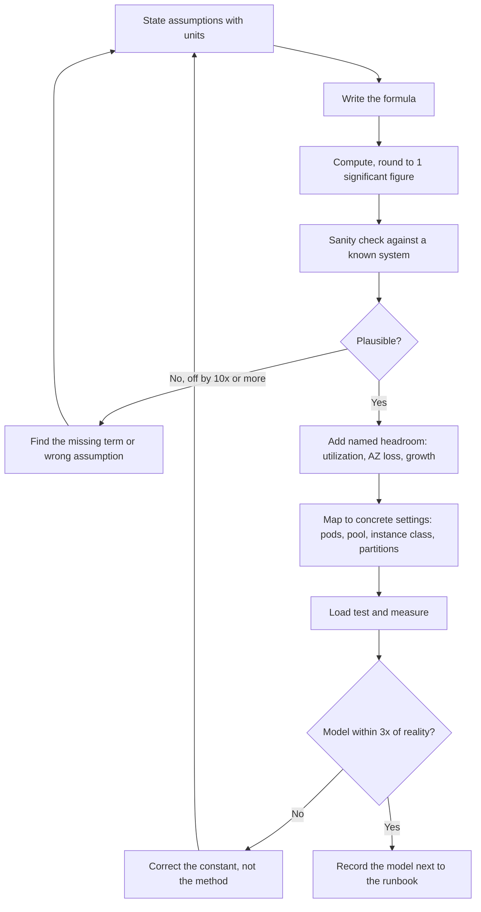

# Part 53 — Capacity Estimation and Back-of-the-Envelope Math

Capacity estimation is the skill that separates an engineer who has opinions from an engineer who has numbers. It is not forecasting and it is not budgeting. It is the ten minutes of arithmetic you do *before* you choose an architecture, so that the architecture you choose is the one the traffic actually needs.

The whole discipline rests on one idea: **an estimate that is right to within a factor of three, computed from assumptions you stated out loud, is worth more than a precise number computed from an assumption nobody checked.** A factor of three is the difference between "one PostgreSQL instance" and "one PostgreSQL instance with a bigger disk". A wrong assumption is the difference between "one PostgreSQL instance" and "you need Kafka and a columnar store".

This part teaches the skill by doing it. Every section is worked, with the arithmetic in tables, because reading someone else's conclusion teaches nothing. Copy the tables. Change the inputs. That is the exercise.

## 53.1 The numbers every backend engineer should know

You cannot estimate anything without a handful of memorized magnitudes. You do not need precision; you need to know which numbers are a thousand times bigger than which other numbers, because that is where design decisions live.

### 53.1.1 Latency: how long one thing takes

| Operation | Typical time | Human scale (if 1 ns = 1 second) | What it means for design |
|---|---|---|---|
| L1 cache reference | 1 ns | 1 second | Free. Never think about it. |
| Branch mispredict | 3 ns | 3 seconds | Free at backend scale. |
| L2 cache reference | 4 ns | 4 seconds | Free. |
| Mutex lock and unlock (uncontended) | 17 ns | 17 seconds | Free until contended. |
| Main memory reference | 100 ns | 1.5 minutes | 100x slower than L1. Cache locality matters in hot loops. |
| Compress 1 KB (snappy/lz4) | 2 us | 33 minutes | Cheap. Compress before you send over a network. |
| Read 1 MB sequentially from RAM | 50 us | 14 hours | Building a 10 MB JSON array in memory is not free. |
| NVMe SSD random read (4 KB) | 50–150 us | 14–40 hours | A PostgreSQL page miss to local NVMe. |
| Network-attached SSD random read (EBS gp3) | 250–600 us | 3–7 days | 4x worse than local NVMe. This is what your RDS actually has. |
| Round trip, same availability zone | 0.25–0.5 ms | 3–6 days | The floor for any network call in your cluster. |
| Redis `GET`, same AZ, small value | 0.2–0.6 ms | 3–7 days | Dominated by the round trip, not by Redis. |
| Indexed PostgreSQL lookup, page in cache | 0.3–1 ms server-side | 4–12 days | The `pg_stat_statements` `mean_exec_time` of a healthy PK lookup. |
| Same lookup, seen from the NestJS service | 0.8–2 ms | 10–24 days | Adds pool acquire, round trip, driver parse, row hydration. |
| Indexed PostgreSQL lookup, page from disk | 5–20 ms | 2–8 months | 10–20x worse. This is why `shared_buffers` and cache hit ratio matter. |
| Kafka produce, `acks=all`, same region | 2–10 ms | 1–4 months | Includes replication to two followers and an fsync policy. |
| Round trip, cross-AZ same region | 0.5–2 ms | 6–24 days | Cheap enough to ignore; not free at 100k calls per request-second. |
| Round trip, cross-region (Mumbai to Frankfurt) | 110–140 ms | 3–4 years | Never put a synchronous cross-region hop on a user path. |
| Round trip, cross-region (Virginia to Ireland) | 70–90 ms | 2–3 years | Same rule. |
| Round trip, mobile client to your edge | 50–250 ms | 2–8 years | The user's latency budget is mostly not yours. |
| Read 1 MB sequentially from network storage | 5–15 ms | 2–5 months | Large `SELECT *` results are an I/O decision, not a code style decision. |
| Third-party HTTPS API call | 80–800 ms | 3–25 years | Always has a timeout. Always. |
| bcrypt hash, cost factor 12 | 250–350 ms | 8–11 years | About 3 logins per second per CPU core. Size for it. |

Two rules fall straight out of this table. First, **anything that crosses a network is at least a thousand times more expensive than anything that does not**, so the number of network round trips per request is the single most important architectural number you control. Second, **a cache miss that becomes a disk read costs 10–20x a cache hit**, which is why a cache hit ratio is not a nice-to-have metric, it is a capacity metric.

### 53.1.2 Throughput: how many things per second

| Component | Sustained throughput | Conditions |
|---|---|---|
| One PostgreSQL instance, 8 vCPU / 64 GB, simple indexed reads | 20,000–40,000 queries/s | Working set fits in `shared_buffers` + page cache; short transactions; connections pooled |
| Same instance, complex joins over 3–5 tables | 1,000–5,000 queries/s | Depends entirely on rows touched |
| Same instance, small write transactions (`INSERT` + index maintenance) | 3,000–10,000 tx/s | `synchronous_commit=on`, fast WAL disk; 2–3x more with `COPY` or multi-row `INSERT` |
| Same instance, bulk load with `COPY` | 100,000–500,000 rows/s | Indexes dropped or few; one session |
| One Redis instance (single-threaded core) | 80,000–150,000 ops/s | Small values, no pipelining. 500k+/s with pipelining |
| One Kafka broker | 100–300 MB/s | Batched producers, `acks=all`, replication factor 3 |
| One Kafka partition | 10–30 MB/s, or 10k–50k small messages/s | This is the parallelism unit. Consumers cannot exceed partitions |
| PgBouncer (transaction pooling) | 20,000–50,000 tx/s per process | Single-threaded; run several with `SO_REUSEPORT` |
| One NestJS pod (1 vCPU, 1 GB), trivial JSON endpoint | 1,500–4,000 RPS | No I/O, small response, no `class-transformer` |
| One NestJS pod, one indexed query + DTO validation | 400–900 RPS | Realistic "read one entity" endpoint |
| One NestJS pod, 3–5 queries + serialization of 50 rows | 120–350 RPS | The realistic "list endpoint" number |
| One NestJS pod, heavy `class-transformer` + 200 KB response | 40–120 RPS | Serialization becomes the bottleneck |

**The loudest caveat in this part: these are starting points, not facts about your system.** A pod's RPS depends on your CPU limit, your Node version, your middleware stack, your logging volume, your payload size and your query plans. The correct workflow is to start from the table, design with it, then **replace every number with a measured one from your own load test** (Part 41 — Performance Engineering covers how to run that test). An estimate built on a measured constant is engineering; an estimate built on a remembered constant is a guess with a table around it.

### 53.1.3 Time and size shortcuts

A day is 86,400 seconds. Round it to **10^5**. That single approximation removes almost all of the arithmetic pain, and it errs on the safe side by 16 percent: it makes your computed RPS slightly *higher* than reality, which is the direction you want to be wrong in.

| Rate | Per day | Per month (30 d) | Per year |
|---|---|---|---|
| 1 per second | 86,400 (~10^5) | 2.6 million | 31.5 million |
| 10 per second | 864,000 | 26 million | 315 million |
| 100 per second | 8.6 million | 260 million | 3.2 billion |
| 1,000 per second | 86 million | 2.6 billion | 32 billion |
| 12 per second | 1 million | 31 million | 380 million |
| 11,600 per second | 1 billion | 30 billion | 365 billion |

Read it in both directions. "One million a day" is 12 per second, which is nothing. "One billion a day" is 11,600 per second, which is a real system. "One million a month" is 0.4 per second, which is a cron job.

For bytes, memorize one anchor: **1 KB at 1,000 per second is 1 MB/s, which is 86 GB/day and 2.6 TB/month.**

| Payload | At 100/s | At 1,000/s | At 10,000/s |
|---|---|---|---|
| 1 KB | 0.1 MB/s = 8.6 GB/day | 1 MB/s = 86 GB/day | 10 MB/s = 864 GB/day |
| 10 KB | 1 MB/s = 86 GB/day | 10 MB/s = 864 GB/day | 100 MB/s = 8.6 TB/day |
| 100 KB | 10 MB/s = 864 GB/day | 100 MB/s = 8.6 TB/day | 1 GB/s = 86 TB/day |

The last cell is why nobody serves 100 KB responses at 10,000 RPS from an origin server. That is a CDN's job, and the arithmetic tells you so in five seconds.

## 53.2 The method

The method is five moves plus one discipline. It takes ten minutes and it works for every system you will ever be asked to size.

### 53.2.1 The five moves

**1. State the assumptions out loud.** Write them as a list with numbers and units. "20 million monthly actives", "10 percent of them are active on a given day", "each active user makes 25 API calls". Every one of these is a guess; the point of writing them down is that a reviewer can attack the guess instead of attacking the conclusion. In a design review, the assumption list is the most valuable part of the document, because it is the part that will be wrong.

**2. Write the formula before you compute.** `average_rps = dau * actions_per_user / 86400`. Writing the formula separates a modelling error from an arithmetic error, and it lets you change one input later without redoing the whole thing. It also makes the estimate reusable: next quarter the DAU changes and the formula still holds.

**3. Compute, rounding to one significant figure.** 2,847 becomes 3,000. 41,900 becomes 40,000. Rounding is not laziness; it is a statement about the precision of your inputs. If your DAU assumption is plus or minus 40 percent, reporting 2,847 RPS is a lie about how much you know. Round in the direction of safety: up for load, up for storage, down for the throughput a component can deliver.

**4. Sanity-check against something you already know.** This is the move that catches the catastrophic errors, and it is the move juniors skip. "3,000 RPS peak" — is that a lot? Compare it to a component: one PostgreSQL instance does 20,000 simple reads per second, so 3,000 RPS with a 95:5 read ratio is comfortable for one primary. Compare it to a system you have run: "our current service does 800 RPS on 8 pods, so this is 4x that, so about 30 pods". Compare it to physics: "500 GB per day of writes on a gp3 volume is 6 MB/s sustained, which is well under the 125 MB/s baseline, fine". If a number fails every comparison you can think of, you made a modelling error, not a rounding error.

**5. Add headroom, explicitly and by name.** Never present a peak number as the capacity target. Systems queue badly above roughly 70–80 percent utilization (Part 41 covers the queueing curve), autoscaling takes 60–180 seconds to react, and one availability zone can disappear. So:

| Headroom type | Multiplier | Why |
|---|---|---|
| Utilization target | 1.5x (run at ~65%) | The knee of the latency curve is near 80% |
| Autoscaling reaction time | included above | A burst must be absorbed before pods arrive |
| AZ loss (N+1 across 3 AZs) | 1.5x | Losing 1 of 3 zones means the other 2 carry everything |
| Growth to next planning cycle | 1.3–2x | Six to twelve months of growth |
| Total, typical | **2.5–4x the average** | Applied to peak, not to average |

Say which multipliers you used. "Peak 3,000 RPS, target 65 percent utilization, N+1 across three zones, so provision for 3,000 / 0.65 * 1.5 = 6,900 RPS of capacity" is a sentence a reviewer can argue with productively.

### 53.2.2 The discipline: precision is not accuracy

Here is the failure that this discipline prevents. Two engineers estimate storage for an order history table.

| | Engineer A | Engineer B |
|---|---|---|
| Row size | "312.4 bytes, computed from `pg_column_size` on a sample" | "about 300 bytes" |
| Rows per day | "60,000 orders" (took last Tuesday's number) | "60,000 orders, but Black Friday is 20x and December runs 3x, so call it 90,000 average" |
| Retention | not mentioned | "3 years hot, then archive" |
| Indexes | not mentioned | "PK plus 3 indexes, roughly 1x the table" |
| Replicas and backups | not mentioned | "primary + 2 replicas + 14 daily backups" |
| Result | **6.8 GB per year** | **~40 GB per year of table+index, ~120 GB of provisioned storage across copies** |

Engineer A's number has four significant figures and is wrong by a factor of 17. Engineer B's number is rounded to one significant figure and is right to within a factor of two. Engineer A will discover the error when the volume fills at 2 a.m.

**A factor-of-three error in an estimate is normal and survivable.** You provision one instance class larger, or you scale out. A factor-of-thirty error is an architecture mistake, and factor-of-thirty errors come from *missing terms*, not from imprecise ones. So the checklist matters more than the calculator: did you count indexes, replicas, backups, WAL, peak vs average, and retention? Every one of those is a multiplier that a careless estimate silently sets to 1.



The last box matters more than it looks. An estimate that lives in a Slack thread is lost by the next quarter. An estimate written next to the runbook, with its assumptions, becomes the thing you update when traffic doubles, and the thing that tells the next on-call engineer what "normal" is supposed to be.

## 53.3 Requests per second

Almost every capacity conversation starts here, and almost every one starts from a marketing number: monthly active users. The job is to walk that number down to a peak second.

### 53.3.1 From monthly actives to average RPS

The chain is: **MAU -> DAU -> sessions per day -> actions per session -> requests per action -> requests per day -> average RPS.**

The step everyone gets wrong is "requests per action". A user tapping "place order" is one action and eight API calls: cart fetch, address list, shipping options, payment methods, order creation, payment intent, order confirmation poll, and an analytics beacon. Count the API calls, not the user's intentions.

Worked example, an e-commerce app:

| Step | Formula | Value | Assumption behind it |
|---|---|---|---|
| Monthly active users | given | 20,000,000 | From the product team |
| Daily active users | MAU * DAU/MAU ratio | 20M * 0.10 = **2,000,000** | 10% is typical for retail apps; 25–35% for social, 60%+ for a work tool |
| Sessions per DAU per day | given | 1.4 | Analytics |
| API calls per session | given | 18 | Counted from a real session trace, not guessed |
| API calls per day | 2M * 1.4 * 18 | **50,400,000** | |
| Round | | **50,000,000/day** | One significant figure |
| Average RPS | 50M / 86,400 | 578 | |
| Round | | **600 RPS average** | |

Sanity check: 600 RPS on a service that does 250 RPS per pod is about 3 pods of raw capacity, which is small. That feels right for 2 million daily users doing light browsing, and it should make you suspicious of any design that starts with "we will need Kafka for the API traffic".

The DAU/MAU ratio is worth its own table, because it is the assumption most likely to be off by 3x:

| Product type | Typical DAU/MAU | Note |
|---|---|---|
| Messaging / social feed | 50–70% | People open it many times a day |
| Ride hailing / food delivery | 8–20% | Bursty and habitual but not daily |
| E-commerce marketplace | 5–15% | Purchase intent is rare; browsing is not daily |
| B2B SaaS used at work | 40–70% on weekdays, 5% weekends | The weekday/weekend split is a real capacity factor |
| Banking / utility app | 10–25% | Spikes on salary day and bill due dates |

### 53.3.2 Peak-to-average ratio

Average RPS is a fiction. Nobody experiences the average. You size for the peak.

| Traffic pattern | Peak / average | Example |
|---|---|---|
| Global consumer app, users spread over many time zones | 1.5–2.5x | The curves overlap and flatten each other |
| Single-country consumer app | 3–5x | One evening peak |
| B2B tool in one country | 5–8x | Nothing overnight, nothing on weekends, everything at 10 a.m. |
| Food delivery | 6–10x | Two sharp meal peaks, near-zero at 4 a.m. |
| Payroll / billing / statements | 20–50x on one day | Month-end, salary day, invoice day |
| Flash sale, ticket drop, result announcement | **30–100x for 60–300 seconds** | A step function, not a ramp |

For our e-commerce example, a single-country app with an evening peak: 600 * 5 = **3,000 RPS peak**. During a flash sale on a specific SKU: 600 * 50 = **30,000 RPS**, but concentrated on two endpoints (product detail and checkout) rather than spread across eighteen.

That distinction is the whole design conversation. A 5x diurnal peak is an autoscaling problem. A 50x flash-sale peak is an architecture problem: a CDN in front of the product page, a queue or a waiting room in front of checkout, precomputed stock counters in Redis, and a rate limiter that sheds rather than melts. **You do not scale your way through a 50x spike; you change the shape of the work.**

### 53.3.3 The diurnal curve

A rough single-country curve, expressed as a percentage of daily volume per hour:

```text
% of daily traffic per hour (single-country consumer app)

12 |                                          ####
10 |                                       ####  ####
 8 |                                    ####        ##
 6 |                      ####       ####             ##
 4 |                 ######    #######                  ##
 2 |          #######                                     ####
 0 |##########                                                ####
   +----------------------------------------------------------------
    00  02  04  06  08  10  12  14  16  18  20  22
                                        ^ peak hour: 20:00-21:00
```

If traffic were flat, each hour would hold 4.17 percent of the day. In this shape the peak hour holds about 10–12 percent. That single fact gives you the first half of the peak factor:

| Quantity | Formula | Value |
|---|---|---|
| Requests per day | given | 50,000,000 |
| Share of traffic in the peak hour | from the curve | 11% |
| Requests in the peak hour | 50M * 0.11 | 5,500,000 |
| **Peak-hour average RPS** | 5.5M / 3,600 | **1,530 RPS** |
| Ratio to daily average | 1,530 / 578 | 2.6x |

### 53.3.4 The peak second is not the peak hour

Inside the peak hour, traffic is not smooth either. Arrivals cluster: a push notification goes out, a TV ad airs, a train arrives and four hundred people unlock their phones. Empirically, the **busiest second within the busiest hour runs 1.5–3x the peak hour's average** for organic traffic, and far more when something triggers a synchronized arrival.

| Quantity | Formula | Value | Sizes what |
|---|---|---|---|
| Daily average RPS | 50M / 86,400 | 580 | Cost, storage growth, monthly bills |
| Peak-hour RPS | 50M * 0.11 / 3,600 | 1,530 | Autoscaling target, replica count, steady-state capacity |
| Peak-second RPS | 1,530 * 2 | **3,000** | Pod count, connection pool, rate limits, queue depth |
| Provisioned capacity | 3,000 / 0.65 * 1.5 (AZ loss) | **6,900** | What you must be able to serve |

Use the right one for the right decision. Sizing storage from the peak second wastes a fortune. Sizing the connection pool from the daily average causes an incident. A useful shorthand: **averages buy hardware, peaks prevent outages, and the peak second is the one that pages you.**

One more distinction that costs people real money: a burst of 3,000 RPS for 5 seconds is absorbed by queueing if your pods have any spare capacity and your clients have any patience. A sustained 3,000 RPS for 20 minutes is not; it must actually be served. Ask "for how long?" before you size for a spike. Buffers absorb bursts; only capacity absorbs load.

