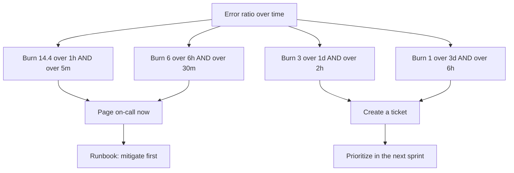
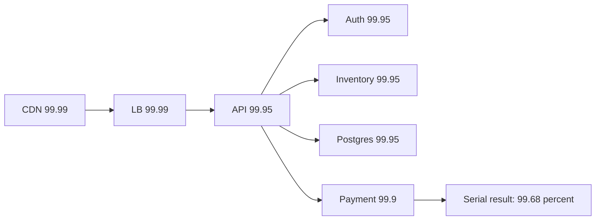

## 53.5 Error budgets

### 53.5.1 The arithmetic

#### Concept

The error budget is simply `1 - SLO`, expressed over your window. It is the amount of failure you are permitted. Two useful units: **time** (how many minutes of total outage) and **requests** (how many individual failures).

For a 30-day rolling window:

| SLO | Budget as a fraction | Budget in minutes / 30 days | Budget in failed requests, at 1.2 M requests / 30 days |
|---|---|---|---|
| 99 % | 1 % | 432 min (7.2 h) | 12,000 |
| 99.5 % | 0.5 % | 216 min (3.6 h) | 6,000 |
| 99.9 % | 0.1 % | 43.2 min | 1,200 |
| 99.95 % | 0.05 % | 21.6 min | 600 |
| 99.99 % | 0.01 % | 4.32 min | 120 |
| 99.999 % | 0.001 % | 0.43 min (26 s) | 12 |

The request-based column is the one to show a product manager. "We are allowed 600 failed checkouts a month; we have used 410 of them and it is the 12th" is a sentence anyone understands. "We are at 99.966 percent" is not.

Two ways to count, and they are not equivalent:

- **Time-based**: count minutes where the service was "down" by some definition. Simple, matches how SLAs are written, and terrible at partial failures. A bug affecting 3 percent of users costs you nothing in a time-based budget because no minute was fully down.
- **Request-based**: count failed requests over total requests. Captures partial failures properly and is what you should use internally.

Prefer request-based for your SLO. Expect your SLA to be time-based because contracts are. Compute both; they will disagree, and knowing by how much is useful.

#### The budget as a graph

The one graph every team should have on the wall:

```promql
# Remaining error budget as a fraction, over a rolling 30 days.
# 1 - (observed error ratio / allowed error ratio)
1 - (
  (1 - sli:checkout_availability:ratio_rate5m_30d)
  /
  (1 - 0.9995)
)
```

It starts each window at 1.0 and walks down. When it hits zero you have spent the month's allowance. When it goes negative you have breached the SLO. Plot it with a straight line from 1.0 to 0.0 across the window as the "spending at exactly the allowed rate" reference; being above the line is healthy, below it is a warning.

### 53.5.2 Burn rate

#### Concept

**Burn rate** is how fast you are consuming the budget, relative to consuming it exactly evenly over the window.

- Burn rate 1 means you will spend exactly the whole budget by the end of the window. Sustainable, by definition.
- Burn rate 2 means you will spend it in half the window: 15 days.
- Burn rate 14.4 means you will spend it in about 50 hours.
- Burn rate 1440 means you spend the whole 30-day budget in 30 minutes. That is a total outage of a 99.9 percent service.

The formula:

```text
burn rate = observed error ratio / allowed error ratio
          = observed error ratio / (1 - SLO)
```

For a 99.9 percent SLO, allowed error ratio is 0.001. If you are currently failing 1.44 percent of requests, burn rate is `0.0144 / 0.001 = 14.4`.

And the time to exhaustion:

```text
hours to exhaust = (window in hours) x (budget remaining fraction) / burn rate
```

At burn rate 14.4 with a full budget and a 30-day window: `720 x 1.0 / 14.4 = 50 hours`.

#### Mental model

Imagine a monthly data plan of 100 GB. Burn rate 1 is streaming at exactly the pace that uses it up on the last day of the month. Burn rate 14.4 is someone downloading a game: you will be out of data by Wednesday. Burn rate 1440 is a device stuck in a loop: gone before lunch.

You want a text message for the game download (act today) and a phone call for the loop (act now). You do not want a notification every time someone opens a web page. That is exactly what multi-window multi-burn-rate alerting gives you.

### 53.5.3 Multi-window, multi-burn-rate alerting

#### Why does it exist?

Two naive alerting strategies both fail.

**Alert on a fixed error-rate threshold** ("page if error rate > 1 percent for 5 minutes"). It fires on a 90-second blip that consumed 0.2 percent of the budget, and it stays silent through a two-week slow bleed at 0.4 percent that consumes the entire budget. It is disconnected from what you actually promised.

**Alert when the budget is exhausted.** Too late by definition. The month is already lost.

The fix is to alert on burn rate, at several rates, each paired with a window sized to that rate. High burn rates get short windows so you are paged fast; low burn rates get long windows so noise is filtered out.

And each alert uses **two windows**: a long one that establishes the burn rate, and a short one (typically one twelfth of the long one) that must *also* be burning. The short window is what makes the alert stop firing quickly once the problem is fixed — without it, a 5-minute outage keeps a 1-hour-window alert firing for an hour after recovery.

#### The standard configuration

The widely used four-alert setup, for a 30-day window:

| Burn rate | Long window | Short window | Budget consumed when it fires | Severity | Time to exhaustion |
|---|---|---|---|---|---|
| 14.4 | 1 hour | 5 min | 2 % | Page | ~2 days |
| 6 | 6 hours | 30 min | 5 % | Page | ~5 days |
| 3 | 1 day | 2 hours | 10 % | Ticket | ~10 days |
| 1 | 3 days | 6 hours | 10 % | Ticket | 30 days |



```yaml
groups:
  - name: checkout-slo-burn
    rules:
      # Fast burn: 2 percent of the 30-day budget in one hour. Wake someone up.
      - alert: CheckoutErrorBudgetFastBurn
        expr: |
          (
            (1 - sli:checkout_availability:ratio_rate1h) > (14.4 * 0.0005)
            and
            (1 - sli:checkout_availability:ratio_rate5m) > (14.4 * 0.0005)
          )
        labels:
          severity: page
          journey: checkout
        annotations:
          summary: "Checkout burning error budget at 14.4x; budget gone in ~2 days"
          runbook: "https://runbooks.internal/checkout/slo-burn"

      # Medium burn: 5 percent in six hours. Still a page, but you have hours.
      - alert: CheckoutErrorBudgetMediumBurn
        expr: |
          (
            (1 - sli:checkout_availability:ratio_rate6h) > (6 * 0.0005)
            and
            (1 - sli:checkout_availability:ratio_rate30m) > (6 * 0.0005)
          )
        labels: { severity: page, journey: checkout }

      # Slow burn: a persistent bleed. A ticket, not a page. Nobody wakes for this.
      - alert: CheckoutErrorBudgetSlowBurn
        expr: |
          (
            (1 - sli:checkout_availability:ratio_rate1d) > (3 * 0.0005)
            and
            (1 - sli:checkout_availability:ratio_rate2h) > (3 * 0.0005)
          )
        labels: { severity: ticket, journey: checkout }
```

`0.0005` is `1 - 0.9995`, the allowed error ratio for the 99.95 percent SLO. Keep that number in exactly one place per SLO; a copy-paste with a stale target is a classic source of alerts that fire at the wrong level.

#### A worked example

Checkout SLO is 99.95 percent over 30 days. Traffic is 1.2 million requests per 30 days, so about 1,667 requests per hour. The budget is 600 failed requests.

**Scenario A — a bad deploy at 14:00.** A regression makes 12 percent of checkouts fail.

- Observed error ratio: 0.12. Allowed: 0.0005. Burn rate: `0.12 / 0.0005 = 240`.
- Time to exhaust the full budget: `720 hours / 240 = 3 hours`.
- The fast-burn alert threshold is `14.4 x 0.0005 = 0.0072`, i.e. 0.72 percent. At 12 percent we are far above it. But the alert uses a 1-hour window and a 5-minute window; the 5-minute rate crosses within about 5 minutes, and the 1-hour *rate* crosses once roughly 6 percent of the hour's requests have failed — about 4 to 6 minutes in. **On-call is paged at roughly 14:06.**
- They roll back at 14:14. Total failures: about 14 minutes at 12 percent of 1,667/hour, so `1667 x (14/60) x 0.12 = 47` failed checkouts. That is 7.8 percent of the month's budget, spent in 14 minutes.
- The 5-minute window drops below threshold within 5 minutes of the rollback, so the alert resolves at about 14:19 rather than at 15:14. That is the whole point of the short window.

**Scenario B — a slow bleed.** A retry bug makes 0.2 percent of checkouts fail intermittently, starting Monday.

- Burn rate: `0.002 / 0.0005 = 4`.
- Time to exhaust: `720 / 4 = 180 hours = 7.5 days`.
- The fast-burn threshold (0.72 percent) never fires. The medium threshold (`6 x 0.0005 = 0.3 percent`) never fires. The **slow-burn** threshold (`3 x 0.0005 = 0.15 percent`) fires once the 1-day and 2-hour windows both exceed it — on Tuesday.
- It creates a ticket, not a page. Nobody's sleep is disturbed for a bug that gives you a week to fix it. By Friday the team has landed the fix having spent about 45 percent of the budget.

That contrast is the value of the whole scheme. The same alerting philosophy caught both a 14-minute catastrophe and a week-long bleed, paged for exactly one of them, and both times the number in the alert directly answered "how urgent is this?"

### 53.5.4 The error budget policy

#### Concept

The policy is the written, pre-agreed answer to "what happens when the budget runs out". It must be agreed by engineering **and** product **and** management *before* an incident, because during an incident everyone's incentives change.

A real, workable policy:

```text
Error Budget Policy — Checkout journey
Agreed by: Head of Engineering, Head of Product, Orders team lead. Review: quarterly.

Budget remaining > 50 %
  Normal operation. Ship freely. Consider raising risk appetite: run more
  experiments, deploy more often, tighten the SLO next review if we are
  never below 80 %.

Budget remaining 20 % to 50 %
  Caution. Deploys continue. No large migrations or infrastructure changes
  without a rollback plan reviewed by a second engineer.

Budget remaining 0 % to 20 %
  Feature freeze on this journey. Only reliability fixes, security fixes and
  P0 customer-blocking bugs ship to checkout. The team's next sprint is
  reliability work drawn from open postmortem action items.

Budget exhausted (below 0 %)
  As above, plus: a written report to the Head of Engineering within 2 business
  days naming the top three contributors and the work that will prevent a repeat.
  Product may request an exception in writing, accepting the SLA risk.

Repeated exhaustion (2 of 3 consecutive windows)
  The SLO is wrong or the system is. Mandatory review: either the target comes
  down (with the SLA re-examined) or reliability work is staffed properly.
```

The last clause is the honest one. An SLO breached every single month is not motivating anyone; it is decoration. Either fix the system or fix the number, and say which out loud.

#### How a Senior Backend Engineer thinks about this

They notice that an *unspent* budget is also a signal. A team that ends every month at 95 percent budget remaining is being too careful: it could deploy more often, run chaos experiments, take on more ambitious changes. Reliability that exceeds the target is not free virtue, it is unspent capital.

They also refuse to let the budget become a stick. The policy pauses *features*, it does not punish *people*. The moment a team hides failures to protect its budget, the SLI is corrupted and the whole system is worthless.

#### Common mistakes

- Alerting on burn rate without recording rules, so the alert query itself times out and never fires.
- Copying the 14.4 / 6 / 3 / 1 numbers without adjusting for a different window length.
- One SLO for an entire service instead of per journey, so a broken checkout is diluted by healthy static assets.
- A policy nobody signed, which is therefore renegotiated during every incident.
- Resetting the budget after an incident "because it was not our fault". If users experienced it, it counts. Exclusions belong in the SLO document, agreed in advance, not applied retroactively.

## 53.6 Availability maths

### 53.6.1 The nines

#### Concept

"Nines" is shorthand for an availability target. What matters is the allowed downtime it implies, and how quickly that becomes implausible.

| Availability | Per day | Per week | Per 30 days | Per year |
|---|---|---|---|---|
| 99 % | 14.4 min | 1.68 h | 7.2 h | 3.65 days |
| 99.5 % | 7.2 min | 50.4 min | 3.6 h | 1.83 days |
| 99.9 % | 1.44 min | 10.1 min | 43.2 min | 8.77 h |
| 99.95 % | 43 s | 5 min | 21.6 min | 4.38 h |
| 99.99 % | 8.6 s | 1 min | 4.32 min | 52.6 min |
| 99.999 % | 0.86 s | 6 s | 26 s | 5.26 min |

Read the 99.99 percent row carefully. **4.32 minutes per month.** A single Kubernetes rolling deploy that goes wrong and takes six minutes to roll back has blown the month. A PostgreSQL failover takes 30 to 90 seconds if it is automated and well-tested; three of those in a month and you are done.

This is why the honest question is never "how many nines do we want" but "what is our mean time to recovery, and how many incidents do we have per month". Availability is `1 - (incidents x MTTR / window)`. Improving MTTR from 40 minutes to 8 minutes does more for your availability than any amount of extra redundancy, and it is usually cheaper: better alerts, a rollback button, a documented kill switch, a runbook.

### 53.6.2 Serial dependencies multiply

#### Concept

If a request must pass through several components, and any one failing fails the request, the availabilities **multiply**.

```text
A_total = A1 x A2 x A3 x ... x An
```

Four services at 99.9 percent each:

```text
0.999 ^ 4 = 0.996006  ->  99.6 %  ->  about 2.9 hours of downtime per 30 days
```

You built four highly reliable services and shipped a mediocre one. This is the most under-appreciated fact in distributed systems and it is why "microservices improve reliability" is, on its own, false. Splitting a monolith into six services that all sit in the checkout path makes checkout *less* available unless you also add isolation, fallbacks and asynchrony.

A realistic checkout chain:

| Component | Availability | Running product |
|---|---|---|
| CDN / edge | 99.99 % | 99.99 % |
| Load balancer | 99.99 % | 99.98 % |
| API pods (3 replicas, 2 AZ) | 99.95 % | 99.93 % |
| Auth service | 99.95 % | 99.88 % |
| Inventory service | 99.95 % | 99.83 % |
| PostgreSQL (managed, multi-AZ) | 99.95 % | 99.78 % |
| Payment gateway | 99.9 % | 99.68 % |

**99.68 percent.** That is 2.3 hours of expected downtime per 30 days, from components that individually look excellent. And your SLO says 99.95 percent.



### 53.6.3 What actually fixes it

Three levers, in order of effectiveness.

**1. Remove the dependency from the synchronous path.** This is the biggest win and it is an architecture decision, not an infrastructure purchase. The email provider was in the chain until we queued it (Part 39); now its availability does not appear in the product at all. Ask of every box in the diagram: does the *response* depend on it?

**2. Make failure non-fatal.** A dependency you can degrade around drops out of the multiplication. If Redis being down means you read from PostgreSQL more slowly instead of returning 500, Redis contributes nothing to your unavailability. If the recommendation service being down means the recommendations panel is empty rather than the page failing, same. This is graceful degradation (Part 34 — Reliability Engineering: Timeouts, Retries, Circuit Breakers and Backpressure) and it is worth more than another nine on any single component.

**3. Add real redundancy.** For components in **parallel**, where either one serving the request is enough, unavailabilities multiply instead:

```text
A_parallel = 1 - (1 - A1) x (1 - A2)
```

Two payment gateways at 99.9 percent each, with automatic failover:

```text
1 - (0.001 x 0.001) = 0.999999  ->  99.9999 %
```

That looks magical, and here is the catch that catches everyone: **the formula assumes independent failures and instant, correct failover.** In reality:

- The failover logic is itself a component with its own availability, and it is the least-tested code you own.
- Failures correlate. Both gateways sit behind the same DNS provider, the same TLS library, the same cloud region, the same expired CA bundle.
- A failover that takes 90 seconds to detect and switch contributes 90 seconds of downtime per event regardless of the maths.
- The standby path is often *broken* and nobody knows, because it is never exercised. This is why game days exist (53.12).

A realistic figure for two-provider redundancy with tested automatic failover is not six nines. It is roughly one extra nine, maybe a bit more. Claim that, not the theoretical number.

### 53.6.4 Why 99.99 percent on a 99.9 percent database is a fantasy

#### Concept

If every request touches a managed PostgreSQL whose provider offers 99.9 percent, your ceiling is 99.9 percent. You cannot be more available than the thing you must call. Promising 99.99 percent means promising to be up during 43 minutes a month when your database is, by contract, allowed to be down.

This is not pedantry; it is the arithmetic that will be quoted back to you after the incident.

There are only four honest responses:

1. **Lower the target** to 99.9 percent or slightly below, and be right.
2. **Remove the database from the critical path** for that journey. Serve reads from a cache with a documented staleness bound. Accept writes into a durable queue and confirm asynchronously. Both are real designs with real trade-offs, and both change the product contract.
3. **Add genuine redundancy**: a multi-AZ primary with automatic failover (which most managed offerings already include in that 99.95 percent figure), a cross-region replica with tested promotion, or a second write path. Each adds cost, complexity and new failure modes — split brain, replication lag, and the failover that does not fire.
4. **Change the definition** so the promise is meetable: promise availability on reads but not writes, or exclude the provider's maintenance windows explicitly in the SLA. This is legitimate if it is honest and written down, and dishonest if it is a trick to make a dashboard green.

What you must not do is set the number because a competitor's marketing page says four nines.

#### Production scenario

A team promised 99.99 percent to an enterprise customer. Their stack: one managed PostgreSQL (99.95 percent), one Redis (99.9 percent, in the synchronous path because sessions lived there), one payment gateway (99.9 percent), one Kubernetes cluster in a single region. Serial product: `0.9995 x 0.999 x 0.999 x 0.999 = 99.68 percent`. Their allowed downtime under the contract was 4.32 minutes a month; their expected downtime was 2.3 hours.

They breached in month one, month two and month four. The fixes that actually moved the number were not exotic: move sessions out of the synchronous Redis path to signed tokens (removed 0.1 percent), add a second payment provider with tested failover (removed most of 0.1 percent), and — biggest of all — cut MTTR from 35 minutes to 6 by adding a one-click rollback and three runbooks. They landed at about 99.94 percent and renegotiated the SLA to 99.9 percent with a straight face.

#### How a Senior Backend Engineer thinks about this

They draw the dependency chain before they agree to a number, and they multiply. They know that MTTR is usually the cheapest lever and redundancy is usually the most expensive. They are deeply suspicious of parallel-redundancy arithmetic that assumes independence, and they insist the failover path is exercised on a schedule, because an untested failover is not redundancy, it is a story you tell yourself.

And they say the uncomfortable sentence out loud in the meeting: *"We cannot promise that. Here is the arithmetic. Here is what it would cost to make it true."*

#### Interview questions

1. *What is an error budget and how do you compute it?* Expected: `1 - SLO` over the window, expressed in minutes and in failed requests; request-based preferred internally. Follow-up: why is request-based better than time-based?
2. *Explain burn-rate alerting to someone who only knows threshold alerts.* Expected: burn rate is observed error ratio over allowed error ratio; multiple rates with paired long and short windows page for fast burns and ticket for slow bleeds; the short window makes alerts resolve quickly.
3. *Four services at 99.9 percent in series. What is the result and what do you do about it?* Expected: 99.6 percent; remove dependencies from the synchronous path, degrade gracefully, then add redundancy; and improve MTTR.
4. *Why is two-provider redundancy not really six nines?* Expected: correlated failures, the failover mechanism's own reliability, detection and switch time, untested standby paths.
5. *Your database provider promises 99.95 percent and product wants a 99.99 percent SLO. What do you say?* Expected: it is arithmetically impossible synchronously; the four honest options.
6. *What should happen when the error budget is exhausted?* Expected: the pre-agreed budget policy — feature freeze on that journey, reliability work prioritized, a written report, and a review if it recurs.

#### Practical exercise

Compute your own numbers rather than reading someone else's.

1. Draw the full synchronous dependency chain for your most important journey. Put each component's stated or measured availability on it and multiply.
2. Compare the result to your current SLO. If the product is lower than the target, list what you would remove from the synchronous path to close the gap.
3. Build the burn-rate alerts for that journey with recording rules, all four rates.
4. Simulate a 12 percent error rate for 15 minutes with a feature flag in staging and measure how long the fast-burn alert takes to fire and to resolve.

Acceptance criteria: the fast-burn alert fires within 10 minutes of the fault starting and resolves within 10 minutes of it stopping; the slow-burn alert does not fire; you can state your journey's budget in both minutes and failed requests; and you have a written budget policy with at least two named signatures.
