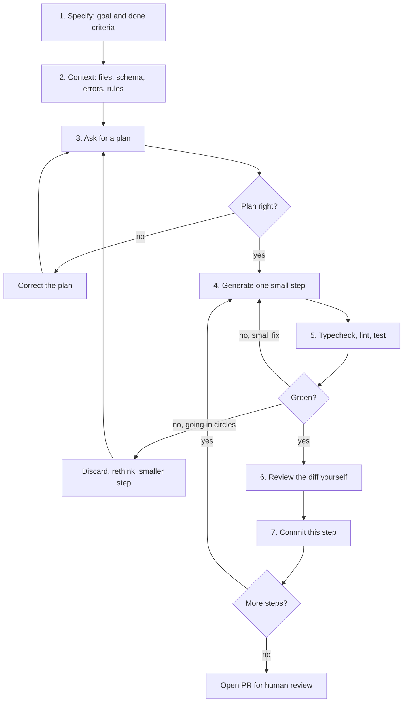

## 53.3 The working layer: a reliable loop

### 53.3.1 Specify, give context, plan, generate small, run, review, commit

#### Concept

A working engineer does not need clever prompts. They need a **loop** that reliably turns AI output into small, tested, reviewed commits. The loop is the same one good engineers used before AI, with the tool slotted into the "write the code" step and verification wrapped tightly around it:

1. **Specify** what you want and what "done" means.
2. **Give context**: the relevant files, the schema, the exact error, the conventions.
3. **Ask for a plan** before any code, and correct the plan.
4. **Generate a small diff**, one step of the plan at a time.
5. **Run the tests** (and the type checker and linter).
6. **Review** the diff as if a stranger wrote it.
7. **Commit** that step, then repeat.

#### Why does it exist?

Without a loop, AI-assisted work drifts into one of two failure modes. Either you ask for the whole feature at once and get a 900-line diff you cannot review properly, or you ping-pong with the tool for an hour, each "fix" breaking something else, with no safe point to return to. Small steps with a commit after each one give you checkpoints, readable diffs and an easy `git revert` or `git reset` (Part 5 — Git Basics and the Development Workflow, 5.7) when the tool goes down a wrong path.

#### Mental model

Imagine directing a fast but literal builder. You do not say "build me a house" and leave for a month. You agree a plan, then say "lay the foundation", inspect it, then "frame the ground floor", inspect it. Each inspection is cheap because each piece is small. A mistake found at the foundation costs an hour; found at the roof, it costs the house.

#### How it works



A few rules make the loop work:

- **"Done" is a test, not a feeling.** "Done when `POST /orders/:id/refund` returns 409 for an already-refunded order, and the new e2e test covers it."
- **The plan is the cheapest place to catch a wrong idea.** If the plan says "add a `refunded` boolean to `orders`" and your system already has a `refunds` table, you fix it in one sentence instead of one hour.
- **Small means reviewable in a few minutes.** As a rule of thumb, aim for steps under about 200 changed lines. Large diffs are where bugs hide (Part 48 — Git from Intermediate to Senior, 48.13).
- **Going in circles is a signal.** If the third attempt at a fix still fails, stop. Discard the changes (`git restore .` or `git stash`), think about why, and give better context or a smaller step. Agents in particular can spend many iterations "fixing" a symptom when the real problem is a wrong assumption early on.
- **Commit after every green step.** Each commit is a save point. You can squash them before merging if your team prefers.

#### Practical example

The task: add partial refunds to an orders service. A good opening message to an agent or chat assistant:

```text
Goal: support partial refunds on orders.
Done when:
- POST /orders/:id/refunds accepts { amountCents, reason, idempotencyKey }
- total refunded can never exceed the order total (enforced in the DB too)
- a retry with the same idempotencyKey returns the first result, no second refund
- unit tests for the service, one e2e test for the endpoint

Context (attached): src/orders/order.entity.ts, src/orders/orders.service.ts,
src/payments/payments.client.ts, migrations/1730000000000-orders.ts, docs/conventions.md

Constraints:
- orders table has ~30M rows and takes writes all day: no blocking DDL
- follow the existing DTO + class-validator pattern
- do not add new npm dependencies

First: propose a plan as a numbered list of small steps. Do not write code yet.
```

The tool proposes six steps: migration for a `refunds` table, entity, DTO, service method with a transaction, controller, tests. You notice step 4 calls the payment provider inside the database transaction, which would hold a row lock during a slow network call (Part 31 — Reliability Engineering). You correct it ("record the refund as pending in a transaction, call the provider after commit, then mark it succeeded or failed") and only then let it generate step 1.

#### Production scenario

A team that adopted this loop measured the median size of AI-assisted pull requests before and after: it fell from roughly 600 changed lines to under 250, review turnaround roughly halved, and the number of review rounds per PR went down. The tool did not change; the habit did.

#### Failure scenario

An engineer asks an agent to "add partial refunds" with no plan step and no constraints. The agent generates a migration adding a column with a check constraint, validated immediately on a 30-million-row table, a service, a controller and forty tests, in one go. All tests pass locally against an empty database. The migration runs in production at 11:00, holds a lock long enough to queue every write to `orders` behind it, and checkout times out for several minutes. A plan step with the constraint "no blocking DDL" would have caught it before a line was written. Part 24 — Database Migrations and Zero-Downtime Schema Changes covers the safe form.

#### Edge cases & failure modes

- **The tool "fixes" a failing test by editing the test.** Always read test changes; require that test changes are called out separately.
- **Hidden scope creep.** You asked for one endpoint; the diff also "tidies up" five unrelated files. Reject unrelated changes; they make review harder and blame history noisier.
- **Environment mismatch.** Tests pass in the agent's environment but it used a different Node version or skipped integration tests that need Docker.
- **A plan that sounds right but is not.** Plans are also plausible text. Check them against the code.

#### How a Senior Backend Engineer thinks about this

The senior's loop is visibly the same as their pre-AI loop: understand, plan, small steps, tests, review, commit. The tool speeds up the typing and some of the thinking, but it never removes a checkpoint. When they are tempted to skip one because "it's just AI boilerplate", they remember that boilerplate is where missing authorization checks live.

#### Common mistakes

- Asking for the whole feature in one prompt.
- Never asking for a plan, so design decisions are made implicitly by the model.
- Letting uncommitted AI changes pile up so there is no clean point to return to.
- Continuing a failing loop for an hour instead of resetting.

#### Interview questions

1. **Describe how you work with an AI assistant on a feature.** Specify done criteria, give context, get and correct a plan, generate small steps, run checks, review, commit each step. Follow-up: how small is a step?
2. **The agent has tried three times to fix a failing test. What do you do?** Stop, discard or stash, figure out the wrong assumption, give better context or a smaller step.
3. **Why ask for a plan before code?** It is the cheapest point to catch a wrong design, and it makes the design decisions explicit instead of implicit.

#### Practical exercise

Implement a small feature (for example, soft-deleting products) using the loop. Acceptance criteria: a written spec with done criteria, the plan you received and the corrections you made, at least three commits each under 200 changed lines, all tests green at each commit, and one paragraph on a mistake the plan step caught.

### 53.3.2 Prompts and project instruction files

#### Concept

A **project instruction file** is a plain Markdown file in the repository that an AI tool reads automatically at the start of a session, so that conventions do not have to be repeated in every prompt. Names differ by tool: Claude Code reads `CLAUDE.md`; GitHub Copilot can read `.github/copilot-instructions.md`; Cursor reads rules from its own rules location; and `AGENTS.md` has emerged as a shared convention that several tools read. Check your tool's documentation for the current name; the idea is the same everywhere.

#### Why does it exist?

Because the tool forgets everything between sessions (53.1.2), and because its default is the average of public code rather than your team's decisions. An instruction file is how you move team knowledge from people's heads into the tool's context: which ORM, how errors are shaped, where validation lives, which commands verify a change, what must never be done.

#### Mental model

Imagine the one-page briefing you would give a contractor on their first morning: "We use these tools. Tests run with this command. Never touch the payments schema without asking. Here is a good example to copy." You would not give them the whole wiki. You give them what prevents the most expensive mistakes.

#### How it works

A good instruction file is short, specific and testable. It does not explain what NestJS is; the model knows. It records *your* decisions.

```text
# CLAUDE.md / AGENTS.md (example for an orders service)

## Stack
- NestJS 10, TypeORM with PostgreSQL 16, Jest. Node version from .nvmrc.

## Commands (run before saying a task is done)
- npm run typecheck
- npm run lint
- npm test               (unit)
- npm run test:e2e       (needs Docker; uses Testcontainers)

## Conventions
- Validation lives on DTOs with class-validator; never on entities.
- Errors: throw Nest HttpExceptions from services; the global filter shapes the body.
- Money is integer cents (amountCents), never floats.
- Every query on customer data filters by the caller's customerId or tenantId.
- Copy src/orders/orders.controller.ts as the reference controller.

## Never
- Never edit an existing migration; add a new one.
- Never use blocking DDL on orders, order_items, payments (30M+ rows): see docs/migrations.md.
- Never add an npm dependency without saying so in the summary.
- Never read or print .env; use .env.example.
```

Writing good prompts follows the same principles at a smaller scale:

| Principle | Weak prompt | Strong prompt |
|---|---|---|
| State the goal and done criteria | "Improve this endpoint" | "Make `GET /orders` return in under 100 ms p95 for a customer with 5,000 orders" |
| Give the real context | "It's slow" | Paste the query and `EXPLAIN (ANALYZE, BUFFERS)` output |
| Name constraints | (nothing) | "No new dependencies; table has 30M rows; no blocking DDL" |
| Ask for reasoning before code | "Write it" | "First list three options with tradeoffs" |
| Say what to leave alone | (nothing) | "Do not change the public response shape" |

#### Production scenario

A platform team maintains one instruction file per service, reviewed like code through CODEOWNERS. When a recurring review comment appears in three or more pull requests ("use `amountCents`, not `amount`"), someone adds a line to the instruction file. Over a quarter, the most common AI-related review comments fall off sharply. The instruction file becomes a living list of "mistakes we have stopped making".

#### Failure scenario

An instruction file grows to 3,000 lines: the full architecture document, every past decision, onboarding notes. Sessions get slower and more expensive, and the tool's adherence to the *important* rules gets worse, because they are buried in the middle of a long input. The team cuts it back to about 80 lines of decisions and commands, linking to longer documents that the agent can open when a task needs them.

#### Edge cases & failure modes

- **Stale instructions.** The file says Jest; the project moved to Vitest. The tool now follows wrong rules confidently. Review it when the stack changes.
- **Secrets in the instruction file.** It is committed to the repository; treat it as public within the company.
- **Instructions are guidance, not enforcement.** A model can still ignore a rule. Anything that must hold goes into a linter rule, a CI check or a permission setting (53.6.1), not only into prose.
- **Conflicting files.** A monorepo with instruction files at several levels; know which ones your tool reads and how they combine.

#### How a Senior Backend Engineer thinks about this

A senior treats the instruction file as executable team memory and as a smell detector: if they keep writing the same correction, the knowledge belongs in the file, or better, in a lint rule. They keep it short, because they know length dilutes attention, and they never rely on it for a security boundary.

#### Common mistakes

- No instruction file at all, then complaining that the tool ignores conventions.
- A file full of generic advice ("write clean code") instead of specific decisions.
- Putting "never do X" only in prose when a CI check could enforce it.

#### Interview questions

1. **What goes in a repository instruction file for AI tools?** Stack, verification commands, team-specific conventions, reference examples and hard "never" rules; not generic advice or secrets.
2. **Is an instruction file a security control?** No. It is guidance the model usually follows; real boundaries are permissions, sandboxes and CI checks.
3. **Your instruction file says one thing and the code does another. What does the tool do?** It may follow either; fix the inconsistency, because both are context.

#### Practical exercise

Write an instruction file for a service you know, under 100 lines. Acceptance criteria: it lists the exact verification commands (checked against `package.json`), at least five team-specific conventions, one reference file per layer, and at least three "never" rules, one of which you have also turned into a lint or CI check.

### 53.3.3 Tests first with AI

#### Concept

The most reliable way to use AI for implementation is to **write or approve the tests first**, then let the tool write code to make them pass. The tests become the specification, written in a language that is checked by a machine rather than interpreted by a model.

#### Why does it exist?

Because "plausible" output (53.1.3) needs an independent check, and the strongest independent check is a test that a human has read and agreed with *before* the implementation exists. If the same tool writes code and tests together, both may share the same misunderstanding. If a human approves the tests first, the implementation has to satisfy the human's intent.

#### How it works

1. Write the test cases yourself, or ask the tool to *list* cases and you choose and edit them.
2. Have the tool generate the test code; read every assertion.
3. Run the tests and watch them fail for the right reason (not a typo).
4. Ask the tool to implement until the tests pass, without changing the tests.
5. Review the implementation for things tests rarely cover: authorization, concurrency, failure handling.

```ts
// refunds.service.spec.ts -- written and approved BEFORE the implementation exists.
describe('RefundsService.create', () => {
  it('rejects a refund larger than the remaining refundable amount', async () => {
    await seedOrder({ id: 'ord_1', customerId: 'cus_1', totalCents: 10_000, refundedCents: 7_000 });
    await expect(
      service.create({ orderId: 'ord_1', amountCents: 4_000, idempotencyKey: 'k1' }, { customerId: 'cus_1' }),
    ).rejects.toThrow('exceeds refundable amount');
  });

  it('returns the first result for a repeated idempotency key, with one provider call', async () => {
    await seedOrder({ id: 'ord_2', customerId: 'cus_1', totalCents: 10_000, refundedCents: 0 });
    const first = await service.create({ orderId: 'ord_2', amountCents: 1_000, idempotencyKey: 'k2' }, { customerId: 'cus_1' });
    const second = await service.create({ orderId: 'ord_2', amountCents: 1_000, idempotencyKey: 'k2' }, { customerId: 'cus_1' });
    expect(second.id).toBe(first.id);
    expect(paymentsFake.refundCalls).toHaveLength(1);
  });

  it('does not let a customer refund another customer\'s order', async () => {
    await seedOrder({ id: 'ord_3', customerId: 'cus_other', totalCents: 5_000, refundedCents: 0 });
    await expect(
      service.create({ orderId: 'ord_3', amountCents: 1_000, idempotencyKey: 'k3' }, { customerId: 'cus_1' }),
    ).rejects.toThrow('not found');
  });
});
```

Note the third test. AI-generated implementations frequently forget ownership checks (53.4); writing the test first means the tool cannot "forget" it without a red build.

#### Common mistakes

- Letting the tool write tests after the code, from the code, so the tests confirm whatever the code does.
- Accepting a passing build without checking the agent did not alter the tests.
- Testing only the happy path because the tool's suggested case list did.

#### Interview questions

1. **Why write tests before asking an AI to implement?** The tests become a machine-checked specification approved by a human, so the implementation cannot share the model's misunderstanding unnoticed.
2. **How do you stop an agent from changing tests to make them pass?** Instruct it not to, review test diffs separately, and protect key test files with CODEOWNERS or a CI check on test changes.

#### Practical exercise

Pick a service method you have not written yet. Write five test cases first (at least one authorization case and one duplicate-request case), then let an assistant implement it. Acceptance criteria: tests committed before implementation, implementation passes without test edits, and a note on anything the tests did not cover that review found.

### 53.3.4 Where AI earns its keep: refactors, migrations, tests, debugging, docs

#### Concept

Some jobs fit these tools very well because they are pattern-heavy, easy to verify, or both. Knowing them lets you put the tool where it saves real time.

#### How it works

| Task | Why it fits | How to keep it safe |
|---|---|---|
| Mechanical refactors (rename, extract, move to new API) | Repetitive, pattern-based, verified by compiler and tests | Small batches; compiler and full test run after each |
| Test generation for existing code | Tedious to type; cases are easy to read | You approve the case list; check assertions are meaningful, not `toBeDefined()` |
| Debugging from a stack trace | Good at reading traces and suggesting hypotheses | Treat suggestions as hypotheses; confirm with logs or a repro |
| Writing a migration draft | Knows SQL syntax and ORM migration shape | Review lock behaviour and data safety yourself (below) |
| Documentation and comments | Good at prose from code | Check every claim against the code |
| Explaining unfamiliar code | Fast orientation in a new codebase | Verify by reading the paths it names |
| Small scripts and one-off queries | Low risk, quick to check | Run against a copy first, never directly on production |

#### Practical example: debugging from a stack trace

```text
QueryFailedError: deadlock detected
    at PostgresQueryRunner.query (node_modules/typeorm/driver/postgres/PostgresQueryRunner.js:219:19)
    at async InventoryService.reserve (src/inventory/inventory.service.ts:48:5)
    at async OrdersService.place (src/orders/orders.service.ts:91:7)
Detail: Process 18231 waits for ShareLock on transaction 99812; blocked by process 18240.
```

Pasting this with the `reserve` method, a good assistant points out that two orders locking the same products in *different orders* can deadlock, and suggests sorting product IDs before locking (Part 21 — Database Transactions and Concurrency Control, 21.7). That is a strong hypothesis. You confirm it by checking whether the deadlocks involve multi-item orders with overlapping products, and by a concurrency test that places two such orders at once. The assistant shortened the investigation; it did not replace it.

#### PostgreSQL example: reviewing an AI-drafted migration

You ask for a migration to add a `refunds` table and an index for looking up orders by customer. The draft:

```ts
// AI draft -- looks fine, has two production problems on a large, busy table
import { MigrationInterface, QueryRunner } from 'typeorm';

export class AddRefunds1731300000000 implements MigrationInterface {
  async up(q: QueryRunner): Promise<void> {
    await q.query(`CREATE TABLE refunds (
      id uuid PRIMARY KEY DEFAULT gen_random_uuid(),
      order_id uuid NOT NULL REFERENCES orders(id),
      amount_cents integer NOT NULL CHECK (amount_cents > 0),
      idempotency_key text NOT NULL UNIQUE,
      status text NOT NULL,
      created_at timestamptz NOT NULL DEFAULT now())`);
    await q.query(`CREATE INDEX idx_orders_customer_created ON orders (customer_id, created_at DESC)`);
    await q.query(`ALTER TABLE orders ADD CONSTRAINT chk_refunded_le_total CHECK (refunded_cents <= total_cents)`);
  }
  async down(q: QueryRunner): Promise<void> { /* drops omitted for brevity in the draft */ }
}
```

What a reviewer catches:

1. `CREATE INDEX` without `CONCURRENTLY` on a 30-million-row `orders` table blocks writes for the whole build, which can take minutes (Part 24, 24.3).
2. `ADD CONSTRAINT ... CHECK` validates every existing row while holding a strong lock; use `NOT VALID` then `VALIDATE CONSTRAINT` separately (Part 24, 24.3).
3. No `lock_timeout`, so if the DDL waits behind a long transaction, every query on `orders` queues behind *it* (Part 24, 24.4).
4. An empty `down`. Also no index on `refunds.order_id`, which you will query by.

The reviewed version splits the work:

```ts
// Reviewed: non-blocking index in its own migration, outside a transaction
import { MigrationInterface, QueryRunner } from 'typeorm';

export class AddOrdersCustomerIndex1731300000001 implements MigrationInterface {
  transaction = false; // CONCURRENTLY cannot run in a transaction; needs migrationsTransactionMode 'each' (22.7)

  async up(q: QueryRunner): Promise<void> {
    await q.query(`SET lock_timeout = '5s'`);
    await q.query(
      `CREATE INDEX CONCURRENTLY IF NOT EXISTS idx_orders_customer_created ON orders (customer_id, created_at DESC)`,
    );
  }
  async down(q: QueryRunner): Promise<void> {
    await q.query(`DROP INDEX CONCURRENTLY IF EXISTS idx_orders_customer_created`);
  }
}
```

```sql
-- Reviewed: constraint added without scanning under a heavy lock, validated separately
SET lock_timeout = '5s';
ALTER TABLE orders ADD CONSTRAINT chk_refunded_le_total
  CHECK (refunded_cents <= total_cents) NOT VALID;      -- brief lock, no full scan
ALTER TABLE orders VALIDATE CONSTRAINT chk_refunded_le_total; -- scans, but allows reads and writes
CREATE INDEX CONCURRENTLY idx_refunds_order_id ON refunds (order_id);
```

The draft saved typing. The review is where the senior's knowledge lives, and no tool supplied it here unasked. You *can* ask for it ("review this migration for lock impact on a 30M-row table under write load") and a good assistant will often find these issues. The point is that someone has to know to ask.

#### Common mistakes

- Letting the tool write tests whose assertions are trivially true.
- Running an AI-written one-off `UPDATE` directly against production.
- Accepting migration drafts without thinking about table size and write load.

#### Interview questions

1. **Which engineering tasks are AI tools best at, and why?** Pattern-heavy, easily verified tasks: refactors, test scaffolding, trace reading, drafts of migrations and docs.
2. **An AI-drafted migration adds an index and a check constraint to a 30M-row table. What do you look for?** `CONCURRENTLY` outside a transaction, `NOT VALID` plus `VALIDATE`, `lock_timeout`, a real `down`, and indexes for new foreign keys.

#### Practical exercise

Ask an assistant to draft a migration that adds a foreign key and an index to a large table in a test database seeded with a few million rows. Acceptance criteria: list every lock problem in the draft, rewrite it safely, and prove with a concurrent `INSERT` loop in a second session that the reviewed version does not block writes.

### 53.3.5 What AI is bad at

#### Concept

The tools are weakest exactly where the stakes are highest: decisions that depend on things not in the code, and properties that only show up under concurrency, failure or attack.

#### How it works

| Weak area | Why the tool struggles | What you do |
|---|---|---|
| Novel architecture | Defaults to common patterns from training; does not know your constraints, team, budget or history | Use it to list options and tradeoffs; decide with an RFC (Part 83 — Writing as an Architect) |
| Subtle concurrency | Bugs appear only with specific interleavings; code looks fine line by line | Reason about it yourself; concurrency tests (Part 41, 41.9) |
| Security boundaries | Authorization depends on your domain; the "average" code it learned from often has none | Explicit review with a checklist (53.4) |
| Exact library versions | Training cut-off and mixed versions in training data | Pin versions; check the changelog and installed types |
| Hallucinated APIs | Invents plausible method names and options | Compiler and docs |
| Hallucinated packages | Invents plausible package names | Verify existence and reputation before installing (below) |
| Performance at your scale | Does not know your row counts or traffic | `EXPLAIN (ANALYZE, BUFFERS)`, load tests |

**Hallucinated packages deserve special attention.** A model asked how to do something in Node may suggest `npm install some-plausible-name`. Sometimes the package does not exist. Research has shown that models repeat many of the same invented names across runs, which makes them predictable, and attackers can register those names on npm or PyPI with malicious code. This is called **slopsquatting**, a cousin of typosquatting (Part 40, 40.28). The defence is cheap:

```bash
# Before installing anything an AI suggested:
npm view nest-refund-guard name version time.created repository.url maintainers
# 404 -> it does not exist: the suggestion was invented. Do not create or install it.
# Exists but created last week, one maintainer, no repository, few downloads -> treat as hostile.

# Prefer packages your organisation already uses, and install without running scripts:
npm install --ignore-scripts some-known-package
npm audit signatures   # verifies registry signatures and provenance attestations where present
```

#### Common mistakes

- Asking an assistant to "design the architecture" and adopting its first answer.
- Installing a package because the tool named it confidently.
- Trusting the tool's claim about which version introduced a feature.

#### Interview questions

1. **What is slopsquatting?** Registering package names that AI models tend to hallucinate, so that developers who follow the suggestion install attacker code. Defence: verify existence, age, maintainers and repository before installing; restrict new dependencies by policy.
2. **Why are AI tools weak at concurrency bugs?** Each line looks correct; the bug lives in interleavings that are not visible in the text.

#### Practical exercise

Ask three different questions of the form "what npm package should I use to do X in NestJS?" for niche tasks. Acceptance criteria: for every package named, record whether it exists, its creation date, maintainer count and weekly downloads; flag any that do not exist or look risky; write a one-paragraph rule your team could adopt for AI-suggested dependencies.
