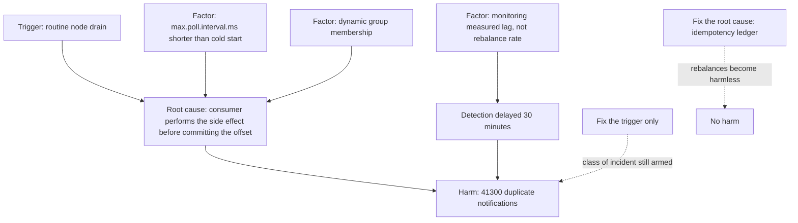

## 53.10 Postmortems

### 53.10.1 Blameless in practice, not just in name

#### Concept

A postmortem is a written analysis of an incident: what happened, why, what we are changing. "Blameless" means the document and the meeting focus on **why the action made sense at the time** rather than on who took it.

That phrasing matters. Blameless does not mean "nobody is responsible" or "we do not name people". It means we assume everyone acted reasonably given what they knew, and we ask what made the wrong action look right.

#### Why does it exist?

Because a blameful culture gets you fewer postmortems, not fewer incidents. If naming a mistake gets an engineer criticized in front of their manager, the next engineer will describe the incident vaguely, omit the part where they were confused, and not mention the two things they tried that made it worse. You lose exactly the information that would have prevented a recurrence.

There is also a deeper reason. If one person's mistake could take down production, that is a **system design defect**, not a personnel problem. Firing them leaves the defect in place for the next person.

#### Blameless in practice: the concrete tests

Most teams say they are blameless and are not. Four tests:

1. **Language.** "Priya deployed without running the migration check" is blameful. "The deploy pipeline allowed a deploy without running the migration check, and the engineer had no signal that it had been skipped" is blameless and, importantly, more accurate.
2. **Action items.** If every action item is "be more careful" or "add a review step", you are still blaming humans, just politely. Real action items change systems: add a guard, add a test, add an alert, remove the sharp edge.
3. **Attendance.** If the person closest to the trigger avoids the meeting, or is unusually quiet in it, you are not blameless regardless of your wiki page.
4. **Counterfactuals.** "If only she had checked the dashboard" is a counterfactual and it is useless — it describes a world that did not happen. Ask instead: *why did the dashboard not make it obvious?*

Blameless has one boundary worth stating: it applies to mistakes, not to deliberate policy violations. Someone who disables the alerting to make their week quieter is not a postmortem topic; that is a management conversation. In fifteen years I have seen that maybe twice, and both times the underlying cause was still an alerting system that was unusable.

### 53.10.2 The template

```text
POSTMORTEM: <short descriptive title>

Status: draft | in review | final
Incident: INC-2026-0142      Severity: SEV2
Date: 2026-09-03             Duration: 1h 47m (impact), 3h 12m (incident)
Authors: <names>             Reviewers: <names>
Postmortem meeting: <date>   Published: <date>

1. Summary
   Three to five sentences. What broke, who was affected, how long, what fixed it.
   A reader who stops here should understand the incident.

2. Impact
   Numbers, not adjectives. Users affected, requests failed, revenue, support
   tickets, error budget consumed, data correctness effects.

3. Timeline
   Timestamped, in one timezone, stated. Include when it started, when we knew,
   when we mitigated, when we resolved. Include the wrong turns.

4. Detection
   How did we find out? Alert, customer, or luck? Time from start to detection.
   Would our alerts have caught it if the customer had not called?

5. Root cause
   The chain of conditions. Distinguish trigger from root cause.

6. Contributing factors
   Everything that made it worse, longer or harder to detect.

7. What went well
   Genuinely. Recognizing effective response reinforces it.

8. What went badly
   Honest. This section is where the value is.

9. Where we got lucky
   The near misses. What would have made this far worse.

10. Action items
    Table: description, type (prevent/detect/mitigate/process), owner (a person,
    not a team), priority, due date, ticket link.

11. Lessons learned
    What we now believe that we did not believe before.
```

Two mandatory fields people leave out. **"Where we got lucky"** surfaces the incident you have not had yet — "the replica happened to be healthy" or "this happened at 4 a.m. instead of during the sale". And **an owner who is a person**: action items assigned to "the platform team" are not done six months later, every time.

### 53.10.3 A complete worked postmortem

```text
POSTMORTEM: Duplicate order notifications after a Kafka consumer group rebalance

Status: final
Incident: INC-2026-0142      Severity: SEV2
Date: 2026-09-03             Duration: 1h 47m impact, 3h 12m incident
Authors: A. Sharma (IC), R. Menon (Ops Lead)
Reviewers: P. Iyer (Orders lead), S. Kaur (Platform), D. Rao (Head of Engineering)
Postmortem meeting: 2026-09-08   Published: 2026-09-09

1. SUMMARY

Between 13:41 and 15:28 IST on 3 September, customers received duplicate order
confirmation emails and SMS messages, up to 6 copies of the same message. The
cause was a Kafka consumer group that entered a continuous rebalance loop after a
routine node drain, combined with a notification consumer that committed offsets
after sending rather than deduplicating on a stable key. Orders, payments and
inventory were not affected; no customer was charged twice. Mitigated by pinning
the consumer to static group membership and increasing session timeouts;
permanently fixed by adding an idempotency ledger keyed on the notification's
business key.

2. IMPACT

- 41,300 duplicate notifications sent (28,900 email, 12,400 SMS) to 9,740
  distinct customers. Peak 6 copies of one message.
- SMS provider cost: about 74,000 rupees of unbudgeted spend.
- 312 support tickets ("did I order twice?"), 4 of which escalated to refunds
  that were not actually needed.
- 2 merchants publicly complained on social media.
- No orders were duplicated. No payments were duplicated. Verified by
  reconciliation query (see appendix): orders created in the window = 24,117,
  payments = 24,117, matched 1:1.
- Error budget: the notification freshness SLO (99 % within 5 minutes) was not
  breached; delivery was fast, just repeated. The correctness SLI for
  notifications, which we did not have, would have been at ~63 % for the window.
  ACTION: we did not have an SLI that would have caught this. See AI-6.

3. TIMELINE (all times IST, 2026-09-03)

13:38  Platform begins a routine node drain on node ip-10-2-41-88 as part of the
       weekly kernel patch rollout. This is a normal, approved change.
13:39  Two notification-consumer pods are evicted and rescheduled.
13:41  Consumer group "notifications-v2" begins rebalancing. First duplicate
       notifications are sent. IMPACT STARTS.
13:41  Rebalance does not converge: pods are still starting (cold JVM-free Node
       start is ~14 s, but the consumer's first poll waits on a schema fetch that
       took 38 s under load), exceeding max.poll.interval.ms of 30 s. The group
       evicts them and rebalances again. Loop begins.
13:52  First customer support ticket: "I got 3 confirmation emails".
14:04  Second and third tickets. Support asks in #eng-help.
14:11  On-call engineer (R. Menon) acknowledges in #eng-help. Note: NO ALERT HAD
       FIRED. Detection was via support, 30 minutes after impact started.
14:14  Incident declared, SEV3 initially. Channel #inc-2026-0142 created.
14:19  Kafka consumer lag dashboard checked: lag is LOW (the consumers are
       processing, repeatedly). This misleads the responder for ~15 minutes;
       the team's mental model was "duplicates mean lag".
14:22  A. Sharma joins as IC. Comms Lead assigned (V. Nair). Upgraded to SEV2
       after estimating volume from provider dashboards.
14:31  R. Menon finds the rebalance loop in the consumer logs:
       "Attempt to heartbeat failed since group is rebalancing" repeating every
       ~40 s across all pods.
14:38  MITIGATION 1: scale the notification consumer from 6 to 2 replicas to
       reduce rebalance participants. Partial improvement; loop continues.
14:52  MITIGATION 2: increase max.poll.interval.ms from 30 s to 300 s and
       session.timeout.ms from 10 s to 45 s; redeploy. Rebalance converges at
       15:04 but a final rebalance during the deploy causes another burst.
15:04  Rebalance converges. Duplicate rate drops sharply.
15:22  MITIGATION 3: enable static group membership (group.instance.id from the
       StatefulSet pod ordinal) so pod restarts do not trigger a rebalance.
15:28  Last duplicate notification observed. IMPACT ENDS.
15:31  Comms Lead posts to the status page and sends a note to support with
       approved wording for affected customers.
16:50  Incident closed after 60 minutes of clean metrics and a manual audit of
       provider send counts.

4. DETECTION

Detected by customers, via support, 30 minutes after impact began. This is the
most serious finding in this document.

Why our monitoring missed it:
- We alert on consumer LAG. A rebalance loop that reprocesses the same messages
  produces LOW lag and HIGH throughput. Our dashboards looked healthy.
- We had no alert on rebalance frequency.
- We had no correctness SLI for notifications; we measured whether we sent, not
  whether we sent once.
- The SMS provider spend alert exists but is a daily budget check that would
  have fired at 23:00.

5. ROOT CAUSE

The notification consumer was not idempotent. It performed the side effect
(calling the email and SMS providers) and then committed the Kafka offset. Any
event that causes a partition to be reassigned before the commit results in the
messages since the last commit being reprocessed and re-sent.

Kafka's delivery guarantee for a consumer that commits after processing is
at-least-once. The consumer was written as if it were exactly-once. This is a
design defect that had been latent since the service was written in March 2026;
it required a rebalance storm to become visible at scale.

6. CONTRIBUTING FACTORS

a) max.poll.interval.ms was 30 s, shorter than the consumer's own cold-start
   path (schema registry fetch under load took up to 38 s). Any restart under
   load therefore risked a rebalance loop rather than a single rebalance.
b) Dynamic group membership meant every pod restart triggered a full rebalance.
   Static membership was available and not used.
c) The node drain was performed during business hours. It is an approved,
   routine change, but it removed two consumer pods simultaneously.
d) Monitoring measured lag, not rebalance rate or duplicate sends.
e) The consumer had no ledger, no deduplication key, and the providers were
   called without idempotency keys, so neither we nor the provider could
   deduplicate.
f) The responder's mental model ("duplicates imply lag") cost ~15 minutes. The
   dashboard reinforced it by putting lag at the top and having no rebalance panel.

7. WHAT WENT WELL

- Support escalated quickly and with specifics (customer ids, message counts),
  which made estimating impact fast.
- The IC/Ops/Comms split worked: R. Menon was never interrupted while debugging.
- The reconciliation query proving orders and payments were 1:1 was written
  within 12 minutes and prevented a much larger panic about double charging.
- Static group membership was implemented and shipped during the incident, and
  it was the right permanent mitigation, not a hack.

8. WHAT WENT BADLY

- 30 minutes to detect, and only because customers told us.
- Initial severity was too low; it was set on ticket count rather than on
  estimated blast radius. Fifteen minutes were lost at SEV3 urgency.
- The lag dashboard actively misled the responder.
- The first mitigation (scaling down) was a guess and did not help.
- The config-change mitigation required a deploy, which itself caused another
  rebalance and another burst of duplicates. We made it worse for 90 seconds.
- We had no way to tell customers "ignore the duplicates" other than a status
  page most of them never saw.

9. WHERE WE GOT LUCKY

- The same consumer group also drives the loyalty-points topic. Points are
  awarded idempotently by a unique constraint, so no customer received duplicate
  points. Had that constraint not existed, we would have had a financial incident.
- The node drain touched 2 of 6 pods. A full-cluster patch would have produced a
  much longer loop.
- This was a Wednesday afternoon, not the sale weekend, when volume is 9x.

10. ACTION ITEMS

| # | Action | Type | Owner | Priority | Due | Ticket |
|---|--------|------|-------|----------|-----|--------|
| AI-1 | Add a notification_deliveries ledger with a unique key on (channel, template, business_key) and check it before sending | Prevent | R. Menon | P0 | 2026-09-12 | ORD-4471 |
| AI-2 | Send provider-side idempotency keys on all email and SMS calls | Prevent | R. Menon | P0 | 2026-09-12 | ORD-4472 |
| AI-3 | Enable static group membership on all 7 consumer groups | Prevent | S. Kaur | P0 | 2026-09-15 | PLT-2210 |
| AI-4 | Raise max.poll.interval.ms to 300 s and audit cold-start time for every consumer | Prevent | S. Kaur | P1 | 2026-09-19 | PLT-2211 |
| AI-5 | Alert on consumer group rebalance rate above 3 per 10 minutes | Detect | S. Kaur | P0 | 2026-09-12 | PLT-2212 |
| AI-6 | Define and instrument a notification correctness SLI: unique notifications sent / notifications intended | Detect | A. Sharma | P1 | 2026-09-26 | ORD-4473 |
| AI-7 | Add a "Rebalances" panel above "Lag" on the Kafka dashboard | Detect | S. Kaur | P2 | 2026-09-19 | PLT-2213 |
| AI-8 | Move routine node drains to the 01:00-04:00 window and require them to be one node at a time | Mitigate | S. Kaur | P1 | 2026-09-26 | PLT-2214 |
| AI-9 | Add a "suppress notifications" kill switch that can be flipped in under 60 seconds | Mitigate | P. Iyer | P1 | 2026-10-03 | ORD-4474 |
| AI-10 | Severity guidance: estimate blast radius, not ticket count. Update the incident policy and the on-call training | Process | A. Sharma | P2 | 2026-10-03 | ENG-991 |
| AI-11 | Game day: force a rebalance storm in staging and verify AI-1, AI-3 and AI-5 | Process | R. Menon | P1 | 2026-10-10 | ORD-4475 |

11. LESSONS LEARNED

- Consumer lag is a throughput metric, not a correctness metric. A system can
  process every message promptly and still be badly wrong.
- Any consumer that commits offsets after performing a side effect is
  at-least-once. Either make the effect idempotent or do not pretend otherwise.
- A mitigation that requires a deploy will itself trigger the failure mode you
  are mitigating. Prefer runtime configuration and kill switches.
- Severity should be set from estimated blast radius, not from how many people
  have complained so far.
```

That document is roughly what a good postmortem looks like: specific, numeric, honest about the wrong turns, and ending in eleven action items each owned by a named person with a date.

### 53.10.4 Making action items actually ship

The most common postmortem failure is not a bad document; it is a good document whose actions never ship. Four practices that fix it:

1. **Create the tickets during the meeting.** Not after. The ticket link goes in the table before anyone leaves.
2. **P0 action items go into the current sprint**, displacing something. If nothing is displaced, it was not really a P0.
3. **Review open postmortem actions monthly** in the same forum that reviews the SLOs, and report the count and age. An action item older than 90 days is either done, cancelled with a reason, or a standing lie.
4. **Tie it to the error budget policy.** When the budget is exhausted, the reliability work that gets prioritized comes from this list. That is the mechanism that turns postmortems into engineering time.

## 53.11 Root cause analysis

### 53.11.1 Trigger, root cause, contributing factors

#### Concept

Three different things, constantly conflated:

- **Trigger** — the event that started this particular occurrence. The node drain.
- **Root cause** — the condition that made the trigger capable of causing harm. The consumer was not idempotent.
- **Contributing factors** — everything that made it worse, longer, or harder to see. Short poll interval, dynamic membership, lag-only monitoring, business-hours drain.

Fixing only the trigger is the classic mistake. "We will not drain nodes during business hours" makes this exact incident less likely and leaves the defect fully armed for the next rebalance, which will come from a broker upgrade, a network blip, or a pod OOM. Fixing the root cause — idempotency — makes rebalances harmless forever.

The useful heuristic: **the root cause is the thing that, if fixed, makes the entire class of incident go away**, not just this instance.



### 53.11.2 Five whys, and its limits

Five whys is a ladder: ask "why" repeatedly until you reach something worth fixing.

```text
Customers received 6 duplicate emails.
  Why? The consumer reprocessed the same Kafka messages repeatedly.
    Why? The consumer group rebalanced continuously, so offsets were never committed.
      Why? Pods exceeded max.poll.interval.ms during a slow cold start under load.
        Why? The schema registry fetch on startup took 38 s under load and the
             interval was 30 s.
          Why? The interval was left at a default nobody had reviewed against
               actual startup behaviour.
```

Useful. But notice what this ladder **missed entirely**: the consumer was not idempotent. That is the real root cause, and it is not on the "why" chain at all, because the chain follows one thread and idempotency is a parallel condition.

That is the central limitation of five whys: **it produces a single linear chain, and real incidents are trees.** Every serious incident has several conditions that all had to be true at once. Following one branch gives you a confident, narrow, incomplete answer.

Better tools when the incident matters:

- **Ask "why" in several directions.** Why did it happen? Why did it take 30 minutes to detect? Why did the first mitigation not work? Why was the blast radius this large? Each question yields its own chain, and together they cover the tree.
- **The contributing factors list**, deliberately kept long. Aim for six to ten. If you have two, you stopped early.
- **Counterfactual pruning**: for each factor, ask "if this had been different, would the impact have been materially smaller?" If yes, it is a real factor and deserves an action item. If no, drop it from the list so it does not dilute the document.

### 53.11.3 "Human error" is never a root cause

#### Concept

When an analysis lands on "the engineer made a mistake", the analysis has stopped one step too early. Every time.

Humans make errors at a stable, well-studied rate. That rate is a property of being human and it does not go down because you asked people to be careful. So "human error" is not a finding; it is the point where the interesting question starts: **what made the error possible, likely, or undetectable?**

Translate, always:

| Do not write | Write instead |
|---|---|
| "The engineer deployed the wrong image tag" | "The deploy command accepts any tag string and does not verify the image exists in the registry or was built from the target branch" |
| "The engineer forgot to run the migration" | "Migrations are a separate manual step that the deploy pipeline neither runs nor checks" |
| "The engineer ran DELETE without a WHERE clause" | "Production database access is direct and unaudited, with no dry-run, no transaction wrapper, and no row-count confirmation for destructive statements" |
| "The on-call did not follow the runbook" | "The runbook was 14 months stale and its first command referenced a deleted namespace" |
| "The engineer misread the dashboard" | "The dashboard's top panel was lag, which is unrelated to this failure mode, and there was no panel for the metric that mattered" |
| "The reviewer approved a bad PR" | "The change had no test covering the failure path, and review is the only control we had" |

Every right-hand entry is fixable by engineering. No left-hand entry is.

There is a sharper version of this test. Ask: **"Would a competent, well-rested, well-intentioned engineer have plausibly done the same thing?"** If the answer is yes — and it almost always is — then the system permitted it, and the system is what you change.

#### How a Senior Backend Engineer thinks about this

They are suspicious of a postmortem that ends after one clean causal chain, because reality is messier. They push for the second and third contributing factor. They ask "how would we have detected this without a customer telling us?" as a mandatory question, because detection gaps compound every future incident. And they never, ever let "be more careful" survive into the action items table.

