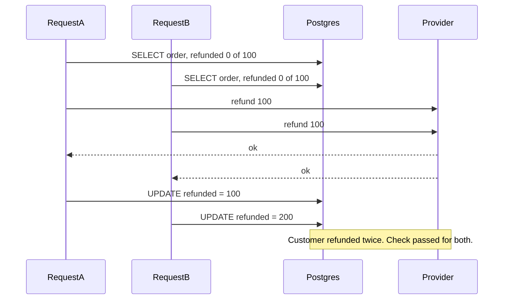
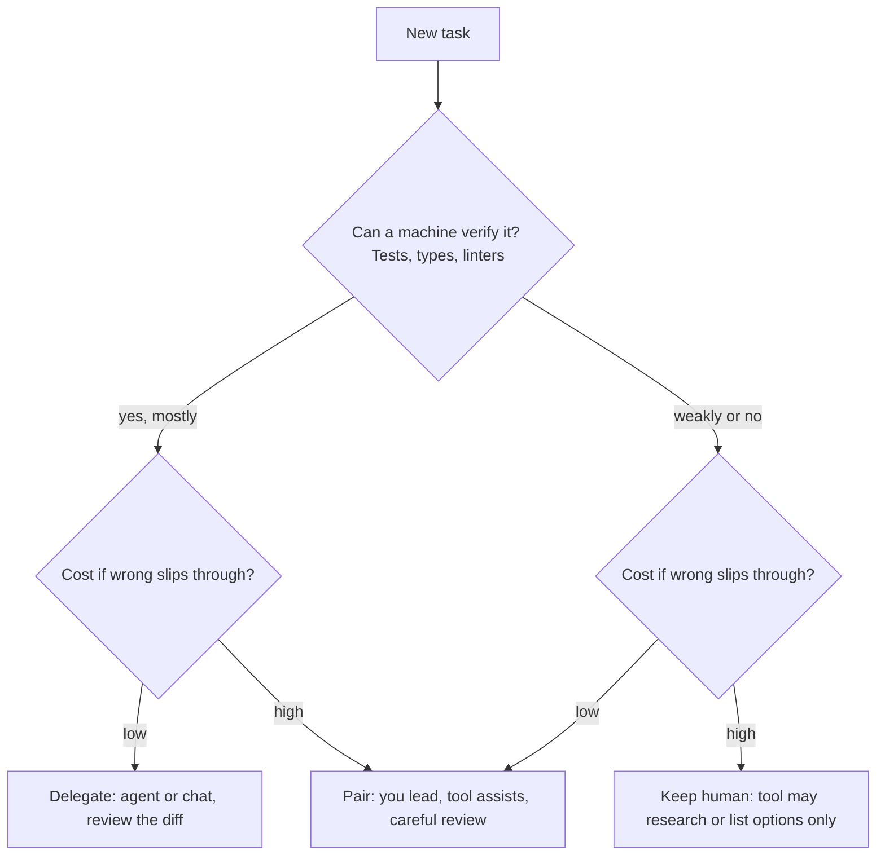

## 53.4 Reviewing AI-written code like a senior

### 53.4.1 The review checklist

#### Concept

Reviewing AI-written code is ordinary code review (Part 58 — The Senior Engineering Mindset, 58.9) with the dials turned in specific directions. AI code tends to be **clean-looking, consistently formatted and well-named**, which lowers a reviewer's guard. Its defects cluster in places that look fine on the page: missing authorization, unhandled failure paths, concurrency, dependency choices and database operations at scale. The checklist below aims attention there.

#### Why does it exist?

Because the usual signals of quality no longer mean much. In human-written code, sloppy formatting and odd naming often travel with sloppy logic, so a reviewer's eye is drawn to trouble. AI code removes those signals: the bug sits in a beautifully formatted function with a helpful comment above it. And volume goes up, so reviewers are tempted to skim. A checklist replaces "does this look right?" with "have I checked the things that are usually wrong?"

#### Mental model

Imagine inspecting a house built by a crew that is very fast and very neat. The paint is perfect, the trim is straight. You do not inspect the paint. You go straight to the wiring, the plumbing under pressure, the load-bearing walls and the locks on the doors, because those are what neatness hides and what fails catastrophically.

#### How it works

The senior's review checklist for AI-assisted pull requests:

| Area | Questions |
|---|---|
| **Intent** | Is this the right change? Does it solve the ticket, and only the ticket? Any unrelated edits? |
| **Correctness** | Does each branch do what it claims? Are edge cases (empty, null, max size, duplicate) handled? Were tests changed or weakened? |
| **The senior mantra** | Can it time out (is there a timeout on every network call)? Can it fail (what happens on error, is it caught at the right level)? Can it become slow (at 10x data)? Can it duplicate (retry, double click, redelivered message)? Can it return a wrong response (stale data, wrong user's data)? Can it partially succeed (step 2 of 3 fails)? |
| **Security** | Injection: any string-built SQL, shell commands, or template rendering (Part 40, 40.20, 40.29)? Authorization: is ownership or tenant checked on every object access, not just login (40.12)? Secrets: hard-coded keys, secrets in logs? Unsafe deserialization or prototype pollution (40.27)? Input validation through a DTO, or a plain TypeScript type that validates nothing at runtime? |
| **Data** | Migrations: lock level, table size, `CONCURRENTLY`, `NOT VALID`, `lock_timeout`, reversible (Part 24)? Transactions: right scope, no network calls inside? Locks: check-then-act races? N+1 queries (Part 22, 22.9)? Missing indexes for new query patterns? |
| **Dependencies** | Was a package added? Does it exist, is it the one you think (spelling, scope), who maintains it, how old is it, what licence, does it run install scripts? Could an existing dependency or a few lines of code do the job? |
| **Operability** | Logs with context but without personal data? Metrics for the new path? Errors that a human at 03:00 can act on? |
| **Understanding** | Can the author explain every line? Would the team be able to debug this in six months? |

Two practical tricks:

1. **Read the tests first.** They tell you what the author (or tool) thought the code should do. Missing cases are the fastest pointer to missing logic.
2. **Read the diff bottom-up for data and top-down for flow.** Start with migrations and queries, which are hardest to undo, then follow a request from controller to database.

#### How a Senior Backend Engineer thinks about this

A senior does not review AI code more harshly than human code; they review it *differently*, spending less time on style and more on the boundaries: trust boundaries (authorization, input), failure boundaries (network, transactions) and time boundaries (concurrency, retries). They also hold the line that the author must understand and own every line, regardless of who or what typed it.

#### Common mistakes

- Approving because it "looks clean".
- Reviewing only the files the PR description mentions and missing a changed lockfile or migration.
- Accepting a TypeScript interface on `@Body()` as validation.
- Skipping review of generated tests.

#### Interview questions

1. **What do you look for first when reviewing AI-generated backend code?** Authorization on object access, injection, failure handling and timeouts, concurrency and idempotency, migrations, and new dependencies. Why it matters: those are the defects AI code most often has and the most expensive to ship.
2. **Why is a TypeScript type on a request body not validation?** Types are erased at runtime; only a DTO class with `class-validator` decorators and a `ValidationPipe` checks what actually arrives.
3. **A PR adds one new npm dependency. What do you check?** Existence and exact name, maintainers and age, licence, install scripts, known vulnerabilities, and whether it is needed at all.

#### Practical exercise

Take three recent AI-assisted pull requests in your team (or generate three small features). Review each with the checklist above, recording findings per area. Acceptance criteria: a table of findings by area for each PR, at least one finding the original review missed (or a note that none were missed, with evidence), and one checklist item you would add for your codebase.

### 53.4.2 Worked example: a plausible endpoint with three real bugs

#### Concept

Here is an endpoint of the kind an assistant produces in seconds when asked to "add a refund endpoint for customers to refund their own orders". It compiles, it passes a happy-path test, it is neatly written, and it would cause a security incident and lose money. Read it and find the problems before reading the analysis.

#### NestJS example

```ts
// refunds.controller.ts -- as generated. Compiles. Happy-path test passes.
import { BadRequestException, Body, Controller, NotFoundException, Param, Post, UseGuards } from '@nestjs/common';
import { InjectRepository } from '@nestjs/typeorm';
import { DataSource, Repository } from 'typeorm';
import { JwtAuthGuard } from '../auth/jwt-auth.guard';
import { Order } from '../orders/order.entity';
import { PaymentsClient } from '../payments/payments.client';

@Controller('orders')
@UseGuards(JwtAuthGuard)
export class RefundsController {
  constructor(
    @InjectRepository(Order) private readonly orders: Repository<Order>,
    private readonly dataSource: DataSource,
    private readonly payments: PaymentsClient,
  ) {}

  @Post(':id/refund')
  async refund(@Param('id') id: string, @Body() body: { amountCents: number; reason: string }) {
    const order = await this.orders.findOne({ where: { id } });
    if (!order) throw new NotFoundException('Order not found');

    if (order.refundedCents + body.amountCents > order.totalCents) {
      throw new BadRequestException('Refund exceeds order total');
    }

    // Refund through the payment provider, then record it.
    const result = await this.payments.refund(order.paymentId, body.amountCents);

    await this.dataSource.query(
      `UPDATE orders SET refunded_cents = refunded_cents + ${body.amountCents},
       refund_reason = '${body.reason}' WHERE id = '${id}'`,
    );

    return { refundId: result.id, status: 'refunded' };
  }
}
```

#### How it works: the three bugs

**Bug 1: authentication without authorization (IDOR).** `JwtAuthGuard` proves the caller is *a* logged-in user. Nothing checks that the order belongs to *this* user. `findOne({ where: { id } })` fetches any order by ID. Any customer can refund any other customer's order by guessing or enumerating IDs: textbook insecure direct object reference (Part 40, 40.12). Assistants produce this pattern constantly, because most example code on the internet looks up records by ID alone.

**Bug 2: SQL injection.** `body.reason` is interpolated into the SQL string. A reason of `x', refunded_cents = 0, total_cents = '999999` rewrites the row. And `@Body() body: { amountCents: number; reason: string }` is a TypeScript type, erased at runtime, so `ValidationPipe` has nothing to validate: `amountCents` can be a string containing SQL, a negative number (a "refund" that *increases* what the customer can refund later), or missing entirely (Part 40, 40.20).

**Bug 3: double refunds and partial success.** Run the senior mantra against it:

- *Can it duplicate?* Yes, three ways. Two concurrent requests both read `refundedCents = 0`, both pass the check, and both refund: a classic check-then-act race (Part 21, 21.3). A mobile client that times out and retries refunds again, because there is no idempotency key (Part 30 — Distributed Transactions: Sagas, Outbox, Inbox and Idempotency). A double tap does the same.
- *Can it partially succeed?* Yes. If the provider call succeeds and the `UPDATE` then fails (connection reset, deploy restart), the money has moved and the database says it has not. The customer can refund again.
- *Can it time out?* The provider call has no timeout. A slow provider holds the request, its socket and its memory indefinitely (Part 31, 31.2).

There are smaller findings too: the refund reason overwrites a single column, so the history of multiple partial refunds is lost; there is no audit record of who refunded what; and the response claims `status: 'refunded'` without knowing.



#### The fixed version

The fix moves logic into a service, validates input with a DTO, makes ownership part of the query, serialises concurrent refunds with a row lock, records the refund as **pending** in a short transaction *before* calling the provider, passes an idempotency key to the provider, and treats "unknown outcome" as its own state for a reconciler job to resolve.

```ts
// create-refund.dto.ts and refunds.controller.ts
import { Body, Controller, Param, ParseUUIDPipe, Post, UseGuards } from '@nestjs/common';
import { IsInt, IsString, IsUUID, Length, Max, Min } from 'class-validator';
import { JwtAuthGuard } from '../auth/jwt-auth.guard';
import { CurrentUser, AuthUser } from '../auth/current-user.decorator'; // project decorator built with createParamDecorator
import { RefundsService } from './refunds.service';

export class CreateRefundDto {
  @IsInt() @Min(1) @Max(10_000_000) amountCents!: number;  // integer cents, positive, bounded
  @IsString() @Length(3, 500) reason!: string;
  @IsUUID() idempotencyKey!: string;                        // client generates once per refund attempt
}

@Controller('orders')
@UseGuards(JwtAuthGuard)
export class RefundsController {
  constructor(private readonly refunds: RefundsService) {}

  @Post(':id/refunds')
  create(
    @Param('id', ParseUUIDPipe) orderId: string,
    @Body() dto: CreateRefundDto,              // global ValidationPipe({ whitelist: true }) validates this class
    @CurrentUser() user: AuthUser,
  ) {
    return this.refunds.create(orderId, dto, user);
  }
}
```

```ts
// refunds.service.ts
import { ConflictException, Injectable, Logger, NotFoundException, UnprocessableEntityException } from '@nestjs/common';
import { DataSource, QueryFailedError } from 'typeorm';
import { Order } from '../orders/order.entity';
import { Refund } from './refund.entity';
import { PaymentsClient, PaymentDeclinedError } from '../payments/payments.client';
import { AuthUser } from '../auth/current-user.decorator';
import { CreateRefundDto } from './refunds.controller';

@Injectable()
export class RefundsService {
  private readonly logger = new Logger(RefundsService.name);
  constructor(private readonly dataSource: DataSource, private readonly payments: PaymentsClient) {}

  async create(orderId: string, dto: CreateRefundDto, user: AuthUser): Promise<Refund> {
    // 1. Short transaction: lock the order row, check, reserve the amount, record a pending refund.
    let refund: Refund;
    try {
      refund = await this.dataSource.transaction(async (m) => {
        const existing = await m.findOne(Refund, { where: { idempotencyKey: dto.idempotencyKey } });
        if (existing) {
          if (existing.orderId !== orderId || existing.amountCents !== dto.amountCents) {
            throw new ConflictException('Idempotency key reused with different parameters');
          }
          return existing; // a retry gets the original refund, never a second one
        }
        const order = await m.findOne(Order, {
          where: { id: orderId, customerId: user.customerId }, // ownership is part of the lookup
          lock: { mode: 'pessimistic_write' },                  // SELECT ... FOR UPDATE serialises refunds
        });
        if (!order) throw new NotFoundException('Order not found'); // same answer for "missing" and "not yours"
        if (order.refundedCents + dto.amountCents > order.totalCents) {
          throw new UnprocessableEntityException('Refund exceeds refundable amount');
        }
        await m.increment(Order, { id: order.id }, 'refundedCents', dto.amountCents); // parameterised
        return m.save(m.create(Refund, {
          orderId: order.id, paymentId: order.paymentId, amountCents: dto.amountCents,
          reason: dto.reason, idempotencyKey: dto.idempotencyKey, status: 'pending', requestedBy: user.id,
        }));
      });
    } catch (err) {
      // Two requests with the same key at the same moment: both passed the findOne check above,
      // the second INSERT hit the UNIQUE constraint (23505) and its transaction rolled back.
      // Return the winner's refund instead of a 500; the winner makes the provider call.
      if (err instanceof QueryFailedError && (err.driverError as { code?: string }).code === '23505') {
        const winner = await this.dataSource.getRepository(Refund).findOneByOrFail({ idempotencyKey: dto.idempotencyKey });
        if (winner.orderId !== orderId || winner.amountCents !== dto.amountCents) {
          throw new ConflictException('Idempotency key reused with different parameters');
        }
        return winner;
      }
      throw err;
    }
    if (refund.status !== 'pending') return refund;

    // 2. Network call AFTER commit: timeout, and our refund id as the provider's idempotency key.
    try {
      const res = await this.payments.refund(
        { paymentId: refund.paymentId, amountCents: refund.amountCents, idempotencyKey: refund.id },
        { timeoutMs: 5_000 },
      );
      await this.dataSource.getRepository(Refund).update(refund.id, { status: 'succeeded', providerRefundId: res.id });
      return { ...refund, status: 'succeeded', providerRefundId: res.id };
    } catch (err) {
      if (err instanceof PaymentDeclinedError) {
        await this.release(refund); // definite failure: give the reserved amount back
        throw new UnprocessableEntityException('Refund declined by the payment provider');
      }
      // Timeout or unknown: money may or may not have moved. Stay pending; a reconciler job asks the provider.
      this.logger.warn(`refund ${refund.id} outcome unknown, left pending: ${String(err)}`);
      return refund;
    }
  }

  private async release(refund: Refund): Promise<void> {
    await this.dataSource.transaction(async (m) => {
      const res = await m.update(Refund, { id: refund.id, status: 'pending' }, { status: 'failed' });
      if (res.affected === 1) await m.decrement(Order, { id: refund.orderId }, 'refundedCents', refund.amountCents);
    });
  }
}
```

#### PostgreSQL example

The database backs up the application's rules, so a future bug (or a future AI edit) cannot break them silently:

```sql
CREATE TABLE refunds (
  id                 uuid PRIMARY KEY DEFAULT gen_random_uuid(),
  order_id           uuid NOT NULL REFERENCES orders(id),
  payment_id         text NOT NULL,
  amount_cents       integer NOT NULL CHECK (amount_cents > 0),
  reason             text NOT NULL,
  idempotency_key    uuid NOT NULL UNIQUE,          -- concurrent same-key inserts: one wins, one gets 23505
  status             text NOT NULL CHECK (status IN ('pending', 'succeeded', 'failed')),
  provider_refund_id text,
  requested_by       uuid NOT NULL,
  created_at         timestamptz NOT NULL DEFAULT now()
);
CREATE INDEX idx_refunds_order_id ON refunds (order_id);
CREATE INDEX idx_refunds_pending ON refunds (created_at) WHERE status = 'pending'; -- the reconciler's scan

-- Added with NOT VALID then VALIDATE (53.3.4), here tightened to forbid negatives too.
-- ALTER TABLE orders ADD CONSTRAINT chk_refunded_le_total CHECK (refunded_cents BETWEEN 0 AND total_cents);
```

#### Production scenario

With the fixed version on a marketplace processing roughly 4,000 refunds a day, a small number each day end in the "outcome unknown" state, typically provider timeouts during their busy periods. A reconciler runs every five minutes, finds pending refunds older than two minutes using the partial index, asks the provider for the status of each idempotency key, and resolves them. The finance dashboard shows a "pending over 30 minutes" count that should be zero; it alerts if not. That is what "partial success handled" looks like in operation: a named state, a job that resolves it, and a metric that proves it.

#### Failure scenario

The original version shipped at a company once (a composite story, but every piece of it is common). Within a week, the support team noticed customers with refunds larger than their orders. The cause was mobile retries: the app retried on a 10-second client timeout while the provider took 12 seconds during a peak. Two weeks later, a security researcher reported that refunds could be triggered on other customers' orders. The fix took a day. The reconciliation with the payment provider, and the conversations with affected customers, took a month.

#### How a Senior Backend Engineer thinks about this

A senior reading the original sees a request that touches money, crosses a network boundary and writes to a database, and immediately asks the mantra questions. None of the three bugs is exotic; all three are standard backend failures that this book covers in other Parts. The AI did not invent new categories of bug. It produced the most common categories in fluent, confident code, at a speed that tempts reviewers to skim. The fix is not "do not use AI"; it is "know the checklist and apply it every time money, identity or data is involved."

#### Common mistakes

- Treating `@UseGuards(JwtAuthGuard)` as authorization.
- Calling a payment provider inside a database transaction (holds a row lock across a slow network call) or before recording intent (loses track of money on a crash).
- Returning "refunded" when the outcome is unknown.

#### Interview questions

1. **Find the bugs in this refund endpoint.** IDOR (no ownership check), SQL injection (string interpolation plus no runtime validation), and double refund or partial success (check-then-act race, no idempotency key, no timeout, provider call before recording intent). Follow-up: how do you test each one?
2. **Why record the refund as pending before calling the provider?** So a crash or timeout after the call leaves a durable record of intent that a reconciler can resolve, instead of money moving with no trace.
3. **Why should "not yours" return 404 rather than 403?** A 403 confirms the object exists, which leaks information and helps enumeration.
4. **Why not call the provider inside the transaction?** It holds the row lock for the duration of a slow, unreliable network call, and the transaction cannot undo the external side effect anyway.

#### Practical exercise

Reproduce the original endpoint in a test project. Write three failing tests, one per bug: a customer refunding another customer's order, a `reason` containing a quote that alters the row, and two concurrent refunds that together exceed the total. Then apply the fixed version. Acceptance criteria: all three tests fail on the original and pass on the fix; the concurrency test uses a real PostgreSQL (Testcontainers, Part 41, 41.7), not a mock.

## 53.5 Delegate, pair or keep: the decision matrix

#### Concept

Not every task should go to an AI tool, and not every task should be kept from one. A useful rule is to judge each task on two axes: **how easy is it to verify** the result, and **how expensive is it if the result is wrong**. Easy to verify and cheap if wrong: delegate. Hard to verify or expensive if wrong: pair (you drive, the tool assists) or keep human.

#### Mental model

Imagine deciding what to hand an intern. Formatting a report: hand it over and skim the result. Drafting a customer email: let them draft, you edit. Signing a contract or deciding a layoff: you do it, though they can fetch the documents. The intern is not less capable on the third task; the cost of an unnoticed mistake is just too high.

#### How it works



| Task | Verifiable? | Cost if wrong | Decision | Notes |
|---|---|---|---|---|
| Boilerplate DTOs, module wiring | High | Low | **Delegate** | Compiler and tests catch most errors |
| Mechanical refactor across many files | High (with good tests) | Medium | **Delegate** | Small batches, full test run each |
| Unit test scaffolding for existing code | Medium | Low | **Delegate** | You approve the case list |
| Explaining unfamiliar code or a stack trace | Medium | Low | **Delegate** | Verify by reading the paths named |
| Documentation drafts | Medium | Low | **Delegate** | Check every claim |
| New CRUD endpoint in an established pattern | Medium | Medium | **Pair** | Authorization and validation reviewed by hand |
| Database migration on a large table | Low (locks only show at scale) | High | **Pair** | Tool drafts; you own lock analysis (Part 24) |
| Performance optimisation | Medium (with load tests) | Medium | **Pair** | Measure before and after |
| Debugging a production incident | Low | High | **Pair** | Tool proposes hypotheses; evidence decides |
| Authentication, authorization, crypto | Low | Very high | **Keep human** (tool may review) | Use proven libraries; human design and review |
| Concurrency and money movement logic | Low | Very high | **Keep human** (pair at most) | Design by hand; concurrency tests |
| Architecture and service boundaries | Low | Very high | **Keep human** | Tool lists options; RFC decides (Part 83) |
| Choosing a new dependency or vendor | Low | High | **Keep human** | Tool can research; policy decides (53.9) |
| Running anything against production | Low | Very high | **Keep human** | No agent writes to production (53.6) |

The flowchart is the first cut; the table adds judgement. Medium verifiability counts as "mostly" when the check is cheap (reading the paths an explanation names), so those rows are delegated. A large-table migration or a production incident scores low on verifiability and high on cost, which the flowchart sends to "keep human"; we still pair on them because the tool's draft or hypothesis is useful, as long as you own the lock analysis and the evidence.

The matrix shifts with your safety net. A team with strong integration tests, Testcontainers and contract tests can delegate more, because more becomes machine-verifiable. A team with weak tests should delegate less, however good the tool is.

#### How a Senior Backend Engineer thinks about this

The senior uses the matrix to set expectations with the team rather than to police individuals: "agents are welcome on the refactor; the refund flow gets designed on a whiteboard first." They also notice that the "keep human" rows are exactly the ones where the team's long-term expertise lives, and protect the learning that happens there (53.8.3).

#### Common mistakes

- Delegating by how *boring* a task is rather than how *verifiable* and *costly* it is.
- Keeping everything human out of fear, and losing real productivity on the safe rows.
- Forgetting that weak tests move every row toward "keep human".

#### Interview questions

1. **How do you decide what to delegate to an AI tool?** By verifiability and cost of error: delegate what machines can check and mistakes are cheap; pair or keep human where verification is hard or errors are expensive.
2. **Would you let an agent write an authorization guard?** I might let it draft or review one, but I would design and review it myself, use proven libraries, and test it adversarially.

#### Practical exercise

List the last twenty tasks your team completed. Place each in the matrix. Acceptance criteria: a table with the decision and reason for each, at least three tasks where your team's current practice differs from the matrix, and a proposal for one test or check that would move a task from "pair" to "delegate".
