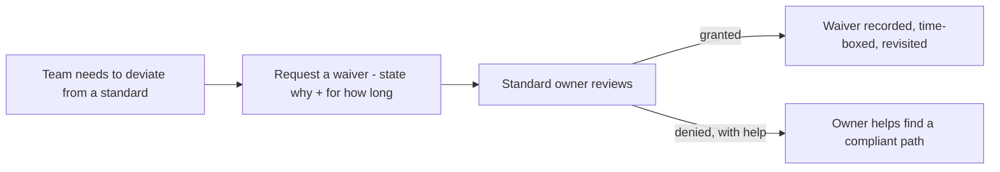

## 53.6 Dependency policy, shared libraries, waivers and measuring compliance

#### Concept

Four governance topics that come up once you have many services. **Dependency and version policy** is how you handle the constant churn of upgrades across dozens of services — upgrade cadence, support windows, end-of-life handling. **Inner source and shared libraries** is how teams share code internally without creating the shared-library trap, where a shared dependency becomes a coupling nobody can change. **Exceptions and waivers** is the process for when a team legitimately needs to deviate from a standard. And **measuring compliance** is how you know whether your governance is working without turning into the police.

#### Why does it exist?

Imagine forty services, each pinning its own versions of Node, NestJS and a dozen libraries, each upgrading on its own whim or never. A critical security vulnerability drops in a widely-used library. You now need to know which of the forty services use the vulnerable version, coordinate forty separate upgrades, and chase the teams that never upgrade anything. Without a version policy, this is an archaeology project under time pressure during a security incident. Without a way to measure compliance, you do not even know which services are affected. The policies exist to make the fleet upgradable and auditable rather than a collection of forty independently-rotting codebases.

The shared-library concern exists because sharing code is the obvious way to avoid duplication, but a shared library that many services depend on becomes a form of coupling: changing it affects everyone, so nobody dares change it, so it ossifies. Inner-source practices exist to get the benefit of sharing without this trap.

#### Mental model

For dependencies, imagine a fleet of company cars. If every driver services their car whenever they feel like it (or never), the fleet is a mix of well-maintained and dangerously-neglected vehicles, and when a recall hits a specific part, you cannot even tell which cars have it. A fleet policy — service every N months, retire cars past a certain age, keep a registry of what is in each — makes the fleet maintainable and auditable. Version policy is fleet maintenance for software.

For shared libraries, imagine a load-bearing wall shared between many apartments. It is efficient (one wall, many homes) but it is also a coupling: you cannot renovate it without affecting every apartment, so it never gets renovated and slowly becomes a constraint everyone works around. A shared library is a load-bearing wall; share deliberately, and only what truly benefits from being shared.

#### How it works

**Dependency and version policy:**

```text
- Upgrade cadence: a defined rhythm (e.g. patch within a week, minor within
  a month, major within a quarter), not "whenever".
- Support window: which versions are supported (e.g. current + previous major
  of Node and NestJS). Older than that, you must upgrade.
- EOL handling: a dependency approaching end-of-life is scheduled for
  replacement BEFORE it reaches EOL, tracked as debt (Part 52.4).
- Automated upgrades: bots (Renovate/Dependabot) open PRs for upgrades; the
  paved road's fitness functions and tests gate them.
- Centralised version management: shared libraries pin blessed versions, so
  a bump propagates through the fleet via the paved road.
```

**Inner source and the shared-library trap.** The trap: a shared library grows to serve everyone's needs, accumulates every team's special case, becomes impossible to change without breaking someone, and ossifies. Avoiding it:

- **Share deliberately, not reflexively.** Not all duplication is bad. Two slightly different implementations are often cheaper than one shared library coupling two teams. Share only stable, genuinely common things (the error filter, the auth client), not volatile domain logic.
- **Version shared libraries, and support multiple versions.** Consumers upgrade on their own schedule within the support window, so a change does not force a synchronised fleet-wide deploy.
- **Clear ownership.** A shared library has an owning team responsible for it, a public API, and a deprecation policy. Ownerless shared libraries rot fastest.
- **Inner-source model.** Other teams can contribute (open a PR) but the owner reviews and maintains coherence, so the library does not become a dumping ground.

**Exceptions and waivers.** Standards need an escape hatch, or teams with real different needs will either suffer or route around governance entirely:



A good waiver is explicit, time-boxed, recorded, and revisited. "Team X may skip the standard error format until Q3 because they are mid-migration; revisit at Q3" is a healthy waiver. A permanent, undocumented exception is governance decay.

**Measuring compliance without policing.** You want to know the state of the fleet without making engineers feel watched:

- Measure at the system level (dashboards of fleet-wide compliance), not the individual level (naming and shaming).
- Use automated signals: what fraction of services use the current paved-road version, use the standard error filter, are within the support window.
- Make non-compliance *visible to the team itself* (a service scorecard the owning team sees), so they fix it because they can see it, not because they are policed.

#### Practical example

An org uses Renovate to open upgrade PRs across all services, with the paved road's fitness functions and tests gating each one. When a security vulnerability drops, they query their service registry (which records each service's dependency versions) and immediately know which twelve of forty services are affected. Renovate opens the patch PR for all twelve; the fitness functions verify each still passes; most merge automatically within a day. The one service that fails (its tests break on the patch) gets human attention. What would have been a week-long archaeology-and-coordination project is a one-day, mostly-automated fleet upgrade — because the version policy, the automated upgrades, and the registry were in place before the incident.

#### Artifact example

A service scorecard — the artifact that makes compliance visible to the owning team without policing them.

```markdown
# Service scorecard: orders-service (auto-generated weekly, seen by the team)

## Paved road & standards
- [x] On paved-road template v3 (current)
- [x] Standard error format (fitness function green)
- [x] Standard logging + trace IDs
- [ ] OpenAPI contract published and matching  <- GAP
- [x] Standard alerts wired

## Dependencies & versions
- [x] Node 22 (supported)
- [ ] NestJS 9  <- support window is 10 + previous; upgrade by Q3
- [x] No known critical vulnerabilities
- [ ] 1 dependency approaching EOL (lib-x, EOL in 5 months) <- schedule

## Reliability
- [x] p99 latency within budget
- [x] Error budget healthy (99.95% this month)
- [ ] 2 alerts fired with no runbook link  <- add runbooks

## Waivers (active)
- Error-format v1 -> v2 migration: WAIVED until Q3 (mid-refactor). Recorded.

## Score: 10/13 green. Trend: improving (was 8/13 last month).
```

The scorecard is addressed to the *owning team*, not to management. It shows gaps the team can act on, records their active waiver so the gap is not held against them, and shows a trend so progress is visible. Teams fix the gaps because they can see them and want a green scorecard, not because anyone is policing them. This is how you measure compliance without turning into the police: make the data serve the team, not surveil it.

#### Real-world scenario

A principal engineer introduces service scorecards across the org, auto-generated weekly and visible to each owning team (and aggregated, anonymised, at the fleet level for leadership). He deliberately does *not* create a leaderboard or name laggards in all-hands, because he knows that policing produces gaming (teams juking the metric) and resentment. Instead, teams see their own gaps and, because engineers generally want their service to be healthy and green, they fix them. Fleet-wide compliance with the paved road rises from 60% to 90% over two quarters, driven almost entirely by teams self-correcting against their own scorecards. The one time a VP suggests a public ranking, the principal pushes back hard, explaining that the moment the metric becomes a stick, it stops measuring reality and starts measuring who is best at gaming it. Compliance measured to help teams rises; compliance measured to police them gets gamed.

#### Failure scenario

An org has a widely-used shared library for "common order utilities". It started small and useful. Over three years, every team that needed anything order-related added their special case to it, because adding to the shared library felt more correct than duplicating. Now the library is a 20,000-line tangle that every service depends on, encoding six teams' conflicting assumptions. Changing anything in it risks breaking an unknown number of consumers, so nobody dares, so it is frozen. A genuinely needed change — fixing a bug that affects three teams — cannot be made safely, because the blast radius is the entire fleet and there is no owner and no versioning. The shared library, meant to reduce duplication, has become the single most coupled, most feared, least changeable piece of the codebase. Sharing reflexively, with no owner, no versioning, and no discipline about what belongs in it, turned a convenience into the org's worst coupling. Deliberate sharing — only stable common things, versioned, owned — would have avoided the trap.

#### Edge cases & failure modes

- **No version policy.** Forty independently-rotting services; a security fix becomes an archaeology project.
- **The shared-library trap.** A reflexively-shared library accumulates everyone's special cases, ossifies, and becomes the worst coupling in the system.
- **Ownerless shared libraries.** Rot fastest; no one maintains coherence or handles deprecation.
- **No waiver process.** Teams with real different needs either suffer or route around governance entirely, which is worse.
- **Permanent undocumented exceptions.** Waivers that are never revisited; governance decays into "the rules apply except where they do not, and nobody remembers why".
- **Measuring compliance as policing.** Leaderboards and naming produce gaming and resentment; the metric stops measuring reality.

#### How a Principal Engineer thinks about this

They treat the dependency fleet as something to keep continuously upgradable and auditable — automated upgrades, a clear support window, a registry — because they know the alternative is discovering during a security incident that they cannot even tell which services are affected. They share code *deliberately and sparingly*, only stable genuinely-common things, with an owner and versioning, because they have seen the shared-library trap turn convenience into the worst coupling in a codebase, and they would rather tolerate some duplication than create a frozen 20,000-line shared tangle.

They insist on a waiver process with time-boxes and revisits, because they know standards without an escape hatch get routed around, and permanent undocumented exceptions are how governance quietly dies. And they measure compliance to *help* teams, never to police them — scorecards addressed to owners, trends not rankings — because the moment a compliance metric becomes a stick, it gets gamed and stops telling the truth. The principal wants a fleet that is healthy because teams can see and want to fix their gaps, not one that performs health for an audience.

#### Common mistakes

- **No version/upgrade policy,** so the fleet rots independently and security fixes are archaeology.
- **Sharing code reflexively** into ownerless, unversioned libraries that ossify into the worst coupling.
- **No waiver process,** so teams route around governance or suffer.
- **Permanent, undocumented exceptions** that decay the standards.
- **Measuring compliance as policing,** which produces gaming and resentment instead of health.

#### Interview questions

1. **How do you keep dependencies and versions healthy across forty services?**
   *Expected answer:* a defined upgrade cadence and support window, automated upgrade PRs (Renovate/Dependabot) gated by fitness functions and tests, EOL handling scheduled before end-of-life, and a registry so you can audit which services use which versions during a security incident. *Follow-up:* how would you respond to a critical vulnerability across the fleet.

2. **What is the shared-library trap and how do you avoid it?**
   *Expected answer:* a reflexively-shared library accumulates every team's special cases, becomes impossible to change safely, and ossifies into the worst coupling in the system. Avoid it by sharing deliberately (only stable, genuinely common things), versioning shared libraries and supporting multiple versions, giving each a clear owner and public API, and tolerating some duplication rather than over-sharing. *Why it matters:* tests whether they understand that sharing is coupling.

3. **How do you measure governance compliance without becoming the police?**
   *Expected answer:* measure at the system level with automated signals, make non-compliance visible to the *owning team* via a scorecard addressed to them (not a leaderboard), show trends, and let teams self-correct because they want a healthy service — never name-and-shame, because policing produces gaming and resentment and the metric stops measuring reality. *Why it matters:* tests understanding of incentives and Goodhart's law.

#### Practical exercise

Design a service scorecard for your org: list the paved-road, standards, dependency and reliability checks it would show, and decide how each is measured automatically. Then write your dependency policy: the upgrade cadence, the support window, and how EOL dependencies get scheduled. Finally, design the waiver process: what a waiver request must contain and how it stays time-boxed.

**Acceptance criteria:** the scorecard is addressed to the owning team (not a management leaderboard) and shows a trend; the dependency policy specifies a concrete cadence and support window rather than "upgrade regularly"; and the waiver process requires every waiver to be time-boxed and recorded, with a revisit date, so exceptions cannot become permanent and undocumented.
