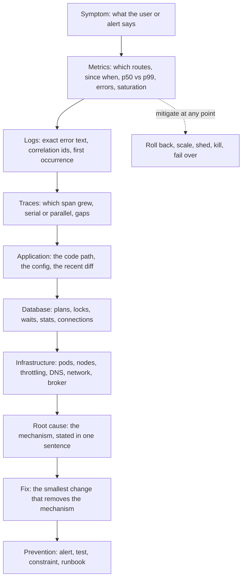
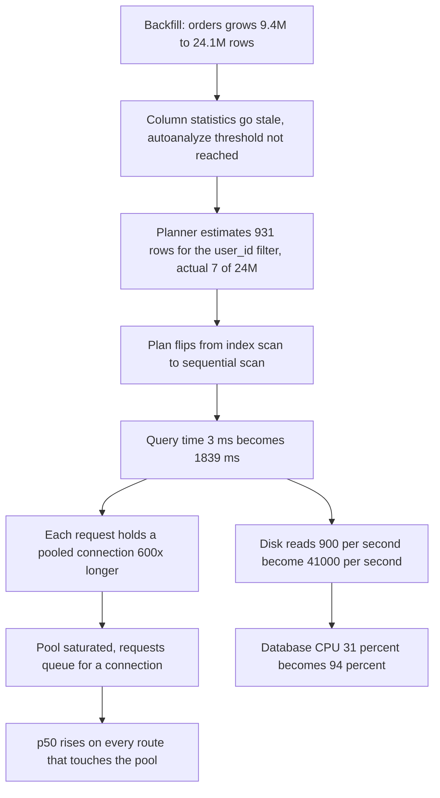

# Part 54 — Production Debugging: Ten Real Scenarios

## 54.0 The senior debugging process

Part 41 — Performance Engineering gave you a runbook for one symptom: the API suddenly got slow. This part goes wider and deeper. Ten incidents, each traced from the first alert to the prevention item, with the commands, the output, the wrong turns and the reasoning. The wrong turns matter as much as the fix, because in a real incident you do not know which theory is correct, and the skill being taught is *how to eliminate theories cheaply*.

**Stay calm.** This is not a personality trait, it is a technique. Panic makes you skip steps, and skipped steps are how a 20-minute incident becomes a 3-hour one. The physical version: sit down, open a scratch document, write the current time and the symptom in one sentence. That sentence takes fifteen seconds and it forces you to state what you actually know versus what you assume. If your hands are shaking, type the timeline anyway; the writing calms you down and you will need it for the post-mortem.

**Mitigate before you diagnose.** Users do not care why. The first question is never "what is the cause" but "what is the fastest safe action that reduces harm". Roll back, scale out, flip the kill switch, shed the noisy tenant, kill the blocking query, fail over the replica. Root cause analysis is much easier when nobody is paging you, and a mitigated incident gives you the luxury of thinking. The trap is the opposite instinct, which every engineer has: "I almost have it, give me five more minutes." You never almost have it.

**Establish a timeline.** Write down: when did it start (the exact minute from the graph, not "around 2 o'clock"), what changed near that minute, when did the alert fire, when did each of your actions happen and what did each one do. Nearly every incident is caused by a change, and the timeline is the cheapest way to find it. It is also the artifact that turns an incident into organizational learning instead of a story.

**Form hypotheses from metrics, not from hunches.** The difference between a mid-level and a senior engineer is visible here. The mid-level says "I bet it's the cache" and spends forty minutes in Redis. The senior says "p50 moved as well as p99, so everything is slower, which means a shared resource, so let me look at the four saturation graphs before I have an opinion." A hypothesis is worth holding only if you can name the observation that would kill it. Write both down: "Theory: the deploy. Killer observation: rolling back does not help."

**Bisect the system.** A request passes through client, CDN, load balancer, pod, cache, database, broker, downstream service. Do not walk it end to end; cut it in half. Is the latency inside the pod or outside it? A trace answers that in one look. Is the database slow, or is the pod waiting for a connection? `pg_stat_statements` mean time versus your pool wait metric answers that. Each bisection halves the search space, and three good bisections take you from eight suspects to one.

**Change one thing at a time.** Under pressure the urge is to restart the pods *and* bump the pool *and* clear the cache. If the symptom goes away you have learned nothing, you cannot revert safely, and you may have introduced the next incident. One change, announced, then observe for at least one full metric scrape interval before the next one.

**Write everything down as you go.** Commands, output, times, theories killed. Two reasons beyond the post-mortem: you will forget what you tried by minute forty, and the person who takes over at handover needs it. A shared incident channel where you narrate is better than a private terminal.

**Communicate on a schedule.** Every 20 to 30 minutes, even when there is nothing new: what is broken, who is affected, what you have done, what you are trying next, when the next update comes. Silence makes stakeholders invent their own theories and start "helping". A fixed cadence buys you uninterrupted thinking time, which is the scarcest resource in an incident.

### 54.0.1 The ladder

```text
Symptom -> Metrics -> Logs -> Traces -> Application -> Database -> Infrastructure -> Root Cause -> Fix -> Prevention
```

Work down it. Each rung narrows the search. You may jump a rung when a rung above gives you a certain answer, but never start in the middle because you have a hunch. The ten scenarios below all use this exact order, so that reading them trains the habit.



### 54.0.2 The tool belt

| Tool | Question it answers | Typical command or query |
|---|---|---|
| Grafana + PromQL | Which routes, since when, how bad, which resource is saturated | `histogram_quantile(0.95, sum by (le,route) (rate(http_request_duration_seconds_bucket[5m])))` |
| Log query (Loki, CloudWatch, ELK) | What is the exact error, and when was the first one | `{app="orders-api"} \|= "QueryFailedError" \| json \| line_format "{{.correlationId}} {{.msg}}"` |
| Jaeger / Tempo | Which span grew; is the work serial | Filter by route and `duration > 1s`, sort by duration, open five |
| `kubectl` | Restarts, events, exit codes, previous logs, node pressure | `kubectl describe pod`, `kubectl logs --previous`, `kubectl top pod` |
| `pg_stat_activity` | What is running or waiting right now | `SELECT pid, state, wait_event_type, now()-query_start FROM pg_stat_activity` |
| `pg_stat_statements` | Which query burns the most total time | `ORDER BY total_exec_time DESC LIMIT 10` |
| `pg_locks` + `pg_blocking_pids()` | Who blocks whom | `SELECT pg_blocking_pids(pid) FROM pg_stat_activity WHERE wait_event_type='Lock'` |
| `EXPLAIN (ANALYZE, BUFFERS)` | Why one query is slow; estimate versus actual rows | Run it against the real parameters |
| Redis `INFO`, `SLOWLOG GET 25`, `--bigkeys` | Memory, evictions, replication lag, slow commands, oversized keys | `redis-cli INFO stats`, `redis-cli --bigkeys` |
| Kafka consumer group tools | Lag per partition, member assignment, rebalances | `kafka-consumer-groups.sh --describe --group notifications` |
| Node heap snapshot + `clinic` | Where memory or CPU is going inside the process | `v8.writeHeapSnapshot()`, `clinic doctor -- node dist/main.js` |

## 54.1 API latency increased from 100 ms to 2 seconds

### Symptom

**14:02** — PagerDuty: `orders-api p95 latency > 1s for 5m`. The customer support channel has three messages about the app "spinning" on the orders page. `GET /orders` p95 is 2.1 s, up from 105 ms. p50 is 890 ms, up from 42 ms. Error rate is 0.3 percent, essentially unchanged. Request rate is 640 RPS, flat.

The first sentence in the incident doc, written at 14:03: *"Since ~13:55, GET /orders p50 and p95 are both up ~20x. Errors flat, traffic flat."*

p50 moving is the important detail. When only p99 moves, a subset of requests is slow: a lock, a GC pause, one tenant, one shard. When p50 moves too, **everything** is slower, which points at a shared resource: the database, the pool, the node, the network.

### First five minutes (mitigation)

The deploy dashboard shows `orders-api v2024.9.41` went out at **13:41**, twenty minutes before the latency started. That is close enough to be the prime suspect, and the rule is roll back first, investigate second.

```bash
kubectl rollout undo deployment/orders-api -n prod
kubectl rollout status deployment/orders-api -n prod   # completed 14:09
```

**14:12** — p95 is still 2.0 s. The rollback did not help.

This is a genuinely valuable five minutes, not a wasted one. It killed the most attractive theory with one cheap action, and it did it before anybody spent an hour reading the diff. The deploy at 13:41 is the **red herring** of this incident: it was a copy change to an email template, it touched nothing on this path, and its proximity in time was a coincidence. Coincidences happen several times a day in a team that deploys twenty times a day.

Second mitigation attempt at 14:14: scale out.

```bash
kubectl scale deployment/orders-api --replicas=24 -n prod   # from 12
```

**14:18** — p95 unchanged at 2.0 s. Also informative: if adding 100 percent more application capacity does nothing, the bottleneck is not in the application tier. Two theories dead in sixteen minutes.

### Metrics

Now, with no more cheap mitigations, look properly.

```text
# p95 by route, last hour
histogram_quantile(0.95, sum by (le, route) (rate(http_request_duration_seconds_bucket{app="orders-api"}[5m])))
```

Only two routes moved: `GET /orders` and `GET /orders/:id/summary`. Everything else is normal. That already narrows it: a shared resource that is *only* used by those routes, or one specific query.

The saturation panel:

| Signal | Before 13:55 | Now | Verdict |
|---|---|---|---|
| Pod CPU | 38% | 22% | Down. Pods are waiting, not working |
| Event loop lag p99 | 8 ms | 11 ms | Fine. Not CPU-bound in Node |
| `pg_pool_waiting` (custom metric) | 0 | 9.4 average | **Red.** Requests queue for connections |
| `pg_pool_borrow_time_ms` p95 | 0.4 | 1,180 | **Red** |
| RDS CPU | 31% | 94% | **Red** |
| RDS `blks_read` rate | 900/s | 41,000/s | **Red.** 45x more disk reads |
| RDS buffer cache hit ratio | 99.4% | 88.1% | **Red** |
| Replica lag | 200 ms | 340 ms | Fine |

Pod CPU going *down* while latency goes up is the signature of waiting. The database is reading 45x more blocks from disk. Something is scanning.

### Logs

```bash
kubectl logs -l app=orders-api -n prod --since=40m | grep -c "slow query"
# 4,812
```

And the PostgreSQL log, with `log_min_duration_statement = 500`:

```text
2026-03-11 13:54:38.221 UTC [21847] LOG:  duration: 1841.203 ms  execute <unnamed>:
        SELECT o.id, o.status, o.total_amount, o.placed_at FROM orders o
        WHERE o.user_id = $1 AND o.status = ANY($2) ORDER BY o.placed_at DESC LIMIT 20
2026-03-11 13:54:38.904 UTC [21851] LOG:  duration: 1903.771 ms  execute <unnamed>: ...
```

The first occurrence of that line is **13:53:19**. Nothing before it. The onset is sharp, not gradual, which is a strong signal: gradual degradation is growth, a sharp step is a change of state.

### Traces

Jaeger, filter `service=orders-api operation=GET /orders duration>1s`, open five traces. All five have the same shape:

```text
GET /orders                                  2,041 ms
├── auth.verify                                   3 ms
├── pool.acquire                                181 ms   <-- queueing
├── db.query orders.findByUser               1,839 ms   <-- the whole thing
├── db.query order_items.findByOrderIds          6 ms
└── serialize                                   11 ms
```

One span is 90 percent of the request. Everything else is noise. The bisection is finished: the problem is one query in the database.

### Application

The code has not changed in six weeks:

```ts
// src/orders/orders.repository.ts
async findRecentForUser(userId: string, statuses: OrderStatus[]): Promise<Order[]> {
  return this.repo.createQueryBuilder('o')
    .where('o.user_id = :userId', { userId })
    .andWhere('o.status IN (:...statuses)', { statuses })
    .orderBy('o.placed_at', 'DESC')
    .limit(20)
    .getMany();
}
```

Nothing wrong with it. The query is the same query it has always been. So what changed is not the query; it is what the database decides to do with it.

### Database

```sql
EXPLAIN (ANALYZE, BUFFERS)
SELECT o.id, o.status, o.total_amount, o.placed_at FROM orders o
WHERE o.user_id = '7c1f...'::uuid AND o.status = ANY('{pending,paid,shipped}')
ORDER BY o.placed_at DESC LIMIT 20;
```

```text
Limit  (cost=1284410.22..1284410.27 rows=20 width=52) (actual time=1836.401..1836.410 rows=7 loops=1)
  ->  Sort  (cost=1284410.22..1284412.55 rows=931 width=52) (actual time=1836.399..1836.404 rows=7 loops=1)
        Sort Key: placed_at DESC
        Sort Method: quicksort  Memory: 26kB
        ->  Seq Scan on orders o  (cost=0.00..1284385.44 rows=931 width=52)
                                  (actual time=402.118..1836.301 rows=7 loops=1)
              Filter: ((status = ANY ('{pending,paid,shipped}')) AND (user_id = '7c1f...'::uuid))
              Rows Removed by Filter: 24118773
              Buffers: shared hit=18422 read=1043117
Planning Time: 0.211 ms
Execution Time: 1836.462 ms
```

There it is. A sequential scan over 24 million rows to return 7, reading a million pages from disk. The index exists:

```sql
\d orders
-- "idx_orders_user_placed" btree (user_id, placed_at DESC)
```

So why is the planner ignoring it? Because it thinks the scan is cheap enough, and it thinks that because its statistics are wrong:

```sql
SELECT relname, n_live_tup, n_mod_since_analyze, last_analyze, last_autoanalyze
FROM pg_stat_user_tables WHERE relname = 'orders';
```

```text
 relname | n_live_tup | n_mod_since_analyze |     last_analyze      |   last_autoanalyze
---------+------------+---------------------+-----------------------+-----------------------
 orders  |   24118780 |            14209455 | 2026-01-04 02:11:09   | 2026-03-05 03:22:41
```

Six days since the last autoanalyze, and 14.2 million rows modified since. The default `autovacuum_analyze_scale_factor` is 0.1, so analyze triggers at 10 percent of the table plus 50 rows. But the table had been growing: a data migration backfilled historical orders from an acquired platform over the previous ten days, taking `orders` from 9.4 million rows to 24.1 million. The planner's row estimate for the `user_id` predicate was computed when the table was small and the distribution was different. Its estimate of 931 rows for the filter was off by a factor of 26,000 in the wrong direction: it believed the scan would return so few rows so quickly that the index was not worth it.

**14:31 — mitigation that works:**

```sql
ANALYZE orders;
```

Eleven seconds. p95 back to 118 ms by 14:33.

### Infrastructure

Checked and cleared: node CPU 40 percent, no `container_cpu_cfs_throttled_seconds_total` growth, no evictions, RDS storage 62 percent used, no burst credit exhaustion on the volume (gp3 with provisioned IOPS, so no credits to exhaust). The infrastructure rung had nothing, which the metrics had already implied.

### Root cause

A bulk backfill grew `orders` from 9.4 M to 24.1 M rows. Autoanalyze did not run often enough to keep column statistics current, so the planner's selectivity estimate for `user_id` was stale by four orders of magnitude and it flipped from an index scan to a sequential scan. Each `GET /orders` then held a pooled connection for 1.8 s instead of 3 ms, and pool saturation turned a slow query into a slow *service*.

The compounding is worth its own arithmetic, because it explains why p50 on unrelated routes also crept up. Little's law says required concurrency equals throughput times latency:

| | Before | After |
|---|---|---|
| `GET /orders` rate | 190 RPS | 190 RPS |
| Connection hold time | 3 ms | 1,839 ms |
| Required concurrent connections | 190 * 0.003 = **0.6** | 190 * 1.839 = **349** |
| Pool size (12 pods x 8) | 96 | 96 |
| Result | plenty of room | **3.6x oversubscribed; everything queues** |



### Fix

1. `ANALYZE orders;` — immediate, done at 14:31.
2. Make analyze aggressive on this table, because a 24-million-row table should not wait for 2.4 million modifications:

```sql
ALTER TABLE orders SET (autovacuum_analyze_scale_factor = 0.02,
                        autovacuum_analyze_threshold = 5000,
                        autovacuum_vacuum_scale_factor = 0.05);
```

3. Give the planner better statistics on the skewed column:

```sql
ALTER TABLE orders ALTER COLUMN user_id SET STATISTICS 500;
ANALYZE orders (user_id);
```

4. Make the index unmistakably cheaper than a scan for this exact query, so a small estimate error cannot flip the plan again:

```sql
CREATE INDEX CONCURRENTLY idx_orders_user_status_placed
  ON orders (user_id, status, placed_at DESC)
  INCLUDE (total_amount);
```

5. Put a ceiling on the damage any single query can do:

```ts
// src/database/database.module.ts — TypeORM DataSource options
extra: {
  statement_timeout: 3000,          // no query may run longer than 3 s
  idle_in_transaction_session_timeout: 30000,
  application_name: `orders-api@${process.env.HOSTNAME}`,
},
```

### Prevention

- **`ANALYZE` at the end of every backfill migration.** Add it to the migration template so nobody has to remember. This one line would have prevented the whole incident.
- **Turn on `auto_explain`** (`auto_explain.log_min_duration = 500`, `log_analyze = on`, `log_buffers = on`) so that when a plan flips you have the before and after plans in the log instead of having to guess.
- **Alert on plan-level symptoms, not just latency**: `rate(pg_stat_database_blks_read[5m])` jumping 10x, buffer cache hit ratio below 95 percent, and `pg_stat_user_tables.n_mod_since_analyze` exceeding 20 percent of `n_live_tup`.
- **Alert on `pg_pool_waiting > 0` sustained for 2 minutes.** Pool saturation shows up as latency, never as errors, so an error-rate alert can stay green through the entire incident (see Part 41).
- **A weekly job that dumps the plan of the ten hottest queries** and diffs against last week. Plan flips are invisible until they are an incident.

### Junior versus senior

| | Junior | Senior |
|---|---|---|
| First move | Reads the deploy diff for 40 minutes | Rolls back in 4 minutes to test the theory, then discards it |
| Reaction to "p50 moved too" | Does not notice | Immediately narrows to shared resources |
| Scaling pods | Sees no improvement, adds more pods | Sees no improvement, concludes the bottleneck is downstream |
| The query | "The query is fine, it has an index" | "The query is fine; the *plan* is not. Show me `EXPLAIN ANALYZE` with real parameters" |
| Fix | `ANALYZE`, closes the ticket | `ANALYZE`, then per-table autovacuum settings, statistics target, a covering index, `statement_timeout`, and an alert that would have paged at the right layer |
| Timeline | In their head | In the incident doc, minute by minute |

