## 54.3 The building blocks tour

Almost every backend design is assembled from the same fifteen pieces. Learn each one as a tool with a purpose, a price and a way of breaking. For each block you get the same six answers: what it is, the problem it solves, when to add it, what it costs, how it fails, and where the book teaches it in depth. A small diagram shows where it sits.

Here is the whole kit in one picture. You will never need all of it on day one, and Section 54.4 shows the order in which a real app earns each piece.

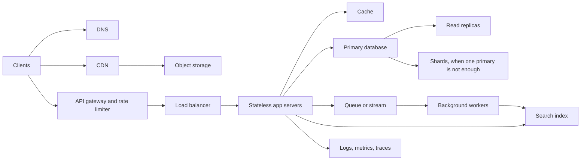

### 54.3.1 DNS

- **What it is:** the internet's phone book. It turns `api.example.com` into an IP address. Your users' devices ask a resolver, which asks the authoritative servers for your domain (for example Amazon Route 53).
- **Problem it solves:** clients need a stable name while the machines behind it change. DNS also gives you coarse traffic steering: weighted records, latency-based routing, and failover records that point to a standby region when health checks fail.
- **When to add it:** day one; you cannot avoid it. Advanced routing policies come at the multi-region stage.
- **What it costs:** very little money. The real cost is **TTL** (time to live): resolvers cache answers for the TTL you set, so a change takes that long, often longer, to reach everyone.
- **How it fails:** a misconfigured record takes the whole site offline; a long TTL keeps sending users to a dead IP after failover; some clients ignore TTLs.
- **Deep dive:** Part 11 — Networking and HTTP, section 11.3 "DNS: turning names into addresses"; Part 46, section 46.8 "CloudFront and Route 53".

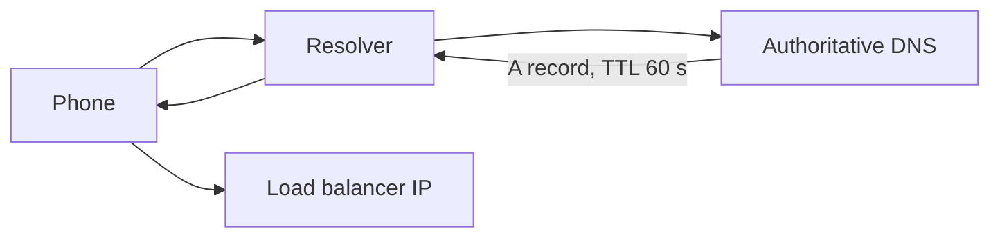

### 54.3.2 Load balancer

- **What it is:** a server that receives client connections and spreads them across several app servers. Layer 4 balancers (such as AWS NLB) forward TCP connections; layer 7 balancers (such as AWS ALB, NGINX, Envoy) understand HTTP and can route by path or header.
- **Problem it solves:** one app server is a single point of failure and has limited capacity. The balancer lets you run several, removes unhealthy ones using health checks, and usually terminates TLS.
- **When to add it:** when you need a second app server, either for capacity or, more often first, so that a deploy or a crash does not take the site down.
- **What it costs:** a managed balancer is roughly tens of dollars per month plus traffic charges; it adds about a millisecond of latency.
- **How it fails:** health checks that are too shallow keep sending traffic to a broken server; checks that are too deep (checking the database) remove *every* server when the database blips. Returns 502 when the backend closes the connection and 504 when the backend is too slow.
- **Deep dive:** Part 46, section 46.7 "Load balancing and the API edge: ALB, NLB and API Gateway"; Part 16, section 16.8 "Load balancing, HTTP/2, gRPC-Web and gateways"; Part 31, section 31.12 "Health checks".

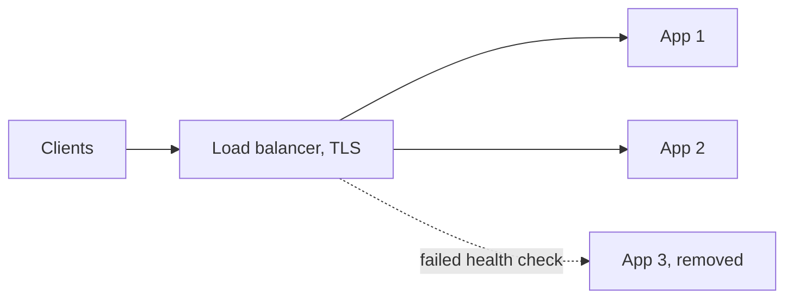

### 54.3.3 Stateless app servers

- **What it is:** your NestJS processes, several identical copies, none holding private state between requests (Section 54.2.7).
- **Problem it solves:** lets you add capacity by adding copies, deploy by replacing copies one at a time, and lose any one copy without losing data.
- **When to add it:** design stateless from day one even with one server; it costs nothing early and is painful to retrofit.
- **What it costs:** state must move somewhere shared: sessions to Redis or signed tokens, files to object storage, scheduled jobs to a lock or a dedicated worker. Each shared store is a new dependency.
- **How it fails:** hidden state, such as an in-memory cache that differs between pods, a cron job that now runs on every replica, or a file written to local disk that the next request cannot find.
- **Deep dive:** Part 29, section 29.8; Part 32, section 32.13 "Scheduled tasks with multiple replicas"; Part 45, section 45.14 "Horizontal Pod Autoscaler".

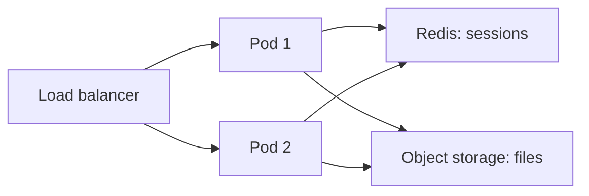

### 54.3.4 Relational database

- **What it is:** PostgreSQL (or MySQL): tables, rows, SQL, indexes, constraints and transactions.
- **Problem it solves:** a durable source of truth with guarantees you would otherwise have to build: atomic multi-row changes, unique constraints, foreign keys, and flexible queries you did not plan for.
- **When to add it:** day one for almost every product. Choose something else as the primary store only when you can name the requirement PostgreSQL cannot meet.
- **What it costs:** one primary accepts all writes, so writes scale only vertically until you shard. A managed Multi-AZ instance with 8 vCPU and 64 GB is in the order of a thousand dollars per month.
- **How it fails:** missing indexes (one bad query saturates CPU), connection exhaustion (too many pods times pool size), lock contention on hot rows, disk full, failover taking 30 to 90 seconds.
- **Deep dive:** Part 17 — Databases and the Relational Model; Part 20 — Database Indexing; Part 21 — Database Transactions and Concurrency Control.

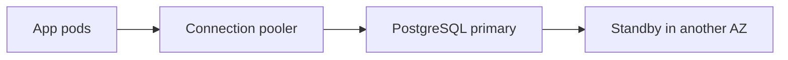

### 54.3.5 Read replicas

- **What it is:** copies of the primary database that receive its write-ahead log and replay it, serving read-only queries.
- **Problem it solves:** read load. If 90 percent of queries are reads and caching cannot absorb them (reports, order history, search-by-filter pages), replicas multiply read capacity.
- **When to add it:** after you have fixed slow queries and added caching, when primary CPU is still high and the load is mostly reads.
- **What it costs:** one more database bill per replica, and a new correctness problem: **replication lag**, usually milliseconds, sometimes seconds or minutes under heavy writes.
- **How it fails:** a user writes, then reads from a lagging replica and sees old data ("my order disappeared"); a long query on a replica conflicts with replication; replicas do nothing for write load.
- **Deep dive:** Part 23, sections 23.3 "Read replicas", 23.4 "Replication mechanics" and 23.5 "Replication lag".

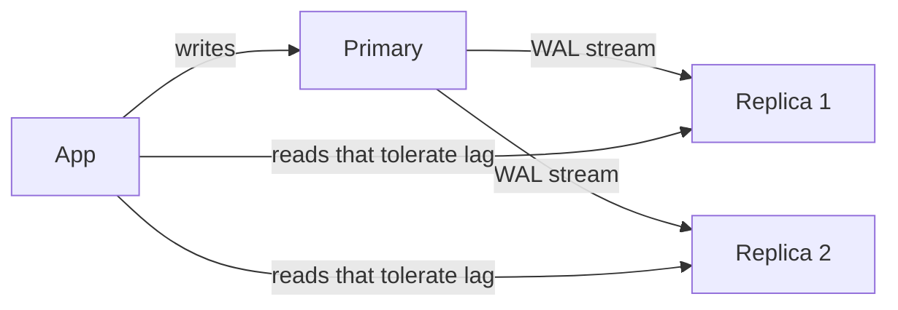

### 54.3.6 Cache

- **What it is:** a fast store, usually Redis, holding copies of data that is expensive to compute or fetch. Reads take 0.2 to 1 ms instead of several milliseconds from the database.
- **Problem it solves:** the same data read over and over: menus, product pages, user permissions, configuration. A 95 percent hit ratio cuts database reads twentyfold.
- **When to add it:** when a measured hot read dominates database load or latency, and the data can be a little stale or you can invalidate it reliably.
- **What it costs:** every cached value can be wrong. You now own invalidation, TTLs, and a second system to run.
- **How it fails:** stale data after an update; a **stampede** when a hot key expires and a thousand requests hit the database at once; Redis down sending all traffic to a database sized for 5 percent of it; memory full and keys evicted.
- **Deep dive:** Part 27 — Caching and Redis, especially sections 27.2 "Cache strategies" and 27.5 "The classic cache problems".

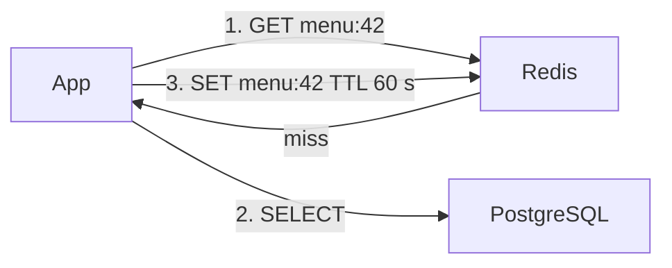

### 54.3.7 CDN

- **What it is:** a content delivery network: hundreds of edge servers around the world that cache your static files (images, JavaScript, CSS, video segments) and sometimes API responses close to users.
- **Problem it solves:** distance and origin load. An image served from an edge 20 ms away instead of an origin 150 ms away; a hit at the edge never touches your servers.
- **When to add it:** when static bytes dominate your bandwidth or users are far from your region. For a consumer app with images, that is early.
- **What it costs:** per-GB transfer and per-request fees; invalidation is slow (seconds to minutes) and sometimes charged; caching personalised content by mistake is a security incident.
- **How it fails:** a wrong `Cache-Control` header caches one user's private page for everyone; an invalidation that never reaches all edges; a cache-key mistake that makes the hit ratio collapse to 10 percent.
- **Deep dive:** Part 33 — File Storage and Uploads, section 33.9 "CDN delivery"; Part 11, section 11.11 "ETags, conditional requests and Cache-Control".

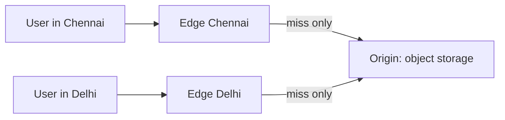

### 54.3.8 Object storage

- **What it is:** a service such as Amazon S3 that stores files ("objects") by key in buckets, over HTTP, at very high durability and low cost per GB.
- **Problem it solves:** files do not belong in your database (they bloat backups and the buffer cache) or on app server disks (which are not shared and disappear with the pod).
- **When to add it:** the first time users upload anything: restaurant photos, invoices, avatars.
- **What it costs:** cheap storage (roughly a couple of cents per GB per month for the standard class), but per-request and egress charges add up; listing and consistency rules differ from a filesystem.
- **How it fails:** a public bucket leaks private files; uploads proxied through app servers eat CPU and memory (use pre-signed URLs instead); orphaned objects whose database row was never written.
- **Deep dive:** Part 33, sections 33.3 "Object storage: the S3 model" and 33.7 "Pre-signed URLs".

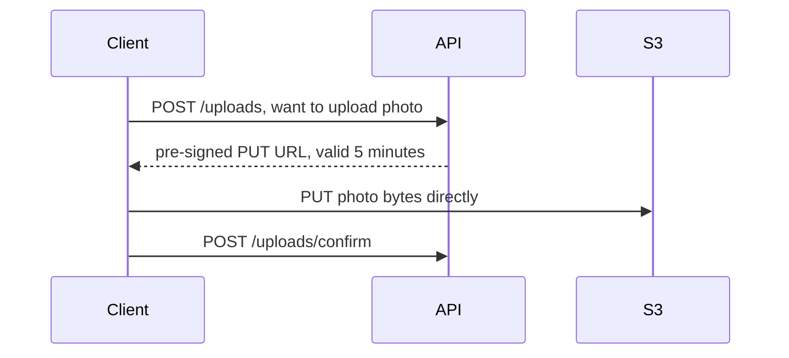

### 54.3.9 What the request-path blocks have in common

Look back at the eight blocks so far. Every one of them either **moves work closer to the user** (DNS steering, CDN), **spreads work across copies** (load balancer, stateless servers, replicas), **avoids repeating work** (cache, CDN), or **puts data where it belongs** (relational database for records, object storage for files). The next seven blocks do two other things: they **move work out of the request** (queues, workers, search indexing) and they **protect and observe the system** (rate limiter, gateway, observability). Sharding is the exception: it is what you do when the database itself runs out of room to grow.

### 54.3.10 Message queue and stream

- **What it is:** a broker that holds messages between a producer and a consumer. A **queue** (RabbitMQ, Amazon SQS, BullMQ on Redis) hands each message to one consumer and deletes it once acknowledged. A **stream** (Kafka, Kinesis) keeps an ordered, replayable log that many consumer groups read at their own pace.
- **Problem it solves:** it decouples "accept the work" from "do the work". Checkout no longer waits for email, invoice PDFs or analytics; a burst of 10,000 orders becomes a backlog that drains, not 10,000 slow requests. A stream also lets several services react to the same event.
- **When to add it:** when slow or unreliable work sits in a user's request path, or when more than one consumer needs the same events. Not before.
- **What it costs:** delivery is at-least-once, so **duplicates are normal** and every consumer must be idempotent; you now monitor lag, dead-letter queues and poison messages; Kafka in particular is a serious system to operate.
- **How it fails:** consumers fall behind (lag grows for hours); one bad message crashes the consumer in a loop; the "write to database then publish" pair half-succeeds (the dual-write problem, solved by an outbox).
- **Deep dive:** Part 28 — Messaging: Queues, Topics, Kafka, RabbitMQ and SQS, sections 28.6 "Kafka versus RabbitMQ versus SQS" and 28.9 "Idempotent consumers"; Part 30, section 30.10 "The transactional outbox".

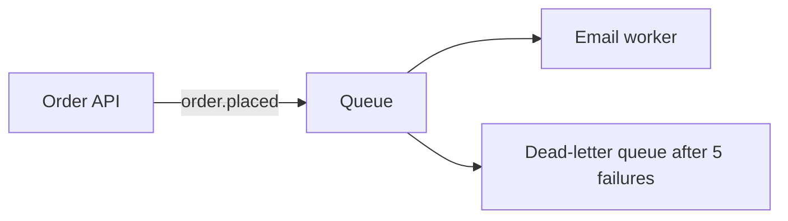

### 54.3.11 Background workers

- **What it is:** separate processes (often the same codebase, a different entry point) that consume jobs: send notifications, resize images, generate reports, retry webhooks, run scheduled tasks.
- **Problem it solves:** keeps API pods fast and predictable. CPU-heavy or slow work no longer competes with user requests, and you can scale workers independently by queue depth.
- **When to add it:** together with the first queue, or for the first scheduled job that must run exactly once across replicas.
- **What it costs:** another deployment to monitor; retry and idempotency logic; a place where work can silently stop if nobody alerts on queue age.
- **How it fails:** a worker crashes mid-job and the job runs twice; a deploy kills workers without graceful shutdown; a retry storm hammers a recovering third party.
- **Deep dive:** Part 36 — Background Jobs and Schedulers, sections 36.3 "Workers as a separate deployment" and 36.8 "Dead-letter queues and idempotent handlers".

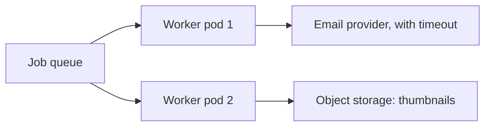

### 54.3.12 Search index

- **What it is:** a store built for text search and filtering, such as Elasticsearch or OpenSearch, using an **inverted index** (word to list of documents). PostgreSQL full-text search with a GIN index is the first step on the same road.
- **Problem it solves:** `WHERE name ILIKE '%paneer%'` cannot use a normal B-tree index and scans every row. Search engines give relevance ranking, typo tolerance, facets ("veg only, rating 4+, under 30 minutes") and fast prefix matching.
- **When to add it:** PostgreSQL full-text search first; a dedicated engine when you need fuzzy matching, complex ranking or facets at a scale PostgreSQL cannot serve cheaply.
- **What it costs:** a second copy of your data that is always slightly behind, a sync pipeline (outbox events or change data capture), reindexing when mappings change, and a cluster to operate.
- **How it fails:** the index drifts from the database (a deleted dish still appears); the sync consumer lags; a mapping change requires a full reindex; queries with deep pagination time out.
- **Deep dive:** Part 34 — Search: PostgreSQL Full-Text to Elasticsearch/OpenSearch, sections 34.10 "Keeping the index in sync with PostgreSQL" and 34.12 "When PostgreSQL search is enough, and when it is not".

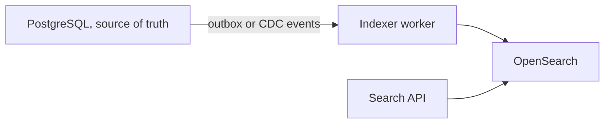

### 54.3.13 Sharding and partitioning

- **What it is:** **partitioning** splits one big table into pieces inside the same database (for example, `order_events` by month). **Sharding** splits rows across *separate* database servers by a **shard key** (for example, by city or by customer), so each server holds and writes only its share.
- **Problem it solves:** partitioning keeps huge tables manageable (drop an old month instead of deleting a billion rows). Sharding is the only way to scale *writes* and total data size beyond one primary.
- **When to add it:** partitioning when a table reaches hundreds of millions of rows or needs time-based retention. Sharding last: after indexes, caching, replicas, moving misplaced writes elsewhere and the biggest sensible instance, when write throughput or data size still exceeds one machine.
- **What it costs:** cross-shard queries, joins and transactions become hard or impossible; rebalancing is a live data migration; every query must know its shard key. This is the most expensive block in the kit.
- **How it fails:** a bad shard key creates a **hot shard** (one city holds 40 percent of orders); a resharding migration drops or duplicates rows; a "simple" report now fans out to every shard.
- **Deep dive:** Part 23, sections 23.7 "Partitioning", 23.8 "Sharding", 23.9 "Shard keys" and 23.10 "Hot partitions and hot shards".

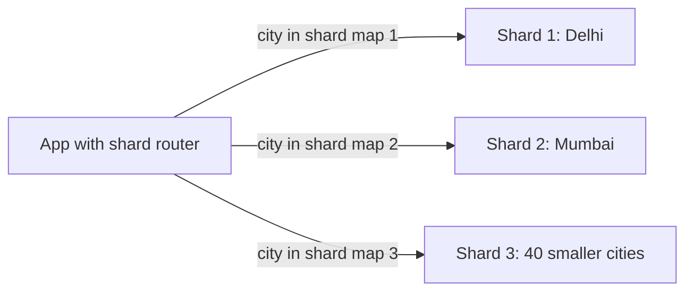

### 54.3.14 Rate limiter

- **What it is:** a component that counts requests per key (user, API key, IP, tenant) in a time window and rejects the excess with HTTP 429. Usually a counter in Redis with a token bucket or sliding window algorithm.
- **Problem it solves:** protects the system from abuse (credential stuffing, scraping), from one heavy client starving the rest, and from paying for a third party's per-call price on a runaway loop.
- **When to add it:** on authentication endpoints from day one; globally when the API is public or multi-tenant.
- **What it costs:** an extra Redis call per request (about half a millisecond) and a policy decision: what happens when the limiter itself is down (fail open or fail closed).
- **How it fails:** limits keyed by IP punish a whole office behind one NAT; a limiter that fails closed takes the site down with Redis; per-pod in-memory limits multiply by the number of pods.
- **Deep dive:** Part 55, section 55.3 "Rate Limiter"; Part 27, section 27.11 "Rate limiting in Redis"; Part 31, section 31.7 "Rate limiting".

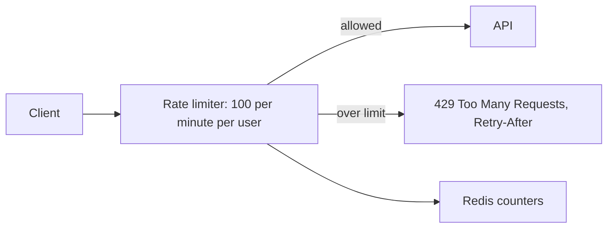

### 54.3.15 API gateway

- **What it is:** a single entry point in front of several services that handles cross-cutting concerns: authentication, rate limits, routing by path, request size limits, API keys, sometimes response caching. Examples include Amazon API Gateway, Kong and Envoy-based gateways.
- **Problem it solves:** without it, every service re-implements auth checks and limits slightly differently, and clients must know every service's address.
- **When to add it:** when you have several backend services or external API consumers. A monolith behind a load balancer usually does not need one; NestJS guards and middleware do the job.
- **What it costs:** another hop (a few milliseconds), another critical component, and the temptation to put business logic in it.
- **How it fails:** a gateway outage is a total outage; a misconfigured route sends traffic to the wrong service; gateway timeouts shorter than the service's work produce confusing 504s.
- **Deep dive:** Part 62 — Real-World Architecture Patterns, section 62.1 "API Gateway"; Part 46, section 46.7.

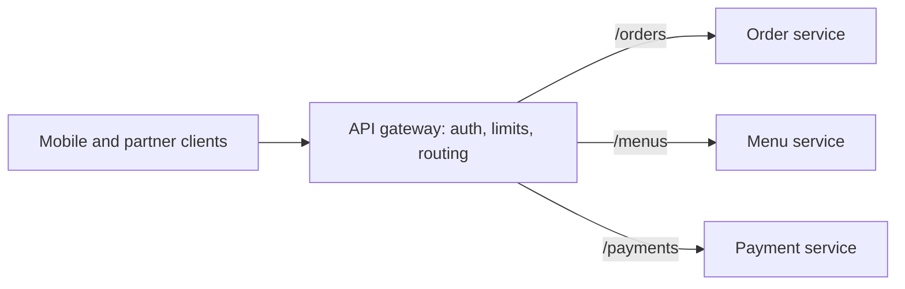

### 54.3.16 Observability: logs, metrics and traces

- **What it is:** the three signals that tell you what the system is doing. **Logs** are timestamped records of events ("order 812 failed: card declined"). **Metrics** are numbers over time (RPS, p99 latency, error rate, queue lag, DB CPU). **Traces** follow one request across services, showing where its time went.
- **Problem it solves:** you cannot fix, scale or even notice what you cannot see. Every trigger in Section 54.4 ("primary CPU at 75 percent at dinner") is a metric somebody was watching.
- **When to add it:** day one for logs and the four golden signals (latency, traffic, errors, saturation); tracing as soon as a request crosses more than one service or queue.
- **What it costs:** money (observability bills commonly reach 10 to 30 percent of infrastructure spend if unmanaged), and noise: alerts nobody trusts.
- **How it fails:** high-cardinality labels (a `user_id` label on a metric) explode the metrics store; logs without request IDs cannot be correlated; alerts on causes instead of symptoms page people at 03:00 for nothing.
- **Deep dive:** Part 43 — Observability: Logs, Metrics and Traces; Part 49, section 49.2.

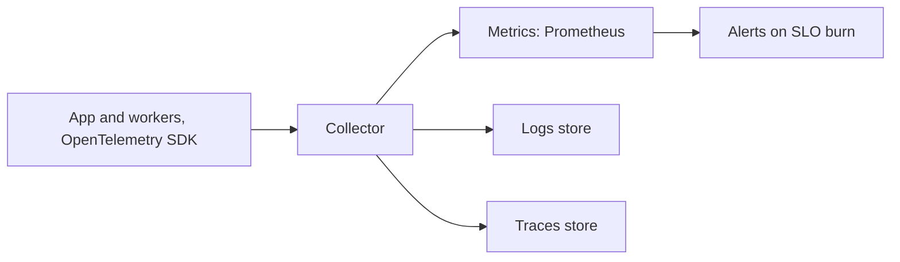

### 54.3.17 Decision table: symptom to building block

When you see a symptom, this table tells you which block to reach for **first** and what to check before you add anything. The "check first" column is the anti-hype column: most symptoms have a cheaper cure than a new box.

| Symptom you observe | Check first | Building block to add | Deep dive |
|---|---|---|---|
| A deploy or one crash takes the site down | Is there only one app server? | Load balancer plus a second stateless app server | Section 54.3.2 |
| App CPU high at peak, DB fine | Profile the hot endpoint; serialization, bcrypt | More app servers (horizontal scaling) | Part 42 |
| DB CPU high; a few queries dominate | `pg_stat_statements`, missing indexes | Nothing yet: fix queries and indexes | Part 20 |
| DB CPU high; same rows read constantly | Hit pattern of the hot reads | Cache (Redis, cache-aside) | Part 27 |
| DB CPU high; varied reads, reports, history | Can these reads tolerate lag? | Read replicas | Part 23 |
| `too many connections` errors | Pods x pool size vs `max_connections` | Connection pooler (PgBouncer or RDS Proxy) | Part 19, section 19.2.2 |
| Images slow far away; egress bill high | Are files served by app servers? | Object storage plus CDN | Part 33 |
| Checkout slow because of email, PDF, SMS | Which calls are in the request path? | Queue plus background workers, with outbox | Parts 28, 36 |
| A third-party outage breaks a core flow | Timeouts, retries, where the call sits | Queue plus circuit breaker | Part 31 |
| `ILIKE` search scans the table, users want typo tolerance | PostgreSQL full-text with GIN first | Search index (OpenSearch) | Part 34 |
| One tenant or bot floods the API | Per-key request counts | Rate limiter | Section 54.3.14 |
| Several services re-implement auth and limits | Is there really more than one service? | API gateway | Part 62 |
| Writes saturate the biggest primary; table in TBs | Misplaced writes, partitioning, batching | Sharding | Part 23, section 23.13 |
| Whole region outage takes you down; RTO missed | RPO and RTO requirements | Multi-region standby | Part 50 |
| "Something is slow" and nobody knows where | Request IDs, golden signals | Metrics, logs, traces | Part 43 |

Keep this table near you for Section 54.4. Every stage there begins with a row from it.
