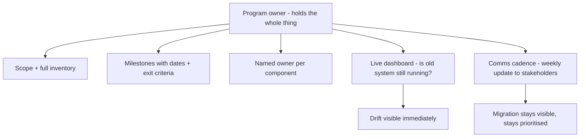

## 54.2 Running a migration as a program

#### Concept

A large migration is not a project; it is a program — a long-running, multi-team effort that needs its own scoping, milestones, owners, tracking, and communication cadence, run with the same discipline as a product launch. The difference between a migration that finishes and one that stalls is usually not the technical plan; it is whether someone ran it as a program with a visible dashboard, named owners for every piece, and a regular drumbeat of communication that keeps it from fading into the background. A migration without program management is a migration that will stall, because nobody is holding the whole thing and nothing is keeping it visible.

#### Why does it exist?

Imagine a migration run as a loose collection of tickets in various teams' backlogs, with no overall owner, no dashboard, and no regular status. Each team does its piece when it gets around to it. There is no one person who knows the overall state, no one chasing the stragglers, and no visibility to leadership about whether it is on track. Predictably, it drifts: teams deprioritise their migration tickets for features, nobody notices because there is no dashboard, and leadership assumes it is fine because nobody is reporting problems. Six months later someone asks "how is that migration going?" and the honest answer is "nobody knows".

Program management exists to prevent exactly this. A migration needs a single owner who holds the whole thing, a visible dashboard so drift is noticed immediately, named owners for every component so nothing is orphaned, and a communication cadence that keeps it from fading. These are not bureaucracy; they are the mechanisms that keep a long, boring, multi-team effort alive and moving when every local incentive pulls toward ignoring it.

#### Mental model

Imagine a large building construction. It has a general contractor who owns the whole thing, a schedule with milestones everyone can see, a named subcontractor responsible for each trade (plumbing, electrical, framing), a site meeting every week to surface blockers, and a visible progress board. Nobody would run a building by throwing tasks into various crews' backlogs and hoping. A migration is a construction project, and it needs the same scaffolding of program management: a general contractor (the program owner), a visible schedule (the dashboard), named responsible parties (component owners), and a regular site meeting (the comms cadence). Remove any of these from a building site and it stalls; remove them from a migration and it stalls the same way.

#### How it works

The program-management elements of a migration:

**1. Scoping.** Define precisely what is in and out, and what "done" means (the old system is off). Inventory *everything* that must migrate — every table, every caller, every job — because the things you do not inventory are exactly the orphans that stall you later. The inventory is the foundation; an incomplete inventory guarantees surprises in the last 20%.

**2. Milestones.** Break the migration into phases with dates, each with a clear exit criterion. "Phase 1: new system live and taking 1% of traffic. Phase 2: 50% of callers migrated. Phase 3: old system read-only. Phase 4: old system deleted." Milestones make progress legible and make slippage visible early.

**3. Owners.** Every component to be migrated has a named owner who is accountable for migrating it. The program has a single overall owner — the general contractor — who holds the whole thing and chases the stragglers. Unowned components are orphans waiting to stall you.

**4. Tracking dashboard.** A single, always-current view of the migration state: what is migrated, what remains, who owns what, and the headline "is the old system still running". The dashboard makes drift immediately visible, which is what keeps the migration from fading quietly.

**5. Communication cadence.** A regular drumbeat — a weekly or fortnightly update to all stakeholders and leadership — that keeps the migration visible and keeps the pressure on. The moment a migration stops being communicated, it starts being deprioritised.



#### Practical example

A staff engineer runs a migration from a PHP monolith to NestJS services (the full worked example is in 54.7). She runs it as a program. The inventory lists every endpoint, every background job, every database table, and every external caller — 140 items. Each is assigned to an owning team. The dashboard, auto-generated, shows the count migrated versus remaining and the headline "legacy monolith: STILL RUNNING". Milestones have dates: strangler proxy live (month 1), 50% of endpoints migrated (month 8), monolith read-only (month 15), monolith deleted (month 18). Every Friday she posts a one-screen update to the whole org and the executive sponsor: what moved this week, what is blocked, and the countdown to the deletion date. The cadence is relentless and slightly boring, which is the point — the migration never fades into the background, so it never stalls. Eighteen months later the monolith is deleted, on schedule, because it was run as a program, not a backlog.

#### Artifact example

A migration dashboard and the weekly update it feeds — the two artifacts that keep a program alive and visible.

```markdown
# Migration dashboard: PHP monolith -> NestJS services (auto-updated)

## HEADLINE
Legacy monolith: STILL RUNNING. Scheduled deletion: 2027-06-30 (T-112 days).
Benefit delivered so far: 0% (we pay for both systems until deletion).

## Progress (completion, not volume)
Endpoints migrated:        118 / 140   (22 remain)
Background jobs migrated:    9 / 12    (3 remain)
Tables with data ownership moved: 31 / 34
Callers off the legacy API: 36 / 43   (7 remain — 2 orphaned, flagged)

## Milestones
[x] M1: Strangler proxy live (done, month 1)
[x] M2: 50% endpoints migrated (done, month 8)
[>] M3: Monolith read-only (target month 15 — ON TRACK)
[ ] M4: Monolith deleted (target month 18)

## Blocked (needs attention THIS WEEK)
- Enterprise batch import: owner Integrations, blocked on new bulk API (ETA 2wk)
- Legacy admin tool: ORPHANED — needs an owner assigned (escalated to director)

---

# Weekly update (every Friday, to all stakeholders + exec sponsor)
Subject: Monolith migration — week 54 — ON TRACK for June 30 deletion

- This week: migrated 6 endpoints (checkout flow complete), moved refunds
  table ownership. 118/140 endpoints done.
- Blocked: legacy admin tool still orphaned; need a director to assign an
  owner by Wednesday or M4 slips. (This is my one ask this week.)
- Next week: batch import, then we hit the read-only milestone.
- Countdown: 112 days to monolith deletion. We pay for both systems until then.
```

The dashboard leads with the headline that matters (old system still running, benefit 0%, countdown to deletion), measures completion not volume, and flags the orphan and the blocker. The weekly update is short, specific, has exactly one ask, and repeats the countdown — which keeps leadership attention and keeps the migration from fading. Together they are the program-management machinery that turns a stall-prone migration into a dated, visible, finishing program.

#### Real-world scenario

Two migrations start in the same org in the same quarter, of similar technical difficulty. One is run as a program: single owner, full inventory, dashboard, milestones, weekly updates. The other is run as "tickets in backlogs": each team migrates its piece when it can, no overall owner, no dashboard, no cadence. Eighteen months later, the program-run migration is finished and the old system deleted. The backlog-run migration is 80% done and stalled — nobody can even say exactly how much remains, because there is no inventory and no dashboard, and the last pieces are orphaned. The technical work was comparable; the difference was entirely program management. The visible, owned, communicated migration finished; the invisible, unowned, uncommunicated one stalled. This is the most reliable pattern in large-scale migrations: the one that is run as a program finishes, and the one that is not, does not.

#### Failure scenario

A migration is run with milestones and a dashboard but no communication cadence — the program owner builds the dashboard and assumes people will look at it. They do not. Without a regular update actively pushed to stakeholders, the migration fades from everyone's attention within weeks. Teams quietly deprioritise their migration tickets for features, and because nobody is pushing the status, nobody notices until the next quarterly review, where it emerges that the migration has not moved in two months. By then, momentum is lost, the context has gone cold, and restarting it costs a re-planning effort. The dashboard existed but was passive; a dashboard nobody is pushed to look at is a dashboard nobody looks at. The communication cadence — the active, relentless, slightly annoying weekly push — is what keeps a migration in people's attention, and without it even a well-instrumented migration drifts into the background and stalls. Visibility is not a passive property of having a dashboard; it is an active practice of communication.

#### Edge cases & failure modes

- **No single program owner.** Nobody holds the whole thing; the migration is a collection of tickets that each team deprioritises independently.
- **Incomplete inventory.** The things you did not inventory become the orphans that stall you in the last 20%.
- **Passive dashboard, no cadence.** A dashboard nobody is pushed to look at fades from attention, and the migration drifts.
- **Milestones with no exit criteria.** "Phase 2: migrate more stuff" cannot be declared done or slipped, so slippage is invisible.
- **Unowned components.** Orphans that nobody is accountable for migrating, which become the permanent blocker.
- **Comms that are status theatre.** Updates full of green lights and no asks or blockers, so leadership cannot help and problems stay hidden until they are crises.

#### How a Principal Engineer thinks about this

They run a large migration with the discipline of a product launch, because they know the technical plan is rarely the thing that fails — the program management is. They insist on a single accountable owner who holds the whole thing, because a migration owned by everyone is owned by nobody. They build a complete inventory up front, because they have learned that the items left off the inventory are exactly the orphans that stall the last 20%.

They treat the communication cadence as the load-bearing practice, not the dashboard, because a dashboard is passive and attention is the scarce resource — a relentless weekly push with specific asks is what keeps a long, boring migration alive against the constant pull of features. And they make every update honest and useful, leading with blockers and asks rather than green lights, because status theatre hides problems until they are crises, whereas an update that says "I need a director to assign an owner by Wednesday or we slip" actually gets the owner assigned. The principal's program management is what converts a technically-sound migration from one that could finish into one that does.

#### Common mistakes

- **No single program owner,** so the migration is nobody's whole responsibility.
- **An incomplete inventory,** which guarantees orphan surprises in the last 20%.
- **Building a dashboard but running no communication cadence,** so the migration fades from attention.
- **Milestones without exit criteria,** so slippage is invisible.
- **Status updates that are all green lights,** hiding problems until they become crises.

#### Interview questions

1. **Why run a large migration as a program rather than as tickets in teams' backlogs?**
   *Expected answer:* because migrations stall when they are nobody's whole responsibility and fade from attention; a program gives it a single accountable owner, a complete inventory, dated milestones with exit criteria, a live dashboard, and a communication cadence — the machinery that keeps a long, boring, multi-team effort visible and moving against the constant pull of features. *Follow-up:* which of these is the most load-bearing and why.

2. **A migration has a dashboard but is drifting anyway. What's likely missing?**
   *Expected answer:* an active communication cadence — a dashboard is passive, and without a relentless regular update pushed to stakeholders with specific asks, the migration fades from attention and gets deprioritised. Visibility is an active practice, not a property of having a dashboard. *Why it matters:* tests whether they understand attention as the scarce resource.

3. **What makes a migration status update useful versus theatre?**
   *Expected answer:* a useful update leads with blockers and has specific asks ("I need an owner assigned by Wednesday or we slip"), measures completion not volume, and repeats the countdown to the old system's deletion; theatre is all green lights, which hides problems until they are crises and gives leadership no way to help. *Why it matters:* tests communication judgement under long-running pressure.

#### Practical exercise

Take a migration you are leading or have observed. Produce its program-management artifacts: a scope statement with a definition of done (old system off), a complete inventory of everything that must migrate, a milestone plan with dated exit criteria, an owner assignment for every component (flagging orphans), and a dashboard design that leads with "is the old system still running". Then write one weekly update in the useful (not theatre) style, with exactly one specific ask.

**Acceptance criteria:** the inventory is complete enough that you would be surprised to discover an un-listed caller later; every component has a named owner or is explicitly flagged as an orphan needing assignment; the milestones have exit criteria you could objectively declare met or slipped; and your weekly update leads with a blocker and a specific, actionable ask rather than a list of green lights.
