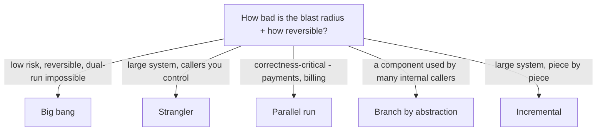

## 54.3 Choosing the migration strategy

#### Concept

There is no single way to do a migration; there is a family of strategies, each with a different risk profile, and choosing the right one for your situation is a principal-level decision. The main strategies are **big bang** (cut everything over at once), **incremental** (migrate piece by piece), **strangler** (route traffic gradually from old to new, covered in Part 47.6), **parallel run** (run both systems and compare outputs before cutting over), and **branch by abstraction** (introduce an abstraction layer, then swap the implementation behind it). Each trades off speed, risk, and complexity differently, and picking the wrong one for your blast radius is how migrations turn into incidents.

#### Why does it exist?

Imagine using a big-bang cutover for a payment system migration — flip everything from the old system to the new one at midnight on a Saturday. If the new system has any bug the testing missed, you have broken payments for the entire company at once, with no gradual signal to warn you and no easy way back. Now imagine using a slow incremental strategy for a trivial, low-risk internal tool migration — you spend months on scaffolding and dual-running for something a weekend big-bang would have handled safely. Each strategy is right for some situations and catastrophic for others.

The family of strategies exists because migrations differ enormously in blast radius and reversibility. A strategy that is prudent for a payment system is overkill for an internal tool, and a strategy that is fine for an internal tool is reckless for payments. Choosing deliberately, based on blast radius and reversibility, is what separates a controlled migration from a gamble.

#### Mental model

Imagine changing the engine of a vehicle. **Big bang** is swapping the whole engine in one go while the vehicle is switched off — fast if it works, but if the new engine does not start, you are stranded. **Incremental** is replacing components one at a time — cylinders, then pistons — keeping the vehicle running throughout, slower but never stranded. **Strangler** is building the new engine alongside the old and gradually diverting the fuel line from old to new, so you can divert it back instantly. **Parallel run** is running both engines and comparing their output before trusting the new one. **Branch by abstraction** is installing a universal mount that either engine can bolt onto, then swapping engines on the mount. The right choice depends on how bad it is to be stranded (blast radius) and how easily you can switch back (reversibility).

#### How it works

Each strategy, with its risk profile:

**Big bang.** Cut everything over at once. Fast, simple to reason about, no dual-running complexity. But the blast radius is total and the rollback is hard — if it fails, everything fails at once, and reverting is a second big cutover under incident pressure. Appropriate only for low-risk, well-understood, easily-reversible migrations, or where dual-running is genuinely impossible.

**Incremental.** Migrate one piece at a time, each piece going fully live before the next. The blast radius of each step is one piece, so failures are contained and the system keeps running throughout. Slower, and requires the old and new to coexist (which has its own complexity), but far safer. The default for most large migrations.

**Strangler (Part 47.6).** Put a routing layer (a proxy or facade) in front, and gradually route calls from the old implementation to the new one, feature by feature or percentage by percentage, until the old one receives no traffic and can be removed. Reversible at every step (route back instantly), observable (you see the new path under real traffic gradually). The gold standard for migrating a live system with callers you control.

**Parallel run.** Run both the old and new systems on the same inputs, serve from the old (trusted) system, but compare the new system's output against the old. Only cut over once the outputs match for long enough to trust the new one. The safest strategy for correctness-critical migrations (payments, billing, anything where a wrong answer is catastrophic), because you verify the new system against the old on real production data before trusting it.

**Branch by abstraction.** Introduce an abstraction layer over the thing being migrated (an interface the rest of the code uses), move all callers onto the abstraction, then swap the implementation behind it from old to new without the callers knowing. Ideal for migrating a library or a component used by many callers within a codebase, because the abstraction decouples the callers from the migration.



The decision matrix:

| Strategy | Speed | Risk / blast radius | Reversibility | Best for |
|---|---|---|---|---|
| Big bang | Fast | Total | Hard | Low-risk, well-understood, dual-run impossible |
| Incremental | Slow | Per-piece | Good | Most large migrations (default) |
| Strangler | Medium | Gradual, controlled | Instant (route back) | Live systems with controllable callers |
| Parallel run | Slow | Low (verify first) | Instant (serve old) | Correctness-critical migrations |
| Branch by abstraction | Medium | Contained by the abstraction | Good (swap back) | Components with many internal callers |

These are not mutually exclusive. A large migration often combines them: strangler for the traffic routing, parallel run for the correctness-critical parts, branch by abstraction for shared components.

#### Practical example

A company migrating its order system chooses a *combination*. The overall approach is strangler: a routing layer sends order traffic to old or new per endpoint, reversible at every step. For the refund calculation specifically — where a wrong number means a customer is charged incorrectly — they layer in a parallel run: both systems calculate every refund, the old one's answer is served, and the new one's answer is compared and logged. Only after two weeks of matching refund calculations do they cut refunds over to the new system. For the shared "order formatting" library used by twelve internal callers, they use branch by abstraction: an interface is introduced, all twelve callers move onto it, then the implementation is swapped. Three strategies, each applied where its risk profile fits: strangler for controllable live routing, parallel run for correctness-critical money math, branch by abstraction for the shared component. Using big bang for the refund calculation would have risked charging customers wrong at scale; using parallel run for everything would have been needlessly slow. Matching the strategy to the blast radius of each part is the skill.

#### Artifact example

A migration strategy decision record — the artifact that documents which strategy applies where and why.

```markdown
# Migration strategy decision: order system -> new platform

## Overall: STRANGLER
A routing facade sends each order endpoint to old or new. Reversible per
endpoint (route back instantly). Lets us migrate and verify under real
traffic, gradually. Rejected big-bang: blast radius is all orders — too total.

## Refund calculation: STRANGLER + PARALLEL RUN
Refund amounts are money; a wrong number charges a customer incorrectly.
So on top of the strangler routing, we PARALLEL RUN: both systems compute
every refund, old is served, new is compared and logged. Cut over only
after 14 days of 100% match. Rejected cutting over on test confidence alone
— test coverage can't match real production refund diversity.

## Shared order-formatting library (12 internal callers): BRANCH BY ABSTRACTION
Introduce an OrderFormatter interface, move all 12 callers onto it, then
swap the implementation old -> new behind it. Callers never change again.
Rejected migrating each caller's inline formatting: 12x the work, 12x the risk.

## Legacy admin tool (1 orphaned caller, low traffic, read-only): BIG BANG
Low risk, read-only, easily reversible. A weekend cutover with a tested
rollback is proportionate. Rejected strangler: scaffolding cost exceeds the
risk it would mitigate.

## Why a mix
Each part's strategy matches its blast radius and reversibility. One
strategy for everything would be either too risky (big bang on refunds) or
too slow (parallel run on the admin tool).
```

The decision record's value is that it is explicit about matching strategy to blast radius per component, and it names what each choice rejected and why. It shows the principal-level judgement: not dogmatically applying one strategy, but choosing deliberately based on how catastrophic a failure would be and how easily it could be undone.

#### Real-world scenario

A team migrating a billing system wisely chooses parallel run for the core billing calculation. For six weeks, both the old and new billing engines process every invoice; the old engine's result is sent to customers, and the new engine's result is computed and diffed. In week three, the diffs reveal that the new engine rounds tax differently on multi-currency orders — a bug that every test had missed because the tests did not include the specific multi-currency edge case that real production data contained. Because of the parallel run, this bug is caught in a *log*, affecting zero customers, rather than in a customer's incorrect invoice. The team fixes the rounding, the diffs go to zero, and after six weeks of perfect matching they cut over with justified confidence. Had they used big bang or cut over on test confidence, that rounding bug would have shipped to every multi-currency customer's invoice, producing a billing incident and a mass of corrections. The parallel run converted a would-be billing incident into a logged diff nobody outside the team ever saw. For correctness-critical migrations, parallel run is worth its slowness precisely because real production data contains edge cases no test suite anticipates.

#### Failure scenario

A team migrates a payment processing system with a big-bang cutover, confident because their test suite is comprehensive and staging looked perfect. At midnight on a Saturday they flip all payment traffic to the new system. Within minutes, a bug that only manifests under concurrent load — invisible in single-threaded testing — causes a fraction of payments to be recorded twice. Because it is a big bang, *all* payment traffic is on the new system, so the bug affects everyone immediately, and because there is no parallel run, there is no comparison that would have caught it before cutover. Rolling back means a second emergency cutover under incident pressure, during which more payments are mis-recorded in the chaos. The incident lasts hours, affects thousands of customers, and requires weeks of financial reconciliation to untangle the double-charges. The big-bang strategy, chosen for speed and simplicity, was catastrophically wrong for a correctness-critical system with a total blast radius — a parallel run would have caught the concurrency bug in a diff, affecting no one, and an incremental or strangler approach would have limited the blast radius to a small percentage. The strategy choice, not the bug, is what turned a caught-in-diff issue into a company-wide payment incident.

#### Edge cases & failure modes

- **Big bang on a correctness-critical or high-blast-radius system.** A missed bug fails everything at once, with a hard rollback under incident pressure.
- **Cutting over on test confidence alone** for correctness-critical migrations, when real production data contains edge cases no test anticipated.
- **Over-engineering a low-risk migration** with parallel run or strangler scaffolding that costs more than the risk it mitigates.
- **Strangler with no actual rollback.** A routing layer that cannot route back (because the new path wrote incompatible data) is not reversible, defeating the point.
- **Parallel run that never ends.** Both systems running forever because the team never gains the confidence to cut over, or never schedules the cutover.
- **Branch by abstraction where the abstraction leaks.** If the abstraction does not fully decouple callers from the implementation, swapping the implementation still breaks callers.

#### How a Principal Engineer thinks about this

They choose the migration strategy by blast radius and reversibility, not by habit or fashion, and they are comfortable mixing strategies across a single migration because different components have different risk profiles. They reach for parallel run whenever correctness is critical and a wrong answer is catastrophic, because they know that real production data contains edge cases no test suite anticipates, and verifying the new system against the old on real data is the only way to gain justified confidence. They reserve big bang for the genuinely low-risk, reversible cases where the scaffolding of a safer strategy would cost more than the risk it mitigates.

They are skeptical of confidence based on testing and staging for high-stakes migrations, because they have seen too many concurrency bugs, data-diversity edge cases, and load-only failures that staging never surfaced. And they insist that whatever strategy is chosen preserves a real rollback — a strangler that cannot route back, or a cutover with no reverse path, has thrown away the safety the strategy was supposed to provide. The principal's judgement is in matching the strategy's safety to the component's stakes, spending safety where failure is catastrophic and speed where it is cheap.

#### Common mistakes

- **Big bang on a high-blast-radius or correctness-critical system,** risking a total, hard-to-reverse failure.
- **Trusting test confidence over a parallel run** for correctness-critical migrations.
- **Over-engineering a low-risk migration** with heavy scaffolding.
- **A strangler or cutover with no real rollback,** throwing away the safety the strategy promised.
- **A parallel run that never ends,** running both systems forever without ever cutting over.

#### Interview questions

1. **What migration strategies do you know, and how do you choose between them?**
   *Expected answer:* big bang, incremental, strangler, parallel run, branch by abstraction; choose by blast radius and reversibility — big bang only for low-risk reversible cases, strangler for live systems with controllable callers, parallel run for correctness-critical migrations, branch by abstraction for components with many internal callers, incremental as the general default. Mix them across one migration. *Follow-up:* which would you use for a billing calculation and why.

2. **Why is a parallel run worth its slowness for a payment or billing migration?**
   *Expected answer:* because real production data contains edge cases (multi-currency rounding, concurrency, data diversity) that no test suite anticipates; running both systems on real inputs and diffing the outputs catches these bugs in a log affecting zero customers, before cutover, giving justified confidence that testing alone cannot. *Why it matters:* tests understanding of why real-data verification beats test confidence for critical systems.

3. **A team wants a big-bang cutover for payments because their tests pass. What's your concern?**
   *Expected answer:* big bang gives a total blast radius with a hard rollback, and test/staging confidence misses load-only and data-diversity bugs; for a correctness-critical system, a missed bug would affect everyone at once with no gradual warning. Recommend strangler for gradual, reversible routing plus a parallel run to verify correctness on real data before cutover. *Why it matters:* tests risk judgement on a high-stakes migration.

#### Practical exercise

Take a migration you are planning (or decompose a large one into its components). For each major component, choose a migration strategy and justify it by blast radius and reversibility. Identify at least one component that warrants a parallel run (correctness-critical) and at least one that warrants a lightweight big bang (genuinely low-risk). Write the strategy decision record showing the mix and what each choice rejected.

**Acceptance criteria:** different components are assigned different strategies based on their risk profiles (not one strategy applied uniformly); the correctness-critical component uses parallel run or an equivalent real-data verification; the low-risk component is not over-engineered; and every choice names the blast radius and reversibility that justify it, plus what it rejected and why.
