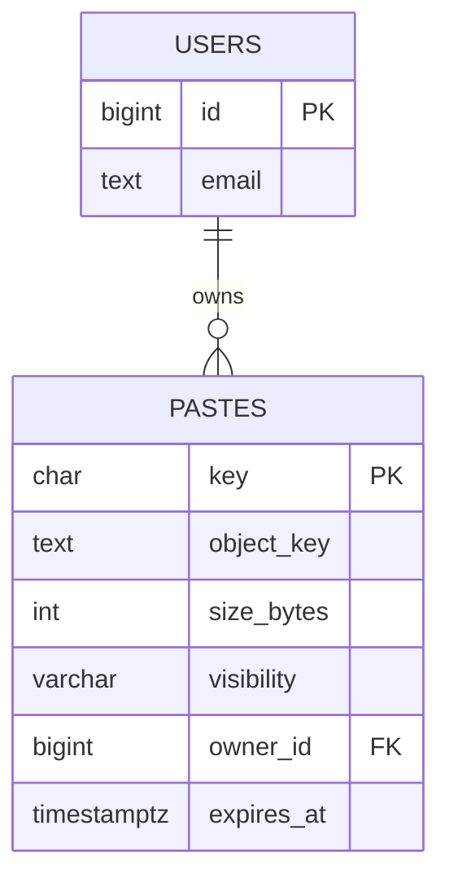
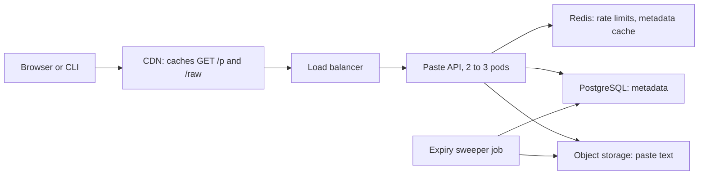
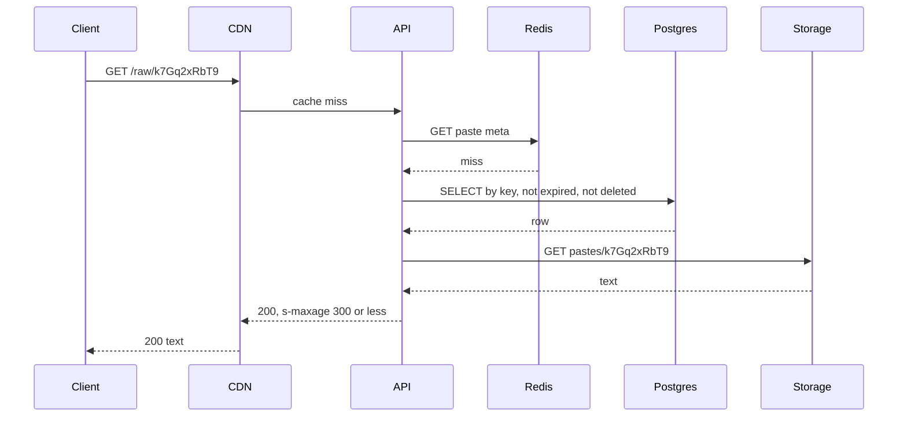
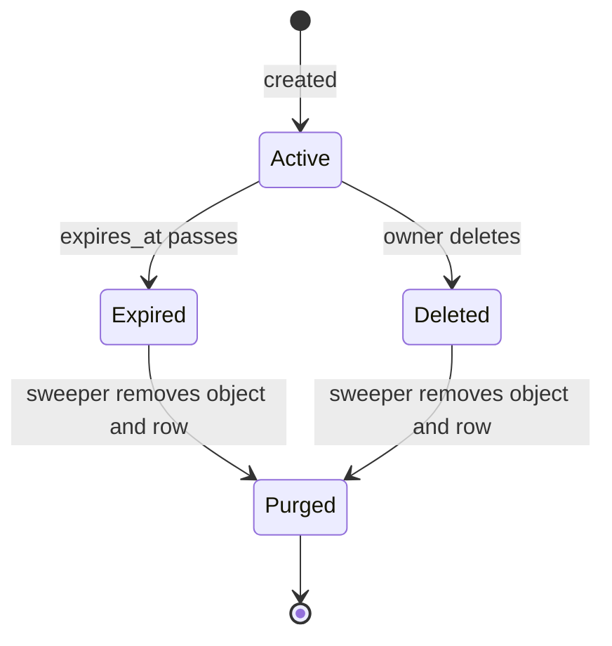
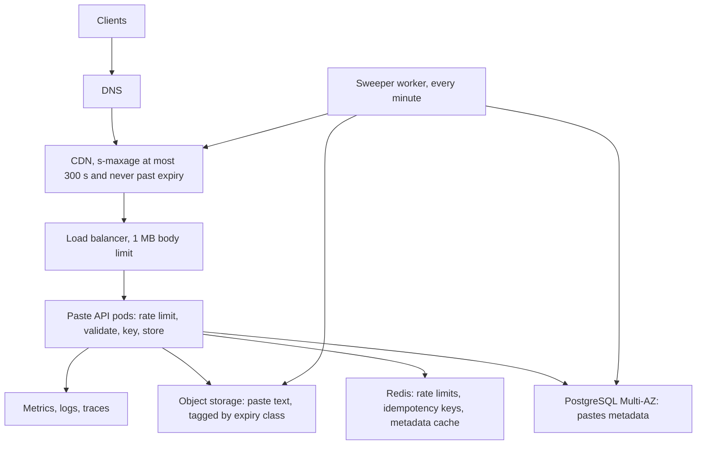

## 54.5 Back-of-the-envelope in 15 minutes

Every trigger in Section 54.4 was a number. Estimation is how you get numbers *before* the system exists, so the design fits the traffic instead of your fears. This section gives you just enough to start; Part 56 — Capacity Estimation and Back-of-the-Envelope Math is the full course.

### 54.5.1 The handful of numbers

Memorise these. They are approximate, and they are enough for every first estimate in this Part.

| Number | Value | Use it for |
|---|---|---|
| Seconds in a day | 86,400 | Turning "per day" into "per second" |
| 1 million per day | about 12 per second | The anchor conversion |
| 1 billion per day | about 11,600 per second | When a system becomes "real" |
| Peak to average | 2x to 10x (food ordering about 5x) | Never size for the average |
| PostgreSQL, simple indexed reads | 20,000 to 40,000 per second per instance | Is one database enough for reads? |
| PostgreSQL, small write transactions | 3,000 to 10,000 per second | Is one primary enough for writes? |
| Redis, simple operations | about 100,000 per second per instance | Is one cache node enough? |
| One NestJS pod, one-query endpoint | 400 to 900 RPS | How many pods? |
| 1 KB at 1,000 per second | 1 MB/s, about 86 GB per day | Bandwidth and storage |
| Same-region round trip / cross-region | 0.5 ms / 70 to 150 ms | Latency budgets |

Dividing by 100,000 instead of 86,400 is a fine shortcut for mental arithmetic, but it makes rates about 14 percent low, so round the result *up* afterwards. Part 56, section 56.1 "The numbers every backend engineer should know", has the longer tables.

### 54.5.2 The 15-minute script

1. **Write the assumptions as a list, with units.** Users, daily actives, actions per user, sizes. Anyone can then argue with an assumption instead of with your conclusion.
2. **Write the formula, then compute.** `peak_rps = dau x actions / 86,400 x peak_factor`.
3. **Round to one significant figure.** 6,944 becomes 7,000.
4. **Sanity-check against a component.** "7,000 RPS of mostly cached reads is fine for one PostgreSQL primary plus Redis."
5. **Add named headroom.** Run at about 65 percent utilisation and survive the loss of one of three zones: multiply by roughly 2.3.

These are Part 56's five moves (section 56.2.1) in miniature.

### 54.5.3 One worked estimate: Tiffin at 2 million daily actives

**Assumptions.** 2 million DAU; 60 API calls per user per day; peak factor 5; about 10 percent of customer calls are writes (cart, order, address); 0.5 orders per DAU; each order produces about 10 status updates from restaurant tablets and rider apps; an order with its items and events takes about 3 KB, doubled to 6 KB for indexes; 50,000 restaurants with a 50 KB menu document each.

| Quantity | Formula | Result |
|---|---|---|
| Average API RPS | 2,000,000 x 60 / 86,400 | about 1,400 |
| Peak API RPS | 1,400 x 5 | about 7,000 |
| Peak customer write requests | 7,000 x 10 % | about 700 per second |
| Peak status updates | 1,000,000 x 10 / 86,400 x 5 | about 580 per second |
| Peak write transactions | (700 + 580) x about 2 (outbox and events) | about 2,600, call it 3,000 |
| Order storage per year | 1,000,000 x 6 KB x 365 | about 2.2 TB |
| Menu cache size | 50,000 x 50 KB | about 2.5 GB, one Redis node |
| App pods | 7,000 / 500 per pod / 0.65 x 1.5 | about 32 pods |
| Database connections | 32 pods x pool of 10 | 320, so put PgBouncer in front |

**Sanity check.** 3,000 write transactions per second is inside one large primary's range (3,000 to 10,000), but with writes doubling yearly it will not be next year. 2.2 TB per year means the database passes 4 TB within two years, where backups, restores and vacuum hurt. Both numbers agree with Stage 8's trigger in Section 54.4.9: that is the point of estimating, to see the trigger coming months early.

For the rest of the method (read/write ratios, cache hit arithmetic, row-size estimation, queue drain time) go to Part 56, sections 56.3 to 56.7, and compare this estimate with section 56.8.1 "An e-commerce API at 2 million daily actives".

## 54.6 Your first guided design: a Pastebin

> **Try it first** · Level: Beginner · About 45 minutes
>
> **Build:** a text-sharing service where anyone can paste text, get a short link, and share it so others can read it.
>
> **Requirements:**
> - Create a paste of up to 1 MB of text and receive a short URL such as `/p/k7Gq2xRbT9`
> - Read a paste by its URL, as a formatted page or as raw text
> - Choose an expiry: 10 minutes, 1 day, 1 week, or never
> - Choose visibility: public, or unlisted (readable only by people who have the link)
> - Delete your own paste
>
> **Scale and constraints:** 1 million new pastes a day and 10 million reads a day, peaks about 5 times the average; average paste 10 KB; read p99 under 200 ms, create p99 under 500 ms; 99.9 percent availability for reads.
>
> **Your task:** sketch the API, the data model and the main components; estimate storage and throughput; name the two hardest problems and how you would solve them.
>
> Spend the time on paper before you read on. The model design follows.

This is a guided design. The system is a text-sharing service: users paste text (up to 1 MB), get a short link, and share it. Readers open the link to see the text formatted or raw. Each paste has an expiry (10 minutes, 1 day, 1 week, or never) and a visibility (public or unlisted). Owners can delete their pastes. The load is 1 million new pastes and 10 million reads per day, with peaks of five times the average, an average paste of 10 KB, a read p99 under 200 ms, a create p99 under 500 ms, and 99.9 percent read availability.

Each step below starts with a **Stop and try** prompt. Cover the rest of the step, spend the suggested minutes on paper, then compare with the model answer. The steps follow a simplified version of Part 55's nine moves.

### 54.6.1 Step 1: clarify the requirements

> **Stop and try (5 minutes):** write the functional requirements, the non-functional requirements with numbers, and two things you would declare out of scope. What questions would you ask the interviewer?

**Model answer.**

Functional: create a paste (text, optional language label for syntax highlighting, expiry, visibility); read by key as HTML or raw; delete by owner; anonymous use allowed, so anonymous creators get a secret delete token.

Non-functional: reads 10 times more frequent than writes; read p99 under 200 ms; create p99 under 500 ms; 99.9 percent read availability (about 43 minutes of downtime a month); a saved paste must not be lost before its expiry (durability); an **unlisted paste must not be guessable**, which is a security requirement hiding inside a product word.

Questions worth asking: Is editing allowed? (No; a paste is immutable, which makes caching easy.) Do public pastes appear in a listing or search? (Out of scope for now.) Do we need view counts? (Nice to have, approximate is fine.) Out of scope: accounts beyond basic login, search, comments, binary files.

### 54.6.2 Step 2: estimate

> **Stop and try (5 minutes):** compute average and peak writes per second, average and peak reads per second, storage per day and per year, peak outbound bandwidth, and a cache size.

**Model answer.**

| Quantity | Arithmetic | Result |
|---|---|---|
| Writes, average | 1,000,000 / 86,400 | about 12 per second |
| Writes, peak | 12 x 5 | about 60 per second |
| Reads, average | 10,000,000 / 86,400 | about 116 per second |
| Reads, peak | 116 x 5 | about 600 per second |
| Content per day | 1,000,000 x 10 KB | 10 GB |
| Content per year | 10 GB x 365 | about 3.65 TB, before expiry removes some |
| Metadata per year | 1,000,000 x 500 bytes with indexes x 365 | about 180 GB |
| Peak outbound bandwidth | 600 x 10 KB | about 6 MB/s |
| Hot cache | 100,000 popular pastes x 10 KB | about 1 GB |

What the numbers say: the request rates are small (one PostgreSQL instance and two app pods would cope), but **content storage is the big number**. 3.65 TB of text a year in PostgreSQL would bloat backups and restores for no benefit. That pushes content to object storage and keeps only metadata in the database.

### 54.6.3 Step 3: define the API

> **Stop and try (5 minutes):** write the endpoint table with method, path, request, response and status codes. Which calls are idempotent?

**Model answer.**

| Method and path | Request | Response | Notes |
|---|---|---|---|
| `POST /api/pastes` | `{ content, language?, expiresIn: "10m" or "1d" or "1w" or "never", visibility }`, header `Idempotency-Key` | `201 { key, url, deleteToken, expiresAt }` | 413 if over 1 MB; 429 if rate-limited |
| `GET /p/:key` | none | `200` HTML page | 404 if missing or expired |
| `GET /raw/:key` | none | `200 text/plain; charset=utf-8` | Served with `X-Content-Type-Options: nosniff` |
| `DELETE /api/pastes/:key` | header with owner token or delete token | `204` | Idempotent: deleting twice is still 204 |

`POST` is not naturally idempotent: a mobile client that retries after a timeout would create two pastes. The `Idempotency-Key` header, stored for 24 hours, returns the first response on a retry (Part 15, section 15.12 "Idempotency").

### 54.6.4 Step 4: model the data

> **Stop and try (5 minutes):** write the table(s) with types and indexes, and decide where the paste text lives. Justify the choice with your Step 2 numbers.

**Model answer.** Metadata in PostgreSQL, content in object storage under the paste's key.

```sql
CREATE TABLE pastes (
  key                char(10)     PRIMARY KEY,            -- random base62, see Step 6
  object_key         text         NOT NULL,               -- e.g. 'pastes/k7Gq2xRbT9'
  size_bytes         integer      NOT NULL CHECK (size_bytes <= 1048576),
  language           varchar(32),
  visibility         varchar(8)   NOT NULL CHECK (visibility IN ('public', 'unlisted')),
  owner_id           bigint,                              -- null for anonymous pastes
  delete_token_hash  bytea        NOT NULL,               -- never store the raw token
  created_at         timestamptz  NOT NULL DEFAULT now(),
  expires_at         timestamptz,                         -- null means never
  deleted_at         timestamptz
);

-- Serves the expiry sweeper: "find expired pastes, oldest first"
CREATE INDEX pastes_expires_at_idx ON pastes (expires_at)
  WHERE expires_at IS NOT NULL AND deleted_at IS NULL;

-- Serves "my pastes" for logged-in users
CREATE INDEX pastes_owner_created_idx ON pastes (owner_id, created_at DESC)
  WHERE owner_id IS NOT NULL;
```



A reasonable alternative stores small pastes (under about 4 KB) inline in a `content` column to save one object-storage call. It is a valid optimisation, but it gives you two code paths; start with one.

### 54.6.5 Step 5: draw the high-level design

> **Stop and try (5 minutes):** draw the boxes for the create path and the read path. Where does caching go, and what is cached?

**Model answer.**



The create path: rate-limit, validate size, generate a key, `PUT` the text to object storage, then insert the metadata row. Writing the object first means a row never points at missing content; a failure between the two leaves an orphan object, which the cleanup in Step 7 removes.



Because pastes are immutable, caching is easy. The CDN caches each paste for at most five minutes, and never past its expiry (`s-maxage` is the smaller of 300 seconds and the remaining lifetime). Popular pastes are then served from the edge; the origin sees only misses.

### 54.6.6 Step 6: deep dive on key generation

> **Stop and try (5 minutes):** how do you generate the short key? Consider collisions and, for unlisted pastes, guessing. How long must the key be?

**Model answer.** Three options:

| Option | Pros | Cons |
|---|---|---|
| Auto-increment ID encoded in base62 | No collisions, short | Sequential and enumerable: anyone can walk every unlisted paste |
| Hash of the content | Deduplicates identical pastes | Same text gets the same URL, leaking that someone pasted it; expiry conflicts |
| Random base62 from a secure random source | Unguessable, no coordination | Rare collisions, handled by retry |

Choose random. Now the length. Collisions are the easy part: with 8 characters there are 62^8, about 2.2 x 10^14, keys, and a year of 365 million pastes gives a collision chance per insert around 1 in 600,000, handled by retrying on the primary-key violation. **Guessing is the real constraint.** With a billion live pastes and 8-character keys, a random guess hits a real paste about once in 220,000 tries; a botnet guessing 1,000 per second finds an unlisted paste every few minutes. With 10 characters (62^10, about 8.4 x 10^17), the same botnet needs about ten days per hit, and per-IP read limits plus an alert on the 404 rate make such a campaign visible long before that. So the key is 10 characters; if unlisted pastes are expected to hold secrets, 12 characters push the average to about a century. Part 55, section 55.1 "URL Shortener", and Part 66, section 66.3 "Unique ID Generator", cover the other key strategies in depth.

```ts
import { ConflictException, Injectable } from '@nestjs/common';
import { InjectRepository } from '@nestjs/typeorm';
import { QueryFailedError, Repository } from 'typeorm';
import { randomInt } from 'node:crypto';
import { Paste } from './paste.entity';

const ALPHABET = 'ABCDEFGHIJKLMNOPQRSTUVWXYZabcdefghijklmnopqrstuvwxyz0123456789';

@Injectable()
export class PasteKeyService {
  constructor(@InjectRepository(Paste) private readonly pastes: Repository<Paste>) {}

  newKey(length = 10): string {
    let key = '';
    for (let i = 0; i < length; i++) key += ALPHABET[randomInt(ALPHABET.length)]; // CSPRNG, no modulo bias
    return key;
  }

  // Insert the row; on a primary-key collision, retry with a fresh key.
  async insertWithFreshKey(build: (key: string) => Partial<Paste>): Promise<Paste> {
    for (let attempt = 0; attempt < 3; attempt++) {
      const key = this.newKey();
      const paste = this.pastes.create(build(key));
      try {
        await this.pastes.insert(paste); // plain INSERT: save() would SELECT then UPDATE an existing key
        return paste;
      } catch (err) {
        const isUniqueViolation = err instanceof QueryFailedError && (err as any).code === '23505';
        if (!isUniqueViolation) throw err;
      }
    }
    throw new ConflictException('Could not allocate a paste key'); // practically never happens
  }
}
```

In the real create flow the object key depends on the paste key, so the service picks the key, uploads the object, then calls the insert; a collision at insert time re-uploads under the new key. With 10-character keys a collision is about 1 in 2 billion inserts in the first year (365 million keys out of 8.4 x 10^17), so that cost is irrelevant.

### 54.6.7 Step 7: deep dive on expiry and deletion

> **Stop and try (5 minutes):** a paste set to "10 minutes" must stop being readable after 10 minutes. How do you guarantee that, and how do you actually free the storage? What about copies in the CDN?

**Model answer.** Separate *visibility* from *cleanup*.

1. **Visibility is checked on every read.** The read query includes `expires_at IS NULL OR expires_at > now()` and `deleted_at IS NULL`. Even if every cleanup job is broken, an expired paste returns 404 from the origin.
2. **CDN copies cannot outlive the paste,** because `s-maxage` never exceeds the remaining lifetime. On explicit delete, the API also sends a CDN invalidation for both URLs; until it completes (usually seconds to a few minutes), the 5-minute cap bounds the exposure.
3. **Cleanup runs in batches.** A worker every minute selects up to 1,000 expired keys using the partial index, deletes the objects with a batch delete (S3's `DeleteObjects` accepts up to 1,000 keys per request), then marks or deletes the rows. Deleting in small batches keeps locks and vacuum load low.
4. **A safety net for storage.** Objects are tagged with their expiry class (`expiry=10m`, `1d`, `1w`), and object-storage lifecycle rules delete tagged objects after one, two or eight days. Lifecycle rules work in whole days, so they are a backstop, not the main mechanism. A weekly reconciliation removes orphan objects with no row.



### 54.6.8 Step 8: failures, abuse and scaling

> **Stop and try (5 minutes):** for each box, what happens when it is down or slow? What will abusers do? What changes at 10x?

**Model answer.**

| Failure | Detection | Impact | Mitigation | What the user sees |
|---|---|---|---|---|
| Object storage slow or down | Error rate and latency on storage calls | Uncached reads fail; creates fail | CDN serves popular pastes; `stale-if-error`; short timeouts | Old popular pastes work; new ones show "try again" |
| PostgreSQL down | Health check, connection errors | Creates fail; uncached reads fail | Multi-AZ failover in about 60 seconds; metadata cache in Redis | Brief errors |
| Redis down | Connection errors | Rate limits and metadata cache gone | Fall back to database; fail open on read limits, closed on create limits | Slightly slower |
| Sweeper stopped | Alert on age of oldest expired row | Storage grows | Read path still hides expired pastes | Nothing |
| Crash between object upload and row insert | Reconciliation report | Orphan object | Weekly orphan cleanup | Nothing |

Abuse: spam and malware links (rate-limit creates per IP and per account, a report-abuse endpoint, takedown tooling); stored XSS (render text escaped, serve raw as `text/plain` with `nosniff`, ideally from a separate domain); scraping unlisted pastes (10-character keys plus read rate limits); huge bodies (1 MB limit enforced at the load balancer and the body parser).

Scaling: at 10x (600 writes and 6,000 reads per second at peak), the CDN and the metadata cache absorb reads, PostgreSQL handles 600 inserts per second comfortably, and storage reaches about 36 TB a year in object storage, which is a cost line, not an architecture change. At 100x, partition `pastes` by `created_at` month so old months can be detached; sharding is still not needed.

### 54.6.9 The full design and a self-review rubric



Score your own attempt honestly. One point per row; 9 or more is a strong beginner answer.

| Check | Present in your design? |
|---|---|
| Asked at least two clarifying questions and stated what is out of scope | |
| Computed peak reads and writes per second and storage per year | |
| Let the storage number decide where content lives | |
| Wrote an API table with status codes and an idempotency story for create | |
| Wrote a table with types, a primary key and an index that serves a named query | |
| Chose a key strategy and sized the key for guessing, not only collisions | |
| Made expired pastes invisible on read, independent of the cleanup job | |
| Bounded CDN caching by the paste's expiry and handled delete | |
| Wrote at least three failure modes with what the user sees | |
| Named at least two abuse cases and their defences | |
| Said what changes at 10x and why sharding is not needed | |
| Named one tradeoff you made and the alternative | |

If you missed the guessing point, you are in good company: it is the most common gap, and it is exactly the kind of requirement that a product word ("unlisted") hides. That habit, reading requirements for the hidden non-functional ones, is what the next designs on the ladder will keep training.
