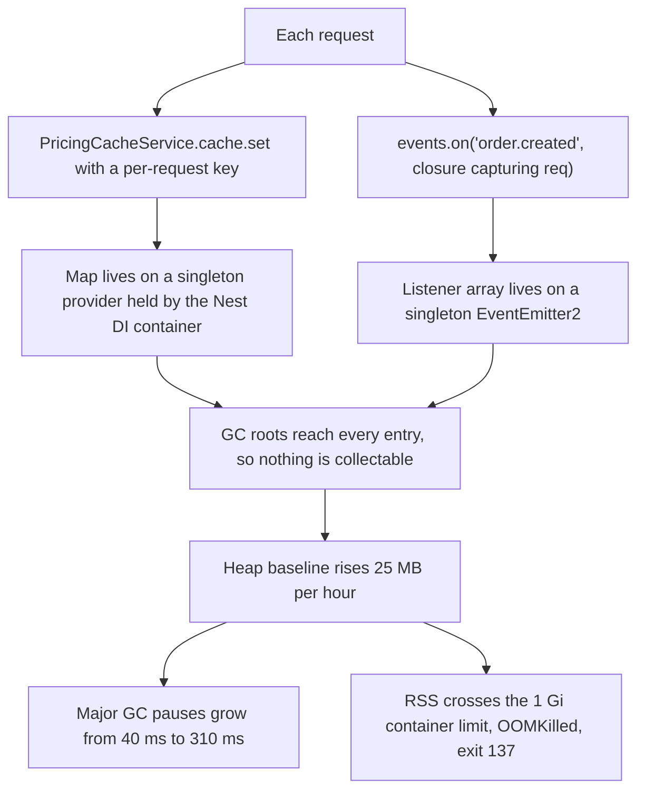
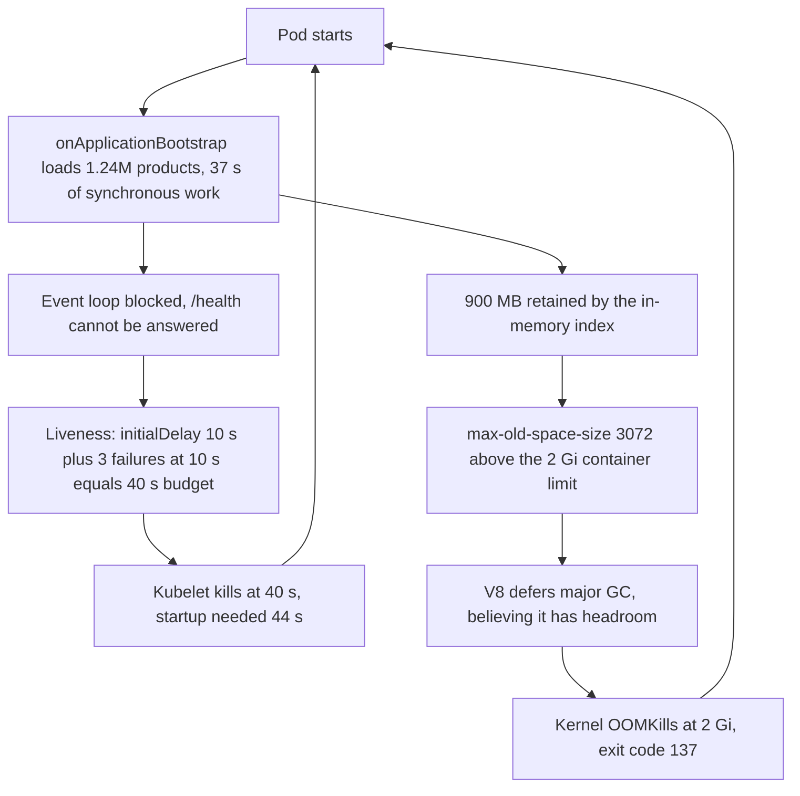

## 54.6 Memory usage keeps increasing

### Symptom

**Ongoing, noticed 11:20 on a Tuesday.** The `orders-api` memory graph over seven days is a sawtooth on a rising slope: each pod starts at about 380 MB of RSS, climbs to roughly 1.4 GB over 40 hours, gets OOMKilled, restarts at 380 MB, and repeats. Nobody had noticed because the restarts happen at different times on different pods and the service never becomes unavailable. It surfaced only because the duplicate-notification incident in section 54.5 traced back to a consumer OOM, and someone finally looked at the memory graphs for the whole fleet.

A sawtooth with a **flat** baseline is healthy garbage collection. A sawtooth with a **rising** baseline is a leak. The distinction is the entire diagnosis, and it is visible in one graph.

### First five minutes (mitigation)

There is no user impact right now, so the mitigation is minimal and reversible: raise the memory limit from 1 Gi to 2 Gi, which converts a 40-hour restart cycle into an 80-hour one and buys time to investigate properly.

Say clearly in the channel that this is not a fix. Raising a memory limit to stop OOMKills is the production equivalent of turning up the radio to hide the engine noise, and teams that do it three times in a row end up with 8 GB pods that still leak.

### Metrics

| Metric | Behaviour | What it rules in or out |
|---|---|---|
| `container_memory_working_set_bytes` | Rises 25 MB/hour, sawtooth on a rising baseline | The leak is real |
| `nodejs_heap_size_used_bytes` | Rises in step with RSS, from 210 MB to 1.15 GB | **The leak is in the JS heap**, not in native memory |
| `nodejs_external_memory_bytes` | Flat at 22 MB | Not `Buffer`s, not a native addon |
| `nodejs_gc_duration_seconds` (major) | 40 ms rising to 310 ms | GC is working harder over the same live set: classic retention |
| `nodejs_active_handles_total` | Flat at 34 | Not leaked sockets or timers |
| Event loop lag p99 | 9 ms rising to 60 ms | The GC pauses are starting to hurt latency |
| RPS | Flat | Not traffic growth |

Heap and RSS rising together, external flat, handles flat. That combination says: **JavaScript objects are being retained**. If RSS had risen while the heap stayed flat, the hunt would be entirely different (native buffers, a leaking `pg` result cache, an addon, or fragmentation).

### Logs

Nothing useful, which is itself informative. There is one exception, found by grepping the startup logs:

```text
11:02:03 WARN  MaxListenersExceededWarning: Possible EventEmitter memory leak detected.
               11 order.created listeners added to [EventEmitter2]. Use emitter.setMaxListeners()
               to increase limit
```

That warning appeared once, four months ago in the deploy logs, and stopped appearing after a commit whose message was "silence noisy listener warning". Node was telling the truth and someone turned off the alarm. Keep this in mind; it becomes the second leak.

### Traces

Traces show nothing: every request is normal, the slow ones are slow because of GC pauses that appear as unexplained gaps with no child span. This is expected. **Tracing finds slow requests; it does not find leaks.** Knowing which tool cannot answer your question is half of debugging.

### Application

Time for a heap snapshot. You cannot attach Chrome DevTools to a production pod, so expose an admin endpoint on the internal port, and take the snapshot from a pod removed from the load balancer, because `writeHeapSnapshot` blocks the event loop for seconds on a large heap and briefly doubles memory.

```ts
// src/ops/heap.controller.ts  (internal port, admin guard, rate limited)
import { Controller, Post, UseGuards } from '@nestjs/common';
import { writeHeapSnapshot } from 'node:v8';

@Controller('internal/heap')
@UseGuards(InternalAdminGuard)
export class HeapController {
  @Post('snapshot')
  snapshot(): { file: string } {
    const file = `/tmp/heap-${process.pid}-${Date.now()}.heapsnapshot`;
    writeHeapSnapshot(file);   // blocks; take it off the load balancer first
    return { file };
  }
}
```

```bash
POD=orders-api-7d9f4c8b6-x2k9q
# 1. Take the pod out of rotation so the snapshot pause hurts nobody
kubectl label pod $POD -n prod app-                     # removes it from the Service selector
kubectl exec -n prod $POD -- curl -s -XPOST localhost:9100/internal/heap/snapshot
kubectl cp prod/$POD:/tmp/heap-1-1743500000000.heapsnapshot ./t0.heapsnapshot
# 2. Put it back, let it serve traffic for four hours, repeat
kubectl label pod $POD -n prod app=orders-api
# ... four hours later ...
kubectl cp prod/$POD:/tmp/heap-1-1743514400000.heapsnapshot ./t4.heapsnapshot
```

Open Chrome DevTools, Memory panel, load both snapshots, select the second, and switch the view to **Comparison** against the first, sorted by Size Delta. **One snapshot tells you what is in memory; two snapshots tell you what is accumulating**, and only the second question matters.

```text
Constructor                  # New    # Deleted   # Delta   Size Delta
(object)                    1,284,110    9,412  +1,274,698   +412 MB
Map                                 3        0         +3    +398 MB
(string)                      642,004    8,110    +633,894   +181 MB
PricingContext                318,441       12   +318,429     +98 MB
(closure)                     319,006    1,004   +318,002     +64 MB
Array                          12,884      440    +12,444     +51 MB
OrderEntity                     4,110    3,980       +130      +2 MB
```

Three Maps holding 398 MB, 318,429 `PricingContext` objects, and 318,002 closures. Select the `Map` row, expand an instance, and read the **Retainers** pane bottom-up:

```text
Map @1284110
  in cache            @982110  PricingCacheService
    in _providers     @441002  Map (Nest DI container)
      in container    @12      NestApplicationContext
```

The retainer path names the culprit: a `Map` field on a singleton NestJS provider, held by the DI container, held by the application. Nothing will ever collect it.

Here is the **red herring**, and it consumed a full day before the snapshots were taken. The initial theory was "a leak in a dependency", supported by a GitHub issue on the HTTP client library describing a leak under keep-alive. The team upgraded `axios`, then `pg`, then bumped Node from 30.11 to 30.14, deploying each on its own and waiting eight hours to observe. The slope did not change. Three days and four deploys spent on a theory that a four-hour heap comparison disproved in ten minutes, because the comparison pointed at application constructors (`PricingContext`) rather than at library internals. The lesson is not "dependencies never leak" but **"measure before you upgrade"**: an upgrade is a change with its own risk, and using it as a diagnostic is expensive.

The code:

```ts
// src/pricing/pricing-cache.service.ts  (leak 1)
@Injectable()
export class PricingCacheService {
  private readonly cache = new Map<string, PricingContext>();   // unbounded, singleton scope

  get(key: string, build: () => PricingContext): PricingContext {
    let ctx = this.cache.get(key);
    if (!ctx) { ctx = build(); this.cache.set(key, ctx); }       // nothing ever deletes
    return ctx;
  }
}
```

The key is `${userId}:${cartHash}:${currency}`, which is effectively unique per request. Every request inserts a new entry and nothing is ever removed. At 640 RPS with an object graph of roughly 1.3 KB, this is about 3 GB a day of pure retention.

The second leak explains the `(closure)` growth and the old `MaxListenersExceededWarning`:

```ts
// src/orders/order-events.interceptor.ts  (leak 2)
@Injectable()
export class OrderEventsInterceptor implements NestInterceptor {
  constructor(private readonly events: EventEmitter2) {
    this.events.setMaxListeners(0);   // "silence noisy listener warning": removed the alarm
  }

  intercept(ctx: ExecutionContext, next: CallHandler): Observable<unknown> {
    const req = ctx.switchToHttp().getRequest<Request>();
    // A new listener on a long-lived singleton emitter, for every request. Never removed.
    this.events.on('order.created', (e: OrderCreatedEvent) => this.audit(req.correlationId, e));
    return next.handle();
  }
}
```

Each listener closure captures `req`, which captures headers, the parsed body and the response object. That is why the `(string)` and `(object)` counts grow alongside the closures: the leak is not the function, it is everything the function keeps alive.

Verify it live without a snapshot:

```ts
setInterval(() => {
  logger.log({ listeners: this.events.listenerCount('order.created') }, 'listener count');
}, 60_000);
// 1204 ... 2417 ... 3630 ... rising monotonically with request count
```



### Database

Ruled out in two minutes and worth doing: `pg_stat_activity` shows no growth in connection count, no `idle in transaction` accumulation, and the pool metrics are flat. A leaked connection or an accumulating result set would have shown here.

### Infrastructure

`kubectl describe pod` on a restarted pod confirms `Last State: Terminated, Reason: OOMKilled, Exit Code: 137`. Node memory is fine; no other pod on the node is affected. The infrastructure is correctly enforcing a limit the application is violating.

### Root cause

Two independent retention bugs on singleton-scoped objects. An unbounded `Map` cache keyed by a per-request value on a singleton provider, and an event listener registered per request on a singleton `EventEmitter2` and never removed, whose closure retained the entire request object. Both are reachable from the NestJS DI container, which is a GC root for the process lifetime, so nothing was ever collectable.

### Fix

```ts
// Fix 1: bound the cache by size and time
import { LRUCache } from 'lru-cache';

@Injectable()
export class PricingCacheService {
  private readonly cache = new LRUCache<string, PricingContext>({
    max: 10_000,               // hard object ceiling
    ttl: 5 * 60_000,           // and a time ceiling
    maxSize: 64 * 1024 * 1024, // and a byte ceiling
    sizeCalculation: (v) => v.approximateBytes,
  });
  // ... get() unchanged
}
```

Three ceilings, because any one of them can be defeated by an unexpected object shape. **An unbounded cache is not a cache, it is a leak with a hit ratio.**

```ts
// Fix 2: do not subscribe per request. Subscribe once, at module init.
@Injectable()
export class OrderEventsListener implements OnModuleInit, OnModuleDestroy {
  private readonly handler = (e: OrderCreatedEvent) => this.audit(e);

  onModuleInit(): void { this.events.on('order.created', this.handler); }
  onModuleDestroy(): void { this.events.off('order.created', this.handler); }  // symmetric
}
```

The correlation id that the interceptor was trying to capture comes from `AsyncLocalStorage` instead, which is what request context is for (see section 54.12). Also revert `setMaxListeners(0)`: the warning is a leak detector, and disabling it is disabling the detector.

**Set the heap limit relative to the container limit** so V8 collects aggressively before the kernel intervenes:

```yaml
env:
  - name: NODE_OPTIONS
    value: "--max-old-space-size=1400"   # ~70% of the 2 Gi limit
resources:
  requests: { memory: "2Gi", cpu: "1" }
  limits:   { memory: "2Gi", cpu: "2" }
```

After the fix: RSS settles at 410 MB with a flat baseline over six days, major GC pauses back to 35 ms, and the memory limit is returned to 1 Gi.

### Prevention

- **Alert on the slope, not the level**: `deriv(nodejs_heap_size_used_bytes[6h]) > 5e6` sustained for two hours. Level alerts fire when it is already too late; a slope alert fires on day one.
- **A soak test in CI**: 60 percent of peak load for four hours in staging, failing the build if the heap baseline (measured after a forced GC) rises more than 10 percent. This is the test that catches leaks before users do.
- **Review rules with teeth**: no `Map`, `Set` or array as a mutable field on a singleton provider without a documented bound; every `.on()` has a matching `.off()` in `onModuleDestroy`; never call `setMaxListeners(0)`.
- **A documented heap-snapshot runbook** so the next engineer does not spend three days upgrading dependencies. The procedure above (label off, snapshot, label on, wait, snapshot, compare) should take twenty minutes.
- **`--max-old-space-size` set from the container limit in a shared base image or Helm template**, so no service can get it wrong individually.

### Junior versus senior

| | Junior | Senior |
|---|---|---|
| First move | Raises the memory limit and closes the ticket | Raises the limit to buy time, states loudly that it is not a fix |
| Theory | "It's a leak in a dependency" | Compares heap snapshots before touching a single dependency version |
| Snapshot use | Takes one snapshot and stares at the biggest object | Takes two, four hours apart, and sorts by delta |
| Reading the result | Sees a big `Map`, guesses which one | Reads the retainer path bottom-up to the exact field on the exact provider |
| Fix | Clears the Map on an interval | Bounds it three ways, fixes the listener symmetry, and sets the heap limit from the container limit |
| Prevention | None | Slope alert, soak test in CI, review rules, runbook |

## 54.7 NestJS pods keep restarting

### Symptom

**08:05** — `kubectl get pods` during a routine morning check:

```text
NAME                            READY   STATUS             RESTARTS       AGE
orders-api-6c8f9d7b5-2xnpq      1/1     Running            47 (3m ago)    3h12m
orders-api-6c8f9d7b5-4tk8v      0/1     CrashLoopBackOff   51 (18s ago)   3h12m
orders-api-6c8f9d7b5-9wzlm      1/1     Running            44 (7m ago)    3h12m
```

Forty-seven restarts in three hours. Users see intermittent 502s (roughly 0.4 percent of requests) when a pod is killed mid-request, and p99 is spiky because a fraction of traffic keeps landing on pods that are still warming up.

### First five minutes (mitigation)

Two immediate actions. Increase the replica count so that pods restarting is a smaller fraction of capacity, and stop the bleeding on the readiness side so traffic is not sent to pods that are not ready:

```bash
kubectl scale deployment/orders-api --replicas=18 -n prod   # from 12
```

Then, before changing anything else, capture the evidence, because a restart destroys it.

### Metrics

| Metric | Value |
|---|---|
| `kube_pod_container_status_restarts_total` | Rising steadily since 04:55 |
| `container_memory_working_set_bytes` | Reaching exactly 2,147,483,648 before each restart on some pods |
| `probe_duration_seconds{probe="liveness"}` | 1.0 s (the timeout) on the failing pods |
| Startup duration (first request served after start) | 44 s |
| Event loop lag during startup | 3,800 ms peak |

Two different numbers stand out, and that is the clue that there are **two different problems**. Some pods die at exactly the memory limit; others die while their liveness probe times out during startup. It is tempting to look for one explanation. Resist it: the restart counts tell you a pod can die for more than one reason.

### Logs

```bash
kubectl describe pod orders-api-6c8f9d7b5-4tk8v -n prod
```

```text
Containers:
  api:
    State:          Waiting
      Reason:       CrashLoopBackOff
    Last State:     Terminated
      Reason:       OOMKilled
      Exit Code:    137
      Started:      Wed, 15 Apr 2026 08:01:12 +0000
      Finished:     Wed, 15 Apr 2026 08:03:58 +0000
    Restart Count:  51
    Limits:         memory: 2Gi        cpu: 2
    Requests:       memory: 512Mi      cpu: 500m
Events:
  Type     Reason     Age                    From     Message
  ----     ------     ----                   ----     -------
  Warning  Unhealthy  14m (x38 over 3h4m)    kubelet  Liveness probe failed: Get
             "http://10.44.2.19:3000/health": context deadline exceeded
             (Client.Timeout exceeded while awaiting headers)
  Normal   Killing    14m (x19 over 3h4m)    kubelet  Container api failed liveness probe,
             will be restarted
  Warning  BackOff    2m (x214 over 2h51m)   kubelet  Back-off restarting failed container
```

Exit codes are worth committing to memory, because they classify the death in one glance:

| Exit code | Meaning | Typical cause |
|---|---|---|
| 0 | Clean exit | Process returned from `main`; usually a bug in a server |
| 1 | Uncaught exception | Unhandled rejection, config validation failure at boot |
| 137 | 128 + 9 = SIGKILL | **OOMKilled** by the kernel, or a liveness kill after the grace period |
| 143 | 128 + 15 = SIGTERM | Graceful shutdown requested (deploy, scale-down, eviction) |

And the previous container's logs, which are the only place the truth survives a restart:

```bash
kubectl logs orders-api-6c8f9d7b5-4tk8v -n prod --previous
```

```text
08:01:12  [Nest] LOG [NestFactory] Starting Nest application...
08:01:14  [Nest] LOG [InstanceLoader] TypeOrmModule dependencies initialized
08:01:15  [Nest] LOG [CatalogWarmupService] loading product catalog into memory...
08:01:52  [Nest] LOG [CatalogWarmupService] loaded 1,240,000 products (37,412 ms)
08:01:52  [Nest] LOG [NestApplication] Nest application successfully started
08:01:52  [Nest] LOG server listening on :3000
```

Thirty-seven seconds inside `CatalogWarmupService`, and the probe configuration:

```yaml
livenessProbe:
  httpGet: { path: /health, port: 3000 }
  initialDelaySeconds: 10
  periodSeconds: 10
  timeoutSeconds: 1
  failureThreshold: 3
```

Ten seconds of grace plus three failures at ten-second periods is **forty seconds** before the kubelet kills the container. Startup takes forty-four. The pod is killed four seconds before it would have become healthy, every single time, in a perfect loop.

### Traces

The catalog warm-up shows as one 37-second synchronous span with no children. It is a `for` loop over a million rows building nested objects, entirely synchronous, so the event loop never yields. Even after the HTTP server binds the port, an in-progress synchronous block means the probe's connection is accepted by the kernel but never answered by JavaScript. **The process is alive and the probe still times out**, which is precisely the failure mode liveness probes are worst at distinguishing.

### Application

```ts
// src/catalog/catalog-warmup.service.ts
@Injectable()
export class CatalogWarmupService implements OnApplicationBootstrap {
  async onApplicationBootstrap(): Promise<void> {
    const rows = await this.repo.find();                  // 1.24 M rows into memory
    for (const row of rows) { this.index.set(row.sku, this.toDto(row)); }   // sync, 37 s
  }
}
```

`onApplicationBootstrap` runs before `listen()` completes in the sense that matters: the application does not begin serving until it returns. And the health endpoint itself:

```ts
@Get('health')
async health(): Promise<{ status: string }> {
  await this.dataSource.query('SELECT 1');       // a database call in a LIVENESS probe
  await this.redis.ping();
  return { status: 'ok' };
}
```

A liveness probe that depends on the database means that **when the database has a hiccup, Kubernetes restarts every pod in the fleet simultaneously**, converting a two-second database blip into a full outage. That is a latent second incident sitting in this manifest.

### Database

Not the cause here, and confirmed quickly: `SELECT 1` runs in 0.3 ms, connections are normal. But the investigation notes it as a serious latent risk because of the liveness dependency above, and the fix removes it.

### Infrastructure

The second death mode. Some pods are OOMKilled at exactly 2 GiB with no probe failures. Their config:

```yaml
env:
  - name: NODE_OPTIONS
    value: "--max-old-space-size=3072"     # 3 GiB heap
resources:
  limits:
    memory: 2Gi                            # 2 GiB container
```

V8 is told it may use a 3 GiB old space, so it happily grows past 2 GiB before deciding a major collection is worthwhile. The kernel's cgroup limit is 2 GiB and it does not negotiate. **V8 never gets the chance to collect**, because the process is killed while V8 still believes it has a gigabyte of headroom. Add the catalog's 1.24 million objects (about 900 MB) to normal request memory and the pods that survive startup die in the first hour.

The **red herring**: for the first thirty minutes the working theory was the cluster autoscaler evicting pods to consolidate nodes, which had been enabled the previous week. It is a good theory, it explains restarts, and it was checked and discarded in four minutes: `kubectl get events --field-selector reason=Evicted` returned nothing for this namespace, node count had been stable at 14 for three days, and evictions produce exit code 143 with a `Killing` event citing eviction, not 137 with `OOMKilled`. **Exit codes discriminate between causes; use them before you theorize.**

### Root cause

Two independent faults arriving together. A liveness probe budget of 40 seconds against a 44-second startup, made worse by a synchronous 37-second catalog load that blocked the event loop so the probe could not be answered even after the port was bound. And `--max-old-space-size=3072` set above a 2 GiB container limit, so V8 deferred major GC past the point where the kernel killed the process.



### Fix

```yaml
# 1. A startupProbe owns the slow start; liveness only takes over once the pod is up.
startupProbe:
  httpGet: { path: /health/live, port: 3000 }
  periodSeconds: 5
  failureThreshold: 30            # 150 s of startup budget, 3x the observed 44 s
livenessProbe:
  httpGet: { path: /health/live, port: 3000 }   # cheap: no I/O at all
  periodSeconds: 10
  timeoutSeconds: 3
  failureThreshold: 3
readinessProbe:
  httpGet: { path: /health/ready, port: 3000 }  # checks dependencies, cached for 10 s
  periodSeconds: 5
  timeoutSeconds: 2
  failureThreshold: 2
```

```ts
// 2. Liveness answers "is this process healthy enough to keep", not "is the database up".
@Controller('health')
export class HealthController {
  constructor(private readonly health: HealthCheckService, private readonly db: TypeOrmHealthIndicator) {}

  @Get('live')
  live(): { status: string } {
    return { status: 'ok' };   // no I/O. If the event loop can answer, the process is alive.
  }

  @Get('ready')
  @HealthCheck()
  ready() {
    // Readiness may depend on the database: a failing pod is removed from the Service,
    // it is not killed. This is the difference that matters.
    return this.health.check([() => this.db.pingCheck('database', { timeout: 1500 })]);
  }
}
```

```ts
// 3. Do not block the event loop during warm-up; yield, and serve traffic while it fills.
async onApplicationBootstrap(): Promise<void> {
  void this.warm();   // do not await: the app becomes ready immediately
}

private async warm(): Promise<void> {
  const stream = await this.repo.createQueryBuilder('p').stream();
  let n = 0;
  for await (const row of stream) {
    this.index.set(row.p_sku, this.toDto(row));
    if (++n % 5_000 === 0) await new Promise((r) => setImmediate(r));  // yield to the loop
  }
  this.warmed = true;
}
```

Better still, delete the warm-up: 1.24 million products in every pod's heap is 900 MB per pod times 18 pods of duplicated data that Redis already holds once. The reason it existed was a 6 ms Redis lookup that somebody wanted to be 0.05 ms. That trade cost 16 GB of cluster memory and this incident.

```yaml
# 4. Heap limit below the container limit, and requests == limits for Guaranteed QoS.
env:
  - name: NODE_OPTIONS
    value: "--max-old-space-size=1400"
resources:
  requests: { memory: "2Gi", cpu: "1" }
  limits:   { memory: "2Gi", cpu: "1" }
```

```ts
// 5. Graceful shutdown, so a restart does not produce 502s.
app.enableShutdownHooks();
// terminationGracePeriodSeconds: 30 in the manifest, and readiness fails first so the
// Service stops sending traffic before the server stops accepting it.
```

### Prevention

- **Alert on `increase(kube_pod_container_status_restarts_total[1h]) > 3`.** Restarts hide behind a healthy replica count; nothing else will tell you.
- **Alert specifically on OOMKill events**, which are a distinct and always-actionable signal.
- **A CI check on the manifests**: `--max-old-space-size` must be present and must be at most 75 percent of `resources.limits.memory`; `startupProbe.failureThreshold * periodSeconds` must exceed the measured p99 startup time by 3x.
- **Measure startup time as a metric** and alert when it grows. Startup time creeps up quietly as modules are added, and it is invisible until it crosses a probe budget.
- **A standing rule: liveness probes never perform I/O.** Readiness checks dependencies; liveness checks only that the process can answer.
- **A PodDisruptionBudget** so voluntary disruptions cannot remove too many pods at once.

### Junior versus senior

| | Junior | Senior |
|---|---|---|
| First look | `kubectl logs pod` (empty, the container just restarted) | `kubectl logs --previous` and `kubectl describe` for the exit code and events |
| Restart cause | Assumes one cause | Notices two death modes in the metrics and treats them separately |
| Exit code 137 | "It crashed" | "SIGKILL: OOMKilled or a liveness kill; the describe output distinguishes them" |
| Probe design | Health endpoint checks everything, used for both probes | Liveness with no I/O, readiness with dependencies, startupProbe for slow boot |
| Heap flag | Raises `--max-old-space-size` to stop OOMKills | Sets it *below* the container limit, because above it guarantees the kill |
| Warm-up | Optimizes the loop | Asks whether 900 MB per pod of duplicated cache should exist at all |
