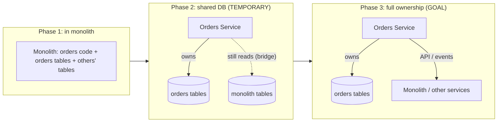

## 54.4 Monolith decomposition: seams, the first service, and data ownership

#### Concept

Breaking a monolith into services is the most common large migration, and the hardest part is not the code — it is the data. Decomposition means finding the **seams** (the natural boundaries where the monolith can be split), extracting the **first service** (which is disproportionately hard because you are building all the platform scaffolding for the first time), splitting **data ownership** (deciding which service owns which tables, the genuinely difficult part), and managing the **shared database phase** (the transitional period where the new service still reads the monolith's tables, which must be temporary or it becomes a permanent distributed monolith). Part 5 covered monolith versus microservices as a choice; this is about executing the decomposition when you have decided to do it.

#### Why does it exist?

Imagine trying to extract an "orders" service from a monolith where the orders code reads and writes the users table, the products table, the inventory table, and the payments table directly, and where other parts of the monolith read and write the orders table directly. You cannot simply lift the orders code out, because it is entangled with everyone else's data, and everyone else is entangled with its data. Pull it out naively and you either break a dozen other features or you create a service that still reaches into the monolith's database — which is a distributed monolith, the worst of both worlds (network calls *and* shared-database coupling).

Decomposition discipline exists because a monolith's modules are usually entangled at the data layer, and untangling that entanglement — deciding who owns what data and severing the direct cross-module database access — is the real work. The code extraction is mechanical once the data ownership is sorted; the data ownership is where decompositions succeed or fail.

#### Mental model

Imagine separating two trees whose roots have grown together underground. Above ground they look like two separate trees (two modules), and you might think you can just cut between them. But below ground, their roots are intertwined (the shared database), and if you cut carelessly you kill both. Separating them requires carefully tracing which roots belong to which tree and untangling them one at a time, often leaving some shared root structure in place temporarily while the trees establish their own. Monolith decomposition is root-untangling: the visible module boundary is easy, but the data roots underneath are intertwined, and the whole job is tracing and separating them without killing either side.

#### How it works

**1. Find the seams.** Seams are the natural boundaries — usually bounded contexts (Part 5) — where coupling is low across the boundary and high within it. Signs of a good seam: the module has a clear domain, few other modules read its tables, and it reads few other modules' tables. Signs of a bad seam (do not cut here): the module shares tables promiscuously with others, or there is a transaction that spans the proposed boundary. Enforcing module boundaries first (Part 53.5's fitness functions) makes the seams visible and clean before you cut.

**2. Extract the first service (the hard one).** The first extraction is disproportionately expensive, because you are building everything for the first time: the service template, the deployment pipeline, the inter-service communication, the observability, the data-ownership pattern. Budget for this; the first service might take as long as the next five combined. Choose a first service that is valuable but not the riskiest — a context with a clean seam, moderate importance, and a cooperative owning team, so you learn the mechanics on a forgiving case.

**3. Split data ownership.** This is the crux. Each service must *own* its data — be the only one that reads and writes its tables directly. Other services access that data only through the owning service's API or events, never by reaching into its database. Splitting ownership means: identify which tables belong to the extracted context, make the new service the sole owner, and replace every other module's direct access to those tables with API calls or events.

**4. Manage the shared-database phase.** In reality you cannot sever all data access at once. There is a transitional phase where the new service runs but still reads (or even writes) some of the monolith's tables, because untangling every access takes time. This phase is *acceptable only as a temporary bridge with a scheduled end*. If it becomes permanent, you have a distributed monolith: services that are separately deployed but still coupled through a shared database, which has all the costs of distribution and none of the benefits of true independence.



#### Practical example

A team extracts an orders service from an e-commerce monolith. They find the seam: the orders context owns the `orders`, `order_items`, and `order_status_history` tables, and its main entanglements are reading the `products` table (for product details on an order) and the `users` table (for customer info). They extract the orders service as their first service, building the template, pipeline, and inter-service communication in the process — it takes three months, far longer than later services will. For data ownership: the orders service becomes the sole owner of the three order tables, and the monolith's code that used to read `orders` directly is changed to call the orders service's API. For the orders service's reads of `products` and `users`, they enter a temporary shared-database phase: the orders service reads those tables directly for now, with a scheduled task (two months out) to replace those reads with API calls to a future products service and the users module. The shared-database phase is explicitly temporary and dated, so it does not calcify into a distributed monolith.

#### Artifact example

A data ownership map and shared-database phase plan — the artifacts that make the hard part (data) explicit and time-bound.

```markdown
# Orders service extraction: data ownership map

## Tables the orders service will OWN (sole read/write)
- orders
- order_items
- order_status_history
Other code accesses these ONLY via the orders service API/events after cutover.

## Tables the orders service READS but does NOT own
| Table | Owner (now/future) | Access after extraction | Bridge end date |
|---|---|---|---|
| products | monolith -> future products svc | TEMP: direct read (bridge) | Q3 (via products API) |
| users | monolith users module | TEMP: direct read (bridge) | Q3 (via users API) |
| inventory | monolith -> future inventory svc | TEMP: direct read (bridge) | Q4 (via inventory events) |

## Who currently reads the tables we will OWN (must be cut over)
| Current direct reader | New access | Owner | Status |
|---|---|---|---|
| Monolith checkout flow | orders service API | checkout team | migrated |
| Monolith admin panel | orders service API | admin team | migrated |
| Reporting job | orders service read-replica API | data team | IN PROGRESS |
| Legacy export script | ORPHANED — assign or delete | ? | escalated |

## Shared-database phase: RULES
- Every bridge (direct cross-service table read) has an END DATE above.
- No bridge may become permanent. A bridge past its date is escalated as a
  distributed-monolith risk.
- No new bridges after extraction without an RFC and an end date.
```

The artifacts make the invisible data entanglement visible: what the service owns, what it temporarily bridges (with an end date for each bridge), and who currently reaches into the tables it will own (which must be cut over). The explicit end dates and the "no permanent bridge" rule are what prevent the shared-database phase from becoming a distributed monolith. This is the real work of decomposition, made concrete.

#### Real-world scenario

A team extracts their first service and, because they treated data ownership rigorously, the extraction is clean: the new service owns its tables, every other reader was cut over to the API, and the two temporary bridges to the monolith's tables have end dates. Six months later, they extract their *fifth* service, and it takes three weeks instead of three months. The platform scaffolding built during the first extraction — the template, the pipeline, the communication patterns, the data-ownership playbook — all apply directly. The first extraction was expensive because it was pathfinding; the later ones are cheap because the path is paved. This is the normal shape of a well-run decomposition: a slow, expensive, educational first service, then an accelerating series of cheaper extractions, because the hard platform work and the data-ownership discipline established on service one compound across all the rest.

#### Failure scenario

A team extracts an orders service but skips the hard data-ownership work. The new orders service is deployed separately, which feels like progress, but it still reads and writes the monolith's tables directly — including tables other modules also write — and the monolith still reads and writes the orders tables directly. They have created a distributed monolith: two separately-deployed systems that are coupled through a shared database. Now they have all the costs of distribution (network calls, two deploy pipelines, two on-call surfaces, distributed debugging) *and* all the costs of the shared database (any schema change to a shared table requires coordinating both systems, transactions that used to be local now span the database in uncontrolled ways, and a change in one system can break the other through the shared tables). This is strictly worse than the monolith they started with, because the monolith at least had everything in one deployable with local transactions. The decomposition, by skipping data ownership, produced negative value: more operational cost, more coupling, and no independence. The shared-database phase, never ended, became the permanent architecture — the exact failure that data-ownership discipline and bridge end-dates exist to prevent.

#### Edge cases & failure modes

- **Cutting at a bad seam.** Splitting where tables are shared promiscuously or a transaction spans the boundary, producing a service that cannot own its data.
- **Skipping data ownership.** Extracting the code but leaving shared-database access, creating a distributed monolith that is worse than the original.
- **The permanent shared-database phase.** Bridges with no end date that calcify into permanent coupling.
- **Underestimating the first extraction.** Not budgeting for the disproportionate cost of building all the platform scaffolding the first time.
- **Choosing the riskiest service first.** Learning the mechanics on the highest-stakes context, so mistakes are expensive.
- **A transaction that spanned the boundary.** An operation that must be atomic across the old boundary now spans two services, requiring a saga (Part 47.3) that nobody planned for.

#### How a Principal Engineer thinks about this

They understand that monolith decomposition is fundamentally a data problem, not a code problem, and they spend their attention on data ownership — who owns which tables, who currently reaches into them, and how to sever that access — because that is where decompositions succeed or fail. They enforce module boundaries first (Part 53) so the seams are clean and visible before cutting, because cutting at a bad seam produces a service that can never own its data. They budget realistically for the disproportionate cost of the first extraction and choose a forgiving first service, because the first one is pathfinding and the platform work it builds compounds across all the rest.

Above all, they treat the shared-database phase as a temporary bridge with a hard end date, and they watch it like a hawk, because they know the single most common decomposition failure is the shared-database phase becoming permanent — producing a distributed monolith that is strictly worse than the monolith they started with. A principal would rather delay an extraction than ship one that leaves permanent shared-database coupling, because a half-decomposed service with shared data is negative value, carrying all the costs of distribution with none of the independence.

#### Common mistakes

- **Treating decomposition as a code problem** and neglecting the data ownership that actually determines success.
- **Extracting the code but keeping shared-database access,** creating a distributed monolith.
- **Letting the shared-database phase become permanent** by not setting and enforcing bridge end dates.
- **Underestimating the first extraction** and under-resourcing the platform scaffolding it must build.
- **Choosing the riskiest service to extract first,** making the learning expensive.

#### Interview questions

1. **What is the hardest part of decomposing a monolith into services, and why?**
   *Expected answer:* splitting data ownership — the modules are usually entangled at the data layer, and the real work is deciding who owns which tables and severing every other module's direct access to them, replacing it with APIs or events. The code extraction is mechanical once data ownership is sorted; the data is where decompositions fail. *Follow-up:* what is a distributed monolith and how does skipping data ownership cause it.

2. **What is a distributed monolith and why is it worse than the monolith you started with?**
   *Expected answer:* services that are separately deployed but still coupled through a shared database; it has all the costs of distribution (network calls, multiple pipelines, distributed debugging) plus all the costs of the shared database (coordinated schema changes, cross-service coupling via shared tables), with none of the independence — strictly worse than a monolith that at least had local transactions and one deployable. Skipping data ownership during extraction causes it. *Why it matters:* this is the central decomposition failure.

3. **Why is the first service extraction so much more expensive than later ones?**
   *Expected answer:* the first extraction is pathfinding — you build all the platform scaffolding for the first time (template, pipeline, inter-service communication, observability, the data-ownership playbook), which later extractions reuse. Budget for a slow first service and an accelerating series after it. *Follow-up:* how would you choose which service to extract first.

#### Practical exercise

Take a monolith (yours or a hypothetical e-commerce one) and plan the extraction of one service. Find the seam: which context has a clean boundary (owns a coherent set of tables, with limited entanglement). Produce the data ownership map: the tables the service will own, the tables it temporarily reads but does not own (each with a bridge end date), and the current direct readers of the tables it will own (each needing cutover). Flag any transaction that spans the proposed boundary.

**Acceptance criteria:** the chosen seam has a coherent set of owned tables and limited cross-boundary data sharing; the data ownership map explicitly lists every temporary bridge with an end date and every current reader that must be cut over; and you have identified whether any atomic operation spans the boundary (requiring a saga). A reader can see that the shared-database phase is temporary and bounded, not a path to a distributed monolith.
