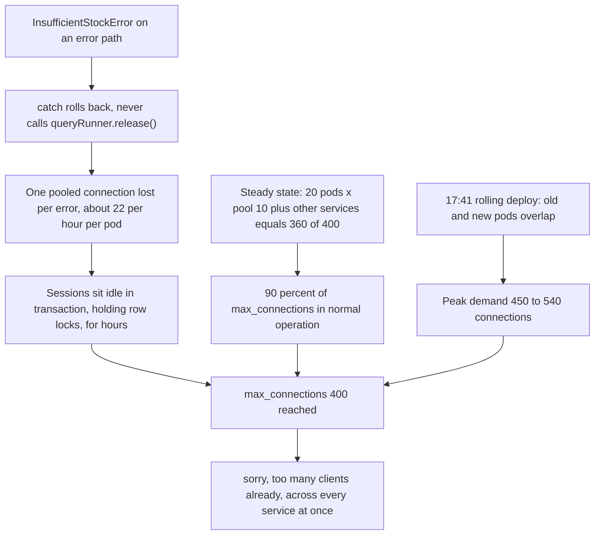
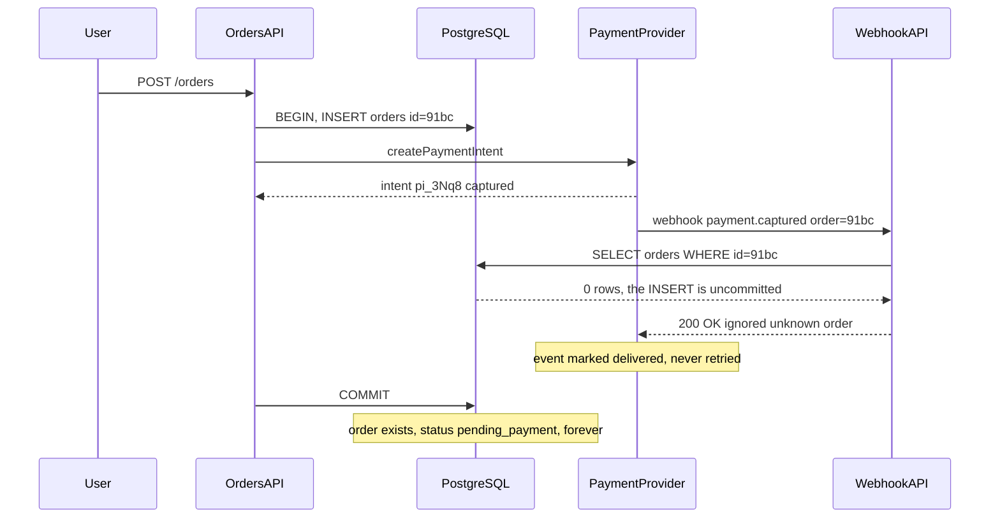

## 54.8 Database connections are exhausted

### Symptom

**17:44** — every service starts failing at once. The API returns 500s on 60 percent of requests. Two distinct errors dominate the logs:

```text
QueryFailedError: sorry, too many clients already
TimeoutError: ResourceRequest timed out
```

The second is TypeORM's pool refusing to hand out a connection within `connectionTimeoutMillis`. The first is PostgreSQL refusing to accept a new one at all. The on-call cannot open `psql` either, until they remember that `superuser_reserved_connections` exists and connects as the admin role.

Simultaneous failure across every service is characteristic. When one service breaks, suspect that service. When **everything** breaks at the same second, suspect the thing they share: the database, the cache, DNS, or the network.

### First five minutes (mitigation)

```sql
-- Connect as the reserved superuser
SELECT state, count(*) FROM pg_stat_activity WHERE backend_type = 'client backend' GROUP BY state;
```

```text
         state          | count
------------------------+-------
 idle                   |   210
 idle in transaction    |   118
 active                 |    61
 idle in transaction (aborted) |  9
```

398 of 400 slots used, and 127 of them are sitting inside an open transaction doing nothing. Those are pure waste and they hold locks. Reclaim them:

```sql
-- Kill sessions idle inside a transaction for more than 5 minutes. Safe: they are doing nothing,
-- and killing them rolls their transaction back.
SELECT pg_terminate_backend(pid), left(query, 60), now() - state_change AS idle_for
FROM pg_stat_activity
WHERE state IN ('idle in transaction', 'idle in transaction (aborted)')
  AND state_change < now() - interval '5 minutes';
```

**17:49** — 118 sessions terminated, error rate drops to 3 percent within thirty seconds. Then a guard so it cannot recur while the investigation runs:

```sql
ALTER SYSTEM SET idle_in_transaction_session_timeout = '30s';
SELECT pg_reload_conf();
```

**17:52** — error rate at 0.1 percent. Mitigated in eight minutes without a single deploy or restart.

### Metrics

| Metric | Normal | At 17:44 |
|---|---|---|
| `pg_stat_activity` total | 210 | 398 of 400 |
| `idle in transaction` count | 2 | **127** |
| Application pool `waitingCount` | 0 | 84 per pod |
| Pool `totalCount` | 8 per pod | 10 per pod (at max) |
| Pod count (`orders-api`) | 20 | **30, mid-deploy** |
| RDS CPU | 41% | 22% (the database is barely working) |

The database is at 22 percent CPU while everything fails. It is not overloaded; it is **full**. Distinguishing "slow" from "full" is the first fork in any connection incident, and the CPU graph answers it in a second.

`idle in transaction` climbing from 2 to 127 over the previous six hours (visible on the graph in hindsight) is the leak signature. Those sessions began a transaction and never ended it.

### Logs

Attribute the connections. This works only because `application_name` was set per pod, which is why section 54.12 insists on it:

```sql
SELECT application_name, state, count(*)
FROM pg_stat_activity
WHERE backend_type = 'client backend'
GROUP BY 1, 2 ORDER BY 3 DESC LIMIT 10;
```

```text
        application_name          |        state        | count
----------------------------------+---------------------+-------
 orders-api@orders-api-6c8f-2xnpq | idle in transaction |    31
 orders-api@orders-api-6c8f-9wzlm | idle in transaction |    29
 orders-api@orders-api-6c8f-4tk8v | idle in transaction |    28
 catalog-api@catalog-api-77d-h4x  | idle                |    18
 settlement-cron@settlement-2xk   | active              |     3
```

`orders-api` alone holds 88 idle-in-transaction sessions across three pods. Now find what they were last doing:

```sql
SELECT pid, application_name, now() - xact_start AS xact_age, left(query, 100) AS last_query
FROM pg_stat_activity
WHERE state = 'idle in transaction'
ORDER BY xact_start LIMIT 5;
```

```text
 pid   |    application_name    |   xact_age   |                     last_query
-------+------------------------+--------------+------------------------------------------------
 41102 | orders-api@...-2xnpq   | 05:41:22.114 | SELECT p.id, p.available FROM products p WHERE p.id = $1 FOR UPDATE
 41118 | orders-api@...-9wzlm   | 05:12:04.882 | SELECT p.id, p.available FROM products p WHERE p.id = $1 FOR UPDATE
```

A transaction open for five hours and forty-one minutes, holding a `FOR UPDATE` row lock on a product the whole time. The application log for that correlation id:

```text
12:03:14 ERROR reserveStock failed correlationId=e41a orderId=91bc
        error=InsufficientStockError: only 0 of 2 available
        at StockService.reserve (/app/dist/inventory/stock.service.js:62:15)
```

An error path. Every leaked connection is preceded by an exception.

### Traces

Traces of failing requests show `pool.acquire` spans of 9,800 ms ending in a timeout, with no database span after them. The requests never reached PostgreSQL. Traces of the *original* failures, hours earlier, show a complete `db.transaction` span that ends normally with an error status. The span closes; the connection does not. **A trace shows you the logical operation finished; it cannot show you that a resource was not released.** Know your tools' blind spots.

### Application

```ts
// src/inventory/stock.service.ts  (the leak)
async reserve(productId: string, qty: number): Promise<void> {
  const queryRunner = this.dataSource.createQueryRunner();
  await queryRunner.connect();               // takes a connection from the pool
  await queryRunner.startTransaction();
  try {
    const product = await queryRunner.manager.findOne(Product, {
      where: { id: productId }, lock: { mode: 'pessimistic_write' },
    });
    if (!product || product.available < qty) {
      throw new InsufficientStockError(`only ${product?.available ?? 0} of ${qty} available`);
    }
    product.available -= qty;
    await queryRunner.manager.save(product);
    await queryRunner.commitTransaction();
    await queryRunner.release();             // released ONLY on the happy path
  } catch (err) {
    await queryRunner.rollbackTransaction();
    throw err;                               // no release. The connection is gone forever.
  }
}
```

The `catch` rolls back and rethrows. It never calls `release()`, so the connection is never returned to the pool. In TypeORM the `QueryRunner` holds a real pooled connection, and a `QueryRunner` that is not released is a permanently lost slot. Worse, the `rollbackTransaction()` on line one of the catch can itself throw (if the connection has already broken), in which case even the rollback is skipped and the session stays `idle in transaction` holding locks.

The leak rate matches the arithmetic: roughly 22 `InsufficientStockError`s per hour on a popular SKU, times three pods, over six hours, equals about 120 leaked connections. Exactly what `pg_stat_activity` shows.

The **red herring** was investigated between 17:46 and 17:50. Somebody said "the analytics team must be running a huge report again", which had genuinely caused a similar-looking incident four months earlier. It is checked in one query and dismissed:

```sql
SELECT usename, count(*) FROM pg_stat_activity GROUP BY 1 ORDER BY 2 DESC;
--  orders_app | 312
--  catalog_app | 61
--  analytics_ro | 4        <-- four connections. Not them.
```

Four connections. The analytics role is also capped by `ALTER ROLE analytics_ro CONNECTION LIMIT 10`, which was the fix from that earlier incident and which worked. Ruling it out took forty seconds because the earlier incident had left behind both a limit and a habit.

### Database

Even without the leak, the arithmetic was already unsafe. The deploy at 17:41 is what tipped it:

| Consumer | Replicas | Pool max | Connections |
|---|---|---|---|
| `orders-api` | 20 | 10 | 200 |
| `catalog-api` | 12 | 8 | 96 |
| `notification-worker` | 8 | 5 | 40 |
| `settlement-cron` | 2 | 5 | 10 |
| Exporters, backups, humans | | | 14 |
| **Steady-state total** | | | **360 of 400** |
| **During a rolling deploy** (old pods draining, new pods started, `maxSurge: 25%`) | x1.25 to x1.5 | | **450–540** |

Steady state used 90 percent of `max_connections`. A rolling deploy needed 112 to 135 percent. The system had been surviving deploys only because pods terminated quickly; on this deploy, three pods drained slowly (they were holding those five-hour transactions, which had to be rolled back), and the surge crossed the limit. This is Part 53's "third deploy of the day" failure, arriving on schedule.

### Infrastructure

Nothing wrong at the infrastructure layer: the RDS instance was healthy, no failover, no network event. `max_connections` was 400 on a `db.r6g.2xlarge` because RDS's default formula sets it from instance memory, and nobody had ever computed whether 400 was the right number for this fleet.



### Root cause

A `QueryRunner` leaked on an error path in `StockService.reserve`, losing one pooled connection per `InsufficientStockError` and leaving the session `idle in transaction` holding a row lock. Independently, the fleet's steady-state connection demand was 90 percent of `max_connections`, so the surge of a normal rolling deploy exceeded the limit. Either fault alone would have caused an incident eventually; together they picked 17:44 on a Tuesday.

### Fix

```ts
// Fix 1: use the managed transaction helper, which cannot leak.
async reserve(productId: string, qty: number): Promise<void> {
  await this.dataSource.transaction('READ COMMITTED', async (manager) => {
    const product = await manager.findOne(Product, {
      where: { id: productId }, lock: { mode: 'pessimistic_write' },
    });
    if (!product || product.available < qty) {
      throw new InsufficientStockError(`only ${product?.available ?? 0} of ${qty} available`);
    }
    product.available -= qty;
    await manager.save(product);
  });
  // Commit, rollback and release are all handled. Throwing from the callback rolls back.
}
```

If a raw `QueryRunner` is genuinely required (streaming, advisory locks, `LISTEN`), the `finally` block is not optional:

```ts
const queryRunner = this.dataSource.createQueryRunner();
try {
  await queryRunner.connect();
  await queryRunner.startTransaction();
  // ...
  await queryRunner.commitTransaction();
} catch (err) {
  if (queryRunner.isTransactionActive) await queryRunner.rollbackTransaction();
  throw err;
} finally {
  await queryRunner.release();          // ALWAYS. This line is the whole fix.
}
```

**Fix 2, the arithmetic.** Size pools from Little's law rather than from a copied default. Measured p99 connection hold time is 9 ms; peak per-pod rate is 32 RPS; required concurrency is `32 * 0.009 = 0.29`. A pool of 4 is generous.

| Consumer | Replicas | Old pool | New pool | New total |
|---|---|---|---|---|
| `orders-api` | 20 | 10 | 4 | 80 |
| `catalog-api` | 12 | 8 | 4 | 48 |
| `notification-worker` | 8 | 5 | 3 | 24 |
| `settlement-cron` | 2 | 5 | 4 | 8 |
| Exporters, humans | | | | 14 |
| **Steady state** | | 360 | | **174** |
| **With deploy surge x1.5** | | 540 | | **261 of 400** |

**Fix 3:** PgBouncer in transaction mode in front of the primary, so the fleet's client connections stop being the database's problem at all (`default_pool_size 40`, `reserve_pool_size 10`), sized as Part 53 shows.

**Fix 4:** make the settings enforce the invariants.

```ts
// TypeORM DataSource
extra: {
  max: Number(process.env.DB_POOL_MAX ?? 4),
  connectionTimeoutMillis: 2000,      // fail fast; a 30 s wait hides saturation as latency
  idleTimeoutMillis: 30000,
  statement_timeout: 5000,
  idle_in_transaction_session_timeout: 30000,   // the database kills leaks by itself
  application_name: `orders-api@${process.env.HOSTNAME}`,
},
```

`idle_in_transaction_session_timeout` is the single most valuable line. It turns "a leak that accumulates for six hours" into "a leak that self-heals in thirty seconds and shows up as an error in the logs".

### Prevention

- **Export pool metrics and alert on them**: `pool.totalCount`, `pool.idleCount`, `pool.waitingCount`. Alert when `waitingCount > 0` for 2 minutes, and when `totalCount` stays at `max` while RPS is flat, which is the leak signature.
- **Alert at 70 percent of `max_connections`**, computed from `pg_stat_activity`. This would have paged at about 11:00, six hours before users noticed.
- **An integration test that asserts the pool returns to baseline after an error path.** Call `reserve()` with insufficient stock fifty times and assert `pool.totalCount` is unchanged. It is ten lines and it catches the entire bug class.
- **A lint or review rule: `createQueryRunner()` is only allowed inside a reviewed helper**; everything else uses `dataSource.transaction()`.
- **`idle_in_transaction_session_timeout` and `statement_timeout` set on every role**, in the database, not only in application config, so a connection from anywhere is bounded.
- **`application_name` on every connection string.** Without it, the attribution query above returns nothing useful and the investigation takes hours instead of minutes.

### Junior versus senior

| | Junior | Senior |
|---|---|---|
| First action | Restarts all the pods | Queries `pg_stat_activity`, sees the state breakdown, kills idle-in-transaction sessions |
| Reading the numbers | "The database is overloaded" | "Database CPU is 22 percent: it is full, not slow" |
| Fix | Raises `max_connections` to 800 | Fixes the leak, right-sizes pools from Little's law, adds PgBouncer, sets the timeouts |
| Attribution | Guesses which service | `application_name` per pod answers it in one query |
| Prevention | Closes the ticket | Adds the pool-return test, the 70 percent alert, and the database-side timeout |

## 54.9 Payment succeeds but the order stays pending

### Symptom

**Reported at 14:20 by finance, not by monitoring**, which is itself a finding. Over the preceding six hours, 47 customers were charged by the payment provider while their order sat at `status = 'pending_payment'`. The customers see "payment failed, please try again" in the app; several tried again and were charged twice. The provider dashboard shows all 47 payments as `captured`.

Money moved and the system does not know. This is the highest-severity class of bug in commerce backends, because it is silent, it compounds (customers retry), and it is invisible to every latency and error-rate dashboard you own.

### First five minutes (mitigation)

Stop the harm to customers before understanding it. Two actions:

1. **Freeze the retry path.** A feature flag disables the "Retry payment" button on the order screen, replacing it with "Payment is being confirmed, contact support". No new double charges after 14:26.
2. **Reconcile manually for the 47 known orders** using the query below, so those customers get their goods today.

### Metrics

| Metric | Value | Note |
|---|---|---|
| `payment_webhooks_received_total` | 18,400 today | Normal |
| `payment_webhooks_processed_total` | 18,353 | **47 short** |
| `payment_webhooks_rejected_total{reason="unknown_order"}` | **47** | Exactly the missing ones |
| `orders_stuck_pending_gt_15m` | (metric did not exist) | The gap that let this run six hours |
| `outbox_oldest_unprocessed_age_seconds` | **11,400** (3h10m) | **Red.** Nobody was watching this either |

The rejection counter existed and had the exact right value all day. Nobody alerted on it. **A metric nobody alerts on is a metric that exists to make the post-mortem embarrassing.**

### Logs

One affected order, by correlation id:

```text
11:03:41.220 [orders-api]  INFO  BEGIN order creation orderId=91bc userId=u-4412 corr=7f2a
11:03:41.238 [orders-api]  INFO  INSERT orders id=91bc status=pending_payment corr=7f2a
11:03:41.402 [orders-api]  INFO  INSERT order_items x3 corr=7f2a
11:03:41.455 [orders-api]  INFO  calling provider createPaymentIntent corr=7f2a
11:03:41.980 [orders-api]  INFO  provider returned intent pi_3Nq8 status=requires_capture corr=7f2a
11:03:42.104 [payments-api] INFO  webhook received event=payment.captured intent=pi_3Nq8 order=91bc
11:03:42.140 [payments-api] WARN  webhook: order 91bc not found, acknowledging corr=c19f
11:03:42.141 [payments-api] INFO  webhook response 200 body={"ignored":"unknown order"}
11:03:42.702 [orders-api]  INFO  COMMIT order creation orderId=91bc corr=7f2a
```

Read the timestamps. The webhook arrived at **11:03:42.104**. The transaction that created the order committed at **11:03:42.702**, six hundred milliseconds later. The webhook handler queried for an order that existed only inside another session's uncommitted transaction, and under `READ COMMITTED` it was correctly invisible.

Then the line that turned a transient race into a permanent loss: the handler returned **200 OK**. The provider marked the event as successfully delivered and never retried it. A `git log` on that file finds the commit:

```text
commit 8c41f2a  "webhook: stop retry storms from unknown orders"
-   return res.status(404).json({ error: 'unknown order' });
+   // Provider retries 404s for 3 days and floods our logs with test-mode events.
+   return res.status(200).json({ ignored: 'unknown order' });
```

The engineer solved a real annoyance (test-mode webhooks for orders that genuinely do not exist) by telling the provider "handled" for events that were not handled. It worked for eighteen months. It is the single most dangerous line in this scenario, because it converts a retryable race into permanent data loss.

### Traces

The trace of order creation shows why the race window existed at all:

```text
POST /orders                                  1,482 ms
└── db.transaction                            1,464 ms
    ├── db.query INSERT orders                    18 ms
    ├── db.query INSERT order_items x3            53 ms
    ├── http POST provider/payment_intents       525 ms   <-- external call INSIDE the transaction
    ├── db.query UPDATE orders SET intent_id       9 ms
    ├── db.query INSERT outbox                     7 ms
    └── commit                                   852 ms
```

An external HTTP call inside a database transaction. The transaction is held open for the entire 525 ms provider round trip plus a slow commit, and the provider can (and does) fire its webhook the instant it responds. **Any external call inside a transaction creates a window in which the outside world knows something your database has not yet committed.**

### Application

```ts
// src/payments/payment-webhook.controller.ts  (the bug)
@Post('webhooks/provider')
async handle(@Body() event: ProviderEvent, @Headers('x-signature') sig: string) {
  this.verifySignature(event, sig);
  const order = await this.orders.findOne({ where: { id: event.metadata.orderId } });
  if (!order) {
    this.logger.warn(`webhook: order ${event.metadata.orderId} not found, acknowledging`);
    return { ignored: 'unknown order' };      // HTTP 200. The event is now lost forever.
  }
  await this.orders.markPaid(order.id, event.data.intentId);
  return { ok: true };
}
```

The **red herring**: the first theory, held for about twenty minutes, was clock skew. The webhook's `created` timestamp from the provider was slightly *earlier* than the application's own log line for the provider's response, which looked impossible and suggested the provider's clocks were wrong or that the application server's NTP had drifted. It was checked: `chronyc tracking` on the nodes showed 1.2 ms of offset, and the provider's timestamps are second-granularity, which fully explains the apparent inversion. Fifteen minutes spent, theory discarded at 14:52. It was a reasonable thing to check and the mistake would have been to keep believing it after the evidence came back clean.

### Database

The compounding failure. There is a transactional outbox precisely so that a missed webhook does not matter: order state changes write to `outbox`, a relay polls it, and a reconciliation job re-queries the provider for any order pending more than fifteen minutes. None of it ran.

```sql
SELECT count(*), min(created_at), max(created_at), now() - min(created_at) AS oldest_age
FROM outbox WHERE processed_at IS NULL;
```

```text
 count |         min         |         max         |  oldest_age
-------+---------------------+---------------------+--------------
 41208 | 2026-05-19 08:14:02 | 2026-05-19 14:19:51 | 06:05:49
```

Six hours of unprocessed outbox rows. The relay uses a PostgreSQL advisory lock for single-writer leader election:

```sql
SELECT pid, application_name, now() - state_change AS held_for, l.objid
FROM pg_locks l JOIN pg_stat_activity a USING (pid)
WHERE l.locktype = 'advisory';
```

```text
  pid  |    application_name    |   held_for   |   objid
-------+------------------------+--------------+-----------
 38820 | outbox-relay@relay-9wz | 06:11:33     | 774451201
```

A session holding the advisory lock for six hours. The pod `relay-9wz` was OOMKilled at 08:14 (the leak from section 54.6 again), but its TCP connection was half-closed: the node died in a way that never sent a FIN, and with `tcp_keepalives_idle` unset PostgreSQL kept the backend alive indefinitely. The lock is held by a session belonging to a process that no longer exists. The replacement relay pod started, tried to take the lock, failed, logged `relay: another instance holds the lock, sleeping` every ten seconds for six hours, and nobody read it.

### Infrastructure

Confirmed: `relay-9wz` OOMKilled at 08:14:02, exit 137. One dead pod, no alert, six hours of stalled reconciliation.



### Root cause

The provider's webhook arrived 600 ms before the transaction that created the order committed, so the handler could not see the order. The handler returned 200, telling the provider the event was handled, which permanently discarded the only notification of a successful payment. The outbox relay, which would have caught the discrepancy through reconciliation, had been stalled for six hours because a dead pod's session still held its advisory lock. Two independent safety nets, both with holes, both unmonitored.

### Fix

**1. Never reject a webhook you cannot yet process. Store it, then process it.**

```ts
@Post('webhooks/provider')
@HttpCode(200)
async handle(@Body() event: ProviderEvent, @Headers('x-signature') sig: string) {
  this.verifySignature(event, sig);      // verify BEFORE storing: never persist unverified input
  await this.dataSource.query(
    `INSERT INTO payment_events (provider_event_id, type, order_id, payload, received_at)
     VALUES ($1, $2, $3, $4, now())
     ON CONFLICT (provider_event_id) DO NOTHING`,   // idempotent: the provider retries
    [event.id, event.type, event.metadata.orderId, JSON.stringify(event)],
  );
  return { received: true };   // 200 means "durably stored", not "fully processed"
}
```

A separate worker processes `payment_events`, and because the row is durable it can retry for as long as it takes for the order to appear. **200 must mean "I have this", never "I looked and gave up".** When a webhook genuinely cannot be stored, return 503 so the provider retries with backoff.

**2. Move the external call out of the transaction.** Create the order and commit; then call the provider; then update. The order row exists before the provider has any reason to call back, which closes the race at its source.

**3. The reconciliation query**, run every five minutes and also available for manual use during an incident:

```sql
-- Arm A: a captured payment event exists, but the order never advanced.
SELECT o.id AS order_id, o.status, o.created_at, o.total_amount,
       pe.provider_event_id, pe.received_at, pe.payload->'data'->>'intentId' AS intent_id
FROM orders o
JOIN payment_events pe ON pe.order_id = o.id
WHERE o.status = 'pending_payment'
  AND pe.type = 'payment.captured'
  AND o.created_at < now() - interval '15 minutes'
ORDER BY o.created_at;

-- Arm B: pending too long with no event at all. These must be checked against the
-- provider's API directly, because the webhook may never have arrived.
SELECT o.id, o.payment_intent_id, o.created_at, now() - o.created_at AS pending_for
FROM orders o
WHERE o.status = 'pending_payment'
  AND o.payment_intent_id IS NOT NULL
  AND o.created_at < now() - interval '30 minutes'
  AND NOT EXISTS (SELECT 1 FROM payment_events pe WHERE pe.order_id = o.id)
ORDER BY o.created_at
LIMIT 500;
```

Arm A catches the race in this incident. Arm B catches a webhook that was never delivered at all, which is a different failure with the same symptom, and the provider's `GET /payment_intents/:id` is the source of truth for it. Both arms feed a job that either advances the order or raises an operations task. Run reconciliation even when everything is healthy: it should find nothing, and the day it finds something is the day it pays for itself.

**4. Fix the stalled relay.** Set `tcp_keepalives_idle = 60`, `tcp_keepalives_interval = 10`, `tcp_keepalives_count = 3` on the database so dead sessions are reaped in ninety seconds instead of never; and replace advisory-lock leader election with a lease row carrying an expiry:

```sql
UPDATE relay_lease SET owner = $1, expires_at = now() + interval '30 seconds'
WHERE name = 'outbox' AND (owner = $1 OR expires_at < now())
RETURNING owner;   -- 0 rows means someone else holds a live lease
```

A lease expires on its own. A lock held by a ghost does not.

### Prevention

- **Alert on `orders_stuck_pending_gt_15m > 0`.** This is a business-invariant alert, and business-invariant alerts catch the incidents that latency and error dashboards structurally cannot see.
- **Alert on `outbox_oldest_unprocessed_age_seconds > 300`.** Queue and outbox *age* is the right signal; depth can look fine while nothing is moving.
- **Alert on `payment_webhooks_rejected_total`** with any reason. It was already being counted correctly.
- **Ban 200-on-unhandled in code review.** A 2xx to a webhook is a durability promise.
- **A chaos test**: deliver a webhook for an order id that does not exist yet, then create the order, and assert the order reaches `paid` within the reconciliation interval.
- **A daily finance reconciliation** comparing the provider's settlement report against `orders` totals, with a report that a human reads. Every payments team that has been through this incident has one.

### Junior versus senior

| | Junior | Senior |
|---|---|---|
| Framing | "The webhook failed" | "The webhook succeeded. Our handler discarded it." |
| Timestamps | Reads the logs in order | Reads the *sub-second* timestamps and spots a 600 ms ordering inversion |
| Webhook contract | 200 means "I received the HTTP request" | 200 means "I have durably stored this and take responsibility for it" |
| Fix | Retries the 47 orders by hand | Stores events first, moves the provider call out of the transaction, writes reconciliation for both arms, fixes the ghost lock |
| Monitoring | Adds a log line | Adds business-invariant alerts, because no infrastructure metric can see money that went missing |
