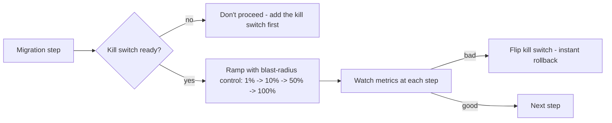

## 54.6 Deprecating, platform migrations, and risk management

#### Concept

Three topics that complete the migration toolkit. **Deprecating and turning things off** is the discipline of actually removing the old system — using usage telemetry to find the real callers, deprecation notices and brownouts to push them off, and specific tactics for the stubborn last 5%. **Platform migrations** are the specific flavours of migration where you change a foundational layer: the database engine, the cloud provider, or the framework (Express to NestJS, Sequelize to TypeORM). **Risk management** is the set of safety mechanisms — rollback points, kill switches, blast-radius control — that let you run a large migration without betting the company on it.

#### Why does it exist?

Imagine you have migrated 95% of callers off the old API and want to turn it off, but you do not actually know who the remaining 5% are, because you never instrumented it. You cannot turn it off, because it might break something critical that you cannot identify. So it stays on, forever, carrying the full cost of the old system for 5% of usage — the 80%-done-forever problem of 54.1, in its final act. Deprecation telemetry and tactics exist to find and evict those last callers so the old system can actually be deleted.

Platform migrations exist as a category because changing a foundational layer is riskier than changing an application: everything sits on top of it, so a mistake has a huge blast radius, and these migrations tend to be big-bang-tempting (it feels like you have to switch the database all at once) when they should usually be done with the safe, gradual strategies from 54.3. Risk management exists because large migrations, done without safety mechanisms, are a bet-the-company gamble; the mechanisms turn a gamble into a controlled, reversible process.

#### Mental model

For deprecation, imagine trying to demolish an old building that might still have tenants. You cannot just demolish it; you must first find out who still lives there (telemetry), give them notice to move (deprecation notices), make it progressively less comfortable to stay (brownouts — turning off the heating for an hour at a time), and finally, for the last stubborn tenant, knock on their door personally (chase the last callers). Only when it is empty and you have confirmed it is empty do you demolish. Turning off a system is an eviction process, and skipping the "find out who still lives there" step means you can never safely demolish.

For risk management, imagine a climber who places protection points as they ascend. Each piece of protection means that if they fall, they only fall to the last point, not to the ground. A migration's rollback points, kill switches and blast-radius controls are the climber's protection: they bound how far you fall when something goes wrong, turning a fatal fall into a short, recoverable one.

#### How it works

**Deprecating and turning off:**

1. **Usage telemetry.** Instrument the old system so you know, precisely, who is still calling it — which callers, how often, which endpoints. You cannot turn off what you cannot see. This should be in place *before* you start migrating, so you can watch usage decline and identify the stragglers.
2. **Deprecation notices.** Announce the deprecation with a date, through every channel the callers use (docs, response headers like `Deprecation` and `Sunset`, direct outreach to known teams). Give a realistic timeline.
3. **Brownouts.** Deliberately make the old system temporarily unavailable for short, announced windows (e.g. return errors for one hour) as the deprecation date approaches. Brownouts flush out callers who ignored the notices, because their system breaks briefly and they finally investigate — far better than discovering them at the permanent shutdown.
4. **The last 5%.** The stubborn remainder: orphaned callers, teams that keep deprioritising, systems whose owners have left. Tactics: escalate to management with the deletion date as leverage, offer to do the migration *for* them, or (for truly orphaned, low-value callers) simply turn it off and see who screams, with a fast rollback ready. The last 5% is where deletion dates and escalation paths (54.1, 54.2) earn their keep.

**Platform migrations.** Each has specifics:

- **Database engine change** (e.g. MySQL to PostgreSQL): use the data-migration techniques from 54.5 (backfill + CDC + reconciliation). The risk is correctness (SQL dialect differences, type differences, transaction semantics), so parallel run and reconciliation are essential.
- **Cloud migration** (e.g. on-prem to AWS, or AWS to GCP): huge blast radius, many interdependent pieces. Do it incrementally, service by service, with the ability to run across both environments during transition.
- **Framework migration** (Express to NestJS, Sequelize to TypeORM): ideal for strangler and branch-by-abstraction. For Express to NestJS, run both frameworks side by side (NestJS can mount Express middleware), migrating route by route. For Sequelize to TypeORM, introduce a repository abstraction, then swap the ORM behind it per repository.

**Risk management mechanisms:**

```text
- Rollback points: at every stage, a defined way to return to the previous
  safe state. If you can't roll back from a step, don't take it until you can.
- Kill switches: a feature flag that instantly reverts to the old path. The
  single most valuable migration safety mechanism (Part 49 flags).
- Blast-radius control: migrate a small percentage / one tenant / one region
  first, so a failure affects a fraction, not everyone.
- Canary + gradual ramp: 1% -> 10% -> 50% -> 100%, watching metrics at each step.
- Backward-compatible changes: never make a change the old path can't survive,
  so rollback stays possible (expand-contract, Part 31).
```



#### Practical example

A team turning off a legacy order API has usage telemetry in place from the start, so they can see the caller count fall from 43 to 7 as the migration proceeds. They publish a deprecation notice with a sunset date and add a `Sunset` header to every legacy response. As the date approaches, 3 callers remain, so they run a brownout: the legacy API returns 503 for one announced hour. Two of the three callers break during the brownout, investigate, and migrate within the week — the brownout flushed them out. The last caller is an orphaned script with no owner; the team escalates with the deletion date, nobody claims it, so they turn it off with a fast rollback ready. Nothing screams. The legacy API is deleted. The telemetry found the callers, the brownout evicted the laggards, and the escalation-plus-turn-it-off handled the orphan — the full deprecation toolkit used to actually finish, which is the part that usually does not happen.

#### Artifact example

A deprecation and shutdown plan — the artifact that turns "we should turn off the old system" into an executed eviction.

```markdown
# Legacy order API: deprecation and shutdown plan

## Telemetry (in place since migration start)
Per-caller request counts logged. Current callers: 7 (was 43). Dashboard
shows each caller's last-seen time and daily volume.

## Timeline
- Now: deprecation notice published (docs + Deprecation/Sunset headers +
  direct email to the 5 known caller teams).
- T+4 weeks: brownout #1 — legacy API returns 503 for 1 hour, 14:00 UTC,
  announced. Purpose: flush out callers who ignored the notice.
- T+6 weeks: brownout #2 — 503 for 2 hours. Final warning.
- T+8 weeks: SHUTDOWN. Legacy API returns 410 Gone permanently.
- T+12 weeks: DELETE legacy API code and infrastructure.

## The last callers (named, with plan)
| Caller | Owner | Plan |
|---|---|---|
| Reporting job | data team | Migrating now, ETA T+2wk |
| Partner webhook | integrations | Migrating, ETA T+3wk |
| Orphaned export script | NONE | Escalated. If unclaimed by T+6wk, turn off with rollback ready. |

## Safety
- Kill switch: shutdown is a flag; if something critical breaks at T+8wk,
  flip it back on in <5 min while we investigate.
- Old code kept (not deleted) until T+12wk as the rollback window.

## Definition of done
Legacy API code and infra DELETED at T+12wk. Not "returning 410" — DELETED.
```

The plan uses telemetry to know the callers, deprecation notices and escalating brownouts to evict them, a named plan for the stubborn last callers including the orphan, and safety mechanisms (kill switch, retained code) so the shutdown itself is reversible. Crucially, "done" is defined as *deleted*, not merely *returning 410* — because a system that returns 410 is still running infrastructure, still costing money, still the 80%-done-forever trap in disguise. This artifact is how the final, usually-skipped act of a migration actually gets executed.

#### Real-world scenario

A company migrating from AWS to GCP (a cloud migration, huge blast radius) manages the risk by doing it region by region and service by service, never big-bang. They run services across both clouds during the transition, with a traffic-routing layer that can shift load between them and roll back instantly. For the database, they use CDC to keep the GCP database in sync with the AWS one, with reconciliation gating each cutover. When one service's cutover reveals a latency problem (cross-cloud calls to a dependency still in AWS), they roll that one service back in minutes via the routing layer, fix the dependency ordering, and retry — a contained, recoverable setback affecting one service, not a cloud-wide incident. The blast-radius control (one service, one region at a time) and the instant rollback (routing layer) turned what could have been a catastrophic cloud migration into a series of small, reversible steps. The migration takes longer than a big-bang would have, but it never risks the whole company, which is the correct trade for a change with that blast radius.

#### Failure scenario

A team migrates from Sequelize to TypeORM with no abstraction layer and no kill switch — they rewrite each data-access call directly from Sequelize to TypeORM, service by service, deploying each as they go. Partway through, a subtle difference in how the two ORMs handle transactions (Sequelize's default isolation versus TypeORM's) causes a race condition in the order service under production load, producing occasional duplicate orders. Because there is no kill switch — the Sequelize code was deleted as each call was rewritten — there is no way to instantly revert to the old data-access path; reverting means a code rollback and redeploy, which takes much longer than flipping a flag, extending the incident. And because they did not use a repository abstraction, the fix must be applied call-by-call across every already-migrated service. The migration, done without the branch-by-abstraction safety (which would have let them swap ORMs behind an interface and keep the old implementation as a kill-switch fallback) and without a kill switch, turned an ORM difference into a production incident with a slow rollback. The safety mechanisms — an abstraction to swap behind and a kill switch to revert instantly — are exactly what a framework/ORM migration needs, and skipping them converted a routine technical difference into an extended incident.

#### Edge cases & failure modes

- **No usage telemetry.** You cannot find the remaining callers, so you can never safely turn the old system off.
- **Defining "done" as returning 410/deprecated** rather than deleted, leaving infrastructure running forever.
- **No brownouts.** Laggard callers are discovered at the permanent shutdown instead of during a recoverable one-hour brownout.
- **Big-bang platform migration.** Changing the database engine or cloud all at once, with a total blast radius.
- **No kill switch.** A problem after cutover requires a slow code rollback instead of an instant flag flip.
- **A step with no rollback point.** Taking a migration step you cannot undo (e.g. deleting old data) before you are certain, so a problem is unrecoverable.
- **Deleting the old system before the safety window.** No fallback when a problem surfaces days later.

#### How a Principal Engineer thinks about this

They insist on usage telemetry from the *start* of a migration, not the end, because they know the final act — turning the old system off — is impossible without knowing who still calls it, and that the last 5% is where migrations go to die. They define "done" as the old system deleted, and they use the full eviction toolkit (notices, escalating brownouts, named plans for stragglers, escalation with the deletion date as leverage) because they have learned that stubborn callers do not migrate on their own and that a brownout flushes out laggards far more safely than a permanent shutdown.

For platform migrations, they resist the big-bang temptation that foundational-layer changes create, and apply the gradual, reversible strategies (strangler, branch-by-abstraction, incremental) with the blast-radius matched to the stakes, because a database or cloud migration has a company-wide blast radius that no amount of testing confidence justifies betting all at once. And they treat kill switches, rollback points and blast-radius control as the non-negotiable safety equipment of any large migration — they will not take a migration step that has no rollback, and they would rather a migration be slow and reversible than fast and a gamble. The principal runs migrations like a climber places protection: every step bounded, every fall recoverable.

#### Common mistakes

- **No usage telemetry,** so the old system can never be safely turned off.
- **Treating "deprecated" or "returns 410" as done** instead of deleted.
- **Skipping brownouts,** so laggard callers surface at the permanent shutdown.
- **Big-bang platform migrations,** betting a company-wide blast radius all at once.
- **No kill switch or rollback point,** turning a post-cutover problem into an extended incident.

#### Interview questions

1. **How do you actually turn off a legacy system, and why do so many never get turned off?**
   *Expected answer:* use usage telemetry (from the start) to find the real callers, publish deprecation notices with a sunset date, run escalating brownouts to flush out laggards, and handle the stubborn last callers with escalation (using the deletion date as leverage), offering to migrate them, or turning off with a rollback ready. They never get turned off because teams define "done" as migrated-the-easy-part, lack telemetry to find the last callers, and have no deletion date forcing the issue. *Follow-up:* what is a brownout and why does it help.

2. **What risk-management mechanisms make a large migration safe?**
   *Expected answer:* rollback points at every stage, a kill switch (feature flag for instant revert — the most valuable one), blast-radius control (migrate a small percentage/one tenant/one region first), canary and gradual ramp with metric-watching at each step, and backward-compatible changes so rollback stays possible. Never take a step you cannot roll back. *Why it matters:* tests whether they can run a migration without betting the company.

3. **How would you migrate from Sequelize to TypeORM (or Express to NestJS) safely?**
   *Expected answer:* use branch-by-abstraction — introduce a repository (or routing) abstraction, move callers onto it, then swap the implementation behind it per repository/route, keeping the old implementation as a kill-switch fallback; migrate incrementally with a kill switch, not by deleting the old path as you go. *Why it matters:* tests knowledge of safe framework/ORM migration specifically.

#### Practical exercise

Take a legacy system or API in your org that should be turned off. Write its deprecation and shutdown plan: the usage telemetry you need (or have), a timeline with deprecation notice, escalating brownouts, shutdown, and deletion dates, a named plan for the stubborn last callers (including any orphans), and the safety mechanisms (kill switch, retained-code window). Define "done" as deleted. Separately, for a platform migration you face (DB, cloud, or framework), identify the strategy and the risk-management mechanisms you would use.

**Acceptance criteria:** your deprecation plan relies on telemetry to identify the actual remaining callers, includes at least one brownout before permanent shutdown, has a specific plan for stubborn/orphaned callers, and defines done as the old system deleted (not merely deprecated); your platform-migration note uses a gradual, reversible strategy proportionate to its blast radius, with a kill switch for instant rollback.
