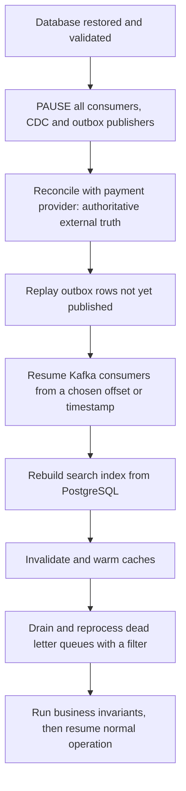

## 54.7 Database recovery scenarios

#### Concept

Disaster recovery is a set of specific playbooks, not one procedure. This section is the catalogue: seven situations that actually happen, and the first three moves for each.

#### How it works

**Scenario 1: a corrupted table.**

Symptoms: queries error with `invalid page in block 12345 of relation base/16384/24576`, or a checksum failure, or a query returns rows that violate a constraint that should make them impossible.

```sql
-- Confirm and locate. Requires the amcheck extension (available on RDS).
CREATE EXTENSION IF NOT EXISTS amcheck;
SELECT bt_index_check(index => c.oid, heapallindexed => true)
FROM pg_class c JOIN pg_namespace n ON n.oid = c.relnamespace
WHERE c.relkind = 'i' AND n.nspname = 'public';

-- Is it just an index? Rebuilding an index is cheap and non-destructive.
REINDEX INDEX CONCURRENTLY order_items_order_id_idx;

-- Heap corruption is different. Find the extent of the damage:
SELECT count(*) FROM order_items;   -- may error on the bad block
```

Moves, in order: (1) if it is an index, `REINDEX CONCURRENTLY` and you are done. (2) If it is the heap, do **not** set `zero_damaged_pages` on production as a first response; it silently discards data. (3) PITR to before the corruption on a side instance, extract the affected table, and repair as in 54.4. (4) Investigate the cause: on RDS, hardware corruption is rare and the usual causes are a bug, an unclean shutdown on self-managed hardware without `fsync`, or storage-level issues. Enable `data_checksums` if you are self-managed and it is off.

**Scenario 2: an accidental `DROP TABLE` or `DROP DATABASE`.**

A `DROP` is worse than a `DELETE` in one way and better in another. Worse: the table's files are gone, so there is nothing to recover in place. Better: it is instantly obvious, so detection time is near zero.

Moves: PITR to one minute before the `DROP` on a new instance, then `pg_dump --table=dropped_table` from that instance and `pg_restore` into production. Because nothing in production references the table (it does not exist), there is no reconciliation problem for the table itself — but foreign keys pointing *to* it were dropped too, and every write that would have gone into it during the window is lost. Check the outbox and application logs for those.

Prevention beats recovery here: revoke `DROP` from application roles, require migrations for all DDL, and set `ALTER DEFAULT PRIVILEGES` so no ad-hoc session has the rights.

**Scenario 3: ransomware, or deleted backups.**

The attack pattern is specific: the attacker gets a credential, spends time finding backups, deletes or encrypts the backups *first*, and only then destroys the data. Deleting the primary while snapshots remain achieves nothing, and they know that.

The only defence that works is a **second custody boundary**:

- Backups copied into a separate AWS account whose credentials are not in your CI, not in your secrets manager, and not held by anyone with production access.
- AWS Backup vault lock in compliance mode, or S3 Object Lock in compliance mode. In compliance mode, the retention cannot be shortened by anyone, including the account root user. That is the point.
- MFA delete on the backup bucket.
- Alerting on the destructive API calls themselves: `DeleteDBSnapshot`, `DeleteDBInstance`, `PutBucketLifecycleConfiguration`, `ScheduleKeyDeletion`, `DeleteBackupVault`. These should page, not appear in a weekly report.

Recovery is then a restore-from-vault into a clean account, with new credentials everywhere, which is slow but possible. Without the second boundary, there is no recovery.

**Scenario 4: a replica promoted with missing commits.**

You promoted an async replica; it was 12 seconds behind. Those 12 seconds contained real orders. The database is now internally consistent — it just does not contain everything.

Moves: (1) Record the promotion LSN and timestamp. (2) Snapshot the old primary before touching it; that snapshot contains the missing commits. (3) Restore that snapshot to a forensic instance. (4) Diff the window: rows in the forensic instance created after the promotion timestamp minus rows in the new primary. (5) Reconcile the gaps using idempotent inserts, and separately reconcile against the payment provider (54.8) because a charged customer with no order is the case that matters. (6) Fix sequences if you inserted rows with explicit ids: `SELECT setval('orders_id_seq', (SELECT max(id) FROM orders));`

**Scenario 5: a failed migration that needs a data rollback.**

A migration ran, the schema change succeeded, and then the data backfill corrupted 200,000 rows. Schema rollback is easy (a down migration). Data rollback is not, because the old values are gone.

Moves: (1) Stop the backfill immediately. (2) Determine the exact affected row set and the window — the migration log has this. (3) PITR to before the migration on a side instance. (4) Extract only the affected columns for only the affected rows and `UPDATE ... FROM` them back:

```sql
-- Restore only the corrupted column, only for rows the migration touched.
UPDATE products p
SET price_cents = r.price_cents
FROM recovered.products r
WHERE r.id = p.id
  AND p.updated_at BETWEEN '2026-09-09 11:00Z' AND '2026-09-09 11:40Z'
  AND p.price_cents <> r.price_cents;
```

This is why Part 27's expand-contract pattern matters: a migration that only adds is trivially reversible; a migration that transforms in place needs a recovery plan written *before* it runs. Create a restore point (`pg_create_restore_point`) or a manual snapshot immediately before every destructive migration.

**Scenario 6: a full disk.**

PostgreSQL with no free space cannot write WAL, and a database that cannot write WAL cannot commit anything. On RDS, the instance enters `storage-full` and stops accepting writes. It is an outage, but usually not data loss.

Common causes, in the order you should check them: unexpected data growth; a replication slot that is not being consumed, so WAL is retained forever; WAL archiving failing, so segments accumulate; `pg_stat_statements` or logging filling the disk; a runaway temporary file from a bad query.

```sql
-- The single most common cause of a mystery full disk: an abandoned replication slot.
SELECT slot_name, active, restart_lsn,
       pg_size_pretty(pg_wal_lsn_diff(pg_current_wal_lsn(), restart_lsn)) AS retained_wal
FROM pg_replication_slots
ORDER BY pg_wal_lsn_diff(pg_current_wal_lsn(), restart_lsn) DESC;

-- If a slot is inactive and retaining hundreds of GB, drop it (after confirming
-- no consumer needs it) and the space is released at the next checkpoint.
SELECT pg_drop_replication_slot('abandoned_cdc_slot');

-- Where is the space actually going?
SELECT relname, pg_size_pretty(pg_total_relation_size(c.oid)) AS size
FROM pg_class c JOIN pg_namespace n ON n.oid = c.relnamespace
WHERE n.nspname NOT IN ('pg_catalog','information_schema')
ORDER BY pg_total_relation_size(c.oid) DESC LIMIT 20;
```

Moves: enable RDS storage autoscaling *before* you need it; alert at 75 percent, not 90; set `max_slot_wal_keep_size` so a dead slot cannot take the database down; and never let a CDC connector's slot outlive the connector.

**Scenario 7: transaction id wraparound.**

PostgreSQL transaction ids are 32-bit. Rows are visible based on transaction id comparison in a circular space, so if 2 billion transactions pass without those rows being "frozen" by `VACUUM`, old rows would appear to be in the future and vanish. To prevent that, PostgreSQL refuses new transactions when the oldest unfrozen transaction id gets within 1 million of the limit. The database goes read-only with a very memorable message: `database is not accepting commands to avoid wraparound data loss`.

This is a slow-motion emergency: it takes weeks or months to develop and gives you many warnings you probably ignored.

```sql
-- Watch this. Alert at 500 million, page at 1 billion.
SELECT datname, age(datfrozenxid) AS xid_age
FROM pg_database ORDER BY xid_age DESC;

-- Which table is holding it back?
SELECT c.relname, age(c.relfrozenxid) AS xid_age,
       pg_size_pretty(pg_total_relation_size(c.oid)) AS size
FROM pg_class c JOIN pg_namespace n ON n.oid = c.relnamespace
WHERE c.relkind IN ('r','m') AND n.nspname NOT IN ('pg_catalog','information_schema')
ORDER BY age(c.relfrozenxid) DESC LIMIT 10;
```

Causes are always one of: a long-running transaction or an idle-in-transaction session holding an old snapshot; an abandoned replication slot; a prepared transaction nobody committed; or autovacuum being throttled so hard it cannot keep up on a huge table.

Emergency moves: (1) find and kill the blocker — `SELECT pg_terminate_backend(pid) FROM pg_stat_activity WHERE state = 'idle in transaction' AND xact_start < now() - interval '1 hour';` (2) check `pg_prepared_xacts` and `ROLLBACK PREPARED` any orphans. (3) drop abandoned replication slots. (4) If already read-only, restart in single-user mode (self-managed) or let RDS's protective vacuum run; a manual `VACUUM FREEZE` on the offending table is the fix and it can take hours on a large table. (5) Afterwards, tune `autovacuum_freeze_max_age`, increase `autovacuum_max_workers` and `autovacuum_vacuum_cost_limit`, and add the `xid_age` alert you clearly did not have.

See Part 22 — PostgreSQL Internals for the MVCC and vacuum mechanics behind this.

#### Edge cases & failure modes

- Recovering a table but not its sequences, triggers, or foreign keys.
- Restoring into a database where the extension version differs, so functions behave differently.
- A recovery that succeeds but leaves the search index, cache and warehouse stale (54.8).
- Killing `idle in transaction` sessions blindly and aborting a legitimate long-running job.
- Autovacuum tuned so aggressively during a wraparound emergency that it saturates IOPS and causes a performance outage on top of the data emergency.
- Backup vault lock in compliance mode applied with a 7 year retention "to be safe", creating an unbounded and undeletable storage bill.

#### How a Senior Backend Engineer thinks about this

They keep this catalogue as *runbooks in the repository*, one file per scenario, each with the detection query, the first three commands, and the decision points. During an incident nobody invents procedure; they open the file.

They notice that five of these seven scenarios are prevented by ordinary hygiene: alerts on `xid_age`, on disk usage, on replication slot size, on destructive API calls, and a manual snapshot before every migration. Prevention is cheaper than every recovery in this section.

And they treat the read-only-mode scenarios (full disk, wraparound) as the most dangerous, because the database is *up*, health checks pass, and the failure is silent until writes start failing everywhere at once.

#### Common mistakes

- Setting `zero_damaged_pages = on` to "fix" corruption, silently deleting rows.
- Granting `DROP` to the application's database role.
- Storing backups only where the application's own credentials can reach them.
- Ignoring `xid_age` until the database goes read-only.
- Leaving a CDC replication slot behind after decommissioning the connector.
- Running a destructive migration with no restore point taken first.

#### Interview questions

1. **A query returns `invalid page in block`. What do you do?** Expected: determine index vs heap, `REINDEX CONCURRENTLY` if index, PITR to a side instance and extract if heap, never `zero_damaged_pages` as a first move, then root-cause the storage or shutdown issue.
2. **Your database disk is full and nothing is writing much data. What is the likely cause?** Expected: an inactive replication slot retaining WAL, or failing WAL archiving. Follow-up: what setting bounds it? `max_slot_wal_keep_size`.
3. **Explain transaction id wraparound and how you would handle it as an emergency.** Expected: 32-bit xids, freezing, refusal to accept commands within 1 million of the limit; kill long transactions and idle-in-transaction sessions, clear prepared transactions and slots, `VACUUM FREEZE`, then tune autovacuum and add alerting on `age(datfrozenxid)`.
4. **How do you protect backups from an attacker with production credentials?** Expected: separate account, separate credential path, vault lock or Object Lock in compliance mode, MFA delete, alerts on destructive API calls.
5. **A migration corrupted a column's values. Schema rollback is easy. How do you roll back the data?** Expected: PITR to before the migration on a side instance, extract only that column for only the affected rows in the affected window, `UPDATE ... FROM`, verify invariants; and take a restore point before every destructive migration.

#### Practical exercise

Write three runbook files for a database you own: `runbook-accidental-delete.md`, `runbook-disk-full.md`, `runbook-xid-wraparound.md`. Each must contain the detection query, the alert that should have fired, the first three commands to run, the decision point, and the reconciliation step.

Acceptance criteria: someone who has never seen the system can execute each runbook; each runbook names the alert that would have caught the problem earlier; and at least one of the three alerts does not currently exist, so you create it.

## 54.8 Application-level recovery

#### Concept

The database being back is not the system being back. An e-commerce platform is a database *plus* a cache, a search index, a stream of events, a set of queues, and a payment provider that kept working the whole time you were down. Every one of those is now inconsistent with the restored database, and every one needs a deliberate recovery step.

Application-level recovery is the work of making the rest of the system agree with the database again, without causing a second incident by doing it.

#### Why does it exist?

Because state got out of sync in both directions during the outage:

- The database went **backwards** (a restore to 14:31 discarded writes that other systems already saw).
- Other systems went **forwards** (Stripe took payments, the warehouse shipped, customers received emails, Kafka accumulated events) while the database was frozen or absent.

If you only restore the database and declare victory, you get: search results for products that no longer exist, carts referencing deleted orders, customers charged with no order record, a warehouse shipping items the database thinks were never sold, and a dead-letter queue full of messages that will fail forever.

#### Mental model

Imagine a shop whose till was replaced with yesterday's till. The shelves (warehouse), the card machine (payment provider), the customer's inbox (notifications) and the noticeboard (search index) all still reflect today. Recovering the till is step one. Step two is walking the shop and reconciling every one of those against the till, deciding for each discrepancy whether the till is wrong or the world is wrong.

#### How it works

Work in this order. The order matters, because getting it wrong causes duplicate side effects.



**Step 0: pause everything that produces side effects.** Before the restored database takes any traffic beyond reads, stop the outbox publisher, the CDC connector (Debezium), the notification consumers and the email worker. If you skip this, restoring 8 million rows re-emits 8 million events and someone receives 40,000 emails (the failure scenario in 54.4).

In Kubernetes this is `kubectl scale deployment/outbox-publisher --replicas=0` and friends, and it belongs in the runbook as a single script.

**Step 1: reconcile with the payment provider.** Do this first, because it is the only source of truth you do not control and the only discrepancy that costs real money and legal exposure.

The question is precise: for the gap window, does every charge at Stripe have a corresponding order in the database, and does every order in the database have a corresponding charge?

```ts
// payment-reconciliation.service.ts
import { Injectable, Logger } from '@nestjs/common';
import { DataSource } from 'typeorm';
import Stripe from 'stripe';

export interface Discrepancy {
  kind: 'CHARGED_NO_ORDER' | 'ORDER_NO_CHARGE' | 'AMOUNT_MISMATCH';
  paymentIntentId: string;
  orderId?: string;
  amountCents: number;
}

@Injectable()
export class PaymentReconciliationService {
  private readonly log = new Logger(PaymentReconciliationService.name);
  constructor(private readonly ds: DataSource, private readonly stripe: Stripe) {}

  /** Compares the provider's record of truth against ours for an incident window. */
  async reconcile(fromUnix: number, toUnix: number): Promise<Discrepancy[]> {
    const found: Discrepancy[] = [];

    // Stripe is authoritative for money. Page through everything in the window.
    for await (const pi of this.stripe.paymentIntents.list({
      created: { gte: fromUnix, lte: toUnix },
      limit: 100,
    })) {
      if (pi.status !== 'succeeded') continue;

      // Our orders carry the payment intent id; that link is what makes this possible.
      const [order] = await this.ds.query<{ id: string; total_cents: number }[]>(
        `SELECT id, total_cents FROM orders WHERE payment_intent_id = $1`,
        [pi.id],
      );

      if (!order) {
        // Customer was charged and we have no order. Highest severity.
        found.push({ kind: 'CHARGED_NO_ORDER', paymentIntentId: pi.id, amountCents: pi.amount });
      } else if (order.total_cents !== pi.amount) {
        found.push({
          kind: 'AMOUNT_MISMATCH', paymentIntentId: pi.id,
          orderId: order.id, amountCents: pi.amount,
        });
      }
    }

    // The other direction: orders we think are paid with no successful charge.
    const orphanOrders = await this.ds.query<{ id: string; payment_intent_id: string; total_cents: number }[]>(
      `SELECT id, payment_intent_id, total_cents FROM orders
       WHERE status = 'PAID' AND created_at BETWEEN to_timestamp($1) AND to_timestamp($2)`,
      [fromUnix, toUnix],
    );
    for (const o of orphanOrders) {
      const pi = await this.stripe.paymentIntents.retrieve(o.payment_intent_id);
      if (pi.status !== 'succeeded') {
        found.push({
          kind: 'ORDER_NO_CHARGE', paymentIntentId: o.payment_intent_id,
          orderId: o.id, amountCents: o.total_cents,
        });
      }
    }

    this.log.warn(`reconciliation found ${found.length} discrepancies in window`);
    return found;
  }
}
```

Note what makes reconciliation possible at all: **the order row stores the provider's `payment_intent_id`**. If your schema does not carry the external identifier, you cannot reconcile, and you will be matching by amount and timestamp, which is guesswork. This is a design decision made months before the incident.

`CHARGED_NO_ORDER` never gets auto-fixed. It goes to a human queue: either recreate the order from the payment intent's metadata (if you put the cart in the metadata, which you should) or refund the customer with an apology. Both are acceptable; silence is not.

**Step 2: replay the transactional outbox.** If you followed Part 31's outbox pattern, every event that should have been published is a row in PostgreSQL, written in the same transaction as the business change. That means the database restore automatically restored the event stream, and republishing is a matter of finding unpublished rows.

```sql
-- The outbox table. published_at NULL means "not yet on the broker".
CREATE TABLE outbox_events (
  id             bigserial PRIMARY KEY,
  aggregate_type text        NOT NULL,
  aggregate_id   text        NOT NULL,
  event_type     text        NOT NULL,
  payload        jsonb       NOT NULL,
  created_at     timestamptz NOT NULL DEFAULT now(),
  published_at   timestamptz
);
CREATE INDEX outbox_unpublished_idx ON outbox_events (id) WHERE published_at IS NULL;

-- After a restore, this is exactly the backlog to replay.
SELECT count(*), min(created_at), max(created_at)
FROM outbox_events WHERE published_at IS NULL;
```

The subtlety: after a PITR, some rows may be marked `published_at = NOT NULL` in the restored state but the broker never actually received them (or received them and the consumer had not processed them). The safe posture is **at-least-once with idempotent consumers**. Republish anything from the incident window, and rely on consumer-side idempotency keys to drop duplicates. If your consumers are not idempotent, the outbox replay is dangerous and you have a design problem to fix before the next incident, not during this one.

**Step 3: resume Kafka consumers.** Kafka retains events independently of your database, which makes it a recovery asset. Three cases:

1. **The database went backwards past events the consumers already processed.** The consumers' offsets are ahead of the restored database's state. Reset the consumer group to the timestamp of the recovery target so it reprocesses:

```bash
# Reset a consumer group to a wall-clock time. Requires the group to be idle.
kafka-consumer-groups.sh --bootstrap-server kafka:9092 \
  --group inventory-projector \
  --topic order-events \
  --reset-offsets --to-datetime 2026-09-09T14:31:00.000 \
  --execute
```

2. **The database is current but consumers were down.** Just restart them; they resume from their committed offsets and catch up. Watch consumer lag drain, and expect a thundering herd of processing that can overload the freshly restored database. Scale consumers up gradually.

3. **Events were produced during the outage that reference rows that no longer exist.** These fail and land in the dead-letter queue. That is step 5.

Kafka retention is the constraint: if your topic retains 7 days and you restore to a point 9 days ago, the events are gone. This is another argument for the outbox as the durable source.

**Step 4: rebuild caches and search indexes.** Both are derived state with PostgreSQL as the source of truth, which is why 54.3 gave them an unlimited RPO.

Redis: the safest action after a database restore is a **targeted invalidation**, not a `FLUSHALL`. Flushing everything at 400 RPS causes a cache stampede that hammers the just-restored database.

```ts
// cache-recovery.service.ts
import { Injectable, Logger } from '@nestjs/common';
import Redis from 'ioredis';

@Injectable()
export class CacheRecoveryService {
  private readonly log = new Logger(CacheRecoveryService.name);
  constructor(private readonly redis: Redis) {}

  /**
   * Invalidate only keys affected by the incident, in batches, with a pause
   * between batches so the database is not stampeded. SCAN, never KEYS.
   */
  async invalidatePrefix(prefix: string, batch = 500, pauseMs = 50): Promise<number> {
    let cursor = '0';
    let deleted = 0;
    do {
      const [next, keys] = await this.redis.scan(cursor, 'MATCH', `${prefix}*`, 'COUNT', batch);
      cursor = next;
      if (keys.length > 0) {
        // UNLINK frees memory asynchronously; DEL blocks the Redis event loop on big keys.
        await this.redis.unlink(...keys);
        deleted += keys.length;
        await new Promise((r) => setTimeout(r, pauseMs));
      }
    } while (cursor !== '0');
    this.log.log(`invalidated ${deleted} keys under ${prefix}`);
    return deleted;
  }

  /** Warm the keys that carry the most traffic, before reopening to users. */
  async warmTopProducts(ids: string[], loader: (id: string) => Promise<unknown>): Promise<void> {
    const concurrency = 20;
    for (let i = 0; i < ids.length; i += concurrency) {
      await Promise.all(ids.slice(i, i + concurrency).map(async (id) => {
        const value = await loader(id);
        await this.redis.set(`product:${id}`, JSON.stringify(value), 'EX', 3600);
      }));
    }
  }
}
```

Search index: rebuild from PostgreSQL rather than trying to patch it. For 2 million products a full OpenSearch reindex is typically 20 to 60 minutes with bulk indexing. The pattern is index-into-a-new-index and atomically swap the alias, so search never serves a half-built index:

```text
products_v7 (live, alias "products")  ->  build products_v8  ->  alias swap  ->  delete v7
```

Sessions in Redis: usually the right decision is to accept the loss and let users log in again. Trying to restore sessions from a snapshot risks resurrecting sessions that were legitimately revoked, which is a security problem.

**Step 5: reprocess dead-letter queues.** During the outage, thousands of messages failed and went to the DLQ. Some will now succeed; some are genuinely poison; some would cause harm if replayed (a "charge customer" message from an order that has since been refunded).

Never replay a DLQ blindly. The procedure:

1. **Classify.** Group by error type and event type. Usually 90 percent are one cause ("connection refused") and are safe.
2. **Filter.** Exclude messages whose side effect is no longer valid, using the current database state as the check.
3. **Replay in batches** with rate limiting, watching the error rate. If the failure rate on replay exceeds a few percent, stop.
4. **Rely on idempotency.** Every consumer must key on a message id or business key so a duplicate replay is a no-op.

```ts
// dlq-replay.service.ts (BullMQ example)
import { Injectable, Logger } from '@nestjs/common';
import { Queue, Job } from 'bullmq';

@Injectable()
export class DlqReplayService {
  private readonly log = new Logger(DlqReplayService.name);
  constructor(private readonly failed: Queue, private readonly main: Queue) {}

  /**
   * Replays failed jobs whose failure reason matches a known-transient pattern,
   * in bounded batches. Everything else stays in the DLQ for human review.
   */
  async replayTransient(pattern: RegExp, batchSize = 200, delayMs = 1000): Promise<number> {
    let replayed = 0;
    for (;;) {
      const jobs: Job[] = await this.failed.getFailed(0, batchSize - 1);
      if (jobs.length === 0) break;

      const eligible = jobs.filter((j) => pattern.test(j.failedReason ?? ''));
      if (eligible.length === 0) break;

      for (const job of eligible) {
        // retry() re-enqueues the SAME job id, so a consumer keyed on job id
        // will treat a duplicate as a no-op.
        await job.retry();
        replayed++;
      }
      this.log.log(`replayed ${replayed} DLQ jobs`);
      await new Promise((r) => setTimeout(r, delayMs)); // rate limit the flood
    }
    return replayed;
  }
}
```

#### Production scenario

For our platform, application-level recovery after a 90 minute database outage typically looks like: 8 minutes of payment reconciliation (about 2,100 payment intents in the window, 3 discrepancies), 4 minutes of outbox replay (28,000 events), 12 minutes of Kafka consumer catch-up, 35 minutes of search reindex (running in the background while the site is already up), 6 minutes of cache warming, and 20 minutes of DLQ triage with 9,400 of 9,600 messages replayed automatically and 200 escalated.

Total: roughly 50 minutes of active work after the database is back, most of it parallelisable. If it is scripted, one engineer does it. If it is not scripted, it is four engineers improvising for three hours.

#### Edge cases & failure modes

- Replaying events that trigger payment capture, re-charging customers. The single worst outcome in this section. Every money-moving consumer must be idempotent on a provider-side idempotency key.
- Duplicate emails and SMS from replayed notification events. Cheap to prevent (a `notifications_sent` table with a unique key on event id), expensive in trust.
- Search index rebuilt from a database that is still missing recovered rows, so it must be rebuilt again.
- `FLUSHALL` on Redis at peak, causing a stampede that takes down the recovered database. Always invalidate by prefix, in batches.
- Consumer offset reset applied to a group that is not idle, silently doing nothing.
- Kafka retention shorter than the recovery gap, so the events cannot be replayed at all.
- Webhook endpoints from the payment provider that retried during the outage and gave up; check the provider's failed-webhook list, do not assume they retried forever.
- Reconciliation run against a payment provider window in the wrong timezone, missing an hour of charges.

#### How a Senior Backend Engineer thinks about this

They design for this recovery long before the incident, by making three choices: an outbox in the same transaction as the write, external identifiers stored on the row (`payment_intent_id`, `shipment_id`), and idempotency on every consumer. Those three make application recovery mechanical rather than heroic.

They order the work by irreversibility. Money first, because a wrong refund cannot be un-sent. Derived state last, because it can be rebuilt as many times as you like.

They pause side effects before they touch data. This is the reflex that separates a clean recovery from a second incident.

And they script it. A recovery script that has been run in a drill is worth more than a very good engineer improvising, because the engineer is tired and it is 04:00.

#### Common mistakes

- Declaring the incident over when the database is back.
- Replaying the DLQ with one command and no filter.
- Not storing the payment provider's identifier on the order, making reconciliation impossible.
- Flushing the entire cache after a restore.
- Forgetting that customers received emails about orders that the restore has now erased.

#### Interview questions

1. **The database is restored to 20 minutes ago. What else is now inconsistent?** Expected: payments taken in the gap, events already consumed downstream, caches, search index, warehouse/fulfilment, notifications already sent, DLQ contents. Walk the ordered recovery.
2. **How do you reconcile with a payment provider?** Expected: the provider is authoritative; list charges in the window; match on a stored external id; classify charged-no-order, order-no-charge, amount mismatch; escalate money discrepancies to humans.
3. **Why is the outbox pattern a disaster recovery feature?** Expected: events are written transactionally with the data, so restoring the database restores the event log, and replay is a query for unpublished rows.
4. **What makes DLQ replay dangerous and how do you make it safe?** Expected: side effects may no longer be valid and duplicates may re-charge; classify, filter against current state, batch with rate limiting, rely on consumer idempotency.
5. **How do you rebuild a search index without downtime?** Expected: build a new index, bulk load from PostgreSQL, swap the alias atomically, delete the old one.

#### Practical exercise

Take a service with a queue and a cache. Simulate a restore by rolling the database back 30 minutes while the queue keeps running. Then write and execute the recovery script: pause consumers, reconcile against an external stub API, replay the outbox, reset the consumer offset, invalidate cache by prefix, replay the DLQ with a filter.

Acceptance criteria: no duplicate side effects (assert by counting outbound calls to your stub), all business invariants pass afterwards, and the script is idempotent when run twice.
