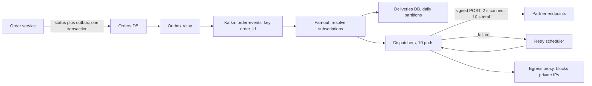
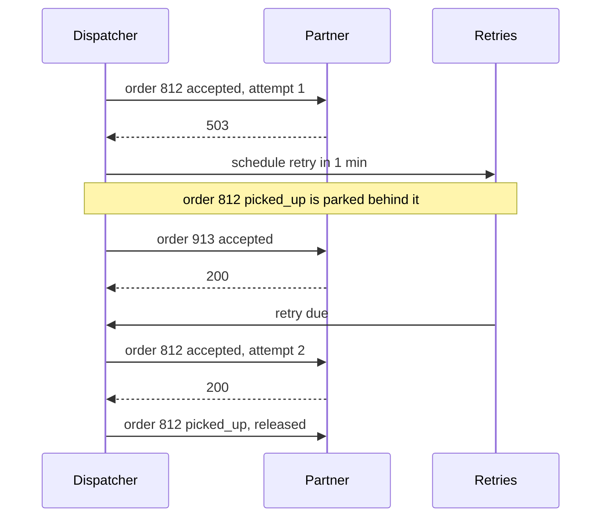
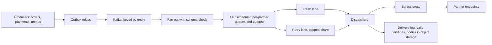
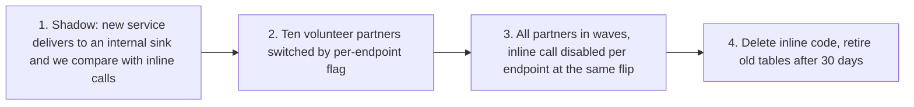

### 54.8.3 The senior answer

**00:00 Interviewer:** (gives the prompt)

**00:30 Candidate:** Before I draw anything, a few questions. Who consumes these: only external partners, or internal services too? What guarantee do partners expect: at-least-once with deduplication on their side, or something stronger? Does order matter, for example "picked up" never before "accepted"? How long do we keep retrying a dead endpoint, and do partners need to see a delivery log or replay events? And the scale: orders per day, partners, payload size?

**02:30 Interviewer:** (gives the numbers from the private notes)

**03:00 Candidate:** Then my requirements: at-least-once delivery with a stable event ID for deduplication; ordered per order per endpoint; retries for 72 hours; 30-day delivery log with replay; first attempt within 5 seconds for 95 percent of events. Out of scope: transforming payloads per partner. Let me estimate.

```text
events      = 2,000,000 orders x 8          = 16 M per day
deliveries  = 16 M x 1.5 endpoints          = 24 M per day
average     = 24 M / 86,400                 ~ 280 per second
peak (x5)                                   ~ 1,400 per second
in flight   = 1,400/s x ~0.5 s mean latency ~ 700 concurrent requests (Little's law)
log storage = 16 M x 2 KB payloads + 24 M x ~300 B attempts ~ 40 GB per day
30 days                                     ~ 1.2 TB
```

**06:00 Candidate:** Two things follow. 700 concurrent outbound requests is fine for Node's non-blocking I/O, say ten dispatcher pods with 100 in flight each, but slow endpoints matter more than the average: endpoints timing out at 10 seconds hold far more connections than their share. And 1.2 TB of logs means daily partitions that we drop after 30 days, not `DELETE`.

**08:00 Candidate:** Partner-facing API: `POST /v1/endpoints` to register a URL and event types, returning a signing secret; `GET /v1/deliveries?endpoint=&status=` for the log; `POST /v1/deliveries/:id/replay`; `POST /v1/endpoints/:id/test`. Tables: `endpoints`, `subscriptions`, `events` partitioned by day, `deliveries` partitioned by day with `status`, `attempt_count`, `next_attempt_at`, and `attempts` for the log.

**12:00 Candidate:** Architecture. Today the order service calls partners inline, which is how the two incidents happened. I would have it write an outbox row in the same transaction as the status change; a relay publishes to a Kafka topic keyed by `order_id`, so events for one order stay in one partition, in order. A fan-out consumer resolves subscriptions and creates delivery records. Dispatchers send them.



**17:00 Candidate:** Kafka or SQS? At about 1,000 events per second at peak either works. I chose Kafka because analytics also wants these events and Kafka lets a second consumer group replay them; an SQS FIFO queue with the order ID as the message group would be the simpler choice if this were the only consumer.

**19:00 Interviewer:** Go deeper on retries and ordering.

**19:30 Candidate:** Retries use exponential backoff with jitter: about 1 minute, 5, 30, 2 hours, then every 6 hours until 72 hours, then the delivery is marked failed and the partner is emailed. A `429` honours `Retry-After`. A `410 Gone` disables the endpoint. For ordering, if a delivery for order 812 to endpoint E is waiting for a retry, later events for the same order and endpoint are parked behind it, not sent. Other orders to the same endpoint continue. So ordering costs us blocking only within one order.



**25:00 Candidate:** A circuit breaker per endpoint: after, say, 20 consecutive failures, stop sending for a minute and send new deliveries straight to the retry schedule, then probe. Security: each request carries `Webhook-Id`, `Webhook-Timestamp` and an HMAC-SHA256 signature over the timestamp and body with the endpoint's secret; partners reject anything older than five minutes. Rotation supports two active secrets. Partner URLs are validated at registration *and* at send time, because DNS can change: we resolve the name and refuse private, loopback and cloud metadata addresses, and all traffic leaves through an egress proxy (Part 40, section 40.23 "Server-Side Request Forgery (SSRF)").

**30:00 Interviewer:** A chain that is 30 percent of all traffic has its endpoint down for two hours at dinner. What happens?

**30:30 Candidate:** About 420 deliveries a second fail. The breaker opens quickly, so we stop hammering them, but the retry backlog grows by roughly 3 million deliveries in two hours. Two risks. Retry workers spend all their time on that one partner and delay everyone else's retries, so retries need a per-endpoint concurrency cap. And when they recover, we must not send 3 million requests at once: drain at a rate the partner can take, starting low and increasing while their success rate stays high. I should have raised that isolation earlier.

**35:00 Candidate:** Metrics: time from event to first attempt (the SLO), success rate per endpoint, retry backlog by endpoint, age of the oldest pending delivery, breaker state changes. Alerts on the SLO and on oldest-pending age. Failure table: Kafka unavailable (outbox holds events, nothing lost), dispatcher crash mid-send (redelivered; same `Webhook-Id`, partner deduplicates), deliveries DB down (dispatch pauses, Kafka retains), a partner returning 200 but dropping events (replay API and the log). At 10x, the deliveries database is the first pressure point; partitions help, and I would move payload bodies to object storage.

**42:00 Candidate:** Tradeoffs I made: at-least-once instead of exactly-once, because exactly-once to an external HTTP endpoint is not achievable; per-order ordering instead of per-endpoint ordering, which would let one bad order block a whole restaurant; Kafka over SQS for the second consumer.

#### Interviewer's scores: senior answer

| Dimension | Score | Evidence |
|---|---|---|
| Requirements | Strong | Asked about guarantees, ordering, retention, replay and scale before drawing |
| Estimates | Strong | Rates, Little's law concurrency and storage; numbers drove partitioning and pod count |
| API and data model | Strong | Partner-facing API, daily partitions with drop-based retention |
| Tradeoffs | Strong | Kafka versus SQS FIFO, at-least-once, ordering scope, each with what it costs |
| Failure handling | Strong on most, Mixed on isolation | Retries, breaker, SSRF, duplicates unprompted; per-partner isolation only after the prompt at 30:00 |
| Operability and evolution | Mixed | Good metrics and alerts; said "outbox" but gave no plan to move off today's inline calls safely |
| Communication | Strong | Narrated, structured, admitted the missed point |

**Recommendation:** hire for senior.

**Debrief.** This is a clear senior answer: arithmetic plus failure analysis, the signature described in Part 59, section 59.2.20. Numbers became decisions (daily partitions, ten pods, slow endpoints), and the hard mechanisms (per-order ordering, signatures, SSRF) came unprompted. Two gaps kept it from staff level: isolation between partners appeared only when the interviewer forced the scenario, and the design started from a blank page although the interviewer had said a live inline system existed. A staff answer treats "how do we get from today to this" as part of the design.

### 54.8.4 The staff answer

**00:00 Interviewer:** (gives the prompt)

**00:30 Candidate:** Let me check the shape of the problem first. Who are the users: partner engineers integrating with us, and internal teams who want to emit events? What happens to the business when a webhook is late or lost: does a restaurant miss an order and the food never gets cooked? What exists today, and what went wrong in it? And the numbers.

**02:30 Interviewer:** (gives the numbers, and that inline calls from the order service caused two incidents)

**03:30 Candidate:** Then the most important requirement is not on the list: **one partner's problems must never delay another partner's events, and webhooks must never slow the order flow.** Both incidents were probably that. I'll propose SLOs per tier: for healthy endpoints, 99.9 percent of events get a first attempt within 5 seconds; the order service's p99 is unaffected by any partner. The estimate (rates, concurrency and storage, written on the board in a minute) gives 1,400 deliveries a second at peak, about 700 in flight, and about 1.2 TB of logs over 30 days.

**06:00 Candidate:** One product decision changes a lot: what goes in the payload. A **fat** payload (the full order) is convenient but leaks personal data to every subscriber and goes stale if retried hours later. A **thin** payload (event type, order ID, sequence number) makes partners call back for the order: 24 million fetches a day, about 1,400 per second at peak, landing on the order API. I'd ship fat payloads limited by a per-subscription field allowlist, with a per-order `sequence` number on every event so partners can detect gaps and stale retries, plus a fetch API for reconciliation. I'd want product and the partner team to agree to that, because it is a contract we cannot easily take back (Part 25 — Backward Compatibility: APIs, Schemas, Events and Clients).

**10:00 Candidate:** The core design is close to what you'd expect: outbox, Kafka keyed by order, fan-out, dispatchers, signed requests through an egress proxy, retries with backoff, per-order ordering, daily partitions. Let me spend the time on the parts that decide whether this survives: isolation and the migration.



**12:00 Candidate:** Isolation. Every partner gets its own logical queue and a concurrency budget, roughly proportional to its normal traffic, with a floor so small partners are never starved. The scheduler picks the next delivery by weighted fair queuing across partners, not first-in-first-out across everyone. Retries run in a separate lane that can use at most, say, 20 percent of dispatch capacity, so a two-hour outage at a partner with 30 percent of traffic, about 3 million queued retries, cannot delay fresh events for anyone else. On recovery we drain that partner slowly and increase the rate while its success rate holds. This is the noisy-neighbour pattern from Part 90, section 90.4 "Noisy neighbours: per-tenant rate limits, quotas, and fair queuing".

**18:00 Interviewer:** Why not strict ordering per endpoint? Some partners asked for it.

**18:30 Candidate:** Strict per-endpoint ordering means one stuck event blocks every later event for that restaurant. Per-order ordering plus the sequence number gives partners what they actually need, which is never applying "delivered" before "accepted" for the same order. If a partner truly needs per-endpoint order, we can offer it as an opt-in mode with a lower throughput promise, rather than imposing the cost on everyone.

**21:00 Candidate:** Now the migration, because the inline calls are live and partners depend on them. Four steps, each shippable and reversible:



Each endpoint is delivered by exactly one path at a time, switched by a flag, so partners never receive both. We roll back per endpoint. Success criteria per step: equal delivery counts in shadow, the SLO met for two weeks in step two.

**27:00 Candidate:** Ownership. If orders, payments and menus will all emit partner events, this is a platform, so one team owns it, with an event catalogue, schema checks in the fan-out (a producer cannot ship a breaking change), and a partner-facing status page and delivery log so partner support stops paging the order team. Build or buy: managed webhook-delivery services exist and a common approach is to evaluate one; I would timebox that evaluation to a week against our hard requirements (per-order ordering, field allowlists, data residency, cost at 24 million deliveries a day) before committing a team to build.

**31:00 Interviewer:** What fails that you haven't covered?

**31:30 Candidate:** A partner whose endpoint returns 200 but drops events: the sequence number lets them detect gaps, and replay fixes it. Secret leaks: rotation with two active secrets. A producer emitting a bug storm, a million events from a bad migration: per-producer rate limits at fan-out plus a kill switch per event type. Region loss: Kafka and the delivery log replicate to the standby region; at failover we may resend some events, which is acceptable under at-least-once and covered by event IDs. Cost: about ten dispatcher pods, a share of the existing Kafka cluster, and 1.2 TB of rolling logs, the biggest line, which is why bodies go to object storage.

**38:00 Candidate:** What I would deliberately not build in v1: per-partner payload transformations, exactly-once promises, and a custom UI beyond the delivery log. And what I would measure in the first month to decide the next step: share of deliveries needing retries, the top ten partners by retry volume, and how many partners actually use replay.

**42:00 Candidate:** Summary: the hard part of this system is not sending HTTP requests; it is isolation between partners and moving off the live inline path without anyone noticing. Everything else is standard.

#### Interviewer's scores: staff answer

| Dimension | Score | Evidence |
|---|---|---|
| Requirements | Strong | Found the unstated requirement (isolation), framed SLOs per tier, asked about business impact and today's system |
| Estimates | Strong | Same numbers as senior, delivered in a minute, and used to evaluate thin payloads (1,400 fetches a second) |
| API and data model | Strong | Payload contract as a long-lived decision; sequence numbers; field allowlists |
| Tradeoffs | Strong | Fat versus thin, strict versus per-order ordering offered as opt-in, build versus buy with criteria |
| Failure handling | Strong | Isolation unprompted; bug storms, silent drops, secret leaks, region loss |
| Operability and evolution | Strong | Four-step reversible migration, success criteria, ownership, what to measure next |
| Communication | Strong | Set the agenda, chose where to spend depth, summarised the real problem in one sentence |

**Recommendation:** strong hire for staff.

**Debrief.** The staff candidate did *less* drawing of the standard parts than the senior candidate. They named the standard design in two sentences and spent the time on the three things that decide success: the unstated isolation requirement, the payload contract that cannot be taken back, and the sequence from today's live system to the new one. That is the staff signature from Part 59, section 59.2.20: a *sequence*, with every intermediate state shippable, and decisions that involve other teams made explicit. Part 91, section 91.4 "Ambiguous large-scope system design at staff level", trains this further.

### 54.8.5 What separated the levels

| Dimension | Junior | Senior | Staff |
|---|---|---|---|
| Requirements | Asked which events | Asked guarantees, ordering, retention, scale | Also asked business impact and today's system; found the unstated requirement |
| Estimates | A guess | Rates, concurrency, storage; numbers drove decisions | Same numbers, faster, used to settle a product decision |
| Data model | Three tables | Partitioned tables, retention by dropping partitions, partner API | The payload as a public contract: sequence numbers, allowlists, versioning |
| Tradeoffs | None | Named for each major choice | Offered choices as options with costs (opt-in strict ordering), build versus buy |
| Failure handling | First layer, when prompted | Deep and mostly unprompted; isolation when pushed | Isolation as a design principle; failure classes beyond the service |
| Evolution | None | Mentioned outbox, no migration | Reversible four-step migration, ownership, what to measure next |
| Communication | Waited to be led | Narrated and structured | Set the agenda and chose where depth mattered |

Five habits you can copy today, whatever your level: ask about guarantees and today's system before drawing; turn every estimate into at least one decision; raise "one bad customer hurts everyone" before the interviewer does; say what each choice gives up; and end with how you would ship it from where the company is now.

## 54.9 Interview questions and practical exercises

### 54.9.1 Interview questions

1. **"What is the difference between latency and throughput, and how can a slow dependency take down a fast service?"**
   *Expected answer:* latency is time per request, throughput is requests per second; Little's law (in flight = throughput x latency) means a dependency slowing from 50 ms to 2 s multiplies in-flight requests by 40, exhausting pools and memory. *Why it matters:* it is the root of most cascading failures. *Follow-up:* "What would you add to stop it?" (timeouts, bulkheads, circuit breakers, async offloading).

2. **"Your API is at 99.95 percent and the business wants 99.99. What do you ask and what changes?"**
   *Expected answer:* ask which flows need it and what downtime costs; 99.99 allows about 4.3 minutes a month, so serial dependencies, deploys and database failovers each have to be examined; usually it means multi-AZ everything, fast automated rollback, removing synchronous third parties from the path, and practised failover. *Follow-up:* "Is it worth it?"

3. **"When would you add a read replica instead of a cache?"**
   *Expected answer:* cache for a small hot set read repeatedly that tolerates staleness or can be invalidated; replica for varied reads that do not cache well (history, reports, filters). Both introduce staleness; replicas also need read-your-writes handling. Neither helps writes.

4. **"Tell me about a time you, or a team you know, scaled too early or too late."**
   *Expected answer:* a specific story with the trigger that was missed or invented, the cost, and the habit adopted afterwards (written triggers, metric thresholds).

5. **"Why is sharding the last rung, and how would you choose a shard key for a food-delivery app?"**
   *Expected answer:* sharding makes cross-shard queries, transactions and rebalancing hard forever; exhaust indexes, caching, replicas, moving misplaced writes and partitioning first. Choose a key that keeps a transaction on one shard and spreads load: city works because an order's restaurant, rider and customer share it, with big cities isolated to avoid hot shards.

### 54.9.2 Exercise 1: availability of a checkout chain

Checkout passes through a CDN (99.99), a load balancer (99.99), the API (99.95), PostgreSQL (99.95) and a payment provider (99.9), all required. Compute the checkout availability and the downtime per 30 days. Then propose changes that remove more than half of that downtime.

#### Worked answer to the exercise

Serial availabilities multiply: 0.9999 x 0.9999 x 0.9995 x 0.9995 x 0.999 is about 0.9978, so **99.78 percent**. A 30-day month has 43,200 minutes; 0.22 percent of that is about **95 minutes**. The payment provider is the weakest link. Adding a second provider with automatic failover makes the payment step fail only when both fail: 1 - (0.001 x 0.001), about 99.9999 percent, assuming independent failures. The chain becomes about 99.88 percent, around **52 minutes**, removing roughly 45 percent; combining it with making the API Multi-AZ with fast rollback (pushing it towards 99.99) brings the total near 35 minutes. The lesson: find the weakest serial link before buying more nines elsewhere. See Part 49, section 49.6 "Availability maths".

### 54.9.3 Exercise 2: read the symptoms

For each, name the first thing you check and the building block (if any) you add:

a. Product page p99 is 900 ms, database CPU 85 percent; one query, product by ID, runs 3,000 times a second and 500 products account for 99 percent of calls.
b. A week after adding a read replica, support receives "I changed my address and it did not save" tickets.
c. Every night at 02:00 the sales report pushes the primary to 100 percent CPU and the payment settlement batch fails.

#### Worked answer to the exercise

a. First confirm the query uses the primary-key index and is not pulling large columns; if it is already cheap, the problem is repetition: a **cache** for those 500 products (cache-aside, TTL plus invalidation on update, stampede protection for the hottest keys). Expect database reads to drop by about 99 percent for this query.

b. Nothing new to add: this is **replication lag**. The save worked on the primary; the next page read from a lagging replica. Route a user's reads to the primary for a few seconds after they write (read-your-writes), and alert on replica lag.

c. Check what the report queries and whether it must read live data. Move it to a **dedicated reporting replica** (or an analytics store fed by change data capture, Part 39), so reporting can never compete with money-moving work on the primary. Also reschedule so the two jobs do not overlap.

### 54.9.4 Exercise 3: do not add pieces

A restaurant table-reservation service expects 500,000 DAU, 20 API calls per user per day, a peak factor of 4, 0.05 reservations per DAU per day, and about 1 KB per reservation with indexes. Estimate peak RPS, writes and storage, and draw the architecture you would launch with.

#### Worked answer to the exercise

Peak RPS = 500,000 x 20 / 86,400 x 4, about **460 RPS**. Reservations = 25,000 a day, about 0.3 per second on average and perhaps 2 to 3 per second at peak. Storage = 25 MB a day, about **9 GB a year**. These numbers fit Stage 2 of Section 54.4: a load balancer, two or three stateless NestJS pods (460 RPS at 400 to 900 RPS per pod, plus headroom and zone loss), one Multi-AZ PostgreSQL, and a small job queue for confirmation emails and reminders. No cache, no replicas, no search cluster, no Kafka: each would add failure modes with no trigger. Write down the triggers instead: "add a cache when restaurant-availability reads exceed 50 percent of database time", "add a replica when primary CPU passes 60 percent at peak". The one hard problem worth a deep dive is double-booking a table, solved with a unique constraint or an exclusion constraint on (table, time range) in PostgreSQL (Part 20, section 20.12.1).

### 54.9.5 Exercise 4: Pastebin with "burn after reading"

Extend the Pastebin of Section 54.6 with an option where a paste can be read exactly once and is then destroyed. What changes?

#### Worked answer to the exercise

1. **Atomic claim on read.** Only one reader may win, even if two requests arrive together. Use one statement: `UPDATE pastes SET deleted_at = now() WHERE key = $1 AND burn = true AND deleted_at IS NULL RETURNING object_key`. If a row comes back, this request is the reader; fetch and return the content, then delete the object. If not, return 404.
2. **No caching anywhere.** Serve with `Cache-Control: no-store`; the CDN must not cache it, or the second reader gets it from the edge.
3. **Link previews burn the paste.** Chat apps and email scanners fetch links to build previews, so a plain `GET` would destroy the paste before the human sees it. Make `GET /p/:key` show a "Reveal" page, and reveal the content only on a `POST`. This is the point most designs miss, and it is a requirement hidden in real-world behaviour rather than in the spec.
4. **Failure after the claim** loses the paste. For secrets that is the right side to fail on; tell the product manager.

## Senior Checklist — Part 54

- [ ] I understand the concept
- [ ] I can explain it simply
- [ ] I can implement it
- [ ] I understand its failure modes
- [ ] I understand its scaling limitations
- [ ] I understand its security implications
- [ ] I understand its operational implications
- [ ] I can choose between alternatives
- [ ] I can explain the tradeoffs
- [ ] I can answer senior-level interview questions
- [ ] I can define latency, throughput, p99, availability, durability, consistency and SLO with a real number for each
- [ ] I can convert a nines target into downtime per month and multiply serial availabilities
- [ ] For each of the fifteen building blocks I can say the problem it solves, when to add it, what it costs and how it fails
- [ ] I can map a symptom to the cheapest fix before adding a component
- [ ] I can walk an app from one server to multi-region and name the trigger and the new failure mode at each stage
- [ ] I can produce a 15-minute estimate (RPS, writes, storage, pods, connections) and turn it into decisions
- [ ] I have done the Pastebin design on paper and scored it with the self-review rubric
- [ ] I have a 12-week plan and I redo each design a week later
- [ ] I can explain what separates junior, senior and staff answers to the same design question

## Part 54 — Key Takeaways

- System design is decisions with reasons about pieces, data and failure; the simplest design that meets the measured requirements wins.
- Every vocabulary word needs a number: "p99 under 300 ms", "99.9 percent is 43 minutes a month", not "fast and reliable".
- Little's law explains most outages: when latency rises, requests in flight rise with it until a pool runs out.
- Fifteen building blocks cover almost every design; each one solves one problem and adds at least one new failure mode.
- No block before its trigger: fix queries before caching, use PostgreSQL full-text before a search cluster, move misplaced writes before sharding.
- The first reason for a second server is availability, not capacity.
- Write down the trigger for the next stage before you need it; a sustained metric above its threshold *is* the trigger.
- Estimates exist to change decisions; if a number changes nothing, you computed the wrong number.
- Requirements hide inside product words: "unlisted" is a security requirement, "burn after reading" is a concurrency and link-preview requirement.
- Practise by producing, comparing and redoing a week later; reading model designs alone is recognition, not skill.
- Senior answers are arithmetic plus failure analysis; staff answers add unstated requirements, cross-team contracts and a reversible sequence from today's system.
- Part 55's nine moves and 20-section template are the next step; start with its Beginner designs.
