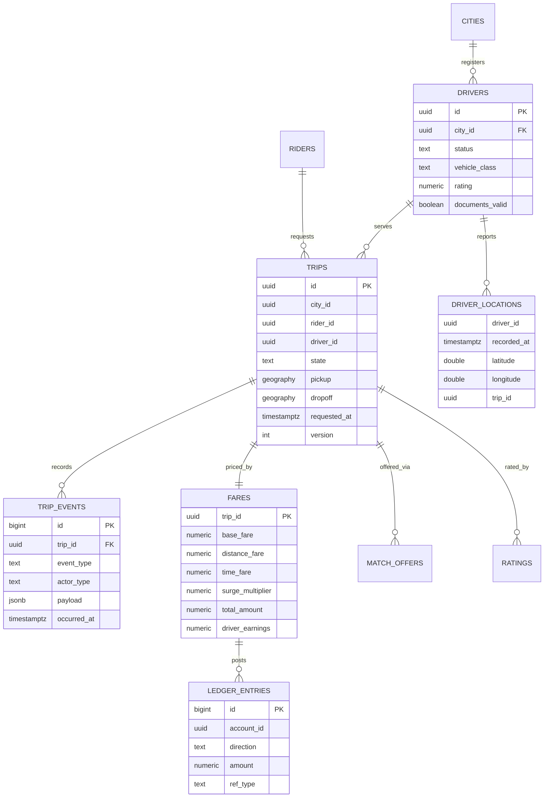
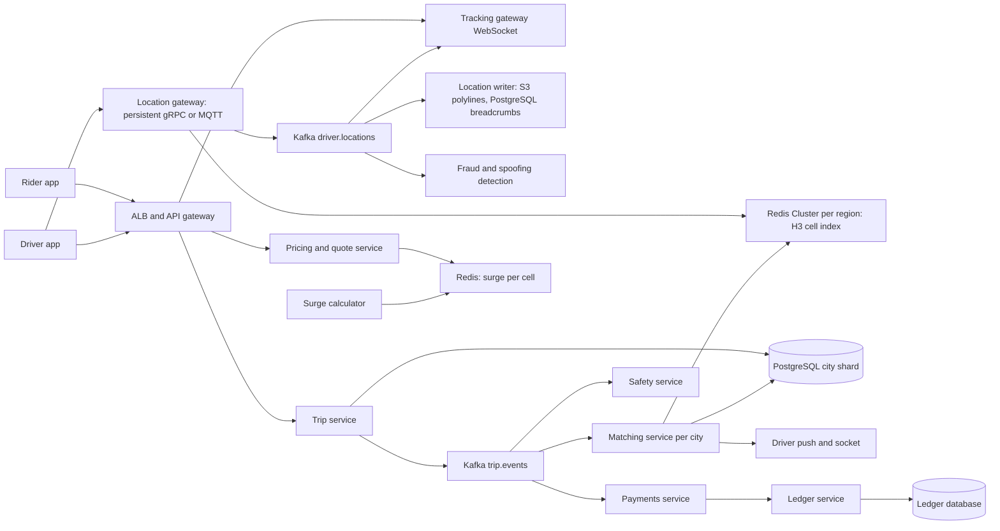
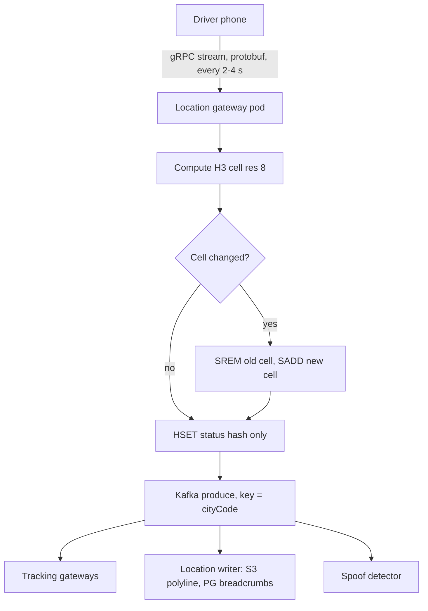
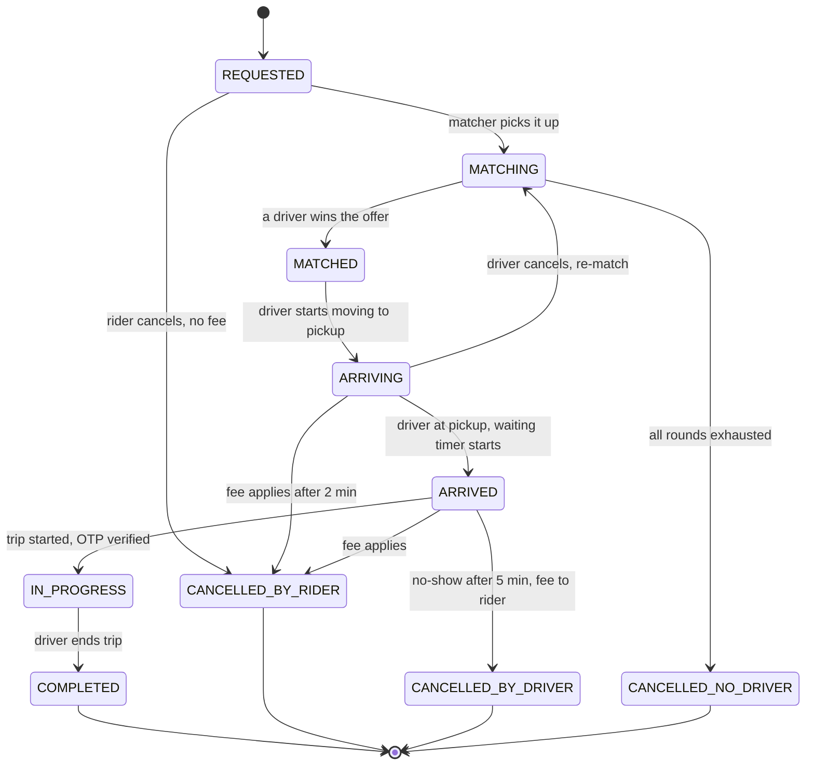
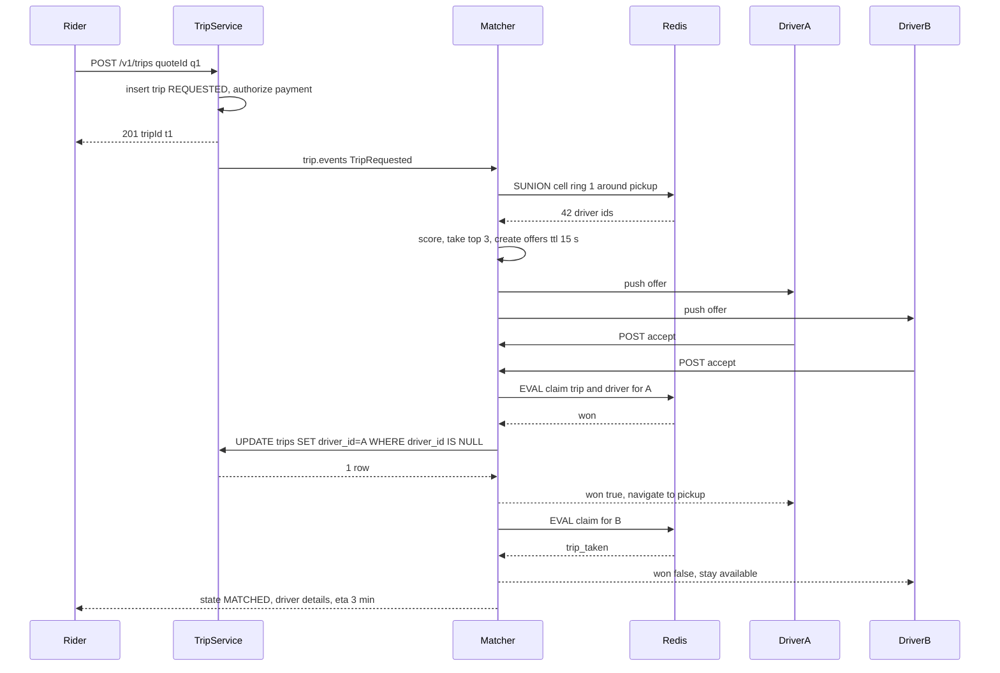
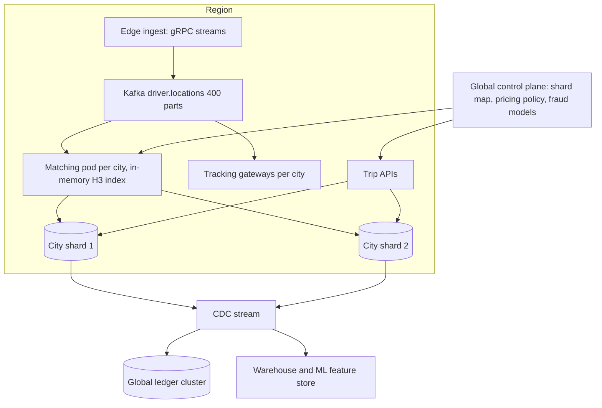

## 54.11 Ride Booking System

### 54.11.1 Requirements

A ride booking platform matches a person who wants to go somewhere with a driver who is nearby and willing. Everything hard about it comes from three facts: the participants are physically moving, the match must happen in seconds, and money changes hands at the end of a journey whose price was only estimated at the beginning.

The users are riders (request, track, pay, rate), drivers (go online, receive offers, navigate, get paid), and the operations and safety teams who watch cities and respond to incidents. Regulators are a fourth stakeholder in many markets, with rules about fare transparency, driver hours, data retention and incident reporting.

Imagine an air traffic controller's radar screen, except the aircraft are 500,000 cars, every one of them reports its position every few seconds, and every few seconds someone on the ground raises a hand and needs the nearest available car sent to them within thirty seconds. The controller cannot look at all 500,000 blips; they look at the small square of the grid around the person raising their hand. That grid is the core data structure of a ride booking system: **space cut into cells, drivers indexed by the cell they are in, and search reduced from "scan everything" to "read seven small sets".**

The second thing that makes this domain distinctive is that a trip is a financial event with a duration. The fare is estimated up front, computed at the end from what actually happened, split between the driver and the platform, taxed, tipped, adjusted for tolls, occasionally disputed and eventually paid out. That demands a ledger with the discipline of accounting, not a `balance` column that services increment.

### 54.11.2 Functional requirements

1. Riders request a ride from a pickup to a destination, see an upfront fare estimate and ETA, and choose a vehicle class.
2. Drivers go online, appear in the supply pool, receive offers, accept or decline, and navigate.
3. Matching: find nearby available drivers, score them, offer with a timeout, and let exactly one driver win.
4. Trip lifecycle: `REQUESTED -> MATCHED -> ARRIVING -> IN_PROGRESS -> COMPLETED` with cancellation branches at every stage and defined cancellation fees.
5. Live tracking of the driver before pickup and of the trip after, over a persistent connection, plus shareable trip links.
6. Fare estimation upfront and final fare computation from distance, duration, waiting time, tolls, surge and promotions.
7. Surge (dynamic) pricing per cell, applied transparently before the rider commits and locked for the trip.
8. Payments: authorize at match, capture at completion, handle failures after completion, support cash markets.
9. Driver earnings and payouts through a double-entry ledger with weekly settlement and full statement history.
10. Two-way ratings after every trip, aggregated into scores that feed matching and account standing.
11. Safety: emergency button, trip sharing, driver identity verification, ride check anomaly detection, and audio/telematics evidence retention.
12. City-based operation: pricing, rules, supply and support are all per city.

### 54.11.3 Non-functional requirements

| Property | Target | Why |
|---|---|---|
| Time to match | p50 under 4 s, p95 under 15 s | The rider is standing on a street corner |
| Location ingest | 175,000 writes per second sustained, p99 under 40 ms | 500,000 concurrent drivers |
| Geospatial search | p99 under 25 ms for a candidate query | It is inside the matching latency budget |
| Exactly-one match | Zero double matches | Two drivers at one pickup is a wasted trip and an angry driver |
| Tracking freshness | Rider sees a driver position under 4 s old | The map is the entire pre-pickup experience |
| Fare correctness | Final fare reproducible from trip data, to the cent, forever | Disputes, regulators, driver trust |
| Ledger integrity | Debits equal credits, always; no orphan postings | It is money |
| Availability | 99.99 percent for request and match; degraded modes must still complete in-progress trips | A city with no rides is a news story |
| Safety response | Emergency signal reaches the safety team in under 5 s, independent of the main app path | Lives |

### 54.11.4 Constraints

- 70 cities across 12 countries; regulations, pricing rules, currencies and data-residency requirements differ per country.
- Driver and rider phones are on mobile networks with frequent short outages; the apps must work offline for short periods and reconcile after.
- Maps, routing and traffic come from an external provider with per-call pricing.
- Payments are external per country (card processors, wallets, UPI, cash), each with different failure modes.
- Cash is a first-class payment method in several markets, which means the platform sometimes *owes* the driver and sometimes the driver owes the platform.
- In-progress trips must survive any deploy or partial outage; a trip that started must be completable.

### 54.11.5 Capacity estimation

| Quantity | Assumption | Calculation | Result |
|---|---|---|---|
| Registered riders | given | | 120,000,000 |
| Registered drivers | | | 4,000,000 |
| **Concurrent online drivers, peak** | 12.5 percent online at peak | 4M x 0.125 | **500,000** |
| Drivers on a trip at peak | 40 percent of online | 500,000 x 0.40 | 200,000 |
| Idle drivers at peak | | 500,000 - 200,000 | 300,000 |
| Ping interval, on trip | | | every 2 s |
| Ping interval, idle | | | every 4 s |
| **Location updates per second, peak** | 200,000 / 2 + 300,000 / 4 | 100,000 + 75,000 | **175,000 per second** |
| Location payload on the wire | driverId, lat, lon, bearing, speed, accuracy, ts, tripId, protobuf | | about 60 B |
| Location ingest bandwidth | 175,000 x 60 B x 1.4 (framing and TLS overhead) | | about 15 MB per second |
| Trips per day | | | 25,000,000 |
| Trips per second, average | 25M / 86,400 | | 289 per second |
| Trips per second, peak hour | 8 percent of the day in the busiest hour | 25M x 0.08 / 3,600 | 555 per second |
| Trips per second, instantaneous burst | 1.5x peak hour | 555 x 1.5 | 833 per second |
| Match requests per second, peak | 1.25 requests per trip (cancellations before match) | 833 x 1.25 | 1,040 per second |
| Offers per second, peak | 2.2 rounds x 3 candidates | 1,040 x 2.2 x 3 / 3 (3 per round counted once) | about 6,900 offers per second |
| Geospatial searches per second | one per round | 1,040 x 2.2 | about 2,300 per second |
| Concurrent trips at peak | 833 per second x 1,150 s average trip plus pickup | | about 958,000 |
| WebSocket connections at peak | 958,000 riders + 500,000 drivers | | about 1,460,000 |
| Gateway pods | 25,000 connections per pod, 40 percent headroom | 1.46M / 25,000 x 1.4 | 82 pods |
| Tracking fan-out per second | one push per trip per 3 s | 958,000 / 3 | about 320,000 messages per second |
| `trips` rows per year | 25M x 365 | | 9.1 billion |
| Bytes per `trips` row | ids, timestamps, geography, fare columns, snapshots | | about 1.3 KB |
| `trips` storage per year | 9.1B x 1.3 KB x 1.4 (indexes) | | about 16.6 TB, so sharded by city group and partitioned by month |
| `trip_events` rows per year | 14 events per trip | 9.1B x 14 | 127 billion, kept 90 days hot, then S3 |
| Raw location points per day | 175,000 x 86,400 x 0.55 (average online is 55 percent of peak) | | about 8.3 billion |
| Raw location storage if kept in PostgreSQL | 8.3B x 40 B x 1.5 | | 500 GB per day, which is why it is not kept in PostgreSQL |
| Trip polylines in S3 | 25M trips x 575 points x 8 B packed, gzip 3x | | about 38 GB per day |
| `driver_locations` (downsampled, 1 per 30 s, on-trip only, 3-day retention) | 200,000 x 2 per minute x 60 x 14 h | 336M rows per day, 3 days | about 1 billion rows, 90 GB |
| Redis memory for the supply index | 500,000 drivers x (geo entry 70 B + status hash 220 B + cell membership 60 B) | | about 175 MB per region, provision 16 GB across the cluster with buffers |
| Redis operations per second | 175,000 writes + 2,300 searches x 7 cells + 6,900 offer scripts | | about 200,000 per second, needs a cluster of 8 or more shards per region |
| Kafka throughput, peak | 175,000 location + 12,000 trip and offer events | | 187,000 messages per second, about 18 MB per second |
| Payment operations per day | 25M authorizations + 25M captures + refunds | | about 52M, roughly 600 per second average |
| Ledger postings per day | 6 postings per trip (fare, commission, tax, tip, promotion, toll) | 25M x 6 | 150 million per day |
| Connections | 200 API pods x 10 + 82 gateways x 4 + workers | | about 2,600, PgBouncer plus per-city clusters |

Three numbers dictate the architecture. **175,000 location writes per second** means locations live in Redis and Kafka, never in a relational write path. **9.1 billion trip rows a year** means a single PostgreSQL cluster is impossible, so the database is sharded by city from the start, not later. And **1.46 million WebSocket connections** means the tracking tier is its own stateless fleet with its own scaling and its own deploy strategy.

One number is deliberately absent from the panic list: 833 trips per second of transactional writes. Split across 70 cities and a handful of shards, that is a few dozen writes per second per cluster. The transactional core of a ride booking system is small. What is enormous is the telemetry around it.

### 54.11.6 API design

| Method | Path | Request | Response | Status codes | Idempotency | Auth |
|---|---|---|---|---|---|---|
| POST | `/v1/quotes` | `{ pickup: {lat,lon}, dropoff: {lat,lon}, vehicleClass }` | `[{ quoteId, class, fareLow, fareHigh, surge, etaPickupS, expiresAt }]` | 200, 422 | Yes | Rider |
| POST | `/v1/trips` | `{ quoteId, paymentMethodId, note }` plus `Idempotency-Key` | `{ tripId, state: 'REQUESTED' }` | 201, 200 on replay, 402, 409, 422 | **Required** | Rider |
| GET | `/v1/trips/{id}` | | trip with state, driver summary, ETA, fare | 200, 403, 404 | Yes | Rider or driver |
| WS | `/v1/trips/{id}/stream` | subscribe | `{ state, driverLocation, eta, fare }` frames | 101, 401, 403 | n/a | Rider or driver token |
| POST | `/v1/trips/{id}/cancel` | `{ reason }` | `{ trip, cancellationFee }` | 200, 409 | Yes | Rider or driver |
| POST | `/v1/trips/{id}/share` | `{ contacts[] }` | `{ shareUrl, expiresAt }` | 201 | Yes | Rider |
| POST | `/v1/trips/{id}/sos` | `{ lat, lon }` | `{ caseId }` | 201 | Yes, dedup 60 s | Rider or driver |
| POST | `/v1/trips/{id}/rating` | `{ stars, tags[], comment, tip }` | rating | 201, 409 | Via `Idempotency-Key` | Rider or driver |
| POST | `/v1/driver/status` | `{ online, lat, lon, vehicleId }` | `{ status, cityCode }` | 200, 409 if documents expired | Yes | Driver |
| POST | `/v1/driver/locations` | batch `[{ lat, lon, bearing, speed, accuracy, ts, tripId? }]` | `{ accepted }` | 202 | Yes, `ts` dedupes | Driver |
| POST | `/v1/driver/offers/{offerId}/accept` | | `{ won: true, trip }` or `{ won: false, reason }` | 200, 410 | Yes, exactly one winner | Driver |
| POST | `/v1/driver/offers/{offerId}/decline` | `{ reason }` | | 204 | Yes | Driver |
| POST | `/v1/driver/trips/{id}/arrived` | `{ lat, lon }` | trip | 200, 409 | Yes | Driver |
| POST | `/v1/driver/trips/{id}/start` | `{ lat, lon, otp? }` | trip | 200, 409, 422 on wrong OTP | Yes | Driver |
| POST | `/v1/driver/trips/{id}/complete` | `{ lat, lon, tolls?, waitingSeconds }` | `{ trip, fare }` | 200, 409 | Yes | Driver |
| GET | `/v1/driver/earnings` | `?from=&to=` | statement from the ledger | 200 | Yes | Driver |
| GET | `/v1/ops/cities/{code}/live` | | supply, demand, surge, stuck trips | 200 | Yes | Ops |

Contract notes:

- `POST /v1/trips` is idempotent on a client-generated key. A rider double-tapping "Confirm" on a flaky connection must never create two trips, because that means two drivers dispatched and one cancellation fee argued about.
- The quote carries a **locked** surge multiplier and an expiry (2 minutes). Surge cannot rise between quote and request. If the quote expires, the client re-quotes and the rider sees the new price before committing.
- `POST /v1/driver/trips/{id}/start` optionally requires an OTP that the rider reads out. It exists to stop the wrong passenger getting in, and it makes trip start non-forgeable by the driver alone.
- `POST /v1/trips/{id}/sos` bypasses normal rate limiting, writes to a separate high-priority path, and is the only endpoint in the system with a dedicated capacity reservation.

### 54.11.7 Data model



```sql
CREATE TYPE trip_state AS ENUM (
  'REQUESTED','MATCHING','MATCHED','ARRIVING','ARRIVED','IN_PROGRESS',
  'COMPLETED','CANCELLED_BY_RIDER','CANCELLED_BY_DRIVER','CANCELLED_NO_DRIVER','EXPIRED'
);

CREATE TABLE drivers (
  id               uuid PRIMARY KEY DEFAULT gen_random_uuid(),
  city_id          uuid NOT NULL,
  status           text NOT NULL DEFAULT 'OFFLINE'
                   CHECK (status IN ('OFFLINE','ONLINE','ON_TRIP','SUSPENDED')),
  vehicle_class    text NOT NULL,
  rating           numeric(3,2) NOT NULL DEFAULT 5.00,
  acceptance_rate  numeric(4,3) NOT NULL DEFAULT 1.000,
  cancellation_rate numeric(4,3) NOT NULL DEFAULT 0.000,
  documents_valid  boolean NOT NULL DEFAULT false,
  documents_expire_at date,
  onboarded_at     timestamptz NOT NULL DEFAULT now()
);
-- serves the online-supply query and the ops console
CREATE INDEX drivers_city_status_idx ON drivers (city_id, status) WHERE status IN ('ONLINE','ON_TRIP');
-- serves the nightly compliance sweep that takes expired drivers offline
CREATE INDEX drivers_docs_idx ON drivers (documents_expire_at) WHERE documents_valid;

CREATE TABLE trips (
  id                uuid NOT NULL DEFAULT gen_random_uuid(),
  city_id           uuid NOT NULL,
  rider_id          uuid NOT NULL,
  driver_id         uuid,
  vehicle_class     text NOT NULL,
  state             trip_state NOT NULL DEFAULT 'REQUESTED',
  version           integer NOT NULL DEFAULT 1,
  pickup            geography(Point, 4326) NOT NULL,
  dropoff           geography(Point, 4326),
  pickup_address    text NOT NULL,
  dropoff_address   text,
  quote_snapshot    jsonb NOT NULL,          -- fare band, surge, pricing rule version at request time
  match_round       smallint NOT NULL DEFAULT 0,
  requested_at      timestamptz NOT NULL DEFAULT now(),
  matched_at        timestamptz,
  arrived_at        timestamptz,
  started_at        timestamptz,
  completed_at      timestamptz,
  cancelled_at      timestamptz,
  cancel_reason     text,
  distance_m        integer,
  duration_s        integer,
  polyline_s3_key   text,                    -- the route, stored in S3, not in the row
  PRIMARY KEY (id, requested_at)
) PARTITION BY RANGE (requested_at);

CREATE TABLE trips_2026_09 PARTITION OF trips
  FOR VALUES FROM ('2026-09-01') TO ('2026-10-01');

-- serves the rider's trip history, the most common authenticated read
CREATE INDEX trips_rider_idx ON trips (rider_id, requested_at DESC);
-- serves the driver's earnings and trip list
CREATE INDEX trips_driver_idx ON trips (driver_id, requested_at DESC) WHERE driver_id IS NOT NULL;
-- serves the matcher and the ops console: unmatched or in-flight trips in a city
CREATE INDEX trips_city_active_idx ON trips (city_id, state, requested_at)
  WHERE state IN ('REQUESTED','MATCHING','MATCHED','ARRIVING','ARRIVED','IN_PROGRESS');
-- one active trip per rider, enforced by the database rather than by hope
CREATE UNIQUE INDEX trips_rider_active_uidx ON trips (rider_id, requested_at)
  WHERE state IN ('REQUESTED','MATCHING','MATCHED','ARRIVING','ARRIVED','IN_PROGRESS');

CREATE TABLE trip_events (
  id          bigint GENERATED ALWAYS AS IDENTITY,
  trip_id     uuid NOT NULL,
  seq         integer NOT NULL,
  event_type  text NOT NULL,
  from_state  trip_state,
  to_state    trip_state,
  actor_type  text NOT NULL CHECK (actor_type IN ('rider','driver','system','ops','webhook')),
  actor_id    text,
  lat         double precision,
  lon         double precision,
  payload     jsonb NOT NULL DEFAULT '{}'::jsonb,
  occurred_at timestamptz NOT NULL DEFAULT now(),
  PRIMARY KEY (id, occurred_at)
) PARTITION BY RANGE (occurred_at);
-- serves the trip timeline for support and disputes
CREATE UNIQUE INDEX trip_events_trip_seq_uidx ON trip_events (trip_id, seq, occurred_at);

CREATE TABLE driver_locations (
  driver_id   uuid NOT NULL,
  recorded_at timestamptz NOT NULL,
  city_id     uuid NOT NULL,
  latitude    double precision NOT NULL,
  longitude   double precision NOT NULL,
  bearing     smallint,
  speed_mps   real,
  accuracy_m  real,
  trip_id     uuid,
  PRIMARY KEY (driver_id, recorded_at)
) PARTITION BY RANGE (recorded_at);
-- serves safety replay and dispute investigation for one trip
CREATE INDEX driver_locations_trip_idx ON driver_locations (trip_id, recorded_at)
  WHERE trip_id IS NOT NULL;

CREATE TABLE fares (
  trip_id           uuid PRIMARY KEY,
  currency          char(3) NOT NULL,
  base_fare         numeric(12,2) NOT NULL,
  distance_fare     numeric(12,2) NOT NULL,
  time_fare         numeric(12,2) NOT NULL,
  waiting_fare      numeric(12,2) NOT NULL DEFAULT 0,
  surge_multiplier  numeric(4,2) NOT NULL DEFAULT 1.00,
  tolls             numeric(12,2) NOT NULL DEFAULT 0,
  promotion_amount  numeric(12,2) NOT NULL DEFAULT 0,
  tip_amount        numeric(12,2) NOT NULL DEFAULT 0,
  tax_amount        numeric(12,2) NOT NULL DEFAULT 0,
  total_amount      numeric(12,2) NOT NULL,
  commission_amount numeric(12,2) NOT NULL,
  driver_earnings   numeric(12,2) NOT NULL,
  pricing_version   text NOT NULL,            -- which rule set produced these numbers
  computed_at       timestamptz NOT NULL DEFAULT now(),
  CONSTRAINT fares_split_ck CHECK (driver_earnings + commission_amount
                                   = total_amount - tolls - tax_amount + promotion_amount)
);

CREATE TABLE ledger_accounts (
  id       uuid PRIMARY KEY DEFAULT gen_random_uuid(),
  owner_type text NOT NULL CHECK (owner_type IN ('driver','rider','platform','tax','promo')),
  owner_id text NOT NULL,
  currency char(3) NOT NULL,
  UNIQUE (owner_type, owner_id, currency)
);

CREATE TABLE ledger_entries (
  id           bigint GENERATED ALWAYS AS IDENTITY,
  transfer_id  uuid NOT NULL,                  -- groups the two or more sides of one movement
  account_id   uuid NOT NULL REFERENCES ledger_accounts(id),
  direction    char(2) NOT NULL CHECK (direction IN ('DR','CR')),
  amount       numeric(14,2) NOT NULL CHECK (amount > 0),
  currency     char(3) NOT NULL,
  ref_type     text NOT NULL,                  -- 'trip','payout','adjustment','chargeback'
  ref_id       text NOT NULL,
  created_at   timestamptz NOT NULL DEFAULT now(),
  PRIMARY KEY (id, created_at)
) PARTITION BY RANGE (created_at);
-- serves the driver statement and balance computation
CREATE INDEX ledger_entries_account_idx ON ledger_entries (account_id, created_at DESC);
-- serves idempotent posting: one transfer per business event
CREATE UNIQUE INDEX ledger_transfer_ref_uidx ON ledger_entries (ref_type, ref_id, account_id, direction, created_at);

CREATE TABLE match_offers (
  id         uuid PRIMARY KEY DEFAULT gen_random_uuid(),
  trip_id    uuid NOT NULL,
  driver_id  uuid NOT NULL,
  round      smallint NOT NULL,
  score      numeric(8,3) NOT NULL,
  status     text NOT NULL DEFAULT 'OFFERED'
             CHECK (status IN ('OFFERED','ACCEPTED','DECLINED','EXPIRED','SUPERSEDED')),
  offered_at timestamptz NOT NULL DEFAULT now(),
  expires_at timestamptz NOT NULL
);
CREATE UNIQUE INDEX match_offers_trip_driver_uidx ON match_offers (trip_id, driver_id);
CREATE INDEX match_offers_expiry_idx ON match_offers (expires_at) WHERE status = 'OFFERED';
```

Three schema decisions are worth defending. The route is a `polyline_s3_key`, not a `geography(LineString)` column, because 25 million routes a day at 4 KB each would add 100 GB a day to the database for data that is read perhaps once per thousand trips. The partial unique index on active trips per rider makes "one trip at a time" a database guarantee rather than an application check that races. And `driver_locations` holds only downsampled on-trip breadcrumbs for three days; the raw firehose never lands in PostgreSQL at all.

### 54.11.8 High-level architecture



The load-bearing boundary is again the location path: a gateway with no database, whose only job is to keep the supply index fresh and produce to Kafka. The second boundary is the **ledger**, which is deliberately its own service with its own database. Money movement has different consistency, retention, audit and access-control requirements from trip state, and mixing them means every schema change to trips needs a finance review.

### 54.11.9 Component design

```text
src/
  trips/
    trips.module.ts
    api/trips.controller.ts
    api/driver-trips.controller.ts
    domain/trip-state-machine.ts
    application/request-trip.service.ts
    application/trip-transition.service.ts
    application/cancellation.service.ts
  matching/
    matching.module.ts
    matcher.service.ts               round orchestration per city
    supply-index.service.ts          H3 cells in Redis
    scoring.service.ts
    offer.service.ts
    lua/claim-trip.ts
    workers/offer-expiry.worker.ts
  location/
    location.gateway.ts              gRPC stream / MQTT bridge
    location.service.ts              H3 cell move + Kafka produce
    workers/location-writer.worker.ts
    workers/spoof-detector.worker.ts
  pricing/
    quote.service.ts
    fare-calculator.service.ts
    surge.service.ts
    workers/surge-calculator.worker.ts
  tracking/
    tracking.gateway.ts
    tracking-consumer.service.ts
  payments/
    payments.service.ts
    workers/capture-retry.worker.ts
  ledger/
    ledger.service.ts
    posting.rules.ts
    workers/payout.worker.ts
  safety/
    sos.controller.ts
    ride-check.service.ts
```

#### Driver location ingestion with H3 cells

A geohash or H3 cell turns a continuous coordinate into a discrete bucket. H3 is preferred here over geohash for two concrete reasons: its hexagonal cells have uniform neighbour distance (a geohash rectangle's neighbours are at different distances depending on direction, which biases search), and `kRing` gives you a ring of neighbours with one cheap call. At H3 resolution 8, a cell is roughly 0.46 square kilometres, which in a dense city holds a few dozen drivers, and a `kRing(cell, 1)` of 7 cells covers roughly 1.2 km across.

```ts
// location/location.service.ts
import { Inject, Injectable } from '@nestjs/common';
import { latLngToCell, gridDisk } from 'h3-js';
import type { Cluster } from 'ioredis';
import { REDIS_CLIENT } from '../redis/redis.module';
import { KafkaProducer } from '../kafka/producer';

const RES = 8;

@Injectable()
export class LocationService {
  constructor(@Inject(REDIS_CLIENT) private readonly redis: Cluster, private readonly kafka: KafkaProducer) {}

  async ingest(driverId: string, cityCode: string, p: Ping): Promise<void> {
    const cell = latLngToCell(p.lat, p.lon, RES);
    const prev = await this.redis.hget(`drv:{city:${cityCode}}:${driverId}`, 'cell');

    const pipe = this.redis.pipeline();
    if (prev && prev !== cell) {
      pipe.srem(`cell:{city:${cityCode}}:${prev}`, driverId);      // left the old hexagon
    }
    if (p.status === 'ONLINE') {
      pipe.sadd(`cell:{city:${cityCode}}:${cell}`, driverId);      // available supply lives in cell sets
    } else {
      pipe.srem(`cell:{city:${cityCode}}:${cell}`, driverId);      // on a trip: still tracked, not offerable
    }
    pipe.hset(`drv:{city:${cityCode}}:${driverId}`, {
      cell, lat: p.lat, lon: p.lon, bearing: p.bearing, speed: p.speed,
      ts: p.ts, status: p.status, tripId: p.tripId ?? '',
    });
    pipe.expire(`drv:{city:${cityCode}}:${driverId}`, 60);         // a dead driver disappears in 60 s
    await pipe.exec();

    // acks=1, no idempotence: one lost point out of 175,000 per second is invisible.
    this.kafka.produceFireAndForget('driver.locations', cityCode, encodePing(driverId, p));
  }

  async candidateIds(cityCode: string, lat: number, lon: number, rings: number): Promise<string[]> {
    const cells = gridDisk(latLngToCell(lat, lon, RES), rings);    // 7 cells at rings=1, 19 at rings=2
    const keys = cells.map((c) => `cell:{city:${cityCode}}:${c}`);
    return this.redis.sunion(...keys);                             // one round trip, same slot via hash tag
  }
}
```

The hash tag `{city:BLR}` in every key is what makes this work on a Redis Cluster: all keys for one city land on one slot, so `SUNION` over seven cells is a single-node operation. The price is that a city is a hot slot, which is exactly why the cluster is sized per region and the largest cities get a dedicated shard.

The status hash carries a 60-second TTL, which quietly solves a hard problem: a driver whose phone dies simply vanishes from the index. No heartbeat monitor, no cleanup job, no stale supply.



#### The trip state machine



The legal transitions, with who may trigger them and what must hold:

| From | To | Trigger | Actor | Guard |
|---|---|---|---|---|
| REQUESTED | MATCHING | matcher claims | system | Rider has no other active trip |
| MATCHING | MATCHED | offer accepted | driver | `driver_id IS NULL` on the row |
| MATCHING | CANCELLED_NO_DRIVER | rounds exhausted | system | 4 rounds or 120 s elapsed |
| MATCHED | ARRIVING | driver moves | system | Driver location within the city |
| ARRIVING | ARRIVED | arrival | driver | Within 120 m of pickup, or ops override |
| ARRIVING | MATCHING | driver cancels | driver | Increments the driver's cancellation rate |
| ARRIVED | IN_PROGRESS | start | driver | OTP matches where required |
| IN_PROGRESS | COMPLETED | end | driver | Trip lasted at least 30 s |
| REQUESTED, MATCHING | CANCELLED_BY_RIDER | cancel | rider | No fee |
| ARRIVING, ARRIVED | CANCELLED_BY_RIDER | cancel | rider | Fee if more than 120 s after match |
| ARRIVED | CANCELLED_BY_DRIVER | no-show | driver | At least 300 s waiting, geofence satisfied |
| any | any | ops override | ops | Reason mandatory, audited, dual approval for fare-affecting overrides |

Transitions use exactly the pattern from the order management design: `SELECT ... FOR UPDATE` on the trip row, an assertion against the transition table, an `UPDATE`, an append to `trip_events`, and an outbox row, all in one short transaction.

#### Matching, and the acceptance race

```ts
// matching/matcher.service.ts (one round)
async runRound(trip: Trip): Promise<'offered' | 'exhausted'> {
  const rings = [1, 2, 3][trip.matchRound] ?? 3;                    // widen if nobody bit
  const ids = await this.supply.candidateIds(trip.cityCode, trip.pickupLat, trip.pickupLon, rings);
  if (ids.length === 0) return 'exhausted';

  const already = await this.offers.driversAlreadyOffered(trip.id);  // never re-offer to a decliner
  const states = await this.supply.loadMany(trip.cityCode, ids);
  const ranked = states
    .filter((d) => d.status === 'ONLINE' && d.vehicleClass === trip.vehicleClass && !already.has(d.id))
    .map((d) => ({ d, score: score(this.signals(d, trip)) }))
    .sort((a, b) => b.score - a.score)
    .slice(0, 3);                                                    // offer to the top 3 at once

  if (ranked.length === 0) return 'exhausted';
  await this.offers.createBatch(trip.id, trip.matchRound, ranked, 15);   // 15 s timeout
  await Promise.all(ranked.map((r) => this.push.sendOffer(r.d.id, trip)));
  return 'offered';
}
```

Scoring blends ETA to pickup (dominant), driver acceptance rate, idle time (fairness), rating, and destination compatibility when the driver has set a preferred direction. The single most important term is ETA to pickup, not straight-line distance: a driver 400 metres away across a river is worse than one 1.2 km away on the same road, and using distance instead of ETA is the classic beginner error that produces furious riders watching a car circle the wrong side of a highway.

The acceptance race is settled atomically in one Lua script that claims **both** the trip and the driver, because a driver who accepts two offers within the same millisecond is just as broken as two drivers accepting one trip.

```ts
// matching/lua/claim-trip.ts
export const CLAIM_TRIP_LUA = `
-- KEYS[1] = 'match:{city:BLR}:trip:<tripId>'   KEYS[2] = 'match:{city:BLR}:driver:<driverId>'
-- ARGV[1] = driverId  ARGV[2] = tripId  ARGV[3] = ttl seconds
-- ARGV[4] = cityCode  ARGV[5] = the driver's current H3 cell
-- The derived cell key shares the {city:...} hash tag, so it stays on this slot.
local tripHeld = redis.call('GET', KEYS[1])
if tripHeld and tripHeld ~= ARGV[1] then
  return {0, 'trip_taken', tripHeld}
end
local drvHeld = redis.call('GET', KEYS[2])
if drvHeld and drvHeld ~= ARGV[2] then
  return {0, 'driver_busy', drvHeld}
end
redis.call('SET', KEYS[1], ARGV[1], 'EX', ARGV[3])
redis.call('SET', KEYS[2], ARGV[2], 'EX', ARGV[3])
redis.call('SREM', 'cell:{city:' .. ARGV[4] .. '}:' .. ARGV[5], ARGV[1])  -- remove from offerable supply
return {1, 'won', ARGV[1]}
`;
```

Redis decides in about 0.3 ms. PostgreSQL then confirms with a conditional update that is correct on its own:

```ts
const res = await this.ds.query(
  `UPDATE trips
      SET driver_id = $2, state = 'MATCHED', matched_at = now(), version = version + 1
    WHERE id = $1 AND requested_at = $3
      AND driver_id IS NULL AND state IN ('REQUESTED','MATCHING')
  RETURNING id, version`,
  [tripId, driverId, requestedAt],
);
if (res.length === 0) {
  await this.redis.del(tripKey, driverKey);      // Redis and PostgreSQL disagreed: the database wins
  return { won: false, reason: 'taken' };
}
```

`WHERE driver_id IS NULL` is the guarantee. Redis is an optimisation that makes the decision fast and keeps 6,900 offer responses per second off the database; the `UPDATE` is what makes a double match impossible even during a Redis failover, a network partition or a bug in the script.



#### Fare estimation, final fare and surge

The upfront estimate comes from the routing provider's predicted distance and duration, the city's pricing rule set, and the surge multiplier for the pickup cell, all frozen into `quote_snapshot`. The final fare is computed at completion from what actually happened:

```ts
// pricing/fare-calculator.service.ts
export function computeFare(trip: CompletedTrip, rules: PricingRules): FareBreakdown {
  const distanceFare = (trip.distanceM / 1000) * rules.perKm;
  const timeFare     = (trip.durationS / 60) * rules.perMinute;
  const waitingFare  = Math.max(0, trip.waitingS - rules.freeWaitS) / 60 * rules.perWaitMinute;

  // Surge applies to the variable portion only, never to tolls or taxes, and uses the
  // multiplier locked at quote time so the rider is never charged more than they agreed.
  const variable = (rules.baseFare + distanceFare + timeFare + waitingFare) * trip.surgeLocked;
  const beforeMin = Math.max(variable, rules.minimumFare);
  const afterPromo = Math.max(0, beforeMin - trip.promotionAmount);

  const tax        = round2(afterPromo * rules.taxRate);
  const total      = round2(afterPromo + trip.tolls + tax + trip.tip);
  const commission = round2(afterPromo * rules.commissionRate);
  const driver     = round2(afterPromo - commission + trip.tolls + trip.tip);
  return { distanceFare, timeFare, waitingFare, surge: trip.surgeLocked, tax, total, commission, driver,
           pricingVersion: rules.version };
}
```

`pricing_version` is stored on the fare row so a rule change never makes an old fare unreproducible. Recomputing a three-month-old fare with today's rules is the ride-booking equivalent of recomputing an old order total, and it is equally wrong.

Surge is computed per H3 cell every 60 seconds from open requests versus available drivers, then damped and smoothed exactly as in the food delivery design, with three additional guards specific to this domain: a hard cap set per city by regulation, a floor of 1.0, and a **minimum dwell time of 5 minutes at any level**. Without dwell time, surge oscillates: the multiplier rises, riders stop requesting, demand collapses, the multiplier drops, riders return, it spikes again. Riders experience that as the app playing games with them, and it is one of the most reputationally damaging bugs in the product. Surge is also always shown before commitment and locked into the quote, so an oscillation can never change the price of a trip already agreed.

#### Payments and the ledger

Money moves in three steps. At match, the rider's payment method is **authorized** for the upper bound of the estimate. At completion, the actual fare is **captured** (a partial capture of the authorization). Afterwards, the fare is **posted to the ledger** as a set of double-entry transfers.

```ts
// ledger/ledger.service.ts
async postTripFare(fare: Fare, tripId: string): Promise<void> {
  const transferId = uuidv5(tripId, TRIP_FARE_NAMESPACE);   // deterministic: retries post once
  const rows = [
    { account: acc('rider', fare.riderId),      dir: 'DR', amount: fare.totalAmount },
    { account: acc('driver', fare.driverId),    dir: 'CR', amount: fare.driverEarnings },
    { account: acc('platform', fare.cityId),    dir: 'CR', amount: fare.commissionAmount },
    { account: acc('tax', fare.jurisdiction),   dir: 'CR', amount: fare.taxAmount },
  ];
  const debits  = sum(rows.filter((r) => r.dir === 'DR'));
  const credits = sum(rows.filter((r) => r.dir === 'CR'));
  if (debits !== credits) throw new Error(`unbalanced transfer ${transferId}: ${debits} vs ${credits}`);

  await this.ds.transaction(async (m) => {
    for (const r of rows) {
      await m.query(
        `INSERT INTO ledger_entries (transfer_id, account_id, direction, amount, currency, ref_type, ref_id)
         VALUES ($1,$2,$3,$4,$5,'trip',$6)
         ON CONFLICT DO NOTHING`,                            // idempotent under retry
        [transferId, r.account, r.dir, r.amount, fare.currency, tripId]);
    }
  });
}
```

The rules that make a ledger trustworthy: entries are never updated or deleted (corrections are new balancing transfers), every transfer balances and the code refuses to write one that does not, a balance is always `sum(CR) - sum(DR)` over the account (materialised into a snapshot row per account per day so the sum is bounded), and posting is idempotent through a deterministic `transfer_id`. Payouts are a separate transfer type: a weekly job computes each driver's balance, creates a `payout` transfer that debits the driver account and credits a payout-clearing account, and only then calls the bank. If the bank call fails, the transfer is reversed with an explicit compensating transfer, never by deleting rows.

Cash markets invert the flow: the driver collects the fare directly, so the ledger debits the driver's account for the platform's commission, and the driver's balance goes negative until they settle. That is the same machinery with different signs, which is exactly why a real ledger beats a `driver_balance` column.

#### Ratings and safety

Ratings are collected from both sides after completion, stored per trip, and aggregated into a rolling average over the last 100 trips (so a driver can recover from a bad month). Ratings below a threshold trigger a review, never an automatic ban, because a single hostile rider can otherwise end someone's livelihood.

Safety features are engineered as a separate path with independent capacity:

- **SOS** posts to a dedicated endpoint that writes to its own small database and pages the safety team within seconds, and it works even when the main trip service is degraded, because it depends on nothing except the location cache and its own store.
- **Trip sharing** produces a signed, expiring URL that renders live position and ETA to anyone with the link, with no authentication and no PII beyond a first name and vehicle plate.
- **Ride check** watches every in-progress trip for anomalies: a long unexpected stop, a large route deviation, a trip that has not moved for 10 minutes, or a sudden end far from the destination. It sends an in-app check-in to both parties and escalates to the safety team on no response.
- **Retention for safety** is longer than for anything else: trip breadcrumbs and audio recordings (where enabled and consented) are retained for the legally mandated period in a separately-encrypted store with break-glass access that is logged and reviewed.

### 54.11.10 Database design

The database is sharded by city from day one, because 9.1 billion trip rows a year cannot live in one cluster and because cities are naturally independent. Cities are grouped so each shard carries a similar load, and the mapping lives in a small configuration table replicated to every service; a city can be moved between shards during a maintenance window by a copy-and-cutover procedure.

Within a shard, `trips`, `trip_events`, `driver_locations` and `ledger_entries` are all range-partitioned by time: `trips` monthly (retain 24 months, then S3 Parquet), `trip_events` monthly (retain 3 months hot), `driver_locations` daily (retain 3 days), `ledger_entries` monthly (retained for the legal period, typically 7 to 10 years, because financial records do not get archived away as casually as telemetry).

The ledger lives in its **own** cluster, not a shard of the trip database. Reasons: different retention, different access control (finance and auditors, not engineers), different consistency posture (no eventual anything), and different growth profile. Cross-referencing a trip to its ledger entries is a `ref_id` lookup, not a join, and that is fine because it happens in support tooling, not on a hot path.

The query that decides whether the driver app feels fast:

```sql
EXPLAIN (ANALYZE, BUFFERS)
SELECT id, state, rider_id, pickup, requested_at
FROM trips
WHERE driver_id = $1
  AND state IN ('MATCHED','ARRIVING','ARRIVED','IN_PROGRESS')
  AND requested_at > now() - interval '12 hours';
```

```text
Append  (cost=0.56..16.62 rows=1 width=96) (actual time=0.048..0.071 rows=1 loops=1)
  ->  Index Scan using trips_2026_09_driver_idx on trips_2026_09
        (cost=0.56..16.61 rows=1 width=96) (actual time=0.047..0.049 rows=1 loops=1)
        Index Cond: ((driver_id = 'd41c...'::uuid) AND (requested_at > (now() - '12:00:00'::interval)))
        Filter: (state = ANY ('{MATCHED,ARRIVING,ARRIVED,IN_PROGRESS}'::trip_state[]))
        Buffers: shared hit=5
Planning Time: 0.331 ms
Execution Time: 0.104 ms
```

Five buffer hits and a tenth of a millisecond, because the partition pruning from `requested_at` and the leading `driver_id` column do all the work. The same query without the time bound would touch 24 partitions and cost 30x more planning time for an identical result, which is why every hot query in this system is written with a time bound whether it strictly needs one or not.

One more decision worth stating: `trips` is not partitioned by `city_id` inside a shard. City is already the shard key, so partitioning by it again just multiplies partition count. Time is the dimension that determines what is hot, so time is the partition key.

### 54.11.11 Caching

| What | Where | TTL | Invalidation | Notes |
|---|---|---|---|---|
| Driver current state and position | Redis hash `drv:{city}:{driverId}` | 60 s sliding | Overwritten every 2 to 4 s | Live state, not a cache; the TTL is the liveness check |
| Cell membership sets | Redis set `cell:{city}:{h3}` | none, maintained by moves | `SREM` on move, offline or match | The supply index |
| Surge per cell | Redis `surge:{city}:{h3}` | 90 s | Recomputed every 60 s | Missing means 1.0 |
| Route ETA between cell pairs | Redis, keyed by origin cell, destination cell and 15-minute bucket | 10 min | Time | Cuts routing-provider spend by about 80 percent |
| Active trip snapshot | Redis JSON `trip:{id}:live` | life of the trip plus 10 min | Updated on every transition | Serves socket reconnects with no database read |
| Rider and driver profile summary | Redis, 15 min | 15 min | Deleted on profile or rating update | Read on every offer and every trip screen |
| Pricing rules per city | In-process map, refreshed every 60 s | 60 s | Pub/sub on change | Read on every quote and every fare computation |
| Driver account balance snapshot | Ledger database materialised daily, plus Redis for the current day | 5 min | On every posting | Avoids summing a partitioned ledger on every app open |

The trip snapshot cache deserves a note. Mobile clients on poor networks reconnect constantly, and each reconnect wants the full current state. Without a cache, 1.46 million sockets reconnecting during a network blip would produce a million database reads in a few seconds. With `trip:{id}:live` maintained on every transition, a reconnect is a single Redis `GET`.

### 54.11.12 Messaging

| Topic | Key | Partitions | Events | Consumers |
|---|---|---|---|---|
| `driver.locations` | `cityCode` (sharded for large cities) | 400 | Location pings | Tracking gateways, location writer, spoof detector, supply analytics |
| `trip.events` | `trip_id` | 120 | `TripRequested`, `TripMatched`, `DriverArrived`, `TripStarted`, `TripCompleted`, `TripCancelled` | Matching, payments, notifications, safety, analytics |
| `match.events` | `trip_id` | 60 | `OfferSent`, `OfferAccepted`, `OfferDeclined`, `OfferExpired`, `RoundExhausted` | Matching metrics, driver scoring, ops |
| `payment.events` | `trip_id` | 60 | `Authorized`, `AuthFailed`, `Captured`, `CaptureFailed`, `Refunded` | Trip service, ledger, collections |
| `ledger.events` | `account_id` | 60 | `TransferPosted`, `PayoutInitiated`, `PayoutSettled`, `PayoutFailed` | Driver app, finance warehouse |
| `safety.events` | `trip_id` | 12 | `SosRaised`, `RideCheckTriggered`, `AnomalyDetected` | Safety console, paging |
| `*.dlq` | | | Poison messages | On-call |

`driver.locations` uses `acks=1`, no compression on the produce path (the payloads are already protobuf and tiny; compression costs more CPU than it saves bandwidth at this message size), and a short `linger.ms` of 5 to batch without adding perceptible latency. Everything financial uses `acks=all`, the transactional outbox, and consumers that are idempotent by a deterministic key.

`safety.events` gets its own small topic with a dedicated consumer group and its own alerting, so a consumer lag incident on the 400-partition location topic cannot delay an SOS. Separating the critical low-volume path from the high-volume path is a pattern worth copying anywhere a life-safety or money-safety signal shares infrastructure with telemetry.

### 54.11.13 Scaling

**At 1x (833 trips per second, 175,000 location updates per second, 1.46M sockets).** 200 API pods, 82 tracking gateway pods, 40 location gateway pods, 6 PostgreSQL city-shard clusters plus 1 ledger cluster, an 8-shard Redis Cluster per region, Kafka with 400 location partitions. Matching runs as a per-city consumer group.

**At 10x (8,300 trips per second, 1.75 million location updates per second, 14 million sockets).** This is planetary scale and the changes are structural:

- Location ingest moves entirely to a persistent binary protocol (gRPC bidirectional streams or MQTT) terminated at regional edges, with adaptive ping intervals (2 s on trip, 4 s idle and moving, 20 s idle and stationary). Stationary detection alone removes about 35 percent of the volume, since a large fraction of idle drivers are parked.
- Matching becomes a stateful in-memory service, one owner per city, holding the entire supply index in process and rebuilding from Kafka on failover. A scoring pass over 40,000 drivers takes under 15 ms in memory versus 20 ms of Redis round trips plus deserialisation, and it makes batch matching (below) feasible.
- Redis stops being the query path and becomes the recovery and cross-pod-visibility path.
- City shards multiply to 40 or more clusters, and the shard map becomes a real control-plane service with online migration.
- Tracking gateways partition by city so each pod consumes only relevant Kafka partitions, and the fan-out uses a shared-nothing routing layer rather than every pod seeing every message.



**At 100x.** The interesting constraint stops being throughput and becomes **blast radius and locality**. Each region is fully self-sufficient: its own Kafka, its own Redis, its own shards, its own matching, its own tracking. Nothing is globally synchronous except the shard map and the identity system, both of which are read-mostly and cached everywhere. The ledger federates by currency and jurisdiction because data residency laws require it anyway. And the biggest engineering investment moves from serving traffic to **matching quality**: at that scale, a one percent improvement in matching efficiency is worth more than the entire infrastructure budget, which is why mature platforms replace greedy matching with batch optimisation over 3 to 5 second windows.

### 54.11.14 Security

- **Location privacy.** A driver's live position is visible to a matched rider and to ops, and to nobody else. Idle-driver positions are never exposed through any public API, including the "cars near you" animation, which shows synthetic markers derived from aggregate supply rather than real driver positions. Historic tracks require a case id and are access-logged.
- **Rider address exposure.** The driver sees the pickup on match and the dropoff only at trip start. Phone numbers are proxied through masked calling. Home and work labels are never sent to the driver app.
- **GPS spoofing.** Detection combines implausible speed between consecutive points, teleportation beyond what elapsed time allows, mock-location flags from the OS, accuracy values that are too perfect, inconsistency between GPS and cell-tower or Wi-Fi positioning, and a fingerprint of the reporting cadence (spoofers tend to be metronomic where real GPS jitters). Response is graduated: shadow-suppress from matching, require a selfie identity check, then human review. Instant bans are avoided because tunnels, urban canyons and cheap GPS chips produce the same signals.
- **Account takeover.** Driver accounts are targets because they hold a payout balance. Payout destination changes require re-authentication, a cooling-off period, and a notification to the previous contact details.
- **Fake trips and collusion.** A driver and a colluding rider can run trips that never happened to farm incentives. Controls: telemetry must be consistent with the claimed route, repeated pairs are flagged, incentive payouts are held for review above a threshold, and payment method reuse across accounts is a strong signal.
- **Idempotency and replay.** Every state-changing endpoint validates the trip's state and the caller's role; a driver cannot complete a trip they are not on, and a replayed `complete` call is a no-op rather than a second fare.
- **Ledger access control.** Only the ledger service may write postings, the database role has no `UPDATE` or `DELETE` grant on `ledger_entries`, and all reads by humans go through an audited tool.
- **Data residency.** Trips and locations stay in the region where they occur; cross-region access is through aggregated, de-identified extracts.
- **SOS integrity.** The SOS endpoint cannot be rate limited into uselessness, but it also cannot be a denial-of-service vector, so it is rate limited per account at a generous level (one per 60 seconds) and its capacity is reserved separately from the main API.

### 54.11.15 Failure scenarios

Can it time out, fail, slow down, duplicate, return something wrong, or partially succeed? Every row below is a real incident class.

| Failure | Detection | Impact | Mitigation | What the user sees |
|---|---|---|---|---|
| **Driver app goes offline mid-trip** | No location for 60 s while `IN_PROGRESS`; status hash TTL expires | Rider's map freezes; trip cannot be completed by the driver | The trip stays `IN_PROGRESS` (never auto-cancelled); the rider's app shows "connection lost, last seen 90 s ago" honestly; the driver app buffers events locally and replays them on reconnect with original timestamps; if the driver never returns, ops completes the trip from the last known position and the fare is computed from the breadcrumbs already received | An honest stale indicator, then a fare computed from real data |
| **Double match** (two drivers accept one trip) | Normal race, counted per city | Two drivers drive to one pickup; one is unpaid and furious | Redis Lua claims trip and driver atomically; PostgreSQL `WHERE driver_id IS NULL` is the independent second gate; the loser is told in under 500 ms and stays in the pool | The losing driver sees "taken" before they start driving |
| One driver accepts two trips | Same Lua script, driver key | Driver double-booked, one rider stranded | The script claims the driver key as well as the trip key; the second claim fails | Second offer shows "no longer available" |
| **GPS spoofing** | Speed, teleportation, mock-location flag, sensor inconsistency, cadence fingerprint | Fake supply, farmed incentives, fraudulent trips | Graduated response: shadow-suppress from matching, identity re-check, human review; incentive payouts held pending review | Genuine drivers occasionally get an identity check; spoofers stop receiving offers |
| **Surge oscillation** | Variance of the multiplier per cell over 15 minutes | Prices flicker; riders feel manipulated; demand becomes unstable | Exponential smoothing, a maximum change of 0.2 per minute, a 5-minute minimum dwell, a per-city regulatory cap, and the multiplier locked into the quote | A stable price that changes slowly and never after they agreed |
| **Payment fails after the trip completed** | Capture failure event | Service delivered, money not collected; the driver must still be paid | The trip completes regardless (never hold a rider in the car for a payment problem); the fare is posted to the ledger, the driver is credited, and the rider's account carries an outstanding balance; retry the capture with backoff over 7 days, then try a backup payment method, then collections; the rider cannot request a new trip until it is settled | "There was a problem with your payment", a retry prompt, and a blocked next request until fixed |
| Payment authorization fails at match | Auth decline | Trip should not start | Authorization happens at match, before the driver drives; on decline the trip is cancelled with no fee and the rider is asked for another method | "Payment method declined" within seconds, before a driver is dispatched |
| No driver accepts after 4 rounds | `RoundExhausted` events | Rider waits and gives up | Widen the search rings, raise the driver incentive automatically, and after 120 s cancel with `CANCELLED_NO_DRIVER`, apologise and offer a scheduled ride | "No drivers available right now", with alternatives, rather than an endless spinner |
| Redis Cluster shard failover | Topology change, error rate | The supply index for those cities is empty | Drivers re-register their cell on the next ping, so the index rebuilds in 2 to 4 seconds; matching retries with backoff and, if still empty, falls back to a PostGIS query over `driver_locations` breadcrumbs | Match takes a few seconds longer |
| Location gateway saturation at peak | Event-loop lag, ingest p99 | Stale positions, degraded matching, frozen maps | Aggressive HPA, adaptive ping intervals, and load shedding that drops stationary idle drivers first and never drops on-trip pings | Nothing for riders on a trip |
| Kafka lag on `driver.locations` | Consumer lag | Tracking maps behind reality | Tracking consumers seek to the latest offset and skip the backlog: freshness beats completeness for a live map; the writer catches up independently | The map jumps to the current position |
| Duplicate `complete` call from a retrying driver app | Same trip, already `COMPLETED` | Would double-charge and double-post the ledger | The state machine makes a same-state transition a no-op; the ledger posting uses a deterministic `transfer_id` with `ON CONFLICT DO NOTHING` | Nothing |
| Ops or a bug moves a trip to an illegal state | `illegal_transition` counter | Trip stuck or wrongly completed | The transition table rejects it; ops overrides require a reason and are audited; a repair tool replays `trip_events` to rebuild state | Nothing, or a short support-assisted fix |
| City shard primary failover | Write errors | Requests fail in that city for 30 to 90 s | Multi-AZ, PgBouncer reconnect, 503 with `Retry-After`; **in-progress trips continue** because the driver app buffers events locally and replays them | New requests fail briefly; ongoing trips are unaffected |
| Routing provider outage or rate limit | Error rate, quota alarm | No ETAs, no upfront fares | Fall back to straight-line distance times a learned city road factor and a learned speed for this hour; mark quotes as estimates with a wider band | Slightly less precise ETAs and a wider fare range |
| Clock skew between a phone and the server | Timestamps in the future or far past | Wrong durations, wrong speeds, wrong fares | Server timestamps are authoritative for fare-affecting events; client timestamps are only used for ordering within a batch and are clamped to a sane window | Nothing |
| Ledger posting unbalanced due to a code bug | The service refuses to write, error metric | Fare not posted, driver not credited | The balance assertion throws before any write; the event goes to a DLQ; a replay tool reposts after the fix; drivers see the amount as pending, not lost | "Pending" earnings that settle after the fix |

### 54.11.16 Observability

1. `match_time_to_match_seconds` histogram per city and vehicle class. p95 above 20 s is a page; it is the number the whole business is judged on.
2. `match_rounds_per_trip` and `trips_unmatched_total`. Rising values mean a supply problem, which is answered with incentives, not a rollback.
3. `offer_acceptance_rate` per city and driver cohort. A sudden drop is usually a driver-app release or a fee change.
4. `double_match_total`. Any non-zero value pages immediately.
5. `location_ingest_rate`, `location_gateway_event_loop_lag_seconds`, `supply_index_size` per city. A falling index size with a flat online-driver count means the index is losing entries.
6. `tracking_push_latency_seconds` (Kafka timestamp to socket write) and `tracking_ws_connections`.
7. `trip_state_stuck_total` by state with per-state thresholds; `ARRIVED` for over 15 minutes and `IN_PROGRESS` for over 3 hours are the two that matter most.
8. `fare_dispute_rate` and `fare_recompute_mismatch_total` (a job that recomputes a sample of yesterday's fares from stored inputs and compares). Any mismatch is a P1.
9. `ledger_unbalanced_total` (must be zero), `ledger_posting_lag_seconds`, `payout_failed_total`.
10. `payment_capture_failure_rate` and `outstanding_balance_total` per city.
11. `surge_multiplier` gauge and `surge_change_rate` per cell, plus a "cells at cap" count.
12. `sos_to_ack_seconds`. This has the tightest alert threshold in the system.

Traces cover a trip end to end with `tripId` and `cityCode` as span attributes, and sampling is tail-based on outcome: 100 percent of trips that end in `CANCELLED_NO_DRIVER`, a dispute, a payment failure or an SOS, and 0.1 percent of the rest. A 20-minute trace with 200 spans is expensive to keep for 25 million trips a day and invaluable for the few thousand that go wrong.

The ops console is again the most useful tool: a live per-city map with supply, demand, surge cells, unmatched requests and stuck trips, plus a "trip inspector" that replays `trip_events` and breadcrumbs side by side. Most support and safety work happens there, and the quality of that tool determines how fast a city team can respond to anything.

### 54.11.17 Deployment

| Workload | Kind | Replicas | Notes |
|---|---|---|---|
| `trip-api` | Deployment | 60 to 200 | Per region; blocked from deploying during local peak hours |
| `pricing-api` | Deployment | 20 to 60 | Stateless, cache-heavy |
| `location-gateway` | Deployment | 40 to 120 | Persistent connections; `terminationGracePeriodSeconds: 90`; scales on event-loop lag |
| `tracking-gateway` | Deployment | 82 to 200 | WebSocket; staggered reconnect on `preStop`; 15 percent surge cap on rollouts |
| `matching` | StatefulSet | 1 owner plus 1 standby per city | City lease in Redis with a 5 s TTL; standby rebuilds from Kafka in under 10 s |
| `offer-expiry-worker` | Deployment | 4 | `SKIP LOCKED` over `match_offers` |
| `location-writer` | Deployment | 12 | Polylines to S3, downsampled breadcrumbs to daily partitions |
| `payments` | Deployment | 10 | Authorize, capture, retry with exponential backoff |
| `ledger` | Deployment | 6 | Own database, own on-call rotation shared with finance |
| `payout-worker` | CronJob weekly per country | 1 | Balances, transfers, bank files |
| `surge-calculator` | Deployment with a 60 s tick | 1 per region | Writes Redis keys with TTL |
| `safety-consumer` | Deployment | 4 | Dedicated group, dedicated alerting |
| `partition-maker` | CronJob daily | 1 per shard | 14 days of `driver_locations`, 60 days of monthly partitions |

Two deployment rules earn their keep. First, **in-progress trips must survive every deploy**: the driver app buffers state changes locally and replays them with original timestamps, so a 40-second gap in API availability produces no lost trips and no lost fares. This is tested in staging with a chaos job that kills every trip-api pod during synthetic trips. Second, deploys are blocked during local peak hours per region, enforced in the pipeline, and the matching StatefulSet is deployed one city at a time with an automatic pause if `match_time_to_match_seconds` regresses.

Migrations use expand-migrate-contract, run per shard, and are validated on the smallest city shard first. A migration that takes an `ACCESS EXCLUSIVE` lock on `trips` is never acceptable; every DDL is checked for lock level in review, and `SET lock_timeout = '3s'` is set for all migration sessions so a blocked migration fails fast instead of queueing every query behind it.

### 54.11.18 Cost considerations

| Item | Sizing | Monthly (USD, approximate) |
|---|---|---|
| PostgreSQL city shards | 6 clusters, db.r6g.8xlarge Multi-AZ plus readers | 26,000 |
| Ledger cluster | db.r6g.4xlarge Multi-AZ plus reader, long retention | 3,000 |
| Storage and backups | 40 TB gp3 across shards plus PITR | 6,000 |
| Redis Cluster | 3 regions x 8 shards cache.r6g.2xlarge with replicas | 9,500 |
| Kafka (MSK) | 3 regions x 9 brokers kafka.m5.2xlarge, 60 TB | 18,000 |
| EKS compute | about 1,800 vCPU average | 42,000 |
| Network egress and cross-AZ | 320,000 tracking messages per second plus replication | 12,000 |
| S3 for polylines and archives | 38 GB per day growing, lifecycle to Glacier | 900 |
| **Maps, routing and traffic provider** | about 3 calls per trip x 25M trips x 0.003 USD | **67,500** |
| Payment processing | 2.4 percent of gross bookings | far larger than everything above |
| Total infrastructure | | about 185,000 |

The same lesson as the delivery design, only louder: the routing provider costs more than any individual infrastructure line, and payment processing dwarfs the entire technology budget. The highest-leverage engineering projects at this scale are therefore an in-house routing engine on OpenStreetMap data (which typically pays back within a year at this volume), smarter payment routing per country, and reducing failed captures, because each of those moves a number that is measured in millions rather than thousands. It is worth internalising early: a senior engineer reads the cloud bill *and* the vendor invoices before deciding what to optimise.

### 54.11.19 Tradeoffs

- **H3 cells in Redis rather than PostGIS for supply.** Sub-millisecond candidate queries at 175,000 writes per second, at the cost of a second geospatial system, a discretisation error at cell boundaries (mitigated by searching a ring), and a supply index that is rebuilt rather than durable.
- **Offer to three drivers with a 15-second timeout.** Faster matching and higher acceptance, at the cost of two drivers being told "taken", which erodes trust if the count is too high; tuned per city by acceptance rate.
- **Redis arbitration with a PostgreSQL gate.** Fast plus provably correct, at the cost of two systems that can disagree and code that must resolve the disagreement in favour of the database.
- **Upfront fare locked at quote time.** Riders get certainty and surge cannot bite them mid-trip; the platform absorbs the risk when a trip takes far longer than estimated, which is a real cost paid deliberately for trust.
- **Trip completes even when payment fails.** Nobody is held in a car over a declined card; the platform carries collection risk and a small fraction becomes bad debt.
- **A real double-entry ledger instead of balance columns.** More tables, more code, an extra service and a finance-owned schema, in exchange for money that always adds up, corrections that are auditable, and disputes that can be answered.
- **Raw locations never in PostgreSQL.** 500 GB a day of write load avoided, at the cost of forensic replay depending on S3 and downsampled breadcrumbs rather than every point.
- **City sharding from day one.** Cross-city queries move to the warehouse and a shard map must be operated, in exchange for a blast radius of one city group and linear scaling.

### 54.11.20 Alternative architectures

**Batch matching over a short window instead of greedy per-request matching.** Collect all open requests and all available drivers for 3 to 5 seconds, then solve a global assignment problem (min-cost bipartite matching, or a min-cost flow when pooling is involved). In dense conditions this reduces total pickup distance by 10 to 20 percent, raises driver utilisation, and makes shared rides genuinely tractable, because pooling is an optimisation problem that greedy matching cannot express. It wins at high density and at peak, where dozens of requests and hundreds of drivers are in play at once. It loses in thin markets, where waiting 4 seconds to batch a single request just adds 4 seconds to a rider standing in the rain, and it is much harder to build, tune, explain and debug: "why did I not get the ride 100 metres away" has no simple answer when the answer is a global optimum. The mature approach is adaptive: greedy below a density threshold, batch above it, decided per cell per minute.

**A stateless matching service using only Redis, versus a stateful in-memory matcher per city.** The design above starts stateless because it is far easier to operate: pods are interchangeable, a crash costs nothing, and scaling is an HPA setting. The stateful alternative holds the full city supply index in process, which removes tens of milliseconds of Redis round trips per round, makes complex scoring and batch matching cheap, and is where every large platform eventually arrives. It costs leader election, lease management, state rebuild from Kafka, careful memory budgeting and a much higher operational bar. Move to it when profiling shows the geospatial query path dominates match latency, not because the diagram looks more sophisticated.

**Buy the marketplace: a white-label ride-hailing platform, or run on a managed geospatial and matching stack.** Several vendors sell the whole stack, and managed services (a geospatial database with built-in indexing, a managed matching engine, a payments platform with driver payouts and tax handling built in) can replace large chunks of this design. It wins decisively for a startup entering one or two cities: time to market drops from a year to weeks, regulatory and payout complexity comes bundled, and the engineering team can be five people instead of fifty. It loses when matching quality becomes the competitive advantage, when per-trip vendor fees start scaling with success (they always do), when local regulation demands custom behaviour the vendor will not build, and when the data needed to improve the product lives in someone else's system. The pattern that repeats across this industry is: buy to launch, then rebuild the matching engine first (because it drives unit economics), the pricing engine second, and the ledger third, leaving payments and mapping as vendor relationships for far longer.
