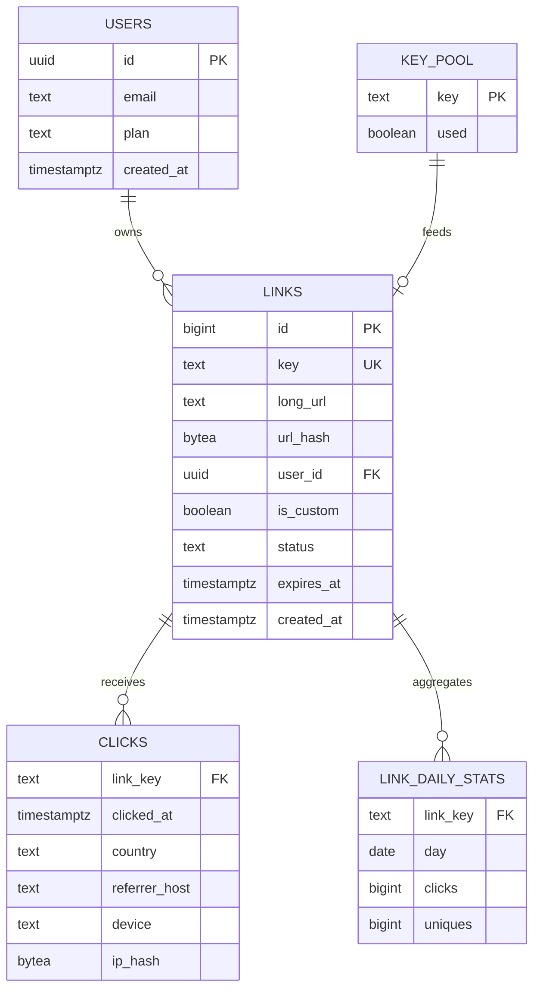
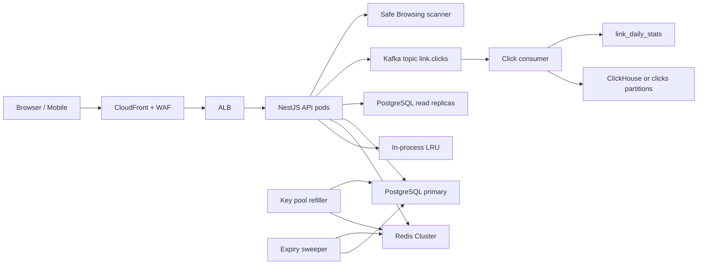
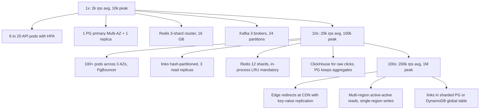

# Part 55 — System Design Case Studies

## 55.0 How to approach any system design interview or design review

System design is the part of the job where a senior engineer earns the title. Anyone can write a controller. The senior engineer is the one who can take a vague sentence like "we need a notification system" and turn it into a set of components, numbers, tables, failure plans and a bill, and then defend every choice. This section gives you a repeatable method. Every case study in this part follows it, so once you have internalized the method you can read the case studies as worked examples and, more importantly, produce your own.

### 55.0.1 The method in nine moves

**1. Clarify the requirements before you draw anything.** The single biggest mistake in design interviews and design reviews is solving the wrong problem beautifully. Spend the first minutes asking: who are the users, what do they do, what must be true (functional), how well must it work (non-functional: latency, availability, consistency, durability), and what are the hard constraints (budget, team size, compliance, existing stack). Write the answers down. In an interview, say them out loud and get agreement. In a design review, put them at the top of the document; if a reviewer disagrees with a requirement, that is a much cheaper argument than one about the architecture.

**2. Estimate.** Numbers turn opinions into engineering. You need users, daily active users, requests per second average and peak, the read/write ratio, bytes per record, records per year, bandwidth, cache size and connection counts. Do the arithmetic visibly and round aggressively; the goal is the order of magnitude. "10,000 redirects per second peak" tells you that one PostgreSQL instance cannot serve every redirect from disk, that Redis must be in the path, and that the click stream is a Kafka problem, not an `INSERT` problem. Without the number, you would argue about it.

**3. Define the APIs.** Write the endpoint table: method, path, request, response, status codes, whether it is idempotent, what authentication it needs. APIs are the contract between your system and the world; once they are written, the data model and the components almost design themselves. Idempotency belongs in this table because clients retry, and every write you expose will be retried at some point.

**4. Model the data.** Draw the entities and their relationships, then write the DDL with real types, constraints and indexes. For each index, name the query it serves. An index nobody can explain is a write-amplification tax. Decide now what is the source of truth and what is a derived copy (cache, search index, analytics store), because that decision drives every consistency conversation later.

**5. Draw the high-level design.** Boxes and arrows: clients, edge, API, cache, database, broker, workers, third parties. Show the direction data flows. Keep it under about fifteen boxes; if you need more, you are drawing the wrong level.

**6. Deep-dive the hot spots.** Every system has two or three paths that carry most of the risk: the redirect path in a shortener, the refresh path in an authentication system, the Lua script in a rate limiter, the fan-out in a notification system, the confirm step in an upload system. Go deep there: sequence diagram, code, the exact Redis and SQL commands, the latency budget. Everything else can stay at the box level.

**7. Address the cross-cutting concerns.** For each of failure, scaling, security, observability, deployment and cost, ask the senior mantra about every arrow on your diagram: *Can it timeout? Can it fail? Can it become slow? Can it duplicate? Can it return a wrong response? Can it partially succeed?* Turn the answers into a failure table, a scaling ladder (1x, 10x, 100x), a threat list, a metric list and a monthly bill.

**8. State the tradeoffs.** Every choice gave something up. Say what. "We chose 302 redirects, so every click costs us a request, but we keep analytics and the ability to change destinations." A reviewer trusts a design that names its own weaknesses.

**9. Offer alternatives.** Name at least two architectures you did not choose and the conditions under which they would win. This is not politeness; it proves you chose rather than defaulted.

### 55.0.2 The 20-section template

Each case study in this part uses the same twenty sub-sections in the same order. Use it as your own checklist for design documents.

```text
 1. Requirements                 -- the problem in one paragraph, who the users are
 2. Functional requirements      -- what the system must do, numbered
 3. Non-functional requirements  -- latency, availability, consistency, durability, with numbers
 4. Constraints                  -- budget, team, compliance, existing stack, hard limits
 5. Capacity estimation          -- users, DAU, RPS avg/peak, read:write, storage, bandwidth, cache, connections
 6. API design                   -- endpoint table with status codes, idempotency, auth
 7. Data model                   -- ER diagram, DDL, index-by-query explanation
 8. High-level architecture      -- components and data flow diagram
 9. Component design             -- responsibility of each box, module layout, key code
10. Database design              -- partitioning, replicas, transactions, retention
11. Caching                      -- what, where, TTL, invalidation, stampede protection
12. Messaging                    -- topics, keys, retries, DLQ, idempotent consumers
13. Scaling                      -- 1x, 10x, 100x ladder
14. Security                     -- authN/authZ, abuse, threats specific to this system
15. Failure scenarios            -- table: mode, detection, impact, mitigation, user sees
16. Observability                -- metrics, logs, traces, alerts, dashboards
17. Deployment                   -- pods, workers, config, migrations, rollout
18. Cost considerations          -- monthly ballpark and the biggest drivers
19. Tradeoffs                    -- decisions made and what was given up
20. Alternative architectures    -- two or more, and when they win
```

The order is deliberate. Sections 1 to 5 are thinking; 6 to 12 are building; 13 to 18 are operating; 19 and 20 are judgment. If you run out of time in an interview, sections 1, 2, 5, 6, 7, 8, 15 and 19 are the ones that must exist.

### 55.0.3 Talking through it in 45 minutes

| Minutes | What you do | What the interviewer or reviewer is checking |
|---|---|---|
| 0 to 5 | Clarify requirements, write the functional and non-functional lists, agree on scope | Do you solve the right problem? Do you ask about consistency and latency unprompted? |
| 5 to 10 | Capacity estimation out loud, with rounding | Can you reason with numbers? Do the numbers change your design? |
| 10 to 15 | API table and data model, including indexes | Do you understand contracts and storage, or only boxes? |
| 15 to 25 | High-level diagram, then narrate one request end to end | Is the design coherent? Does every arrow have a reason? |
| 25 to 35 | Deep dive the hot path the interviewer chooses, with the exact mechanism | Depth. Can you go below the boxes? |
| 35 to 42 | Failure scenarios, scaling ladder, security threats, cost | Have you operated something like this? |
| 42 to 45 | Tradeoffs and alternatives, and what you would do differently with more time | Judgment, honesty, seniority |

Narrate constantly. Silence while you draw is wasted evidence. Say "I am putting Redis here because the estimate said 10,000 reads per second, and I do not want PostgreSQL to see those" rather than just drawing a Redis box.

### 55.0.4 Common mistakes

- **Starting with the diagram.** Boxes without requirements are decoration. Ask first.
- **Skipping the numbers.** "We will use Kafka for scale" without a throughput figure is a cargo cult. Kafka at 20 events per second is a liability, not an architecture.
- **Designing for 100x on day one.** Sharding, multi-region and CQRS all cost operational complexity. Show the ladder: what you build at 1x, what changes at 10x, what changes at 100x.
- **Forgetting the writes.** Read scaling is easy: replicas and caches. Ask what happens to the write path and to the single primary.
- **No idempotency story.** Every write API will be retried. If you cannot say what a duplicate does, the design is incomplete.
- **Ignoring the third parties.** Email providers, push services, malware scanners and identity providers all go down. Design for their outage.
- **One giant failure paragraph.** Use a table: mode, detection, impact, mitigation, what the user sees. It forces you to think about each mode separately.
- **Hand-waving security.** "We will use JWT" is not a security section. Name the threats specific to this system and what stops each.
- **No cost.** Senior engineers know that CDN request pricing, cross-AZ traffic and Multi-AZ databases dominate the bill, and they design with that in mind.
- **Not naming tradeoffs.** A design with no stated weaknesses has not been thought through.

### 55.0.5 How to read the case studies

Each case study assumes the same default environment: NestJS on Kubernetes (EKS), PostgreSQL (RDS), Redis (ElastiCache), a broker (Kafka via MSK, or SQS where a simple queue is enough), S3, CloudFront, and the AWS managed services around them. The numbers are illustrative but realistic; they are chosen so that the design decisions are forced by the numbers, which is what should happen in real life. When your numbers are ten times smaller, simplify; when they are ten times larger, climb the scaling ladder in section 13 of each design.

## 55.1 URL Shortener

> **Try it first** · Level: Beginner · About 30 minutes
>
> **Build:** a service that turns a long URL into a short 7-character link, redirects anyone who opens it, and shows the owner click statistics.
>
> **Requirements:**
> - Create a short link for an `http` or `https` URL, with an optional custom alias and an optional expiry (expired links return `410 Gone`).
> - Redirect `GET /{key}` to the long URL.
> - Record every click (time, country, referrer, device) without storing the raw IP, and show per-link statistics.
> - Let the owner disable or delete a link; block known malicious destinations.
>
> **Scale and constraints:** 50 million new links per month (about 20 writes per second, 60 at peak); each link clicked about 100 times, so 5 billion redirects per month (about 1,900 per second, 10,000 at peak). Redirect p99 under 50 ms server-side and 99.99 percent available; a created link must never be lost and must redirect within 1 second of creation; analytics may lag by minutes. Team of four, budget about 5,000 USD per month.
>
> **Your task:** sketch the API, the data model and the main components; estimate storage, cache size and throughput; decide how keys are generated and how clicks are recorded without slowing the redirect; name the two hardest problems and how you would solve them.
>
> Spend the time on paper before you read on. The model design follows.

### 55.1.1 Requirements

A URL shortener takes a long URL such as `https://shop.example.com/products/2291?utm_source=newsletter&utm_campaign=sept` and returns a short one such as `https://sho.rt/x7Qa9Bc`. When anyone opens the short URL, the service redirects them to the long one and records the click. Users are marketing teams, developers using the API, and the anonymous public who click the links. The business sells analytics (clicks by country, device, referrer, time) and custom branded aliases.

Imagine a coat check at a theatre. You hand over a bulky coat and get a small numbered ticket. Later you hand the ticket back and get the coat. The ticket is the short key; the coat is the long URL; the counter clerk is the redirect service; and the attendance sheet the clerk keeps is the analytics. The clerk must be fast, must never give you someone else's coat, and must not run out of tickets.

### 55.1.2 Functional requirements

1. Create a short link for a valid `http` or `https` URL; return the key.
2. Optionally choose a custom alias (`sho.rt/summer-sale`) if it is free and allowed.
3. Optionally set an expiry time; expired links return `410 Gone`.
4. Redirect `GET /{key}` to the long URL.
5. Record every click with timestamp, country, referrer host, device family; never store the raw IP.
6. Show per-link statistics: total clicks, clicks per day, top countries and referrers.
7. Let the owner disable or delete a link.
8. Block links to known malicious destinations and let an operator flag links after creation.

### 55.1.3 Non-functional requirements

| Property | Target | Why |
|---|---|---|
| Redirect latency | p50 under 10 ms, p99 under 50 ms server-side | The redirect is on the critical path of someone else's page load |
| Redirect availability | 99.99 percent (about 52 minutes per year) | A broken shortener breaks every campaign that used it |
| Create availability | 99.9 percent | Creation can be retried; redirects cannot |
| Durability | A created link must never be lost | Links are printed on posters and in emails |
| Consistency | A link must redirect correctly within 1 second of creation; analytics may lag by minutes | Creators test their link immediately; dashboards are not real time |
| Key length | 7 characters base62 | 62^7 is about 3.5 trillion keys, enough for centuries at our rate |

### 55.1.4 Constraints

- Team of four backend engineers; must run on the company's existing EKS, RDS and ElastiCache.
- Budget ceiling of roughly 5,000 USD per month at the estimated scale.
- Analytics must not store personal data in raw form (GDPR). IPs are hashed with a rotating daily salt and dropped after geolocation.
- Redirects must work for any browser, including ones that block JavaScript, so the redirect must be an HTTP redirect, not a page.

### 55.1.5 Capacity estimation

| Quantity | Assumption | Calculation | Result |
|---|---|---|---|
| New links per month | Marketing and API usage | given | 50 million |
| Writes per second, average | 50M over 2.59M seconds | 50,000,000 / 2,592,000 | about 20 per second |
| Writes per second, peak | 3x average (campaign launches) | 20 x 3 | about 60 per second |
| Read to write ratio | Each link is clicked about 100 times over its life | given | 100:1 |
| Redirects per month | 50M x 100 | | 5 billion |
| Redirects per second, average | 5B / 2.59M | | about 1,900 per second |
| Redirects per second, peak | 5x average (viral link, TV ad) | 1,900 x 5 | about 10,000 per second |

Storage:

| Item | Size per row | Rows | Total |
|---|---|---|---|
| `links` row | 7 B key + 300 B average URL + 100 B metadata + about 100 B index overhead = about 500 B | 50M per month, 600M per year | 25 GB per month, 300 GB per year, 1.5 TB over 5 years |
| `clicks` row (PostgreSQL) | about 120 B including indexes | 5B per month | 600 GB per month uncompressed |
| `clicks` in a columnar store | about 15 B compressed | 5B per month | 75 GB per month, about 1 TB for 13 months |
| Key pool | 8 B per key | 100M pre-generated | 0.8 GB |

Bandwidth:

| Direction | Per request | At 10,000 rps | Notes |
|---|---|---|---|
| Inbound redirect request | about 800 B (headers, cookies) | 8 MB per second | Trivial for an ALB |
| Outbound redirect response | about 400 B (302 plus Location) | 4 MB per second | About 10 TB per month |

Cache and connections:

| Item | Calculation | Result |
|---|---|---|
| Distinct links redirected per day | About 30 percent of last-90-day links get any traffic; roughly 20M distinct per day | 20M |
| Redis memory for hot links | 20M x (key 7 B + URL 300 B + overhead 90 B) = about 400 B each | about 8 GB, so a 16 GB cluster |
| API pods at peak | 10,000 rps at about 500 rps per pod (Node.js, mostly cache hits) | 20 pods |
| PostgreSQL connections | 20 pods x pool of 10 through PgBouncer | 200 client connections, 40 server connections |
| Kafka click events | 10,000 per second at about 150 B | 1.5 MB per second, 130 GB per day |

The numbers say three things. First, redirects are a cache problem: 10,000 reads per second must not reach PostgreSQL. Second, clicks are a streaming problem: 10,000 inserts per second belongs in Kafka and a columnar store, not in synchronous `INSERT`s. Third, the `links` table grows past a billion rows within two years, so it needs partitioning or at least a plan for it.

### 55.1.6 API design

| Method | Path | Request | Response | Status codes | Idempotent | Auth |
|---|---|---|---|---|---|---|
| POST | `/v1/links` | `{ url, alias?, expiresAt?, tags? }` plus `Idempotency-Key` header | `{ key, shortUrl, url, expiresAt, createdAt }` | 201, 400 invalid URL, 409 alias taken, 422 blocked destination, 429 | Yes via `Idempotency-Key` (24 h) | API key or user JWT |
| GET | `/v1/links/{key}` | | link object | 200, 404 | Yes | Owner or admin |
| PATCH | `/v1/links/{key}` | `{ url?, expiresAt?, status? }` | link object | 200, 404, 422 | Yes | Owner |
| DELETE | `/v1/links/{key}` | | | 204, 404 | Yes | Owner |
| GET | `/v1/links` | `?cursor&limit&tag` | page of links | 200 | Yes | Owner |
| GET | `/v1/links/{key}/stats` | `?from&to&groupBy=day` | `{ total, series[], countries[], referrers[] }` | 200, 404 | Yes | Owner |
| GET | `/{key}` | | redirect | 302, 404, 410 expired, 451 blocked | Yes | None |
| POST | `/v1/admin/links/{key}/flag` | `{ reason }` | | 204 | Yes | Admin |

The redirect endpoint lives on the short domain (`sho.rt`); the management API lives on `api.sho.rt`. Separating the hosts lets you scale, cache and protect them differently: the redirect host has no authentication and a very small attack surface.

### 55.1.7 Data model



```sql
CREATE TABLE links (
  id          bigint GENERATED ALWAYS AS IDENTITY PRIMARY KEY,
  key         text NOT NULL,
  long_url    text NOT NULL CHECK (length(long_url) <= 8192),
  url_hash    bytea NOT NULL,                       -- sha256(long_url), for dedup lookups
  user_id     uuid NOT NULL REFERENCES users(id),
  is_custom   boolean NOT NULL DEFAULT false,
  status      text NOT NULL DEFAULT 'active'
              CHECK (status IN ('active', 'disabled', 'blocked', 'deleted')),
  expires_at  timestamptz,
  created_at  timestamptz NOT NULL DEFAULT now(),
  CONSTRAINT links_key_format CHECK (key ~ '^[0-9A-Za-z_-]{4,32}$')
);

-- Serves the redirect: SELECT long_url, status, expires_at FROM links WHERE key = $1
CREATE UNIQUE INDEX links_key_uidx ON links (key);

-- Serves "my links" listing, newest first, with cursor pagination
CREATE INDEX links_user_created_idx ON links (user_id, created_at DESC, id DESC);

-- Serves "did this user already shorten this exact URL?" for dedup on create
CREATE INDEX links_user_urlhash_idx ON links (user_id, url_hash);

-- Serves the expiry sweeper; partial so it stays tiny
CREATE INDEX links_expires_idx ON links (expires_at) WHERE expires_at IS NOT NULL AND status = 'active';

CREATE TABLE key_pool (
  key   text PRIMARY KEY,
  used  boolean NOT NULL DEFAULT false
);
-- Serves the refill job: SELECT key FROM key_pool WHERE used = false LIMIT 10000 FOR UPDATE SKIP LOCKED
CREATE INDEX key_pool_unused_idx ON key_pool (key) WHERE used = false;

CREATE TABLE clicks (
  link_key       text NOT NULL,
  clicked_at     timestamptz NOT NULL,
  country        char(2),
  referrer_host  text,
  device         text,
  ip_hash        bytea
) PARTITION BY RANGE (clicked_at);

CREATE TABLE clicks_2026_09 PARTITION OF clicks
  FOR VALUES FROM ('2026-09-01') TO ('2026-10-01');
-- Serves per-link time-range queries inside a partition; BRIN keeps it tiny for append-only data
CREATE INDEX clicks_2026_09_key_time_idx ON clicks_2026_09 (link_key, clicked_at);
CREATE INDEX clicks_2026_09_time_brin ON clicks_2026_09 USING brin (clicked_at);

CREATE TABLE link_daily_stats (
  link_key  text NOT NULL,
  day       date NOT NULL,
  clicks    bigint NOT NULL DEFAULT 0,
  uniques   bigint NOT NULL DEFAULT 0,
  PRIMARY KEY (link_key, day)             -- serves the stats endpoint directly
);
```

`links_key_uidx` is the only index the redirect path touches. Keeping it small (7-byte keys) means the whole index for a billion rows is about 30 GB and stays in RAM on a machine with 64 GB, which matters when Redis misses.

### 55.1.8 High-level architecture



The data flow for a redirect: browser to CDN (which does not cache redirects by default, but terminates TLS close to the user and absorbs DDoS), to ALB, to a NestJS pod, which checks an in-process LRU, then Redis, then PostgreSQL, and emits a click event to Kafka without waiting. Creation goes to the primary, takes a key from the Redis pool, and publishes a `link.created` event that triggers an asynchronous safety scan.

### 55.1.9 Component design

| Component | Responsibility | Scaling unit |
|---|---|---|
| Redirect controller | Resolve key, enforce status and expiry, emit click, return 302 | Stateless pod, HPA on RPS |
| Links service | Validate URL, dedup, allocate key, insert, invalidate cache | Same pods, separate route group |
| Key pool service | Serve keys from Redis list, refill from PostgreSQL, generate more | Refiller is a single-replica worker |
| Click producer | Buffer click events in memory, flush to Kafka every 50 ms or 500 events | Per pod |
| Click consumer | Batch insert into the analytics store, update daily aggregates | Consumer group, one consumer per partition |
| Safety scanner | Check new URLs against Safe Browsing and internal blocklist; flag links | Worker consuming `link.created` |
| Expiry sweeper | Mark expired links, evict cache entries | CronJob every minute |

NestJS module layout:

```text
src/
  links/
    links.module.ts
    links.controller.ts          -- /v1/links management API
    redirect.controller.ts       -- GET /:key on the short host
    links.service.ts
    link-resolver.service.ts     -- LRU -> Redis -> PG, single-flight
    key-pool.service.ts
    dto/create-link.dto.ts
    entities/link.entity.ts
  clicks/
    click-producer.service.ts    -- kafkajs producer with batching
    click-consumer.worker.ts     -- separate process entry point
  safety/
    safety.module.ts
    url-safety.service.ts        -- Safe Browsing client with timeout and cache
  redis/redis.module.ts          -- provides REDIS_CLIENT (ioredis)
```

The key generation service is the interesting part. There are three common strategies:

| Strategy | How | Pros | Cons |
|---|---|---|---|
| Random base62 with collision check | Generate 7 random chars, `INSERT ... ON CONFLICT DO NOTHING`, retry on conflict | Simple, unpredictable, no coordination | Retry loop under high load; needs a unique index round trip |
| Counter or Snowflake encoded | Take a PostgreSQL sequence or a Snowflake id, base62 encode it | No collisions ever, cheap | Sequential keys are enumerable and reveal volume; needs obfuscation (XOR or Feistel) |
| Pre-generated key pool | Generate random keys offline into `key_pool`, load batches into a Redis list, `LPOP` per create | Constant-time allocation, unpredictable, no collisions at request time | An extra worker and a table; pool can run dry if the refiller dies |

We use the pool as the primary strategy and random-with-collision-check as the fallback if the pool is empty.

```ts
// links/key-pool.service.ts
import { Inject, Injectable, Logger } from '@nestjs/common';
import { DataSource } from 'typeorm';
import type { Redis } from 'ioredis';
import { randomBytes } from 'node:crypto';
import { REDIS_CLIENT } from '../redis/redis.module';

const ALPHABET = '0123456789ABCDEFGHIJKLMNOPQRSTUVWXYZabcdefghijklmnopqrstuvwxyz';
const POOL_LIST = 'keypool:v1';
const LOW_WATER = 50_000;

@Injectable()
export class KeyPoolService {
  private readonly logger = new Logger(KeyPoolService.name);

  constructor(
    @Inject(REDIS_CLIENT) private readonly redis: Redis,
    private readonly dataSource: DataSource,
  ) {}

  /** Hot path: O(1) pop from Redis; falls back to a random key if the pool is dry. */
  async take(): Promise<{ key: string; fromPool: boolean }> {
    const key = await this.redis.lpop(POOL_LIST);
    if (key) return { key, fromPool: true };
    this.logger.warn('key pool empty, falling back to random key');
    return { key: this.randomKey(7), fromPool: false };
  }

  /** Refiller worker: move 10k unused keys from PostgreSQL into Redis, marking them used. */
  async refill(): Promise<void> {
    const size = await this.redis.llen(POOL_LIST);
    if (size > LOW_WATER) return;
    await this.dataSource.transaction(async (em) => {
      // SKIP LOCKED lets two refillers run safely without blocking each other
      const rows: { key: string }[] = await em.query(
        `UPDATE key_pool SET used = true
         WHERE key IN (SELECT key FROM key_pool WHERE used = false LIMIT 10000 FOR UPDATE SKIP LOCKED)
         RETURNING key`,
      );
      if (rows.length === 0) {
        await this.generate(em, 1_000_000);
        return;
      }
      await this.redis.rpush(POOL_LIST, ...rows.map((r) => r.key));
    });
  }

  private async generate(em: { query: (q: string, p: unknown[]) => Promise<unknown> }, n: number) {
    const keys = Array.from({ length: n }, () => this.randomKey(7));
    // Duplicates against links or the pool are simply skipped
    await em.query(
      `INSERT INTO key_pool (key)
       SELECT k FROM unnest($1::text[]) AS k
       WHERE NOT EXISTS (SELECT 1 FROM links l WHERE l.key = k)
       ON CONFLICT DO NOTHING`,
      [keys],
    );
  }

  private randomKey(len: number): string {
    const bytes = randomBytes(len);
    let out = '';
    for (let i = 0; i < len; i++) out += ALPHABET[bytes[i] % 62];
    return out;
  }
}
```

Creation uses the key and inserts in one statement, retrying only in the fallback case:

```ts
// links/dto/create-link.dto.ts
import { IsOptional, IsUrl, Matches, IsISO8601, MaxLength } from 'class-validator';

export class CreateLinkDto {
  @IsUrl({ protocols: ['http', 'https'], require_protocol: true })
  @MaxLength(8192)
  url!: string;

  @IsOptional()
  @Matches(/^[0-9A-Za-z_-]{4,32}$/)   // reserved words are checked in the service
  alias?: string;

  @IsOptional()
  @IsISO8601()
  expiresAt?: string;
}
```

```ts
// links/links.service.ts (create path)
async create(userId: string, dto: CreateLinkDto): Promise<Link> {
  const url = this.normalize(dto.url);               // lowercase host, strip fragment, reject private IPs
  await this.safety.assertNotBlockedSync(url);       // fast local blocklist only; full scan is async
  const urlHash = createHash('sha256').update(url).digest();

  for (let attempt = 0; attempt < 3; attempt++) {
    const alloc = dto.alias
      ? { key: dto.alias, fromPool: false }
      : await this.keyPool.take();
    if (dto.alias && RESERVED.has(dto.alias.toLowerCase())) throw new ConflictException('alias reserved');

    const rows = await this.dataSource.query(
      `INSERT INTO links (key, long_url, url_hash, user_id, is_custom, expires_at)
       VALUES ($1, $2, $3, $4, $5, $6)
       ON CONFLICT (key) DO NOTHING
       RETURNING id, key, long_url, expires_at, created_at`,
      [alloc.key, url, urlHash, userId, !!dto.alias, dto.expiresAt ?? null],
    );
    if (rows.length === 1) {
      await this.events.emit('link.created', { key: alloc.key, url });   // outbox-backed
      return rows[0];
    }
    if (dto.alias) throw new ConflictException('alias already taken');
    // pool keys never collide; a random fallback key might, so loop
  }
  throw new ServiceUnavailableException('could not allocate key');
}
```

### 55.1.10 Database design

The `links` table is the source of truth and lives on a Multi-AZ PostgreSQL primary. Redirect reads that miss Redis go to a read replica; the primary serves creates, updates and the rare read-after-write (a creator testing a link within the first second, which we handle by writing the cache on create, so the replica is never asked for a brand-new key).

Partitioning: `links` stays a single table until about 500M rows, which is roughly month ten. At that point we partition by hash of `key` into 32 partitions. Hash partitioning keeps the redirect lookup a single-partition index scan and spreads vacuum work. Range partitioning by `created_at` would be more natural for retention, but the redirect query does not know the creation date, so it would have to scan every partition's index.

`clicks` is range-partitioned by month from day one, with partitions created a month ahead by a scheduled job. Old partitions are detached and dropped after 13 months; a `DROP` of a partition is instant, whereas `DELETE` of 5 billion rows is a week-long incident. For the dashboards, `link_daily_stats` is maintained by the click consumer with `INSERT ... ON CONFLICT (link_key, day) DO UPDATE SET clicks = link_daily_stats.clicks + EXCLUDED.clicks`, so the stats endpoint reads one small table by primary key instead of aggregating billions of rows.

At 100x we would move raw clicks to ClickHouse, which compresses this shape of data by 10x or more and answers "top countries for link X in September" in tens of milliseconds over billions of rows. PostgreSQL remains the system of record for links and daily aggregates.

### 55.1.11 Caching

| Layer | What | TTL | Invalidation | Notes |
|---|---|---|---|---|
| In-process LRU (per pod) | key to `{url, status, expiresAt}` for the 50,000 hottest keys | 60 s | Time only | Absorbs viral hot keys so a single Redis shard is not hammered |
| Redis Cluster | `l:{key}` to compact JSON | 24 h, refreshed on hit if under 1 h left | `DEL` on update, disable, delete, flag, expiry | Hit ratio target above 98 percent |
| Redis negative cache | `l:{key}` to empty string for keys that do not exist | 5 min | Written when PG says no row | Stops scanners from turning 404s into PG load |
| CDN | Nothing for redirects by default | | | See scaling section for edge redirects at 100x |

Stampede protection: when a hot key expires from Redis, hundreds of pods could miss at once and all query PostgreSQL. Two mechanisms: per-pod single-flight (an in-memory `Map<string, Promise<Link>>` so one pod issues one PG query per key at a time), and a short Redis lock `SET lock:l:{key} NX PX 200` so that across pods only one queries PostgreSQL while the others wait 20 ms and retry the cache. With a 24-hour TTL plus refresh-on-hit, hot keys effectively never expire, so the stampede path is rare.

```ts
// links/link-resolver.service.ts (read path)
async resolve(key: string): Promise<CachedLink | null> {
  const local = this.lru.get(key);
  if (local !== undefined) return local;

  const inflight = this.inflight.get(key);
  if (inflight) return inflight;                       // single-flight per pod

  const p = (async () => {
    const raw = await this.redis.get(`l:${key}`);      // about 0.3 ms
    if (raw === '') return null;                        // negative cache
    if (raw) { const v = JSON.parse(raw) as CachedLink; this.lru.set(key, v); return v; }

    const rows = await this.replica.query(
      'SELECT long_url, status, expires_at FROM links WHERE key = $1', [key]);
    if (rows.length === 0) { await this.redis.set(`l:${key}`, '', 'EX', 300); return null; }
    const v: CachedLink = { url: rows[0].long_url, status: rows[0].status, exp: rows[0].expires_at?.getTime() ?? null };
    await this.redis.set(`l:${key}`, JSON.stringify(v), 'EX', 86400);
    this.lru.set(key, v);
    return v;
  })().finally(() => this.inflight.delete(key));

  this.inflight.set(key, p);
  return p;
}
```

### 55.1.12 Messaging

| Topic | Producer | Key | Consumers | Purpose |
|---|---|---|---|---|
| `link.clicks` | Redirect pods | link key | `clicks-writer` group (24 partitions) | Raw click stream to analytics store and daily aggregates |
| `link.created` | Links service via outbox | link key | `safety-scanner` group | Asynchronous malicious-URL scan |
| `link.flagged` | Safety scanner, admin API | link key | `cache-invalidator` | Evict from Redis and every pod's LRU (pub/sub fan-out) |

Kafka is chosen over SQS because click volume (10,000 per second peak, 130 GB per day) needs partitioned, replayable, batch-friendly consumption; SQS would cost about 13,000 USD per month at that request rate and offers no replay. Keying by link key gives locality (one consumer sees all clicks for a link, so it can aggregate in memory before flushing) but not strict ordering, which analytics does not need.

The click producer never blocks a redirect: events go into an in-memory buffer flushed every 50 ms or 500 events; if Kafka is unavailable the buffer is capped at 50,000 events and then drops with a counter metric. Losing a few seconds of clicks during a broker outage is an accepted tradeoff; delaying redirects is not.

The click consumer is idempotent by design: it batches 5,000 events and inserts them with `INSERT INTO clicks SELECT * FROM unnest(...)`. Because Kafka delivers at least once, a consumer crash after insert but before commit would re-insert the batch. We tolerate duplicate raw clicks (analytics tolerance is about 0.1 percent) but protect `link_daily_stats` by recording the last committed `(partition, offset)` in the same transaction as the aggregate update and skipping batches already applied. Failed batches (for example a poison event that fails parsing) go to `link.clicks.dlq` after three attempts.

### 55.1.13 Scaling



At 1x, the design above is enough: about 6 pods at average load and 20 at peak, a single primary with one replica, a small Redis Cluster. At 10x, the write path is still tiny (600 creates per second) but the read path needs 100 or more pods, and the in-process LRU becomes mandatory because a single viral link can generate 50,000 requests per second for one Redis key, which a single shard cannot serve. `links` gets hash-partitioned, replicas go to three, and raw clicks move to ClickHouse. At 100x, redirects move to the edge: CloudFront Functions or Lambda@Edge look up the key in a replicated key-value store (DynamoDB Global Tables or a CDN key-value store) and return the 302 without touching the origin; the origin only sees misses and management traffic. Writes stay in one region because creation volume never justifies multi-master.

### 55.1.14 Security

- **Open redirect and dangerous schemes.** A shortener is an open redirect by definition, so it must be an honest one: accept only `http` and `https`, reject `javascript:`, `data:`, `file:` and everything else at the DTO, and re-validate at redirect time in case the database was edited.
- **Malicious destinations.** New URLs are checked against a local blocklist synchronously and against Google Safe Browsing asynchronously (about 100 ms, cached 1 hour). Flagged links redirect to an interstitial warning page (`451` on the API). Reports from the public (`/report/{key}`) feed a review queue.
- **SSRF via preview fetching.** If you ever fetch the destination (for titles or previews), resolve the hostname and refuse private, loopback and link-local ranges, and follow no more than three redirects with a 3-second timeout.
- **Key enumeration.** Random 7-character keys give a 1 in 3.5 trillion hit chance per guess; sequential keys would let a scanner walk every link. The negative cache plus a per-IP limit of 60 unknown-key requests per minute makes scanning expensive.
- **Abuse of creation.** Per-API-key limit (for example 100 creates per minute on the free tier), per-IP limit on anonymous creation, and a daily quota. Custom aliases exclude reserved words (`admin`, `login`, `api`) and impersonation patterns.
- **Transport.** HSTS on both hosts, TLS 1.2 minimum, no mixed content. The `Location` header is the exact stored URL, never reconstructed from user input at redirect time.
- **Data protection.** IPs are hashed with a daily rotating salt before leaving the API process and are used only for unique-visitor estimates; country is derived at the edge from the CloudFront geo header. Owners can delete a link, which soft-deletes the row and removes the aggregates on request.
- **AuthZ on management.** Every management query includes `user_id = $current_user`; there is no endpoint that looks up a link by key without an owner check, so a leaked key does not leak its analytics.

### 55.1.15 Failure scenarios

| Failure | Detection | Impact | Mitigation | What the user sees |
|---|---|---|---|---|
| Redis cluster down | Connection errors, hit ratio drops to 0 | All redirects go to PG replicas; PG can serve about 5,000 rps of index lookups, so peak traffic degrades | Circuit breaker on Redis with 50 ms timeout; LRU absorbs hottest keys; replicas scaled; creation continues | Slightly slower redirects; at peak, some 503s |
| PG primary failover | RDS event, write errors for 30 to 60 s | Creates fail; redirects unaffected (cache and replicas) | Retry creates with idempotency key; clients get 503 with `Retry-After: 5` | Creation fails briefly; links keep working |
| Kafka lag or brokers down | Consumer lag alert, producer buffer drops counter | Analytics delayed; some clicks lost after buffer cap | Buffer with cap, drop counter; consumers catch up; dashboards show "delayed" | Redirects normal; stats lag |
| Key pool empty | `keypool_size` below low-water alert | Creates fall back to random keys with collision retry | Refiller alert, on-call restarts worker; fallback keeps creation working | Nothing, or slightly slower creation |
| Hot key (viral link) | Single Redis shard CPU spike, key-level sampling | One shard saturates; other keys on that shard slow down | In-process LRU with 60 s TTL serves the key locally; per-pod rate is unlimited | Nothing |
| Duplicate click events | Consumer reprocessing after crash | Daily stats overcount | Offset checkpoint in aggregate transaction; raw duplicates tolerated | Nothing visible |
| Bad deploy (redirect returns 404 for valid keys) | Canary 404 rate compared to baseline | Every click on affected pods fails | Canary at 5 percent for 10 minutes with automatic rollback on 404 rate increase | A few users see 404 during canary |
| Safe Browsing API outage | Scanner timeouts, queue growth | New links unscanned | Links are created regardless; scanner retries with backoff and scans later; local blocklist still applies | Nothing |
| Region outage | Route 53 health checks fail | Everything down in single-region deployment | Warm standby in second region with cross-region replica and Redis re-warmed from PG; RTO 15 min | Outage until failover |
| Clock skew between pods | Expiry decisions differ by pod | Link expires on some pods seconds earlier | Expiry compared with 30 s tolerance; sweeper is the authority | Nothing noticeable |
| Wrong response (stale cache after URL edit) | Owner report, cache invalidation failure metric | Redirects go to old URL until TTL | Invalidate via `DEL` plus pub/sub to LRUs; on failure, edit is rolled back | Old destination for up to 60 s in the worst case |

### 55.1.16 Observability

Metrics (Prometheus, per pod and aggregated):

1. `redirect_latency_seconds` histogram, labels `outcome` (302, 404, 410, 451). Alert when p99 above 50 ms for 5 minutes.
2. `redirect_cache_hits_total` by layer (`lru`, `redis`, `pg`, `negative`). Alert when Redis hit ratio falls below 95 percent.
3. `redirect_requests_total` by status. Alert on 404 rate above 2x the 7-day baseline (catches bad deploys and scanners).
4. `keypool_size` gauge. Alert below 50,000.
5. `click_buffer_dropped_total`. Alert on any increase.
6. `kafka_consumer_lag` for `clicks-writer`. Alert above 5 minutes of lag.
7. `pg_replication_lag_seconds`. Alert above 10 s.
8. `links_created_total` by tier and `create_latency_seconds`.
9. `safety_scan_duration_seconds` and `links_flagged_total`.
10. Redis per-shard CPU and command latency (hot-shard detection).

Logs: structured JSON, one line per create (key, user, outcome, latency), none per redirect at 10,000 rps except sampled 1 in 1,000 and every non-302 outcome. Traces: OpenTelemetry spans on the create path and on redirect cache misses only; sampling 100 percent of misses and 0.1 percent of hits. Dashboards: a redirect dashboard (RPS, latency, hit ratio by layer, status mix), a pipeline dashboard (buffer size, Kafka lag, consumer batch size), and a business dashboard (creates per hour, active links, flagged links).

### 55.1.17 Deployment

| Workload | Kind | Replicas | Notes |
|---|---|---|---|
| `shortener-api` | Deployment | 6 min, 40 max, HPA on RPS per pod (target 400) | Serves both hosts; readiness probe checks Redis and PG replica |
| `clicks-writer` | Deployment | 8 (24 partitions, 3 each) | Graceful shutdown commits offsets |
| `safety-scanner` | Deployment | 2 | Outbound egress to Safe Browsing only |
| `keypool-refiller` | CronJob every 5 min | 1 | Idempotent; `SKIP LOCKED` allows overlap |
| `expiry-sweeper` | CronJob every 1 min | 1 | Marks expired, publishes `link.flagged`-style invalidations |
| `partition-manager` | CronJob daily | 1 | Creates next month's `clicks` partition, drops the 14th oldest |

Configuration from environment via `@nestjs/config`: Redis endpoints, PG primary and replica DSNs, Kafka brokers, Safe Browsing key from Secrets Manager, cache TTLs. Migrations run as a Kubernetes Job before rollout using TypeORM migrations; index creation uses `CREATE INDEX CONCURRENTLY` outside a transaction. Rollout: canary 5 percent for 10 minutes with automatic rollback if the 404 rate or p99 rises, then a rolling update with `maxUnavailable: 0`. Environments: dev (shared RDS, single Redis), staging (production-shaped, 10 percent size), production. Pod disruption budget keeps at least 4 API pods during node drains.

### 55.1.18 Cost considerations

| Item | Sizing | Monthly (USD, approximate) |
|---|---|---|
| EKS nodes | 6 x m6i.large across 3 AZs, spot for consumers | 500 |
| RDS PostgreSQL | db.r6g.large Multi-AZ primary plus one replica, 2 TB gp3 | 900 |
| ElastiCache Redis | 3 shards x cache.r6g.large with replicas | 700 |
| MSK Kafka | 3 x kafka.m5.large, 2 TB storage | 600 |
| ALB | About 10 LCUs at peak | 100 |
| CloudFront in front of the short host | 5B requests at 0.01 per 10,000 plus 10 TB egress | 5,000 to 6,000 |
| ClickHouse on EC2 (10x stage) | 3 x r6i.large | 450 |
| Total without CDN | | about 3,300 |
| Total with CDN | | about 8,500 |

The surprise is the CDN: at billions of tiny requests per month, per-request pricing dominates, so many shorteners put the short host directly behind an ALB with AWS Shield Standard and only add CloudFront when they need edge redirects or DDoS absorption. The second driver is Kafka; at 1x you could replace it with a cheaper self-managed Redpanda or accept SQS batching. PostgreSQL storage is the third: partition drops and the columnar store keep it bounded.

### 55.1.19 Tradeoffs

- **302 over 301.** A `301` is cached by browsers, so repeat clicks never reach us: faster for the user, no analytics, and the destination cannot be changed. We chose `302` (and `307` when the method must be preserved) to keep analytics and editability, paying one request per click. Owners of permanent, analytics-free links can opt into `301` with `Cache-Control: max-age=3600`.
- **Key pool over counter encoding.** The pool costs a worker and a table but gives unpredictable keys and constant-time allocation. A base62-encoded sequence would be simpler and collision-free but enumerable.
- **At-least-once click delivery with tolerated duplicates.** Exactly-once raw click counting would need deduplication storage for billions of events; we accept about 0.1 percent overcount in raw data and make the daily aggregates exact.
- **Lossy click buffer during Kafka outages.** We chose to drop clicks rather than slow redirects. The alternative (write clicks to local disk and replay) is possible at 10x.
- **PostgreSQL for links rather than a key-value store.** Relational gives us owner listing, dedup, tags and transactions for free; the redirect path never touches PostgreSQL when the cache is warm, so the key-value store's advantage is small at this scale.

### 55.1.20 Alternative architectures

**Serverless on AWS.** API Gateway or a CloudFront Function for redirects, Lambda for creation, DynamoDB with the key as the partition key, Kinesis Data Firehose for clicks into S3 and Athena. Zero servers to patch, scales to any peak instantly, and DynamoDB's single-digit-millisecond reads suit the lookup shape. It wins for small teams and spiky traffic. It loses on cost at sustained 2,000 rps (Lambda alone costs about 1,000 USD per month at 5B invocations before duration) and on analytics flexibility, and cold starts hurt p99 unless you use CloudFront Functions, which cannot reach DynamoDB directly.

**Edge-native.** Cloudflare Workers with Workers KV (or a Durable Object per link) serve redirects within 10 ms of every user on earth without a region. The origin becomes a small management API and a batch job that writes KV. This wins at 100x and for global audiences. It loses when you need strong read-after-write (KV replication takes up to 60 seconds), when analytics needs raw events (Workers Analytics Engine helps but is less flexible than ClickHouse), and when the company already runs everything on AWS.

**Single-node monolith.** One NestJS process, one PostgreSQL, one Redis, no Kafka; clicks written with `INSERT` in a fire-and-forget background queue in-process. This is the right design below about 200 redirects per second. It is what you should build first and what most companies actually need. It loses when a single viral link or a TV ad brings 10,000 rps, which is exactly the moment the business notices you.
