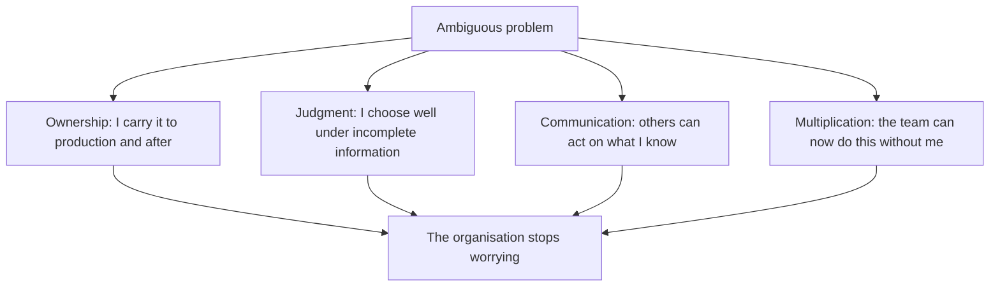
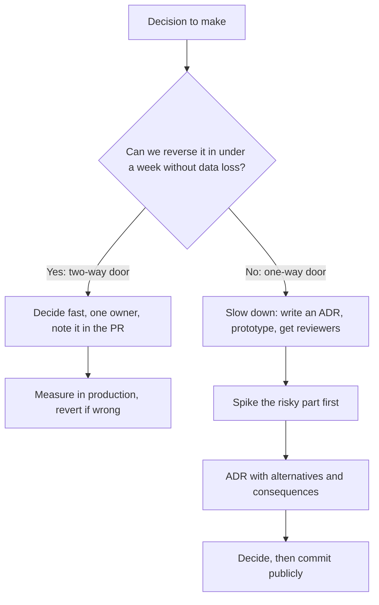

# Part 55 — The Senior Engineering Mindset

At 09:40 on a Tuesday, two engineers read the same design document. It proposes a new `notifications` service that reads from a Kafka topic and writes to PostgreSQL.

The first engineer reads it and thinks: *the code looks fine, the module structure is clean, I would rename one DTO.* The second engineer reads the same page and thinks: *what happens when the consumer crashes between the database write and the offset commit? Who else writes to this table? Is `user_id` indexed for the query on line 40? If Kafka is down for twenty minutes, does the checkout flow still work, or does it block? Who gets paged at 03:00 when this backs up?*

Both engineers can write TypeScript. The difference is not knowledge of syntax. It is the set of questions that fire automatically when they look at a system.

This part is that question set. It is the closest thing to a transferable senior skill that exists: not a list of technologies, but a list of interrogations you run on every design, every pull request and every incident, until they become reflex. I have used the same questions on a two-person startup and on a platform doing 40,000 requests per second. The systems changed. The questions did not.

## 55.1 What "senior" actually means

Companies write career ladders full of words like "impact" and "scope". They are not wrong, but they are hard to act on. Here is a definition you can use tomorrow morning.

**A senior engineer is someone the organisation can hand an ambiguous, important problem to, and then stop worrying about it.**

Unpack that sentence and you get four things: ownership (you carry it to the end), judgment (you make good calls without being told what to do), communication (other people know what is happening and why), and multiplication (the people around you get better, so the organisation is not dependent on you personally).

#### Concept

Seniority is measured in **removed uncertainty**, not in lines of code, not in years, and not in the number of frameworks on your CV. Every organisation has a queue of things nobody is sure how to do. A senior engineer takes items off that queue and returns them as things that are now certain: shipped, monitored, documented, and understood by more than one person.

#### Mental model

Imagine a hospital. A medical student can recite drug interactions. A junior doctor can run a standard treatment for a standard case. The consultant is the person you page when the case is not standard: when the symptoms conflict, when the textbook answer would hurt the patient, when someone has to decide with incomplete information and own the outcome. The consultant does not know more facts than the student who just crammed for exams. They have seen more failures, they know which signals matter, and they will still be responsible in the morning.

Backend engineering is the same. The senior is not the person who has memorised the most PostgreSQL configuration parameters. They are the person you want in the room when the payment flow is double-charging customers and nobody knows why.

### 55.1.1 Ownership

Ownership means the problem is yours until it is actually solved, not until your code is merged.

A concrete story. A mid-level engineer on my team shipped a feature that let customers export their order history as CSV. Code was clean, tests passed, PR merged, ticket closed. Three weeks later, support raised a ticket: exports were timing out for large customers. The engineer's reaction was, honestly, reasonable-sounding: "that's an infra problem, the gateway times out at 30 seconds."

The senior version of that same engineer would have known at design time that the export was unbounded: a customer with 400,000 orders will always break a synchronous endpoint, no matter how fast the query. They would have shipped it as a background job writing to S3 with a signed URL emailed to the customer, or at minimum they would have measured the p99 order count per customer before choosing. And after shipping, they would have checked the dashboard for that endpoint in week one rather than waiting for support to find it.

Ownership in practice:

- You know how your feature behaves in production, because you looked, not because nobody complained.
- You added the dashboard and the alert before you needed them.
- When it breaks, you do not wait to be asked. You pick it up.
- When it is someone else's component but your customer's problem, you still drive it to a resolution and hand it over cleanly.
- You wrote down what future-you will need at 03:00.

Ownership is not heroism, and it is not working weekends. It is refusing to let a problem sit in the gap between two teams.

### 55.1.2 Judgment

Judgment is choosing well when the information is incomplete and the options all have costs. It is the hardest thing to teach and the most valuable thing you have.

Judgment shows up as *restraint* far more often than as cleverness. The junior instinct on hearing "we need to handle more traffic" is to reach for Kafka, or sharding, or a service split. The senior instinct is to ask what the traffic actually is, measure where the time goes, and discover that 80 percent of the load is one unindexed query on a 12-million-row `orders` table, fixable in an afternoon with a composite index and a `LIMIT`.

I once watched a team spend five months migrating to microservices because "the monolith does not scale". Their monolith was serving 90 requests per second on two 2-vCPU containers with a database at 4 percent CPU. It scaled fine. What did not scale was their deployment process, which took 50 minutes and required a manual database migration step. The right project was a two-week CI/CD fix. They spent five months and ended up with the same slow deploys spread across nine repositories.

Judgment is: *what problem are we actually solving, and what is the cheapest thing that solves it?*

### 55.1.3 Communication

If you understand the system perfectly and nobody else can act on that understanding, your value is capped at what you can personally type.

Communication for engineers is mostly writing, and mostly unglamorous: a design doc that a product manager can read, an ADR that explains why you rejected the obvious option, a Slack update during an incident that says what you know and what you do not, a commit message that explains *why*, a runbook with the exact command to run.

The test I use: **could a competent engineer who joins in eighteen months, with no access to me, make a correct decision about this system from what I wrote down?** If not, I have not finished.

### 55.1.4 Making the people around you better

The organisational value of a senior engineer is not their own throughput. A strong mid-level engineer might produce 1.3x the output of an average one. A senior who lifts eight people by 20 percent has produced 1.6 engineers of value without writing a line, and it compounds because those people teach the next cohort.

This is why code review, pairing, design review and writing are not "overhead" at senior level. They are the job. A review comment that teaches somebody why `SELECT ... FOR UPDATE` inside a long transaction will melt under load prevents a class of future incidents, not one.

### 55.1.5 Fifteen years, or one year fifteen times

The uncomfortable truth: time does not automatically produce seniority. I have interviewed engineers with fifteen years who had, functionally, one year of experience repeated fifteen times. They had built the same CRUD API on the same stack in the same way, and had never operated it under load, never had a bad night, never had to migrate a hot table, never had to argue for a decision in front of people who disagreed.

Experience compounds only when it includes **feedback**. Feedback comes from:

- Running what you build in production, and watching the graphs.
- Being on call for your own systems.
- Being wrong publicly and writing down why.
- Working on systems bigger than you can hold in your head, so you must reason rather than memorise.
- Reading other people's code and postmortems, which is borrowed feedback at low cost.

The engineer who has shipped four systems and operated all four for a year each will be more senior than the one who has shipped twenty and operated none.

#### Common mistakes

- **Equating seniority with technology breadth.** Knowing Kafka, Kubernetes, gRPC, Elasticsearch and Terraform by name is not judgment. It is vocabulary.
- **Equating seniority with speed.** Shipping fast while leaving landmines is a debt transfer to your future team.
- **Refusing the unglamorous work.** Someone has to fix the flaky test suite, write the runbook and upgrade Node. Seniors do it because the leverage is real.
- **Hoarding context.** If the system only works because you are around, you are a single point of failure, not a senior engineer.

#### Practical exercise

Take the last three tickets you closed. For each, write down: (1) how you would know today if it is broken in production, (2) what happens at 10x the current volume, (3) who else could operate it if you were on holiday. If you cannot answer all three for all of them, you have found this quarter's growth plan.

## 55.2 Architecture questions

These are the five questions I ask in every design review. They take four minutes and they have saved more engineering-years than any framework I have used.

### 55.2.1 Is this the simplest thing that solves the problem?

#### Why the question matters

Every piece of architecture you add is a permanent tax: it must be deployed, monitored, secured, upgraded, understood by new hires, and debugged at 03:00 by somebody who did not build it. Complexity that is not paid for by a real requirement is pure loss, and it is almost impossible to remove later because removal has no visible business value.

#### How to actually answer it

Write down the requirement in one sentence with a number in it. Then design the crudest thing that satisfies it. Then ask what specifically breaks about the crude thing. Only add machinery in response to a break you can name.

A useful forcing function: **describe the design to yourself as a list of moving parts, and put a cost next to each one.** "Kafka" is not a line item, it is: a cluster to run or a managed bill, topic and partition decisions, consumer group monitoring, a schema registry or a compatibility convention, a dead-letter strategy, a rebalance failure mode, and one more thing that can be down when you are paged.

#### Worked example

Requirement: "When an order is placed, send a confirmation email. We do about 3,000 orders per day, peaking at 15 per minute."

The proposed design was: order service publishes `OrderPlaced` to Kafka, a notification service consumes it, writes to a `notifications` table, publishes to a second topic for the email sender, which calls SendGrid.

The simplest thing that solves it: the order service writes a row into an `outbox` table inside the same transaction as the order, and a BullMQ worker backed by Redis picks it up and calls SendGrid with retries. One extra table, one worker process, one Redis instance you already run for caching. It handles 15 per minute without noticing, it survives SendGrid being down, and it can be understood by a new hire in fifteen minutes.

At 3,000 orders per day, Kafka buys you nothing you need. At 3 million per day, with eleven consumer teams wanting the same event, Kafka buys you a lot. Ask which world you are in **today**, and whether the migration cost from simple to complex is high. If moving from a queue to Kafka later is a two-week project, and you are not sure you will need it, do not pay for it now.

#### The mistake people make

Designing for the company you hope to be in three years instead of the one you are in this quarter, and calling it "future proofing". The usual outcome is that the future does not arrive in the predicted shape, and you have paid the operational cost the whole time. The senior version of future proofing is *keeping the option open cheaply*: a clean module boundary, an interface, an event you already emit. Not a running cluster.

### 55.2.2 What happens at 10x traffic? At 100x?

#### Why the question matters

Systems do not degrade smoothly. They work, work, work, then hit a wall: the connection pool saturates, the table stops fitting in the buffer cache, the nightly job stops finishing before the next one starts. The wall is usually visible in advance if anyone does the arithmetic.

#### How to actually answer it

Do the arithmetic out loud. Take the current numbers, multiply by 10, and walk each resource:

- Requests per second, and therefore concurrent requests in flight.
- Database connections needed: pods times pool size. Compare against `max_connections`.
- Rows written per day, and the table size in a year.
- Redis memory and key count.
- Queue arrival rate versus consumer drain rate.
- Bytes per second out of the service and across the network.

Then say which resource hits its limit first, and at what multiple. You do not need precision. You need to know whether the wall is at 3x or 300x, because that tells you whether this is a design problem or a next-year problem. Part 53 — Capacity Estimation and Back-of-the-Envelope Math is the full method.

#### Worked example

A product search endpoint does 200 requests per second, each running one PostgreSQL query at 8 ms, on 6 pods with a pool of 10.

At 10x, 2,000 RPS: by Little's law we need roughly `2000 * 0.008 = 16` concurrent database queries on average, which is fine, but the peak-second burst and the p99 of 40 ms push it to 80 in flight. Six pods times ten connections is 60. We start queueing inside the pool, latency climbs non-linearly, and the p99 goes from 40 ms to 900 ms. The fix is not "more pods" (that multiplies connections towards `max_connections`); it is a cache in front of the query, since search results for the top 200 terms cover 70 percent of traffic.

At 100x, 20,000 RPS: PostgreSQL is the wrong tool for this access pattern regardless of pooling. This is where a search engine, a read replica pool, or a materialised result cache with a strict TTL earns its complexity. Now Elasticsearch is not resume-driven development, it is arithmetic.

#### The mistake people make

Answering "we'll scale horizontally" as if it were a plan. Horizontal scaling of stateless application pods is the easy half. The hard half is everything shared: the database, the cache, the queue, the third-party API with a 100 RPS rate limit, the single-writer table with a hot row. Name the shared resource that saturates first, or you have not answered the question.

### 55.2.3 What is the blast radius when it fails?

#### Why the question matters

Everything fails. The design decision is not *whether* it fails, but *how much of the product goes down with it*. Two designs with identical throughput can differ by a factor of fifty in how bad the worst day is.

#### How to actually answer it

For each dependency, ask: if this is completely unavailable for thirty minutes, what stops working? Then classify the answer:

| Blast radius | Meaning | Example |
|---|---|---|
| Cosmetic | A non-critical feature degrades, users may not notice | Recommendation panel is empty |
| Contained | One feature is unavailable, the rest of the product works | Cannot download invoices |
| Revenue | Customers cannot complete the core transaction | Checkout returns 500 |
| Correctness | The system keeps working but produces wrong data | Double-charged payments, lost orders |
| Existential | Data loss, or a breach | Backups unusable, customer data exposed |

Correctness failures are worse than availability failures, and juniors systematically underrate them. An outage is embarrassing for an hour. Silently wrong money movement is a six-month cleanup, a finance reconciliation project and a trust problem.

#### Worked example

We put a Redis cache in front of the product catalogue. Design A calls Redis, and on a Redis error the request fails with 500. Design B calls Redis, and on error falls through to PostgreSQL with a per-request timeout of 100 ms and a circuit breaker.

Design A converts a cache outage into a full catalogue outage: blast radius revenue. Design B converts it into elevated database load and slower pages: blast radius cosmetic-to-contained, *provided* PostgreSQL can survive the cold-cache load, which is exactly the arithmetic from 55.2.2. If the database cannot take 100 percent of catalogue traffic, then Design B is a lie and you need either a bigger database, a stale-while-revalidate local cache, or a load-shedding rule that serves a reduced catalogue.

Notice what the question forced: it turned "add a cache" into three concrete decisions.

#### The mistake people make

Treating a cache, a search index or a message broker as infallible infrastructure because it has been up for a year. Anything that can be unreachable will be unreachable, usually during your busiest hour, usually because of a network change nobody told you about.

### 55.2.4 What are we optimising for?

#### Why the question matters

Time to market, cost, reliability and flexibility trade against each other. Teams argue for weeks because two people are optimising for different things and neither has said so. Naming the objective ends most architecture arguments in ten minutes.

#### How to actually answer it

Force a ranking, not a wish list. Everybody wants all four. Ask the product owner or the business stakeholder to order them for *this* project, and write the order into the design doc.

| Optimising for | You accept | You choose | Typical context |
|---|---|---|---|
| Time to market | Tech debt, manual ops, lower ceiling | Modular monolith, managed services, boring stack | Pre-product-market-fit, a bet you may kill |
| Cost | More engineering effort per feature, more ops | Self-hosted, tighter instance sizing, aggressive caching | Thin margins, high volume, mature product |
| Reliability | Slower delivery, more redundancy spend | Replication, multi-AZ, circuit breakers, canaries | Payments, healthcare, anything regulated |
| Flexibility | Upfront design cost, some indirection | Clear boundaries, events, versioned contracts | Platform used by many teams, unstable requirements |

#### Worked example

A team was designing a promotions engine. Two proposals: a rules DSL with a configuration UI, six weeks; or hardcoded promotion types with a new deployment per type, one week.

The unspoken disagreement was the objective. The engineer proposing the DSL was optimising for flexibility, because marketing "will want to change rules constantly". The product manager was optimising for time to market, because the whole promotions bet might be cancelled in a quarter. When we said this out loud, the answer was obvious in five minutes: build three hardcoded promotion types now behind an interface, and if marketing requests a fourth type twice in one quarter, build the DSL then. They requested one more type in six months. The DSL was never built. That is a saved five weeks and a system nobody had to learn.

#### The mistake people make

Optimising for flexibility by default, because flexibility feels like good engineering. Flexibility has an ongoing cost paid by every reader of the code. Buy it when the variability is real and observed, not imagined.

### 55.2.5 How do we undo this if we are wrong? One-way and two-way doors

#### Why the question matters

Decisions are not all equally serious, and treating them as if they were is the single biggest source of slow teams. A choice you can reverse in an afternoon deserves an afternoon of thought. A choice that is effectively permanent deserves a week, a document and other people's eyes.

#### How to actually answer it

Ask three sub-questions: what would we have to do to undo this, how long would it take, and what data would we lose or have to migrate? Then place the decision on the scale.

Two-way doors (reversible, decide fast): the HTTP client library, the folder structure, the logging format, whether a service is one module or two inside the same deployable, the caching TTL, most library choices, the Jest config.

One-way doors (expensive or impossible to reverse): the primary datastore for a large table, the public API contract once external clients depend on it, splitting a monolith into separately deployed services with separate databases, an event schema that other teams have already consumed and stored, a data model that loses information (once you throw away the original event, you cannot reconstruct it), the choice of a cloud provider's proprietary service that has no equivalent elsewhere, and anything to do with customer identifiers.

#### Worked example

Two decisions from the same project, treated very differently, on purpose.

The first: which UUID version for order identifiers. We chose UUIDv7 for the time-ordering benefit on B-tree inserts. Is this reversible? Not really: identifiers appear in URLs customers bookmark, in exported CSVs, in third-party webhooks and in support tickets. Changing the format later means dual identifiers forever. So this was a one-way door, and it got half a day, a benchmark against `bigint` and `uuidv4`, and a written decision.

The second: whether the notification worker uses BullMQ or a plain `setInterval` poller over an outbox table. Reversible in about two days, since the job payloads are internal and the interface is one method. Two-way door, decided in a fifteen-minute conversation, and revisited nine months later when retry semantics started to matter. Nobody wrote a document. That was the correct amount of process.

#### The mistake people make

Two symmetrical errors. Juniors walk through one-way doors quickly, because the code change looks small: adding a field to a public API response is three lines and forever. Newly promoted seniors freeze in front of two-way doors, holding three-hour meetings about the folder layout, because they have learned that decisions matter and have not yet learned to grade them.

The senior habit is to say the classification out loud: "this is a two-way door, let's pick one and move on" or "careful, this is a one-way door, I want it written down before we build it."

#### Interview questions

1. **"Give me an example of a one-way door decision you made, and how you handled it differently from a normal decision."** Expected: a concrete choice about data model, public contract or datastore; evidence of prototyping, written alternatives and reviewers. Follow-up: what would reversing it have cost?
2. **"A team wants to introduce Kafka for a feature doing 20 events per second. What do you say?"** Expected: not a flat no. Ask what problem it solves, who else consumes, what the retention and replay requirements are, and what the operational owner situation is. Offer the cheaper option and the trigger that would change the answer.
3. **"Your service is at 500 RPS and the business projects 10x in a year. Walk me through what breaks first."** Expected: resource-by-resource arithmetic, not "add pods".
4. **"How do you decide how much design process a decision deserves?"** Expected: reversibility and blast radius as the two axes.

#### Practical exercise

Take the architecture of the service you work on. List every external dependency: database, cache, broker, third-party APIs, internal services. For each, write one line: "if this is down for 30 minutes, X stops working, blast radius Y". Then find the two entries where the blast radius is larger than the business would accept, and write a paragraph on the cheapest change that would shrink it. Acceptance criteria: at least one of those changes is small enough to ship in a week, and you can name the metric that would prove it worked.
