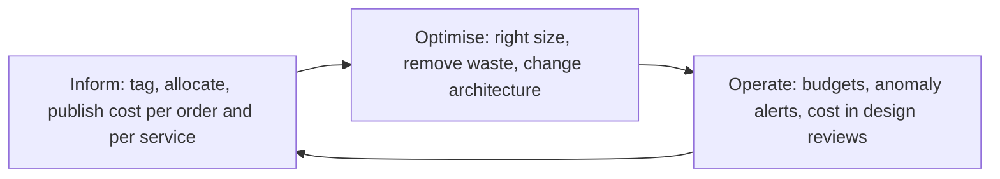

# Part 55 — Cost-Aware Engineering

Every number in this part is an **approximate AWS list price, in `us-east-1`, at the time of writing**. Prices differ by region (often 10 to 30 percent), drop over time, and fall further with Savings Plans, Reserved Instances and Enterprise Discount Programs. Never quote these figures to a finance team as fact. Use them the way an engineer uses "a Redis lookup is about 0.5 ms": as an order of magnitude that lets you reason before you measure.

The system we are pricing is the same e-commerce platform as Part 54: NestJS on EKS, RDS PostgreSQL, ElastiCache Redis, Kafka, S3 and CloudFront, roughly 400 to 500 requests per second at peak, 25,000 orders a day.

## 55.1 Why engineers must understand cost

#### Concept

Cost is a non-functional requirement, exactly like latency, availability and security. It is a property of the design, decided by engineers, at the moment they choose an instance class, a replication topology, a log level or a service boundary. Finance can renegotiate a contract; only engineering can change the fact that your service makes 40 cross-AZ calls per request.

The uncomfortable truth is that cloud cost is *mostly* an engineering artefact. The bill is a printout of your architecture.

#### Why does it exist?

Because the feedback loop is broken by default. When you add an index, you feel the latency change in a benchmark. When you add a read replica, you feel nothing at all — the money leaves 30 days later, aggregated into a bill that no engineer reads, attributed to nothing in particular.

Without deliberate practice, the loop stays broken and three things happen. First, waste compounds silently: every unused environment, oversized instance and debug logger stays forever because nobody owns it. Second, the company reacts late and badly, with a panicked "cut 30 percent" mandate that lands on resilience because resilience is the easiest thing to delete. Third, engineers lose a genuine lever on the business, because a team that can say "we can serve this feature for $0.002 per order" is trusted with decisions that a team quoting only latency is not.

#### Mental model

Imagine your architecture is a house and the cloud bill is the electricity meter. Nobody plans to waste electricity. But if the meter is in a locked cupboard and the bill goes to a different department, the heating stays on in the empty guest room for three years.

Cost awareness is not frugality. It is putting the meter where the people who flip the switches can see it, and labelling each circuit.

#### How it works

**Unit economics is the number that matters.** The total bill is almost useless as an engineering signal, because it moves with traffic. A bill that grew from $18,000 to $24,000 could mean you got 30 percent more efficient (traffic doubled) or 30 percent more wasteful (traffic flat). You cannot tell.

The number to track is **cost per unit of business value**:

- Cost per order
- Cost per API request (or per 1,000 requests)
- Cost per monthly active user
- Cost per gigabyte of customer data stored

For our platform: $18,000 a month at 750,000 orders a month is **$0.024 per order**. That single number changes the conversation completely.

- It is comparable over time. If traffic doubles and the bill grows 60 percent, cost per order *fell* and you are winning.
- It is comparable to revenue. At a $60 average basket with a 4 percent net margin ($2.40 per order), infrastructure is 1 percent of order value. That tells you immediately whether to spend a quarter optimising, or to ship features instead.
- It makes trade-offs concrete. "This new recommendation service adds $0.004 per order" is a decision a product manager can make. "The recommendation service costs $3,000 a month" is a decision nobody can make, because there is nothing to compare it against.
- It catches slow regressions that a total bill hides. Cost per order drifting from $0.024 to $0.031 over two quarters is a real signal; the total bill over the same period just looks like growth.

Compute it monthly and put it on the same dashboard as p99 latency. It belongs there.

**Tagging and cost allocation.** You cannot compute cost per order if you cannot attribute cost. Tagging is the plumbing that makes every other practice in this part possible, and it is boring, which is why it is usually missing.

A workable minimum tag set, enforced rather than requested:

| Tag | Example | Used for |
|---|---|---|
| `service` | `orders-api` | Per-service showback |
| `team` | `checkout` | Ownership, who to ask |
| `env` | `prod`, `staging`, `dev` | Finding non-production waste |
| `cost-center` | `CC-4471` | Finance allocation |
| `owner` | `priya@` | Who to email about the idle instance |
| `expires` | `2026-10-01` | Temporary resources that must die |

Three rules make tags real:

1. **Enforce at creation.** An AWS Organizations tag policy plus a Service Control Policy that denies resource creation without required tags. Or, more practically, enforce in Terraform with `default_tags` at the provider level so every resource inherits them automatically:

```hcl
provider "aws" {
  region = "us-east-1"
  default_tags {
    tags = {
      service     = var.service_name
      team        = var.team
      env         = var.environment
      cost-center = var.cost_center
      managed-by  = "terraform"
    }
  }
}
```

2. **Accept that some cost cannot be tagged.** Kubernetes hides this: one EC2 node runs pods from six teams, and the node has one tag. Shared costs (the EKS control plane, NAT gateways, the load balancer, the data transfer between nodes) need an allocation rule. Kubecost, OpenCost or AWS Split Cost Allocation Data can attribute node cost to pods by their CPU and memory *requests*. Whatever you choose, write the rule down and stop arguing about it.
3. **Publish the untagged percentage.** If 40 percent of your bill is untagged, every showback number is fiction. Drive that below 10 percent before you draw conclusions.

**The FinOps loop.** FinOps is the industry name for the practice, and its three phases are a genuinely useful structure, not just vocabulary.



**Inform** is visibility. Tags, allocation, a dashboard each team can see, and unit economics. Almost every team that has a cost problem is stuck before this phase, and every optimisation they attempt is guesswork.

**Optimise** is the engineering. Right-sizing, autoscaling, storage classes, architecture changes. This is 55.2 through 55.7.

**Operate** is making it stick. Budgets, anomaly detection, cost as a line item in design reviews, and a monthly review with an owner. Without this phase, you optimise once and drift back within two quarters.

The order matters. Optimising before informing is how teams delete a read replica that was actually load-bearing.

#### Practical example

A team is asked to cut cloud spend by 20 percent. They start with the biggest line item, EC2, and spend three weeks right-sizing nodes for a $2,100 monthly saving.

A second team starts by tagging and building the cost-per-order dashboard. It takes them a week, and it reveals that a single internal analytics service, which serves 40 internal page views a day, costs $4,400 a month because it runs a 6-node OpenSearch cluster refreshed by a Kafka consumer every 30 seconds. Nobody had looked, because it was never anyone's line item. Deleting it and replacing it with a nightly materialised view in PostgreSQL saves $4,300 in two days of work.

The lesson is not "analytics services are wasteful". It is that **visibility finds bigger wins than effort does**, and it finds them faster.

#### NestJS example

Unit economics is only real if it is instrumented. Emit the business denominator as a metric so the cost-per-order calculation is a division of two things you already have on a dashboard.

```ts
// order-metrics.interceptor.ts
import { Injectable, NestInterceptor, ExecutionContext, CallHandler } from '@nestjs/common';
import { Observable, tap } from 'rxjs';
import { InjectMetric } from '@willsoto/nestjs-prometheus';
import { Counter } from 'prom-client';

@Injectable()
export class OrderMetricsInterceptor implements NestInterceptor {
  constructor(
    @InjectMetric('orders_placed_total') private readonly orders: Counter<string>,
    @InjectMetric('business_requests_total') private readonly requests: Counter<string>,
  ) {}

  intercept(context: ExecutionContext, next: CallHandler): Observable<unknown> {
    const req = context.switchToHttp().getRequest();
    // Route label, not the raw URL: raw URLs explode metric cardinality (55.4).
    const route: string = req.route?.path ?? 'unknown';
    return next.handle().pipe(
      tap(() => {
        this.requests.inc({ route, method: req.method });
        if (route === '/orders' && req.method === 'POST') {
          // The denominator of cost per order. Label by channel, never by user id.
          this.orders.inc({ channel: req.headers['x-channel'] ?? 'web' });
        }
      }),
    );
  }
}
```

Then the dashboard panel is one expression: monthly cost from Cost Explorer divided by `increase(orders_placed_total[30d])`. Put it next to p99 latency and error rate, and it becomes a number the team actually watches.

#### Production scenario

A useful exercise for any senior engineer joining a team: spend one afternoon producing a single table with five rows.

| Metric | Value |
|---|---|
| Monthly cloud spend | $18,400 |
| Orders per month | 750,000 |
| Cost per order | $0.0245 |
| Revenue per order (average basket) | $60 |
| Infrastructure as percentage of GMV | 0.04 percent |

That table reframes every subsequent conversation. At 0.04 percent of gross merchandise value, a 30 percent cost reduction saves $5,500 a month and is worth roughly two engineer-weeks, not two engineer-quarters. But it also shows that a design which triples cost per order is a real problem, because it moves a number leadership can now see.

For a low-margin business the same table produces the opposite conclusion, and that is exactly the point: the table, not the instinct, makes the decision.

#### Failure scenario

At a Series B startup, cloud spend grew from $22,000 to $61,000 a month over three quarters while traffic grew 40 percent. Nobody noticed until the CFO did, and the response was an emergency mandate: cut 40 percent in one month.

With no tagging and no unit economics, the team cut what was visible: they removed a read replica, dropped RDS backup retention from 35 days to 3, deleted the staging environment, and turned off distributed tracing. Cost fell to $38,000.

Eleven weeks later a data corruption bug introduced by a release was discovered 9 days after the fact. Backup retention was 3 days. There was no correct version of the data, and no tracing to reconstruct what had happened. The recovery cost far more than the entire year of savings, and the company had to rebuild trust with two enterprise customers.

The failure was not the cut. It was cutting without visibility, so the cuts landed on resilience rather than on the $9,000 a month of idle load-test environments that nobody could see.

#### Edge cases & failure modes

- Untagged shared infrastructure (NAT, EKS control plane, load balancers, data transfer) can be 20 to 40 percent of the bill and is attributed to nobody.
- Cost per order computed from a bill that includes one-off migration costs, so the trend is noise.
- Optimising the largest line item rather than the largest *waste*; the largest line item is usually load-bearing.
- Savings Plans and Reserved Instances bought against a workload that then changes shape, leaving you paying for capacity you no longer use (55.9).
- Cost dashboards that only leadership can see, so the people who make the decisions never do.
- Measuring only the cloud bill and ignoring SaaS: Datadog, Snowflake, PagerDuty and CI minutes are often 30 percent of the total technology spend and grow faster.

#### How a Senior Backend Engineer thinks about this

They treat cost as a design constraint they state up front, alongside latency and availability. In a design review they will say, out loud: "this adds roughly $600 a month and about $0.0008 per order; here is what we get for it." That sentence makes them credible with both engineering and finance.

They are deeply anti-panic. They know that the worst cost decisions are made under a deadline mandate, and that the way to avoid one is to keep the number visible so it never becomes a crisis.

They separate *waste* from *cost*. A read replica that serves the reporting workload is cost. A read replica that serves nothing is waste. Cutting cost hurts; cutting waste does not, and there is almost always more waste than anyone expects.

And they refuse to trade away resilience for cost without naming the trade explicitly. "We can save $400 a month by dropping to single-AZ, which changes our RTO from 2 minutes to 90 minutes" is a legitimate proposal. Quietly dropping to single-AZ is not.

#### Common mistakes

- Tracking the total bill instead of unit economics.
- Treating cost as finance's problem, then being surprised by a mandate.
- Starting to optimise before tagging.
- Ignoring engineer time in the equation: two weeks of engineering to save $200 a month has a payback period of years.
- Assuming the cloud bill is the whole cost. Observability SaaS and CI often are not.

#### Interview questions

1. **Why is cost per order more useful than the total bill?** Expected: it normalises for traffic, is comparable over time and to revenue, makes trade-offs decidable, and catches regressions the total hides.
2. **How do you allocate the cost of a shared Kubernetes cluster to teams?** Expected: tag the nodes, then split node cost across pods by CPU and memory requests using Kubecost/OpenCost or AWS split cost allocation; publish the untagged percentage; write the rule down.
3. **Your company mandates a 30 percent cut. How do you approach it?** Expected: get visibility first, separate waste from cost, list candidates with their resilience impact, and refuse to cut resilience silently. Follow-up: what is the first thing you look for? Idle non-production environments and orphaned resources.
4. **What is the FinOps loop?** Expected: inform, optimise, operate; and why optimising before informing is dangerous.
5. **When is it not worth optimising cost?** Expected: when infrastructure is a tiny fraction of revenue and engineer time is the scarcer resource; quantify with the unit economics table.

#### Practical exercise

Produce the five-row unit-economics table for a system you work on: monthly spend, monthly business units, cost per unit, revenue per unit, infrastructure as a percentage of revenue. Then compute the percentage of the bill that is untagged.

Acceptance criteria: you can name your cost per order (or per user) to two significant figures; you know your untagged percentage; and you can name the single largest line item that no team currently owns.
